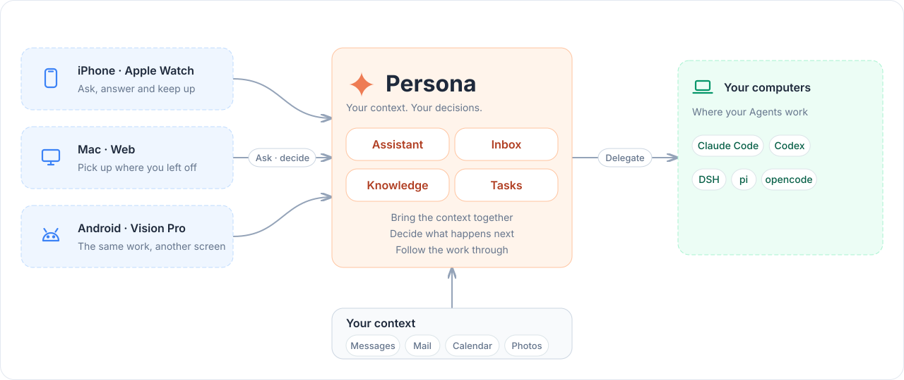

<div align="center">

<picture>
  <source media="(prefers-color-scheme: dark)" srcset="docs/assets/readme/banner-dark.svg">
  
</picture>

**在手机上看着、指挥你每台电脑上的 Claude Code 和 Codex，<br>再配一个读得懂你日程、消息和邮件的 AI 助手。**

[](docs/ios.md)
[](docs/ios.md)
[](docs/mac.md)
[](docs/android.md)
[](docs/server.md)
[](docs/runtimes.md)

[能做什么](#能做什么) · [怎么工作](#怎么工作) · [快速开始](#快速开始) · [平台和连接器](#平台和连接器) · [文档](#文档)

</div>

<br>

<picture>
  <source media="(prefers-color-scheme: dark)" srcset="docs/assets/readme/hero-dark.webp">
  
</picture>

<p align="center"><sub>体验模式录屏，数据是演示用的：从助手切到 Agents，打开在问你的 Claude，点一下回答，它接着干。</sub></p>

Claude Code 始终跑在你自己的电脑上（[herdr](https://herdr.dev) 里的一个普通会话），手机只是另一块屏幕。
出门时在手机上回答它的提问、批准计划；回到电脑前打开 herdr，接着用的还是同一个会话。

## 能做什么

<table>
  <tr>
    <td width="33%" valign="top">
      <br>
      <b>Agents 随身</b><br>
      各台电脑 herdr 里的 Claude Code、Codex 一个列表。点进去实时看它读文件、跑命令、改代码。
    </td>
    <td width="33%" valign="top">
      <br>
      <b>在手机上拍板</b><br>
      回答提问、审批计划、批准工具权限。通知、Apple Watch 和 Siri 里也能批。
    </td>
    <td width="33%" valign="top">
      <br>
      <b>Persona 助手</b><br>
      一个常驻主对话的 Claude，读你的日程、飞书、邮件、知识库和手机数据。会定时做事，可以换形象。
    </td>
  </tr>
  <tr>
    <td width="33%" valign="top">
      <br>
      <b>一个收件箱</b><br>
      飞书、邮件、GitHub、iMessage、Telegram 一行一件事。AI 先分拣，AI 分身起草回复，你点一下发送。
    </td>
    <td width="33%" valign="top">
      <br>
      <b>灵动岛和锁屏</b><br>
      实时活动汇总各台电脑上的 Agent：谁在工作、谁做完了，有事需要你时亮起。
    </td>
    <td width="33%" valign="top">
      <br>
      <b>自建 hub</b><br>
      数据只在你自己的机器上。公网走 TLS 和公钥钉扎，凭据加密后入库。
    </td>
  </tr>
</table>

Claude 还能用 `phone_*` 工具读写 iPhone 上的通讯录、日历、提醒、照片、健康、位置和剪贴板（[手机数据工具](docs/phone-tools.md)）。
每类数据都能在设置里单独关掉，建日程、建提醒这类写操作执行前先在手机上确认。

## 怎么工作

<picture>
  <source media="(prefers-color-scheme: dark)" srcset="docs/assets/readme/architecture-dark.svg">
  
</picture>

- **hub**（`personad hub`）是手机唯一连接的地方：转发对话、管理要你回答的事、运行助手、收消息和邮件，状态存在本机的 Postgres 里。App 关着时，它经 Apple 推送提醒你。
- **各台电脑**上跑 `personad node`：hub 经 SSH 临时启动它，或者电脑装上 node 服务（[jarvis-link](docs/link.md)）主动连 hub。
  node 驱动 herdr、读 Claude Code 的对话记录，把提问和权限请求（hooks）、手机工具调用（MCP）转给 hub。
- **手机**用设备 token 连 hub 实时收发。Claude 调用手机工具时，请求经 node 和 hub 到达 iPhone，在本地执行后原路返回。

设计和取舍见 [docs/architecture.md](docs/architecture.md)。

## 快速开始

要准备的（完整清单和每个配置字段见 [docs/config.md](docs/config.md)）：

- **hub**：一台常开的 Linux 机器，或者能跑 Docker 的 NAS
- **电脑**：装好 Claude Code 或 Codex 的 Mac / Linux
- **编译**：Go 1.27.1+；iOS 要装了 Xcode 和 [XcodeGen](https://github.com/yonaskolb/XcodeGen) 的 Mac，Android 要 JDK 21 和 Android SDK

**1. 写配置**：填上 bundle id、开发者团队、hub 在哪台机器、要接入哪些电脑。

```sh
cp config.example.json ~/.config/persona/config.json
```

**2. 部署**：编译 `personad`，装到每台电脑上（没有 herdr 的顺便装上），在 hub 机器上启动 Postgres 和 hub。

```sh
./scripts/deploy/deploy.sh
```

hub 第一次启动后，在它的 `~/.persona/hub.json` 里补上各台电脑和手机访问用的地址（[网络配置](docs/network.md)）。hub 放在 NAS 上时改用 [Docker](docs/docker.md)。

**3. 装 App，配对**

```sh
./scripts/app/sim.sh                 # iOS 模拟器；真机用 Xcode 打开 apple/Persona.xcodeproj
./scripts/app/android.sh install     # Android：手机开 USB 调试，连上开发机
~/.persona/bin/personad hub pair     # 在 hub 机器上运行，用 App 扫它打印的二维码
```

配好以后，「设置 › 机器」里每台电脑都显示在线，「Agents」里能看到它们 herdr 里的会话。

> [!TIP]
> 还没有 hub？在 App 的配对页点「没有 hub？先体验一下」，用内置的演示数据把每个功能走一遍，不连任何服务器。

> [!NOTE]
> Persona 原名 Jarvis。`jarvisd`、`~/.jarvis`、`~/.config/jarvis/config.json` 和 `JARVIS_*` 继续兼容，现有配对、签名和数据库身份不变。
> 升级前先看 [命名与兼容](docs/config.md#命名与兼容) 和 [迁移清单](docs/rename.md)。

## 平台和连接器

| 客户端 | 最低版本 | 能做什么 | 怎么装 |
| --- | --- | --- | --- |
| iPhone | iOS 26 | 全部功能，加上灵动岛、Siri 和快捷指令 | [TestFlight 公开测试](https://testflight.apple.com/join/vsjfy3hE)（商店名 Persona Side），或自己编译（[docs/release.md](docs/release.md)） |
| Apple Watch | watchOS 10 | 抬腕看谁在等你，直接批准或回答 | 随 iPhone App 安装 |
| Mac | macOS 26 | 和 iOS 同一套逻辑层的原生 App；菜单栏 App「Persona Link」把这台 Mac 接进 hub | Xcode 编 `PersonaMac`；`./scripts/app/mac-link.sh install`（[指南](docs/persona-link-install.md)） |
| Android | Android 12 | 助手、Agents、收件箱、知识库、文件、语音入口和部分手机工具，后台通知不依赖推送服务 | `./scripts/app/android.sh install` |
| 网页 | 现代浏览器 | 由 hub 托管：Agents（连同终端、文件、Git）、助手、收件箱、机器监控 | 打开 hub 的地址 |

| 接入 | 支持 |
| --- | --- |
| Agent | Claude Code、Codex；pi、DSH 等运行时经 [runtime SDK](docs/runtimes.md) 接入 |
| 终端引擎 | herdr（默认）、Herdr App、Orca，每台电脑选一个（[docs/engines.md](docs/engines.md)） |
| 飞书 | 消息进收件箱、知识库，群里或文档评论里发 `/agent …` 起一个 Agent；私聊机器人就是和 Persona 主对话说话。需要自己部署 [lark-connector](https://github.com/nwverse/lark-connector)，没有时助手可以用官方 lark-cli |
| 邮件 | 任意 IMAP / SMTP；Gmail 和 Outlook 用账号登录授权（[docs/mail.md](docs/mail.md)） |
| GitHub | 收件箱、搜索和读取；评论、review 过确认闸门 |
| iMessage | 读 Mac 上的「信息」，要给那台 Mac 上的 personad 完全磁盘访问权限 |
| Telegram | 你自己的账号，只读 |

连接器怎么接、怎么加新的，见 [docs/connectors.md](docs/connectors.md)。

## 数据和安全

- 手机只和你自己的 hub 通信，中间没有别的服务器；只有通知经过 Apple 的推送服务。
- hub 的 token 和数据库密码只在 hub 机器的 `~/.persona/hub.json` 里（权限 0600）；邮箱凭据和模型 Key 用 AES-GCM 加密后存进数据库。
- 公网入口用显式配置的 TLS 端口（自签证书 + 公钥钉扎），优先 IPv6，默认拒绝公网明文 API。内网和 VPN 保留 HTTP（[docs/network.md](docs/network.md)）。
- 替你出面的操作（发消息、发邮件、写手机数据）默认先在手机上确认。Persona 只给自己启动的 Claude 会话注入 hooks，不改你的全局 Claude Code 设置。

## 目前的限制

- 界面只有中文。
- Apple 平台没有上架 App Store：iPhone 用 [TestFlight 公开测试](https://testflight.apple.com/join/vsjfy3hE)安装（不限人数），或自己编译。
- hub 的原生装法只支持 Linux（systemd + Docker 里的 Postgres）；别的系统用 Docker 跑 hub，那台机器不能同时跑 Agent。
- Android 还没和 iOS 完全对齐：健康工具没做，后台通知要在系统设置里放开后台运行（[docs/android.md](docs/android.md)）。

## 文档

| 想做什么 | 看这里 |
| --- | --- |
| 配置、接入多台电脑 | [docs/config.md](docs/config.md) |
| 用 Docker 跑 hub | [docs/docker.md](docs/docker.md) |
| 公网直连、TLS 和配对 | [docs/network.md](docs/network.md) |
| 服务端的几种模式和运维 | [docs/server.md](docs/server.md) |
| hub 的 API 和协议 | [docs/protocol.md](docs/protocol.md) |
| 助手、收件箱、知识库 | [docs/assistant.md](docs/assistant.md) · [docs/inbox.md](docs/inbox.md) · [docs/knowledge.md](docs/knowledge.md) |
| 各端 App | [iOS](docs/ios.md) · [Mac](docs/mac.md) · [Android](docs/android.md) · [网页](docs/web.md) |
| 灵动岛、Siri | [docs/live-activity.md](docs/live-activity.md) · [docs/siri.md](docs/siri.md) |

全部文档的索引在 [CLAUDE.md](CLAUDE.md)「文档索引」。

## 参与开发

- 约定在 [CLAUDE.md](CLAUDE.md)，流程是 issue → 认领 → PR（[docs/collaboration.md](docs/collaboration.md)）。
- 测试命令和截图清单见 [docs/testing.md](docs/testing.md)。
  运行中的 DEBUG App 可以用 `scripts/app/personactl.py` 读状态、导航和截图（[Runtime CLI](docs/runtime-cli.md)）。
- 本页的图由 `scripts/assets/make_readme_assets.py` 生成：截图和录屏来自体验模式，徽章的版本号读自构建配置。

<sub>第三方组件的许可见 [THIRD_PARTY_NOTICES.md](THIRD_PARTY_NOTICES.md)。</sub>
