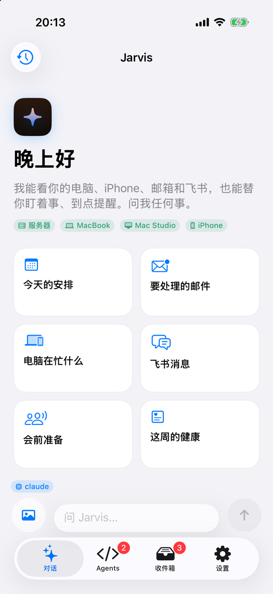
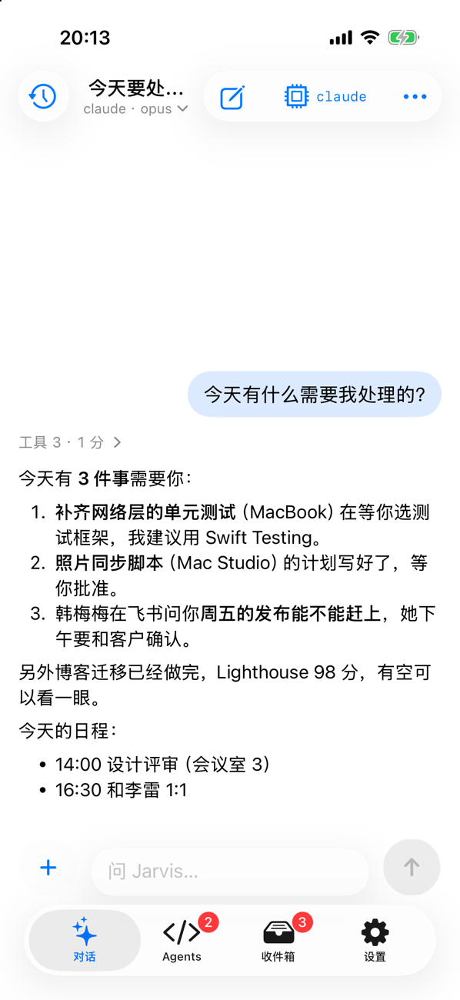
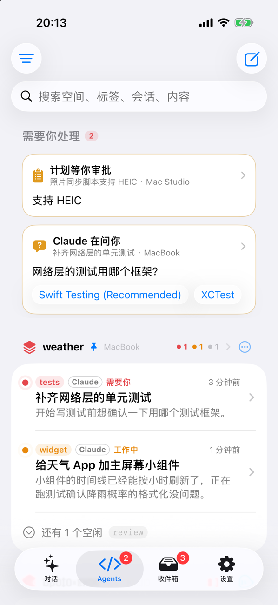
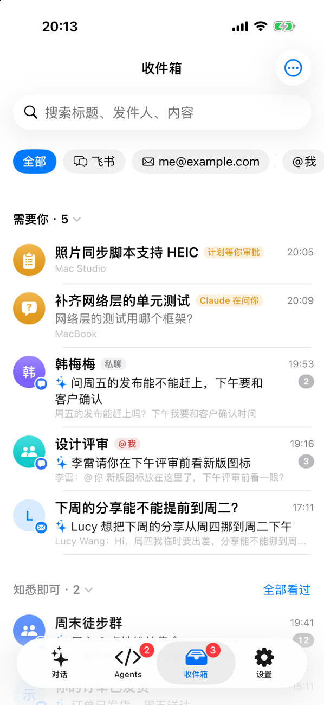

# Jarvis

Jarvis 是一个 iPhone + Apple Watch 助手：在手机上用聊天的方式，看着、指挥你各台电脑上正在干活的 Claude Code 和 Codex，
还有一个能读你的邮件、飞书消息和手机数据的 AI 助手。

Claude Code 始终跑在你自己的电脑上（[herdr](https://herdr.dev) 里的一个普通会话）。手机只是另一块屏幕：
出门时在手机上回答它的提问、批准计划，回到电脑前打开 herdr，接着用的还是同一个会话。

<table>
  <tr>
    <td></td>
    <td></td>
    <td></td>
    <td></td>
  </tr>
  <tr>
    <td align="center">对话：随身的助手</td>
    <td align="center">今天要处理的事</td>
    <td align="center">各台电脑上的 Agent</td>
    <td align="center">飞书和邮件一个收件箱</td>
  </tr>
</table>

## 能做什么

| 地方 | 能做的事 |
| --- | --- |
| **对话** | 随身的 AI 助手。它能查看、指挥各台电脑上的 Agent，读邮件和飞书，查手机上的日历、提醒、通讯录；有记忆，可以定时做事（早报、晚间回顾），也会主动在手机上问你 |
| **Agents** | 各台电脑上 herdr 里的 Claude Code / Codex 一览：谁需要你、谁在工作、谁做完了还没看。点进去像聊天一样看实时过程（文字、工具调用、diff、截图），发消息、回答提问、审批计划、批准工具权限，或者直接看终端、按键 |
| **收件箱** | 飞书消息和各个邮箱的邮件合成一个列表，一行一件事，AI 先分拣出需要你的；可以直接回复，或者交给 AI 处理 |
| **Apple Watch** | 需要你的事抬腕就能批准、回答 |
| **Siri / 快捷指令** | 问 Claude、看 Agent 状态、批准第一个待处理的请求，不用打开 App |

Claude 还能通过 `phone_*` 工具使用 iPhone 本地的数据：通讯录、日历、提醒、照片、健康、位置、剪贴板等。
每类数据都可以在设置里单独关掉；建日程、建提醒这类写操作，执行前会在手机上弹出确认。

## 它是怎么工作的

- **hub**（`jarvisd hub`）跑在一台常开的 Linux 机器上，是手机唯一连接的地方：转发对话、管理需要你回答的问题、
  运行 AI 助手、收邮件和飞书消息，状态都存在本机的 Postgres 里。App 关着的时候，它通过 Apple 推送提醒你。
- **各台电脑**不用装常驻服务。hub 通过 SSH 连上去，临时启动 `jarvisd node`，由它驱动 herdr、读取 Claude Code 的对话记录，
  并把 Claude 的提问和权限请求（hooks）、手机工具调用（MCP）转给 hub。连接断了会自动重连。
- **手机**上的 App 用 token 连接 hub，实时收发；Claude 调用手机工具时，请求经 node → hub 到达 iPhone，在手机本地执行后原路返回。

更细的设计见 [docs/architecture.md](docs/architecture.md)。

## 需要准备

| 东西 | 要求 |
| --- | --- |
| hub 机器 | 一台常开的 Linux 机器，有 docker 和 systemd；手机能访问它的 18660 端口（同一个网络或 VPN） |
| 电脑 | 装好 [herdr](https://herdr.dev) 和 Claude Code（或 Codex）的 Mac / Linux；hub 机器要能用 SSH 密钥免密码登录它们 |
| iPhone | iOS 26；Apple Watch 需要 watchOS 26（可选） |
| 开发机 | 一台装了 Xcode 和 [XcodeGen](https://github.com/yonaskolb/XcodeGen) 的 Mac、Go 1.23+，用来编译服务端和 App |
| Apple 开发者账号 | 自己编译安装 App 用；推送和 HealthKit 需要付费账号 |

邮箱、飞书都是可选的：邮箱支持任意 IMAP / SMTP 和 Gmail；飞书需要你自己部署 [lark-connector](https://github.com/Eric-2369/lark-connector)。

## 开始使用

完整步骤见 [docs/config.md](docs/config.md)，大致是：

1. **写配置**：把 `config.example.json` 复制到 `~/.config/jarvis/config.json`，填上你的 bundle id、开发者团队、hub 在哪台机器、
   要接入哪些电脑。仓库里没有写死任何人的机器和账号，所有个人设置都在这份配置和 hub 的 `~/.jarvis/hub.json` 里。
2. **部署服务端**：`./scripts/deploy.sh`。它会编译 `jarvisd`，装到每台电脑上，在 hub 机器上启动 Postgres 和 hub 服务。
3. **告诉 hub 接入哪些电脑**：在 hub 机器的 `~/.jarvis/hub.json` 里填上各台电脑和手机访问用的地址，然后重启 hub。
4. **安装 App**：模拟器上跑 `./scripts/sim.sh`；装到真机就用 Xcode 打开生成的工程，或者用 `./scripts/release.sh` 发到你自己的
   TestFlight（[docs/release.md](docs/release.md)）。
5. **配对**：在 hub 机器上运行 `~/.jarvis/bin/jarvisd hub pair`，用 App 扫描它打印的二维码。

配好以后，在「设置 › 机器」里每台电脑都应该显示在线，「Agents」里能看到它们 herdr 里的会话。

## 数据和安全

- 手机只和你自己的 hub 通信，中间没有别的服务器；只有通知经过 Apple 的推送服务（APNs）。
- hub 的 token、数据库密码只在 hub 机器的 `~/.jarvis/hub.json` 里（权限 0600）；邮箱凭据加密后存进数据库。
- hub 默认是 HTTP，只该放在内网或 VPN 里访问，不要直接暴露到公网。
- Jarvis 只给自己启动的 Claude 会话注入 hooks，不改你的全局 Claude Code 设置；你自己开的会话也能在手机上看、发消息。

## 目前的限制

- hub 只能装在 Linux 上（部署脚本用 systemd 和 docker）。
- 界面只有中文。
- 只能通过自己编译或自己的 TestFlight 安装，没有上架 App Store。
- Android 版目前只有 Agents 这一块（看、发消息、回答、审批、授权、通知），助手、收件箱、手机数据工具还没做（`docs/android.md`）。

## 文档

| 文档 | 内容 |
| --- | --- |
| [docs/config.md](docs/config.md) | 两份配置怎么写、接入多台机器 |
| [docs/architecture.md](docs/architecture.md) | 架构和设计取舍 |
| [docs/server.md](docs/server.md) | 服务端的几种模式、部署和运维 |
| [docs/ios.md](docs/ios.md) | App 的界面和交互 |
| [docs/android.md](docs/android.md) | Android App（Agents、交互卡片、不用推送的后台通知） |
| [docs/assistant.md](docs/assistant.md) | 「对话」里的助手 |
| [docs/inbox.md](docs/inbox.md) | 收件箱 |
| [docs/mail.md](docs/mail.md) | 邮箱接入（含 Gmail 登录的准备） |
| [docs/phone-tools.md](docs/phone-tools.md) | Claude 能用的手机数据工具 |
| [docs/protocol.md](docs/protocol.md) | hub 的 API 和协议 |
| [CLAUDE.md](CLAUDE.md) | 给参与开发的人（和 AI）看的约定 |
