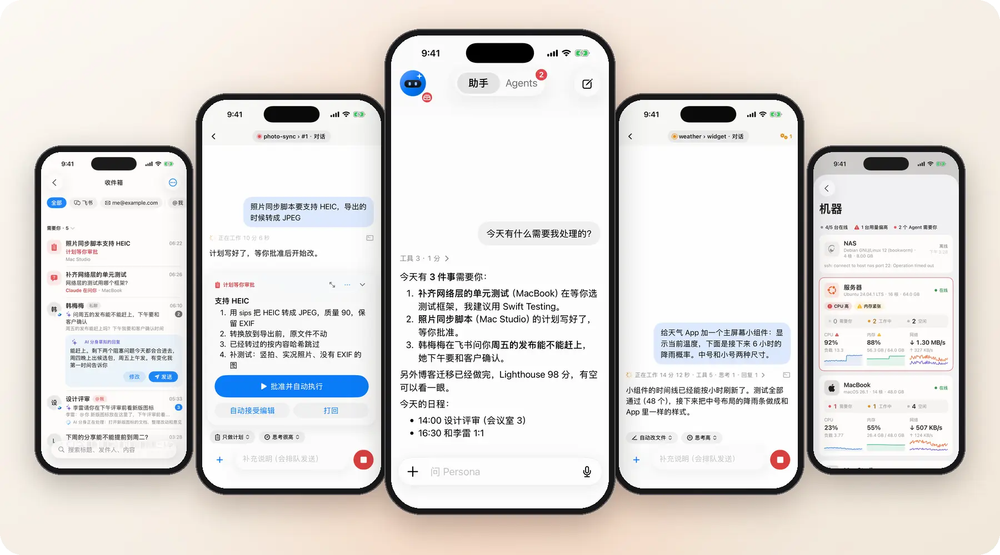

<picture>
  <source media="(prefers-color-scheme: dark)" srcset="docs/assets/readme/banner-dark.svg">
  
</picture>

English · [简体中文](README.zh-CN.md)

**Your SuperAgent. One place for every task.**

Turn a request into work you can follow through. Persona connects your Agents, devices and personal context in one conversation—from the first question to the next decision and the finished task.

[Try it](#try-it) · [What it does](#what-it-does) · [How it works](#how-it-works) · [Docs](#docs)

## What it does

<table>
  <tr>
    <td width="25%" valign="top"> <b>One SuperAgent</b> 
      Talk or type in one chat. Your assistant draws on your context, breaks down the work and delegates to Agents. <a href="docs/assistant.md">Assistant</a> · <a href="docs/voice.md">Voice</a></td>
    <td width="25%" valign="top"> <b>Phone ↔ computer</b> 
      Watch progress, answer questions and approve plans on your phone. At your desk, pick up the very same session—not a copy. <a href="docs/engines.md">Engines →</a></td>
    <td width="25%" valign="top"> <b>Built to extend</b> 
      Add tools, Agents, data sources and in-app experiences through extensions, with SDKs and a marketplace for building your own. <a href="docs/extensions.md">Extensions →</a></td>
    <td width="25%" valign="top"> <b>Beyond the app</b> 
      Track work on Dynamic Island, start tasks with Siri or Shortcuts, and answer from Apple Watch. <a href="docs/live-activity.md">Live Activities</a> · <a href="docs/siri.md">Siri</a> · <a href="docs/intents.md">Shortcuts</a></td>
  </tr>
  <tr>
    <td width="25%" valign="top"> <b>Knowledge &amp; Inbox</b> 
      Give Agents shared context, not repeated explanations. AI sorts incoming messages and mail into an Inbox you can act on. <a href="docs/knowledge.md">Knowledge</a> · <a href="docs/inbox.md">Inbox</a></td>
    <td width="25%" valign="top"> <b>Your phone, useful to AI</b> 
      Bring calendar, reminders, health, location and photos into the work. You choose access; calendar and reminder writes ask first. <a href="docs/phone-tools.md">Phone tools →</a></td>
    <td width="25%" valign="top"> <b>Connect your world</b> 
      Connect Lark, mail, GitHub, iMessage and Telegram. Reach Persona from messaging channels such as Lark and WeChat, too. <a href="docs/connectors.md">Connectors</a> · <a href="docs/channels.md">Channels</a></td>
    <td width="25%" valign="top"> <b>Every screen</b> 
      iPhone, Apple Watch, Mac, Vision Pro, Android and Web. Keep the same conversations and work connected across your devices. <a href="docs/ios.md">Apple</a> · <a href="docs/mac.md">Mac</a> · <a href="docs/vision.md">Vision</a> · <a href="docs/android.md">Android</a> · <a href="docs/web.md">Web</a></td>
  </tr>
</table>

<picture>
  <source media="(prefers-color-scheme: dark)" srcset="docs/assets/readme/hero-dark.webp">
  
</picture>

Demo data, shown in Chinese. An Agent asks, you answer, it keeps going.

## Try it

**[Join the TestFlight beta](https://testflight.apple.com/join/vsjfy3hE)** · On the pairing screen, tap **No hub? Try a demo**—no server or account needed.

Start with a sample task in **Persona**, answer an Agent's question or approve a plan, then explore **Agents**, **Inbox**, **Tasks** and **Knowledge**. The demo also includes sample computers, usage windows, model settings and appearance controls—not just a static chat screenshot.

The demo stays on sample data: replies are simulated, no real programs run, and no messages or mail are sent. Live AI, voice, phone-data actions and cross-device features require your own connected setup.

Ready to use your own data? **[Getting started](docs/getting-started.md)** walks you through installing a hub, pairing your phone and connecting your computers.

## How it works

<picture>
  <source media="(prefers-color-scheme: dark)" srcset="docs/assets/readme/architecture-dark.svg">
  
</picture>

**You decide. Persona connects the context and coordinates the work. Your Agents carry it out.** The hub keeps the pieces connected; Agents run on your computers, and authorized phone actions run on your phone. Technical details live in **[Architecture](docs/architecture.md)** and **[Network and security](docs/network.md)**.

## Docs

| Start here | Go deeper |
| --- | --- |
| **Use Persona** | [Getting started](docs/getting-started.md) · [Configuration](docs/config.md) · [Docker](docs/docker.md) |
| **Connect computers** | [Persona Link](docs/link.md) · [Windows](docs/windows.md) · [Engines](docs/engines.md) · [Workspace board](docs/workspace-board.md) |
| **Build on Persona** | [Extensions](docs/extensions.md) · [Connectors](docs/connectors.md) · [Runtime SDK](docs/runtimes.md) · [API](docs/protocol.md) |
| **Develop with an Agent** | [Conventions and full docs index](CLAUDE.md) · [Issue → claim → PR](docs/collaboration.md) · [Testing](docs/testing.md) |
| **Operate or upgrade** | [Server](docs/server.md) · [Network](docs/network.md) · [Migration](docs/rename.md) |

Client and runtime support depends on the platform and installed integrations; see the guides above. [Third-party notices](THIRD_PARTY_NOTICES.md).
