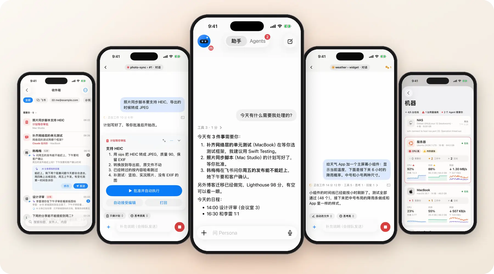

<picture>
  <source media="(prefers-color-scheme: dark)" srcset="docs/assets/readme/banner-dark.zh-CN.svg">
  
</picture>

[English](README.md) · 简体中文

### 一个 SuperAgent，搞定你的所有事。 懂你的上下文，指挥你的 Agent，走到哪儿跟到哪儿。

      
  
 

[体验 Demo](#开始使用) · [主要功能](#主要功能) · [怎么工作](#怎么工作) · [文档](#文档)

 

<picture>
  <source media="(prefers-color-scheme: dark)" srcset="docs/assets/readme/hero-dark.zh-CN.webp">
  
</picture>

体验模式录屏，数据是演示用的。

## 主要功能

- **SuperAgent，一个入口解决所有问题**。在一个对话里说一句，Persona 带上你的上下文，拆好活，交给 Agent 去做。[助手](docs/assistant.md)
- **手机和电脑无缝衔接**。Claude Code、Codex 一直跑在你自己的电脑上。手机上实时看、回答、审批，回到桌前接着用同一个会话。[引擎](docs/engines.md)
- **完整的扩展系统**。工具、Agent 运行时、数据源、渠道、语音都能以扩展接入，有 SDK，也有扩展市场。[扩展](docs/extensions.md)
- **灵动岛、Siri 和快捷指令**。锁屏上一眼看清所有 Agent；用语音、快捷指令或手表提问、审批、派活。[实时活动](docs/live-activity.md) · [Siri](docs/siri.md)
- **知识库和收件箱**。聊天、人、项目沉淀成共享记忆；飞书、邮件、GitHub 汇进一个由 AI 分拣的收件箱。[知识库](docs/knowledge.md) · [收件箱](docs/inbox.md)
- **用上手机里的数据**。通讯录、日历、提醒事项、照片、健康、位置都成了工具，写入要先在手机上确认。[手机工具](docs/phone-tools.md)
- **连接器和渠道**。接入飞书、邮件、GitHub、iMessage、Telegram、微信；在 App、飞书、微信里或用语音都能找 Persona。[连接器](docs/connectors.md) · [渠道](docs/channels.md)
- **全端客户端**。iPhone、Apple Watch、Mac、Vision Pro、Android 和网页，支持中文、英文、日文。[客户端](docs/ios.md)

## 怎么工作

在一台常开的机器上跑一个小小的 hub，你的设备只连它，它再连到你的每台电脑，Agent 跑在那里的 herdr 或 Orca 里。数据留在你自己的机器上。
[架构](docs/architecture.md) · [网络与安全](docs/network.md)

## 开始使用

- **先看看**：装上 [TestFlight 公开测试版](https://testflight.apple.com/join/vsjfy3hE)，在配对页点「没有 hub？先体验一下」，不用服务器也不用账号。
- **自己部署**：一行命令装好 hub，再扫个码。看 [开始使用](docs/getting-started.md)。
- **从源码构建**：[配置](docs/config.md) · [部署](docs/server.md) · [参与开发](CLAUDE.md)

## 文档

[开始使用](docs/getting-started.md) · [架构](docs/architecture.md) · [协议](docs/protocol.md) · [Docker](docs/docker.md) · [iOS](docs/ios.md) · [Mac](docs/mac.md) · [Android](docs/android.md) · [网页](docs/web.md) · [全部文档](CLAUDE.md#docs-index)

第三方许可：[THIRD_PARTY_NOTICES.md](THIRD_PARTY_NOTICES.md)。
