<picture>
  <source media="(prefers-color-scheme: dark)" srcset="docs/assets/readme/banner-dark.zh-CN.svg">
  
</picture>

[English](README.md) · 简体中文

**你的 superagent：一个入口，解决所有问题。**

Persona 把 Agent、设备和你的个人上下文接进同一个对话。从提问、安排任务到跟进结果，不用在一堆 App 之间来回切换。

   

[先试试看](#先试试看) · [能做什么](#能做什么) · [怎么工作](#怎么工作) · [文档](#文档)

## 能做什么

<table>
  <tr>
    <td width="25%" valign="top"> <b>一个 superagent</b> 
      有事就找它。助手结合你的上下文回答问题，把需要动手的任务交给 Agent。 <a href="docs/assistant.md">助手 →</a></td>
    <td width="25%" valign="top"> <b>手机电脑，无缝接着干</b> 
      出门在手机上看进度、回答问题、批准计划；回到电脑前，接着做的还是同一个会话，不是副本。 <a href="docs/engines.md">引擎 →</a></td>
    <td width="25%" valign="top"> <b>全面的扩展系统</b> 
      工具、运行时、连接器、渠道和原生界面都能扩展，配套版本化协议、SDK 和扩展市场。 <a href="docs/extensions.md">扩展 →</a></td>
    <td width="25%" valign="top"> <b>不打开 App，也能办事</b> 
      灵动岛看进度，Siri 和快捷指令发起任务，Apple Watch 抬腕就能回答。 <a href="docs/live-activity.md">灵动岛</a> · <a href="docs/siri.md">Siri</a> · <a href="docs/intents.md">快捷指令</a></td>
  </tr>
  <tr>
    <td width="25%" valign="top"> <b>知识库和收件箱</b> 
      知识库让 Agent 有上下文可用；消息、邮件汇入同一个收件箱，AI 先分拣，再变成可以处理的事。 <a href="docs/knowledge.md">知识库</a> · <a href="docs/inbox.md">收件箱</a></td>
    <td width="25%" valign="top"> <b>让 AI 用上手机数据</b> 
      接入日历、提醒、健康、位置、照片等数据。开放哪些由你决定，建日程、写提醒先请你确认。 <a href="docs/phone-tools.md">手机工具 →</a></td>
    <td width="25%" valign="top"> <b>连接器和渠道</b> 
      接入飞书／Lark、邮件、GitHub、iMessage、Telegram 等数据，也能通过飞书、微信等聊天渠道直接找 Persona。 <a href="docs/connectors.md">连接器</a> · <a href="docs/channels.md">渠道</a></td>
    <td width="25%" valign="top"> <b>每块屏幕，都有它</b> 
      iPhone、Apple Watch、Mac、Vision Pro、Android、网页，通过同一个 hub 连起各端的对话。 <a href="docs/ios.md">Apple</a> · <a href="docs/mac.md">Mac</a> · <a href="docs/vision.md">Vision</a> · <a href="docs/android.md">Android</a> · <a href="docs/web.md">网页</a></td>
  </tr>
</table>

<picture>
  <source media="(prefers-color-scheme: dark)" srcset="docs/assets/readme/hero-dark.webp">
  
</picture>

演示数据：Agent 问，你回答，它接着干。

## 先试试看

**[加入 TestFlight 公开测试](https://testflight.apple.com/join/vsjfy3hE)** · 配对页点「**没有 hub？先体验一下**」，不用服务器也能先逛一圈。

想接入自己的数据？**[开始使用](docs/getting-started.md)** 带你装好 hub、配对手机、连上电脑。

## 怎么工作

<picture>
  <source media="(prefers-color-scheme: dark)" srcset="docs/assets/readme/architecture-dark.zh-CN.svg">
  
</picture>

hub 把各部分连起来，Agent 在你的电脑上工作，手机工具在你的手机上执行。**[架构](docs/architecture.md)** · **[网络与安全](docs/network.md)**

## 文档

| 从这里开始 | 继续了解 |
| --- | --- |
| **使用 Persona** | [开始使用](docs/getting-started.md) · [配置](docs/config.md) · [Docker](docs/docker.md) |
| **连接电脑** | [Persona Link](docs/link.md) · [Windows](docs/windows.md) · [引擎](docs/engines.md) · [工作区看板](docs/workspace-board.md) |
| **扩展 Persona** | [扩展](docs/extensions.md) · [连接器](docs/connectors.md) · [Runtime SDK](docs/runtimes.md) · [API](docs/protocol.md) |
| **和 Agent 一起开发** | [约定与完整文档索引](CLAUDE.md) · [issue → 认领 → PR](docs/collaboration.md) · [测试](docs/testing.md) |
| **运维或升级** | [服务端](docs/server.md) · [网络](docs/network.md) · [迁移](docs/rename.md) |

各端的支持范围与限制见上方平台指南，docs 文档为英文。[第三方组件许可](THIRD_PARTY_NOTICES.md)。
