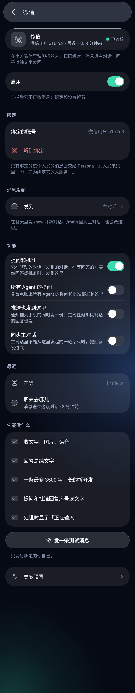
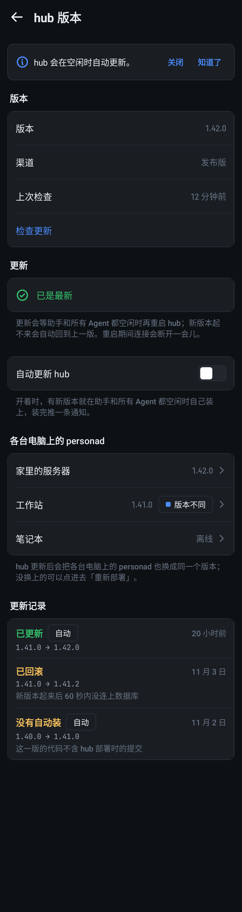

# Android App

`android/`：Kotlin + Jetpack Compose 的 Android 客户端，连同一个 hub，接口和 iOS 一样（`docs/protocol.md`），服务端不用改。
minSdk 30（Android 11），compileSdk 37，targetSdk 37。界面有简体中文、English、日本語三种语言，默认跟随系统，也能在设置里选，见「国际化」。

一句话描述：在 Android 手机上看各台电脑的引擎（herdr、Herdr App、Orca 或 Paseo，每台电脑选一个，`docs/engines.md`）里的 Agent、发消息、回答提问 / 审批计划 / 授权、按终端对话框的选项，
不需要任何推送账号。

## 当前实现

本页主体按 2026-10-31 的提交 `f3a13fdb7672927197cb8ac38bccb9c65671677b` 核对。当前是多模块重设计版本；逐项状态见 [Android P0 状态](archive/android-p0-status.md)，旧版验证记录留在后文，不能代替本版验收。

#277 的后续品牌 / 输入兼容已分批合入：#745 只更新人类可见品牌，保留 `AppTab.Jarvis`、序列化值和旧系统组件；#746 注册并接收 `persona://` 与 `jarvis://`；#758 从 canonical Activity 读取 Debug launch metadata，并在权限检查和联网前统一解析完整配对链接。生成的通知链接仍用旧 scheme。各 PR 的构建和截图证据按对应车道记录；本说明不改写上面的历史核对日期，也不表示最终 open PR 全审计或冻结发布已完成。#770 的手填共用判定、#773 的环境变量 / 脚本兼容和 #786 的静态 guard 已合入，完整边界见 [兼容迁移](rename.md)。

| 入口 | 当前实现 |
| --- | --- |
| 配对 | 扫码、手填、配对深链，临时 token 换设备 token；TLS 公钥钉扎、候选探测和重新配对；完成后进入准备清单 |
| Persona | 首页、主对话、历史抽屉和共用对话页；主对话首句可先进入持久 outbox，恢复连接后解析目标；助手身份确定后保留在 Persona tab。抽屉的「最近」只列用户自己开的对话，hub 自己开的收在「自动对话」一行（默认收起、按本机记住；收起时显示等你的个数和在跑的点，展开后按来源的 chip 筛，搜索照旧搜全部；#3264，`docs/protocol.md`「助手对话的来源」） |
| Agents | 页面最上面是搜索框，下面一排电脑芯片（全部机器 + 每台电脑，带在线状态和计数，可横滑），再下面是快速筛选；没选过分组时默认「按仓库」（#2252；iOS #2161 也以它为默认，网页 #1671 提供这种分组但默认按机器）：电脑 → 仓库 → 工作树 → 会话，仓库只从会话的 cwd 推断（`core:domain` 的 `repoOf` / `agentRepos`，规则同网页 `web/src/lib/agent-repos.ts`：`/.worktrees/`、`/.claude/worktrees/`、`/.herdr/worktrees/` 下的目录归到标记前的仓库，`~/.worktrees/<仓库>/<工作树>` 归到 `<仓库>`，其余目录就是自己仓库的主工作树；没有 cwd 的归到「其他」），仓库按名字排（自然顺序，repo2 在 repo10 前面，同 iOS），工作树主工作树在前、其余按名字；和网页不同，离线电脑上的会话也留在树里，电脑栏头标「离线」，同按电脑和空间；只有主工作树的仓库直接列会话，不画工作树一层；没有动静的仓库排在有动静的后面、默认收起、标出会话数，展开后直接列出全部会话；没有动静的工作树也默认收起，但位置不变；仓库的会话都在同一个 herdr 空间时，仓库栏头带这个空间的置顶 / 屏蔽标记和 `⋯` 菜单；电脑栏头写「N 个仓库，M 个会话」。列表设置里还能选「按电脑和空间」（电脑 → 空间（herdr workspace）→ 会话三层树）、按状态、按待办，选过的一直保留（存过的旧值都按「按电脑和空间」）。树靠缩进、字号字重和细线分层，不给每层垫底板（`docs/android-design.md` 2.4 节），每一层都能折叠、栏头带计数；按电脑和空间时，全是已看会话的空闲空间留在所属电脑下面、排在有动静的空间后面，默认收起、样式弱一点，收起时标出会话数；置顶 / 屏蔽、请求卡和作答；会话重命名（标签名走 herdr，会话名走 Claude 的 /rename，入口在会话行菜单、空间页和对话页菜单）和空间重命名（空间栏头菜单）发出后列表、空间页、对话页标题立即更新，失败回滚；置顶、屏蔽、重命名、关闭由 App 的 `AgentsWiringModule` 接到 hub |
| 对话 | 连续性补洞、历史分页、实时 delta、折叠工作过程、Markdown、diff、待办、图片缓存、阅读锚点、待发气泡及人工核对；输入框见「输入框」，会话控制、来源和能力见「会话控制、会话来源和能力」 |
| 收件箱 | 飞书和邮件事项统一列表、筛选持久化、AI 操作、回复日志；飞书有窗口缓存、事件刷新、可见已读和基础消息渲染；邮件正文页和邮件的读写由 App 的 `InboxModule` 接到 hub（`HttpMailTransport`） |
| 设置 | 配对、准备清单、后台引导、关于和更新；连接诊断里可以手动添加 / 编辑 / 删除 hub 地址、停用候选、拖动排序（列表顺序就是尝试顺序）、逐条测试（见「连接地址」）；设备管理与通知偏好页由 App 的 `DeviceSettingsModule` 接到 hub |
| 扩展模块 | 终端、文件、机器监控、知识库、手机工具、语音对话（见「语音对话」）、跨 App 悬浮胶囊（见「跨 App 悬浮胶囊」）和体验模式已接入 App，入口见「外壳」一节；体验模式没有示例数据的页面显示说明，不连真实 hub |
| 界面 | 三套界面风格：玻璃（默认）、晨报、看板，在设置 › 界面风格切换，立刻生效并存在本机；同一页还有主题色（跟随界面风格（默认）/ 跟随形象 / 五个内置配色）和深浅色（跟随系统（默认）/ 浅色 / 深色），见「外观：主题色和深浅色」。设计规范、组件和写页面的规矩见 [Android 界面风格与设计系统](android-design.md) |

## Agents 列表和机器页的对齐（#3038）

- **排序**：列表设置里「排序：状态优先 / 最近更新」（iOS `AgentSort`，存在本机）。最近更新时每组里的会话只按时间排，有动静的空间、仓库、电脑按各自最新的会话排在前面；按状态时分段不变，只是段里按时间。逻辑在 `core:domain` 的 `AgentList.kt`（`AgentListSettings.sort`）。
- **来源筛选和 botmux 开关**：快速筛选多了「飞书群 / 终端」（#2526，botmux 会话 / herdr 窗格，按 `pane_id` 前缀判断，`SessionSource.kt` 的 `agentSource`）。和 iOS / 网页一样，筛选只露出有 Agent 的项，选中的那项变空时留着。项数多到一排放不下时（六项都有 Agent），晨报的标签和看板的计数格都改成横滑（看板每格最窄 92dp，放得下时仍按宽度平分；横滑时边上露出下一格的一截），不再挤成省略号（截图 `AgentsParityShotsTest.sixFilters`，360dp 宽）。筛选下面的「botmux」胶囊（网页 #2786）在本机隐藏 / 重新显示 botmux 会话，有 botmux 会话或已隐藏时出现，数字是当前范围、电脑和搜索下的 botmux 会话数（没隐藏时直接用「飞书群」的计数，隐藏时单独数一遍，不再多建一次列表）；「飞书群」下隐藏会回到「全部」，隐藏时选「飞书群」会重新显示。
- **会话行的来源标签**（#3132，同 iOS / 网页 #2698，位置按 #3043）：botmux 的会话标「飞书群」，herdr 的窗格标「终端」，其他宿主不标、Persona 自己的对话不标。标签在右上角时间下面、右对齐，字号同时间，标题从行首开始、不被挤；细列表只有一行，标签放在时间前面。飞书群有 https 的 `external_url` 时点标签打开那个话题（走外壳的链接处理，在 App 里打开）。颜色取设计系统的来源色（`PersonaPalette.sourceFeishu` / `sourceTerminal`，同 iOS `Theme.sourceFeishu` / `sourceTerminal`；晨报只用墨色）。截图 `AgentsSourceShotsTest`。
- **空状态分三种**（iOS `ChatsView`）：搜索没结果是「没有找到「xx」」，不放「新建会话」；整体没有会话是「开始第一个开发会话 / 这台机器上没有会话」+「新建会话」；快速筛选为空是「没有 XX 的会话」+「看全部」。
- **herdr 没启动的原因**：「xx 的 herdr 没在运行」那张卡下面一直留着红字「没启动：原因」（node 的已知错误翻成人话，同 iOS `HerdrFailure.says`），到下一次启动或读到 herdr 在运行为止；长按复制 hub 原文和 HTTP 状态。
- **订阅额度**：机器监控页（总览）最上面列出 `GET /api/v1/usage/windows` 的全部账号，最满的在前、过期的在后：每个窗口的用量条（80% 起变成提醒色）、重置倒计时、采样时间、用得偏快 / 偏慢，网关读不到时标出来；hub 没有数据（或旧 hub 没这个接口）时整节不显示，页面在前台时每分钟读一次。逻辑在 `feature:machines` 的 `UsageWindows.kt`，规则同网页 `lib/usage-windows.ts`。
- **这台电脑能做什么**：机器页在电脑卡片和引擎之后读 node 自检（`GET /machines/{id}/doctor`），按功能显示就绪 / 部分可用 / 有问题 / 未启用，「重新检查」，Persona 生成的文件过期或缺失时「修复」（确认后 `POST …/doctor/fix`），「查看全部检查」展开每一项；node 太旧、hub 太旧、离线、设备权限不够各有一句话，node 太旧且可以重新部署时带「重新部署」。逻辑在 `NodeHealth.kt`，规则同网页 `lib/node-health.ts`。
- **浏览器（ego lite）**：hub 的 ego 插件开着时（机器带 `browser`），Mac 的机器页有「允许助手用这台的浏览器」开关、安装 / 取消安装、首次设置的步骤（打开 ego lite、导入别的浏览器的数据、做完设置、再检查一次）和就绪后的情况（导入、使用统计），同 iOS `BrowserSection`；任务在跑或首次设置进行中时每 2 秒读一次。手机上没有那台 Mac 的实时画面（iOS 的「VNC」按钮），首次设置在 Mac 上做。
- **还没做**：机器页的「操控电脑」（Cua）和「浏览器登录」（导入 cookies），新建 Agent 的首条消息带附件，「新建 worktree…」。

## 通知（不用推送服务）

Android 使用 `:platform:notify` 的前台服务共用 hub WebSocket，不依赖 FCM 或厂商推送。通知渠道、开机恢复、网络重连、保活调度和国产系统准备清单已有实现。

真机记录（2026-10-31，ColorOS 16 / Android 16，单次观察）：前台服务在跑，App 切到后台约 6 秒 WebSocket 仍被断开，回前台自动重连；要在系统设置里给 App 打开「允许后台运行」「自启动」并把电池设为不优化（准备清单「后台保活」会引导）。放开后后台能连多久、耗电多少按验收清单 V03 实测，现在未实测。

- 「做完了」由 hub 按与 iOS 相同的完成策略决定，经 `notify` 事件下发；客户端声明 `ws_notify` 后接收，不再自行推算完成。
- 提问、计划、授权和屏幕选项可在通知作答；允许或批准要求解锁，拒绝或打回可输入原因。按钮否定在左、肯定在右（「拒绝 / 允许」「打回 / 批准」），和常驻通知、安卓对话框一致；提问和屏幕选项按原来的顺序。结果不明时提示待确认，不自动重复批准。
- 点击通知和会话深链走同一个导航入口（冷启动和 App 已打开时相同）。通知链接写明 `tab` 时直接按它落到 Persona 或 Agents，不等会话元数据；没写时等元数据到达再分流。终端兜底动作（`target=terminal`）打开该会话的终端，返回落在原对话。
- 准备清单提供通知权限、电池限制、自启动等系统入口，以及锁屏测试预约、展示和回报。各 ROM 的锁屏存活、通知展示、重启恢复和耗电均未实测。

## 连接地址（设置 › 连接诊断）

2026-11-01 用户要求：「当前连接」和「候选地址」要能添加和编辑。hub 不一定发布自己的全部地址（比如 NAS 的网卡挂在虚拟交换机上，被 hub 当成虚拟网卡，它的 IPv6 和内网 https 地址就不会下发），这时在手机上手动补。语义和电脑链路的「手动加地址」一样（[link.md](link.md)），区别是 Android 上这些设置跟着配对走。

候选地址有三个来源，列表里逐条标明：

- 配对时：配对链接里的 `url`、`alt` 和由 `url` + `tls` 拼出的 https 地址，以及配对时读到的 `/api/v1/endpoints`；
- hub 下发：鉴权后的 `/api/v1/endpoints`、WS `hello` 和 `endpoints` 事件（[协议](protocol.md#候选地址)）。hub 的列表一到就替换配对时的那批；
- 手动添加：只存在这台手机上，hub 的列表替换不到它们。

能做的事：

- 添加：`https://域名:端口`、`https://[IPv6]:端口`、`https://IPv4:端口`。没写协议按 https，端口必须写，路径、`?`、`#`、用户名都不收，IPv6 要加方括号。校验不查 DNS、不联网（`core:hub` 的 `checkEndpoint`），错误用中文显示在输入框下面，合法时预览将保存的规范写法（`scheme://host:port`，端口总是写出来）。每个配对最多手动加 10 条，和已有候选重复（按规范写法比较，`https://host:port/` 和 `https://HOST:port` 算同一个）的不收。
- 安全规则不变：https 地址和配对时一样按配对时的公钥指纹钉扎；配对没有指纹（hub 没开 TLS、在反向代理后面）时，https 地址按系统信任的证书和域名校验（[network.md](network.md#反向代理的子路径android)）。`http://` 只能是内网：IP 字面量要过 `LocalAddressPolicy`（回环、私网、链路本地、ULA），名字只认 `localhost` 和 `.local`；运行时 `HubHttpClient` 照旧再按解析出的对端地址拦一次（[network.md](network.md)）。
- 手动加的可以编辑（位置和停用标记不变）、删除（要确认）；配对时的和 hub 下发的不能改，只能停用、重新启用；手动加的也能停用。至少要留一条启用的地址。「正在使用」显示当前连着的那条。
- 每条都能「测试」：用新的连接池带钉扎请求 `GET /api/v1/health` 并核对 hub_id，显示结果和耗时。耗时包含建立连接，https 还包含 TLS 握手；是单次样本，界面标「单次」，不作为性能基线。结果只留在内存里。列表里每条还显示连接自己选路时的探测结果（标「自动探测」），两者显示较新的那个。

**列表的顺序就是尝试的顺序**（2026-11-02 用户要求：「候选地址要支持用户拖动，显示顺序就是尝试的优先级」）。列表怎么排，连接就按什么顺序试，没有看不见的重排：原来的「优先使用」和「重连时先试上次在同一网络连上的那条」都去掉了。

- 调顺序：按住行左边的手柄直接拖，或者长按一行拖；拖到列表上下边缘会自动滚动。行的菜单里有「上移」「下移」，无障碍服务里也有同名操作。手柄上的数字是这一条第几个尝试（停用的不编号）。
- 没调过顺序时按默认规则排（`orderEndpoints`）：公网 IPv6 → 域名 → 内网 → 公网 IPv4 → 其他；同类里 https 在 http 前；再同类里手动添加的在配对时 / hub 下发的前；最后按原来的顺序（手动的按添加先后，其余按 hub 给的顺序）。
- 调过以后以用户的顺序为准（`arrangeEndpoints`）：hub 新发来的地址和新加的手动地址排到最后；hub 不再提供的地址从列表里消失（IPv6 前缀变了的地址算新地址，排到最后）。「恢复默认顺序」（要确认）回到默认规则。
- 停用的地址留在原位、变灰、标「已停用」，连接时跳过；仍然可以拖，重新启用后还在原来的位置。

连接怎么试：只试启用的地址，严格按列表顺序起步。每一条等前一条失败、或者前一条开始满 1 秒（`HubRouteSelector.STEP_MILLIS`）再开始，谁先通过身份校验用谁；所以排在后面的只有在前面那条单独试过 1 秒以后才可能抢先。连上以后每 5 分钟（`OkHttpHubConnection.RECHECK_MILLIS`）看一次排在当前地址前面的那些地址，每条最多等 1 秒；有一条答上来就重新连接（这时整轮竞速选出第一个答上来的），连接自己从不往后换。拖动或恢复默认顺序只改顺序，不会马上探测或切换：连接在下一次重连或下一次 5 分钟复查时按新顺序走，拖动不会把正在用的连接断掉（2026-11-02 用户定）；只有在用的那条被停用、删除或改掉时才直接重连。1 秒和 5 分钟都是配置值，未实测。

存储：手动地址、停用标记和用户的顺序按配对保存（`ScopedHubData.endpoints`，配对目录里的 `endpoints.enc`，和凭据一样用 Tink AEAD 加密），重启后还在；hub 下发新列表不改它们；退出、撤销、重新配对时随配对目录一起删除（`eraseScope`）。文件读不出来时按「默认顺序、没有手动地址」处理，不挡住整个配对（凭据文件读不出来则保留原文件并报错）。上一版存的「优先使用」读出来变成「这一条排第一，其余按默认规则」的顺序。

代码：校验、规范写法、类型和顺序在 `core/hub/.../HubEndpoints.kt`；竞速在 `HubRouteSelector`，复查在 `OkHttpHubConnection`；设置页的控制器 `HubEndpointSettings`（实现 `core:contracts` 的 `ConnectionEndpoints`），由 `ConnectionRuntime.endpoints` 交给设置（`PairingModule`）；存储 `core/data/.../EndpointOverridesStore.kt`；页面 `feature/settings/.../EndpointsSection.kt`、`EndpointEditorState.kt` 和拖动 `EndpointDrag.kt`（候选行用 `JRow` 的插槽写法，三套风格的边距自动对齐）。体验模式没有这份服务，连接诊断保持只读。

截图：`MOCK_ENDPOINTS=1 python3 scripts/mock/mock_hub.py --tls-port 0` 让假 hub 额外下发两条连不上的文档地址（`[2001:db8::10]` 和 `hub.example.com`），用来看失败的测试和停用；带指纹配对要用 `jarvis://pair?url=…&token=mock&hub=<hub_id>&fp=<fp>&tls=<TLS 端口>`，`hub_id` 读假 hub 的 `/api/v1/health`，`fp` 和端口看它启动时打印的「TLS 端口=… fp=…」（`debug.mockAddress` 只配明文地址，没有指纹就加不了 https 地址）。

## 输入框（附件、拍照、听写、「/」命令、@ 引用、引用条、排队条、被拒消息）

2026-11-02 从主线旧 App 移植（盘点 C1–C4、D1、D7）。对话页和 Persona 的输入框都是 `feature/chat` 的 `ChatComposer`，下面的行为两处一样（排队条只在 Agents 的对话里）。

- 照片和文件：「+ › 照片」最多 4 张，选中立刻上传到那台电脑（`POST /api/v1/machines/{mid}/files`），长边缩到 1600、JPEG 质量 75（和 iOS 一样）。照片在输入框上方排成一行 64dp 方形缩略图（设计系统 `AttachmentThumb`，在后台按缩略图尺寸解码），右上角 ✕「移除这张」，已上传的左下角带笔，点一下打开标注编辑器（见「看图和标注」）；上传中压暗加转圈，失败描红边、标「重试」，点一下重传，原因在缩略图下面写一行；读不出来、或「撤回编辑」恢复的只在电脑上的照片显示占位图标。文件仍一行一个（名字、状态、重试、✕）。选文件时按 `OpenableColumns.SIZE` 预检，超过 200 MB 直接标成失效「「名字」超过 200 MB，传不了」，不拷贝也不上传；读不到大小的照旧边拷边数。只有照片、没有字也没有文件时，发出去的正文是「请看图片」，照片照旧写成 `<attached_images>` 标签。从相机、文件选择器回来时连接常还在补拉，上传先等 `readyToSend` 最多 15 秒（`UPLOAD_READY_WAIT_MILLIS`，配置值，未实测），再报「连接恢复后重试上传」。离线时照片不随消息排队（已拍板不做）。
- 拍照：App 为扫码配对声明了 CAMERA，安卓规定这时要先授权才能拉起别的相机 App。「+ › 拍照」先查授权，没有就 `RequestPermission`；拒绝（含「不再询问」）弹「需要相机权限」，说明可以到系统设置 › 应用 › {App 名} › 权限里打开，「去设置」打开本 App 的系统设置详情页。没有相机 App 时提示「这台手机上没有能拍照的应用」。拍的原图在 `cache/chat-captures`（FileProvider `${applicationId}.chat.files`），只在它离开所属草稿时删除（✕ 移除，或发出后输入框清空）：输入框按附件 id 盯着自己草稿的变化删，从不扫目录（别的会话的草稿可能还引用同一目录里的文件）。代码 `ComposerCamera.kt`。
- 听写：麦克风（「听写」）一直在，和 iOS 的 `ShellComposerBar` 一样（#2976 G058）：有内容时发送键在它右边，打了字以后还能接着听写追加；Agent 工作中且没内容时右边是「停止」；没内容、没在工作时只有麦克风。点了打开手机自带的语音输入（`RecognizerIntent.ACTION_RECOGNIZE_SPEECH`，`LANGUAGE_MODEL_FREE_FORM`、`zh-CN`、提示「说吧，说完会放进输入框」），哪家的识别都行，不依赖 Google 服务，App 不录音、不要麦克风权限。没有识别器时不显示按钮（`feature/chat` 的 manifest 声明了 `<queries>`，安卓 11+ 不声明查不到），启动失败提示「这台手机上没有语音输入」。听到的字接在草稿末尾、光标放末尾，不按选区插入（`withDictation`：先去掉草稿尾部空白；草稿末尾是 ASCII 字母数字、且听到的第一个字也是 ASCII 时中间加一个空格，中文直接接上）。代码 `Dictation.kt`。
- 「/」快捷命令：命令表 `SlashCommand`（和 iOS 同一组：继续 `/继续`、`/compact`、`/context`、提交并推送 `/提交`、汇报进展 `/汇报`）加「清空上下文 /clear」。「+」浮层一点即发。输入框里只有一个「/词」（以 `/` 开头、没有空格和换行）时，字段正上方按前缀（不分大小写）列出命令（设计系统 `ComposerSuggestions`：词加粗、右边说明，/clear 用危险色）；点一条把它的文字放进输入框（不发、光标在末尾），草稿正好是唯一匹配的词时列表收起；点 /clear 清空输入框并弹确认。/clear 只给终端引擎窗格里的 Claude（正向判断 `canTypeClaudeCommands`：Claude、能发送、有终端、有窗格、不是 Persona），而且没在工作、没在清时才出现（列表和「+」都是）。确认框：「{Agent} 会开一个新会话，这段对话留在历史里；新会话出现后页面会跳过去。手机里没发出的输入会保留。」，「清空」是危险按钮。发出后最多等 20 秒（`CLEAR_WAIT_MILLIS`），同一窗格出现另一个在跑的会话就打开它；超时提示「已发送 /clear，新会话出现后在列表里打开」并重新给出 /clear（这条 /clear 还没发出去或被拒时不提示，气泡上自己写着）；请求失败立即停止等待。
- /model 和 /loop（#2976 G052，网页 `AGENT_COMMANDS`）：只在「/」列表里出现，不进「+」浮层（那里一点即发）。/model 给终端窗格里的 Claude（`canTypeClaudeCommands` 且能改模式），点了清空输入框、打开「模式」浮层（里面有「模型」一节，见下面「模型」），这是一次性的请求（`openRequested` 打开后由 `onOpenHandled` 清掉），提问卡藏起输入框再回来时不会自己弹开；草稿正好是 `/model` 时列表也不收起，点它才打开。/loop 给同样的会话，点了在输入框里放 `/loop `；草稿是 /loop 命令时输入框上方一行说它会怎么做（`ComposerLoop.kt` 的 `loopHint`，和网页同一套文案：「每 10 分钟重复：…」「由 Claude 自己定节奏重复：…」，没写要做的事时用提醒色写格式）。
- @ 引用文件或会话（#2976 G043，iOS `PromptItems`、网页 `MentionMenu`）：「+」右边的 @ 按钮在光标处打一个 `@`（前面是字时先补空格）；光标前是 `@词`（在开头或空白之后，所以邮箱不算）时，字段正上方用 `ComposerSuggestions` 列出：这段对话里工具读写过的文件（`tool_use` 的 `file_path` / `notebook_path`，最新的在前，最多 12 个），右边写所在目录（会话目录里的写相对路径，根目录的写「本会话用过的文件」），点了换成 `@相对路径 `；然后是别的会话（不含 Persona 的对话和本会话，按更新时间（解析后的时间，不按字符串比：hub 的时间小数位数不固定），最多 8 个），右边写「Agent · 目录 · 作为上下文」，点了把 `@词` 删掉、把那个会话作为上下文卡放到输入框上方（`jarvis://session/<机器>/<会话>`，正文「另一个会话：标题（Agent）/ 目录 / 它最近说：…」，跟网页、iOS 一样随下一条消息发成 `<jarvis-context>`）。按文件路径、会话标题或「Agent · 目录」过滤（不分大小写），没有对得上的写「没有对得上的文件或会话」。只读、不能发送的会话没有 @。还不支持网页那样输入 `/` 浏览文件夹。代码 `ComposerMentions.kt`。
- 引用（#2976 G050）：长按菜单的「引用」不再把消息加「> 」塞进草稿，而是在输入框上方加一张引用卡（`ChatLinkContext` 的 `kind="quote"`，标题是谁说的：自己的消息固定写「我」（`ChatLinkContext.QUOTE_ME`，线上值，和界面语言无关，iOS 也只认「我」；卡片上按语言显示成「引用 你的消息」），Agent 的是它的名字，带消息 id `msg`），草稿不动、光标回到输入框；卡片写「引用 Claude」/「引用 你的消息」和两行原文，「移除」单独去掉。可以叠几条，同一条消息只引用一次（`withQuote`，同 iOS）。发出时和其他上下文一样排在正文前面：`<jarvis-context kind="quote" title="…" url="" msg="…">`。
- 出错停下 / 等你的原因（#2976 G044，iOS `FailureNote` / `AttentionNote`）：`Session` 解析 hub 的 `failure_reason` 和 `attention_reason`。会话需要你且有原因时，输入框上方一条提醒色的说明；宿主把这一轮停在它不会自己重试的错误上（botmux 的通知）、会话又没在工作时，输入框上方一条出错色的说明（去掉开头的 ⚠️），右边「重试」：单独发一条「继续」（不动输入框里的内容），点过的这条通知不再显示。上一条还在提交时「重试」不可点；没被接受（`send` 返回 false）就不藏，发送失败时这条通知重新出现（`hostRetried` 由对话页持有）。会话有宿主那边的链接（`external_url`，只认 https，`Session.externalLink`，同 iOS `externalLink`）时，两种说明都带「在飞书打开」，用系统打开。启动中、启动失败时不显示（有 `ChatStartingNote`）。Agents 列表的行在这两种情况下也用原因代替最后一句话（`Session.reasonPreview`，同 iOS `listPreview`）。代码 `ChatHostNotes.kt`。
- 回复建议（#2976 G057）：Claude 建议的下一句（输入框上方的 chip）点一下填进输入框；长按弹菜单「直接发送」「填入输入框」，无障碍操作里也有「直接发送」（同 iOS `SuggestionPill`）。
- 排队条：工作时发的、还没被取走的消息（会话的 `queued`）显示在输入框正上方（iOS `QueueStrip`），只在输入框显示时出现，只在 Agents 的对话里。标题「排队中 N 条，{Agent} 忙完会依次处理」，每条带编号、最多两行，条数多时限高可滚（设计系统 `QueueStrip`）。点一条弹 `JActionSheet`（标题是这条消息）：「撤回编辑」「拷贝」「删除」（危险色）。撤回和删除都走 `ChatActions.editQueue`（`POST …/queue {keep: 除这一条外的全部序号}`；node 把排队的全拉回、再按顺序放回要留的，回原队列；空列表也照发）。撤回编辑取回包里对应序号的原文放回输入框（草稿空就是它，否则换行接在后面，带的照片恢复成附件），提示「已撤回到输入框，改好再发送」；删除「已从队列删除」；拷贝「已拷贝」；失败「没改成：原因」。改的时候转圈、整条不可点，直到会话刷新完；菜单开着时队列变了就关掉。只有能发送的会话（`session.canSend`）可操作。代码 `ChatQueueStrip.kt`。
- 被拒的待发消息：被电脑拒绝（`input_draft`、`dialog_open`…）或人工确认没送达的消息什么都没打进电脑，气泡下的按钮行（`OutboxStatus`，会话状态浮层也用它）多一个「删除」（`DeliveryAction.Delete` → `sender.cancel`，`OutboxMessageSender.cancel` 现在也接受 Refused）；「编辑」放回输入框并删掉原气泡。结果不明的仍要先核对，不能直接删。
- 只读会话：`ChatComposer(enabled = false)` 时「+」和发送不可用，不显示麦克风和「/」列表，占位文字用传入的 `placeholder`；`canInterrupt = false` 时工作中也不给「停止」（见下一节）。
- 组件目录（调试版）有「附件」「输入框建议」「排队条」三节和一个「听写 + 停止」的输入框样例。单测：`SlashCommandsTest`、`ComposerParityTest`（@、引用、宿主的原因、/model /loop）、`DictationTest`、`ChatComposerStateTest`、`ComposerCameraTest`、`ChatDeliveryStateTest`、`ChatQueueStripTest`，`core:designsystem` 的 `ComposerPartsTest`；`core:data` 的 `OutboxMessageSenderTest`（被拒的能删、发出的不能）。
- 截图：`MOCK_QUEUE=1`（工作中的会话 `macbook/a1f3c2d4-…0001` 带两条排队，`POST …/queue` 按 keep 改，`GET /mock/queue_edits` 看记录）、`MOCK_SEND_REFUSE=input_draft`（被拒气泡）、`MOCK_UPLOAD_KBPS=8`（上传中）、`MOCK_UPLOAD_OLD_NODE=1`（上传失败）。草稿按配对存、跨 `am force-stop` 保留：在一个会话里打一次字或加一次附件，再按风格 × 深浅色冷启动轮着截。

## 会话控制、会话来源和能力

2026-11-02 从主线旧 App 移植（盘点 C5–C7、C9、D2–D5）。规则和 iOS 一致；逻辑在 `core:domain` 的 `sort/SessionSource.kt`（能力、来源文案、恢复命令）、`sort/AgentClose.kt`（关闭确认）、`answer/RequestPresentation.kt`（「总是允许」）。

- 会话来源与能力（`docs/protocol.md`「Codex 来源与能力」）：`Session` 带 `source_kind`（`codex_app_server` / `codex_history` / `identity_conflict` / `runtime`）、`source_thread_id`、`read_only_reason`、`capabilities`（read / send / interrupt / approve / terminal / attach）、`attached`、`agent_label`。没有 `source_kind` 的旧会话什么都能做；有来源的只认明确为 true 的能力（缺字段即拒绝）；`canAttach` = 有来源、`attach` 为 true、还没 `attached`。会话元数据还没到时手机不拦（hub / node 照样会拒），只读和能力判断都按已知的元数据。
  - 对话页：不能发送时输入框禁用、占位「此会话仅可查看」，上方一行写来源（`JTag`）和原因（node 写的「仅查看：」前缀不会叠两遍）；网页卡片的「作为上下文 / AI 修改」也不收。没有终端能力时不给终端按钮和入口，不能中断时不给「停止」和菜单「中断」，不能审批时交互面板照常显示请求、但一个按钮都不能按（「交给电脑处理」也不行），说明写「实时接入以后才能在手机上处理这个请求…」（能实时接入时）或「这个会话不允许在手机上审批，请到电脑上处理」。顶栏副标题先写来源（「Codex 实时 / 服务器 / 目录」）。
  - ⋯ 菜单：「实时接入」（`canAttach`，`ChatAction.Attach` → `POST …/attach`，结果不明时按会话列表的 `attached` 核对；接入后 node 允许它审批），「重命名」「关闭 Agent」要有终端，「复制恢复命令」只给有终端的会话（Codex 用 `codex resume <source_thread_id>`）。
  - Agents 列表：有来源的行在事实里写来源（「Codex 实时 / codex-desk」），只读时再加一个「仅查看」；App 不认识的 Agent 显示 hub 给的 `agent_label`（「DSH」），不再一律叫 Claude。长按菜单多「实时接入」（`AgentOperations.attachSession`），重命名、关闭、恢复命令要有终端，「停止循环」要能发送。请求卡、请求详情和 `AgentsViewModel.answer` 不替不能审批的会话作答，请求详情没有终端时不给「打开终端」。来源会话在「历史」里打开时不给「继续这个会话」，写明只读原因。
  - 通知：通知上的允许 / 批准先查这条请求所属会话（冷启动时先刷新一次会话列表），会话不能审批就不回传，提示「不能在手机上审批」（`NotificationActionResult.ReadOnly`）；查不到会话时交给 hub 判断。
- Agent 运行时（DSH）：`Session.agentLabel` 按 iOS：Codex 来源 → Codex、`traex` → TRAEX、空或 `claude` → Claude，其余用 `agent_label`（没有就用 `agent` 原文）；`isClaude` 是正向判断，Claude 专属的控件（模式、`/model`、`/clear`）只给它。`Interaction` 带 `agent` / `agent_label` / `always_label` / `reason`：别的 Agent 的卡标题写它的名字（「Codex 请求使用 Bash」「DSH 有问题等你回答」），授权卡先写它自己说的理由。「本会话总是允许」只给 Claude 的卡；别的 Agent 的卡只有带 `always_label` 才给「总是同意」，按钮下面写「总是同意会放行：…」（`ApprovalPolicy` 的 `always_offered` 要求，共享夹具 `spec/fixtures/approval/unified.json`、`answer/unified.json`）。
- 权限模式和思考强度（`ChatModes.kt`）：输入框左边的「模式」按钮给所有能发送、在运行的 Claude 会话，Persona 的对话也有（助手进程不在时从下一条消息起生效），Codex / TRAEX / runtime 不显示。浮层「文件权限」四项（手动确认 / 自动改文件 / 只做计划 / 自动，各带一行说明）；在跑的会话不能选「全部放行」，但当前就是它（或这个版本不认识的模式，显示原值）时照样列出来并选中，「模式」按钮用危险色。「思考强度」五项（低 / 中 / 高 / 很高 / 最高）。改的是 `POST …/modes`。
- 模型（`/model`）：终端引擎窗格里的 Claude（不是 Persona）在同一个浮层里多一节「模型」：默认（账号默认）/ Opus（最强）/ Sonnet（均衡）/ Haiku（最快），当前项按会话的 `model` 名字里含 opus / sonnet / haiku 判断（网关模型、没有模型算「默认」）。选了别的就单独发一条 `/model <别名>`（和快捷命令同一条路，输入框里的内容留着）。对话已有缓存时 Claude 会先问「Switch model?」，那是电脑上的对话框，手机上变成一张待处理卡片。
- 同一空间的标签条（`ChatSiblingTabs.kt`，iOS `SiblingTabs`，#477）：Agent 对话的顶栏下面一行，列出同一台机器、同一个 herdr 空间里在运行的 Agent（同一个窗格只算一个：/clear 或恢复后短暂出现两个 session id 时，取当前打开的，否则取最近更新的），按标签顺序，同一个 tab 里的几个 Agent 挨着、按窗格位置排；名字用 herdr 标签名，默认编号显示「#n」，同一个 tab 有几个 Agent 时再带 Agent 名（「#2 Codex」），发起者带「发起」。每个是一枚带状态点的 `JChip`，当前的那枚选中；打开时滚到当前标签。点别的标签打开那段对话（`onOpenSession`）；右边 ⋯ 弹出「N 个 Agent」列出全部（发起者的副标题写「发起者」），有别的标签需要你时 ⋯ 带红点。空间里只有一个标签、Persona 的对话、没有切换入口时不显示。
- 同一个 tab 里的几个 Agent（#2515，网页 #2386，`docs/agent-states.md`「一个 tab 里的几个 pane」）：一个 Agent 在自己的 tab 里分屏、在新窗格里起别的 Agent，几个 Agent 是一组。
  排序和网页一样（`core:domain` 的 `AgentTab.kt`：`PaneOrder`、`launcherOf`、`agentTabs`）：按会话的 `pane_index`，没有时按 pane id 里的序号（herdr 的 36 进制 `p2E`、Herdr App 的 `t1`），再按会话 id；`pane_index` 为 0 的是发起者，左上是 shell 时几个 Agent 平级、不标。
  - Agents 列表只在「按机器」时分组（和网页一样，按仓库 / 状态 / 待办照旧一个 Agent 一行）：一个 tab 有多个 Agent 时先是 tab 行（`AgentTabRow`：tab 名、最需要处理的那个的标题 / 状态 / 最新一句，行尾「N 个 Agent」可收起 / 展开，点行打开那个 Agent），下面发起者在上、带「发起者」，它分出的窗格再缩进一级、挂在一条细线上；整组排在其中最急的那个本来的位置，组里有一个要显示，整组都显示（不再收进「还有 N 个空闲」）。默认展开，收起状态按 `机器/空间名/tab 编号` 存在本机（DataStore 的 `folded-tabs`，不带 tab 名：改名后照样认得）。空间栏头的数字照旧数 Agent。
  - 空间页同样按 tab、窗格位置排，发起者带标记、分支缩进一级。
  - 对话页的「已换成新会话」（`SessionRuntimeState.sameSlot`）：同一个 tab 里别的还活着的窗格不是退出会话的替身，两边都有 pane id 时要是同一个窗格才算。
- 会话信息（`ChatSessionInfoSheet.kt`）：⋯「会话信息」（`GET …/info`）：标题、「状态 / 机器 / 空间」；运行（模型、启动器、Claude Code / Codex 的版本、权限、思考强度）、用量（上下文 N tokens、压缩 N 次（只在 > 0 时）、对话 N 轮、共生成 N tokens、开始时间）、位置（目录、分支，点一下拷贝）、拷贝（session id、恢复命令，只给有终端的会话）。tokens 写法 950 / 12.3k / 1.20M。读不到时说原因、可重试。点标题仍是新版的「会话状态」浮层（送达、排队、循环、后台任务、恢复），两个入口分工：状态看「现在怎样」，信息看「它是什么、跑在哪」。
- 关闭 Agent：长按菜单、列表行左滑（只对在运行、有终端、不是 Persona 的会话；行弹回原位再弹确认；`SwipeAction(destructive = true)` 画危险色，收件箱的不变）和对话页 ⋯（不给 Persona 的对话）用同一份确认：「关闭这个 Agent？」+「「标题」/ 机器 / 空间 › 标签」+ 会退出哪台机器上的哪个 Agent、关掉哪个标签页、正在做的事会中断、对话记录还在「历史」里。确认时再查一次，别处已经关了就直接收起。
- 删除对话（#1749，对齐网页 #801）：没在运行的会话（`Session.canDelete`：未运行 / 完成 / 未知，不在启动中，不是助手的）在长按菜单（未运行的行是「只读打开」旁边）和对话页 ⋯ 里有「删除对话」，确认文案同一份（core:domain `deleteConfirmation`：只从各端列表移除，电脑上的记录不删，再用到会重新出现）。确认后 `DELETE /api/v1/sessions/{mid}/{sid}`（列表走 `AgentOperations.deleteSession`，对话页走 `ChatAction.Delete`，结果不明时按会话列表里没有它核对），列表立即隐藏，打开着的对话页随之退出；hub 拒绝（又跑起来了 409）时提示、不重试。
- 对话页标题位的连接状态：连不上 hub 时，顶栏标题下那一行换成「等待网络 / 连接中… / 更新中…」（连接中和更新中标题旁转圈），恢复后立刻换回会话状态；1.5 秒的延迟和 8 秒的补拉上限在 `OkHttpHubConnection` / `ConnectionRuntime` 里，和其他页的标题一致。
- 交互面板细节：提问的选项带编号，问题的 header 和「可多选」显示成标签；终端对话框的 header 显示在问题上方、选项带终端的键，转回对话的那个选项（hub 标成 `kind: chat`，比如「Chat about this」）变成「改在对话里说」按钮（选它就是把这个选项发给终端）。
- 回答已经结束的请求（#2906，同 iOS #1688）：hub 回 200 `already` 时面板下提示「已经回答过了：<当时生效的答案>」（`feature/chat/AnsweredText`，和网页 `lib/answered.ts` 同一套说法）；410 按 `status` 说「已经过期 / 电脑上已经撤回 / 已经交回电脑处理，回答没有送到」，不带 `status` 的仍是「已在电脑上处理」。`HubInteractionCenter` 记下本机已结束的请求 id（最多 512 个），之后的快照还列着它也不放回来，只有 hub 再推一次这张卡（`interaction` 事件）才算数。
- 假 hub：`MOCK_SOURCES=1` 多三个会话：「整理部署脚本」（Codex 实时，能发送、能实时接入，没接入前不能审批，带一张有 `always_label` 的 Codex 授权卡）、「迁移日志采集」（Codex 历史，只读，带 `read_only_reason`）、「生成季度报表」（DSH runtime，`agent_label: DSH`，没有终端，带一张没有 `always_label` 的授权卡）；`POST …/attach` 把 `attached` 置真并放开审批，对不能接入的回 403 `codex_read_only`。`/info` 对 Codex 会话回 Codex 的模型和版本。`MOCK_SCREEN_CHAT=1` 多一个带 header（「计划模式」）和转回对话选项的终端对话框（「照片同步脚本支持 HEIC」），看交互面板的标签、编号和「改在对话里说」。想看「全部放行」时的模式按钮，可以直接 `POST /api/v1/sessions/{mid}/{sid}/modes {"permission_mode":"bypassPermissions"}` 给假 hub。
- 单测：`core:domain` 的 `SessionSourceTest`（旧 `SessionSourcesTest` 的用例 + runtime、恢复命令）、`AgentCloseTest`、`AlwaysOfferTest` 和 answer / approval 夹具；`core:contracts` 的 `ModelsTest`（新字段、`agentLabel`、`SessionInfo`）；`core:hub` 的 `HttpChatActionsTest`（attach、queue、info）、`HttpAgentOperationsTest`（attach）；`feature:chat` 的 `SessionModesTest`（旧 `SessionModesTest`、`ModelPickerTest`）、`ChatSessionInfoTest`（旧 `SessionInfoTest`）、`InteractionOptionsTest`；`feature:agents` 的 `AgentsListInfoTest`；`platform:notify` 的 `NotificationExecutionTest`（不能审批的会话不回传）。

## 连接详情和触感反馈（#3054，对齐 iOS）

- **连接详情**：Agents、收件箱、飞书会话、飞书文档阅读页的标题在连不上 hub 时换成连接状态（Agents 页以前一直显示机器名），点一下在原地弹出「连接详情」浮层（设计系统 `ConnectionDetails.kt`，照 iOS `ConnectionDetails`），不再跳到设置 tab。浮层写现在的状态和原因（等待网络 / 连接中… / 更新中…，以及本地网络权限、证书变了、配对失效），下面几行事实：上次失败的原因和「N 秒后重试」（只在连接中时）、「上次连上：N 秒前 / N 分钟前 / 时刻」、「N 条消息连上后自动发送」。能重试的状态有「立即重试」（`HubConnection.reconnect()` 后刷新这一页）和「连接设置」；证书、配对、权限这三种重试没用，只给「连接设置」。在线时标题不能点（以前 Agents 页在线也会跳设置）。
  - 数据：`ConnectionDiagnostics.nextRetryAt` 是 `OkHttpHubConnection` 在两次尝试之间等待时写的下次时刻；「上次失败」读 `lastAttemptFailure`（按失败种类给的本地化文案，和设置里候选地址的结果同一套，连上一次就清掉，照 iOS 只在最近一次失败时显示；设置的诊断页仍显示原始的 `lastDisconnectReason`）；「上次连上」用 `lastReceivedAt`（最后一次收到 hub 的消息）；待发数是 outbox 里发送中 / 排队 / 等网络的条数。外壳按选中的组提供 `LocalConnectionDetails`（`Root.kt`），体验模式没有诊断，只显示状态。
  - 截图：`core:designsystem` 的 `ConnectionDetailsShotsTest`，三套风格 × 深浅色的连接中，加等待网络和配对失效，输出到 `build/connection-details-shots/`。
- **触感反馈**（设计系统 `Haptics.kt`，四种和 iOS `Haptics` 对应：Tap → ContextClick、Success → Confirm、Attention → GestureThresholdActivate、Error → Reject，系统的触感设置照样生效）：
  - 回答 / 批准（Agents 页和对话页一样）：发出去成功是 Success；「终端上的对话框变了」是 Attention；已经在别处处理掉的不震；结果不明是 Error；Agents 页离线时点了是 Attention。
  - 收件箱：标已处理（单条、全部、飞书会话页的按钮）立刻 Success，放回去是 Tap。
  - 操作失败：经 `AppFeedback.failure` 弹出的提示，在线时是 Error，连不上 hub 时是 Attention（`FeedbackNotice.haptic`，外壳弹出时播放）。
  - 点连接状态标题、「立即重试」是 Tap。

## 多 hub（同时连接多组 hub）

#295，方案和各路的接口约定见 [plan-hub-mesh.md](plan-hub-mesh.md) 第 4 节和 2.6 节，iOS 是 #256。手机可以配对多台 hub：
互相连通（hub 互联）的几台算一**组**，同组只保持一条连接、组内换线路；不同组（工作 / 生活这类要隔离的环境）各一条连接，互不影响。
Agents、机器、要你处理的请求把各组合在一起显示；Persona、收件箱和 hub 相关的设置是每组自己的，用「选中的组」。

### 原来默认只有一台 hub 的地方

改之前（2026-11-02，集成分支 `679b227f`）App 处处假定只有一份配对。逐项和现在的做法：

| 地方 | 原来 | 现在 |
| --- | --- | --- |
| `core:contracts` 的 `HubScope` | 一份配对一个 `hubId/generation`，数据目录 `hub-data/<hubId>/<generation>/` | 不变；每组的数据放在一个这样的目录（组的 storage），凭据和候选地址仍按配对存 |
| `EncryptedCredentials` / `HubDataStore` | `active.enc` 指向唯一的配对；`pair()` 丢掉旧的再配新的；`restore()` 返回唯一的作用域 | 新的组注册表 `hub-data/groups.enc`（`HubGroupRegistry.kt`），同时打开每组的作用域（`openGroup` / `closeGroup`）；`restore()` 返回选中的组；`pair()` / `unpair()` 签名不变 |
| 凭据、候选地址、钉扎指纹（`credentials.enc`、`endpoints.enc`） | 一份 | 每台已配对的 hub 一份（它自己的配对目录） |
| `ConnectionRuntime` | 一条 `OkHttpHubConnection`、一份 `ScopedHubData`、一个兼容用的 `Hub` | 每组一个 `GroupRuntime`（`di/GroupRuntime.kt`）；原来的公开 API 不变，指向选中的组 |
| `OkHttpHubConnection` / `HubHttpClient` | 一台 hub 的 id、指纹、token | 组内多台：`HubConnectionConfig.members`，每台自己的 id、指纹、token 和候选地址（`HubMembers.kt`） |
| `PairingModule` | 配对就是替换 | 原来的配对页仍是替换；设置 › hub › 添加 hub 是 `WiredPairingService.addHub` |
| `ChatDataOwner`、`AgentsWiringModule`、`AppServices` 的终端 / 文件 / 动作 / 机器监控 | 按唯一的作用域构造 | 每组一份（`GroupStacks`），再合并（`MergedServices.kt`） |
| `InboxDataOwner`（收件箱、Persona 会话列表）、设备设置、检查更新、锁屏测试、分享、手机数据工具、知识库 | 唯一的 hub | 选中的组 |
| `MachineManagementModule` 的机器管理（重连、重新部署、启动器、引擎、botmux 开关、Claude Code / Codex 设置） | 当前配对 | 机器 id 的后缀所在的组（`mergedMachineManagement` + `MachineManagement.inGroup`，#634）：别的组的机器原来被拿去问选中组的 hub，找不到机器或改错了地方；配对后选引擎的那台也从合并列表来，同样按后缀走 |
| 模型配置（`MachineManagementModule.models`）、语音（`AppServices` 的 `VoiceExtensions`） | 当前配对 | 选中的组：都是 hub 级的（一台 hub 一份配置、一个语音扩展），和收件箱、Persona 一样一次看一组（#634 定的）；模型配置里的机器是那台 hub 自己报的，原样用它的 id |
| 连接诊断的候选地址 | 唯一的配对 | 选中的组自己的 hub（组里第一台已配对的 hub）；同组别的 hub 的候选也参与选路，诊断里一起列出 |
| Agents 页的请求卡、请求详情能不能作答 | 选中组的连接 | 请求的机器 id 后缀所在组的连接（`AgentGroups.stateFor`，#4291）：一组掉线不再挡住别的组的请求；只有一组时不变 |
| `Notify.install(connection.events)`、前台服务 | 一条 WebSocket 的事件 | 各组事件合成一条流（ID 已加后缀，见下）；常驻通知的状态是选中组的，Agent 计数各组相加 |
| `ScopedListPreferences`（Agents 列表设置）、对话阅读位置 | 唯一的作用域 | 第一组的作用域：切换选中组不会动它们 |

### 分组和组 id

- 组注册表（`GroupsDocument`）记每组的 id、名字（用户改的）、storage 作用域、已配对的 hub（`hubs`，第一台是这组连接自己的 hub）、
  互联发现但没配对的 hub（`mesh`：地址、指纹、名字），以及 `primary`（主组）和 `selected`（选中组）。加密方式和凭据一样（Tink AEAD），读不出来时保留原文件并报错。
- **分组**：鉴权后的 hello 带 `mesh.hubs`（plan 2.6），是这台 hub 所在连通分量的全部 hub。收到一次就更新各 hub 的 peers：列表里的互相列为 peers，列表外的去掉它们列过的列表成员（新的 hello 能纠正别的 hub 留下的旧信息）。
  两台已配对的 hub 只要一方的 peers 里有另一方就是同一组，组就是连通分量（`learn` / `regroup`，纯函数，`HubGroupRegistryTest`）。没有 `mesh` 字段的 hub（L1 合并前的 hub）只更新名字，自成一组。
- **组 id** 在手机上生成（`g` + 8 位十六进制），稳定：合并时保留最早的 id（含主组成员的一方优先拿主组 id），拆开时含原组第一台 hub 的一方保留 id，拿不到 id 的一方用新 id 和新的空作用域。
- **合并不丢东西**（主持人 2026-11-02 要求）：被并掉的组的数据先不删，在注册表里记一条 `PendingMove`（它的作用域、并进了哪一组）。等它关掉、合并后的组打开，就把它**还没发出的消息**（除了已显示、已取消的都算；正在发送中被打断的记为「结果不明」，先向 hub 核对再决定重发）和**有内容的草稿**搬进合并后的组：消息保留原来的 `client_msg_id`（hub 按它去重，送达语义不变），机器和会话 id 不改（互联后机器 id 在组里稳定，plan 2.6），合并后的组里同一会话已经有内容的草稿不会被覆盖。搬完才删那个作用域（它的已配对 hub 保留凭据）；缓存不搬，重新拉。搬失败（比如数据库读不出来）就留着，下次注册表变化或下次启动再试，不会静默清掉；搬到一半崩了，重搬不会重复（消息按 `client_msg_id` 去重，草稿不覆盖）。用户自己断开的组和吊销的组不搬（断开时确认框写明会清除本地数据）。代码：`GroupMerge.kt`、`HubDataStore.unsentAt`、`ConnectionRuntime.moveUnsentLocked`。
- 拆开（一组变两组）时，拆出去那一组用新的空作用域；还在原组待发队列里、属于拆出去那台 hub 的电脑的消息不搬，发送会失败并显示出来（不会静默消失）。
- **配对一台已经在某组里的 hub**（它在某组的 `mesh` 里，或某台 hub 的 peers 里有它）自动并进那一组，不重复显示；同一台 hub 再配对只换它的凭据，组和数据都留着。
- **迁移**：第一次启动新版本时，旧的单份配对原地变成主组：storage 和唯一的 hub 都是原来的配对目录，不搬文件。数据库表本来就按配对作用域分（`scope` 列）、每组一个目录，所以**没有 Room 的表结构迁移**，`ItemsDatabase` / `PersistentDatabase` 的版本号不变；迁移测的是注册表（`HubGroupRegistryTest`、仪器测试 `HubGroupsDataStoreTest`）。

### 键：机器 id 的组后缀

plan 第 4 节「会话键要能区分组」的 Android 做法（主持人 2026-11-02 定）：

- **主组**（旧的单份配对迁移来的组，或第一次配对的组）的机器 id、会话键、路由、深链、通知和现在逐字节一样。**其余每组**的机器 id 在合并列表里带稳定的 `~<组 id>`（`GroupKeys`，如 `macbook~g0a1b2c3d`），会话键因此是「组 + 机器 + 会话」。后缀只认合法的组 id，hub 自己的撞名后缀 `@<hub>` 是机器 id 的一部分，照样保留。
- 后缀**不跟选中组走**：切换 Persona / 收件箱用的组，任何键都不变，打开着的页面、返回栈、通知深链、草稿、置顶、缓存都不错位。主组断开后别的组保持原样，不提拔新主组；全部断开后，下一次配对的组重新成为主组。
- 交互（要你定的事）的 id 是各台 hub 自己起的，两台 hub 可能用同一个（两个假 hub 的夹具就完全一样，列表因为 LazyColumn 的 key 重复直接崩过）：非主组的交互 id 也带同样的后缀，作答时去掉；`interaction_resolved`、`notify` 的 `interaction_id`、fleet 条目里的交互 id 和条目 id（`machine/session`）的机器部分一起改。
- 每组自己的仓库、数据库、传输只用不带后缀的 id。门面（`GroupNames`、`MergedServices.kt`、`GroupTranslation.kt`）在往上给列表时加后缀，在把调用交给那一组时去掉。这样 `Session` / `Interaction` / `SessionKey` / `ChatActions` 的签名都不用改，feature 页面、路由、深链、通知几乎不用动。
- 取舍：没有像 iOS 那样给 `SessionKey` 加字段。那样每个从路由、深链、通知构造键的地方都要带上组，漏一处就串组；后缀把组编进机器 id，经过哪里都不丢。代价是门面要逐个接口翻译（列表、事件、偏好路径、草稿键、创建会话的结果……），新增带机器 id 的接口时要记得在 `GroupNames` 里补上。

### 连接和换线路

- 每组一条 `OkHttpHubConnection`。组里第一台已配对的 hub 是它自己的 hub，其余已配对的和互联发现的 hub 是 `members`：它们的候选地址排在自己的后面，一起走现有的选路规则（严格按顺序、1 秒步进，5 分钟复查只会往前换，`HubRouteSelector`）。连着的那台掉了，下一轮选路就落到组里别的 hub；它恢复后，复查把连接换回去。
- 每个候选按它那台 hub 的指纹钉扎、核对 hub_id；成员的指纹来自鉴权后的 hello（可信），组里别的 hub 的证书冒充不了这一台（握手时按 host:port 核对，OkHttp 对自签证书不给 `handshake.peerCertificates`）。请求和 WebSocket 用当前线路那台 hub 的凭据：配对过的用自己的，互联发现的借用组凭据（plan 2.6「凭据在组里通用」）。
- 一台 hub 拒绝自己的凭据（401）：只把它从这组里去掉（注册表里删掉它的配对、重开这一组），别的 hub 照用；一台都不剩才算这组失效。只拒绝借用的组凭据的 hub 只是不再尝试，不删任何东西。最后一组失效时和原来只有一份配对时一样：清掉全部数据，状态是「配对失效」。
- 不同组各一条连接，前台服务一直开着的是这几条。断开一组只关它的连接、清它的数据，别的组不受影响。

### 界面

- **只有一组时界面一像素不变**，唯一的例外是设置首页「连接」一节多了一行「hub」（要从这里添加第二台，主持人 2026-11-02 定）。三套风格 × 深浅色逐像素比过，见下面的验证。
- 多于一组时：Agents 的电脑栏头多一个组标签（`AgentTreeHeader(tag)`）；会话行的机器、请求卡、电脑芯片的名字写成「MacBook（家里）」；搜索框下面多一排组筛选（全部 hub + 每组，带在线点和会话数），筛选同时作用于列表和「等你定」。组筛选只在这次打开的页面里有效，不存。
- 设置 › hub（`HubsScreen`）：每组一节，列出组的状态和每台 hub（已配对的、经互联发现的、正在使用哪台）；组的菜单里「用于 Persona 和收件箱」（选中组）、改名（只在这台手机上）、断开这一组；同组有两台以上已配对的 hub 时可以单独断开一台；「添加 hub」走原来的配对页（跳过欢迎页，完成后回到 hub 列表），配对成功的 hub 按 mesh 并进已有的组或成为新的一组。
- Persona 的「在哪运行」只列选中组的机器。机器监控的总览把各组拼在一起（每台机器 id 带后缀），详情按机器的组取。
- 切换选中组时，外壳按新组重建（和以前换配对一样，各 tab 回到首页）：hub 级页面换成新组的，合并列表里的键一个都不变，各组的连接也不重连。
- 一组在页面开着时没了（并进别的组、被断开）：那一组先从列表里拿掉、等各页面不再用它的数据再关（`GroupStacks.awaitDropped`）；还在路上的调用当作「连接已切换」的取消，不当失败报；开着的对话页换到同一会话的新 id（合并后机器 id 去掉了后缀），找不到就返回。
- 对话页、终端、文件、分享到某个会话、会话里上传附件都按会话所在的组走（`ChatWiringSource.bindingsFor`、`ShellChat`、`ShareQueue`）；以前它们直接用唯一配对的服务，多组时会把别组的会话发到选中组的 hub 上（实测踩过：对话页的草稿版本拿选中组的仓库去读别组会话，选中组的 hub 收到了带后缀的请求）。

### 还没做 / 已知限制

- hub 互联（L1，#294）没合进来时，真实 hub 的 hello 没有 `mesh`，每台 hub 自成一组；组内换线路只在单测和下面的假 hub 包装上验证过。
- 设备设置（通知偏好、设备列表）、检查更新、手机数据工具、锁屏测试、分享只对选中的组；设备记录在组里第一台 hub 上，连着别的 hub 时这些页面可能读不到。
- `platform/shortcuts`（port/surfaces 的小组件、磁贴）按配对存的快照在多 hub 时怎么处理：后续。
- 通知按 merged id 发出，点开和作答都按组路由；常驻通知的连接状态只反映选中组。

### 验证

- 合并时搬待发消息和草稿：`HubGroupRegistryTest`（合并记 `PendingMove` 不删数据、搬完才删、搬动跟着再次合并的组走、断开组时一起删；哪些消息和草稿要搬、改作用域、打断的发送变「结果不明」、不覆盖已有草稿），仪器测试 `HubGroupsDataStoreTest`（真实 Room：b 组有一条没发的消息和一段草稿，合并后搬进 a 组的待发队列和草稿，`client_msg_id` 不变；再搬一次不重复；搬完才删 b 的数据、保留 b 的凭据）。
- 单测：`GroupKeysTest`（后缀、主组不变、hello 的 mesh）、`HubGroupConnectionTest`（组内换 hub、各用各的 token、借用凭据、复查切回、成员 401 只排除它、最后一台 401 才失效、成员的地址答成别的 hub 不用、成员的候选只进 `memberEndpoints`、TLS 指纹不能冒充）、`HubGroupRegistryTest`（迁移、learn 的合并 / 拆分 / 名字、id 稳定、主组不提拔、添加的三种去向、断开的擦除清单、选中组的去向）、`GroupRoutingTest`（ID 进出、草稿键、创建会话、合并的置顶只写变了的组且不覆盖读不到的组、fleet 相加）、`AgentGroupsTest`（一组不标、多组标组、筛选）。仪器测试 `HubGroupsDataStoreTest`（迁移 + 同时开两个组作用域）。
- 截图：只有一组时，三套风格 × 深浅色各 36 张逐像素比对（`SHOTS_STYLE=… SHOTS_MOCK_PORT=18771 SHOTS_FROZEN=2026-11-02T04:00:00+00:00 SHOTS_SETTLE=3`），每套只有设置首页深浅色两张不同（新加的「hub」一行，下面的内容整体下移），其余 34 张逐像素相同（连接诊断里实测耗时那一行按上面的办法忽略）。
- 多组（模拟器，下面的假 hub 包装，2026-11-02）：
  - 两组（家里、公司，两个假 hub 数据完全一样）：列表合在一起，组筛选、电脑栏头的组标签、「MacBook（公司）」都对；在「公司」的请求卡上点「允许」，只有公司那台假 hub 收到 `POST /api/v1/interactions/ix_tests_build/resolve`（不带后缀），家里那台什么都没收到；打开公司的会话，只有公司那台收到 `/items` 和 `/seen`（不带后缀）。
  - 把「公司」设为 Persona 和收件箱用的组：`/api/v1/assistant`、`/api/v1/inbox`、设备偏好改向公司那台，家里那台的 WebSocket 没有重连，列表里的键不变。
  - 断开「公司」：它的数据目录被删掉，列表回到只有一组的样子（没有组筛选和组标签），家里那台的 WebSocket 没有重连。
  - 两组合并（先各自成组，公司那台停掉时在公司的会话里发一条、再写一段草稿，然后两台的 mesh 互相列出对方）：合并后对话页没有崩，草稿出现在合并后的同一会话里；那条消息在一次运行里由公司那台在合并前发出，在另一次（合并时 App 崩过、重启后补搬）里搬进合并后的组、带原来的 `client_msg_id` 发给了家里那台，都只发了一次。
  - 同组两台（家里 A、家里 B 的 mesh 互相列出对方，只配对了 A）：hub 列表里 B 显示「经互联发现」；停掉 A，连接换到 B（B 收到 health 和 WebSocket，hub 列表里 B「正在使用」，单次观察约 2 秒，未实测）。A 恢复后靠 5 分钟一次的复查换回，没有等。
  - 通知的点开和作答没有在模拟器上点过（逻辑上走的是合并后的 id，见上）。
- 假 hub 的互联字段由 iOS 那一路加进 `scripts/mock/mock_hub.py`；在那之前用一个不改它的包装：照 `android.sh shots` 的做法 exec 它的源码，换掉 `identity()`（health 和 hello 都用它），加上固定的 `hub_id`、`hub_name` 和 `mesh`。
  两组：两个假 hub（端口各一，不带 mesh），一个用 `debug.mockAddress` 配对，另一个用 `--es debug.addMockAddress http://<回环地址>:<端口>`（debug 包才有，等于设置里的「添加 hub」）。同组两台：两个假 hub 的 mesh 互相列出对方，只配对一台；停掉它，连接换到另一台。

## 构建和安装

```sh
./scripts/app/android.sh          # 编译 debug 包、装到连着的手机 / 模拟器并打开
./scripts/app/android.sh apk      # 只出 APK：android/app/build/outputs/apk/debug/app-debug.apk
./scripts/app/android.sh test     # 全部模块的单元测试（含共享夹具入口）
./scripts/app/android.sh lint     # Android lint
```

- 需要 Android SDK（`$ANDROID_HOME`，默认 `~/Library/Android/sdk`），安装 API 37 平台和对应 build-tools；需要 JDK 21，可用 Android Studio 自带的 JBR 21。
- 工具链为 Gradle 9.8.2、AGP 9.5.0、Kotlin 2.4.21、Compose BOM 2026.09.00。版本集中在 `android/gradle/libs.versions.toml`；wrapper 与 daemon 配置也提交进仓库。
- AGP 9 使用内置 Kotlin，不再 apply `org.jetbrains.kotlin.android`。`build-logic/convention` 提供 `jarvis.android.application`、`jarvis.android.library`、`jarvis.jvm.library`、`jarvis.compose`，统一 SDK 和 JVM 配置；JVM 字节码仍为 17。
- 脚本会检查启动 JVM；`JAVA_HOME` 指向 JDK 8 等旧版本时，回退到 Android Studio 的 JBR。`gradle/gradle-daemon-jvm.properties` 另将 daemon 固定在 JDK 21，IDE 也应选同一版本。
- `test` 用 Gradle 的任务选择器执行各模块单测；`lint` 只跑 Android lint，尚未引入 ktlint / detekt。构建缓存和配置缓存已开启。
- `app/lint-baseline.xml` 只记录两处原有的通知权限误报：调用前已有 `allowed()` 检查，调用本身在 `runCatching` 内。保留原通知代码，其余错误仍阻断构建，已有 warning 继续显示。
- target 是 37：manifest 声明 Android 17 的本地网络权限 `ACCESS_LOCAL_NETWORK`，配对和连接前检查、没给时说明并引导去授权（`app/.../platform/LocalNetworkPermission.kt`、`feature/settings/.../PairingLocalNetwork.kt`）。
- Application ID 走配置：`~/.config/persona/config.json` 的 `android.application_id`，没写就用 `app.bundle_id`，再没有就是 `com.example.jarvis`。
- 同一台手机上并排装两个版本（比如主线和新版对比）：直接调 Gradle，给不同的 `-PjarvisApplicationId` 和应用名 `-PjarvisAppLabel`（默认「Persona」），例如 `./gradlew -PjarvisApplicationId=<包名>.next -PjarvisAppLabel="Persona 新版" :app:assembleDebug`。两个版本都注册 `persona://` 和 `jarvis://` 的 `pair` / `open` 深链，扫配对码时系统会问用哪个 App 打开。配对的深链、扫码、「粘贴链接」和手动输入框都同时接受 `persona://pair` 和 `jarvis://pair`（判断统一走 `Pairing.isLink`），hub 生成的链接仍是 `jarvis://`（见 [rename.md](rename.md)）。85 MB 左右的 debug 包经 USB 流式安装时，个别手机会中途断开 adb，重装一次即可。
- 明文 HTTP 仅用于本地或受信任网络；公网使用 HTTPS / WSS 和配对指纹钉扎（没有指纹的配对按系统 CA 校验，hub 可以在反向代理的子路径下），优先 IPv6。实际目标由 `HubHttpClient` 校验，见 [network.md](network.md)。
- App 图标和 iOS 是同一张（`apple/Persona/Resources/Assets.xcassets/AppIcon.appiconset/icon.png`，团子，#712）：自适应图标的前景是这张图放在 108 dp 画布中间的 72 dp 安全区，
  四周用图边缘的纸色往外延伸铺满整个画布（`drawable-nodpi/ic_launcher_art.png`，648 px，`drawable/ic_launcher_fg.xml` 铺满不内缩），桌面裁成圆形还是圆角方形、视差移动都看不到接缝；
  背景色 `launcher_bg` 是图边缘的米色 `#E5D4C2`，只在极少数启动器露出来。主题图标（Android 13+）用 iOS 的 tinted 版二值化后当遮罩（`ic_launcher_mono_art.png`，白色剪影，眼睛镂空）。
  通知栏小图标 `ic_stat` 是团子的白色剪影（身体挖出两只眼睛，加三道挥手线；路径取自网页 `MochiFace` / iOS `PersonaFace`，1024 px 坐标缩到 24 dp），放在 `core/designsystem/src/main/res/drawable/`，
  所有通知（常驻、需要你、做完了、手机工具、锁屏测试）和磁贴都用它。iOS 换图标时这两张 PNG 要重新导出（#1136 的做法：`magick icon.png -resize 432x432 -virtual-pixel edge -set option:distort:viewport 648x648-108-108 -distort SRT 0`）。
- 装到真机：手机开 USB 调试连上电脑跑 `./scripts/app/android.sh`，或者把 APK 发到手机上直接装。

## 缓存体积预算

`HubDataStore` 的 `cacheBudgets = CacheBudgets(...)` 可分别配置 items、对话图片和收件箱文件的预算，单位为字节。默认依次为 32 MiB、128 MiB、128 MiB；这些值是初始策略，**未实测**，不代表实际内存占用或设备容量评估结果。

- items 仍保留末两轮，去掉图片内嵌原始字节，按数据库中 JSON 的 UTF-8 字节数计费。超过预算时，按最近读写时间整段淘汰会话，同时删除游标，避免留下虚假的连续性记录。页面订阅期间保护该会话；受保护的数据单独超额时暂缓淘汰，最后一个订阅释放后补清理。SQLite 页、索引和 WAL 不计入 JSON 预算，数据库文件可能保留可复用的空闲页；这不是数据库文件长度的硬上限。
- 对话图片按 Coil 的显示尺寸等比降采样，经方向校正后编码成 PNG，再原子写入配对作用域。缓存键包含会话、图片 ID 和目标尺寸，避免复用不合适的缩略图；没有明确尺寸时用当前屏幕尺寸。图片按文件实际字节数计费，读取更新 LRU，整段可见会话的图片都受保护。单图或受保护文件导致无法容纳新图时，拒绝写入并由现有图片失败提示反馈。
- 收件箱文件按实际落盘字节数计费，命中直接复用，超额淘汰最久未用的文件。系统查看器通过 FileProvider 打开的文件描述符持有保护引用，关闭后解除；单个文件超过预算，或已打开文件占满预算时，下载返回错误。附件保持原始内容，不把文件下载改成缩略图。

预算不涉及 outbox、草稿和持久偏好。飞书行内图片沿用已有编码字节内存缓存，不新增原图磁盘副本。图片解码峰值、SQLite 物理占用、冷启动及滚动性能均未实测，仍需真机验收。

## 国际化（简体中文 / English / 日本語，#2453）

公共约定（语言列表、回退、术语表、协议字段）以 `docs/i18n.md` 为准；这里只写安卓端怎么做。

- **语言和回退**：`AppLanguage`（`core/contracts`）是跟随系统、简体中文、English、日本語四个选项。跟随系统时只看系统的第一首选语言（`docs/i18n.md`，不往后找）：任何中文（包括繁体）显示简体中文，日文显示日文，其他都是英文。
- **切换**：设置 › 外观 › 语言（`LanguageSettings.kt`）。Android 13 及以上写系统的按应用语言（`LocaleManager`，`res/xml/locales_config.xml` 登记三种语言），系统设置里的「应用语言」看到、改的是同一个值；更早的系统存在 App 自己的偏好里，切换后 `recreate()`。没用 `AppCompatDelegate.setApplicationLocales`：App 的 Activity 是 `ComponentActivity`，AppCompat 在 13 以下要求 `AppCompatActivity` 和 AppCompat 主题，代价比自己套 Configuration 大。
- **套到界面**：每个 Activity、`HubService` 和 Application 在 `attachBaseContext` 里经 `AppLanguages.wrap` 把资源固定到要显示的语言（只覆盖 locale，深浅色和尺寸照常跟系统）。这样系统是繁体中文时也落到 `values-zh`（`zh-TW` 本来匹配不到 `values-zh`，会掉到英文）。
- **资源**：`values/` 是英文兜底，中文在 `values-zh/`，日文在 `values-ja/`。英文做兜底是因为回退规则就是「其他语言都显示英文」：系统是法语时 Android 直接取 `values/`；要是 `values/` 是中文，法语用户会看到中文，而小组件、磁贴、通知渠道名这些由系统直接读资源、不经 App 套 Configuration 的地方也没法补救。`values-zh` 不带地区，覆盖 `zh-CN`、`zh-Hans`、`zh-SG`。App 打包时 `localeFilters` 只留 en / zh / ja，免得库自带的法文等翻译混进英文界面。
- **key**：所有模块的资源合进一张表，key 以模块名开头（`settings_…`、`chat_…`），各模块各放自己的 `strings.xml`。语言的自称（「简体中文」「English」「日本語」）和 Persona 这个名字标 `translatable="false"`，只放 `values/`。复数用 `plurals`（英文要 one / other，中日文只要 other）。
- **日期和数字**：`LocalizedFormats`（`core/designsystem`）按 skeleton（要显示哪些字段）取格式（`MMMd`、`jmm`…），语言决定顺序和用词；页面里不写带字的 pattern（`M月d日`）。Compose 里用 `currentLocale`，Composable 之外用 `LocalizedFormats.locale(context)`。
- **纯 JVM 模块的文字**：`core/contracts`、`core/domain`、`core/hub` 没有资源，给人看的文字一律返回 `CoreText`（`core/contracts`，一个 key 加参数；列表、拼接用 `CoreText.joined`，用户的名字、hub 的原话用 `CoreText.plain`），词条在 `core/designsystem` 的 `res/values*/strings_core.xml`（`designsystem_core_…`）。页面里 `text()`，有 Context 的地方 `resolve(context)`；手边没有资源的地方（通知的纯函数、异常的 message、`core/data` 仓库放进状态的文字）用 `shown`，它经 `CoreText.words`，App 启动时在 `PersonaApp.onCreate` 指向自己的资源。失败用 `CoreTextException`（`message` 就是当前语言的话）。单元测试：Android 模块的测试 classpath 上有 `values-zh/strings_core.xml`（build-logic），`shown` 读它，期望的中文照写；JVM 模块的测试用各自的 `zh()` 帮手读同一个文件。体验模式的数据按语言分三份：`core/demo` 的 `Demo.json`（中文）、`Demo.en.json`、`Demo.ja.json`，进入体验模式时按当前语言挑。
- **传给 hub**：`ClientLanguage`（`core/contracts`）记着当前显示的语言（`zh-Hans` / `en` / `ja`），hub 客户端每个请求和 WebSocket 升级都带 `Accept-Language`，`client_hello` 带 `locale`；语言一变就在当前连接上再发一次 `client_hello`（`docs/i18n.md`「协议」）。安卓不登记推送设备，没有设备的 `locale`。
- **测试**：Robolectric 测试默认跑在简体中文（`android/build-logic/robolectric/robolectric.properties`，写了 `qualifiers` 的测试要带上 `zh-` 前缀）；测别的语言用 `@Config(qualifiers = "en-…")` / `"ja-…"`，例子是 `LanguageShotsTest`。
- **检查**（无需 Android SDK，CI 的 Privacy and workflow checks 里也跑）：

```sh
python3 scripts/app/android_i18n_check.py            # 三套 key / 占位符 / plurals 一致，key 前缀，values/ 没有中日文，写死的中日文不超过基线
python3 scripts/app/android_i18n_check.py --update   # 把文案挪进 strings.xml 之后记下更低的数
(cd scripts/app && python3 test_android_i18n_check.py)
```

  基线是每个模块的 `i18n-baseline.json`（按模块分文件，几个模块可以同时迁移），只能减少，目标是全部删掉。不是界面文字的字面量（要匹配的 hub 文本、发给模型的提示词）在那一行写 `// i18n-ignore: <原因>`。

## 主对话还缺什么（#4032）

照新用户上手的方案第 4.4–4.6 节（[onboarding.md](onboarding.md)）。hub 带 `assistant_readiness` 时读 `GET /api/v1/assistant/readiness`（`AssistantManagement.readiness`；设置页经 `AssistantReadinessSource`，选中的那组 hub）；老 hub 404 时一切照旧。

- **Persona 首页**（`feature/assistant` 的 `MainReadiness`）：进页面、回到前台、电脑上线 / 下线、开主对话被拒之后重拉。`setup` 时输入框上方一张卡（`ReadinessStepCard`，设计系统里），只画第一个缺的那一步；发送按钮换成「先添加电脑 / 先唤醒电脑 / 先确认电脑 / 先接上模型」（`BlockedSendButton`），点了和卡片主按钮一样，草稿留着，什么都不排队；示例问题换成 hub 给的 `suggestions`，`local` 的打开说明（`ReadinessHelpDialog`），不发给模型；副标题换成「还差一步就能开始」。`chat_only` 是一条提示加「添加电脑」。
- **按钮去哪**：`connect_model` → 设置 › 模型供应商；`edit_provider` → 那个供应商（有 `launcher` 时）；`confirm_computer` → 机器页；`add_computer`、`wake_computer`、`install_claude`、`login_claude` 是说明弹窗；`test_assistant` 跑 `?probe=1`，结果写在卡片上。配对后的整页清单没有导航：说明弹窗里不给「接上模型」「改用 API Key」（点了只会再打开同一个说明），只有「知道了」。
- **开主对话被拒**：`OutboxMessageSender` 认出 409 带上面几个码（`SetupFailureCodes`）的创建失败，把那条消息标成被拒（`error` 是码）、交还「创建主对话」的占位，所以接好以后「重试」会重新创建；别的失败照旧只按主对话指针找（可能已经建好了）。消息下面一张卡片（`AssistantPendingConversation`）写原因、给那一步的按钮和「重试」。创建时遇到 `node_unreachable` / `assistant_offline`（电脑睡着、助手在重启）也交还占位，消息照旧等着，电脑回来后先查指针再创建。
- **按码出文案**：`mapOperationFailure` 认 `no_machine`、`machine_pending`、`node_unreachable`、`claude_missing`、`launcher_missing`、`not_logged_in`、`auth_failed`、`assistant_offline`，`operationFeedback` 给各自的中文和按钮；`node_unreachable` 说电脑不在线，不说连不上 hub；`claude_missing` / `not_logged_in` 的按钮是「怎么安装」/「怎么登录」（和 hub 的 `action` 一致）。页面一律显示 `OperationFeedback.text`（资源里的字，跟随 App 语言），不读 `message`；`message` 只是没有资源时的兜底，hub 自己写字的四个码（`apierr.codeActions`：`no_machine`、`machine_pending`、`claude_missing`、`launcher_missing`）用 hub 的原话，别的码的 `error` 是原始细节（如 `rpc: connection closed`），从不显示。
- **准备清单**（设置 › 准备清单、配对后的整页清单）：手机的项目前面加「主对话」四项（电脑、Claude Code、模型、第一句话），状态、hub 的原因和按钮；有这四项时不再列每台电脑的 node / herdr 版本。点「跳过未完成项」（以后再说）时主对话还没好，就顺带 `POST …/readiness/dismiss`，请求不随页面关闭而取消；点「完成」不发。
- **首屏和空状态**：配对的「连接你的 hub」不再显示 `personad hub pair`，收在「其他方式」里；配对码过期 / 证书不符的文案改成「在已登录的设备上重新出一个码」；机器页和 Agents 零电脑时是「还没有电脑」+「添加电脑」（说明弹窗），Agents 的空状态不再提 herdr。

截图：`AssistantReadinessShotsTest`、`ReadinessMainShotsTest`、`PairingOtherWaysTest`（Robolectric，三种风格 × 深浅色，写到各模块的 `build/onboarding-shots/`）。

## 设计 token 采用率基线

在仓库根目录运行独立检查，无需 Android SDK：

```sh
python3 scripts/app/android_token_baseline.py
python3 scripts/app/android_token_baseline.py --report /tmp/android-token-report.json
python3 scripts/app/test_android_token_baseline.py
```

基线保存在 `android/core/designsystem/tools/token-baseline.json`。脚本遍历 `android/feature/*/src/` 的生产 Kotlin 源码，跳过测试目录，忽略注释、字符串和 import 声明，并识别显式导入及别名。按模块统计颜色、字号和 dp 三类的硬编码次数、token 次数与采用率；采用率为 `token / (token + 硬编码)`，没有用量时为 `null`。

颜色统计数值 `Color(...)`、命名常量和 `parseColor(...)`，字号统计数值 `.sp`，dp 统计所有数值 `.dp`，包含间距、尺寸和圆角。token 包括相应的 `Tokens`、`JarvisTheme.colors`、`JarvisTypography` 和主题映射下的 `MaterialTheme` 引用。这是源码引用计数，不是运行时样式覆盖率；变量传递、通配成员导入、字符串模板内的表达式与自定义包装函数不做完整语义分析。

2026-10-31 界面重做后，`JarvisTheme.palette` / `type` / `shapes` 也算 token；feature 里的颜色和字号已经全部走 token，页面之间的间距仍是 dp 数值（各风格的内边距在设计系统组件里），基线按重做后的代码更新过一次。

每个文件、每类硬编码数量都不能超过基线，新文件从零开始。终端等允许固定尺寸的现有代码也计入基线，新增用量同样受检查。减少另一个文件的硬编码不会抵消本文件的新增。确需接受变更时，运行 `python3 scripts/app/android_token_baseline.py --update-baseline`，在评审中检查基线差异；普通检查不会重写基线。多车道合并后先运行检查，优先修正新增硬编码，再决定是否更新基线。Swift 出口不在本次范围内。

## 模块与代码

模块以 `android/settings.gradle.kts` 为准，仓库内直接依赖以各模块的 `build.gradle.kts` 为准。下表箭头从使用方指向被依赖方，只列生产代码的 `project(...)` 依赖；外部库与测试依赖不列入。

| 模块 | 职责 | 直接依赖 |
| --- | --- | --- |
| `:app` | 应用入口、四 tab、Hilt 装配、配对生命周期、作用域桥接、系统分享和锁屏测试 | `:core:contracts`、`:core:domain`、`:core:terminal`、`:core:navigation`、`:core:hub`、`:core:data`、`:core:chatlist`、`:core:designsystem`、`:core:demo`、`:feature:chat`、`:feature:agents`、`:feature:assistant`、`:feature:inbox`、`:feature:settings`、`:feature:terminal`、`:feature:machines`、`:feature:files`、`:feature:knowledge`、`:feature:voice`、`:platform:notify`、`:platform:phonetools`、`:platform:shortcuts`、`:platform:capsule` |
| `:core:chatlist` | 倒置聊天列表、冻结、回最新、阅读锚点及分页效果；当前主要由 Agent / 助手对话消费 | 无仓库内模块依赖 |
| `:core:contracts` | 纯 JVM：线上模型、事件解码、HubScope、仓储和传输接口 | 无仓库内模块依赖 |
| `:core:data` | Room items / outbox / 草稿、DataStore / Tink 凭据、作用域、缓存及真实仓储 | `:core:contracts`、`:core:domain`、`:feature:inbox` |
| `:core:demo` | 本地演示数据和 DemoHub，使用 assets 中的示例夹具 | `:core:contracts`、`:core:hub` |
| `:core:designsystem` | 三套界面风格的 token（色板、字体、形状、动效）、组件皮肤（页面脚手架、列表、按钮、要你定的事、对话、收件箱）、外壳导航组件、玻璃（Haze）；打包字体（OFL）和 Phosphor 图标 | `:core:domain`、`:core:hub` |
| `:core:domain` | 纯 JVM：连续性 reducer、chatLines、排序、收件箱分段、作答策略和配对解析 | `:core:contracts` |
| `:core:hub` | 纯 JVM：OkHttp HTTP / WS、TLS 钉扎、选路、心跳、配对及各业务传输实现 | `:core:contracts` |
| `:core:navigation` | Navigation 3 路由类型、Navigator、通知和机器页面路由 | 无仓库内模块依赖 |
| `:core:terminal` | 纯 JVM：VT 网格、Unicode 宽度、折行和终端输入编码 | 无仓库内模块依赖 |
| `:feature:agents` | 电脑 → 空间 → 会话的列表、请求卡、新建与关闭确认、空间页、会话和空间的重命名（本地立即生效） | `:core:contracts`、`:feature:chat`、`:core:domain`、`:core:designsystem`、`:core:navigation` |
| `:feature:assistant` | 首页、历史抽屉、主对话发送、资料与定时任务页；管理服务由 App 的 `ChatWiringModule` 装配，专用聊天样式仍待装配 | `:core:contracts`、`:core:data`、`:core:domain`、`:core:designsystem`、`:core:navigation`、`:feature:chat` |
| `:feature:chat` | 共用对话、Markdown、工具 / diff / 待办、照片和文件标签、长按菜单、报错卡、看图和标注、交互面板、附件组件和应用内链接阅读 | `:core:contracts`、`:core:domain`、`:core:designsystem`、`:core:chatlist`、`:core:navigation`、`:feature:inbox` |
| `:feature:files` | 文件树、文本 / 图片 / Markdown / PDF 预览、Git 和提交详情、路径插入；从 Agent 对话 ⋯ 菜单和消息里的文件标签进入 | `:core:contracts`、`:core:hub`、`:core:designsystem`、`:core:navigation` |
| `:feature:inbox` | 统一收件箱、飞书会话、邮件详情、AI 操作和回复组件 | `:core:chatlist`、`:core:contracts`、`:core:hub`、`:core:domain`、`:core:designsystem`、`:core:navigation` |
| `:feature:knowledge` | 知识库列表、阅读和导航；从 Persona 抽屉进入 | `:core:contracts`、`:core:designsystem`、`:core:navigation` |
| `:feature:machines` | 机器 Dashboard、详情和指标图；从 Agents 机器菜单进入 | `:core:contracts`、`:core:designsystem`、`:core:domain`、`:core:navigation` |
| `:feature:settings` | 配对、准备清单、诊断、设备与通知偏好、关于和 APK 安装 | `:core:contracts`、`:core:domain`、`:core:hub`、`:core:designsystem`、`:core:navigation` |
| `:feature:terminal` | 终端 Canvas、流式帧消费、接管和输入；从对话页和通知的终端兜底进入 | `:core:contracts`、`:core:terminal`、`:core:designsystem`、`:core:navigation` |
| `:feature:voice` | 和 hub 语音扩展的全双工语音对话页，见「语音对话」 | `:core:contracts`、`:core:designsystem`、`:core:navigation` |
| `:platform:notify` | 前台服务、常驻汇总通知（`FleetFeed`）、通知策略和按钮、操作日志、开机接收与连接保活 | `:core:contracts`、`:core:domain`、`:core:designsystem`、`:core:navigation` |
| `:platform:phonetools` | 手机工具目录、注册、权限与写入确认，通讯录 / 日历 / 照片 / 位置等实现；设置 › 手机数据进入 | `:core:contracts`、`:core:navigation`、`:core:designsystem` |
| `:platform:shortcuts` | 主屏小组件（Glance）、快速设置磁贴、长按图标快捷方式和「批准待处理」对话框，见「常驻通知和桌面入口」 | `:core:contracts`、`:core:domain`、`:core:designsystem`、`:core:navigation`、`:core:hub`、`:platform:notify` |
| `:platform:capsule` | 跨 App 悬浮胶囊（`TYPE_APPLICATION_OVERLAY` 浮层），见「跨 App 悬浮胶囊」 | `:core:contracts`、`:core:designsystem` |

依赖的主要方向为 `:app → feature / platform / core`，功能层通过 `:core:contracts` 使用接口，由 App 的 Hilt 模块装配真实实现。当前仍有跨层依赖：`:core:data → :feature:inbox`、`:feature:assistant → :core:data`，以及功能模块之间的 `:feature:agents → :feature:chat`、`:feature:assistant → :feature:chat`、`:feature:chat → :feature:inbox`，`:feature:files`、`:feature:inbox`、`:feature:settings` 也直接用 `:core:hub`，这是现有构建图，尚未完全符合设计中的单向分层。`:core:domain → :core:contracts`，`:core:hub → :core:contracts`；`:core:terminal` 不依赖其他项目模块。

`build-logic/convention` 通过 `includeBuild("build-logic")` 引入，不是应用模块。它提供 application、library、JVM、Compose、Hilt 约定插件；Hilt 已接入，Room / KSP、DataStore 和 Tink 在 data 模块。版本见 `gradle/libs.versions.toml`。

`app/di/ConnectionRuntime.kt` 持有连接与配对作用域；`ChatDataModule`、`InboxModule` 装配真实仓储。HTTP 与 WS 共用当前候选和凭据，重配时整体切换 `HubScope(hub_id, pairingGeneration)`，关闭旧协程并删除旧作用域数据。Agent 对话和助手的输入框草稿存进当前配对的 `DraftStore`（`ChatWiringModule` 把 `data.drafts` 交给两边）。

### 构建、测试和截图

在仓库根目录运行：

```sh
./scripts/app/android.sh install  # 与不传参数相同：构建、安装并打开
./scripts/app/android.sh apk      # 只构建 debug APK
./scripts/app/android.sh test     # 各模块单元测试
./scripts/app/android.sh lint     # Android lint
```

脚本支持 `install|apk|test|lint|shots`（`shots` 见下文「假 hub 批量截图」），不透传任意 Gradle 任务。只验证有关模块时直接调用 wrapper，例如：

```sh
cd android
./gradlew :core:domain:test :core:hub:test
./gradlew :feature:chat:testDebugUnitTest
```

`core:designsystem` 有按像素检查组件的单测（`EnabledStateTest`），用 Robolectric 原生渲染（`@GraphicsMode(NATIVE)`），第一次跑会从 Maven Central 下载 Robolectric 的 Android 运行库（SDK 35）。共享规格在 `spec/fixtures/`，相关测试按连续性、行、作答、排序、收件箱和终端读取。约定插件传入仓库根目录，也可用 `-PjarvisRepoRoot=<仓库根>` 指定。本页未运行这些命令，不据此声明测试通过。

截图使用专用模拟器、假 hub 和 adb；先在单独终端运行 `python3 scripts/mock/mock_hub.py`，再执行以下命令。包名与 `scripts/app/android.sh` 的配置一致；替换占位符，不连接线上 hub。

```sh
./scripts/app/android.sh apk
export ANDROID_SERIAL='<专用模拟器序列号>'
JARVIS_PACKAGE='<配置中的 application_id>'
ADB="${ANDROID_HOME}/platform-tools/adb"
"$ADB" install -r android/app/build/outputs/apk/debug/app-debug.apk
"$ADB" reverse tcp:18760 tcp:18760
"$ADB" shell "am start -a android.intent.action.VIEW -d 'jarvis://pair?url=http%3A%2F%2Flocalhost%3A18760&token=mock' $JARVIS_PACKAGE"
```

在配对页确认连接、处理权限和准备清单后，切换到要检查的页面。深浅色各截一张；直接跳转会话时，使用假 hub 的机器和会话 ID：

```sh
"$ADB" shell cmd uimode night no
"$ADB" shell am force-stop "$JARVIS_PACKAGE"
"$ADB" shell "am start -a android.intent.action.VIEW -d 'jarvis://open?machine=<示例机器ID>&session=<示例会话ID>' $JARVIS_PACKAGE"
"$ADB" exec-out screencap -p > /tmp/jarvis-android-light.png
"$ADB" shell cmd uimode night yes
"$ADB" shell am force-stop "$JARVIS_PACKAGE"
"$ADB" shell "am start -a android.intent.action.VIEW -d 'jarvis://open?machine=<示例机器ID>&session=<示例会话ID>' $JARVIS_PACKAGE"
"$ADB" exec-out screencap -p > /tmp/jarvis-android-dark.png
```

页面就绪后再截图。批量截图用 `./scripts/app/android.sh shots`，debug 直达参数见下文；它们都不连线上 hub。滚动性能见「界面风格的性能」。

## 界面风格的性能

2026-10-31 在测试手机（Android，ColorOS，连真实 hub）上用 `scripts/diag/android_scroll_perf.py` 实测：debug 包，经调试入口打开页面
（`debug.style` 切风格，`debug.automation` 关掉掉帧降级，量的是玻璃本身的开销），等 3.5 秒后清零 `dumpsys gfxinfo`，上下各滑两次，
读 framestats。帧时间 = `FrameCompleted − IntendedVsync`，每次取 framestats 里最后约 120 帧（未完成和异常的行剔除），每个场景 10 次。
卡顿帧占比是 gfxinfo 自己的「Janky frames ÷ Total frames」，10 次合计，括号里是单次的 min / p50 / max。
对话场景是手机上最长的一个 Agent 会话（transcript 最大）；第一轮用的 Persona 主对话每次只渲染约 20 帧（没滚动起来），不作数。

模糊输入是 Haze 默认分辨率（约 0.78）时：

| 场景 | 风格 | 样本帧 | min | p50 | p90 | max | mean（ms） | 卡顿帧占比 |
| --- | --- | --- | --- | --- | --- | --- | --- | --- |
| Agents 列表 | 晨报 | 874 | 2.6 | 8.5 | 16.7 | 33.6 | 9.45 | 4.46%（3.4 / 4.5 / 6.1） |
| Agents 列表 | 看板 | 993 | 2.8 | 7.1 | 10.3 | 32.2 | 8.03 | 1.02%（0.2 / 2.3 / 4.6） |
| Agents 列表 | 玻璃 | 988 | 5.2 | 10.9 | 15.5 | 51.1 | 11.31 | 1.75%（0.3 / 2.3 / 4.4） |
| 收件箱 | 晨报 | 763 | 2.6 | 8.6 | 17.7 | 54.0 | 10.46 | 7.08%（4.1 / 6.8 / 9.2） |
| 收件箱 | 看板 | 992 | 2.6 | 7.0 | 10.9 | 43.5 | 8.34 | 1.38%（0.0 / 3.1 / 5.3） |
| 收件箱 | 玻璃 | 772 | 4.6 | 11.2 | 18.8 | 54.2 | 12.99 | 6.59%（5.1 / 6.4 / 7.9） |
| 对话 | 晨报 | 1183 | 2.8 | 8.2 | 12.5 | 83.3 | 9.27 | 5.53%（3.6 / 5.5 / 8.4） |
| 对话 | 看板 | 1182 | 2.4 | 8.1 | 13.7 | 90.5 | 9.39 | 5.32%（3.9 / 5.1 / 9.2） |
| 对话 | 玻璃 | 1186 | 7.3 | 16.3 | 22.3 | 60.2 | 17.46 | 4.39%（2.0 / 4.9 / 8.8） |

结论：列表页玻璃的帧时间中位数比另外两套多 2–4 ms，卡顿帧占比和晨报相当；对话页浮层最多（顶栏、任务条、状态行、输入框和两条滚动边缘），
玻璃的帧时间中位数是另外两套的两倍。于是把模糊的输入降到四分之一分辨率（`LocalHazePerformanceMode` = `Performance`，`JarvisTheme`），
截图对比看不出差别。降分辨率之后的手机数据：未实测（手机中途断开 adb）。

模拟器只作参考（GPU 是模拟的，RenderEffect 很慢）：玻璃的帧时间中位数 Agents 166 ms、对话 261 ms，晨报和看板约 17 ms；
降到四分之一分辨率后玻璃是 103 / 126 ms。这种机器上平时会由下面的降级接手。

降级：`GlassFrameMonitor` 在滑动时连续掉帧（240 帧里超过 30% 超过 1.5 倍帧预算）就本次运行降一级（折射 → 模糊 → 不透明）；
省电模式和「减少透明」直接用不透明面板（模拟器上拔电开省电模式验证过：悬浮坞和顶栏变成不透明，滚动边缘换成渐变）。耗电：未实测。

## 验证记录

以下是旧版 App 的历史记录，本次文档核对未复测。

模拟器（Android 14）连真实 hub，一台 Linux 跑 hub、一台 Mac 经 SSH 接入：

- 扫码链接配对、换设备 token；两台机器在线，列表显示真实会话
- 手机发消息到 Mac 上 herdr 里的 claude；claude 的 AskUserQuestion 变成卡片（hook 拦下的走 `question`，TUI 里的走 `screen`），在手机上选择后 claude 收到
- 计划模式下 ExitPlanMode 的对话框在手机上批准，claude 继续执行改了文件
- App 在后台：提问通知上直接点选项，claude 收到；一轮做完弹「做完了」
- hub 重启后几秒内自动重连；长会话往前翻到两天前的内容；深色模式截图检查

真机（Redmi K60 Pro，Android 16，澎湃 OS 3，没有 Google 服务），手机经 USB（`adb reverse tcp:18660 tcp:18660`）连 hub：

- 配对、列表、对话页正常；claude 的提问在手机上回答，电脑上的 claude 收到
- 「需要你处理」的通知系统里有（channel `input`，重要级别最高），但默认不在通知栏显示：澎湃 OS 给新装的 App 关掉了悬浮 / 锁屏通知，
  要在「设置 › 通知与控制中心 › 通知管理 › Persona」里打开。锁屏后长时间的后台连接还没在真机上测

## 形象（Persona 的脸）

照 iOS（`docs/persona.md`）复刻三个内置形象，默认的「团子」（#1021）和可选的「面罩」「汇流」（#638）：`core/designsystem` 的 `PersonaFace` 用 Canvas 画，几何、配色比例和动作取自 iOS 的 `PersonaFace.swift`，任意尺寸都清楚，不用位图；团子用 App 图标的配色，面罩、汇流按当前主题色着色。

- 用在：Persona 页顶栏左上角（`JPersonaButton`，替换原来的「对话列表」图标，点它照旧打开对话列表；读屏读「对话列表」和「Persona，<状态>」），对话列表顶部（原来的字母头像，宽屏常驻的侧栏也是它）。两处显示同一个状态。
- 五个状态：空闲（每 3.6 秒眨眼）、思考中（眼睛看右上，思考气泡三个点轮流亮）、工作中（眼睛左右扫）、等你处理（呼吸的环）、离线（灰，眼睛闭成线）。只有后三个每帧动（约 12 帧/秒），空闲只在眨眼时动；「减少动画」或省电模式时每个状态停在静止的一帧（同 iOS 的低电量模式）。
- 状态的取法（`feature/assistant` 的 `personaState`，规则同 iOS `AppModel.personaState`）：hub 连不上（连接中、等待网络等，「更新中」不算）或这段对话的机器离线是离线；对话等你（`needs_you` 或有待处理的交互）是等你处理；正在跑一轮是工作中；其他空闲。看的是当前打开的对话；新对话页没有对话，只看 Persona 所在的机器在不在线，其他时候空闲。
- 和 iOS 的差别：这一页拿不到对话的最后一条，分不出思考中和工作中，跑着的一轮都显示工作中；等你处理的环用 Android 设计系统的「需要你」色（橙），不是 iOS 的红；晨报风格的主题色就是墨色（近黑 / 近白），面罩和星标会糊掉，所以晨报里脸用次级墨色（中灰），不给这个风格加颜色；iOS 在收件箱有事时在脸的右下角叠一个小淡红点，Android 的收件箱是底部的独立 tab、自带提醒，脸上不再挂。
- 选哪个：设置 › 外观 › 形象（`feature/settings` 的 `PersonaSettings`），内置的三张卡片（团子、面罩、汇流）、hub 上的包，加选中那个的五种状态，马上生效。选择存在手机上（`AppStyleStore.personaId`，和界面风格同一份偏好，记的是 iOS 同款 id：内置的 `persona` / `jarvis` / `jarvis-circuit`，或者包的 id），换 hub、重新配对都不丢；`LocalPersonaDesign` 把它传给每个 `PersonaFace`。体验模式只有默认形象。2026-11-04 起和 iOS、网页一样默认是团子（id `persona`，App 图标里招手的团子，照图标的配色画、不跟主题色，`docs/persona.md`「内置形象」），面罩、汇流是可选项；选择只有点了才存，没选过的手机落到团子，存过 `jarvis` 的照旧是面罩。
- 汇流：深色圆底上三条走线汇进带两只眼的核心，工作中每条线上有一个光点跑进核心；没有星标。几何同 iOS 的 `Circuit`。
- hub 上的形象包（`docs/persona.md`「包格式」，规则同 iOS 的 `PersonaStore`）：`core/designsystem` 的 `PersonaStore`，全机一份，不跟 hub 走。
  - 列表：每次连上 hub 和打开形象页时各取一次 `GET /api/v1/personas`（`core/hub` 的 `HttpPersonaPacks`），存进 `files/personas/index.json`，下次启动先显示。手机端再查一遍 hub 的检查规则（`PersonaManifest.problem`）；旧 hub 没有这个接口时提示「这个 hub 还不能放形象：更新 hub 后再看」。
  - 下载：选中时才下整个包，先写到 `files/personas/<id>/.<rev>.part`，全部到齐再整个改名成 `<rev>`，所以不会用到半个包；没选的包只下一张头像当卡片的缩略图。rev 变了就下新的，新的没下下来就接着用旧的；没人用的旧 rev 和缩略图在刷新后删掉。rev 必须是 hub 给的 16 位十六进制（它当目录名用）。下载中又选了别的，以后选的为准。
  - 选中的包在手机上就直接从磁盘显示，不等 hub（断网启动也是它）；hub 上没有了就用默认的团子，但保留选择（`AppStyleStore.personaId`），包回来了就恢复。
  - 播放：Android 只解 PNG 的第一帧，所以 `decodeApng` 自己拆 APNG：每帧的数据包成一张单独的 PNG 交给 `BitmapFactory`，再按帧的偏移、dispose 和 blend 合到画布上（生成脚本写的 APNG 只有第 0 帧是整张，后面都是局部帧）。只解当前用到的状态，最多缓存 6 个；帧按文件里的时长轮换，没写时长用 `fps`；「减少动画」或省电模式时停在第 0 帧。状态色画在帧里，App 不再叠环。
  - 选了包以后，Persona 页顶栏、对话列表顶部、菜单里的名字和输入框的「问 xxx…」换成包的 `name`（`LocalPersonaName`）；底部 tab、启动器快捷方式这些产品入口仍叫 Persona。
  - 包里的 `colors` 读进 `PersonaManifest.colors`，主题色选「跟随形象」时用它的 `accent`、`bubble`、`bubble_text`（见「外观：主题色和深浅色」）；`primary` 还不用。
- 测试：`ApngTest`（局部帧按 dispose / blend 合成、时长回退到 fps、单帧 PNG、非 PNG），`PersonaManifestTest`（解析 hub 列表、hub 会拒的包手机也拒、挑头像尺寸、缺的状态用 idle）。实机：`make_persona.py demo` 出的演示包装进 hub 的 personas 目录，在形象页选它。
- 截图核对：组件目录（调试包 `--es debug.openPage catalog`）的「形象」一节按形象各一行，并排画五个状态。

## 外观：主题色和深浅色（#3048）

对齐 iOS 的 `ThemeColor` / `ColorSchemeChoice`，都是新增选项，默认值下界面一像素不变。

- 存储：`AppStyleStore.color`（`style` / `persona` / `blue` / `coral` / `lavender` / `teal` / `lark`）和 `AppStyleStore.scheme`（`system` / `light` / `dark`），和界面风格同一份偏好，不跟 hub 走。
- 主题色（`core/designsystem` 的 `ThemeColors.kt`）：五个内置配色和 iOS 的 `ColorSpec` 一样，取 `Tokens.Semantic` 里各风格的 accent 和自己发的消息的气泡（系统蓝 = 液态玻璃、珊瑚橙 = Claude、薰衣草紫 = 黏土、青 = Island、飞书蓝 = 飞书）：系统蓝、飞书蓝是淡色气泡、页面的墨色字，珊瑚橙、薰衣草紫、青是深色实心气泡、自带浅色字（`PersonaPalette.userBubbleText`，`UserBubbleFrame` 把气泡里的字、链接都换成它）。「跟随形象」在当前形象包带 `colors` 的 `accent` 或 `bubble`（`bubble_text` 跟着 `bubble`）时出现，只带气泡的包保留界面风格自己的 accent。主窗口把选中的换成 `LocalThemeAccent`，`PersonaTheme` 在扩展角色主题之后、风格色板之前套上：换 accent、accentSoft 和气泡（包没给气泡时是 accent 的淡色）；晨报的按钮仍是墨色。颜色在某个风格的页面上不到 3:1 时往黑（浅色）/ 往白（深色）调到达标，气泡上的字不到 4.5:1 时把气泡往反方向调（`ThemeColorsTest` 每个配色 × 每种风格 × 深浅色都查）。选内置的主题色会清掉扩展主题（扩展主题仍在下面单独一节「扩展主题」）。
- 深浅色和主题色对 App 的每个窗口都生效：`AppStyleStore` 把深浅色写进 `AppAppearance.scheme`，`PersonaApp` 把主题色算出的 accent 写进 `AppAppearance.accent`，`PersonaTheme` 的默认值读它们（`appDarkTheme()`），所以分享页、悬浮胶囊、「批准第一个」对话框、健康权限页这些不经 `MainActivity` 的窗口也跟着走（`AppAppearanceTest`）。安卓 12+ 还用 `UiModeManager.setApplicationNightMode` 设 App 自己的夜间模式，WebView 页面和系统对话框也跟着变；安卓 11 上这些仍跟系统。`MainActivity` 另外用 `AppearanceOverride` 换 Compose 的 Configuration，调试截图的 `debug.theme` 仍然优先。
- 截图：`feature/settings` 的 `SettingsParityShotsTest`（`build/parity-shots/`）。

## 设置的其他对齐项（#3048）

- 模型供应商（设置 › AI › 模型供应商，`ProvidersScreen.kt` / `ProvidersState.kt`，对齐 iOS `ModelLaunchersView`）：`GET /api/v1/launchers` 按「Persona 管理 / 来自 ~/.zshrc / 已隐藏（默认收起，搜索时展开）」分组，搜名字、模型、网关和电脑名；长按行：~/.zshrc 的隐藏 / 恢复（不确认），Persona 的删除（确认，Key 一起删）；右上 + 选「新增供应商」（复用 `NewProviderPage`）或「从 ~/.zshrc 导入」（选电脑 → 预览合并后的供应商、默认全选 → 导入，Key 由 hub 自己去那台电脑上读；那台电脑的 personad 太旧（409 `node_outdated`）时提示去「设置 › 电脑」重新部署）。详情页（`ModelProviderRoute`）列设置、测试可用性（~/.zshrc 的在它在线的每台电脑上同时测、各行各自出结果，Persona 的和直接 API 在 hub 上测）、函数原文、隐藏 / 恢复 / 删除。接口在 `ProviderSetup`（`HttpProviderSetup`）。机器 id 是 hub 自己的，多组时用 `GroupKeys.raw` 对名字。
- 存储空间（设置 › 关于 › 存储空间，`StorageScreen.kt`，对齐 iOS `StorageView`）：按「对话里的图片 / 飞书图片和文件 / 网页 / 其他缓存 / App 数据」量 `cacheDir` 和 App 自己的目录，单项或全部清除；正在用的 `items.db`、还没发出去的附件（`chat-uploads`、`chat-captures`）、别处正开着的文件（安装中的更新包 `jarvis-update-*.apk`、打开的 PDF `files-pdf`、分享出去的 `shared` / `files-share`）算 App 数据，不删。删文件经数据层的 `CacheClearing`：拿着缓存锁删，跳过正在读的（`readPinned`）和下载中的 `.part` / `.tmp`，不会和 `BudgetFileCache` 的写入抢。网页缓存只走 `WebView.clearCache`，不直接删它的文件。
- 已登录的 Mac 和手机静音（对齐 iOS `DesktopPresenceRow` / `DesktopPresenceSheet`）：hub 的 `desktops` 事件（`DesktopsEvent`）按 hub 组分开存（`GroupDesktops`，事件本身不带组），设置只显示当前组的，那一组断线时清空它的；退出发给当前组的 hub（`GroupDesktopsTest`）。有电脑端在线时设置首页「通知与后台」一节多一行「Mac 上的 Persona 已登录」（iOS 放在 Agents 列表上方，Android 的 Agents 页这次没动）；通知页多「电脑在线时 › 手机静音」（`NotifyPrefs.mute_while_desktop`，旧 hub 没有这个字段时不显示）；「已登录的 Mac」页逐台显示登录时间、退出（撤销那台的设备凭据）。
- 通知页细节（对齐 iOS `NotificationSettingsView`）：系统关了通知时页首提示「通知没有打开」和「系统通知设置」按钮；「需要你处理时」带副标题和「通知上可以直接允许 / 拒绝」的说明；页尾「声音、锁屏显示、勿扰在系统设置里改」。
- Claude Code 设置 › 屏蔽的配置目录（`ClaudeDirs.kt`，对齐 iOS `ClaudeDirsSection`）：`GET /api/v1/machines/{id}/claude-dirs` 列当前电脑的配置目录，屏蔽 / 取消屏蔽（取消时去掉挡住它的那条规则），没挡住任何目录的规则单独列出可删，手填路径或通配（同 iOS 的校验）；`PUT …/claude-dirs/blocked` 发整份规则。
- 助手设置 › 任务通知 › 只在主对话里通知（`main_tasks_quiet`，旧 hub 没有时不显示）。

## 助手设置（设置 › 助手）

用户要求（2026-11-02）：「jarvis 的会话和记忆等等内容，是运行在哪个设备上的，现在也完全没有设置选项」。代码在 `feature/assistant/…/settings/`：页面 `AssistantSettingsScreen`，状态和请求 `AssistantSettingsState`，接口用 `AssistantManagement` 的 `config` / `updateConfig` / `launchers`（`GET` / `PUT /api/v1/assistant`、`GET /api/v1/machines/{id}/launchers`）和原有的记忆接口。

- 入口：设置列表 AI 一节的「助手」（#3048 对齐 iOS 的 `SettingsPage.assistant`；`AssistantSettingsRoute`，在 `assistantEntries` 里注册，宽窗口在设置列表右栏打开）。#2196 去掉的是原来写成「Persona」的那一行（当时当成「认识 Persona」的重复入口），现在这一行叫「助手」、放在模型配置下面，和 iOS 一样。Persona tab 标题菜单的「助手设置」、右上角的「助手资料」按钮、抽屉里的「启动器」在 Persona tab 里原地打开同一页（抽屉原来的「资料页」和 iOS 的「认识 Persona」一样挪进了设置，#2003）。体验模式没有这页，显示说明。
- 在哪运行：机器（在线状态；`kind: local` 的写「hub 所在的机器」）、工作目录（按那台机器的 home 缩成 `~/.persona/assistant`）。启动器和模型不在这里：统一在「设置 › 模型配置 › 主对话」里选（#1291），那里也显示供应商离线、缺失等状态。
- 换机器：先确认，确认框写明「记忆和会话记录在原来那台机器上，不会跟过去」，目标离线时另外写明；确认后 `PUT {"machine_id":…,"main":"-"}`。主对话是原来那台机器上的 transcript，换过去接不上，所以一起清掉，下一条消息在新机器上开新的主对话；原来的会话和记忆留在那台机器上，换回来还在（原来的主对话成了普通会话）。换完刷新 Persona 的会话列表，重新读启动器和记忆。
  - 发件箱本地记着主对话绑在哪个会话（`main_conversation` 表）。换完要调 `MainConversationSender.mainChanged()` 问 hub：hub 不再认它（换了机器、别的设备新建了主对话）就忘掉，下一条发主对话的消息按 hub 的说法重新找或新开。不调的话，消息会继续发到旧机器上的那个会话，而它现在是普通会话（2026-11-05 用户反馈）。连上 hub 追平时（`OutboxMessageSender.onReady`）和打开 Persona tab 时也各查一次，用来修好已经绑错的手机；查不到 hub、超时都保留原绑定。Persona tab 里原地换完回到新对话页。
- Skills（#2755，对齐 iOS `SkillsPage`）：「在哪运行」一节多一行「Skills」，原地打开只读列表，每次打开读 `GET /api/v1/skills`（`machine`、`skills[]` 的 name / description / source），列名字、说明和「内置 / 我的」；没有 skill 显示空状态（放进那台机器的 `~/.persona/skills/`），读不到时显示 hub 给的原因（409 没有助手机器、502 节点没回，经 `AssistantRefused`），没有原因时用页面自己的话；刷新失败保留已有列表。单测 `core:hub` 的 `AssistantManagementTest`、`feature:assistant` 的 `AssistantSettingsStateTest`。
- 数据存在哪里：会话记录和记忆在助手所在的机器；关于我、定时任务和设置在 hub；知识库在 hub 所在的机器（`~/.persona/data`）。
- 了解你：「关于我」编辑 `notes`。还没在 App 里保存过时打开的是 hub.json 的内容，并说明保存后以这里为准；清空也照样保存（告诉助手什么都不写）。记忆列出 `memory/*.md`，新的在前，标题先取 `MEMORY.md` 索引行，其次 front matter 的 name，类型标成用户 / 反馈 / 项目 / 参考；点开看正文，可以编辑整个文件（含 front matter）或删除（hub 同时删索引行）。`MEMORY.md` 只能看。
- 时区：默认「跟随手机」，和 iOS 一样：打开 Persona tab 或这一页时，hub 的 `timezone` 和手机不同就 `PUT timezone`。关掉以后从列表里挑（当前的和手机的排在最前，可搜城市名、中文名、UTC 偏移），之后不再自动同步。这个选择存在本机（SharedPreferences `jarvis-assistant`），不跟 hub 走。
- 主动做事：「在哪运行」下面一节，一行「定时任务、跟进和运行记录」打开 `AssistantProactiveScreen`（在这一页里原地打开，返回回到这一页），见下文「主动做事」。Persona 抽屉的「定时任务」在 Persona tab 里原地打开同一页；旧的资料页 `AssistantProfile` 已删掉。
- 截图：`debug.assistantSettings` 直达页内一部分（notes、memory、memory-file、memory-edit、memory-delete、machine、launcher、timezone、move 即换机器确认框，proactive 即主动做事，skills 即 Skills 页），和 `debug.openLink 'jarvis://open?target=settings&page=assistant'` 一起传。假 hub 支持 `PUT /api/v1/assistant` 和 `PUT` / `DELETE /api/v1/assistant/memory/{name}`，新开的主对话和真 hub 一样开在助手所在的机器上、记成 `main`，`GET /mock/sent_to` 列出每条消息发到了哪台机器的哪个会话；`MOCK_MACHINES=1` 多一台离线机器，可以看离线的样子。
- 新对话的启动器（#2976 G049，iOS `StarterComposer`、网页 `StarterLauncherChip`）：Persona tab 的新对话页，输入框上方一个启动器 chip，默认写「默认：<设置里的启动器>」；点了列出「默认」和助手那台机器上能跑 Persona 的启动器（Claude Code / Codex，不含 TRAEX，带模型名；读取中、读不到、没有都写一行）。和网页一样每次点开都重新读：默认启动器每次读（设置里改过就跟上），列表读不到的下次点开再读。发送中 chip 不响应点按，但样子和大小不变（没有点按的 `JChip` 会变成矮一截的标签）。选了以后 chip 写「<名字> · 仅这一次」：这一条消息不进主对话，而是先开一个用这个启动器的新对话（`POST /api/v1/assistant/conversations {"prompt":"","main":<还没有主对话时>,"launcher":…}`），再把消息经发件箱发给它，然后打开它，chip 回到默认；默认的启动器仍在「设置 › 模型配置 › 主对话」里改。开对话成功、消息没发出去时重试发给同一个新对话，不会再开一个：记的是「哪个启动器开的哪个对话」（`StarterStart`，`rememberSaveable`，旋转屏幕也在），只在还是同一个启动器时复用（`starterTarget`）；改选别的启动器或默认就清掉，换 hub 也清。没选时照旧发进主对话。体验模式没有 chip。代码 `StarterLauncher.kt`，截图测试 `StarterLauncherShotsTest`。
- 单测：`AssistantSettingsStateTest`（读写配置、换机器的提示和清主对话、换完先通知发件箱再刷新、启动器缺失、跟随手机的时区、关于我、记忆的读取 / 修改 / 删除）、`AssistantConfigTest`（`PUT` 只带改了的字段，空的关于我也发）。

## 收件箱的 AI 草拟、交给 AI，知识库的六类、条目页和打标

2026-11-02 从主线旧 App（`81dc6928`）按行为移植，iOS 的同名功能对照着做（`apple/Persona/Views/Inbox/InboxActions.swift`、`KnowledgeView.swift`）。

收件箱（`feature/inbox`）：

- **AI 草拟 / AI 改**（`InboxAiDraft.kt`）：一行「要求」加按钮，没有草稿时叫「AI 草拟」（占位「要怎么回（可以不填）」），有草稿时叫「AI 改」（占位「让 AI 改：…」）。请求 `POST /api/v1/inbox/{id}/draft {"instruction"}`，instruction 是「要求」和「在这版上改：<当前草稿>」两行（都可缺，`draftInstruction`）；hub 等模型写完才回，所以这个请求单独用 120 秒的读超时（配置值，未实测，`HttpInboxActionsTransport.DRAFT_READ_TIMEOUT_SECONDS`）。结果换掉回复的草稿（新的 `client_id`，`ReplyComposer.replaceWithAi`）；回复在发送中或结果待核对时不换。失败写「没草拟出来：<原因>」（hub 自己给了原因就用 hub 的话，连接问题用统一的操作反馈）。入口：飞书会话页输入框上方的「AI 草拟」（打开 `InboxDraftSheet`，和 AI 分身草稿卡的「改一改」是同一个浮层）、邮件页的「回复」浮层里、底部按钮的「AI 草拟」。原来的「总结 / 拟回复」两个快捷钮去掉了：总结是「交给 AI」的第一个预设，拟回复换成在原地草拟（iOS 也是这两个动作）。
- **AI 写的草稿发送前一律确认**（已拍板）：草稿带 `ReplyDraft.ai` 标记（AI 分身的草稿、AI 草拟 / AI 改的结果；在上面改几个字仍算，删空后重写就是自己的话），记进回复日志（`InboxStoredDraft.ai`）。发送 AI 草稿先弹「以你的身份发送？」，写明「发到飞书「<标题>」」或「回复邮件「<标题>」」和全文（`SendAsYouDialog`，`InboxSendConfirm.kt`），列表行内的草稿卡、草稿浮层都一样；自己手打的回复（飞书会话页底部的输入框）照打的发，不另外确认。邮件回复本来就要确认，文案统一成同一个对话框，并写明发给谁、回复对象变了时提醒。结果待核对时按钮是「核对结果」，只核对、不再确认。
- **草稿卡**（`AgentDraftCard.kt`）：AI 分身在处理 / 排队时一行状态，失败时一句「AI 分身处理失败，你可以直接回复」，有 AI 草稿时一张卡（「改一改」「发送」）。列表行只在 AI 分身拟好了、或者有存着的 AI 草稿时才建回复编辑器（每行都建会一次读所有草稿）；自己手打的草稿仍在行里写「草稿 · …」。飞书会话页和邮件页的卡片在页面一打开就建好，AI 草拟的结果马上出现在卡上。从深链先进了邮件页、列表还没来时，AI 分身的草稿等事项到了再填进去（只填没动过、也没存过草稿的回复，`offerAiDraft`）。
- **邮件页**：元信息下面是 AI 摘要（`JNotice`，标题「AI 摘要」）和 AI 分身的草稿卡；卡上的「改一改」打开回复浮层，「发送」走邮件自己的确认和回复对象核对，都会先切回最新一封。回复浮层里有 AI 分身的依据（草稿还是它那版时）和 AI 草拟那一行。
- **交给 AI**（`InboxHandOffSheet.kt`，逻辑在 `InboxHandOff.kt`）：列表行左滑和长按菜单、飞书会话页、邮件页的「交给 AI」打开同一个浮层：「要它做什么」（空着用第一个预设）和三个预设「总结一下，告诉我要做什么，给出建议的回复」「查清楚背景再告诉我」「直接帮我处理，回复前先问我」；「交给谁」：Persona（主对话，已拍板）或最近活跃的 8 个在线 Agent（不含助手和离线的，新的在前；B 组的能力字段合进来以后再排除只读会话），每行写机器名；没有在线 Agent 时说一句；「同时标为已处理」默认开（已处理的事项不显示）。消息和 iOS 一样：`<jarvis-context kind="context" title="飞书 · <标题>|邮件 · <标题>" url="">` + 正文（hub 的事项上下文，没有就「发件人：预览」；邮件页用整封信的头和正文）+ 飞书 feedId 或邮件 account_id / mailbox / uid 的注记 + 空行 + 要求；属性转义，正文里的 `</jarvis-context>` 去掉。给 Persona 走 `MainConversationSender.sendToMain`，给 Agent 走和 Agents 同一个 outbox 的 `MessageSender.send`（`InboxModule` 注入 `data.messages`）；同样的文字发同一个目标时沿用操作 ID（`HandOffAttempt`），重试不会排两份。入队以后关掉浮层、标已处理（失败只提示），切到 Persona tab 或打开那个 Agent 的对话；对话里这条消息是一张上下文卡片加要求的气泡。失败写「没交过去：<原因>」，浮层留着。
- **列表**：类型标签按旧 App：@ 所有人的写「@所有人」（`lark.at_all`），只抄送给我的邮件写「抄送」（hub 省掉的 `mail.direct` 就是 false）。空状态三种：「收件箱是空的」（配好飞书或加邮箱的说明）、搜索无结果「没有找到」、筛选后为空「都看完了」。
- 浮层里放 `ComposerFrame` 时把 `LocalGlassSource` 置空（见「经验」）。

知识库（`feature/knowledge`）：

- **六类**：「项目 / 会话 / 人 / 文档 / 会议 / 日程」，横排 chip，选中的一类带件数；会话包括私聊（旧 App、iOS、`docs/redesign/parity.md` 3.1 都是全部会话；原来只列群聊）。搜索时 chip 收起（搜的是全部类）。项目分「重点 / 其他进行中（没有重点时叫进行中）/ 已完成 / 不是项目」，「不是项目」默认收起，下面写为什么在这、怎么恢复；其他类一段「按重要级和相关性」（带标签时段名是 #标签）。重读同一个视图（下拉、刷新、打标保存后）时先留着旧内容，不闪成加载圈。
- **搜索结果**：按条目合并，`docs/<id>.json` 这种也认得出条目；同一句只出现一次，档案和时间线在资料前；按类分段；每条最多两处命中：来源（档案 / 时间线 / 资料 / 聊天记录 · 日期）和去掉列表符、JSON 键和引号的那一行，查询的每个词加粗；超过两处写「N 处」。列表里没见过的条目先用类名当名字（后台读那一类的列表补上）。
- **条目页**：头部是重要级、项目的短期 / 长期和状态、相关性、全部标签，一句话，「问 Persona」（原有）和项目才有的「开 Agent」；「在做这个项目的 Agent」（hub 的 `agents`，只留在线、非助手的，`AgentRow`，点开进那个 Agent 的对话）；时间线新的在前，每行「时间 · 来源」一行、内容一行，最新一条用强调色，先 6 条，「显示全部 N 条 / 收起」；档案去掉标题行、和一句话重复的行、「重要级 … 相关性」那行，去完是空的就不显示；关联按类分段（关联的项目 / 会话 / 人 / …），每类先 4 个，「全部 N 个 / 收起」；代码目录写路径末几级和机器；「最近 7 天的消息」折叠；「目录」加一句「Persona、AI 分身和各台电脑上的 Agent 都能直接读这个目录。」
- **打标**（`KnowledgeTagEditor.kt`）：右上 # 打开「打标 · <名字>」：重要级 P0–P3（P0、P1 带状态色点）、「与我相关 N」滑杆（0–100，步长 5，设计系统新组件 `JSlider`）、标签（空格分隔）、项目还有类型「短期（需求）/ 长期（使命）」和状态「进行中 / 暂停 / 已完成 / 不是项目」，说明「手动打的标会锁住，hub 自动整理时不再覆盖。」保存 `PUT /api/v1/kb/{kind}/{id}`，只发设置了的字段（空标签列表要发）；保存中「正在保存…」，失败「没有保存：<原因>」留在浮层里；成功后重读条目，列表也重读（`KnowledgeEdits`）。相关性在动滑杆之前保持原值（不按 5 取整），只改别的字段不会改掉它。
- **开 Agent**：给项目条目，带第一个代码目录（`<机器>:<路径>`）和「项目背景 + 空行」作为第一条消息（`KnowledgeAgentStart`）。`knowledgeEntries(…, onNewAgent = …)` 由外壳接到新建 Agent 的预填入口（E 组的 `NewAgentRoute`）；没接时退而求其次：把项目背景放进剪贴板、切到 Agents，并提示在新建会话里粘贴。

假 hub：`MOCK_DRAFT_SECONDS`（AI 草拟要等多久，默认 1.5 秒）、`MOCK_DRAFT_FAIL=1`（草拟失败，502）、`GET /mock/inbox_drafts`（每次草拟的 instruction）；`MOCK_INBOX_LABELS=1` 多一条 @所有人 的群消息，并给一封邮件（周二分享那封）加上 AI 分身的草稿和依据；`MOCK_NO_LIVE_AGENTS=1` 所有 Agent 离线（交给 AI 只剩 Persona）；`MOCK_KB_SAVE_FAIL=1` 打标保存失败（502）；`MOCK_KB_MANY_LINKS=1` 让「天气 App」关联 6 个人（看「全部 6 个 / 收起」）。知识库原有数据里「日程」是空的，可以看空状态；`GET /mock/kb_updates` 看打标发了什么。

单测：`feature/inbox` 的 `InboxHandOffTest`（和 iOS 一样的交接消息、最近在线 Agent、操作 ID、行标签）、`InboxDraftTest`（instruction 拼法、AI 标记的来去、发送中不换草稿、AI 分身草稿只填没动过的回复、确认文案）；`core/data` 的 `InboxHandOffRepositoryTest`（`at_all` / `mail` / `direct` 的解析、AI 草稿和手打草稿的行状态、交给 Persona 和交给 Agent 走哪个 outbox、草拟走 actions）；`core/hub` 的 `InboxActionsTransportTest`（draft 的路径、请求体、空草稿和失败）、`KnowledgeRepositoryTest`（agents 只留在线非助手、PUT 只发设置了的字段）；`feature/knowledge` 的 `KnowledgePresentationTest`（项目分段、六类、命中的条目 / 来源 / 文本、按条目合并、逐词加粗、时间线、档案去重、代码目录、开 Agent 的预填、打标表单和请求体）、`KnowledgeTaggingFlowTest`（保存失败留在浮层、保存后条目和列表都重读、Agent 只留在线非助手）；`core:designsystem` 的 `SliderTest`。

## 收件箱：等分拣的新条目（#1773）

三端共同的规格（位置、文案、兜底的话、来源名的规则、去配置、假 hub 的 `MOCK_INBOX_TRIAGE`）见 [inbox.md](inbox.md)「分拣状态」的「等分拣的横幅」，这里只写 Android 的做法：

- **数据**：`RealInboxRepository` 每次刷新收件箱时读 `triage`，放进 `InboxSnapshot.triage`（`feature/inbox` 的 `InboxTriage.kt`）；老 hub 没有这个字段，是 null，不显示。
- **横幅**：列表里筛选和搜索框那一项后面单独一项（`InboxScreen` 的 `item("triage")`），设计系统的 `JNotice`，「需要你」的状态色（玻璃是琥珀描边，看板是琥珀色条，晨报按它自己的提示样式），图标 `Clock`（在等，和网页一样）；文案在 `InboxTriageText.banner`，和网页的 `triageBanner` 一条一条对齐。
- **去配置**：打开 `ModelPurposeRoute("inbox.triage")`。能不能改设置由外壳（`Root.kt` 的 `InboxTriageSetup`）判断：横幅要按钮时读一次这个用途（`GET /api/v1/model-config/purposes/inbox.triage`），读得到才给，读到一次就记住；只能回答的设备（403）、没有这个用途的 hub 只显示文字。体验模式没有。
- **截图（不用模拟器）**：`./gradlew :feature:inbox:testDebugUnitTest --tests '*InboxTriageShotsTest*'`，Robolectric 原生绘制整个收件箱页，三种风格 × 深浅色 × 三种情况（没配模型带「去配置」、积压、几个来源带 hub 的原因），PNG 在 `build/inbox-triage-shots/`。
- **单测**：`InboxTriageTest`（解析、老 hub、一个 / 几个来源、hub 的原因和兜底的话、不认识的状态、只有没配模型才有去配置）、`InboxTriageShotsTest`（文案在、去配置只在没配模型时出现且点了打开设置、不能改设置的设备只有文字、回到 ok 和老 hub 不显示）、`core/data` 的 `InboxHandOffRepositoryTest.refreshCarriesTheHubsTriage`。

## 收件箱：后台刷新时列表不动（#1947）

- **刷新**：`RealInboxRepository` 只在收到 `{"type":"inbox"}` 时刷新列表；连续来的几个合成一次（`refreshWindowMillis`，默认 1 秒，用 `sample`），刷新进行中又来的事件，刷新完再补一次。`{"type":"lark"}` 只重读打开着的飞书会话，不刷新列表：hub 改了列表会自己发 `inbox`，iOS 也这样做。连上 hub 时仍立即刷新一次，15 秒轮询仍是兜底。
- **加载行**：只有列表还空着时，刷新才把 `loading` 置为 true，`InboxScreen` 也只在这时显示「正在读取收件箱」。已经有内容时，后台刷新不插这一行。`InboxSnapshot.refreshes` 记录成功刷新的次数；`InboxExperienceRepository` 按这个计数判断刷新是否完成，以便空列表能替换掉旧记录。
- **标题**：从在线变成「连接中…」「更新中…」，要持续 1 秒才显示（`rememberSettledConnection`）；证书不符等其他状态立即显示。
- **单测**：`InboxRepositoryTest.hubEventBurstsOverAShownListRefreshOnceWithoutLoading`、`emptyListShowsLoadingWhileRefreshing`，`InboxFeatureTest.backgroundRefreshToAnEmptyListEmptiesTheExperience`，`InboxBackgroundRefreshTest`。慢 hub 用 mock 的 `MOCK_INBOX_DELAY_MS`（[testing.md](testing.md)）。

## 收件箱：云文档事项（#2323）

飞书文档、表格、多维表格里 @我 / 评论我的通知（`kind: "doc"`，带 `doc` 块，没有 `lark.feed_id`，规格见 [inbox.md](inbox.md)「云文档」）以前落到邮件页，显示「邮件加载失败」。

- **数据**：`RealInboxRepository` 用 `inboxDocRef`（`feature/inbox` 的 `InboxDocDetail.kt`）把 `doc` 读成 `InboxRecord.doc`：`url`（没有时用 `link`）、`type`、`notice`、`reply.label`、`error`、`rows`（标题、表名、字段、状态列的名字和值）；别的字段忽略。本地缓存（`CachedInboxRecord`）也存 `source` 和 `doc`，冷启动时点开照样是文档。
- **分派**（`inboxItemPage`）：公司圈帖子 → 飞书会话（有 `feed_id`）→ 邮件（`mail` 块、`source: "mail"` 或 `kind: "mail"`，且不带 `doc`）→ 其余都进 `InboxItemDetailRoute`。连接器的条目和不认识的形状不再进邮件页。
- **事项页**（`InboxItemDetailScreen`）：复用扩展事项页的外壳（`InboxItemExtensionScreen`：分拣档、来源标签、AI 摘要、AI 草拟 / 交给 AI、已处理），正文是「表格 · 李雷提及了你」、「打开表格」（经 `LarkLinkHost` 的 `LocalLarkLinkOpener`：hub 有 `lark` 时进原生文档阅读器，否则网页浮层）、回复会发到哪、读不到文档的原因、「提到你的行」（每行一张卡：字段 + 状态列的标签）。不认识的条目只显示预览。状态列在 Android 上只读，改状态还在网页 / iOS。
- **列表**：文档事项的头像是文档类型的图标（`MessageItem` 的 `avatarIcon`：表格 `SquaresFour`、多维表格 `Kanban`、其他 `FileText`），类型标签「@我」/「评论」，没有摘要时第二行是「表格 · 李雷提及了你」。
- **测试**：`InboxItemPagesTest.aDocumentsNoticeOpensItsOwnPageAndOnlyMailOpensTheMailPage`（解析、文档 / 飞书会话 / 公司圈 / 邮件 / 只有 kind 的邮件 / 连接器和不认识的条目的分派、缓存、选中、标签）；截图 `./gradlew :feature:inbox:testDebugUnitTest --tests '*InboxDocShotsTest*'`，三种风格 × 深浅色，并检查「打开表格」交给链接打开器，PNG 在 `build/inbox-doc-shots/`。

## 收件箱、飞书聊天和连接器对齐 iOS（#3045）

#2919 的 and-inbox 批次，参考端都是 iOS。

- **静音**（G119，`InboxMutes.kt`）：条目的 `mutes` 读成 `InboxRecord.mutes`，长按菜单在「已处理 / 交给 AI」下面列「静音这个仓库 / 会话 / 发件人 · 名字」（仓库只写名字不带 owner）；点了先把同来源、同 tag + value 的未处理条目标成已处理（`mutedBy`），再 `POST /api/v1/inbox/mutes`，失败放回，成功提示「已静音「X」，以后不再进收件箱」。收件箱 ⋯ 菜单加「已静音」浮层（`GET /inbox/mutes`，新的在前），每行「取消静音」立刻拿掉（`DELETE /inbox/mutes/{id}`），失败放回。和 Agent 静音（`/api/v1/mutes`）是两回事。
- **Pin 消息**（G124，`LarkChatExtras.kt` 的 `LarkPinsSheet`）：聊天 ⋯ 菜单「Pin 消息」，只在打开时读（读列表会在上游标成已读），`next_cursor` 有就显示「加载更多」；点一条先问 hub 原消息在哪（`pin-messages/{id}`，带会话的 `topic`：话题群靠它找到话题），话题里的回复打开话题浮层（话题浮层同样按风灵月影显示），其余跳到聊天里那条附近；⋯ / 长按「移除 Pin」先确认。消息长按菜单在 `can_pin` 时有「添加 Pin」，确认后发（账号取自 Pin 列表的 `account_id`）。账号变了、结果不明、旧 hub（404 / 405 无 code）各有一句话。账号变了时清掉列表、不再能点（只剩「飞书账号已切换，请重新打开会话」）；移除后或结果不明时，重新读到列表前不能再移除。摘要只按 Pin 列表那个账号的风灵月影显示留存内容，账号对不上就当全关。
- **已读回执**（G133）：只问自己的、已在飞书里的消息（`LarkReadReceipts`：一次最多 100 条，同一聊天 3 秒一次，全部已读的不再问，404 / 405 这次打开不再问）；时间左边显示：单聊「已读 / 未读」，群里（按收件箱条目的 `lark.is_group`，两个人的群也算）「N 人未读」或「全部已读」；收件箱里没有这个会话、不知道是不是群时按人数判断。请求不跟着列表变化取消（列表变化太快会一直拿不到回执），间隔到了再问变化后的。iOS 群里画的是进度环，这里用文字。
- **风灵月影**（G131）：设置 › 飞书 › 风灵月影（`LarkDisplaySettings.kt`，`GET / POST /lark/message-display`，带 `expected`），防撤回、编辑历史、扩展有时才出现的[removed]编码；读不到、409、403、404 各有说明和「重新读取」。聊天页打开时读一次（读不到就当全关）：`retained` 的撤回消息在防撤回打开时照常画、下面标「已撤回」；编辑历史打开且有 `edit_history` 时「已编辑」可以点开旧版本。[removed]的解码和发送见 #3274（`LarkBraveClimb.kt`）；三个开关读成同一个 `LarkMessageDisplay`，聊天、话题浮层和 Pin 浮层都经 `LocalLarkMessageDisplay` 拿到它。
- **Outlook**（G128，`OutlookSignIn.kt`）：添加邮箱多一档 Outlook。hub 没有 client ID 时显示注册步骤、回调地址（可复制）和输入框（`PUT /mail/oauth/microsoft/config`）；有了就是「使用 Microsoft 账号登录」，走和 Google 一样的浏览器 + 回调（`GoogleSignIn.signInMicrosoft`，`OAuthRedirectActivity` 多认 `jarvis-mail-oauth://outlook`），错误连同 `error_description` 交给 hub 去说怎么办。hub.json 改过回调地址时这个包接不到，页面会说明。读 hub 的配置时先显示加载中，读不到给「重试」，读到之前不显示缺回调地址的注册表单。
- **信息（iMessage）**（G137，`MessagesConnector.kt`）：`connector/imessage` 不再走通用连接器页：状态行（哪台 Mac、能不能读）、没有权限时的分步引导和「重新检查」、「交给 Persona」开关（`PUT /imessage/settings`）、「删除 hub 上已存的信息」（必须先关开关，确认框说明删什么、Mac 上不受影响）、按开关切换的说明；「会话」页（`/imessage/chats`，搜名字或号码，滚到底续页）和单个会话（`/imessage/chats/{id}/messages`，「更早的消息」，停顿一小时或换天显示时间，群里显示发送人，服务变化时标 iMessage / 短信）。
- **全部标为已读**（G215，`feature:agents`）：「完成未看」筛选下这一行右边写「N 个完成未看」，点了先确认「把 N 个完成未看的会话标为已读？」，数和标的都是列表的 `unreadShown`（和 iOS 一样，不管分组怎么画）；空间菜单里的「全部标为已读」同样先确认。
- **测试**：`ParityInboxTest`（`feature:inbox`、`feature:settings` 各一个）、`core:hub` 的 `ParityInboxTransportTest`（MockWebServer 核对路径和请求体）；截图 `ParityInboxShotsTest`（两个模块）和 `MarkAllReadShotsTest`，三套风格 × 深浅色，PNG 在各模块的 `build/parity-shots/`。
- **没做**：飞书聊天发图片 / 文件（G121）、群聊 @ 人（G122）都要改回复的发件箱（持久化的请求和 `reply` 接口）；话题群一个话题一张卡片（G134）要重排聊天时间线。见 #3045。

## 飞书经扩展：按 hub 的 features 显示（#1530）

经飞书网关接飞书由私有扩展提供，hub 只在装了扩展时有 `/api/v1/lark/…`，扩展往 hello 的 features 里加 `lark`、`lark_moments`（还有 `lark_attachments`、`lark_native_encryption`）。
Android 用一个判断（`core/contracts` 的 `LarkFeatures.of(features)`，和 iOS `LarkFeatures`、网页 `larkOn` 同一个规则）：features 为空（还没收到 hello）或只有 `lark_attachments` 没有 `lark`（扩展之前自己接飞书的 hub）按原样全部显示；否则 `chats` 看 `lark`，`moments` 还要 `lark_moments`。
外壳从选中的 hub 的 hello 算出来，经 `LocalLarkFeatures`（`core/designsystem`）给各页；体验模式一律全部显示（演示数据自带飞书）。

- 设置 › 连接器的「飞书」一行（它的页读 `/api/v1/lark/status`）只在 `chats` 时出现，也只在这时去读状态（`connectorRows`）。
- 对话里的链接（`ChatLinkHost`）和收件箱 / 飞书会话里的链接（`LarkLinkHost`）经 `larkNativeLink(url, lark)` 决定：飞书文档要 `chats` 才进原生阅读器，公司圈帖子要 `moments` 才进帖子浮层、会话里才画成公司圈卡片；没有时照普通网页打开。
- 对话的链接卡片（#3064，对齐 iOS LinkSheet / 网页 LinkPanel）：飞书文档在卡片里用原生阅读器，公司圈帖子在卡片里画帖子和评论（`LarkMomentsLink`），读不到时「重试」或「切换网页」；头部有「把这篇文档作为上下文」（文档只带链接，Agent 自己读）/「把这条动态作为上下文」（带帖子正文），⋯ 的「重新加载」重新读。正文能选中时（文档允许复制）选区菜单在「复制」后面加「AI 修改」「作为上下文」，没有对话的地方是「交给 Persona」。Compose 读不到选区，选项是借菜单自己的「复制」写进一个截下这一次的剪贴板（`LarkSelectable` / `PickingClipboard`），系统剪贴板不动。
- 原生阅读器（#3064，对齐 iOS FeishuDocReader）：标题下面是作者 · 「（某人）更新于」，再下面阅读 / 看过 / 赞 / 评论数；飞书已经生成好的 AI 摘要放一张可展开的卡；有标题时有「目录」（浮层，点了滚到那一节）；正文末尾「在飞书中打开」。这几样读 `/api/v1/lark/raw/documents/reader/info`、`header`、`ai-summary`（`InboxAssistantTransport.documentExtra`），和正文同时读，哪个读不到就不显示，不挡正文。
- 文档评论（#2964，对齐 iOS `FeishuDocsComments` / 网页 `DocComments`）：原生阅读器的标题栏和标题下面有「评论」，打开一个浮层（`LarkDocCommentsSheet.kt`，逻辑在 `LarkDocComments.kt` 的 `LarkDocCommentsModel`）：「未解决 N / 已解决 N」两栏，每条线程写引用的那段（全文评论写「全文评论」）、已解决 / 部分可见标签和各条回复（@ 和链接用强调色、已编辑、N 张图片）。读 `GET /api/v1/lark/raw/documents/comments`；扩展声明了 `lark_doc_comments`（`LarkFeatures.docComments`，要和 `lark` 一起，没收到 hello 时也不算有）才能写：线程下「回复」「解决 / 重新打开」，底部的框默认评论全文，点了回复就是「回复 某某」（× 回到全文），打 @ 按名字找人（`/api/v1/lark/documents/people`），发出的 `mentions` 只留正文里还在的。每次写带 `client_id`，同样的话发到同一处重试沿用；失败留着草稿，写「没发出去：<hub 的原因>」；写完用回答里的线程，没有就重新读。评论正文的一段（对齐 iOS #1729，同样只在 `lark_doc_comments` 时）：文档允许复制时，长按选中文字，选区菜单在「复制」后面多一个「评论」，评论选中的那几个字（不知道块，插件按引用找）；不允许复制时，长按段落或标题弹出「评论这段」，带上整段和它的块 id（JSON 树的 `attrs.id`）。两种都打开评论浮层，框上方写「评论这段」和引用，× 回到全文评论；发出的评论带 `quote`（和 `block_id`）。接口见 [protocol.md](protocol.md)「飞书 API」。截图：`./gradlew :feature:inbox:testDebugUnitTest --tests '*LarkDocCommentsShotsTest*' --tests '*LarkDocPassageCommentTest*'`。
- 文档缓存和预读（#3064，对齐网页 `loadDoc` / iOS 预加载跳过飞书链接）：读过的文档正文在内存里每个配对各留最近 12 篇（`LarkDocumentCache.shared`，读失败的不留），再打开直接显示；所有者、阅读数、AI 摘要这些不缓存，每次打开和刷新都重新读（和网页、iOS 一样），预读也只读正文。原生视图打开的飞书链接不进 WebView 池预加载，打开时也不加载网页，点「切换网页」（或读失败自动退回网页）才取 WebView 加载，这之后卡片的刷新、进度条和「网页意外退出了 / 重新载入」都按网页走。飞书文档改成预读进这个缓存。
- 收件箱里带 `lark` / `doc` / `moment` 的事项只有扩展给，照常画，点开照旧进飞书会话 / 云文档事项页 / 公司圈帖子页（云文档见「收件箱：云文档事项」）。Android 没有「消息」页和后台拉飞书会话，知识库也不显示存档的公司圈帖子，这几处 iOS / 网页有的开关这里没有对应。
- [removed]编码（#882）：开关打开时会话里解码显示、输入框可以选这个模式发送，开关本身在网页 / iOS 改，见 [lark-migration.md](lark-migration.md)「[removed]」。
- 「removed」一律叫「公司圈」。单测 `LarkFeaturesTest`（`core:contracts`）、`LarkNativeLinkTest`（`feature:inbox`）、`SettingsConnectorsTest.feishuRowOnlyWhileTheHubHasFeishu`；截图用 `MOCK_NO_LARK=1` 的假 hub 对比设置页。

## 助手回答里的 hub 链接（#2680）

对话里点 http(s) 链接时，`ChatLinkHost` 先问外壳（`LocalChatHubLinks`，`app` 的 `ShellLinks.kt` `openHubPage`）：链接的 host:port 是选中的 hub 组的地址
（配对地址和备用线路、hub 下发的 endpoints（含 `public_url`）、组里其他 hub 的地址，`OkHttpHubConnection.knownAddresses`；hub 在反向代理子路径下时去掉前缀），
路径又能对上 App 的页面，就直接导航，不开链接卡片；否则照旧在卡片里开。路径的解析是 `core/navigation` 的 `HubLinks.page`（和网页 `web/src/lib/router.ts` 同一套路径）：

| 链接 | App 里 |
| --- | --- |
| `/s/<机器>/<会话>`、`/t/<机器>/<空间>/<槽位>/<会话>` | 那个 Agent 的对话（短会话 id 只对上一个会话时用它）；`/t/…` 没有会话时是 Agents 页 |
| `/j/<对话>` | 助手的那段对话，在 Persona 首页里打开；`/`、`/j`、`/j/new` 是 Persona 页 |
| `/todos?id=<待办>`、`/todos/<待办>`、`/todos` | 待办详情、待办列表 |
| `/inbox/<id>`、`/inbox`、`/agents`、`/settings`、`/machines[/<机器>]` | 对应页 |

机器 id 按 hub 的原样加上组后缀（`GroupKeys.machine`）。查询参数和锚点（`?view=`、`#…`）不影响识别。

**定位到某条消息**（`?at=<条目 id>`，#2921，对齐 iOS #2762）：`/s/…`、`/t/…/<会话>`、`/j/<对话>`、`/persona/<对话>` 的 `at` 解析成
`HubPage.Agent` / `HubPage.Conversation` 的 `itemId`。路由还是那个对话的 `ChatRoute`（栈上一个对话一项，Persona 首页原地显示助手对话），
`openHubPage` 把要跳的消息记在 `core/navigation` 的 `MessageJumps`，那个对话的页面（刚打开的，或者已经开着的）取走一次，
`ChatMessageJump`（`feature/chat`）按对话内搜索的办法落过去：等首次落位（上次读到的地方 / 最新处）做完，在所在的工作组里就先展开，
不在已加载的范围里就往前翻页（最多 20 页），找到后滚到顶部、像搜索命中一样描边 3 秒；找不到停在原处，提示「链接里的这条消息不在这段对话里了」。
体验模式没有 hub 地址，什么都不拦。别的 App / 浏览器里点 hub 链接拉起 App（App Links）还没做（#2194 第 4 步的后半）。
单测 `HubLinksTest`（`core:navigation`）、`ShellHubLinksTest`（`app`）、`ChatMessageJumpTest`（`feature:chat`）。

## 常驻通知和桌面入口（2026-11-02 从主线旧 App 移植）

iPhone 的实时活动、小组件和快捷指令在 Android 上的对应物。四处说同样的话：文案和挑选规则在 `core:domain` 的 `FleetSummary` / `FleetText`（照 iOS `FleetText` 和 hub `buildFleet`），数据都来自 `:platform:notify` 的 `FleetFeed`。

- **数据**：`FleetFeed` 收 WS 的 `fleet` 事件，连接每次连上后再 `GET /api/v1/fleet` 一次（hub 只在变化时推；多组时每个连着的组同时各取一次，一台卡住不耽误别的，和推来的一样换成合并后的 id 再相加），最后一份按配对存在 SharedPreferences `fleet`，进程没跑时小组件和磁贴照样能画；取消配对清掉，换了配对不显示上一个 hub 的。HTTP 和配对标识由 App 的 `FleetModule` 提供（`FleetSource`）。
- **常驻汇总通知**（前台服务那条，`OngoingStatus` / `Notifier.ongoing`）：标题「N 个需要你 / 在工作 / 做完了」，副标题其余数量；「锁屏显示详情」开着时正文是第一个 Agent「名字 · 在做什么」，展开最多三行带「机器 · 空间 › 标签」再加「+N 个」；只剩工作中时走计时；第一个授权「拒绝 / 允许」、第一个计划「查看 / 批准」（`acceptEdits`，允许和批准要解锁，按钮走 `ActionReceiver` + `NotificationActionExecutor`）；只有一个 Agent 时点通知直达它，否则进 Agents。没东西、只剩做完未看满 5 分钟、没连上时退回连接行。「锁屏显示详情」关着（默认）时，正文和展开列表也只用泛化文字（「4 个需要你」「有个授权等你」「2 个授权等你」「1 个在工作」），不放 Agent 名字、位置和请求详情，即使系统设成「锁屏显示全部内容」锁屏上也看不到名字；按钮照旧。开着时通知里有名字，但仍是私有通知、公开版本只有数量，系统设成隐藏敏感内容时锁屏上只有数量。细节见 `platform/notify/README.md`。
- **主屏小组件**（`PersonaWidget`，Glance 1.2.0）：「Persona」标志行，带状态色点的标题，其余数量，下面是放得下的几个 Agent（最多 3 个，色点 + 名字 +「在做什么 · 机器 · 空间」）和「+N 个」；没东西「没有 Agent 需要你」，没配对「还没配对 / 打开 Persona 扫 hub 的二维码」。点某个 Agent 进它的对话，点别处和磁贴一样（唯一的 Agent 或 Agents）；只导航，不能在小组件上批准。按启动器给的实际尺寸排（`SizeMode.Exact`，横竖屏各一份）：画几个 Agent 只看高度（`WidgetLayout`，按启动器上量出来的行高算，给「+N 个」留好位置，系统字号调大时少画；手机上一行高的画 0 个、两行 2 个、三行 3 个），挤到放不下标志行时只留数量。原来用 Responsive 的四档尺寸（110×100 / 250×150 / 250×200 / 250×260），大的三档都是 250dp 宽：手机上 2×2 的小组件永远落在最小那档，多高都只有标题；150dp 那档还会切掉「+N 个」（2026-11-02 模拟器上发现）。最小 110×100dp、默认 3×2 格、可横竖缩放、不定时刷新（`updatePeriodMillis=0`），汇总变化时 `SurfacesRuntime` 让它重画。配色和字号取自设计系统（`SystemSurfaces`：用户选的界面风格的色板和字号，浅色 / 深色一对交给 Glance 跟着系统换），圆角用系统的小组件圆角。
- **快速设置磁贴**（`PersonaTileService`）：标签「Persona」，副标题是汇总标题（「都处理完了」「还没配对」）；需要你或工作中时点亮，没配对不可用；点了和小组件一样打开。
- **长按图标快捷方式**（`ShortcutPublisher`，运行时发布，静态快捷方式要写死 application id）：「问 Persona」打开 Persona tab 并把光标放进输入框、弹出键盘（`jarvis://open?target=tab&tab=jarvis&focus=composer`，冷启动和 App 开着都生效；在内嵌对话里时回到首页的输入框，发出去照样进主对话）；「批准待处理」；后面跟最近活跃的 2 个在线 Agent（不含 Persona 自己，按更新时间），点了直达对话，变了才重发，取消配对时去掉。
- **批准待处理**（`ApproveFirstActivity`，不导出、透明、只显示设计系统的对话框，下面垫一层设计系统的遮罩 `palette.scrim`：没有它时，深色模式的白色状态栏图标落在浅色壁纸上看不清）：从 hub 现拉待处理，取最早的一条。授权问「允许 <摘要>？」，计划问「批准这个计划？」并说明「批准后自动接受编辑，命令仍会先问你」（`ApprovalPolicy` 的快捷入口：计划只用 `acceptEdits`，要先解锁）；下面一行「会话 · 机器」。提问和终端对话框说明要打开 Persona 并给「打开 Persona」（进那个对话）；另有加载中、没有待处理、没配对、出错几种。按钮在发送时不可点，发送结果不明时说「结果待确认」而不是让人重试；成功后 Toast「已允许 Bash」/「已批准计划，开始执行」。

和旧 App 的差异：常驻通知的连接行和汇总共用一个「实时状态」频道（旧 App 连接行另有一个最低优先级频道）；「锁屏显示详情」关着时连通知正文也不放名字（旧 App 只靠公开版本，系统设成显示全部内容时锁屏上会有名字）；数据不再在手机上自己算，而是 hub 算好的 `fleet`；快捷方式批准计划用 `acceptEdits`（旧 App 和 iOS 是 `bypassPermissions`，按统一规格改）；最近 Agent 的快捷方式换成终端提示符图标。

调试（只在 debug 包里）：

```sh
# 「批准待处理」的各个状态：loading、nothing、unpaired、question、screen、permission、plan、sending、error
adb shell am start -n <包名>/persona.platform.shortcuts.ApproveFirstPreviewActivity --es debug.approveState plan --es debug.style board --es debug.theme dark
# 小组件的几种尺寸（最小、1 / 2 / 3 个 Agent 的高度，2 个的那个是手机上两格宽），像启动器一样托管在壁纸上；先给一次绑定权限
adb shell appwidget grantbind --package <包名> --user 0
adb shell am start -n <包名>/persona.platform.shortcuts.WidgetPreviewActivity
# 磁贴放进快速设置
adb shell cmd statusbar add-tile <包名>/persona.platform.shortcuts.PersonaTileService
# 问 Jarvis
adb shell "am start -a android.intent.action.VIEW -d 'jarvis://open?target=tab&tab=jarvis&focus=composer' <包名>"
```

假 hub：`MOCK_FLEET=1`（或 `all`）连上就推 `fleet`、每次作答后再推，`GET /api/v1/fleet` 总是有；`MOCK_FLEET=permission` 只留授权（第一个请求带「拒绝 / 允许」），`working` 只有工作中和做完未看（计时），`done` 只有做完未看，`one` 只有一个工作中的 Agent（点了直达），`empty` 什么都没有（连接行）。默认数据下第一个请求是计划（「查看 / 批准」）。运行中切换不用重启（重启会换 `HUB_ID`，App 要重新配对）：`GET /mock/fleet?mode=<上面的值>` 换一种并推给 App；`GET /mock/notify?interaction=<id>` 像 hub 那样给声明了 `ws_notify` 的 App 发一条「需要你处理」的 `notify`；`GET /mock/renew?minutes=30` 让待处理的请求从现在起再过 N 分钟才过期（请求的期限按假 hub 启动时间算，开久了从通知、快捷方式作答只会得到「已过期」）。

验证状态：单测 `FleetSummaryTest`、`OngoingStatusTest`、`ShortcutTextTest`、`ApproveFirstModelTest`、`ComposerFocusRequestsTest`、`RouterTest`、`UnlockSettleTest` 通过。2026-11-02 统一验证在 API 35 模拟器（Pixel 8、Pixel 启动器）上逐项看过，系统深浅色各一套：常驻通知的收起 / 展开、「查看 / 批准」「拒绝 / 允许」、计时、做完未看 5 分钟退回连接行、只有一个 Agent 点了直达、连接行、状态栏品牌小图标；锁屏上点「批准」先要解锁，解锁后假 hub 收到 `{"approve":true,"mode":"acceptEdits"}`，「拒绝」不用解锁；锁屏隐私（「锁屏显示详情」开 / 关 × 系统显示全部 / 隐藏敏感内容）；小组件（预览的四种尺寸 × 没配对 / 空 / 有 Agent，启动器里真加的 2 × 1、2 × 2、2 × 3、3 × 2）；磁贴（没配对 / 空 / 点亮，点了进 Agents）；长按图标菜单；「批准待处理」九种状态 × 三套风格 × 深浅色，从启动器真批一次授权和一次计划都弹了 Toast；「问 Persona」冷启动和停在 Agents 两种都进 Persona 首页、键盘弹起。验证时修了：锁屏上点按钮解锁后被当成还锁着（见经验）、App 回前台把已退回连接行的常驻通知又改回「N 个做完了」、取消配对后留下一条划不掉的「等待网络」、开着锁屏详情时通知整条公开、小组件在两格宽时一个 Agent 都不画。注意：Pixel 默认「锁屏上隐藏静默通知」，常驻通知（「实时状态」频道是低重要性）这时在锁屏上不出现。Live Update 胶囊要 Android 16 以上的设备，没验。

## 手机数据工具和 iOS 对齐（2026-11-02）

Claude 调 `phone_*` 时 hub 把同名工具合并成一份定义（说明更长的那份），调用可能发给任一台声明了它的手机，所以 Android 的工具和 iOS 逐字一样：名字、英文说明、参数（类型、说明、范围）、必填项都照 `apple/Persona/PhoneTools/*.swift`；数字超范围夹到范围内、多余参数忽略；返回结构用 iOS 的键名；拒绝回 `The user declined on the phone.`，确认 90 秒没人答算拒绝。`phone_notifications_list` 是 Android 自己的工具，保留。对齐用的夹具由 `python3 scripts/assets/export_ios_phone_tools.py` 从 iOS 源码导出（`--check` 检查是否过期），`PhoneToolCatalogTest` 逐个比。有意保留的差异（剪贴板和定位只在前台、视频取图给预览帧、没有可写日历时建本地日历）和全部规则见 `platform/phonetools/README.md`。

照片取图的图片块以前写成 `mimeType`，hub 只认 `mime_type`，图到不了 Claude：已改，`PhotoContentTest` 守着。

假 hub：`GET /mock/tool_call?name=phone_device_info&args=<JSON>` 给声明了这个工具的手机发一次调用（像 hub 那样），`GET /mock/phone` 看手机注册了什么、答了什么。验证状态：单测通过。2026-11-02 在 API 35 模拟器上验过：日历的授权弹窗、确认对话框（三套风格 × 深浅色）、点「拒绝」手机回 `The user declined on the phone.`、点「允许」写进本地的 Persona 日历、App 在后台时锁屏上的确认通知点「允许」再解锁也能写入（修过，见经验）；`phone_photos_recent` 和 `phone_photo_get`（图片块是 `mime_type: image/jpeg`，`max_size` 生效）。

## 看图和标注

对话里的图片全屏看，标注以后作为照片放进输入框（主线旧 App d2d484ef 的移植，2026-11-02）。查看器和编辑器是设计系统的组件（`core:designsystem` 的 `ImageViewer.kt`、`ImageEditor.kt`），收件箱、文件页以后可以直接用；对话的组装在 `feature:chat` 的 `media/`（`ChatImageViewer`、`MediaShare`）。

- 入口：对话页点图片（Agent 的图、工具截图、你发的照片、附图缩略图）打开 `ChatImageViewer(images, initialIndex, onDismiss, onEdited, photoLimitReached)`，由对话页接线，图片按对话里的顺序排。组件本身是 `ImageViewer(images, initialIndex, onDismiss, actions)` 和 `ImageEditor(source, onCancel, onDone)`；一张图是 `ViewerImage(key, description, width, height, load)`，`load` 返回编码后的字节，抛错或空字节算失败；动作是 `ViewerAction(label, icon, onClick)`，`onClick` 拿到页码和原始字节，返回要在查看器里显示的提示（null 不提示）。
- 样子：整页（`JFullScreen`），始终深色，状态栏、导航栏图标是浅色；顶部 ✕ 和「n / m」（多于一张才有）；底部一排动作，玻璃里是浮起的胶囊（玻璃取样的是图片），晨报和看板是贴底的栏；按钮文字单行，放不下先只留第一个（保存）的文字，再放不下全换成图标。读图时转圈（知道宽高时先画一块同比例的底），失败时「图片加载失败」和「重试」。
- 手势：左右滑看别的图；双指 1–6 倍，以两指中间为中心；双击在手指处放大到 2.5 倍，再双击复原；放大后单指拖动，图的边不会拖进画面；单击显示 / 隐藏按钮；1 倍时竖着拖把图拉走，背景跟着变淡，超过 120dp 松手关闭，不够就弹回去。返回键和 ✕ 关闭。
- 解码：在后台线程用 `ImageDecoder`（按 EXIF 方向转正，`BitmapFactory` 不管方向），按 2 的幂降采样到屏幕长边的两倍以内（1024–4096）；原始字节留给动作；最近 8 张的字节留在内存里，来回滑不再读。
- 动作（`ChatImageViewer`）：保存（MediaStore 写进 `Pictures/Jarvis`，不要权限：「已保存到相册」/「保存失败」）、编辑（对话把结果接进输入框时才有）、分享（字节写到 `cache/shared/`，经 `<包名>.chat.files` 的 FileProvider 交给系统分享，失败「分享失败」；超过一天的旧文件顺手删掉）、拷贝（同样的文件以 content URI 放剪贴板：「已拷贝图片」/「拷贝失败」）。这些结果显示在查看器自己的提示条里：`JFullScreen` 是一个对话框窗口，App 统一的提示（`LocalAppFeedback`）画在下面的窗口里，会被盖住。
- 编辑：框选 / 画笔、红黄绿蓝白黑六色（`MarkupColors`，固定的，不随风格变）、撤销、清除。完成时按原图分辨率把标注画进去，笔粗是屏幕上看到的粗细换算成图片像素（`ImageMath.strokeInImage`），画出来什么样，发出去就什么样。结果按长边 1600、JPEG 75 写进 `cache/chat-captures/`（透明的地方先铺白），做成 `ComposerAttachment(image = true)` 交给对话的 `onEdited`，再用 `LocalAppFeedback` 提示「已加到输入框，补一句话就能发」并关掉查看器；输入框里已经有 4 张照片时只提示「一次最多 4 张」。编辑用的图按不小于 1600 的长边解码（成品最多 1600）。
- 输入框里的照片（iOS `ComposerImages`、网页 `AttachmentTray`）：已上传、手机上还有原图的照片点一下打开同一个编辑器（按长边 1600 解码）；完成后照样写成 JPEG 1600 / 75，用同一条上传路径（`uploadAttachment`）传到会话的电脑，成功了才在原位置换掉原图，消息只带新路径；上传失败保留原图，提示「改过的图片没能上传，原图还在」。上传中、失败、失效、只在电脑上的照片点了没有编辑（失败的仍是重试）；什么都没画就点完成不重传。逻辑在 `ComposerPhotoEdit.kt`。
- 纯计算在 `ImageMath`（适配框、屏幕点到图片像素、笔粗、降采样、缩放、缩放和平移、拉走时的透明度、图片类型 PNG / JPEG / GIF / WebP / HEIC / AVIF），单测是 `core:designsystem` 的 `ImageMathTest`；动作的顺序、文案和「最多 4 张」在 `feature:chat` 的 `ChatImageViewerTest`。
- 统一验证时的截图（三套风格 × 深浅色，`debug.style`、`debug.theme`）：
  - 组件目录（`debug.openCatalog true`）拉到最后一节「看图」。「看图（3 张）」打开查看器：每张图要等 0.6 秒，能拍到转圈和同比例的底；第一张横图、第二张竖图（看「n / m」），第三张故意读不出来（失败页）；单击隐藏按钮、双击放大、拉到一半（背景变淡、按钮收起；用 `adb shell input motionevent DOWN / MOVE` 按住不放再截，`input swipe` 会直接松手）；点保存 / 分享 / 拷贝看查看器里的提示条（示例不会真的执行）；「编辑」在查看器上打开编辑器。「标注编辑」直接打开编辑器：框选、画笔、换颜色、撤销以后、点完成。底部四个按钮按估算在 411dp 宽的手机上都放得下文字，窄一些（`adb shell wm density` 调大）就只有「保存」带文字、其余是图标（估算，未上设备看），两种都要截一次。
  - 对话里（对话页接线以后）：假 hub 带 `MOCK_CHAT_IMAGES=1`，「博客迁移」那段对话有两张图（工具截图、回复前的图），点开看多张；编辑完回到输入框，看附件那一行和提示。

## 经验

- 传输层不能在主线程读响应体：配对页在主线程的协程里发起请求，读 body 时 StrictMode 直接抛 `NetworkOnMainThreadException`，
  界面上只看到笼统的「连接失败」「连接没有完成」（logcat 的 `JarvisPairing` 有原因）。JVM 单测测不出来；有没有触发还要看 body
  是否和响应头一起到达：经 `adb reverse` 的 127.0.0.1 常常分两段到，所以失败，模拟器经宿主机别名地址（Android 模拟器文档里的固定地址）连过去的小响应侥幸能过。
  现在 `awaitResponse()` 默认在 OkHttp 的线程里把 body 读完，只有 APK 下载传 `buffered = false`，并在 `Dispatchers.IO` 里流式读。
- 模拟器截图检查（深浅色都要，`docs/testing.md`「界面检查清单」）：
  - 用专用的 AVD，固定端口（`emulator -avd <名字> -port 5600`），所有 adb 命令都带 `-s emulator-5600`，别动别的模拟器。
  - 数据用 `scripts/mock/mock_hub.py`，配对用深链。URL 里的 `&` 会被设备上的 shell 截断，要整条命令再套一层引号：
    `adb shell "am start -a android.intent.action.VIEW -d 'jarvis://pair?url=...&token=mock' <包名>"`，然后在确认页点「连接」。
  - 每张图前先 `am force-stop` 再冷启动，否则各 tab 自己的返回栈会留着上一步推进去的页面；对话页用 `jarvis://open?machine=&session=` 直达。
  - 按文字点控件用 `uiautomator dump` 找节点坐标。同名的文字（「设置」既是底部 tab，也是 Agents 顶栏齿轮的说明）要按坐标点。
- `adb shell input swipe` 从屏幕最上方往下滑会拉出系统的快捷设置，测试翻历史时从屏幕中间开始滑。
- 新建的 AVD 第一次开机偶尔没有网络（`ip addr` 里 eth0 是 DOWN，`dumpsys connectivity` 里没有任何 NetworkAgent），App 配对后一直显示「显示的是本机缓存」：关掉模拟器再开一次就好。
- 一次按键（TAB、BACK、`input text`）会让屏幕退出触摸模式，之后冷启动的 App 会把键盘焦点放在第一个能拿焦点的控件上（手机上是 Agents 顶栏的「新建会话」，截图里多一个焦点框）。截图脚本在冷启动前点一下桌面的状态栏，回到触摸模式。
- `HubService` 是用 `startForegroundService` 拉起的。它在调 `startForeground` 之前被停掉（自己 `stopSelf` 或外面 `stopService`），系统就让 App 崩在 `ForegroundServiceDidNotStartInTimeException`（logcat 先有「Bringing down service while still waiting for start foreground」）。截图机负载很高时配对后常崩就是这个（2026-11-02 查实）。以前有三条路会这样：没配对或用户停过时 `onStartCommand` 一上来就 `stopSelf`；我们发出的启动还没进前台，`NotificationRuntime` 因为 `isPaired` 一真一假就 `stopService`；系统发起的启动（新进程里重启服务、`am start-foreground-service`）还没进前台，`Application.onCreate` 里先跑了停止。现在服务一律先进前台再决定去留，用 `stopSelf(startId)` 不误停更新的启动；`HubService.stop()` 只在服务已经在前台时 `stopService`，我们发的启动还没进前台就把停止记下交给它（`ForegroundStarts`），其余交给服务自己判断。复现：模拟器 `adb root` 后在没配对的 App 上跑 `am start-foreground-service -n <包名>/jarvis.platform.notify.HubService`，修复前必崩，修复后服务进前台再自己停。
- herdr server 继承启动它的 shell 的环境：在带代理变量的 shell 里起 herdr，里面的 claude 也会走那个代理。联调时用干净的登录 shell 起 herdr。
- Claude Code 设置里放开了的工具（allow 规则、bypass 模式）不会触发 PermissionRequest，测授权卡片要在没放开的会话里。
- `JsonCodec` 的 `encodeDefaults = false` 会把等于默认值的字段省掉不发，而 hub 把缺的字段当成空 / false：定时任务的 `enabled = true`、
  `time = "09:00"` 被省掉，保存时被关掉或者 400。发给 hub、hub 又按「缺了就是空」处理的字段，要加 `@EncodeDefault`，或者像定时任务那样手写请求体（`ScheduledTask.editable()`，`AssistantManagementTest` 逐字检查请求）。
- OkHttp 不会在一条死掉的连接上重试 WebSocket 升级：hub 前面的转发（adb reverse、ssh -L）断过一次后，每次重连都报 `unexpected end of stream`，直到重启 App。
  WebSocket 失败时要清空连接池（`connectionPool.evictAll()`）。
- 倒置的聊天列表（`reverseLayout`）在前面插入新行时保持第一个可见项不动：回复变长、新回复进来时人在最新处也会被留在原地。人在最新处（或刚发了消息）时要主动滚回 0。
- 列表里拖动排序（连接诊断的候选地址，`EndpointDrag.kt`）：行被拿起时不能改变 `JGroupItem` 的 `separate`，看板风格的 separate 走另一个 `Column` 分支，切换会重建整行，手指下的拖动手势随之断掉（只改分组位置）。要长按拖动的行，`JRow` 的 `onLongClick` 传 null，长按检测放在插槽里：插槽是行的点击的子节点，按下先到这里；手柄自己消费按下，所以手柄和长按不会同时生效。同一条拖动别同时挂两个手势（会走双倍距离）。
- 会变的透明度不要用 `Modifier.alpha`（2026-11-02 查明 `JButton` 先禁用、后来变成可用时只剩一行字的根因）：`alpha(1f)` 不加图层，别的值加一层 graphicsLayer，于是按钮从禁用（0.4）变可用（1）时，修饰符链中间的这一层被删掉。它前面是 `clip` 和 `background`（按钮的底色、输入框的底和边框、决定选项的底），删层之后 Compose UI 1.12.1 不再画这段背景，直到背景自己再变一次才补上；文字在子节点里，照画。在模拟器和 Robolectric 上逐项试过：去掉 `clip`、或者让这层一直在（`graphicsLayer { alpha = … }`，或者 alpha 用 0.999）都不再丢；去掉 `clickable` 照样丢；按住时 `scale` 那层在链头增删不受影响。设计系统里禁用变淡一律用 `Modifier.stableAlpha`（层一直在，只改 alpha）：`JButton`、`JIconButton`、`JTextField`、`JSwitch`、`JCheckbox`、`JRadio`、`JRow`、`DecisionOption` 和 `JActionSheet` 的行；页面上不用再 `key(enabled) { JButton(…) }`。`core:designsystem` 的 `EnabledStateTest` 用 Robolectric 原生渲染按像素查底色和边框，在旧代码上会失败。Agents 的会话行（`AgentRow`）屏蔽时的变淡也换成了 `stableAlpha`（看板样式在 `clip` + `background` 后面原来是 `alpha(if (muted) 0.75f else 1f)`）。`AgentRowTest` 守着取消屏蔽后底、色块和细线都在、和屏蔽前逐像素一样。不过旧写法在 Agents 行上没有复现丢底：2026-11-02 在模拟器上从列表菜单屏蔽再取消屏蔽（看板、玻璃，深浅色），取消屏蔽后的行和屏蔽前逐像素一样；Robolectric 上包括只有变淡在变、状态色不变的情况也一样。所以这个测试在旧写法上也能过，只是守住取消屏蔽之后的样子。
- 双栏时左栏的高亮以前从来没亮过（点左栏、深链、调试入口都一样）：外壳用 `paneMetadata(key) == ListDetailSceneStrategy.detailPane()` 判断「这一页是不是详情」，而 `detailPane()` 每次新建一个没有 `equals` 的 `DetailMetadata`，两边永远不相等，`LocalDetailKey` 一直是 null。现在按路由判断（`app/…/navigation/ShellPanes.kt` 的 `isDetailDestination` / `detailOf`；`PairingRoute`、`PhoneToolsRoute` 换成对应的设置页），`ShellPanesTest` 覆盖深链、点击、返回和别的 tab。别拿 Navigation 3 / adaptive 的 metadata 做相等比较。晨报的行没有左右边距，选中的底板和左边那道墨线以前会压在图标上：晨报里底板往两边各伸出 12dp（`selectedRow`）。
- 新开会话时 node 靠输入框底栏的字样判断 claude 起来了（`server/internal/node/control.go` 的 `inputBoxVisible`）。有的 Claude Code 版本在手动确认模式下底栏是
  `⏸ manual mode on · ← for agents`，node 认不出，等满 1 分钟报「did not become ready」，其实会话已经能用：App 按「启动前没有、启动后在这个目录里的窗格」找到它并打开。
- 小米 / 红米：`adb install` 要先在开发者选项里打开「USB 安装」（要登录小米账号），手机上还会弹「通过 USB 安装」的确认框，几秒内不点就自动拒绝
  （`INSTALL_FAILED_USER_RESTRICTED`）。`adb shell input` 代点屏幕要再打开「USB 调试（安全设置）」，否则报 `INJECT_EVENTS`。
- 手机没法直接访问 hub 时（hub 在内网、手机在流量上），联调可以走 USB：电脑上把本机 18660 转到 hub，再 `adb reverse tcp:18660 tcp:18660`，
  手机配对时用 `http://127.0.0.1:18660`。
- 两栏布局（material3-adaptive 的 `ThreePaneScaffold`）默认在当前窗格变化时把焦点移进那个窗格（`PaneScaffoldDirective.shouldAutoFocusCurrentDestination`），焦点落到窗格里第一个能拿焦点的东西上：Agents 和收件箱是搜索框，带硬件键盘的平板 / 折叠屏一打开就弹出输入法条，第一次按返回只收起输入法（触摸模式下也会，手机单栏没有这个问题）。`Root.kt` 用完整的构造函数把它关掉；`PaneScaffoldDirective.copy()` 没有这个参数，复制出来的又是默认的 true。查焦点从哪来：在文本框上挂 `onFocusChanged` 打 `Throwable()` 的栈，拿焦点是同步发生的，栈里就是发起者。

### 主线旧 App 的经验

2026-11-02 合并主线时并入：这些是主线那个单模块旧 App 踩过的坑，提到的类名、文件名是旧 App 的（读原文用 `git show origin/master:docs/android.md`，代码在合并前的主线历史里）。新架构写同类功能时对照。

- 折叠屏开合会改 `screenSize` / `smallestScreenSize`，没声明 `configChanges` 时 Activity 整个重建：Compose 的 `rememberSaveable` 能恢复，
  但放在 Activity 字段里的状态（`MainActivity.openSession`，通知打开的对话）不会，开合一次对话就关了；重建时还会把启动 intent 再处理一遍，
  重新打开用户已经关掉的通知会话。现在声明了 `configChanges`，打开的对话也写进 `onSaveInstanceState`，启动 intent 只在第一次 `onCreate` 处理。
- 自己画的面板（双栏的右栏、占位、Persona 的左栏）底色要用 `Surface(color = …)`，不能用 `Modifier.background`：只有 Surface 会设 `LocalContentColor`，
  没写颜色的 `Text` 默认是黑的，深色模式下标题、正文黑字压在黑底上看不见（原来的底部浮层、Scaffold 自带 Surface，所以单栏没这个问题）。
- 同一个页面在两种布局里处在 Compose 树的不同位置，位置决定的 `rememberSaveable` 会丢（草稿、Persona 正在看的对话）：按页面用 `SaveableStateHolder.SaveableStateProvider(key)` 包住，
  不再画的页面 `removeState`，否则关掉再开的对话会回到上次的滚动位置，而不是最新处。
- 全屏看图别放进 Compose 的 `Dialog`：对话框窗口停在状态栏和导航栏之间（`decorFitsSystemWindows = false`、`FLAG_LAYOUT_NO_LIMITS` 都试过，上下照样露出底下的页面），
  直接画在对话页上面（`ImageViewerOverlay`），状态栏图标打开时改成浅色、关掉时还原。
- `Markdown` 默认包在 `SelectionContainer` 里，长按会变成系统的选中文字，消息菜单弹不出来：对话里的回复传 `selectable = false`，要选文字用菜单的「选择」。
- 倒置列表（`reverseLayout`）的 `verticalArrangement` 写成 `spacedBy(x)` 会顶着上边排，内容少时消息浮在顶上：要 `spacedBy(x, Alignment.Bottom)`。
- 对话页验证用 `scripts/mock/mock_hub.py`：`MOCK_CHAT_IMAGES=1` 给「博客迁移」那段对话加两张截图（查看器、编辑器），文件和 Git 是编出来的 `~/code/weather`。
- 小米 / 澎湃 OS 上 `adb shell input` 要开「开发者选项 › USB 调试（安全设置）」，开完要重连一次 adb（`adb reconnect`）才生效；
  之后偶尔连着几次 `SecurityException: Injecting input events requires … INJECT_EVENTS`，隔几秒再发就好，测试脚本里每次点击被拒就等 3 秒重试。
- 终端里打字：安卓输入法对每个英文词也走 composition（为了联想），等 commit 再发的话一个词要到空格才出现；所以输入框里的文字（含正在拼的）
  每次变化只发和上次的差（新字，或若干个退格）。按这个规则，拼音选字时终端里先出现拼音，选好后退格换成汉字（模拟器没有中文输入法，还没在真机上试）。安卓的 emoji 字体会把 ⏺ ⏸ ⏵ 画成两格宽的彩色图标，
  加 U+FE0E 也没用，这几个按形状自己画。
- hub 前面的转发断过以后，hub 那边可能还以为 node 在线，但每个调用都回 `rpc: connection closed`（/screen 也一样）。重启常驻 node
  （`launchctl kickstart -k gui/$UID/com.jarvis.node`）再让 hub 重连这台机器就好了，App 这边不用动。
- `adb shell am start` 启动一个和当前任务根 intent 一样的 intent 时只是把任务拉到前台（「Activity not started」），onNewIntent 不来；
  验证快捷方式要从启动器长按图标点，或者让 App 先停在别的页面。
- WebView 用 application context 建出来时页面永远是浅色：application context 没有 App 的主题（`isLightTheme` 读成 true），WebView 只在外面的主题是深色时才给页面
  `prefers-color-scheme: dark` / 算法变暗。池里的 WebView 包一层 `ContextThemeWrapper(app, Theme.Jarvis)`，`values-night` 里的 `Theme.Jarvis` 是深色并写明 `isLightTheme=false`。
- 往 WebView 的选中菜单加项：Chromium 在 `onPrepareActionMode` 里（每次选区变化）填菜单，它的项都要求显示成按钮，浮动工具栏先排这种；
  自己的项也要 `SHOW_AS_ACTION_ALWAYS`、order 比它小，才排在 Copy 前面。点了以后先 `evaluateJavascript` 读到选区再 `mode.finish()`，先 finish 的话选区已经清掉，读到空字符串。
- `scripts/mock/mock_hub.py` 带 `MOCK_RICH=1 MOCK_LINKS=1` 时给对话、Persona 主对话、收件箱各放了几个链接。
- 截图测试（Paparazzi）只画一帧：`LaunchedEffect` 里同步改的状态画得出来，要等网络或 `delay` 的画不出来。所以页面要能先装好数据再画：hub 的状态在 `Hub` 的
  StateFlow 里（测试里先 `refresh()`），对话在 `hub.chat(key)`（先等它 `loading = false`），助手的状态在 `AssistantModel`（测试里先 `reload()` 再传给 `ShellRoot`）。
  对话页离开时会 `hub.release(key)` 把对话还掉，同一个测试拍第二张（深色）前要再装一次。页面自己的网络请求有时又会在拍之前回来，盖掉装进去的数据：
  装进去的要和 mock 返回的一样。Paparazzi 的报告目录会留着旧的运行，按名字拷图前先删掉（`android.sh shots` 会删）。
- Paparazzi（layoutlib）里的 `WebView` 是个桩：类在，`getSettings()` 没有，一调就 `NoSuchMethodError`；它也不设 `LocalInspectionMode`、`isInEditMode`。
  要在截图里出现的 WebView（读信）先用反射看 `getSettings` 在不在，不在就画替身（`MailWebView` 画 `MailHtml.toText` 的字）。
- Paparazzi 下没有 Activity：`rememberLauncherForActivityResult` 要 `LocalActivityResultRegistryOwner`，`BackHandler` 要 `LocalOnBackPressedDispatcherOwner`，
  `ShotHost` 给了假的；`JarvisApp.instance` 没有（页面里在组合时读它的要 `runCatching`）；`PowerManager.isIgnoringBatteryOptimizations` 这类系统服务会抛 `Unsupported Service`。
- 两页常驻的外壳：上面那页的根上要有一个 `pointerInput`，否则点在它空白处的手指会落到下面那页；藏起来的那页 `clearAndSetSemantics`，免得读屏读到。
  同一个 Box 里后画的在上面，`zIndex` 会改这个顺序：给页面 `zIndex(1)` 之后顶栏要 `zIndex(2)`，不然被页面盖住（一开始顶栏就是这样不见的）。
- 一行里两个 `weight` 会平分剩下的宽度：标题 `weight(1f, fill = false)` 再加一个 `Spacer(Modifier.weight(1f))`，标题最多只能占一半，短屏上被截断。
  标题和它旁边的小东西放进一个 `weight(1f)` 的 Row，时间放在外面。
- 中文行比英文字符高（Noto CJK 的行距大），列表的「•」和中文同一个字号时会浮在上面：标记和文字都 `alignByBaseline()`。
- `WindowInsets.statusBars.asPaddingValues()` 读的是原始值，不管外面有没有 consume：页面自己用它算顶部留白时（`AgentsScreen`、外壳里的对话），
  要放在从窗口顶部开始的窗格里；用 `statusBarsPadding()` 的页面（`PageHeader`、对话的顶栏）放在只让开了外壳顶栏高度的窗格里，状态栏的那一截它自己补。
- 页面在组合树里换了位置（单栏 ↔ 两栏），`remember` / `rememberSaveable` 的状态都跟着丢：要跨布局留下的东西（草稿）放在页面外面。

- hub 只存一份 phone_* 工具列表（`setPhoneTools`），每台手机 `register_phone` 时整个替换，调用发给最后注册的那台（`phoneClient`）。
  所以安卓声明的工具要和 iOS 一模一样，不能多也不能改参数。安卓 10 以后只有在前台的 App 能读剪贴板，后台调 `phone_clipboard_get` 读到的是空，结果里会说明。
- 两台手机同时连着 hub 时，phone_* 调用发给最后注册的那台：测模拟器上的工具时要关掉真机上的 Persona，不然调用发到真机、它那边没开这个数据源就超时。
  Claude Code 只在启动时读一次工具列表，新加的工具要新开会话才看得到。
- 模拟器默认没有能写的日历账号，`phone_calendar_create_event` 会报「no writable calendar」；测的时候用 `content insert` 建一个 LOCAL 日历。
- 已配对时打开配对链接：配对页要等配对做完再清掉 `pendingPair`。先清掉的话 Root 立刻换回正常页面，配对页和它的协程一起被丢掉，链接等于没点。
- 无窗口（`-no-window`）的模拟器上 `adb exec-out screencap` 有时拿到的是上一帧：点完马上截图像是没反应，其实已经跳过去了。截两次、中间等一秒。
- 只读地连真实 hub 看界面：配对页会 `POST /api/v1/auth/tokens` 在 hub 上多出一台设备。debug 包可以 `run-as` 直接写 `shared_prefs/pairing.xml`（`url`、`token`）再启动，看完 `pm clear`；别点会写 hub 的开关（Claude Code 设置、通知、手机数据）。
- 曲线的纵轴按字节时要按 1024 取整（`ChartMath.yTicks(binary = true)`），按十进制取整的刻度显示出来是「1.91 MB/s」「3.81 MB/s」；数值标签的宽度按最宽的那个量，固定宽度会被裁掉。
- 假 hub（`scripts/mock/mock_hub.py`）的 WebSocket 连上时不推待处理的交互：进 App 后下拉刷新一次才拿到交互。
- 飞书页面的截图（`LarkShots`）要 `MOCK_LARK=1` 的假 hub（会话里各种消息、表情库、图片）：图片在后台解码，第一帧拍不到。先用同一个名字拍一次让页面把要的图都发出去，等 `LarkMedia.settle()`（没有在下载的图），再拍真的；链接预览这种「拿回来的东西里还有图」的要来回两三次。默认的假 hub 里 f2、f3 是另一份数据（iOS 的截图、TranslationTests 和 f3 那段画全了的会话用），`MOCK_LARK=1` 时这几个会话换成这一份，两份互不影响。
- 收件箱的详情是 `JSheet`（ModalBottomSheet，单独的窗口），链接卡片和看图盖不上去：会话这种要点链接、看图的页面推成页面画在列表上面，不放进浮层；浮层里的资料卡、话题、公司圈帖子点链接或图片时先关掉自己（`LarkActions.closing`）。

## App 外壳与页面直达

当前组合根使用 `:core:designsystem` 的 `JarvisTheme`，风格来自 `AppStyleStore`（设置 › 界面风格）。底部固定四个 tab：Persona / Agents / 收件箱 / 设置，三套风格顺序相同、都带文字，样子各按各的风格（玻璃是悬浮坞，晨报和看板是底栏）；dock 属于每个 tab 的第一页，推进去的页面（对话、文档、二级设置）盖住它；访问过的 tab 保持组合，切回来不重建（详见 `docs/android-design.md` 第 3 节）。平板和折叠屏按窗口宽度分布局：expanded 时四个 tab 进左侧导航栏，列表和详情分两栏，桌面姿态把对话放上半屏、输入框放下半屏（第 3.1 节）。四个 tab 各自保留返回栈，Agents 角标统计普通 Agent 的待处理交互数，并按 hub 的会话／空间屏蔽及例外规则过滤；Persona 角标统计助手待处理交互数，同一会话的多个请求分别计数。收件箱角标统计「需要你」分组中的未处理事项和未屏蔽请求。当前 tab、Agents 机器筛选及各 tab 打开的会话保存在配对目录内，正常冷启动恢复；退出、撤销或重新配对时一并删除，已退出的写入者不能重建位置文件。旧版外部 shell 偏好及准备清单等兼容全局记录在退出配对时清除。

连接状态显示在各页自己的标题位（Agents、收件箱、Persona 和对话页），外壳不再在页面上方另加横幅，避免重复和顶部多出空白。轻量刷新失败不另弹提示；用户操作失败由统一出口处理，断网提示共用 4 秒去重窗口。这是提示策略配置，性能未实测。操作结果未知时仍保留会话内的核对入口。

第二批模块入口：

- 对话页终端按钮进入完整终端；助手对话隐藏该按钮。通知的终端兜底（`jarvis://open?target=terminal&machine=…&session=…`）打开同一页面，下面垫着原对话。
- 收件箱事项和飞书会话深链（`target=inbox&item=…`、`target=lark&chat=…`）先等事项列表刷新，再换成收件箱列表会打开的飞书或邮件页面；事项已不在列表时显示说明。
- Agents「列表设置」面板里的「机器监控」进入机器列表；树里每台电脑栏头右边的仪表按钮直接进这台电脑的详情。
- 独立终端（#2972，`docs/terminal.md` 第十九节）：hub 的 features 有 `terminal_panes` 时，「列表设置」面板在「机器监控」下面多一个「终端」（网页侧边栏「机器」下面的「终端」），列出每台在线电脑的空间 → 标签页 → 窗格（`GET …/machines/{mid}/panes`，在前台时每 8 秒重读），Agent 窗格写会话标题和状态、按会话 id 打开，shell 窗格按地址 `pane:<窗格>` 打开同一个终端页（`TerminalAddress`；`/keys` 不认地址，只读时打字会提示没发出去）；空间旁的「新标签页」`POST …/panes {workspace_id, kind}` 后打开新窗格。多 hub 时按机器 id 的组后缀发到那个组（`MergedShellServices.panes`），带后缀机器的终端也走那个组的连接和 features（`groupTerminal`，订阅 / 输入去掉后缀、事件加回后缀）；列表项按「主机类型/空间 id」区分，同一台电脑的 herdr 和 orca 都有 `w1` 时不会撞。关闭 / 拆分 / 重命名不做。
- Agents 操作和对话页菜单确认关闭成功后，从所有 tab 移除该会话的聊天、请求和终端页面；结果未知时保留页面供核对。分享目标与 Agents 共用 `agentRank`，同状态再按时间和稳定标识排序。
- Agent 对话页 ⋯ 菜单进入文件；确认是仓库后显示 Git 和改动数。文件和 Git 在原会话内切换，插入路径保留草稿和有效选区，并返回输入框。
- Persona 抽屉的「知识库」进入档案、搜索及详情，链接在应用内打开。
- 设置 › 手机数据进入工具权限和开关。应用前台状态与常驻服务实际运行状态共同决定工具可用性；定位和剪贴板仍要求前台。旧配对若没有设备标识，须重新配对。
- 设置 › 助手（`SettingsPage.Assistant`）是 Persona 的设置页，Persona tab 的标题菜单「助手设置」、右上角头像也打开它，见上文「助手设置」。
- 未配对时可选「没有 hub？先体验一下」。体验模式使用独立数据、缓存及待发队列，设置中可退出；缺少演示数据的终端、机器监控和知识库显示说明，不调用真实 hub。

Debug 直达入口及启动参数解析适配器只存在于 `src/debug/`，复用 `:core:navigation` 的 debug 解析，Release 不注册开发入口。示例中的包名替换为实际构建使用的 Application ID：

```sh
adb -s emulator-5600 shell am start -W -n com.example.jarvis/jarvis.android.debug.DebugEntryActivity --es debug.openTab Agents
adb -s emulator-5600 shell am start -W -n com.example.jarvis/jarvis.android.debug.DebugEntryActivity --es debug.openSession machine/session --es debug.conversationKind agent
adb -s emulator-5600 shell am start -W -n com.example.jarvis/jarvis.android.debug.DebugEntryActivity --es debug.openRequest request --es debug.session machine/session --es debug.conversationKind agent
adb -s emulator-5600 shell am start -W -n com.example.jarvis/jarvis.android.debug.DebugEntryActivity --es debug.openPairing true
adb -s emulator-5600 shell am start -W -n com.example.jarvis/jarvis.android.debug.DebugEntryActivity --es debug.openDiagnostics true
```

每次只传一种 `debug.open…` 目标。`debug.openTab` 的兼容参数值可选 `Jarvis`（Persona 助手页）、`Agents`、`Inbox`、`Settings`；`debug.conversationKind` 可选 agent 或 assistant；`debug.openCatalog true` 打开设计系统组件目录；`debug.openLink '<jarvis:// 链接>'` 按 MainActivity 的规则打开任意深链（终端兜底、通知 tab、收件箱事项、设置子页）；`debug.openPage` 可选 machines、knowledge、phone、catalog，直达没有公开深链的页面。链接里有 `&` 时要再套一层单引号，adb shell 会把整条命令交给设备上的 shell。`debug.theme` 可选 light 或 dark，只影响本应用（含各页面自己套的 JarvisTheme），不更改模拟器系统主题。`debug.style` 可选 glass、brief、board，切换界面风格并保存（和在设置里选一样）。`debug.posture` 可选 tabletop、book，在窗口正中假装有一条半折的铰链（只给截图用：android-35 的 Pixel Fold 模拟器不给 App 报 FoldingFeature）。

状态预览使用 `debug.state`，只在 debug 包解析。请使用未配对的独立测试包；入口会自动进入本地体验模式并跳过准备清单，不访问真实 hub。已配对时不自动退出或替换配对，需要改用独立测试包。状态固定，刷新不会结束预览；不传该参数重新启动即可回到普通体验模式。可同时传 `debug.openTab`、`debug.openSession` 和 `debug.theme` 等既有目标及主题参数，每次仍只选一个目标，不能与 `debug.mockAddress` 同传。

| `debug.state` | 默认目标 | 可截图状态 |
| --- | --- | --- |
| `offline` | Agents | 等待网络，保留演示列表 |
| `connecting` | Agents | 正在连接 |
| `updating` | Agents | 正在更新 |
| `pairing-expired` | Agents | 配对失效提示，保留缓存示例 |
| `certificate-mismatch` | Agents | 证书变化提示 |
| `local-permission` | Agents | 本地网络权限提示 |
| `empty` | Agents | 空会话列表；可指定 Inbox 查看空收件箱 |
| `loading` | Inbox | 持续加载；也可指定会话目标 |
| `load-failed` | Inbox | 加载失败及重试入口；也可指定会话目标 |

```sh
adb -s emulator-5600 shell am force-stop com.example.jarvis
adb -s emulator-5600 shell am start -W -n com.example.jarvis/jarvis.android.debug.DebugEntryActivity --es debug.state offline --es debug.theme dark
adb -s emulator-5600 exec-out screencap -p > /tmp/jarvis-state-offline-dark.png
```

状态夹具及参数名都在 `app/src/debug/`，正式构建不注册状态入口。截图前等待目标页面出现；这些固定状态不用于测量连接或加载性能，性能未实测。

本轮验证：`./gradlew --no-daemon -q :app:assembleDebug :app:testDebugUnitTest` 通过，App 单测共 14 项。进程内 Kotlin 编译复核及独立包构建也通过。在专用模拟器上完成以上 9 个状态的深浅色截图，共 18 张，输出 `/tmp/jarvis-p5-root-shots/`；抽查离线、空列表、配对失效和加载失败页面。Release 产物检查、真实关闭会话和退出配对仍待集成验收。

Debug 包的设置页底部另有一行「组件目录（调试版）」，自动化启动（`debug.automation`）时隐藏。组件目录的路由和页面只在 `src/debug/` 编译，Release 包里没有。兼容 `--es openSession machine/session`。通知、公开深链和 debug 参数最终汇入同一个路由器；旧通知需要等待会话元数据加载后再分流。

## 待办和 iOS 对齐（#3034）

代码在 `feature/agents/`（`TodosScreen`、`TodoDetailScreen`、`TodoPickerSheet`）和 `core/domain` 的 `TasksStore`、`sort/AgentList.kt`。

- 列表：没完成的行标题下面一行动态，顺序同 iOS `TodoRow`：自动完成的原因、最要紧 Agent 的最新一句（等你时红色）、说明（一行）、都没有时「还没交给 Agent」。已完成的行右滑重新打开、左滑删除，自动完成的写原因。列表为空、没在搜索时，空状态带「新建待办」按钮。 最要紧 Agent 的那句同 iOS `mostUrgentSummary`：启动失败且有原因时「启动失败：原因」，否则会话最新一句（去掉 Markdown 记号）、会话标题、Agent 自己的标题，都没有就往下落到说明。
- 详情：状态标签后面「N 个 Agent · X 创建」；「项目」一段列整组挂上的工作区（项目 · 电脑，那个项目当前没有活着的 Agent 时写「当前没有 Agent」，「移出」调 `DELETE /api/v1/todos/{id}/spaces/{mid}/{space}`）；每个 Agent 写「电脑 · 空间 · tab」、来源（随项目 / 由 X 派出 / 派生 / 同群，同 iOS `TodosLogic.agentSource`）和最新一句。hub 的待办都不带 `spaces` 时（旧 hub）不显示项目，也不给空间菜单的入口。
- 挂待办：Agents 页空间的 ⋯ 里「挂到待办… / 改挂到其他待办… / 移出待办」（`PUT` / `DELETE …/spaces/…`，项目名按 hub 的 `space_name`，没有时用空间 id），挂上的空间栏头带「待办：标题」标记；选待办的面板（会话和空间共用）下面有「新建待办…」→ 输入标题 →「创建并挂上」，空间挂着时还有「移出待办」。`TasksStore.setTodoSpace` 先在本地把项目挪过去（一个项目只在一个待办上，原来那个待办下随项目来的 Agent 一起去掉），失败退回，之后重读。 这三项只在 hub 读回过待办、并且认识项目（带 `spaces` 字段）时出现；挂的时候 hub 回路由层的 404（没有 code，或 `not_found` +「Not Found」，同 iOS `TodosLogic.isLegacySpacesRoute`）就当旧 hub，之后不再显示。
- 按待办分组：在 herdr 里手动开的、没挂待办的（`space_kind == "herdr"` 且不是 Persona 开的）单独一段「手动开的」，在「没有待办」前面、展开；「没有待办」上面有待办段、里面没有等你的时默认折叠（同网页 `buildTodoAgentGroups`），用户展开过记在 `expandedIdle` 的 `todo-none`。
- 按待办是三层树（#3156，同网页 #2698）：项目 › 待办 › 会话。项目取待办里会话所在的仓库（`repoOf`，跨电脑合并，几个仓库时取会话最多的那个，同名取字母序靠前的；没有 cwd 的归「其他」），有需要你的项目在前、再是有在做的，「其他」在最后；项目栏头写「N 个待办」，待办缩进一级、栏头末尾的箭头进待办详情，会话行照旧写在哪台电脑 / 空间。「手动开的」「没有待办」在最后，里面再按项目分一层；它们的默认折叠规则不变。每一层都能折叠（`todo-project/<仓库名>`、`todo-loose/<段 id>/<仓库名>`）。网页的派生 Agent 缩进和「做完一天的分支默认折叠」Android 还没做。截图 `AgentsTodoTreeShotsTest`。
- 桌面快捷方式：长按图标多一个「新建待办」（`ShortcutPublisher`，`jarvis://open?target=new-todo` → `NewTodoRoute`，待办列表打开时新建面板已经弹出），对齐 iOS `AddTodoIntent`。
- 截图：`TodosParityShotsTest`（列表、空状态、详情、新建并挂上，三套风格 × 深浅色，写到 `feature/agents/build/i18n-shots/todos-*.png`）；单测 `TodoDataTest`（手动开的一段和默认折叠）、`TaskDockTest`（挂项目）、`HttpTasksApiTest`、`RouterTest`、`ShortcutTextTest`。

## 主对话统一入口（#930）

和 iOS、网页同一套（[unified-entry.md](unified-entry.md)），代码尽量在新文件里，对话页只留几个挂接点：

| 部分 | 在哪 |
| --- | --- |
| 线上类型：计划、对话动态、待办、`todos` / `assistant_feed` / `task_plan` 事件，提问的 `task_title` | `core/contracts` 的 `Tasks.kt`、`ServerEvent.kt`、`Models.kt` |
| 接口 | `core/contracts/api/TasksApi.kt`、`core/hub/HttpTasksApi.kt` |
| 状态（待办、计划、每段对话的动态、路由、发送）和纯计算（`AssistantLines`：动态放在它发生的那一轮末尾、工作行后面的秒办结果、每天一行日期；`TaskState`；`QuickResult`） | `core/domain/tasks/Tasks.kt`，单测 `AssistantLinesTest` |
| 新的一种对话行 `ChatLine.Extra(id, payload)`，由对话页的宿主画 | `core/domain/lines/LineModels.kt` |
| 卡片：计划卡、任务卡（不是今天的折成一行）、回执、答过的问题、路由气泡、「今天」、消息卡、秒办结果、日期；输入框上方的任务坞和路由标签 | `feature/chat/AssistantTasks.kt` |
| 挂接点：`ChatChromeBindings.tasks`（`ChatDestination` 只给助手对话）、`ChatPage` 里行的合并、任务 Agent 的提问并进原来的提问面板（`requests`）、发送前看路由、底部栏的任务坞 | `feature/chat/ChatScreen.kt`、`ChatEntries.kt`、`app/di/ChatWiringModule.kt` |

- 任务详情（#3034，对齐 iOS `TaskDetailSheet` / 网页 `TaskPanel`）：点任务卡、任务行、任务坞、回执的「看看」、「今天」和消息卡里的任务，都从底部升起这个任务的详情（`feature/chat/AssistantTaskSheets.kt`），不再直接离开主对话：标题、状态、没在跑时 ⋯ 里「移除任务」、关闭；几个 Agent 时上面一排 chip 切换；Agent 那一块是电脑 · 目录 · 类型、它现在在做什么、子 Agent，下面「打开对话」（进那个 Agent 的整页对话）和「说一句」（路由到它）。还没有 Agent 时写「正在开 Agent」，没开起来时写原因并给「重试」「移除任务」。和 iOS 的差别：iOS 在面板里直接嵌 Agent 的整页对话、拉到 0.6 时后面的对话还能用；Android 用设计系统的 `JSheet`（模态），对话在「打开对话」后看。 详情面板画在对话页上（`ChatScreen` 里，和输入框区域无关），只读的助手对话里点任务也能打开；「没开起来」时的「移除任务」先弹确认。
- 任务坞（对齐 iOS `TaskDock`）：最左边不滚动的「全部 N」打开「任务」面板（等你 / 在做 / 做完了 / 停着 / 已完成 / 没开起来分段，长按可以移除）；后面横滑的任务胶囊，长按没在跑的任务可以移除（`JChip` 加了 `onLongClick`）；主对话里再接手动开的、在做或等你的 Agent 胶囊（`core/domain` 的 `dockAgents`，同 iOS `DockAgent.shown`：不是任何未完成任务的 Agent，hub 标了待办的只认手动建的待办），点开是这个 Agent 的面板（「Agent · 不是从对话开的」）。主对话的 id 由 `TasksStore.mainConversation` 记下。 「任务」面板的任务行写「电脑 · 目录 · Agent · 正在做什么」（没开起来写原因），Agent 行写「电脑 · 目录 · Agent · 最新一句」，同 iOS `TaskBoardSheet`。
- 计划卡「改一下」（对齐 iOS `PlanEditSheet`）：开始前每个任务可以改标题、电脑（hub 的电脑 chip）、目录、模型（空着用默认）、权限（每步都问 / 可以改文件 / 先出方案 / 全部放行）和第一条消息，点「开始」经 `POST /api/v1/task-plans/{id}/start` 的 `tasks` 发出（`TasksApi.startPlan(id, remember, tasks)`）。 改过之后下拉、点外面或返回先问「放弃这些修改？」（`JSheet` 的 `onBlockedDismiss`），同 iOS `.sheetCancel(unsaved:)`。
- 截图：`TaskSheetsShotsTest`（任务坞、两个 Agent 的详情、正在开、全部、Agent 面板、改一下，三套风格 × 深浅色，写到 `feature/chat/build/i18n-shots/tasks-*.png`）；单测 `core/domain` 的 `TaskDockTest`。
- 秒办结果在 Android 上没有撤销（提醒和日程在 iPhone 上），写「在 iPhone 上」。
- 多 hub：只有当前组（不带组后缀的机器 id）的任务能对上会话，其他组的任务卡显示「正在开」，提问不并进来；要做时在 `GroupTranslation` 里给待办的机器 id 加组后缀。
- 截图：`MOCK_TASKS=1`（可加 `MOCK_TASKS_AT`、`MOCK_TASKS_NO_ASKS`）导出后跑 `./scripts/app/android.sh shots`，助手对话那张就是主对话。

## 助手的卡片：动作、活卡片、HTML（#2022）

规格在 [assistant-views.md](assistant-views.md)。画法是扩展的渲染器（`ExtensionViewColumn`），不另做组件；每种状态只是交给它的那一页不同（`AssistantCardPresentation`）。

| 部分 | 在哪 |
| --- | --- |
| feed 的 `views` / `view_actions` / `view_blocks`（按条原样留着，一张读不了不连累别的）、`assistant_view` / `assistant_view_action` / `assistant_view_block` 事件、`view` 动态 | `core/contracts` 的 `Tasks.kt`、`ServerEvent.kt` |
| 提交动作和 HTML bridge 的请求（生成的 `ExtensionViewActionInput` / `ExtensionAssistantHTMLActionInput`）、409 的两种结果（`view_changed` 读 `ExtensionViewChangedError` 的版本和卡片，`already_answered` 读已有的回答） | `core/contracts/api/AssistantViewActions.kt`、`core/hub/HttpTasksApi.kt` |
| fence 和 key（照 `sdk/go/wire/assistantblocks.go`，对照 `assistant-text/fences.json`）、卡片的检查（照 `CheckAssistantView`，用生成的 `ExtensionWire`）、`open` 目标、结尾的 `<persona-action>` | `core/domain/views/` |
| 每个 hub 一份状态（`TasksStore.cards`），里面按对话分开：活卡片按 version、回答按 revision 只往前走，快照只补不退；`AssistantCardActions` 发动作 | `core/domain/views/AssistantViewStore.kt` |
| 卡片本身：页面栈、字段、确认、已选 / 发送中 / 失败、HTML | `feature/settings/AssistantViewCard.kt`、`AssistantCardPresentation.kt`、`AssistantHtml.kt` |
| 挂接点：正文按 fence 切开画（`ChatMarkdownCards`，key 按整条 text item 编号），`view` 动态画活卡片，`LocalAssistantCards` 只在助手对话里给 | `feature/chat/ChatContent.kt`、`StructuredContent.kt`、`AssistantTasks.kt`、`ChatScreen.kt` |

- 正文卡片的 key 是 `<item id>/<n>`，n 数整条 text item 里第几个 `persona-view`（坏块也算，`persona-card` 和其他代码块里的示例不算），version 固定 1；
  hub 注册过（`view_blocks` 或事件）才能回答，流式中、没注册、只读设备、只读对话都只画不答。活卡片的 key 是 `view_…`，version 跟 hub 的。
- 回答只有一次：点了 reply 带上看到的 version（`expected_version`）；有 `confirm` 的先弹原生确认，写出确认语和要发的原文，确认时卡片换了版本就关掉对话框、提示重新确认。
  409 `view_changed`：拉一次 feed（卡片原位重画，已填的字段和所在页保留），不自动按新版本再发；409 `already_answered`：拉 feed 显示已有的回答。
  同一个请求重试用同一个 `client_msg_id`，内容或版本变了才换。回答后选中的那项标「已选」，字段变成只读的行，下面一行写「已选，正在发送 / 已发送 / 发送失败：原因」；open、push、pop 一直能用。
- `open`：https 在 App 内的链接卡片里开，`persona://session/…` 转成 App 自己的链接；task、kb、file 目前提示「安卓上还打不开这类目标」，绝不交给别的 App。
- 用户消息结尾严格符合 hub 写法的 `<persona-action view=… action=…>{"values":{…}}</persona-action>` 不显示，气泡上方写「来自卡片」；别的位置、多一个属性、值不是字符串都不认。
- 只有 hub 在 hello 里说了 `assistant_views`（`HttpTasksApi.features` 跟着同一个 hub 连接的 `serverFeatures`），卡片才能回答：reply、submit、搜索、筛选、加载更多都要它；
  HTML 的 bridge 还要 `assistant_html_bridge`。老 hub、`persona_view` 关着、还没收到 hello（能力未知）时，卡片只画不答，一个请求都不发（`AssistantCardActions` 也会拦，返回 `Unsupported`）；
  open、push、pop 是本地的，照常能用。hub 之后的 hello 带上了这个能力，卡片就地变成能点的。
- 搜索、筛选、加载更多：都是这张卡的 reply。搜索框用扩展的 `ExtensionSearchBar`，打字只记下 `q`，不会停顿后自动发出；旁边的「搜索」按钮（`SearchSubmit`，扩展不传就没有，扩展的行为不变）点一下发送搜索动作和 `q`；选筛选项才发，带上 `q` 和筛选值；
  submit 按 hub 的规则带上这一页的全部字段、`q` 和筛选值（`AssistantCard.fields`）。加载更多画成一个按钮，点了才发（扩展的加载更多一出现就自动请求，卡片里不能这样）。
  卡片回答过就不再显示搜索框和筛选。
- 403：hub 对一个请求的拒绝（`forbidden`：只读设备、关掉的卡片；`permission_denied`）只是这个请求失败，配对不撤销（`HubFailure.from`，`HubHttpRoutingTest.aRefusedCardDoesNotRevokeThePairing`）；
  401 和其他 403（凭据在这里不能用，如 `master_token_local_only`）照旧撤销配对。App 里另外两处自己看状态码的地方（`ApiClient` 的拦截器、输入框的「中断」）仍把任何 403 当成配对过期，没在这次改。
- **HTML**：`AssistantHtmlSandbox.Accepted = false`，所有 html 组件都显示「这个页面在安卓上还不运行」和卡片的 fallback。沙箱代码已写好待验收：
  独立 WebView（支持时用单独的 Profile）、data: 文档（不透明源）、CSP 放在页面内容之前、`blockNetworkLoads`、所有请求在 `shouldInterceptRequest` 里答空、所有导航拒绝、
  不开窗口 / 弹框 / 权限、只对这个 WebView 拒第三方 cookie（不碰全局 cookie）；bridge 只用 `addWebMessageListener`，只收当前实例主 frame 的消息、一次一个确认、拒两次就不再问；
  最多同时跑 2 个，离开屏幕销毁，有停止 / 重试，renderer 退出只停这一页。**还没做的验收**（做这次改动的机器上没有模拟器）：真实 WebView 上逐项观察 fetch、XHR、图片、CSS、iframe、
  WebSocket、beacon、跳转、meta refresh、popup、表单、cookie / storage、伪造 bridge 消息、确认轰炸的请求次数（带不设防的对照）；`addWebMessageListener` 的 `*` 规则对不透明源是否注入；
  死循环和大分配：页面里的死循环会占住 App 共用的 renderer（链接卡片也会卡），停止只销毁这个 WebView，不是硬性的 CPU / 内存限制。这些都过了才能把 `Accepted` 改成 true。
- 截图：`./gradlew :feature:settings:testDebugUnitTest --tests '*AssistantCardsShotsTest*'`，三套风格 × 深浅色：待回答（决策、表单）、已回答（已发送、发送失败、活卡片更新后）、
  fallback（HTML、流式中的块、比较表），PNG 在 `build/assistant-card-shots/`。同一个类里还有点按发出的请求、确认和换版本后重新确认、没注册的块不发的测试。
- 单测：`AssistantFencesTest`、`AssistantCardsTest`、`AssistantViewStoreTest`、`PersonaActionTagTest`（`core:domain`），`TasksContractTest.theCardsSnapshotDecodes`，
  `HttpTasksApiTest` 的卡片三条，`AssistantHtmlTest`（只查 App 设了什么、收什么；Robolectric 的 WebView 不跑页面，不能当验收）。

## 对话内容：照片、文件、长按菜单、工具详情、报错卡

主线旧 App（d2d484ef、4588285d）对话部分的移植（2026-11-02），按新设计系统重画；行为和 iOS 对齐。看图和标注见上文「看图和标注」，文件页见下文「对话里的文件和 Git」。

- 你发的照片：消息里 `<attached_images>` 的路径（以及更早版本附在文末的「相关图片：…」「（我从手机发来了图片，请用 Read 查看：…）」两种说明）画成气泡里的方形缩略图（一张大、多张小，放不下换行），文字里去掉这些说明和 Claude Code 的 `[Image #N]`；只有照片时气泡里只有照片。缩略图从会话所在那台电脑读（`GET /api/v1/machines/{mid}/file`，`AttachedPhotos`，字节和缩略图各在内存里留 40 张），读的时候转圈，读不到（文件没了、不是图片、超过 2 MB 被截断）显示「加载失败」，点一下重试；点开进查看器，翻这条消息的几张。以前 `cleanText` 把整段标签换成「[图片]」，手机发出的照片在历史里只剩「[图片]」；现在只有一行预览（`cleanText`）还写「[图片]」。Persona 的对话也显示（`ChatAppBindings.files`），会话没有目录时用 `~` 去读（路径是绝对路径）。
- 你发的视频 / 录音 / 文件（#2981，对齐 iOS `AttachedFileCards`、网页 `FileCards`）：消息里的 `<jarvis-file kind path name size duration/>` 标签（`core/domain` 的 `parseAttachedFiles`）从气泡文字里去掉，在气泡上方画成卡片（设计系统 `FileAttachmentCard`：播放 / 波形 / 文件图标、名字、「大小 · 时长」），点开进文件页（视频、音频在那里播放），长按拷贝路径（TalkBack 读作「拷贝路径」）；只有文件没有字时不画空气泡。时长四舍五入到秒（同 iOS）。编辑重发时标签原样带回，文件不会丢。
- 回答里提到的文档（#2981，对齐 iOS `DocumentCards` #1543）：Word / Excel / PowerPoint / iWork / RTF / PDF 且机器上确实存在的（`PathPresence`），最多 6 个，在回答下方排成一行可横滑的卡片：左边是 hub `file/thumb` 画的首页（`DocumentCardThumbnail`），右边是名字和类型（「Word 文档」……），点开进文件页，长按拷贝路径；别的文件仍是 chip。截图 `ChatFileCardsShotsTest`（三套风格 × 深浅色，写到 `build/file-card-shots/`）。
- 文件路径（#1694，规则同网页 #1669、iOS `FilePresence`）：**只链接在那台机器上真的存在的路径。** 消息和回复里像路径的字（`PathRefs`：`~/x`、至少两段的 `/x/y`、带目录和字母开头扩展名的相对路径；后面可以跟行号 `:12`、`:12:5`、`:12-20`、`#L12`；反引号里整段算一个路径，可以有中文和空格；链接、`deepseek/v4.1-flash` 这种模型名、句末的句号不算）先批量问一次 `GET /api/v1/machines/{mid}/stat`（`PathPresence`，相对路径按会话目录，同一时刻出现的行合成一次请求），file / dir / denied 的才画成链接：你的消息里是可点的文字（`messageLinkAnnotations`），回复的 Markdown 里改写成 `[路径](persona-path:…)` 链接（`PathLinks.markdown`，代码块、缩进代码、已有的链接不动；整段是路径的行内代码整段变链接），点了由 `PathLinks.handler` 截下、不走网页卡片。答案回来前、问不到时（旧 node、没网）是普通文字。结果记住：在的 30 分钟、不在的 2 分钟（Agent 可能马上写出来）、问不到的 1 分钟。下面那排文件标签（`FilePaths`，最多 6 个，文件名 + 类型图标）也只留在的。点了在文件页里直接打开（`ChatChromeBindings.onOpenPath` → `SessionFilesScreen(initialPath)`，相对路径按会话目录补全）。带行号的路径（`a.kt:12`、`a.kt#L12`、`a.kt:12:3`）打开时直接显示源码、滚到那一行（放在屏幕上方三分之一处）并用强调色底标出来（同 iOS `FileViewer.goTo(line)`：链接写成 `persona-path:…#L12`，行号经 `onOpenPath(path, line)` → `SessionFilesScreen(initialLine)` → `FileSelection.File.line` 到 `FileText(focusLine)`）；文件一次读完（不分页），超过 2 MB 被截断、行号超出时停在最后一行。工具卡片里改动上面的文件头、Read 的路径也能点（不查：工具刚用过）。只在能打开文件的对话里有：Agent 对话（有会话目录时）；Persona 自己的对话没有文件页，不显示标签也不链接。
- Agent 的目标（#2888，同 iOS #2420，`docs/agent-goal.md`）：会话有 `goal`（Claude Code 的 `/goal`、Codex 的 thread goal）时，顶栏下面（同空间的标签、端口之后）多一行目标条：靶心图标 + 目标的第一行 + 状态（进行中 / 已达成 / 已暂停 / 受阻 / 用量到上限 / 预算用完），进行中是工作中的蓝，达成是绿，其余是提醒色；点按打开底部面板：状态和已用的 token / 时间、目标全文、最近一次检查（达成时是「为什么算达成」）的理由。没有 goal 时这一行不出现。截图：`GoalBarShotsTest`（三套风格 × 深浅色，`build/goal-shots/`）。
- 离开期间回顾：Claude Code 每次闲置后被看一眼就写一条回顾，画成一行「离开期间回顾 · 21 分钟前 ›」，连着几条合成一行（「离开期间回顾 3 条 · …」，`foldRecaps`，和 iOS 一样）；点开是底部面板，新的在前，每条写「写于 …」和 Markdown 全文（可以选字）。
- 被截断的回复：hub 把超过 24 KB 的文字截断（`full_size`），回复显示截断前的部分（去掉 hub 加的「…（已截断」那一行）和「看全文（N KB）」，点了取全文（`GET …/items/{id}/full`）原地换上；「加载中…」，失败「加载失败，点一下重试」。
- 长按菜单：长按（鼠标右键也行）你的消息、Agent 的回复（包括工作过程里的中间回复）、别的会话发来的消息，被按的那条变淡，弹出操作面板（`JActionSheet`）：复制、选择（全屏的纯文本，可以任意选中，右上角复制全文）、引用（每行加 `> ` 放到输入框开头，已有的草稿接在后面）、分享、交给 Persona（消息作为 `<jarvis-context>` 加「看看这条消息，告诉我该怎么处理。」交给主对话，切到 Persona tab，主对话确定后打开它；Persona 自己的对话里没有这一项）、作为上下文（放到本对话输入框上方，随下一条消息发出）、编辑（只在你的消息上：文字回到输入框，照片作为已上传的附件一起回来）。为了让长按到得了菜单，消息正文不再包 `SelectionContainer`；思考和回顾还能直接选字。只读的对话（子 Agent、历史）没有引用、作为上下文、编辑（`messageMenuWrites`；B 组给会话加上能力字段后，「不能发送」的会话也在这里关掉）。
- 工具详情：Codex 的文件改动（hub 把 FileChange 写成只带 `diff` 的 `Edit`）按 unified diff 画，带新旧行号，`@@` 和「\ No newline at end of file」这类行变淡；新建、删除的文件 hub 发来的是整份内容（没有 `@@`），画成全部新增 / 全部删除。改动上面一行文件头（文件名、目录、+N −N，能点就打开文件）。计划（ExitPlanMode）按 Markdown 画，提问（AskUserQuestion）列出每个问题的标题、可多选和选项，子任务（Task / Agent）显示类型和说明的前 8 行（长的「看全文」），其余工具照旧是「键: 值」。改文件的工具只在出错时显示它的输出（成功时那句「已更新」没有信息）。
- 图片：对话里的图（Agent 的图、工具截图、你发的照片）保持比例、最高 280dp（`ChatPictureFrame`），竖长截图不会铺满好几屏；点开查看器，左右滑看这段对话的全部图片；读不到「加载失败，点一下重试」。
- API 报错卡片（D6）：Claude Code 放弃时写的「API Error: …」回复（包括「Failed to authenticate. API Error: 401 …」这种前面一句话的）和 hub 的「API 错误：…」通知（在顶层时；工作过程里的仍是一步）画成报错卡（`ErrorCard`）：白话原因（和 iOS 同一套：GPU、过载、登录过期、限流、超时、连不上、参数错、5xx…）、状态码、「临时故障」或「要处理」、同一个错误中间只隔着「继续 / 重试 / continue…」时合并成一张写「连续 N 次」（`foldApiErrors`）；点开看请求 ID 和 Session（可复制）、时间、原文（可选中、可复制）。「重试」只在这张卡是对话的最后一行、Agent 没在工作、没有待发的消息、错误不是「要处理」（登录过期、参数错）时出现，点了发「继续」（走 outbox）。Agent 对话和 Persona 对话都适用。
- 进行中那一轮（2026-11-04 照网页 #1990 改，#2252）：Agent 对话里工作行写「正在工作…」，旁边是每秒走的用时（单独一小块 `WorkClock`，只重画它自己），下面就地露出最新的计划卡和最新 5 步
  （工具调用和有内容的思考，中间回复、通知、折叠段、子 Agent（Task / Agent）不算；同一串读文件里重复读同一个文件只算一次；思考在这里只占一行，截断，`workPeek`）；点开照旧列出全部步骤，做完收成「做了 N 步，用时 X，K 项失败」。
  Persona 自己的对话（`ChatRenderStyle.Assistant`，`compactToolSummary`）不变：仍是一行「正在运行 swift test，第 5 步，1 分 20 秒」（R1），没有预览。
- 工具的名字照 iOS（`ToolViews.swift`、`PersonaToolNames.swift`，#2753）：Persona 自己的工具、管理对话的 `conversation_*`、操控电脑的 `computer_*` / `browser_*`、`phone_*`、`mail_*` 按去掉 `mcp__x__` 前缀的名字给词（「重命名对话」「操控电脑」「手机」「读 Agent 对话」…，三种语言）、图标和一句主题，运行中的工作行写「操控电脑 macbook」，没给 app 的 `computer_state` 写「macbook · 整个屏幕」（随界面语言），`ask_user` 写第一个问题，`Monitor` 写描述或命令第一行；Persona 服务器上没认出来的写「调用 Persona · github read」，别的没认出来的照旧是原名（`core/domain` 的 `namedToolVerb`，单测 `ToolVerbTest`、`feature/chat` 的 `ToolPresentationTest`）。
- 计划（TodoWrite）画成计划卡（设计系统 `PlanCard`）：标题是「完成数/总数」和正在做的那项（进行中的用它的 activeForm），右边「Step N/M」（全部做完是一个对勾），
  点标题收起成一条进度细线；列表里做完的变淡打勾，进行中的在跑时转圈，待办是空心圆；更新失败写「更新失败」（收起时也显示，`planProgress`）。
  和网页 `planSteps` 一样，一个工作行只画最新一份两项以上的计划（`latestPlan`）：更早的 TodoWrite、清空用的空列表、只有一项的都不画；没写 content 的项用它的 activeForm。
- 对齐 iOS / 网页的一批（#2967）：
  - 计划卡滚出视野后，输入框上方居中浮出「Step N/M」胶囊（设计系统 `PlanPill`，进度环，全部做完是对勾；同网页 `PlanPill`），点一下滚回最新那张计划卡（`latestPlanLine`：打开的工作行里的计划步，或运行中工作行的预览）。
  - 消息菜单的分支和回退（同网页 MessageActions）：Agent 的回复是 transcript 里的一行（id 形如 `<uuid>#<n>`，`line…` 不算）、会话 `can_fork` 时多「分支到新聊天」（`POST …/fork {at_item_id}`，成功提示「已分支到新聊天」并打开新会话；Persona 助手对话的分支按助手对话打开，同网页 `forkAt`）；你的消息上多「回退到这里」（只在 Agent 对话、能发送时出现；不是 Claude、未运行、待回答、工作中时变灰，标签里写原因；发送失败、等你处理的消息不算工作中，同网页 `outgoing`），选了再挑「只回退对话 / 回退代码和对话」，后者再确认一次。请求 `POST …/rewind`（`prompt` / `occurrence` / `prompts_after` / `restore`，算法同网页 `rewindTarget`，在 `core:domain` `Rewind`），等 110 秒；成功后消息回到输入框，hub 的 404 / 403 / 409 分别写「这个 hub 还不支持回退」「要用完整权限的设备」和节点给的原因。
  - 左滑引用（同 iOS #1058）：消息往左拖，右边的回复图标跟着出来，过了阈值（44pt × 1.5）轻震一下、图标填满，松手引用这条；拖过阈值后有阻尼；无障碍服务里整条消息是一个焦点，「引用」是它的操作（设计系统 `swipeToReply`，消息里的链接和按钮仍各自可选）。只在菜单有「引用」的对话里有。
  - Persona 自己的工具的名字用 #3100 的 `namedToolVerb`（`core:domain` `Rows.kt`）；这一批补上：`computer_run` 带步骤或脚本时标题写成一句「MacBook · 点 AC → 6 → ×」（同 iOS `ComputerSteps`，代码 `PersonaTools.kt`），ask_user、Agent、知识库、卡片、提醒类工具有各自的图标，标题就是工具名（没有对象）时看板风格不再把动词标签重复一遍。
  - 展开 ask_user 步骤：列出每个问题和选项，按 hub 的回答（「The user answered: - 问题 → 答案」）勾出选中的，自填的答案单独一行，没人回答写「没有回答」（同 iOS `AskUserDetail`）；回答过的不再在下面重复原始输出，出错的才显示。
  - Task / Agent 步骤下面有「查看子 Agent」（同 iOS）：会话的 `subagents` 里有这次调用（`tool_use_id`）就给，跑完的也能进，打开它的只读对话。
  - 回复里写了语言的代码块（```kotlin）按语言上色（设计系统 `CodeSyntax`：注释、字符串、数字、常见关键字，颜色取调色板的角色色）；`//`、`/* */` 只在 C 一族的语言里算注释（bash 的 URL、Python 的 `//` 不算）；没写语言的、text / log / output / diff / markdown 这类不是编程语言的、工具输出都不上色，同网页只给认识的语言高亮。
  - 计划审批多「批准，每步确认」（`mode: default`，同网页），和「批准并自动执行」一起排在两个主按钮下面，放不下换行。
  运行中的工作行把这份计划钉在预览最上面，点开的工作行在它原来的位置画这一张。
  和网页的差别：网页的计划卡不随工作收起，滚出视野后总有「Step N / M」胶囊；安卓的胶囊只对打开的工作行里的计划步或运行中工作行的预览出现，做完的计划收在关着的工作行里，没有能滚回去的卡片，也就没有胶囊；
  标题里正在做的那项，网页写它的 content，安卓写进行中那项的 activeForm（没有才写 content）。
- Claude 给的下一条建议（会话的 `suggestion`）：会话空闲、输入框为空、没有附加上下文时，在输入框上方显示一个标签，点一下填进输入框（X1）。
- 代码：`core/domain` 的 `MessageText.kt`（`messageText`、`imagePaths`、`FilePaths`）、`lines/ApiErrors.kt`（`ApiErrorInfo`、`foldApiErrors`、`foldRecaps`；`ChatLine.ApiError` / `ChatLine.Recaps` 在 `LineModels.kt`，`chatLines` 最后做这两步）；`feature/chat` 的 `ChatRowActions.kt`（对话页给每一行的能力：全文、打开路径、照片、查看器、菜单、重试，经 `LocalChatRowActions`）、`AttachedPhotos.kt`、`MessageMenu.kt`、`MessageHandoff.kt`（`handToJarvis`、`rememberHandToJarvis`）、`ToolDetails.kt`、`ApiErrorCard.kt`（报错卡和回顾行）、`MessageExtras.kt`（看全文、相对时间、建议）、`ContentPresentation.kt`（`messageModel`、`patchDiff`、`unifiedDiffLines`）；设计系统的 `ChatParts.kt`（`ChatPictureFrame`、`PhotoThumbnail`、`PhotoRow`、`PathChip`、`ChatNoteChip`、`ErrorCard`、`DetailField`，组件目录「对话里的附件和报错」一节）。App 只在 `ShellChat.kt` 传 `files`、`onOpenPath`、`onHandToJarvis`，在 `ChatWiringModule.kt` 给 `ChatAppBindings.files`。
- 单测：`core/domain` 的 `MessageTextTest`、`PathRefsTest`（和网页 `path-refs.test.ts` 同一批用例）、`lines/ApiErrorsTest`（旧 `ApiErrorTest` 的用例）、`LinesFixtureTest`（新的两种行）；`feature/chat` 的 `MessageContentTest`（照片、文件、Codex diff、提问、走动的用时、运行中的预览和计划进度、截断）、`WorkTraceShotsTest`（运行中的工作行、计划卡和做完的工作行，三套风格 × 深浅色，PNG 在 `feature/chat/build/work-trace-shots/`）、`MessageMenuTest`（菜单项、引用、交给 Persona、重试条件、报错标签、相对时间、建议）、`ChatPicturesTest`（从电脑读照片、查看器的图片列表）、`PathLinksTest`（Markdown 改写、批量和缓存、问不到）、`PathLinksShotsTest`（在 JVM 上画你的消息和回复里的路径链接，三套风格 × 深浅色，PNG 在 `feature/chat/build/path-link-shots/`，并点一下链接）。
- 假 hub：`MOCK_CHAT_CONTENT=1` 加一个「看图、文件和计划」会话（MacBook，`/Users/me/code/weather`）：两张照片（一张读不到）、只有照片的消息、带路径的回复、计划 / 提问 / 子任务、一条被截断的长回复；「排查 /orders 接口变慢」（Codex，在跑）多两个文件改动（一个 patch、一个新文件）；Persona 的「帮我约周五和韩梅梅吃饭」多一张照片（服务器上的照片只在不开 `MOCK_FILES` 时读得到）。报错卡用 `MOCK_API_ERRORS=1`（Persona 首页对话连续 3 次 502 带重试，「检查 PR #42」最后是登录过期），回顾用 `MOCK_RECAPS=1`，建议用 `MOCK_SUGGESTION=1`（「检查 PR #42」），对话里的图用 `MOCK_CHAT_IMAGES=1`。
- 统一验证时要截（三套风格 × 深浅色，`debug.style`、`debug.theme`，`debug.openSession <机器>/<会话>` 直达）：带两张照片（一张失败）和只有照片的消息、文件标签和点开后的文件页、计划 / 提问 / 子任务的详情、Codex 的 patch 和新文件、看全文前后、回顾一行和面板、长按你的消息 / Agent 的回复 / 工作过程里的中间回复的菜单、「选择文本」页、作为上下文后输入框上方的卡片、交给 Persona 后落到 Persona tab、报错卡（连续 3 次带重试、登录过期没有重试、展开详情）、跑着的工作行在走的用时、输入框上方的建议标签；组件目录「对话里的附件和报错」一节。

## 假 hub 批量截图

先启动专用 Android 模拟器，再指定序列号和输出目录：

```sh
./scripts/app/android.sh shots -s emulator-5600 --out /tmp/jarvis-android-shots
```

命令构建并安装独立测试包 `com.example.jarvis.shots`，只清理该包的数据。随后用 `scripts/mock/mock_hub.py` 在自动分配的本地端口启动假 hub，通过指定设备的 `adb reverse` 自动配对，逐页冷启动并输出深浅色 PNG。覆盖四个 tab、Agent 对话、助手对话（落在 Persona 首页的内嵌对话）、请求、终端、飞书会话、邮件详情、配对、连接诊断、通知和准备清单两个设置子页、机器监控、知识库、手机数据、组件目录，以及模型配置和新增模型供应商（自己填写、从扩展添加）。假 hub 为这些页面提供了飞书窗口 / 话题 / 文档、邮件正文、知识库、会话文件和 Git 的示例数据。自动化启动从各 tab 根页开始、不恢复上一张的位置，也不弹准备清单；脚本以配对目录里的 `shell-position.json` 判断外壳已起来。浮层、菜单和表单（状态浮层、搜索、任务页、全文、完整请求页、文件 / Git、筛选、细列表、空间页、长按菜单、新建、历史、飞书话题和文档、设备、机器详情、知识库详情、体验模式）仍要在页面上点开再截。示例联系人在启动假 hub 前统一匿名化；实际截图内容来自假数据。

`SHOTS_PLUGINS=1` 让假 hub 带上 `MOCK_PLUGINS`，并多截设置 › 扩展和三个扩展的页（`example-notes` 要设置、各种字段都有，`voice` 是 hub.json 来的只读，`example-weather` 这台 hub 用不了）；默认不开，因为它运行中的语音扩展会让 Persona 页多出语音按钮，改变其他页的基线截图。

测试不读取用户的 hub 配对，也不连接用户 hub；自动化入口不声明可用手机工具。结束或失败时停止本次假 hub、停止测试包并移除本次端口转发。输出目录还包含假 hub 日志和夹具标识，便于排查缺页。截图等待时间只是脚本配置，不代表页面加载性能；性能未实测。手机权限、国产系统后台存活和真实终端输入法仍需真机验证。

### 改前改后逐像素比对

只挪代码、不许改样子的重构（比如 2026-11-02 把 Agents 树的组件挪进 designsystem），用改前、改后两个包在同一台模拟器上按同样的步骤截图，逐像素比。要比得准，先把会自己变的东西都定住：

- 动画：`settings put global animator_duration_scale 0`（App 据此进入减少动效，转圈和呼吸光都画成静止的样子）。
- 时间：假 hub 的「现在」和模拟器的时钟固定在同一时刻（hub 里的 `datetime.now()` 返回固定值；模拟器 `adb root`、`settings put global auto_time 0`，冷启动时和每次截图前用 `date -u` 设一次）。晨报的问候、循环的「下次 HH:MM」、「N 分钟前」都跟着时钟走，不定住就会在改前改后之间变。
- 状态栏：每轮截图前重新进 SystemUI 演示模式（先 `exit` 再 `enter`），只留时钟和电量；不退出就重复进入会留着上一次的图标（实测前一轮两个 Wi-Fi 图标，后一轮一个）。
- 比对：别用 Pillow 的 `ImageChops.difference(a, b).getbbox()` 判断相同。RGBA 图的 `getbbox()` 只看 alpha 通道，截图的 alpha 全是 255，永远报「相同」（踩过）。直接比 `tobytes()`，差异按通道算。

`android.sh shots` 可以把这些都做掉（2026-11-02，多 hub 那次加的；不设变量时行为不变）：

```sh
SHOTS_STYLE=glass SHOTS_MOCK_PORT=<端口> SHOTS_FROZEN=2026-11-02T04:00:00+00:00 SHOTS_SETTLE=3 \
  ./scripts/app/android.sh shots -s <模拟器> --out /tmp/shots-before-glass
python3 scripts/app/android_shots_diff.py /tmp/shots-before-glass /tmp/shots-after-glass --diff /tmp/shots-diff-glass
```

- `SHOTS_STYLE`：每次启动都带 `debug.style`；`SHOTS_MOCK_PORT`：假 hub 用固定端口（地址会写进配对，改前改后必须同一个端口）；`SHOTS_SETTLE`：冷启动后等几秒再截（之后还会等到连续 3 帧相同，最多 20 秒）。
- `SHOTS_FROZEN`：假 hub 的 `datetime` 和 `time` 换成定住的时钟、`uuid4` 用固定种子（hub_id 每次一样），都在 `android.sh` 的包装里做，不改 `mock_hub.py`；模拟器 `adb root`、关自动时间，整个运行期间每 0.1 秒设一次时钟（机器页的图按秒取时间）。动画倍率设 0，状态栏进演示模式；结束时恢复。
- 比对脚本直接比像素，给出差异像素数、外接矩形，`--diff` 输出差异图；`--tolerance` / `--ignore '<文件名通配>=x0,y0,x1,y1'` 默认关。
- 同一个包连拍两次，仍会不同的只有两处：连接诊断里「已通过身份校验，N 毫秒」（App 实测的探测耗时，单次样本）和玻璃浅色飞书页底部 49 行差 1 的像素（原因未查明）。比对时这两处用 `--tolerance 1 --ignore '*-diagnostics.png=0,Y0,1079,Y1'` 去掉（Y 按风格：玻璃 1385–1425，晨报 1360–1410，看板 1305–1355）。

## 主动做事（设置 › 助手 › 主动做事）

用户要求（2026-11-02）：「jarvis 的会话和记忆等等内容，是运行在哪个设备上的，现在也完全没有设置选项」。「设置 › 助手」拆成两块，这一块管 Persona 自己主动做的事：定时任务、它替自己安排的跟进、运行记录（iOS 的同名页面在 `apple/Persona/Views/Settings/AssistantProactiveViews.swift`）。代码在 `feature/assistant/…/proactive/`，对外只有 `AssistantProactiveScreen(onBack, onOpenConversation)`：`onOpenConversation` 打开一段助手对话（运行开出来的、跟进接着的、立即运行新开的）；接口和协程作用域默认取 Persona tab 宿主（`LocalAssistantHost`）里当前配对的。子页面（某个定时任务、新建、全部跟进、运行记录）和返回在页面里自己管，转场和 App 的页面一样从右边推入。

- 入口：设置 › 助手的「主动做事」一节（在助手设置页里原地打开，打开的对话经 `ChatRoute(kind = Assistant)` 落到 Persona tab）；Persona 抽屉的「定时任务」在 Persona tab 里原地打开同一页，打开的对话直接显示在 Persona 首页。
- 首页：Persona 的一句话（几个定时任务开着、下一件在什么时候）；「接下来」时间线（左边大号时刻，所有开着的任务按下次运行混排，最多 4 件）；定时任务（每天和每隔 N 分钟的：规则的人话「每个工作日 上午 9:00」「每 30 分钟」、下次、上次结果、不是默认时的权限模式和开关；`created_by: "assistant"` 的头像角上有火花并写明「Persona 在对话里建的」，上次没跑起来的角上是红色警告）；已安排的跟进（一次性的：时间、接着原对话 / 在同一个对话里 / 开新对话，点一下进编辑页，⋯ 里立即运行 / 编辑 / 打开对话 / 删除，删除要确认）；最近 3 次运行。右上角 ＋ 从模板新建（会前准备、周报、下班前盘点，和 iOS 同一套）或空白。长按定时任务：立即运行、编辑、打开对话、删除。
- 定时任务页（iOS `AssistantTaskEditor`，#3034 对齐）：名称（一次性的可不填）、开关；什么时候（分段「一次 / 每天 / 每隔」：一次是今天起 14 天的日期 chip 加时分滚轮，过去的时间存不了；每天是时分两个滚轮，24 小时，TalkBack 可以像滑块一样调，加周几（一 … 日，快捷「每天 / 工作日 / 周末」，最后一天关不掉）；每隔是 5 分钟到 24 小时的 chip；切到一次默认一小时后的整点，切到每隔默认 30 分钟）、提示词；运行方式（任务模型：打开「设置 › 模型」的 `task.<id>`，新建时是 `schedule`，宿主没给入口时不显示；权限模式：默认 / 自动改文件 / 只做计划 / 自动 / 全部放行，选全部放行先确认，选了以后整行红色）；对话（从对话里安排的有「接着原来的对话」开关，只能关；否则是「在同一个对话里运行」，已经有自己的对话时点开它，下面「下次开新对话」调 `POST …/tasks/{id}/fresh`）；已有的还有立即运行（有改动先保存）、查看上次结果、历史记录（最近 5 次，更多进运行记录）、删除（要确认）。改了没保存就返回会先问。
- 运行记录：新的在前，按天分组；已运行 / 没跑起来 / 已跳过，准时或晚了多久、手动运行、原因（hub 常见的英文错误译成中文，其余原样显示）；开出过对话的点开就是那段对话。一个定时任务的历史按 `ref_id` 过滤：`Run` 加了 `ref_id`、`due` 两个字段（hub 本来就返回）。「上次」以运行记录里最新的一次为准：hub 的立即运行不更新 `last_run`，只看定时任务自己的字段会把上一次定时运行的时间和这次手动运行的结果拼在一起。
- 写入：统一的 `/api/v1/assistant/tasks`（#3034 起不再调旧的 `routines` / `followups`）：新建 `POST`，改一个 `PUT …/tasks/{id}`，删 `DELETE`。请求体只带用户能改的字段（`ScheduledTask.editable()`：标题、提示词、`repeat`、`at`、`time`、`weekdays`、`every_minutes`、`enabled`、`session_id`、`permission_mode`），不带 `push`，hub 保留原值；`launcher` / `effort` hub 已经不从这里读（模型走模型配置）。编辑只写用户改过的字段，Persona 在这期间从对话里改的（比如时间）留着；切换重复方式时写新规则的字段。写排队、一次一个，开始了的写不会因为离开页面被打断；开关先在界面上动，写失败按 hub 上的值恢复。写入或删除失败先重读核对，hub 上已经是想要的样子就不算失败；正在编辑的任务在这期间被删了，提示没保存上，不会把它写回去。新建的 id 由 hub 分配，回包丢了无法分辨，按失败提示。
- 立即运行：`POST …/tasks/{id}/run`，hub 要等对话开起来才回（它自己最多等 2 分钟），所以这个请求的读超时是 130 秒（`HttpAssistantManagement`，和新建 Agent 一样；其他请求仍是 15 秒）。成功后打开那段对话；一次性的跑了就从列表里拿掉（之后重读）。运行挂在配对的作用域上，离开页面不会中断。 新建时也有「立即运行」：先添加，再运行并打开那段对话（同 iOS `runNow`）。
- 失败提示：用户操作的失败交给 App 的统一出口（`LocalAppFeedback.notice`），没有时（调试入口）显示在页面底部；传输层在配对或线路变了时抛的取消算这次请求失败（「连接刚换过，请再试一次」），页面不会卡在「正在保存」。读取失败显示在对应的区块里，可以重试，已经读到的内容留着。相对时间每 30 秒刷新，最近的一件到点 5 秒后自动重读（按上次读取的时刻算，时钟跳动不会把这次重读取消）。
- 时间：hub 的 `next_run` 按用户时区写、带偏移（`+08:00`）；Android 12 / 13 的 `Instant.parse` 只认 `Z`，这一页统一用 `instantOf`（先 `Instant`，再 `OffsetDateTime`）。`core:contracts` 的 `parseTime` 还是只用 `Instant.parse`，别的页面遇到带偏移的时间在这两个版本上会读不出来。hub 也接受 `9:00` 这样的一位小时，编辑页按 `09:00` 显示和写回。数字一律按 `Locale.ROOT` 格式化。
- 调试入口（只在 debug 包里，`app/src/debug/…/ProactiveDebugActivity.kt`）：直接连假 hub，不读 App 自己的配对，只接受本机回环地址：

  ```sh
  PORT=0 python3 scripts/mock/mock_hub.py        # 打印 mock hub on <回环地址>:<端口>
  adb -s <模拟器> reverse tcp:<端口> tcp:<端口>
  adb -s <模拟器> shell am start -n <包名>/jarvis.android.debug.ProactiveDebugActivity \
    --es debug.mockAddress http://<回环地址>:<端口> --es debug.theme dark --es debug.style board --es debug.page routine:morning
  ```

  `debug.page` 可选 `routine:<id>`、`new`、`new:<模板序号>`、`followups`、`runs`、`runs:<定时任务 id>`，不传是首页；`debug.theme`、`debug.style` 和 App 的调试参数一样。点到要打开对话的地方，调试入口只弹框说明会打开哪段对话。接进设置以后，也可以在真实外壳里直达：配对假 hub 后 `--es debug.openLink 'jarvis://open?target=settings&page=assistant' --es debug.assistantSettings proactive`。
- 假 hub：示例数据按 UTC+8 的规则排（上次运行就是规则的上一次，截图用的模拟器设成这个时区），`next_run` 和 hub 一样带 `+08:00`；`MOCK_SCHEDULE=empty` 什么都没有（空状态）；`PUT` 和 hub 一样校验名称、提示词和 HH:MM，按 id 保留 hub 的字段、算下次运行；立即运行和取消对不存在的 id 回 404，每次立即运行记一条手动运行、更新定时任务的上次状态（不动 `last_run`）；`GET /mock/schedule` 看立即运行了哪些，`GET /mock/schedule/reset` 恢复初始数据。
- 验证（2026-11-02，#3034 换到 tasks 后重写）：单测 `ProactiveStoreTest`（两段的划分、开关只写这一个任务、开关失败恢复、回包丢失不算失败、编辑只写改过的字段、切换重复方式、关掉接着原对话、被删的不写回、删除和回包丢失、立即运行（一次性的跑完拿掉）、下次开新对话、读取失败保留旧数据、传输层的取消算失败）、`ProactiveTextTest`（规则、每隔、时刻和偏移、倒计时、晚了多久、错误、上次运行、去向、运行方式、时间线和那句话、页面键、草稿比较）、`AssistantManagementTest`（POST / PUT / fresh / run 的路径和请求体）；`ProactiveShotsTest` 拍首页、每天 / 每隔 / 一次的编辑页、新建、跟进和运行记录（三种语言，玻璃深浅色，首页三套风格）。2026-11-02 那一轮在模拟器上连假 hub 点过旧版的每个操作；#3034 这一轮 Linux 开发机 没有模拟器，只看了 Robolectric 截图，真机和真实 hub 没有测。
- 设计系统里没有时间选择和周几选择的组件：这两个件写在 `proactive/ProactiveComponents.kt` 里，只用 token（色板、字体、`shapes.chipShape` / `controlShape`、`Tokens.Space`），不按风格分支；以后设计系统有了对应组件再换过去。

## 终端与链接（主线旧 App 移植，2026-11-02）

主线旧 App（单模块）在终端和链接上的功能按新架构补齐，交互和取舍以 iOS 为准。代码在 `feature/terminal`（`README.md`）、`core/terminal`、`feature/chat`（`LINKS.md`）和外壳的 `app/…/ui/ShellLinks.kt`。

终端：

- 键栏多一个「⇧Tab」（Claude Code 切模式，一个键而不是 ⇧ 再 Tab）。所有键是设计系统的 `JKeyCap`：Ctrl / Alt / ⇧ 点一下只管下一个键（着色加描边），按住时实底，快速双击锁住（实底加下划线），和 iOS 一样。
- 接管 / 只读记在手机上（SharedPreferences `jarvis-terminal`，不跟配对走），下次打开沿用；「接管终端？」弹框里选只读只管这一次。
- 只看和读屏降级时也能按键（2026-11-02 拍板）：键栏、键盘、粘贴走 `POST /api/v1/sessions/{m}/{s}/keys`，同一时间一个请求，在途时打的字攒进下一个（先文本后键），发完立刻再读一次屏幕；发失败时丢掉排着的键并提示「按键没有发出去」。滚轮和点击仍只在接管时有。
- 接管时滚出屏幕顶的行攒在手机上（最多 3000 行，`ScrollbackGrid`）：「选择文本」里能看到，node 不支持 `terminal_scroll` 时手指滑动在这些行里本地翻。键盘收起、窗格变高后程序重画出的行会从攒下的里去掉。只看时视图贴着最后一行（以前从第 0 行画，长的镜像屏幕先看到最上面的旧内容）。
- 字形：框线（含圆角、虚线、半线）逐格画，⏺ ⏸ ⏵ ⏹ ⏴ ● ■ ▶ ◀ 按形状画（打包的 JetBrains Mono 没有这几个，系统回落到 emoji 字体会画成两格宽的彩色图），✔ ✳ 等加 U+FE0E，OSC 8 链接画半透明下划线（点了仍是终端单击，iOS 会打开链接，这里没做）。
- 选择文本：顶栏拷贝按钮，整页纯文本，等宽不折行、横竖滑、「全部拷贝」。没做 iOS 那样在格子上直接选。
- 显示面板（顶栏右边）：字号 7–20、步长 0.5、默认 15，单位 dp（不跟系统字体大小，接管时列数稳定），存在手机上；接管时换字号就是换网格。自动换行开关从顶栏挪到了这里。
- 接管中、只看改在标题下的一行说明（「正在接管…」「电脑 172×45」「每秒读一次屏幕」），不再在终端上方放提示卡：提示卡出现和消失会改终端高度，接管时窗格因此多重排两次。

链接：

- 预加载只取最后 40 条里 15 分钟内 Agent 回复的前 3 个链接，主机没有点的不算，原生视图打开的飞书链接也不算（飞书文档改成预读，见「飞书」）；池最多 4 个页面。
- WebView 渲染进程崩溃 / 被杀只丢掉那一页（卡片里「重新载入」），第三方 Cookie 打开，内存紧张时销毁不在屏幕上的页面，看过的页面先用磁盘缓存；⋯ 菜单加「分享」；选中菜单的项在 `onPrepareActionMode` 里加，排在「复制」前面。
- 对话以外的网页（外壳的卡片：知识库、Persona 首页之外的页面；收件箱打开的网页）选中文字只有「交给 Persona」：写一句要它做什么（可空），进 Persona 主对话并切到 Persona tab。收件箱网页经 `feature/inbox` 的 `LocalInboxWebSelection` 由外壳提供。
- 对话里的 `jarvis://session|tab|assistant|inbox` 在 App 内跳转（外壳经 `LocalChatAppLinks` 接到导航），`jarvis://pair`、`jarvis://open` 不认；`mailto:` / `tel:` / 其他 App 的链接先确认再交给系统，`intent:` 按旧规则清洗；危险协议不打开。
- `<jarvis-context>` 和 iOS 逐字一致（正文不转义，只去掉 `</jarvis-context>`；多个之间一个换行），只带上下文时正文「参考上面的内容。」，「AI 修改」没写要求时「按上面选中的内容修改。」，「交给 Persona」没写时「看看上面这段。」。

验证：单测 `core:terminal` 的 `BoxDrawingTest`、`ScrollbackGridTest`（iOS 的录制帧 `apple/PersonaTests/Fixtures/terminal-control-scroll.jsonl`），`feature:terminal` 的 `TerminalPortTest`、`TerminalCriticalPathTest`，`core:hub` 的 `HubTerminalTransportTest`，`feature:chat` 的 `ChatLinksTest`。假 hub：

```sh
# 接管、攒行（每 0.7 秒写一行）、键盘；只看时的 /keys 记在 GET /mock/keys
MOCK_TERMINAL_STREAM=1 MOCK_TERMINAL_CONTROL=1 MOCK_TERMINAL_SCROLL=1 MOCK_TERMINAL_INTERVAL=0.7 PORT=<端口> python3 scripts/mock/mock_hub.py
# 只看时镜像真实的 Claude Code 帧（圆角输入框、⏺、⏵⏵）
MOCK_TERMINAL_STREAM=1 MOCK_TERMINAL_CONTROL=1 MOCK_TERMINAL_FIXTURE=apple/PersonaTests/Fixtures/terminal-observe-permission.jsonl MOCK_TERMINAL_INTERVAL=0.2 PORT=<端口> python3 scripts/mock/mock_hub.py
# 各种协议的链接（第一个 Agent 对话最后一条回复）和 Jarvis 主对话 / 收件箱里的链接
MOCK_LINK_SCHEMES=1 MOCK_LINKS=1 PORT=<端口> python3 scripts/mock/mock_hub.py
```

终端页直达：`--es debug.openLink 'jarvis://open?target=terminal&machine=macbook&session=<会话 id>'`。2026-11-02 在模拟器上用上面两个终端开关看过接管 / 只读、修饰键三态、选择文本、显示面板、字号 7 / 15 / 20、只看时键盘走 `/keys`，三套风格 × 深浅色；链接部分没在模拟器上看（各车道停止构建后才写完），选中菜单的实际顺序、渲染进程崩溃后的恢复、拼音输入要在设备上确认。

端口转发（#2144，`docs/ports.md`，对齐 iOS `PortForwarder` / `PortLinks`）：

- 识别：`core/domain/ports/PortLinks` 认 `http(s)://localhost|127.0.0.1|0.0.0.0|[::1]|*.localhost|这台机器的主机名（带不带 .local）:端口/路径`，和不带 scheme 的 `localhost:3000/x`；没写端口的、局域网地址、别的主机不算。`Session.ports`（`ListeningPort`）跟会话列表一起来。
- 打开：对话的链接入口（`ChatLinkHost`，`LocalChatPorts` 给它会话所在的机器）先认端口链接：端口在这台机器某个 Agent 的 `ports` 里就直接转发，不在就先 `POST …/ports/{port}/open`，404 时提示「端口 :N 已经没有在监听」，链接不动。网页卡片标题下写「机器名 :端口」，菜单只有「重新加载」（手机回环上的地址别的 App 打不开）。
- 转发（`core/hub/PortForwarder`）：在手机 127.0.0.1 上绑同一个端口号，被占就随机一个，再在 ::1 绑同一个号；只绑回环。每条连接一个 `…/ports/{port}/connect` 的 WebSocket（设备 token、配对钉住的证书，跟当前线路走），从 hub 来的字节在读线程上直接写给浏览器，往 hub 发的排队超过 512 KB 就先不读浏览器，两边都不在内存里堆。多 hub 时按会话所在的组转（`PortOpener.inGroup`）。
- 端口链接不预加载；端口页不走磁盘缓存，再打开时重新加载（地址每次一样，dev server 已经变了，iOS #1934）。
- 会话顶部的端口条（`ChatPortChips.kt`，iOS `SessionPortChips`）：Agent 对话的标签条下面一行，`Session.ports` 每个端口一枚 `PathChip`（地球图标、「:端口 页面标题」），点了和点链接一样经转发打开；没有端口、Persona 的对话、不能打开端口时不显示。
- 回复和 Bash 输出下面的端口 Badge（`PortBadges`，iOS `PortChips`）：Agent 回复和 Bash 的输出里认出的端口链接，每个一枚「:端口/路径 页面标题」，点了经转发打开。不在 Agent `ports` 里的端口出现时问一次 `GET …/ports/{port}`（`PortPresence`：记 1 分钟，没在听的记 30 秒；问不到就不标），没在听的 Badge 变淡、写「已停止」，打开时 hub 说 404 也会把它标成停止。
- 还没有：https 的 dev server（系统 CA 不认自签证书）。

## 机器、引擎、模型配置与新建 Agent

2026-11-02 从主线旧 App（单模块）按行为移植过来（分组 E：机器页、引擎、Claude Code 设置、模型配置、异步新建、预填的新建页、设备页的已撤销分组）。

- **机器页**（Agents › 列表设置 › 机器监控 › 点一台，或树里电脑栏头的仪表按钮；`MachinesRoute` / `MachineDetailRoute`）：
  - 卡片上的部署行：在线且 `node_mismatch` 或 `deploying` 时出现，「重新部署」= `POST /api/v1/machines/{id}/deploy`；进行中、上次失败（`deploy_error`）跟着 `machines` 推送变，发出失败提示「部署失败：原因」（409 的原因原样显示）。列表和详情是同一张卡片。
  - 「引擎与连接」一组：「引擎」打开引擎选择（`EngineRoute`）；「重新连接」= `POST …/reconnect`，之后最多等 15 秒看这台变成在线，等的时候每 3 秒读一次机器列表（推送丢了也能等到），提示「已连上」「还没连上：<机器的 error>」「重新连接失败：原因」。脚注写接入方式（hub 所在的机器 / hub 通过 ssh <别名> 接入）。
  - 同一组里「引擎」下面是「同时显示 botmux 会话」开关（#2899，iOS `BotmuxSwitchModel`、网页 #2575 / #2842）：`GET / PUT /api/v1/machines/{id}/botmux {"on"}`，打开页面读一次，老 hub 回 404（或读失败）就不显示这一行；点一下立刻翻、马上保存（不跟引擎的「保存」走），失败翻回去并提示「botmux 开关没有保存：原因」。有这一行时脚注换成「这台电脑装了 botmux 时……」的说明。放在机器页而不是引擎选择页，是跟网页 #2842 的结论：和引擎挨着、一眼能看到、一点就改。
  - 「启动器 N」：`GET …/launchers`，名字等宽、模型取路径最后一段；机器离线不读，上线后自动重读，读失败显示原因。
  - 历史曲线多一张磁盘图（历史里是已用字节，按最新一次的磁盘总量算成百分比，总量未知时不画）；系统信息多开机于、herdr、Claude Code、Persona node 版本。hub 上已经没有这台机器时页面写明。
  - 代码：`feature/machines` 的 `MachineActions.kt`（重连 / 部署 / 启动器 / botmux 开关，有单测）、`MachineManagementSections.kt`；接口 `core:contracts` 的 `MachineManagement`，实现 `core:hub` 的 `HttpMachineManagement`（走配对连接的 `request`），`app/…/di/MachineManagementModule.kt` 每次调用按机器 id 的组后缀找那组的连接（多 hub，#634）。体验模式没有这些操作。
- **引擎**（[engines.md](engines.md)）：
  - 配对完成后、准备清单之前插入必选的一步（`PairingScreen`）：hub 所在的机器（`kind: local`，没有就第一台）报了 `engines` 才有；没有返回键、不能跳过，保存失败（「保存失败：原因」+「必须选一个引擎才能继续……」）停在本页；预选现在的引擎（没选过是 herdr），不按检测结果猜，推送更新会跟着动，直到用户自己改过。
  - 进程被杀后能恢复：配对时把要问的机器记在 `ReadinessRecords`（`engine-pending`），App 重启后 `OnboardingScreen` 先显示这一步再进准备清单；读不到那台机器时可以重试或「先继续」。
  - 机器页的「引擎」打开同一页（`EngineSelectionScreen`，`EngineRoute` 由 `settingsDetailEntries` 注册）；成功提示「已切换引擎」/「已保存，连上后生效」，返回的 Machine 立刻替换列表里那台（`SessionsRepository.applyMachine`）。规则（选项、能不能选、检测文案、脚注）在 `core:domain` 的 `engines/Engines.kt`。
- **Claude Code 设置**（设置 › 电脑 › Claude Code 设置，`SettingsPage.ClaudeCode`，深链 `page=claudecode`）：选一台在线机器（第一次是 hub 所在那台，离线了退回第一台在线的）和「同时改所有在线机器」（默认开），两项记在本机；开关 / 选项 / 文本三种行，没设过标「默认」，文本清空 = 发 JSON null 回到默认；同时改时逐台写，全部成功提示「已应用到 N 台机器」，有失败逐台列出并重读。
- **Codex 设置**（设置 › 电脑 › Codex 设置，`SettingsPage.Codex`，深链 `page=codex`，#2754）：和 Claude Code 设置同一页（`ClaudeSettingsPage(kind = AgentSettingsKind.Codex)`，iOS `AgentSettingsKind.codex`），读写 `GET/PUT /api/v1/machines/{mid}/codex-settings`，改的是那台机器 `~/.codex/config.toml` 白名单里的几项；选的机器和「同时改」跟 Claude Code 设置共用。
- **模型配置**（设置 › AI › 模型配置，`SettingsPage.ModelConfig`，深链 `page=modelconfig`）：hub 的用途目录按分组列出、可搜索（名称、分组、id、模型），每行写生效的供应商和模型、状态或继承来源；一个用途一页（`ModelPurposeRoute(purposeId)`，语音页可以直接打开 `plugin.<id>`）：当前生效、供应商选择（隐藏的标「已隐藏」，引用了不可用的标「当前引用不可用」，换供应商清掉模型和思考强度）、具体模型、思考强度（Messages API 的供应商不显示）、恢复继承；保存是带 revision 的 PATCH，空值发 null，409 时保留编辑、提示「配置已在别处修改……」并只给「重新加载（丢弃编辑）」。旧 hub（路由 404、没有 JSON 错误）提示先更新服务器，hub 有配置但没有这个用途时说没有。扩展用途的「具体模型」暂时是文本框：语音扩展的模型目录接口随语音模块（G 组）接入后再换成选择。
- **新建 Agent**：
  - Claude 一律异步新建（`async: true`）：hub 立刻回一个 `starting` 的会话，先并进会话列表（`SessionsRepository.adopt`），对话页马上打开；第一条消息不放 `prompt`，改带 `name_hint` 起标签名，消息本身当普通消息走待发队列，它的 id 和启动的操作 ID 一起存在启动记录里（`AgentCreationStore`），回执丢了、进程重启后核对时用同一个 id 入队，只发一次。Codex 照旧同步新建、第一条消息放 `prompt`（必填）。
  - hub 有「新建 Agent」用途（`agent.new`）时默认「跟随模型配置」（发空 launcher），不再自动带上次的启动器；在「本次启动器」里手选一个是这一次的覆盖。旧 hub 照旧选启动器；读不到这个用途时提示原因，要先选启动器或重新加载。
  - 对话页输入框上方：「正在启动 Claude，消息会在它就绪后发出」/「没有启动起来：原因」（`ChatStartingNote`）。
  - `NewAgentRoute(machineId, cwd, prompt)` 是同一张表单的页面版，给知识库的「开 Agent」：那台机器在线时预选机器和目录（都能改），不在线就选别的并写明；开好后页面关掉，对话在 Agents 打开。
- **设备**（设置 › 设备）：已撤销的凭据单独一组（灰，「撤销于 …」），没用过的设备显示「添加于」，写明凭据的意思；hub 不支持设备凭据（404）、没有数据库（503）时直接说明。
- 调试直达：`--es debug.openPage machine:<机器 id>`、`engine:<机器 id>`、`purpose:<用途 id>`、`new-agent` 或 `new-agent:<机器 id>:<目录>`（预填）；新建会话加 `--es debug.newAgent '<步骤>'`，加载完依次做：`launcher:<名字>`、`effort:<档位>`、`model:<id>`、`models[:<搜索词>]`（打开模型列表，可带搜索），多个步骤用逗号分开。配对后的引擎一步要用配对链接走配对页（`debug.mockAddress` 是静默配对，看不到这一步）。
- **新增模型供应商**（#1331，`docs/launchers.md`「从扩展添加」）：模型配置页右上角「+」，或用途页选供应商弹层里的「新增模型供应商…」。页面（`NewProviderScreen.kt`，逻辑 `NewProviderState.kt` 的 `NewProviderModel`）：自己填写——名字、接入方式（Claude Code 启动器 / 直接 API，API 再选 Messages / Responses）、Base URL、Key（不回显）、默认模型，启动器还有小模型、子 Agent 模型、额外参数；hub 有扩展预设（`GET /api/v1/launchers/presets`，旧 hub 404 当没有）时顶上多「自己填写 / 从扩展添加」，从扩展添加只填名字和 Key，默认模型从预设的模型里选，`POST /api/v1/launchers` 只带 name、api_key、preset（换了模型才带 model）。名字按 hub 的规则当场检查，hub 拒绝的原因显示在页面上、填的不丢。保存后模型配置重新读；从用途页加的会直接选上（编辑保留，仍要点保存）。接口 `ProviderSetup`（`core:contracts`）、`HttpProviderSetup`（`core:hub`），DI 在 `MachineManagementModule.providers`（选中的组）。调试直达 `--es debug.openLink 'jarvis://open?target=settings&page=modelconfig' --es debug.newProvider manual|preset`；批量截图带 `settings-modelconfig`、`new-provider-manual`、`new-provider-preset`。单测 `core:hub` 的 `HttpProviderSetupTest`、`feature:settings` 的 `NewProviderStateTest`。
- 假 hub 开关：`MOCK_NODE_MISMATCH=1`（Mac Studio 的 jarvisd 不是 hub 这一版）、`MOCK_DEPLOY_ERROR=<原因>`（重新部署失败）、`MOCK_ENGINE_ERROR=1`（保存引擎 503）、`MOCK_MODEL_CONFLICT=1`（保存模型配置 409）、`MOCK_START_SECONDS=<秒>`（新会话「正在启动」多久）、`MOCK_START_ERROR=<原因>`（到时间后启动失败，对话页显示「没有启动起来」）、`MOCK_MACHINES=1`（离线的实验室主机，重新连接后上线）。
- 单测：`core:contracts` 的 `MachineManagementContractTest`；`core:hub` 的 `HttpMachineManagementTest`、`HttpModelConfigurationTest`、`AgentCreationModelTest`、`DeviceCredentialsTest`；`core:data` 的 `SessionsAdoptTest`；`core:domain` 的 `EnginesTest`；`feature:machines` 的 `MachineActionsTest`；`feature:settings` 的 `SettingsMachinesTest`（引擎选择、Claude Code 设置、模型配置）、`DeviceCredentialsStateTest`；`feature:agents` 的 `NewAgentAsyncTest`（第一条消息只发一次、跟随模型配置、Codex、预填）；`feature:chat` 的 `ChatStartingNoteTest`；`app` 的 `GroupRoutingTest.anotherGroupsMachineIsManagedOnItsOwnHub`（别的组的机器打到它那组的假 hub）。

## 扩展（设置 › 扩展，#1206）

和 iOS 同一套规格（[extensions.md](extensions.md)「hub 的接口」「App：设置 › 扩展」）。hub 的 hello 带 `extension_manager`（#1844 之前的 hub 是 `plugin_manager`）时，设置首页「扩展」一节多一行「扩展」，右边写个数和几个要处理（`ExtensionText.listSummary`，回到设置首页、重连后重读）；体验模式没有。

- **新老接口**（#1846，[extensions.md](extensions.md)「命名和兼容」）：hello 的 features 有 `extensions` 时走 `/api/v1/extensions/…`（列表的键 `extensions`，界面位置的 `extension` / `extension_name`，市场的个数 `extensions`，从市场预览带 `extension`）；没有（#1844 之前的 hub，或还没收到 hello）走 `/api/v1/plugins/…` 和老键。`HttpExtensionManagement(legacy = …)`、`HttpVoiceExtensions(legacy = …)` 按调用时所选 hub 的 features 选路；契约类型两种键都认（`@JsonNames`，`WireSerializer` 也认备用名）。WebSocket 的 `extension_ui` 和老的 `plugin_ui` 解成同一个 `ExtensionUiEvent`（新 hub 两个都发，同一个角标设两次没有变化）。UI 插槽看 `extension_ui_slots` 或 `plugin_ui_slots`。路由的 `@SerialName`、调试直达的名字（`page=plugins`、`plugin:<id>`、`plugin-ui:…`）、截图名和测试标签不改。
- **市场的签名**（#1848）：市场带 `signature: {state, key_id?, detail?}` 时，那一行写「已签名」/「未签名」；`state` 是别的（签名对不上、换了 key）时右边是危险色的图标，下面一行说原因（`CatalogText.signatureProblem`，hub 不给 `detail` 时说「到 hub 所在的机器上确认」）。老 hub 不带这个字段，什么都不写。

- 数据：`core:contracts` 的 `ExtensionManagement`（`available` 跟着所选 hub 的 features，列表、详情、开关、整份保存设置、设 / 清密钥）、`HubExtension`（和语音页共用，多了版本、来源、启用、描述、提供、还缺、警告）、`ExtensionDetail`（列表那一项加上 `form`、`config`、`secrets`、`permissions`…，`ExtensionDetail.decode` 从同一个对象里读两遍）；`core:hub` 的 `HttpExtensionManagement`（hub 自己的接口在保留的 `-` 段下；扩展 id 和密钥名先校验，不让它们变成别的路径；400 `invalid_config` 变成 `ExtensionConfigRejected(field, message)`），在 `MachineManagementModule` 里按当前配对注入。
- 页面：`feature:settings` 的 `ExtensionsScreen.kt`（列表 `ExtensionsPage`、一个扩展 `ExtensionPage`，`ExtensionRoute(extensionId)` 是详情页，宽屏在右栏）和 `ExtensionsState.kt`（文案 `ExtensionText`、草稿 `ExtensionDraft`、两个页的模型）。
  - 列表：名字、状态（启动 / 正在启动 / 需要设置 / 停用 / 这台 hub 用不了 / 出错了；`running`、`stopped` 都是「启动」，详情里小字写是否在跑），右边是该风格的状态点，坏了的是危险色的警告图标；页脚说只能在 hub 机器上装。
  - 详情：状态行（状态 · 版本 · 来源）、描述、「还缺：…」、错误；「启用」开关；「设置」按 `form.fields` 画：文字（`uri` / `email` 换键盘）、数字（打字时保留原文，读不成数时那一项下面写「要是一个整数 / 数」、保存按钮灰掉）、开关、选择（底部面板）、文字列表（逐项删除、下面加一项）和多选（每个选项一个开关），对象是单独一节；底部「保存」整份提交（空字符串和空列表不发，用扩展默认值），hub 拒绝的字段原因写在那一项下面、草稿留着，表单画不到的字段写在页顶。没保存的修改在切换开关、设密钥后还在。「密钥」每项只写已设置 / 未设置（必填），点开是底部面板，输入不回显，已设置的可以清除；「提供」「它可以」「关于」（版本、上一个版本、来源、发布者、安装自、主页、警告）。hub.json 来的只能看：不显示开关、表单和密钥。
- 调试直达：`--es debug.openLink 'jarvis://open?target=settings&page=plugins'`、`--es debug.openPage plugin:<id>`；截图见「假 hub 批量截图」的 `SHOTS_PLUGINS=1`。
- 单测：`core:hub` 的 `HttpExtensionManagementTest`（MockWebServer：列表和旧 hub、详情、hub.json 的、开关 / 保存 / 密钥的路径和正文、拒绝的字段、不合法的 id 和密钥名、读不懂的回答），`feature:settings` 的 `ExtensionsStateTest`（文案、草稿按路径改和清理、数字、整份保存、拒绝的字段、没保存的修改留着、失败文案、只读、列表）。

### 扩展画的界面和扩展市场（#1329）

规格见 [extensions.md](extensions.md)「声明式 UI」「扩展市场」。数据：`ExtensionManagement` 同时是 `ExtensionUi`（`uiPlaces`、`renderUi`、`uiAction`）和 `ExtensionMarkets`（市场、目录、预览、安装 / 升级 / 卸载），`listing()` 带上列表的 `can_install`、`markets`；`ExtensionDetail.ui` 是扩展自己的页面（只留 `plugin_page`）。`HttpExtensionManagement` 把 404 `{code: "unsupported"}`（扩展说这个启动器的网关不是它的，#1339）变成 `ExtensionUiUnsupported`。

- **渲染器**（`ExtensionViewContent.kt`，`LazyListScope.extensionViewItems` + `rememberExtensionView`）：八种条目只用设计系统画。text 按 `style` 用正文 / 次要 / 说明 / `JCodeBlock`；metric 是一块（说明、`number` 字号的值、细节）；progress 是 `JLinearProgress(tone)` 加百分比和细节；row 是 `JRow`（徽标 `JTag(tone)`，有 action 才可点）；button 是整宽 `JButton`（submit 的是主按钮，`destructive` 是危险按钮，其余次要，文字单行）；link 是带外链图标的行（只画 https，在 App 内打开）；field 五种：文字、密钥（不回显、不预填）、数字（只收数字）、开关、选择（底部面板）；divider 是 `JDivider`。相邻的行、链接、开关、选择合成一组。`tone` 经设计系统新加的 `Tone` / `PersonaPalette.tone()` 换成角色色（positive 完成绿、caution 需要你琥珀、danger 红、neutral 灰）。不认识的条目跳过不画。按钮有 `confirm` 先弹 `JDialog`；`submit` 带上这一页所有 field 的当前值；结果里的 view 换掉整页，toast 走 App 的提示，`open_url` 只开 https，什么都没有就重画一次；画的时候带回扩展的 `state`。逻辑在 `ExtensionUiState.kt`（`ExtensionViewModel`、`ExtensionPlacesModel`、`ExtensionViewText`）。
- **扩展页面**：扩展详情多一节「页面」（扩展有 `ui` 时），点进 `ExtensionUiRoute(extensionId, uiId, title)`，标题用 View 的 `title`；读不到是带「重试」的提示，空的是空状态，下拉刷新。
- **启动器页**：Android 原来没有启动器详情页。hub 有 `plugin_manager` 时，机器详情页「启动器」一节的行可以点（没有时和以前一样不可点），进 `LauncherRoute(machineId, name)`：启动器的模型、网关主机、类型，下面是「额度」（#1748，见下），再下面是 `launcher_section` 的各节（`context` 带启动器名和 hub 自己的机器 id）。回 `unsupported` 的那一节整个不画，不算出错；标题等 View 回来才出现，所以不会闪一下。
- **扩展市场**（`ExtensionMarketScreen.kt` / `ExtensionMarketState.kt`）：设置 › 扩展列表在 `markets: true` 时顶上多一行「扩展市场」（`ExtensionMarketRoute`）。目录：搜索（停 0.3 秒再问 hub，晚到的旧回答丢掉）、多个市场时按市场筛选的 chip、每个扩展的名字、说明、版本 / 已装 / 可升级 / 装不了的原因、标签，读不到的市场在上面红字。详情（`ExtensionCatalogRoute(marketId, extensionId)`）：状态徽标、说明、标签、「它可以」、「提供」、「关于」；底部按钮按 `CatalogText.actions`：没装且能装 →「安装」，可升级 →「升级到 x」，从这个市场装的 →「卸载」（对话框，可勾「保留它的数据」）；别处装的说明要去 hub 机器上改。安装和升级先预览（下载、校验），底部面板列出版本、「它可以」、警告，升级权限变多时顶上红字、单列「新增」、按钮变成红色的「同意新权限并升级」；不点同意什么都不装。管理市场（`ExtensionMarketsRoute`）：每个市场的地址、扩展数、有没有 token、读取时间，错误和警告写在下面；点开是「现在重新读取 / 设置或换 token / 打开主页 / 删除市场」；添加是底部面板（地址原样交给 hub，不在 App 里校验格式（#1373），占位和说明写 https、github:owner/repo、git:… 三种写法；token 只写），hub 的拒绝原因写在面板里。
- **额度**（#1748，和 iOS `LauncherQuotaSection`、网页 `LauncherQuota.tsx` 一样，`docs/launchers.md`「额度」）：`MachineManagement.launcherQuota` 读 `GET /api/v1/launchers/{name}/quota?machine=<这台>`（下拉刷新和右上角 ↻ 带 `refresh=1`；hub 最多等 45 秒，读超时放宽到 50 秒），按机器 id 的后缀走它所在的组，回答里读额度的机器换回合并后的 id。
  标题「额度 · <网关名>」（hub 给的 `gateway_name`，旧 hub 没有时用 `gateway`）；一组里依次是说明、Key 的预算、各账号 / 供应商（状态不对的说明用 caution 色，按模型折叠）、这个 Key 的用量、没上限时的一句话；页脚是网关上的 Key 名、由哪台读取、多久前读的。
  进度条 ≥ 70% caution、≥ 90% 或用完 danger。数字格式在 `QuotaText`（`LauncherQuotaState.kt`），和 iOS 的 `QuotaText`、网页的 `lib/quota.ts` 对齐。
  查不了（`unsupported`）时显示 hub 给的原因、不显示刷新；↻ 失败时保留上次的结果，下面写原因。单测 `LauncherQuotaTest`、`HttpMachineManagementTest`，截图 `LauncherQuotaShotsTest`（三套风格 × 深浅色，写到 `feature/settings/build/launcher-quota-shots/`）。
- **自动升级、按机器的开关和卸载**（#3049，和网页、iOS 对齐，[extensions.md](extensions.md)「自动升级」「机器（`format: machine`）」）：
  - 市场扩展（`HubExtension.autoUpgrade` 有值）的详情在「启用」下面多一组「升级」：「自动升级」开关（`PUT …/{id}/-/auto-upgrade`）；有新版本时一行「有新版本 x」，小字写它怎么样（`ExtensionText.upgradeDetail`），要你做的行尾是「去确认」（等确认、上次回滚过的是 caution 色的标签）或「去升级」，点了进它在市场里的条目页（`ExtensionCatalogRoute`）预览、确认（hub 没给 `market` 时这一行只写字、不能点）；自动升级开关失败时写「没有打开 / 关掉自动升级：原因」；没有新版本时写上次的结果（已自动升级到 / 起不来已回到）。列表里等确认的状态后面加「· 新版本待确认」。
  - 管理市场最上面是「自动升级扩展」总开关（`GET/PUT /api/v1/extensions/-/upgrades`），下面的小字随开关变；老 hub（404）或没有市场时不显示。
  - 设置表单里 `type: array`、`items.format: machine` 的字段画成每台机器一个开关（`MachineSwitches`）：按 `items.os` 只列这些系统的机器（机器来自 `SessionsRepository.machines`，只取 id、名字、系统、在线，指标变化不重画），小字写在线 / 离线；是 `node_machines` 那个字段时，开着的机器再写程序在那边怎么样（`ExtensionText.programStatus`）；提供 `computer` 的扩展（cua）其余的 Mac 在线时再写 Cua Driver 在那边怎么样（没装 / 没在运行 / 缺权限 / 锁屏了 / 可以用，取自机器的 `computer`，`Machine.computer` → `ExtensionText.cuaStatus`，和网页的 `machineStatus` 一样；节点还没回过话时不写）；值里找不到的机器照样列出来、可以关掉。开关立刻保存（`ExtensionModel.saveNow`：只把这一项改进已保存的配置，别的没保存的修改留在草稿里；被拒时开关退回、上面写原因）；`confirm`（`x-confirm`）在打开前先问，关不问。表单只有这种字段时没有「保存」按钮。
  - 从市场装的扩展（`origin` 是 `market:…`）详情页最下面有红色的「卸载」（配置只读的也有，和网页一样），和市场条目页同一个确认框（`UninstallDialog`）；宽屏时列表在详情旁边，卸载、开关、自动升级、保存成功后经 `ExtensionChanges` 通知列表重新加载，不用下拉；「保留它的数据」**默认勾上**（和网页一样），`ExtensionMarkets.uninstall` 的 `keepData` 默认也改成 `true`。
  - 单测 `HttpExtensionManagementTest`（新字段、两个开关的路径和正文、老 hub 没有总开关、`format: machine` 和 `node_machines`）、`ExtensionsStateTest`（升级的文案、机器开关和立即保存、被拒退回、卸载、Cua 的状态、自动升级失败的文案、列表跟着详情页的改动）、`ExtensionMarketStateTest`（总开关）；截图 `ExtensionUpgradeShotsTest`（详情（含锁屏的 Mac）、列表和详情并排时卸载后列表里那一行消失、打开机器前的确认、卸载确认框、管理市场，三套风格 × 深浅色，PNG 在 `feature/settings/build/extension-upgrade-shots/`）。
- 调试直达：`--es debug.openPage plugin-ui:<扩展>:<界面>`、`market`、`market-plugin:<市场>:<扩展>`、`markets`、`launcher:<机器>:<启动器>`；`SHOTS_PLUGINS=1` 的 `android.sh shots` 会截这些（`plugin-example-gateway`、`plugin-ui`、`plugin-market*`、`plugin-markets`、`launcher`）。假 hub 的 `example-gateway` 还有一节总是回 `unsupported` 的 `launcher_section`（`elsewhere`），启动器页上不应出现。
- 单测：`HttpExtensionManagementTest`（列表的 `markets`、详情的 `ui`、`uiPlaces` 的查询串、画和按按钮的正文、`unsupported` 和别的 404、市场的增删刷新和 token、目录的查询串、预览、安装 / 升级带摘要、卸载 `keep_data`），`ExtensionUiStateTest`（tone、https、哪些条目画、字段初值（密钥不预填）、submit 的值、新 view、什么都没回就重画、`open_url` 只认 https、失败文案、`unsupported` 隐藏不报错、启动器的位置），`ExtensionMarketStateTest`（各种状态和能做的事、确认按钮文案、市场文案、搜索和筛选、晚到的回答、预览后才装、升级、失败、卸载、市场管理、地址原样交给 hub）。

### 扩展的 UI 插槽（#1451）

规格见 [extensions.md](extensions.md)「UI 插槽」。hub 的 features 有 `plugin_ui_slots` 时才问新插槽（`ExtensionManagement.slotsAvailable`），老 hub 上什么都不画。

- **数据**：`ExtensionUiPlace` 加了 `plugin_name`、`size`、`icon`、`opens`、`badge`；`uiPlaces("")` 不带 `placement`，一次拿齐 `nav_page`、`overview_card`、`machine_section`。`ExtensionUiContext` 加了 `size`、`tz`、`locale`、`platform`、`ui_version`：`HttpExtensionManagement` 每次画、按按钮都带上这台手机的时区、语言、`android` 和 UI 版本 2（`deviceContext()`），调用方只给启动器、机器和尺寸。`ExtensionView.refresh_after`；条目加了 `chart`（`series`、`unit`、`stacked`）、`stat_grid`（`stats`）、`segmented`。一节里读不出来的条目（更新的 hub 的、字段类型对不上的）单独丢掉，其余照画，不会白屏（`LenientItemsSerializer`）。404 `not_found`（hub 不认识这台机器，比如另一台 hub 的）是 `ExtensionUiNotFound`，那一节不画。WebSocket 事件 `plugin_ui {plugin, id, badge}` 解成 `ExtensionUiEvent`（`ExtensionManagement.uiEvents`）。扩展详情的 `ui` 现在是 `plugin_page` 和 `nav_page`（都能从设置 › 扩展 › 这个扩展点进去）。
- **整个外壳一份**：`ExtensionSlots`（`feature:settings` 的 `ExtensionSlots.kt`）在 `Root.kt` 的 `PersonaShell` 里建（`rememberExtensionSlots`），放进 `SettingsServices.extensionSlots`：hub 在线时读一次列表，回到设置首页时再读，收到 `plugin_ui` 只改那一项的角标。不认识的 `placement` 忽略，不认识的 `icon` 画成拼图（`ExtensionSlotText.icon`，`money` 用新加的 `PhIcons.Coins`）。
- **设置首页最上面的「扩展」一节**：先是卡片（`overview_card`，`size: compact` 画，`JCard` 里标题、扩展名，内容由 `ExtensionCardContent` 不懒加载地画，不画 `field`；有 `opens` 时整张卡可点，进那一页），再是每个 `nav_page` 一行（图标、标题、扩展名、角标 `JTag(tone)`），点进 `ExtensionUiRoute`，就是原来的扩展页面（`ExtensionUiPage`）。没有卡片也没有入口时这一节不出现；体验模式没有。
- **设置 tab 的角标**：各 `nav_page` 角标里的数字相加（`ExtensionSlotText.tabBadge`）；只有文字角标时是一个点（`NavItem.dot`，设计系统加的）。
- **机器详情页**：`machinesEntries(extensionSections = …)` 由 app 传入 `rememberMachineExtensionSections`，在机器自己的各节（系统信息和统计口径）后面画每个 `machine_section`，`context` 带 hub 自己的机器 id（去掉组后缀）。
- **新条目**：`chart` 和 `stat_grid` 用设计系统新加的 `JChart` / `JStatGrid`（`core:designsystem` 的 `Charts.kt`，Canvas 画，颜色取色板：不写 `tone` 时第一个系列是风格的强调色、后面是 Hue 的紫、橙、绿，写了就是角色色）。柱状图并排或叠起来（负数往下），折线图最多 4 条；整页的图右边是取整的刻度、下面的标签按实际宽度隔几个写一个、首尾不挤（`ChartMath.labelIndices`），卡片里的图不画刻度，只写首尾两个标签；点一下（或横着拖）选中那一列，图上方写标签和各系列的 `display`（没给就按 `unit` 写成 `1.2M tokens`），再点一下取消。`stat_grid` 一行 2–3 个（4 个是两行两个）。`segmented` 用 `JSegmented`，选了马上 `ui.action`，`values` 是 `{name: 选的值}`（`submit` 时连同字段），界面先换过去，失败了换回原来的。
- **收件箱条目的页（`inbox_item`，#1683）**：扩展的连接器（飞书扩展的 `lark`）可以画自己那些条目详情的正文。`ExtensionSlots` 读完各插槽后再单独问一次 `uiPlaces("inbox_item")`（hub 只按 placement 列这一种），只留写了 `connector` 的（`ExtensionUiPlace.connector`），放在 `ExtensionSlotsState.inboxItems`，切到收件箱 tab 时再读一次（`loadInboxItems`）；老 hub 不认识这个插槽，回空列表，读不到时留着上次的、不提示；还没读到这张列表时（刚启动、hello 还没到）打开的条目先走原来的页，外壳记下它们（`InboxItemPages.open` / `opened`），列表第一次读到后，还开着、连接器有扩展页的那些换成扩展的页（`swaps`），和 iOS 一样落在扩展的页上；会话链接（`LarkChatRoute`）不记，仍是会话。外壳把它交给收件箱（`LocalInboxItemPages` → `InboxItemPages`，`feature:inbox` 的 `InboxItemPages.kt`）：条目的 `source` 等于某个页的 `connector`，列表、深链（`InboxItemRoute`）都打开 `InboxItemUiRoute(itemId, extensionId, uiId, title)`，宽屏在右栏，左栏选中那一行；别的条目、没有这种页的 hub 照旧打开会话 / 邮件 / 公司圈（`inboxItemPage`）。
  - **页面**：上面是 App 自己的条目头（`feature:inbox` 的 `InboxItemExtensionScreen`）：标题、分级和来源一行（来源、类型、几条消息，和列表那一行同样的字）、顶栏的「已处理」、AI 摘要、「AI 草拟」「交给 AI」、AI 分身的草稿；下面是扩展的 View，代替原来会话 / 正文的位置（`feature:settings` 的 `rememberInboxItemBody`，同一套渲染器，画和按按钮都带 `context: {item: <条目 id>, size: full}`），外壳（`Root.kt` 的 `InboxItemUi`）把两半拼起来；条目变了（版本、更新时间、条数、已处理）扩展的正文重画一次。扩展的正文不重复标题、分级、总结和已处理；回复（View 里的输入框加提交）、在会话里看是扩展自己的按钮，App 不另加按钮栏，三端一样。
  - **在会话里看**：扩展按钮回的 `open_url` 只有这一个不是 https 的：`persona://inbox/<条目 id>/source`（hub 只让这个插槽这样回，`ExtensionViewText.inboxSource` 认它），打开那件事原来的详情（`inboxSourcePage`，飞书是停在条目第一条消息的会话页），压在事件页上面，返回回到事件页。别的扩展页仍只认 https。
  - **兜底**（`InboxItemPageText.fallback`）：第一次画就被拒（403，只读设备也是；404 `not_found`；`unsupported`）或画出来什么都没有，悄悄换成条目原来的页；扩展出错（502 `plugin_failed`）、连不上 hub，也换成原来的页，但那一页上多一行「扩展的页面没画出来：…」带「重试」（`InboxExtensionNotice`，会话页在输入框上面，邮件 / 公司圈在最上面），点了换回扩展的页。已经画出来以后再刷新、按按钮失败只在页上说一句，页面留着。体验模式没有。
- **刷新**：`refresh_after`（30 秒到一天）只在页面 resumed 时算（`KeepFresh` → `ExtensionViewModel.keepFresh`），切走、退到后台就停，回来时过了点马上重画；扩展页、卡片、机器上的一节都一样。
- **截图（不用模拟器）**：`./gradlew :feature:settings:testDebugUnitTest --tests '*ExtensionSlotsShotsTest*'`，Robolectric 原生绘制，三种风格 × 深浅色，设置首页的「扩展」一节和一个扩展页（segmented、四个数、叠起来和并排的柱子、折线、30 个点的标签、选中一列），还有设置 tab 的点，PNG 在 `build/plugin-ui-shots/`（`-Dpersona.shots=<目录>` 换地方）。收件箱条目的页：`--tests '*InboxItemShotsTest*'`，App 的条目头（标题、分级、来源、已处理、AI 摘要、AI 草拟 / 交给 AI）下面一件飞书事件的正文（涉及的人、时间跨度、「接着《…》」、消息链、回复框、在会话里看），点「在会话里看」回到外壳的是这件事的来源，条目变了才重画，PNG 在 `build/inbox-item-shots/`。在真机 / 模拟器上看：`MOCK_PLUGINS=1` 的假 hub（`example-gateway` 有全部新插槽），`--es debug.openPage plugin-ui:example-gateway:usage` 直达扩展页，`machine:<id>` 看机器上的一节。
- **单测**：`HttpExtensionManagementTest`（不带 placement 的列表、角标、上下文的正文、`refresh_after`、新条目、读不出的条目跳过、`not_found`），`ExtensionUiContractTest`（`plugin_ui` 事件），`ChartMathTest`（紧凑数字、范围、刻度、标签不重叠、点选），`ExtensionUiStateTest`（新条目画不画、图的转换和 tone、segmented 的动作和失败回退、`refresh_after` 在前台才刷新），`ExtensionSlotsTest`（只在有 `plugin_ui_slots` 且在线时读、不认识的插槽忽略、角标事件、tab 角标相加 / 点、图标、卡片打开哪一页）；收件箱条目的页：`HttpExtensionManagementTest.drawsAnInboxItemsPageWithTheItem`（`placement=inbox_item` 的查询串、`connector`、画和按按钮的 `context.item`、老 hub 的空列表、403 是 `ExtensionUiForbidden`），`ExtensionInboxItemTest`（按 placement 读、没有 `connector` 的不要、读不到留着上次的、切到收件箱只再读这一种、读到过才算知道、老 hub 不问；带着条目画和按按钮、提交回复框、新 view；`persona://inbox/<id>/source` 怎么认、只有条目的页放它过去；403 / 404 / `unsupported` / 什么都没画时悄悄换、502 和连不上时带一行和重试，画出来以后失败不换），`InboxItemPagesTest`（按连接器找页、列表读到前打开的条目读到后换成扩展的页、会话链接不换、别的来源和老 hub 照旧、第一个为准、条目自己的页、来源链接打开哪一页、页头的分级和来源一行、左栏选中），`ShellRoutesTest`（深链打开扩展的页、会话链接还是会话）、`ShellPanesTest`（在右栏）。

### UI 版本 3：统一组件、页面跳转、invalidate（#1851）

规格见 [extensions.md](extensions.md)「UI 版本 3」，字段以 `schema/extension/view.schema.json` 为准。App 每次画都发 `ui_version: 3`（`HttpExtensionManagement.UI_VERSION`；老 hub 按自己的版本截到 2）。

- **类型**：`ExtensionUi.kt` 手写的契约加了 View 的 `search` / `filter`、节的 `more`、条目的 `key` / `icon` / `avatar` / `thumbnail` / `columns` / `rows` / `caption` / `button`（`empty` 的按钮）、
  动作的 `push`、回答的 `push` / `pop`；`ExtensionUiEvent` 加 `invalidate`（这时 `id` 可以没有：这个扩展的全部界面），角标事件仍要有 `id`。`ExtensionUiContractTest` 读 schema 自己的
  `examples/View.components-v3.json`，每个组件的每个键都要落到字段上（字段名漂移会在这里失败）。
- **新组件**（`ExtensionViewParts.kt`）：`markdown` 用 mikepenz 的渲染器和设计系统的字号、颜色，图片变成它的文字、非 https 链接变成文字，链接只开 https；`table` 是自己排的网格
  （一列和最宽的格一样宽、一行和最高的格一样高，`end` 列靠右，格子不换行、整张表横向滚动）；`empty` 是 `JEmptyState`（图标、一个按钮）；`loading` 是 `JLoading`。
  行的 `icon` 从固定图标集换成 `PhIcons`（`ExtensionIcons.of`，不认识的是拼图），`avatar` 是 `JAvatar`（https 的图经 Coil 直接加载、不带凭据，没加载出来时是首字母），
  `thumbnail` 是一块圆角的格子（加载失败是空格子）；卡片上不画 `table`。
- **搜索、筛选、加载更多**：View 有 `search` / `filter` 时页面最上面一行 `JSearchField`（停 0.3 秒再问）和筛选 `JChip`（点开是 `JActionSheet`）；节有 `more` 时节尾一行「加载更多」，
  滚到它（LazyColumn 组合它时）自动问一次，回答之前不再问，也能点。这三样不占住整页（`ExtensionViewModel.quietly`：页面照样能点，正在输入的字段留着，被后来的回答超过的旧回答丢掉）；
  筛选现在选的是哪个以扩展回来的 View 的 `filter.value` 为准。列表的 lazy key 用扩展的 `key`（重复的退回位置），重画时滚动位置不跳。
- **页面跳转**：`ExtensionUiRoute` 加了 `state`、`depth`（`@SerialName` 不变）。点一个带 `push` 的动作不发给扩展，直接推一页 `ExtensionUiRoute(扩展, push.ui ?: 这个界面, 标题, push.state, depth + 1)`
  （`ExtensionViewText.pushed`，最多 8 层）；回答带 `push` 同样推，带 `pop` 就返回（系统返回键也是）。被推过一页的页面在回来时重画一次（`ExtensionViewModel.covered`）。
  卡片、机器详情的一节、启动器页的一节没有自己的栈：push 打开一整页（`ExtensionViewText.opened`）。
- **`ui.invalidate`**：`KeepFresh(model, events)` 除了 `refresh_after` 还跟着 `extension_ui` 的 invalidate：页面在前台就马上重画，不在就记下、回来时画（`ExtensionViewModel.invalidate` / `shown`）。
  扩展页、启动器页的节跟 `ExtensionManagement.uiEvents`，卡片和机器详情的节跟 `ExtensionSlots.invalidations`；`ExtensionSlots.badge` 不理 invalidate 事件（不会清掉角标）。
- **对话里的 `persona-card`**：`core:designsystem` 的 `LocalViewBlocks`（`ViewBlocks(parse, draw, block, live)`），App 在 `Root.kt` 提供 `PersonaViewBlocks.blocks`。
  `persona-card` 按 `sdk/go/wire/personacard.go` 的规则转成组件（`PersonaViewBlocks.fromCard`，数字的写法 `number` 也照它：千分位、最多一位小数、一半往远离 0 的方向取），
  只读，单测 `PersonaViewBlocksTest.cardsBecomeTheSameViewsAsOnEveryApp` 逐个对照 `schema/extension/examples/persona-card/` 的用例。`persona-view` 见下面「助手的卡片」。
- **截图（不用模拟器）**：`./gradlew :feature:settings:testDebugUnitTest --tests '*ExtensionComponentsShotsTest*'`，三套风格 × 深浅色，一页列表（搜索框、筛选、带图标 / 头像 / 缩略图的行、
  加载更多、markdown、表格、带按钮的空状态、加载中）和一段回答里的卡片（`stacked_bar`、`line`、一个 `persona-view`），PNG 在 `build/extension-v3-shots/`。
- **单测**：`ExtensionUiV3Test`（push 不发给扩展、推的页的路由和层数、带初始 state 画、回答的 push / pop、搜索 / 筛选 / 加载更多不占住页面、加载更多只问一次、晚到的搜索回答丢掉、
  invalidate 在前台马上画 / 不在前台回来再画、被推过的页回来重画、哪些事件让哪个界面重画、新组件画不画、表格补齐和截断、只认 https 的图、首字母、markdown 的清理、key、图标），
  `PersonaViewBlocksTest`、`ExtensionUiContractTest.aVersionThreeView` / `theSchemasVersionThreeExampleReads`、`HttpExtensionManagementTest.theDeviceContextIsThePhones`（UI 版本 3）。

### UI 版本 4：代码托管（#2951）

规格见 [extensions.md](extensions.md)「UI 版本 4：代码托管」。App 现在发 `ui_version: 5`（见下一节）。

- **画法**：`ExtensionCodeViews.kt`（`header`、`breadcrumb`、`file_tree`、`code`、`diff`、`comment_thread`、`composer`），逻辑和高亮在 `ExtensionCodeText.kt`（没有第三方高亮库：关键字、字符串、注释、数字的轻量分词，
  块注释跨行）。手机屏窄，`diff` 只有统一看法；评论串插在行下面、和屏幕一样宽（不随代码横向滚动），点一行开评论框。长文件、长 diff 先画 400 行，「显示全部」再画其余。
  `tabs` 是列表顶上一排标签（`ExtensionTabs`），`layout: split` 的侧栏收成顶上一条可展开的「文件 · N」（`SidePane`，选了文件收起）。动作的 `values` 按「字段 → 组件的值 → 动作自带的」合并（`ExtensionViewText.sent`）。
- **入口**：宽屏（rail）在四个标签下面列出扩展的 `nav_page`（`AppNavigationRail(extra = …)`），点了在设置的详情栏里打开；手机上照旧在「设置」首页顶上。
- **单测 / 截图**：`ExtensionCodeTest`；`ExtensionShowcaseShotsTest` 会把 `code-overview` / `code-review` / `code-browse` 三页和其余组件展示页一起画（三套风格 × 深浅色）。

### UI 版本 5：代码 review（#3136）

规格见 [extensions.md](extensions.md)「UI 版本 5：代码 review」。App 发 `ui_version: 5`。逻辑在 `ExtensionCodeReview.kt`（和网页的 `lib/code-review.ts` 同一套算法和用例），画法在 `ExtensionCodeReviewUi.kt`：
字级高亮、按 `context` 取行展开、已看（`mark_viewed`，或按 `path@revision` 存在 SharedPreferences）、生成 / 大 / 已看的文件先收起、点两下行号选一段评论、草稿和底部评审条（弹层里写总结）、suggestion、忽略空白。
`context` / `mark_viewed` / 自动 `load` 走 `ExtensionUiState.fetch`（不占 busy），回答的 `items` 按 key 原地换。只有统一视图。单测 `ExtensionCodeReviewTest`，截图 `ExtensionReviewShotsTest`。

### 扩展模型和纯声明贡献（#2226）

规格见 [extensions.md](extensions.md)「贡献的开关」「依赖、导出和合集」「纯声明贡献」「沙箱」。只接安卓的界面和 HTTP；不运行扩展里的程序，也不改生成的 `ExtensionWire.kt`。

- **贡献开关**：详情的 `contributions` 有值时按项显示，能关的经 `setContribution` 发 `PUT …/-/contributions/{point}/{id}`，返回详情后更新开关；未保存的设置仍留着，失败保留原状态并显示错误。`can_disable: false` 的项只显示状态；`via: connector` 明确写跟随连接器，在连接器设置里改，hub.json 来的仍只读。旧 hub 没有这个字段时，继续按 `contributes` 显示原来的「提供」列表。
- **依赖和合集安装**：`ExtensionPreview` 读 `depends`、`bundle`、`unresolved`，清单预览读 `extension_pack`。确认页的 `BundlePreview` 列依赖状态、合集成员和这次要一起装 / 升级的每个扩展、各自权限、新增权限及警告。不满足的依赖（含停用、未知状态）、找不到的成员不能确认；hub 的扁平 `bundle` 里，成员之间的依赖按同一整组判断。确认后原顺序回传全部 `{preview_id, permissions_digest}`，不会悄悄只装主扩展。没有新字段的旧预览仍按原流程走。
- **依赖未就绪（#2469）**：`state: not_ready` 明确显示「依赖未就绪」，确认页要求先完成依赖扩展的设置，再重新预览；同组成员的依赖也按此提示。`ok` 才显示「已满足」，未知状态仍保守回退并禁止确认，不改旧 hub 的字段格式。
- **声明贡献的装配**：`Root.kt` 的 `ExtensionDeclarationsHost` 按当前 hub 身份提供快捷提示、主题和分拣模板（`ExtensionDeclarationsModel`）。只有 App resumed 时才读，回来立即刷新，前台每 30 秒再读；在本机安装 / 升级 / 卸载、停用扩展或改变贡献后立即重读。新 API 的 404 是旧 hub，表示没有该类贡献；其他错误保留上次数据，不把网络失败当成扩展已停用。体验模式没有这些贡献。
- **快捷提示**：`GET …/-/prompts` → `LocalExtensionPrompts`。`ChatComposer` 的斜杠候选和加号菜单列出它们，标题单行截断，以 `<扩展>/<id>` 区分同标题。选中只替换输入框文字、移光标到末尾并请求焦点；附件留着，不调用发送或命令回调。原有内置命令的行为不改，助手主对话和 Agent 对话共用这个输入框。
- **主题色**：`GET …/-/themes` → 设置 › 外观的「主题色」。hub 有 `problems` 的不列；`ExtensionThemeColors` 再校验两种深浅色 × 三套风格的页面、半透明卡片合成后、实心面板、抬起 / 下沉底色以及提示底色上的对比度（accent 至少 3，其他给出的文字角色至少 4.5）。只收 `accent`、`positive`、`caution`、`danger`、`ai`；其他角色和全部布局 token 不变。用户不选时原配色完全不变；选择按 hub 身份保存，另一个 hub 同名主题不冒用；停用后刷新不到该项时清掉本机选择、回默认。主题只覆盖声明的角色色，不改 Agent 状态色；自定义角色的按钮 / 勾选标记从设计系统取可读的前景色。
- **分拣模板**：`GET …/-/triage-templates` → 扩展设置顶层 `triage_rules` 文字字段的「从模板填」。选择后先显示标题、来源和全文，确认只修改 `ExtensionModel` 的草稿，不调用 `setConfig`；仍需用户再点「保存」。其他字段不动，规则可多行编辑。没有模板就不增加按钮。
- **沙箱**：`HubExtension.sandbox` 对应列表 / 详情的实际状态；详情「运行隔离」区分正在生效、已要求但未生效、未启用，显示 `why` 和出网计数。旧 hub 不带这个字段就不画。不再写「扩展都不在沙箱里」或「都能读写系统用户的文件」；安装页只说明到安装后的详情核对，手机不提供沙箱开关。
- **仍未接成安卓 UI 的协议**：`exports` 的 schema / `contributions_to_me`、依赖的 `cascade` 确认、合集 `members=1` 连同成员卸载没有新增编辑 / 删除入口；卸合集仍是原有卸载，只卸合集自身，成员留着。`skills` 和 instructions prompts 是 hub 的助手准备过程，不是 App 本地执行。分拣模板接的是已有扩展配置表单，不新增一套来源规则浏览页。
- **验证入口**：`HttpExtensionModelTest`（新 / 旧路径、贡献开关、sandbox、依赖摘要、404 / 503）、`ExtensionModelTest`（旧字段缺失、扁平依赖、开关保留草稿、阻止不完整预览）、`ExtensionThemesTest`、`UnselectedExtensionThemeTest`（安装但未选主题时，设计系统组件三风格 × 深浅色逐像素不变）、`ExtensionDeclarationsHostTest`（停用主题回默认）、`ExtensionPromptsTest`。`ExtensionModelShotsTest` 和 `ExtensionPromptsShotsTest` 用 Robolectric Native 检查实际扩展页、安装确认、模板确认、主题选择器和输入框的三风格 × 深浅色，PNG 在各模块 `build/extension-model-shots/`、`build/extension-prompt-shots/`。这不是模拟器 / 真机实测，设备上仍要另验。
- **截图经验**：Robolectric Native 截 `ModalBottomSheet` 最外层可能得到全黑 PNG，语义断言和图像尺寸都正常也不能算看过界面；安装确认改截实际内容节点，并检查非背景像素后再打开图片。确认对话框截 dialog 节点，不能截被遮住的主页面。

## 渠道（设置 › 扩展 › 渠道，#1466）

规格见 [channels.md](channels.md)「接口」「界面」「来源标记」。hub 的 hello 带 `channels` 时，设置首页「扩展」一节在「扩展」下面多一行「渠道」，右边写「N 个已连接」（Persona 自己的各端不算），有出错的写成「N 个已连接 · M 个出错」、危险色带警告图标（`ChannelText.listSummary`，回到设置首页、重连后重读）；hub 没有 `plugin_manager` 只有 `channels` 时这一节只有「渠道」。体验模式没有。

- 数据：`core:contracts` 的 `ChannelManagement`（`available` 跟着所选 hub 的 features；列表、详情、`update` 只发带了的 `enabled` / `target` / `features`、`bind` 一步一步、解绑、测试；`conversations` 是所选 hub 的助手对话，用 hub 自己的 id，给「消息发到」选）、`HubChannel`（`channel.View`）、`ChannelDetail`（同一个对象里读两遍，加上 `waiting`、`conversations`、`settings_url`）、`BindPrompt`（`connector.Prompt`：字段、`qr` 带 `qr.rows`、`device_code`、`pair_code`；`polled` 是要自己再问的那几种）、`ChannelSources`（按 `client_msg_id` 第一个 `-` 前的前缀认渠道，`app` 和认不出的不标；会话的 `channels` 取最近一个）；`Session.channels`（老 hub 没有就是空）。`core:hub` 的 `HttpChannelManagement`：渠道 id 先校验；列表 404 是老 hub（`ChannelsUnsupported`），400 `invalid` → `ChannelRejected`、409 `read_only` → `ChannelReadOnly`、404 `not_found` → `ChannelNotFound`；绑定和测试要等 IM，读超时放到 40 秒。`app` 的 `ChannelsModule` 按当前配对注入；`ChannelStore`（`ChannelDirectory`）给每个打开的 hub 组各存一份列表，连上且 features 有 `channels` 时重读、断线时留着，合成一份（所选组的在前），`MainActivity` 经设计系统的 `LocalChannels` 往下给。
- 设计系统：`Brand`（官方标志，和 iOS `Theme.Brand` 同一份图，`res/drawable/brand_lark.xml` 是 `brand-lark` 转成的矢量图，原样不改色）、`JBrandMark`、`JSourceMark`（有标志画标志，没有画名字首字，三种大小 `MarkSize.Inline` / `Row` / `Header`）、`channelBrand`（飞书机器人和飞书 `/agent` 用飞书的鸟，别的用首字：微信的标志还没定用不用）、`JChannelMark`、`JChannelSource`（「来自 微信」）、`JStateLabel`（状态点 + 文字，出错时危险色）、`JQrCode`（按 `qr.rows` 画，深色模块浅色底、带静区，深色模式也一样，`ScanColors`）、`qrBitmap`、`JCodeDisplay`（大号等宽的配对码）；`JRow` 多了 `titleAccessory`（标题后面的小标志，不传时和原来一像素不差）。
- 页面：`feature:settings` 的 `ChannelsScreen.kt`（列表 `ChannelsPage`，一个渠道 `ChannelPage`，`ChannelRoute(channelId)` 是详情页，宽屏在右栏）和 `ChannelsState.kt`（文案 `ChannelText`、分节 `channelSections`、「消息发到」的选项 `targetOptions`、列表和详情的模型、绑定 `BindState`）。
  - 列表：三节「Persona」（`app`，第二行是各端）、「已接入」、「可以安装」（`source: market`，点进去是扩展市场的 `ExtensionCatalogRoute(market, extension)`）；每行是标志、名字、第二行（出错的原因 / 账号 / 说明），右边是状态：已连接（绿点）/ 未连接（灰点）/ 出错（危险色）/ 已停用；每节下面一句说明。
  - 详情：顶上是标志、名字、「状态 · 账号 · 最近一条 N 分钟前」，说明，出错时的原因和一句怎么修；「启用」开关；「绑定」：没绑时一个「绑定」/「扫码绑定」按钮，一步一步走：填字段（密钥不回显，同一步答错了保留填的、换一步清空）、扫码（画二维码，「保存二维码」存进相册的 Pictures/Persona，好在同一台手机上的微信里从相册扫）、配对码 / 验证码（大号显示、可复制），这三种每 `interval` 秒（至少 1 秒）自己再问一次，问失败了下次再问，直到下一步或 `done`；绑了以后是账号和「解除绑定」（先确认）；没启用时说先启用。「消息发到」：底部面板选主对话 / 新对话（下一条消息开）/ 这个渠道最近进过的对话和助手的其他对话（最多 20 段，当前选的那段一定在）；「功能」按 `features` 画开关（不认识的也画）；「最近」：在等几个回答、几个提问，最近进过的对话；「它能做什么」按能力写几句，`app` 多一行各端；已连接时「发一条测试消息」；`settings_url` 是 Android 有的页面时多一行「更多设置」（`settings/plugins/<id>` 进扩展页，`settings/model-config` 进模型配置；飞书机器人自己的设置页 Android 没有，这行不画）。`read_only` 的（`app`、飞书 `/agent`、语音）只显示，不画开关、绑定、发到、功能和测试。
  - 扩展页：贡献了 `channel` 的扩展（微信）详情顶上多一行「这是一个对话渠道 / 在 设置 › 扩展 › 渠道 里设置」，点进那个渠道；扩展页其余照旧。Android 没有连接器页和飞书机器人设置页，所以只有这一处。
- 对话：从渠道来的用户消息气泡下面一行小字「来自 微信」（渠道标志 + 名字，次要色，和时间在一行），App 自己发的不标；Persona 的历史抽屉里，会话 `channels` 不空时标题后面画最近那个渠道的小标志。
- 调试直达：`--es debug.openPage channels`（列表）、`--es debug.openPage channel:<id>`（一个渠道），也可以 `--es debug.openLink 'jarvis://open?target=settings&page=channels'`；假 hub 的渠道数据见 `scripts/mock/mock_hub.py` 的 `MOCK_CHANNELS`。
- 单测：`core:hub` 的 `HttpChannelManagementTest`（MockWebServer：列表和读不懂的字段、老 hub、详情、只发改了的、分步绑定的正文和配对码 / 二维码 / 完成、解绑和测试的路径、读超时、`invalid` / `read_only` / `not_found` 和别的错误、不合法的 id、读不懂的回答），`core:contracts` 的 `ChannelSourcesTest`（前缀、UUID 和 `app` 不标、会话最近的渠道、几个 hub 合并、`Session.channels` 和老 hub），`feature:settings` 的 `ChannelsStateTest`（状态文案和点、第二行、三节、设置首页的个数和出错、能做什么、「更多设置」只进有的页、发到的文案和选项、能力、顶上一行和时间、列表读不到、只发改了的、拒绝的原因、读不到的渠道、填字段 → 配对码 → 自己再问 → 完成、二维码问失败了再问和取消、第一步失败和解绑）。
- **截图（不用模拟器）**：`./gradlew :feature:settings:testDebugUnitTest --tests '*ChannelsShotsTest*' :feature:chat:testDebugUnitTest --tests '*ChannelSourceShotsTest*'`，Robolectric 原生绘制，三种风格 × 深浅色，假数据照假 hub 的 `MOCK_CHANNELS`：设置首页「扩展」里的「渠道」（正常 / 有一个出错）、渠道列表、微信的页面、扫码那一步（随手编的 21 × 21 格子，扫不出东西）、配对码那一步，还有对话里「来自 微信」「来自 飞书机器人」和 App 自己发的（不标）。PNG 在 `android/feature/settings/build/channel-shots/` 和 `android/feature/chat/build/channel-shots/`（`-Dpersona.shots=<目录>` 换地方）。在真机 / 模拟器上看：`MOCK_CHANNELS=1` 的假 hub 加上面的调试直达。





## hub 版本（设置 › hub 版本，#1746）

规格见 [hub-update.md](hub-update.md)「App 里」，和 iOS 的 `HubSettingsPage`、网页的 `HubSettings` 同样的内容和文案。设置首页「连接」一节在「hub」下面多一行「hub 版本」，右边是版本，更新中写状态，有新版本写「有新版本」/「有新镜像」（`HubUpdateText.summary`；回到设置首页、重连后重读，`hub_update` 推送随时改）。体验模式没有这一行。

- 数据：`core:contracts` 的 `HubUpdates`（`status` / `check` / `start(now)` / `settings(auto, noticeSeen)` 只发带了的 / `history`，`events` 是所选 hub 的 `hub_update` 推送）、`HubUpdateStatus`（`working` 是下载、等空闲、重启、确认这四种）、`HubUpdateEvent`（`ServerEvent` 的 `hub_update`）。`core:hub` 的 `HttpHubUpdates`：状态 404 是老 hub（`HubUpdatesUnsupported`），别的错误照 hub 的原话显示（409「正在更新」）。`app` 的 `MachineManagementModule.hubUpdates` 按所选 hub 组注入。
- 页面：`feature:settings` 的 `HubUpdateScreen.kt`（`HubUpdatePage`，`SettingsPage.HubUpdate`，页名 `hub-update`）和 `HubUpdateState.kt`（`HubUpdateModel`，文案 `HubUpdateText`）。从上到下：第一次的「hub 会在空闲时自动更新。」提示（「关闭」关掉自动更新，「知道了」记下 `auto_notice_seen`，和网页一样）；版本、渠道、上次检查、「检查更新」（下拉也是检查）；更新：新版本、发布时间和说明、回滚过 / 自动更新不装的提醒、「更新 hub」，更新中是进度，等空闲时列出在忙的对话和「现在就更新…」（先确认会中断什么），开发版说为什么不会自己更新，Docker 写要运行的命令（钉了版本的先改 `.env`），每条可复制；「自动更新 hub」开关（只有能自己更新的 hub）；各台电脑上的 personad 版本，「版本不同」的标出来，点进机器页「重新部署」；最近 10 次更新记录。更新结束（已更新 / 已回滚 / 没更新成功）时重读记录；连接断了又连上时（hub 重启后）整页重读一次。页面标题是「hub 版本」而不是 iOS 的「hub」：Android 设置里「hub」那一行已经是 hub 组的列表。
- 还没做：Agents 页顶上的那一行提示（iOS 的 `HubNoticeRow`）。
- 调试直达：`--es debug.openPage hub-update`。
- 单测：`core:hub` 的 `HttpHubUpdatesTest`（MockWebServer：状态和读不懂的字段、Docker 的镜像和缺字段、老 hub 404、检查 / 开始 / 现在就更新 / 设置各自的路径和正文、409 的原话、记录和 `null`、读不懂的回答），`core:contracts` 的 `HubUpdateContractTest`（`hub_update` 事件），`feature:settings` 的 `HubUpdateStateTest`（读取、老 hub、读不到、开始和拒绝、开关和提示、更新结束重读记录、文案、更新一组显示什么、提醒、Docker 的步骤）。
- **截图（不用模拟器）**：`./gradlew :feature:settings:testDebugUnitTest --tests '*HubUpdateShotsTest*'`，Robolectric 原生绘制，三种风格 × 深浅色：设置首页的两种行、自动更新不装的新版本、等两个在忙的、钉了版本的 Docker、已是最新加更新记录；另一个用例在页面上点「更新 hub」→「现在就更新…」→ 确认，再收一条推送、点开关。PNG 在 `android/feature/settings/build/hub-update-shots/`（`-Dpersona.shots=<目录>` 换地方）。




## 会话在等什么（设置 › 会话分诊，#1837）

hub 分诊停下的会话（[agent-work.md](agent-work.md)）以后，`Session.work` 带一行：Agents 列表和知识库「在做这个项目的 Agent」的行，
停着时用它代替最后一句话（做完的「✓ 结论」，在等的「在等什么（N 分钟后叫醒 / 马上重试）」，`Session.workLine`）；
hub 会替它等的（`WorkState.hubWaits`）排进「待唤醒」。开关在「设置 › AI › 会话分诊」（`TriageSettingsPage`，`GET / PUT /api/v1/agents/triage`，默认全关），
「分诊模型」一行跳到模型配置的 `agent.triage`。调试直达：`--es debug.openPage triage`。

## 后台 workflow（#2935）

主轮结束、Workflow 还在跑的 Agent 由 hub 算成 `state: working`，状态不用改；新字段 `Session.workflows`（旧 hub 没有，为 null）和 `background[].expires_at / run_id` 在 `core/contracts`，
解码全是可选的，不认识的 status 当完成（`Workflow.state`）。在跑的 workflow 同时在 `background` 里（kind `workflow`），不重复计数：`Session.backgroundCount`
= 非 workflow 的后台条数 + 在跑的 workflow 数（旧 hub 照旧数 `background`）。文案都在 `core/domain` 的 `WorkflowSummary`。

- Agents 列表行（`SlotRow`）：最后一句话下面一行 `AgentRow(note = RowNote)`，ai 色图标 `WorkflowIcon`，「后台 workflow「parity-audit」 · Verify 2/2 · 169/185 · 14 分」，多个时加「等 N 个」；旧 hub 只有 kind 为 workflow 的后台条目时写「后台运行中」。
- 对话的状态面板（`ChatStatusSheet`）：后台任务上面一段「后台 workflow」，每个 run 一张 `JWorkflowCard`（设计系统）：名字（缺省 summary）、状态（在跑是 ai 色呼吸，完成 / 失败 / 已停止 / 没动静了）、耗时（在跑时每分钟刷新）、阶段条、「169/185 个 agent 完成 · 16 个在跑」、错误一行、「展开 agent」（在跑的在前，点开按 `session_id` 进子 Agent 一样的只读对话）。
- 主对话的任务卡：子 Agent 那一行下面同一句摘要。
- 截图：`:feature:agents:testDebugUnitTest --tests '*AgentWorkflowRowShotsTest*'`（`build/workflow-row-shots/`）、`:feature:chat:testDebugUnitTest --tests '*WorkflowShotsTest*'`（`build/workflow-shots/`），三种风格 × 深浅色；单测 `WorkflowContractTest`、`WorkflowSummaryTest`。

## 翻译（设置 › 翻译，#1744）

和 iOS（`docs/ios.md`「翻译」）、网页（`docs/web.md`）同一套：开了「自动翻译」以后，不是目标语言（默认简体中文）的内容由 hub 的翻译模型（模型配置的 `translate` 用途）翻译。范围是邮件（默认开）和设置里选中的飞书会话（默认一个都不翻，只翻别人发的）。

- 设置存在这台手机上，不跟 hub 走，重新配对也留着：`core:contracts` 的 `TranslationSettings` / `TranslationPrefs`（目标语言的列表同 `assistantwire/inbox.go` 的 `TranslateLanguages`，不认识的目标回到默认值），`app` 的 `StoredTranslationSettings`（SharedPreferences `persona-translate`，键名同 iOS 的 `translate.*`；选中的会话连名字一起存成 JSON，读不懂就当没有）。
- 同步到 hub：`WiredDeviceSettings` 每次连上时读设备偏好（`GET /api/v1/devices/{id}/prefs` 的 `translate`），和本机的 `enabled / target / mail` 不同就 `PUT {"translate":{…}}`（三个字段都写，false 也写），之后每次改设置再发；读不到 hub 已有的就当它没有、照样发；发失败了等下次改或下次连上再发（`syncTranslation`）。hub 按它收信时提前翻好新邮件（收件箱是管理者的：`assistant/inbox_translate.go`），存在收件箱条目的 `translations[目标语言]` 里。选中的飞书会话只留在手机上。
- 页面：`feature:settings` 的 `TranslationSettingsPage`（设置首页「AI」一节，在「模型配置」下面，右边写目标语言或「关闭」）：自动翻译开关、翻译模型（读 `translate` 用途的摘要，点进它的模型配置页）；开着时目标语言（底部面板选）、翻译范围（邮件开关、飞书会话「N 个会话 / 不翻译」）、选中会话的列表（右边 ✕ 移除）。选会话是底部面板：先列已选的（不在最近里也能取消），再列置顶和最近的会话（`ConnectorsManagement.larkChatChoices`：`/api/v1/lark/pinned`，老 hub 没有就跳过，再 `/api/v1/lark/conversations?scope=chats&limit=60`），可按名字搜。hub 没有飞书扩展（`LocalLarkFeatures.chats` 为假）时不显示飞书会话这部分。体验模式只显示一句说明。
- 收件箱里显示译文（#1745）：
  - 邮件行：hub 提前翻好的 `translations[目标语言]`（`InboxRecord.translations`，从收件箱条目的 JSON 读，列表快照里也有）直接显示成译后的标题和摘要，标题后面一个翻译小图标（`MessageItem` 的 `titleIcon`，不传时一像素不变）。Android 的行只有一行预览，有 AI 摘要时照旧显示摘要（iOS / 网页是摘要和「发件人：译后摘要」两行），这时只有标题是译文。
  - 邮件页：不是目标语言的邮件（标题 + 正文，正文没有纯文本就用 HTML 转成的文字）经 `POST /api/v1/translate/mail` 翻译，标题和正文换成译文（纯文本），正文上方一行「已翻译成简体中文 · 显示原文」，可以来回切；翻译中「正在翻译成…」，失败一行「没能翻译：…」，原文照常；正文太长 hub 只翻前面一部分（`clipped`）时正文下面说一句（文案同 iOS / 网页）。翻译失败只说「hub 暂时翻译不了，显示的是原文」，不把 hub 或网络的原始报错给人看。
  - 飞书：设置里选中的会话里别人发的、不是目标语言的文字消息，气泡下面一行灰色译文（`LarkTranslationLine`，在气泡的 footer 里），自己发的、撤回的、加密的（`olk`）不翻（`LarkMessage.translatable`）。没连上 hub 时先不问，下次出现再问。出现时请求，300 ms 内的攒成一批，每批最多 30 条（`POST /api/v1/translate`）。
  - 要不要翻在手机上判断：Android 没有 iOS 的 NaturalLanguage，`core:domain` 的 `LanguageGuess` 和网页 `lib/translate.ts` 同一套规则（看文字体系，拉丁字母再看常用词和重音；少于 6 个字母不判；简繁中文算同一种；分不清的拉丁字母只对非拉丁目标算外文）。
  - `feature:inbox` 的 `Translator`（`LocalTranslator`，`app` 的 `TranslationModule` 建一个，经所选 hub 的连接发 `HttpTranslationTransport`）：按文本和邮件缓存这次运行的结果，失败或空的这次运行不再问；体验模式下没有（`Root` 里置空）。
- 调试直达：`--es debug.openPage translate`，加 `--es debug.translateChats 1` 打开时直接弹出选会话的面板；也可以 `--es debug.openLink 'jarvis://open?target=settings&page=translation'`。
- 单测：`core:hub` 的 `HttpDeviceSettingsTest`（读 `translate`、只写 `translate` 且三个字段都在、老 hub 没有）、`HttpConnectorsManagementTest`（置顶在前、去重、没名字用 id、老 hub 没有置顶），`app` 的 `StoredTranslationSettingsTest`（默认值、重启后还在、清空会话删键、读不懂的值）和 `TranslationSyncTest`（hub 已有的不发、会话不发、老 hub / 失败后下次再发），`feature:settings` 的 `TranslationSettingsShotsTest`（打开开关出现范围、选语言、关邮件、选会话保留名字、移除、选会话面板的排序和搜索）；收件箱这边 `core:domain` 的 `LanguageGuessTest`、`core:hub` 的 `HttpTranslationTransportTest`、`feature:inbox` 的 `TranslatorTest`（攒批、每批上限、按目标分批、失败不再问、没连上不问、邮件只问一次）和 `InboxTranslationShotsTest`（关着、没选的会话、自己发的、已经是中文的都不翻；原文 / 译文切换）。
- **截图（不用模拟器）**：`./gradlew :feature:settings:testDebugUnitTest --tests '*TranslationSettingsShotsTest*'`，三种风格 × 深浅色：关着、开着并选了两个会话、选会话面板的内容（面板是单独的窗口，Robolectric 拍不到，所以把面板里的内容直接画在页面底色上）。PNG 在 `android/feature/settings/build/translation-shots/`。收件箱的：`./gradlew :feature:inbox:testDebugUnitTest --tests '*InboxTranslationShotsTest*'`（翻好的邮件行和没翻的、邮件页上方的三种状态、飞书的译文行），PNG 在 `android/feature/inbox/build/translation-shots/`。

## 语音对话（hub 语音扩展）

和 hub 上的语音扩展全双工对话（契约见 [extensions.md](extensions.md)「语音」）：页面开着就一直听，Persona 说话时直接开口就能打断。代码在 `feature/voice`，传输在 `core/hub` 的 `HttpVoiceExtensions`，契约 `core/contracts` 的 `VoiceExtensions`，路由 `VoiceRoute(extensionId, title)`。

- 入口：模块对外只有两样。`voiceEntries(navigator, extensions, identity, onModelConfiguration = null)`（回调参数是用途 id） 注册 `VoiceRoute`（`Root.kt` 里和机器监控同样写法，体验模式没有这份服务，打开是说明页）；`rememberVoiceExtension(extensions, active)` 在 `active` 为真时取一次 hub 上第一个 `kind == voice && status == running` 的扩展（404、失败都当没有，配对换了重取），宿主据此决定出不出现「语音对话」入口（Persona 标题菜单，由宿主接）。服务是 `ShellSession.voice`，和 `metrics` 一样每次调用按当前选路、钉扎的客户端和 token 建 `HttpVoiceExtensions`，配对换了就取消。
- 权限：第一次进页面申请 `RECORD_AUDIO`（另声明 `MODIFY_AUDIO_SETTINGS`）。没给时是空状态「语音对话要用麦克风 / 只在这一页打开时听，离开就结束，不在后台录音。」，拒绝后「没有麦克风权限 / 语音对话用不了。可以在系统设置里给 Persona 打开麦克风。」，按钮「允许使用麦克风」：系统还会问就再申请一次，已经不再问（拒绝两次）就打开系统里这个 App 的设置页，回来时重新检查。
- 模型：读模型配置的用途 `plugin.<id>`（`VoiceExtensions.modelChoice`）和扩展的 `/models`。状态（`status`）有值且不是「未验证」：「语音模型不可用」加原因；配置的模型不在扩展目录里：「配置的语音模型不在扩展目录中，请在模型配置里重新选择。」；旧 hub（404）用扩展默认模型（`/models` 的 `default`，没有就不带 model）；别的读取失败显示「读不到语音模型配置」和原因，只能重试，不当成没有配置（[model-config.md](model-config.md)「生效边界」）。模型只在开始或重新开始时读。模型配置页不在这个模块：宿主传了 `onModelConfiguration(purposeId)`（参数是用途 id `plugin.<扩展 id>`，`voicePurposeId`；宿主接到模型配置单项页）才有「模型配置」入口（右上角菜单和「模型不可用」页的按钮），没传时右上角直接是「音色」按钮，「模型不可用」页只有「重试」。
- 音色：右上角「音色」打开浮层，列出这个模型的音色（「女声 / 男声 · 中文、英文 · 默认」），当前的打勾，点一下选中并关闭；拿不到列表时「音色列表没拿到：…」，对话照常用上次选的音色。选择按配对存在本机（配对目录 `hub-data/<配对>/voice.json`，每个扩展一份，取消配对时随目录删掉）；扩展已经没有这个音色时用默认的，但记录不删（换回别的模型可能还有）。换了音色或模型就重开一次对话。
- 页面：顶栏扩展名、副标题「模型 · 音色」；中间的光球（设计系统 `VoiceOrb`：说话时快跳，听时慢呼吸并跟着音量放大，连接中转圈，静音和结束变灰；玻璃是一颗发光的球，晨报是墨色圆盘、说话时荧光笔圈住，看板是状态色方块加五格电平）；状态行（`VoiceStatus`）「正在连接… / 在听 / 正在说，直接开口就能打断 / 已静音 / <工具>… / 对话已结束」，出错时下面一行红字；字幕（`VoiceCaption`）自己的在右边气泡，Persona 的是正文，没定稿时变淡，跟着滚到最新；底部三个带字圆按钮（`VoiceControl`）「静音 / 取消静音」「打断」（只在正在说时可点）「挂断」，结束后左边换成「重新开始」。玻璃的背景光跟着对话变：听时蓝，说时薄荷绿。
- 协议（`VoiceProtocol.kt`，有单测）：连上发 `{"type":"start","model":…,"voice":…}`（选了才带）；`ready` 之后才开录音和播放，采样率以 `ready` 为准（缺省 16000 / 24000，不合理的值也按缺省）；上行 20 ms 一帧 PCM16 单声道二进制，静音时照送全零；下行二进制立即播；`transcript` 同 id 原地替换、空白的新行不加；`tool` 可以同时开几个，显示最新未完成的；`clear` 清掉没播完的；`error` 显示，`fatal` 结束；「打断」发 `{"type":"interrupt"}` 并清播放。WebSocket 没有读超时、15 秒 ping。
- 结束和出错：离开页面、挂断、App 进后台（`ON_STOP`）都结束对话，不在后台录音；对话期间屏幕常亮，结束后放开。关闭码 1001（扩展重启）或对话中断线：「连接断了（语音服务可能刚重启，或网络不稳），点下面的按钮重新开始」；升级被拒 404：「hub 上没有语音扩展」；开始前连不上：「连不上语音服务：<原因>」（原因按 HTTP 状态和网络错误说成中文：403 是只读设备，5xx 是语音服务没有响应）；麦克风打不开或中途没了：「麦克风打不开」；扩展带原因的其他关闭码显示原因。
- 音频（`AndroidVoiceAudio`）：`VOICE_COMMUNICATION` 音源 + 系统回声消除 / 降噪（外放时模型不会听到自己），`MODE_IN_COMMUNICATION`，有线 / 蓝牙 / USB / LE 耳机或助听器优先，否则外放扬声器（不是听筒）；申请通话类的短暂音频焦点（别的 App 的音乐会暂停）；结束时还原音频模式、通信设备和焦点。音频硬件在 `VoiceAudio` 接口后面，状态机（`VoiceSession`）和页面逻辑（`VoicePage`）在 JVM 单测里用假音频、假扩展测。
- 和旧 App 的差别：进后台就结束对话（旧 App 页面还在就一直录）；申请音频焦点；助听器也算耳机；拒绝过两次后按钮去系统设置；音色按配对存在配对目录（旧 App 是全局 SharedPreferences）；旧 hub 不再读本机的旧模型选择（新 App 从来没有）；没有模型配置入口时右上角直接是「音色」，不放只有一项的菜单。

截图：假 hub 的 `MOCK_VOICE=1` 提供一个运行中的语音扩展、它的音色和模型、模型配置里的 `plugin.voice`，以及按脚本说话的 WebSocket（ready 后 1.5 秒用户字幕、4 秒工具「查日程」、7 秒 Persona 开始说并持续发静音音频、11 秒工具结束、30 秒说完，收到 interrupt 回 `clear`）。别的模式：`drop`（14 秒时用 1001 关闭）、`bad-model`（模型配置说不可用）、`missing-model`（配置的模型不在目录里）、`old-hub`（没有 `plugin.voice`，404）、`error`（ready 后来一个 fatal 错误）、`off`（扩展不在运行，WebSocket 404）、`slow`（start 之后 8 秒才 ready，一直「正在连接…」）。`GET /mock/voice?mode=<模式>` 运行中切换模式（重启假 hub 会换 hub_id，配对就失效了），`GET /mock/voice` 看 App 发过的 start、interrupt 和音频帧数。模拟器按规矩用 `-no-audio` 启动，没有麦克风可开，调试包加 `--es debug.voiceAudio fake` 让语音页用假音频（静音上行、丢弃下行、电平是一个缓慢变化的假值），正式包没有这个入口：

```sh
MOCK_VOICE=1 PORT=<端口> python3 scripts/mock/mock_hub.py
adb -s <模拟器> reverse tcp:<端口> tcp:<端口>
# 配对见上文「App 外壳与页面直达」（debug.mockAddress），之后：
adb -s <模拟器> shell pm grant <包名> android.permission.RECORD_AUDIO
adb -s <模拟器> shell am start -n <包名>/persona.android.debug.DebugEntryActivity \
  --es debug.openPage voice --es debug.voiceAudio fake --es debug.style glass --es debug.theme dark
```

`debug.openPage voice` 打开扩展 id 为 `voice` 的语音页（落在 Persona tab）。组件目录（调试版）有「语音对话」一节，几种光球、状态行、字幕和按钮都在。

验证（2026-11-02）：单测 `VoiceProtocolTest`（旧 App 的 `VoiceTest` 全部改写过来，加上采样率、缺字段的帧、工具、电平）、`VoiceTextTest`（状态行、光球、音色说明、各种失败的文案、模型规则、声音路由）、`VoiceSessionTest`（ready 之前不录不播、start 只发一次、静音照送全零、字幕和工具、clear 和打断、非致命和致命错误、1001 和断线、开始前失败、麦克风打不开、正常关闭、停了以后什么都不认）、`VoicePageTest`（旧 hub 用扩展默认模型、不可用不换别的模型、读不到配置不当成没有、音色按配对保存并重开、扩展没有的音色不发、音色列表拿不到照常对话、重新开始重读配置、进后台结束）、`VoicePrefsTest`，`core:hub` 的 `HttpVoiceExtensionsTest`（MockWebServer：扩展列表、音色、模型、模型配置、配对换了取消、WebSocket 双向、关闭只报一次、升级被拒带状态码）。模拟器（API 35，`-no-audio`，假音频）连 `MOCK_VOICE` 假 hub：三套风格 × 深浅色截了没有权限、被拒、连接中、在听、用户字幕、工具、正在说（带字幕和工具）、说完、已静音、音色浮层、断线结束、模型不可用，玻璃深色另有配置的模型不在目录、致命错误、没有语音扩展、旧 hub；点过打断（假 hub 收到 interrupt、播放清空）、选音色（新开对话带上音色、`voice.json` 写进配对目录）、进后台再回来（对话已结束）、重新开始、挂断，对话中窗口带 `KEEP_SCREEN_ON`，挂断后去掉。真机才能验的：真实录音和回声消除（外放时模型会不会听到自己）、耳机 / 蓝牙的切换、音频焦点、和真实语音扩展的延迟和打断手感；这些都没测，延迟未实测。

## Persona 页（现在要你处理的事、对话历史、交接对话的标题）

2026-11-02 从主线旧 App（和 iOS 的 `ShellNeedsYou`）移植过来。代码在 `feature/assistant`：`NeedsYou.kt`、`AssistantData.kt`、`AssistantScreen.kt`；宿主的数据和跳转在 `app/…/ui/Root.kt`、`app/…/navigation/NeedsYouLinks.kt`。

- 现在要你处理的事：Persona 首页（新对话页）的问候下面、建议卡上面（已拍板：和建议卡并存）。先列等你的 Agent（待处理的提问、计划、授权、终端对话框；不算 Persona 自己的对话，按 hub 的屏蔽规则去掉被屏蔽的会话和空间，空间里单独放行的照样算），按 hub 给的顺序；再列收件箱「需要你」里没处理的事，新的在前。最多 3 行，多出来的写成一行「还有 N 件在收件箱」（N 也算多出来的 Agent，和 iOS 一样），点了去收件箱；一件都没有就整节不出现。每行：左边一个标记（Agent 按请求的种类、用「需要你」的颜色；收件箱按飞书 / 邮件 / 文档、灰色），标题是会话名（没有就目录最后一段，再没有「Agent」）或消息标题，副标题是请求的一句话或消息的摘要（没有摘要用预览），都是单行。点 Agent 的一行打开它的对话（落在 Agents tab），点收件箱的一行打开收件箱列表会打开的那一页（飞书会话或邮件）。纯函数 `needsYou(...)`，单测 `NeedsYouTest`、`NeedsYouLinksTest`。
- 对话历史（抽屉、宽屏的侧栏）：搜索框下面第一行是主对话，和 iOS 侧边栏一样显示成形象名（默认「Persona」）、前面是 Persona 的脸，没有「主对话」分组标题和标签；还没有主对话时这一行写「开始主对话」，点了开始。只改显示，会话的标题和 id 不变（#2003）。iOS 侧边栏里 Persona 和「收件箱」之间的分隔线 Android 不做：收件箱是底部 tab，不在抽屉里。截图 `AssistantDrawerShotsTest`（Robolectric，三套风格 × 深浅色，输出 `feature/assistant/build/drawer-shots/`）。每一行的 ⋯ 和长按是同一个菜单：「置顶 / 取消置顶」（主对话没有）、「拷贝会话 ID」、在跑的对话还有「结束对话」。置顶存在 hub 的 pins（已拍板，和 Agents 共用一份，所以 iOS / 旧 App 存本机的做法没搬）；「置顶」组标题的 ⋯ 里有「全部取消置顶」，只取消 Persona 自己的对话，不动 Agents 的置顶。「最近」组先列 30 个，其余收成一行「查看全部 N 个」（N 是这一组的总数），点开后全部列出；搜索时列出全部结果。
- 标题菜单（点标题「Persona」）：助手设置、知识库、语音对话（hub 有运行中的语音扩展时，见上文「语音对话」；每次切到 Persona tab 且连着 hub 时问一次 `GET /api/v1/extensions`（#1844 之前的 hub 是 `/api/v1/plugins`））、会话信息，打开着对话时再加一条「拷贝会话 ID」。拷贝后提示「已拷贝会话 ID」。
- 交接对话的标题：从「交给 Persona」开出来的对话，第一句是 `<jarvis-context … title="X">` 标签，hub 按它起标题；历史里显示「交给 Persona：X」（解码 `&quot; &lt; &gt; &amp;`），标签没有 title 时显示「交给 Persona」。没有标题时取最后一句的第一行，先认标签再截到 30 个字（旧 App 先截断，长标题的标签就认不出来了）。单测在 `AssistantTest`。
- 截图：假 hub 默认就有 5 个等你的请求和几件「需要你」的收件箱（三行 + 还有 N 件）；`MOCK_NEEDS=two` 两行、`MOCK_NEEDS=none` 整节不出现；`MOCK_HISTORY=1` 让历史很长（最近 30 个 + 查看全部）、多一段交接对话和一个置顶，并且保存 App 写的置顶。Persona tab 默认打开主对话，要看首页：点左上角「对话列表」→「返回首页」。

## 大屏两栏：可拖的分隔条、空间页、横放的左右留白

2026-11-01 用户要求「两栏中间能拖、右栏别太小」「别只针对我的机型」，旧 App 做过（ui/shell/Fold.kt、Panes.kt，#632 已删）；2026-11-02 移植到新外壳。

- 接法：material3-adaptive 1.3.0 的 Navigation 3 list-detail 场景（`rememberListDetailSceneStrategy`）带 `paneExpansionState` 和 `paneExpansionDragHandle` 两个参数，每个 tab 一份（`app/…/ui/PaneDividers.kt` 的 `rememberShellListDetail`）。库自带的 `paneExpansionDraggable` 松手时只会吸到锚点（有锚点就一定吸到最近的一个），做不到「离折痕 28dp 以内才吸，否则停在松手处」，所以拖动是自己写的：把手的 `draggable` 每一帧直接写 `PaneExpansionState.setFirstPaneWidth`，只重排两栏、不重组页面。
- 规则（纯函数在 `app/…/navigation/PaneSplit.kt`，单测 `PaneSplitTest`，数值照旧 App）：最窄左栏 280dp、右栏 320dp；没拖过时左栏约 38%，夹在 320～420dp，右栏能留 400dp 就留（771dp 的内屏是 320 / 451，平板横放 1280dp 是 420 / 860；原来是 Material 的固定宽度）；拖的时候左栏跟手，经过平放的折痕轻震一下，松手时离平放折痕 28dp 以内吸上去，否则停在松手处；位置按「占宽度的比例」每个 tab 存一份（SharedPreferences `jarvis-panes` 的 `split.<tab>`，存在本机、不跟配对走，和界面风格一样），窗口宽度变了按比例换算再夹回最窄宽度。
- 收起左栏：只有 Agents，而且旁边开着东西（对话、空间页）时，往左拖过左栏最窄宽度 64dp 以上松手就收起，右栏铺满；把手留在左边缘（变成强调色），拖回来或点一下就展开；右栏关掉（返回）时列表自动回来。收件箱和设置不收（和旧 App 一样）。
- 分开的折痕（书本式半折、双屏有缝）：两栏固定分在折痕处、不出把手（交还给库的 hinge 避让：expansion state 一旦设了宽度就会盖过 `excludedBounds`，所以这时要 `clear()`）；放平后回到拖过的位置。离边太近的折痕不算。
- 把手（设计系统 `PaneDivider`，组件目录「两栏分隔条」一节）：线上一颗小把手，左右各伸出 8dp 都能按住拖；鼠标 / 触控板悬停是左右箭头光标；拖动中变宽变深，快要收起时和收起后是强调色。玻璃是一颗半透明的墨色药丸，晨报是一道细墨线，看板是带描边的小格。TalkBack：「调整左右两栏的宽度」，自定义操作「左栏变宽 / 左栏变窄」（每次 64dp）、可以收起时「收起左栏」、收起后「展开左栏」。
- 空间页进右栏：空间页从盖住整个窗口的 `JFullScreen` 改成路由页 `SpaceRoute(spaceId)`（`feature/agents/…/SpaceEntries.kt`，`ShellPanes.isDetailDestination` 把它算作详情）：宽屏在列表右边打开，手机推入；在空间页里点的会话压在它上面，返回回到空间页。空间页自己建一份 `AgentsViewModel` 和新建会话的 `NewAgentViewModel`（按目的地各一份，菜单和对话框沿用列表的）。
- 横放时的左右留白：手机横放时摄像头挖孔或三键导航条在左边 / 右边，edge-to-edge 下外壳会画到它们下面。外壳的内容（导航栏、两栏、悬浮坞）按 `WindowInsets.safeDrawing` 的左右两边留白，背景（`PageBackdrop`）照样铺满；用 `windowInsetsPadding` 留白会把左右两边消耗掉，页面里再用 `navigationBarsPadding()` 不会重复留。
- 截图要看：书本式折叠屏内屏平放（默认位置、拖到折痕附近吸附、拖到最左收起、收起后点一下展开）、半折（`debug.posture book`，固定在折痕、没有把手）、三折屏、平板横放、横放手机，三套风格 × 深浅色；手机横放挖孔在左 / 在右、三键导航条在侧边。拖动手感要在折叠屏 / 平板模拟器上手试。

## 对话里的文件和 Git

Agent 对话页 ⋯「文件」「Git · N」打开会话目录的文件和 Git（只读，`feature/files`）。它是对话页里的一层，不是导航页：返回键先关预览，再在文件夹里逐级往上（只到面包屑的顶），最后回到对话；顶栏左边的返回直接回对话。助手对话没有这些入口。接口是 hub 转给那台机器 node 的 `GET /api/v1/machines/{mid}/fs|file|git/status|git/diff|git/log|git/show`（`core/hub/.../HubSessionFiles.kt`）。

- 按路径直接打开：`SessionFilesScreen(..., initialPath = 路径)`（参数表最后一个，可选）。给消息里的文件标签、工具卡片的路径和 diff 文件头用：相对路径按会话目录补全，`~` 开头的原样交给 hub（只有 hub 知道 home 在哪）。是文件就直接打开预览，返回直接回对话、不先退到目录列表；路径以 `/` 结尾，或者 hub 回 `is_dir`，就在浏览器里打开那个文件夹，它就是面包屑的顶，从那里返回也回对话。会话目录还没到时，绝对路径和 `~` 路径也能打开。
- 浏览：面包屑是一排 chip（当前一级实心），进去时自动滚到最后；⋯「上一级文件夹」可以一直走到 `/`，面包屑的顶跟着往上；「显示隐藏文件」存在本机（SharedPreferences `jarvis-files`，不跟配对走），隐藏文件的名字变淡；目录在前，大小和相对时间（刚刚 / N 分钟前 / N 小时前 / N 天前 / 日期），文件是 Git 字母、文件夹是「有改动」（里面有冲突时是琥珀色）；去过的文件夹先显示上次的列表再刷新。读不出来时显示 node 自己的原因（macOS 不让 jarvisd 读「桌面」时，说明要在哪里授权），网络问题才说「连不上 hub」；刷新失败时保留上次的列表。
- 预览：Markdown 默认渲染（README 里的 `` `<a>` `<br>` `<p>` 先转成 Markdown，裸链接在第一个非 ASCII 字符处结束），⋯ 切「查看源文件 / 渲染 Markdown」；Markdown 里指向同一台机器上文件的链接在文件页里打开，图片经 hub 读那台机器上的文件（网页图片不取，App 没有图片的网络栈）。长文档按块懒加载。代码和文本等宽带行号、两个方向滑；图片可以缩放；PDF 逐页渲染（`PdfRenderer`，按显示宽度在后台画）；其他「无法预览」并写明类型和大小。顶部一行是大小，超过 2 MB 时写「只显示前 2 MB」（整份取回的图片、PDF、视频、文档不写）。
- 整份取回（#2981，对齐网页 `fileURL` / `fileBytes`、iOS `fetchBytes`）：文件页用 `stream=1` 读预览（`SessionFiles.filePreview`，hub 功能 `file_stream`），图片、PDF、视频、音频、Office 文档和 xlsx 只回描述（`stream: true`、没有 `data`），字节一律走 `file/download` 写进 `cache/files-image|files-pdf-whole|files-video|files-office|files-sheet/`（`WholeFile.kt` 的 `rememberWholeFile`，按路径和大小命名，各留最近一两个），分享也从 download 取。旧 hub 不认 `stream` 时照旧回 base64：没被截断的直接用预览里的字节，超过 2 MB 的再走 download。连接不支持 download 或 node 太旧（409）时说明要更新 node。取回的大图交给 Coil 按文件解码（`BitmapFactoryDecoder` 按显示尺寸降采样），不整份读进内存。
- 视频（#2981，对齐网页 `MediaView`、iOS `VideoFileView`）：`video/*` 和 mp4 / mov / m4v / mpeg / webm / mkv / avi 整份取回后交给系统的 `VideoView`（带 `MediaController` 控制条），App 退到后台时暂停；放不了的编码写「手机放不了这种编码」。没有边下边播，理由同音频。
- Office 文档（#2981，对齐网页 `OfficeView` 的 PDF 后备）：docx / docm / dotx / doc / dot / pptx / pptm / ppsx / potx / ppt / pps / odt / odp / wps / wpd / pages / key / numbers 经 hub 的 `file/convert?to=pdf`（那台机器上的 LibreOffice，请求等 130 秒，超过 hub 的 2 分钟）转成 PDF，取回后按 PDF 逐页画；RTF 由 hub 当文本回，按文本显示；机器上没有 LibreOffice（404 `no_converter`）、node 太旧（409）时说明原因。安卓不像网页那样自己渲染 docx / pptx。xlsx 仍走表格。
- 缩略图（#2981，对齐 iOS `FilesPane` #1370）：文件列表里图片、文档（Word / Excel / PowerPoint / iWork / RTF / PDF）、视频的行向 hub 要 `file/thumb`（`SessionFiles.thumbnail`），拿到就替换扩展名图标（设计系统 `FileThumbnailIcon` / `FileThumbnails`：同 iOS 最多同时问 3 张，同一个文件同时只发一次；解码后的图在内存里留 96 张，按机器、路径、大小、修改时间缓存，键变了（文件被改写、行被复用）重新取；机器画不了（404 `no_thumbnail`）或解不出来的这次启动不再问，超时、断网下次再问；请求等 35 秒，超过 hub 的 30 秒）。截图 `FilesMediaShotsTest`（三套风格 × 深浅色：带缩略图的列表、超过 2 MB 的图片、node 太旧的视频、没有 LibreOffice 的 pptx）。
- 表格（#1754，对齐 iOS #1294、网页 `lib/sheets.ts`）：CSV / TSV / TAB 和 xlsx / xlsm 打开成网格（`Sheets.kt` 解析、`SheetView.kt` 画）。CSV 按 RFC 4180（引号里的分隔符、换行、`""`），值原样不猜数字和日期，跳过空行和 BOM；分隔符按扩展名，CSV 取第一行里逗号、分号、制表符最多的那个。xlsx 自己解（`ZipInputStream` + SAX，解压后最多 96 MB；带 `<!DOCTYPE` / `<!ENTITY` 的部件整个不解析，因为 Android 的 Expat 不认关 DTD 的开关，不能指望它防实体展开）：共享 / 内联字符串、数字按 Excel「常规」（整数不带 .0、15 位有效数字）、TRUE / FALSE、错误值、日期格式（内置 14–22、45–47 和含 y/m/d/h/s 的自定义格式）显示成 yyyy-MM-dd [HH:mm]，序号 60 以前按 Excel 的 1900 闰年错误换算，文件里跳过的行留成空行。每张表最多 20 万行。列字母、文件的第一行（表头，加粗）和行号固定，单元格两个方向滑，每行只组合看得见的列（宽表几千列也不卡）；列宽按前 300 行最宽的字算格数（中日韩算两格）乘一格的宽，限在 64–224dp；像数字的右对齐。超过 20 万行时表上方写「只显示了前 200000 行」。多张表时上面一排 chip 切换。点一下单元格，底栏显示它的名字（A1）、全文和拷贝按钮；长按拷贝单元格或整行；没选时底栏是「N 行 × M 列」。CSV 在 ⋯ 里可以切「查看源文件 / 查看表格」。文件超过 2 MB 只读到前 2 MB：CSV 显示读到的行，xlsx 能读出多少算多少（`ZipInputStream` 顺着读，被截断的部分之前的表照样能读）。旧 .xls、Numbers 仍是「无法预览」。单测 `SheetsTest`，截图 `SheetShotsTest`（Robolectric，三套风格 × 深浅色，另有 60 列 × 200 行横竖滑到底的一张，写到 `build/files-shots/`）。
- Jupyter 笔记本（#1755，对齐 iOS #1296、网页 `lib/notebook.ts`）：`.ipynb` 默认按单元格显示（`Notebook.kt` 解析、`NotebookView.kt` 画），⋯ 切「查看源文件 / 查看笔记本」。认 nbformat 4 和 3（worksheets、heading 单元格变成 `#` 标题、输出的短键 png / html / text 和 stream 字段）；超过 2 MB 被截断的笔记本 JSON 不完整，直接说明并提示在 ⋯ 里看源文件。顶部一行是内核名（没有就用语言）、单元格数、nbformat 版本。Markdown 单元格用文件页同一套 Markdown 外观（`MarkdownText`，非懒加载），`attachment:` 图片取单元格里贴的图；代码单元格上面「In [n]」，代码按关键字着色；输出依次：stdout / stderr 流（相邻的同名流合成一块，stderr 用危险色底）、图片（PNG / JPEG / GIF / WebP，SVG 退回它的文字）、HTML 去掉标签变成文字（表格按列对齐，中日韩算两格）、`text/markdown` 和 `text/latex`（变成 `$$` 块）按 Markdown 画、JSON 缩进、纯文字（HTML 里的数字实体也解码）；错误是「名字: 值」加完整 traceback（去掉终端颜色码）。每段文字输出最多 2000 行，超出写「还有 N 行没有显示」。输出等宽、横向可滑、可选中。单测 `NotebooksTest`，截图 `NotebookShotsTest`（Robolectric，三套风格 × 深浅色，写到 `build/files-shots/`）。
- 音频（#1756，对齐网页 `ui/Media.tsx`）：`audio/*` 和常见音频扩展名（mp3、m4a、aac、wav、ogg、opus、flac、amr……）打开是一个播放卡片（`AudioFile.kt`）：文件名、进度条（可拖）、当前时间 / 总时长、播放 / 暂停。预览接口的 base64 最多 2 MB，所以整个文件另走 hub 的 `file/download`（`SessionFiles.download`，`HubSessionFiles` 用不缓冲的请求流式写进 `cache/files-audio/`，每次下载各写各的 `.part-…` 再改名，下载断了不会留下半个文件，离开页面在两块之间就停），再交给 `MediaPlayer` 播放。不像网页那样把地址直接交给播放器边下边播：hub 的连接要钉证书、在几条路之间选（`OkHttpHubConnection`），MediaPlayer 自己的 HTTP 栈都做不到。缓存按路径和大小命名，只留最近一个。离开页面释放播放器，App 退到后台时暂停。手机解不了的编码写「手机放不了这种编码」。连接不支持 download、或者那台机器的 node 太旧（409）时退回预览里的 base64（只在没被截断时），否则说明要更新 node；别的失败用文件页同一套说法（`filesLoadError`）。单测 `AudioFileTest`（Robolectric 的 `ShadowMediaPlayer`：下载、准备好显示时长、播放，三套风格 × 深浅色截图）、`HubSessionFilesTest.downloadStreamsTheWholeFileIntoPlace`。
- 网页（#1757，对齐 iOS #1297、网页 `lib/html-preview.ts`）：`.html` / `.htm` / `.xhtml` 默认在一个隔离的 WebView 里预览（`HtmlPreview.kt`），⋯ 切「查看源文件 / 预览网页」。页面没有地址（`loadDataWithBaseURL(null, …)`），读不到 App、本机文件和 hub；关掉文件 / content 访问、DOM 存储、多窗口和定位。默认脚本和联网都关：页面前面插一条 CSP（`default-src 'none'`，只放行 data: / blob: 的图片、媒体、字体和内联样式），`blockNetworkLoads`，`shouldInterceptRequest` 只放 data / blob / about（开了联网再放 http / https）。⋯ 里「允许运行脚本」「允许联网」只对这个文件、这次打开有效，改了就重建 WebView（开着联网时只切脚本也重建）；页面上方一行写当前状态和「页面引用的 N 个相邻文件不会加载」。页面自己从不跳转：用户点的 http / https / mailto 链接在 App 的链接卡片里打开，别的忽略。单测 `HtmlPreviewTest`（CSP 放在 doctype 后、请求放行规则、相邻引用计数、提示文案）、`HtmlFileTest`（Robolectric：WebView 的设置、无地址加载、改策略后重建）；模拟器上看过默认（远程图片不加载、脚本不跑）、允许脚本（脚本跑了）、点链接进链接卡片。
- 公式和图（#1758，对齐 iOS「公式和图」、网页 `ui/Markdown.tsx` / `ui/Mermaid.tsx`）：文件页的 Markdown（含笔记本的 Markdown 单元格）、对话里的 Markdown 和知识库的人物页都画公式（KaTeX）和 Mermaid 图，脚本和 iOS 同一份，随 App 打包在 `core/designsystem/src/main/assets/render/`（连同各自的 LICENSE，MIT），不联网。认哪些和 iOS 一样（`MathMarkdown.kt` 是 `MathMarkdown.swift` 的移植）：```math（也认 latex / tex / katex）和 ```mermaid 代码块，独占几行或一行只有一个公式的 `$$…$$`、`\[…\]` 当独立公式，行内的 `$…$`、`\(…\)` 变成 `` 行内图片；`$` 的开闭按 pandoc 的规矩、中间有中文的不算，所以「$5 到 $10」照旧是文字；代码不动。怎么画（`MarkdownRenderer.kt`）：一个隐藏的 WebView（透明、放在窗口最底下、不接触摸和无障碍；离开窗口的 WebView 画不出东西）加载 `render.html`，CSP 只放行包里的脚本、样式和字体，`shouldInterceptRequest` 把包外的请求都回空；一次画一个，等 `postVisualStateCallback` 后用 `draw(Canvas)` 截成位图。要画的东西作为参数交给 `renderMath` / `renderMermaid`（JSON 转义），结果经 `@JavascriptInterface` 回来。图按（种类、源码、深浅色、字号、屏幕密度）存在内存（48 MB）和缓存目录。公式画成黑色、显示时按文字颜色着色，深浅色共用一张；Mermaid 按深浅色各画一张。行内公式经 `MathImages`（`ImageTransformer`）按自己的大小、垂直居中放进行里；独立公式居中，比栏宽就横滑；图按栏宽缩小、最小 0.7 倍，再宽就横滑，点开全屏（`ImageViewer`）。画不出来时：独立公式和图退回代码块，下面一行「没能画出来：」加 KaTeX / Mermaid 的原话；行内公式显示成等宽的原文。只有 KaTeX / Mermaid 报的语法错误记下来不再重画；页面没加载、超时、没有窗口这类下次再试，超时还会换一个新页面（免得晚到的结果混进下一张）。一张图最多 800 万像素，更大的按比例降分辨率。WebView 挂在 Activity 的 decorView 上（对话框、底部面板、浮层里的 Markdown 也用它）。三个页面的 `codeFence` 都走 `MarkdownFence`，行内图片走 `rememberMathImages`。已知差别：Markdown 渲染库把比行高高很多的行内图片提成单独一行，高的行内公式（大分式、求和）因此会单独占一行。单测 `MathMarkdownTest`（iOS 的用例全部搬过来，加上代码块的语言、图的键、行内占位）、`RenderedMarkdownTest`（Robolectric 截图，深浅色，写到 `core/designsystem/build/render-shots/`：把画好的图预先放进缓存，看公式按文字颜色着色、写错的公式和图退回代码块加原话、普通代码块不变）；Robolectric 的 WebView 不画东西，所以真正画出来的样子在模拟器上看（2026-11-05，API 36，假 hub `MOCK_RENDER=1 MOCK_MERMAID=1`：对话和假仓库里的「算法.md」深浅色、点图全屏、写错的图退回源码）。APK 因此大约多 6 MB（Mermaid 占 5.5 MB）。
- ⋯ 菜单：拷贝路径、拷贝内容、分享、刷新。分享：文本按文本分享（超过 10 万字符改成文件，选择器经 binder 传，太大会崩）；图片、PDF 等写进 `cache/files-share/`，经 `FilesShareProvider`（authority `${applicationId}.files.share`）分享；截断了的二进制文件不给分享（打不开）。拷贝都经 `LocalAppFeedback` 提示「已拷贝路径」等。
- Git：分支卡（上游、已同步 / ↑↓、贮藏 N、仓库根）；「改动」标题右边是 +N −N 合计，每行文件名、文件夹（改名时「← 原路径」）、字母、暂存状态、± 或「二进制」，点开看 diff（两半都有时「未暂存 / 已暂存」切换）；「提交历史」每行两行标题、短哈希、作者、相对时间、「HEAD」和分支 / 标签 chip（本地分支突出，远端分支和 tag 是中性的；远端名取自上游，`feat/x` 这种带斜杠的本地分支也认得出），30 条之后「加载更早的提交」。
- 拉取（#2301，同 iOS `GitPullModel`）：有上游时分支标题右边是「拉取」（落后 N 时「拉取 N」），点了 `POST …/git/pull` 做 fast-forward 拉取，进行中是「拉取中」并且不能再点，状态 / 历史的刷新也等它；成功后用回包里的状态替换并重新开始历史，分支卡下写「已拉取最新代码」或「已经是最新代码」，失败时用红色写 hub 给的原因并重新读一次状态（`FilesController.pull`）。TalkBack 读按钮上的字，状态读「拉取中」或「落后 N 个提交」（同 iOS 的 accessibilityValue）。
- 提交详情：标题、说明、作者、完整日期「yyyy年M月d日 HH:mm」、完整提交号（点了拷贝，提示「已拷贝提交号」），「N 个文件」列表，点一个文件看它那一段 diff（`git show` 每个提交只取一次，按 `diff --git` 拆开，路径从行尾取、空格保留，改名按新旧两个名字都找）。整个提交的 diff 超过 512 KB 被截断时，截断之后的文件说「改动太大，没有带回来」，被截在中间的那个文件写「改动太大，只显示了前 512 KB」。diff 页不再显示 `diff --git` / `index` / `---` / `+++` 这几行文件头（标题已经说了是哪个文件；hunk 里以 `---` 开头的是被删的行，照常显示）。
- 时间：node 发的时间带机器自己的时区偏移（`2026-10-31T13:58:40.205893083+08:00`），Android 12 / 13 的 `Instant.parse` 不认，这里统一用 `fileTime`（`OffsetDateTime`）；Go 的零时间（`0001-…`）当没有。
- 代码：`feature/files/src/main/kotlin/jarvis/feature/files/`：`FilesScreen.kt`（入口和浏览器）、`FilesState.kt`（`FilesController`：绝对路径的浏览、页面栈、返回、提交缓存）、`FilePreview.kt`、`FileMarkdown.kt` / `FileMarkdownText.kt`、`PdfPages.kt`、`Sheets.kt` / `SheetView.kt`、`Notebook.kt` / `NotebookView.kt`、`HtmlPreview.kt`、`AudioFile.kt`、`FileShare.kt`、`GitPages.kt` / `GitText.kt`、`FilesPaths.kt`（路径、大小、时间）、`FilesErrors.kt`、`FilesPreferences.kt`。模块依赖多了 `:core:hub`（`FilesErrors.kt` 读 `HubFailure` 里 node 给的原因）、Markdown 渲染库和 `androidx.core`（FileProvider）。单测：`FilesControllerTest`、`FilesPathsTest`、`SheetsTest`、`SheetShotsTest`、`NotebooksTest`、`NotebookShotsTest`、`HtmlPreviewTest`、`HtmlFileTest`、`AudioFileTest`、`GitModelsTest`（按真实 node 回包的形状：带偏移的时间、零时间、refs、改名 / 冲突 / 未跟踪的字母）、`FilesCriticalPathTest`。
- 假 hub（`scripts/mock/mock_hub.py`）：浏览树（`MOCK_TREE`，一直有）里有 `docs/guide.pdf`（两页，脚本里生成）、第三个提交带 tag；home 以上的文件夹（`/`、`/Users`）能列出来；`~/Desktop` 回 node 的 macOS 授权说明（看加载失败）。`MOCK_FILES=1` 时 `…/file` 先由大文件集合回答，不在里面的回落到浏览树（PDF、图片、文件夹也能打开）。`MOCK_TIME_OFFSET=+08:00` 让文件和提交的时间带这个偏移（和真实 node 一样），默认是 `Z`。
- 截图：起假 hub（`PORT=<端口> MOCK_FILES=1 MOCK_TIME_OFFSET=+08:00 python3 scripts/mock/mock_hub.py`），`adb reverse` 后用 `DebugEntryActivity` 的 `debug.mockAddress` 自动配对，`debug.openSession macbook/a1f3c2d4-0000-4000-8000-000000000001`（会话目录 `/Users/me/code/weather`）打开对话，⋯ 里点「文件」。三套风格和深浅色用 `debug.style` / `debug.theme`；按文字点控件用 `uiautomator dump`（属性值里可能有 `>`，用 XML 解析，别用正则截 `<node …>`）。
- 验证（2026-11-02，模拟器 API 35 连假 hub）：上面的路径都点过一遍（隐藏文件开关、走到 `/` 再回来、加载失败、Markdown 渲染和源文件、README 里的图和指向别的文件的链接、分享文本 / 大文本 / PDF、PDF、图片、代码、Git、历史、提交、单文件 diff、拷贝提交号），三套风格 × 深浅色的手机尺寸和平板双栏都截图看过。`initialPath` 是在本地临时让对话页传路径点的（文件、`~` 路径、不带斜杠的文件夹、带斜杠的文件夹、读不到的文件，返回都回到对话），对话页的入口不在这个模块里。真机和真实 hub 没有测；PDF 渲染和长 Markdown 的性能未实测。

## 主线旧 App 新增、待移植到新架构

主线在 `81dc6928` 之后给旧单模块 App 加的功能和改动（PR 号来自 `git log 81dc6928..origin/master --format='%h %s' -- android docs/android.md`）。port 车道读的是 `81dc6928`，这些没有一起移植。2026-11-03 对照新架构的代码逐项核对了一遍：已经有的写明在哪，缺的各开了 issue，做完一项就从这里删掉。

- 待办（旧 App #427）：**没有**，`android/` 下没有任何待办的接口、页面或分组。→ #815（侧边栏入口、列表和详情、交给 Agent、Agents 按待办分组、对话里的关联待办）。
- 邮件阅读和写信（旧 App #320）：**读信已有**，`feature/inbox/MailScreen.kt`：线程按「第 N 封 / 最新一封」切换、锁住的 WebView + jsoup 清洗渲染 HTML（`MailHtml.kt`）、附件下载、手动标已读 / 未读、AI 摘要、AI 草拟回复、交给 AI、已处理。**缺**写信（新邮件、回复全部、转发、抄送 / 密送、信里的 `mailto:`）、「显示图片」（现在远程图片一律屏蔽）、打开即已读、星标 → #816。
- 设置 › 连接器（旧 App #320）：**没有**，设置里只有单独的「手机数据」页；邮箱的添加 / 测试 / 删除、Gmail 登录（`android.google_oauth_scheme`、`OAuthRedirectActivity`）、飞书飞书网关状态都没有 → #817（按 iOS 当前的连接器分组做，hub 后来还加了通用的 `/api/v1/connectors` 和 Microsoft 登录）。
- 飞书会话（旧 App #365）：**会话页已有**，`feature/inbox/LarkScreen.kt` 等：按 `start_position` 打开、上下翻页、可见即上报已读、`lark` 事件刷新、窗口缓存、跳到 @我、引用、撤回 / 系统消息、话题浮层（`feature/inbox/LARK_THREAD.md`）、图片和文件（点图片全屏查看，会话里的图片可以左右滑，#2981 对齐 iOS `LarkImageGallery`；卡片、链接封面、话题浮层和合并转发详情里的图片同样能点，`LocalLarkImageOpener`）、卡片的静态展示、发送。**缺**表情回应、富文本（现在按纯文本 + 链接）、合并转发 / 语音 / 视频 / 表情包（现在是「在飞书中打开」）、卡片按钮回调（现在禁用）、名片、媒体的磁盘缓存、飞书色板的设计 token → #818。
- 公司圈（旧 App #365）：**没有**，`InboxItem` 不解析 `moment`，收件箱里公司圈那件打不开帖子 → #819。
- 收件箱：别处已读的 @我 / @所有人 不再显示 @ 标签（旧 App #246，#821）：**已有**，`RealInboxRepository` 把 hub 的 `read` 带进 `InboxRecord`，已读的 `mention` 在行内显示「群聊」；未读的继续显示「@我」/「@所有人」。客户端保留原来的 kind 和分层，和 `docs/inbox.md` 的已读规则一致。
- 脚本目录调整（#505）：已经跟上，本文档统一写成 `scripts/app/android.sh`、`scripts/mock/mock_hub.py`。

### Agents 的 herdr 启动提示（#1916）

Agents 页可见时每 5 秒读取在线经典 herdr / herdr-both 机器的 `GET /api/v1/machines/{mid}/herdr`；
普通机器列表不携带这个运行状态。只对 `known: true, running: false` 的机器显示提示，遵循当前 hub 组和机器筛选；
离线机器、Herdr App、历史范围以及状态未知或接口不可用的机器不显示。提示使用设计系统 `JNotice`，三种风格共用。
点「启动」才发 `POST /api/v1/machines/{mid}/herdr/start`，不修改自动启动设置；请求期间隐藏启动按钮，
确认运行后移除提示，失败时说明原因并保留入口。启动确认后的状态不会被更早发起的查询覆盖；启动请求不自动重试。


## 跨 App 悬浮胶囊（#2124）

设置 › 悬浮胶囊：默认关闭，可选择“有任务时显示”或“一直显示”，首次开启时到系统授予“显示在其他应用上层”权限。
它是 Android 原生 `TYPE_APPLICATION_OVERLAY` 浮层，和系统状态栏的 Live Updates 胶囊独立，在项目支持的 Android 12+ 上可用。

- 收起为约 64 × 40 dp 的小胶囊，仅显示 Persona 形象和提醒点；拖动后贴到最近的屏幕边缘，记住相对高度，不再用长任务摘要或“优先状态数 / 活跃总数”撑大窗口。
- 展开约 300 dp 宽、最多 420 dp 高，固定“未读 / 主对话 / 收件箱”三个入口。“未读”沿用 Agent 的完成未看状态和 seen 版本投影，继续排除静音 / quiet 会话；“主对话”固定发给 Persona，“收件箱”沿用当前组的待处理 action 分组，包含事项和交互请求；入口各自显示明确数量。工作中的会话不算未读。
- 未读会话可在胶囊中预览和继续发消息；预览不自动清除未读，打开完整会话后沿用原页的已读确认。收件箱事项 / 交互打开 App 现有详情 / 会话。“查看并处理”与“打开会话”保持原有处理链路。
- 新完成的会话会短暂显示一行“会话名 · 已完成”，约 4 秒后恢复小胶囊；多条提示依次展示，点击直接打开对应会话。它是独立的非焦点提示态，不展开聊天记录或唤起输入法，也不改变手动卡片正在选择的入口和草稿。
- 完成提示跟踪已在线、已观察到 Working 的本轮任务，经过 NeedsYou 等待后完成也适用；Unread 终态消费该轮，Idle、移除和断线清除运行标记。主对话与 Agent 都适用；初始旧未读、重复版本、静音 / quiet 和中断的会话不补播。连接重建后首个新鲜快照只建立基线，未观测到的运行轮次不猜测补播。它独立于系统通知的“只通知长任务”等筛选。
- 正在查看手动卡片或输入时不抢占、不延后补播；回到 App、锁屏、熄屏、撤权、关闭或退出配对时清理提示与排队。旧计时器不会收起用户新打开的手动卡片。
- 各会话草稿互相独立；同一合并会话键经既有持久发件箱发送，多 hub 路由保持原样。卡片展开时才观察聊天记录，胶囊收起时停止观察。
- 回到 Persona、锁屏、熄屏、关闭、撤销系统权限或退出配对时移除浮层。任务结束后已展开的卡片保持，等用户收起。
- 浮层使用同一界面风格和形象，适配转屏与输入法；系统和厂商的后台限制仍按“后台保活”设置处理。

代码分工：`android/platform/capsule/` 管窗口、权限、展示策略和公开 `CapsuleContentSource`；
`android/app/src/main/java/persona/android/capsule/` 把现有会话、消息和配对接到浮层；设置只依赖 `FloatingCapsuleSettings`。
完成事件使用合并的实时会话流，按所在 hub 的在线状态门控；`VerifiedSessionsRepository` 仅暴露已有的已验证会话快照，用于启用时建立基线，不额外拉取或创建 WebSocket。点击完成提示有独立目标路由，避免误用当前手动选中的主对话 / 收件箱。

扩展声明 `contributes.ui[].placement = "capsule_card"` 可贡献 compact 卡片和动作，使用现有 `ui.render` / `ui.action`；
Android 只在展开的主对话 / 会话详情中渲染，未读和收件箱列表保持紧凑；确认、错误与动作回执在卡片内显示。安装 / 升级需接受这项 App 外展示能力。
扩展页面和链接由完整 App 打开；扩展不在手机运行代码，系统浮层权限由用户和原生宿主管理。详见 [extensions.md](extensions.md)。

本轮交付基础浮层、开关、会话入口和声明式扩展插槽。长按语音、双击发送当前屏幕、原地完成全部类型的审批仍为 #2124 后续项，Issue 保持开启。
