# 架构



## 目标

- 手机（和手表）上像聊天 App 一样和 Claude 对话，但 Claude 本体始终是某台机器 herdr 里的一个**交互式 Claude Code**：
  在电脑前 `herdr` 打开就是同一个会话，可以无缝接手；手机只是另一个「终端」。
- 启动时可选启动器（`~/.zshrc` 里的 `cc_ds` / `cc_max` / `ccc` …，本质是选模型和网关）。
- 手机实时看到对话过程：文字、思考、工具调用和结果、当前屏幕。
- 需要人参与的环节（AskUserQuestion、执行计划审批、工具权限、信任目录等 TUI 对话框）都能在手机 / 手表上处理。
- Claude 能用 iPhone 的数据（通讯录、日历、提醒、照片、健康、位置、剪贴板……）和邮箱。

## 组件

```
 iPhone App ──┐  HTTPS/WS (Bearer token)
 Watch App ───┤ ───────────────────────────►  jarvisd hub (example-machine :18660)
              │                                   │  ├─ mail（IMAP/SMTP，凭据加密）
              │  WS: tool.call ◄──────────────────┤  ├─ 交互队列（问题 / 计划 / 权限）
              │      (手机数据工具)                │  └─ 会话索引、事件扇出
                                                  │
                     stdio JSON-RPC over `ssh <host> jarvisd node --stdio`
                     （example-machine 本机直接起子进程）
                                                  ▼
                              jarvisd node（每台机器一个，生命周期跟随 hub 的连接）
                               ├─ herdr CLI：建 tab、启动 claude、prompt、send-keys、read、agent 状态
                               ├─ tail ~/.claude/projects/*/<session>.jsonl → 结构化事件
                               ├─ unix socket ~/.jarvis/node.sock ◄── jarvisd hook（Claude Code hooks）
                               │                                 ◄── jarvisd mcp（给 claude 的 MCP 工具）
                               └─ 启动器列表：zsh -ic _claude_launchers
```

单一二进制 `jarvisd`，四种模式：

| 模式 | 运行位置 | 作用 |
| --- | --- | --- |
| `hub` | example-machine，systemd --user 常驻 | App 的 API、事件扇出、交互队列、邮件、调度各 node |
| `node --stdio` | 每台机器，由 hub 通过 SSH 拉起 | 本机 herdr / claude / transcript / hook 中转 |
| `hook <event>` | Claude Code hooks 调用 | 把事件交给 node；需要人决定的（提问、计划、权限）阻塞等手机回答 |
| `mcp` | Claude Code MCP（stdio） | 暴露手机数据、邮件等工具，调用经 node → hub → 手机 |

## 为什么这样设计

- **不用 `claude -p --output-format stream-json`**：那是一次性无头模式，电脑上不能接手，也没有 TUI 的交互能力。用户要的是
  「服务端 / Mac 上是 herdr 里的一个 claude」。
- **结构化内容来自 transcript JSONL**：Claude Code 每个内容块（thinking / text / tool_use / tool_result）完成就追加一行，
  tail 它得到可靠的结构化流；**逐字的进行中输出**来自 `herdr pane read`（每 400ms 采样屏幕，仅在有订阅且 agent 在工作时），
  App 里显示为「实时屏幕」条。两者结合 = 实时流式。
- **交互走 hooks 而不是模拟按键**：hook 能拿到结构化的问题 / 计划，回答也是结构化的（实测见 `docs/claude-integration.md`）。
  模拟按键（`herdr agent send-keys`）只作兜底：任何 hook 覆盖不到的 TUI 对话框（信任目录、模型选择……），App 显示屏幕快照 +
  按键面板。
- **hooks 只注入 jarvis 启动的会话**（`--settings ~/.jarvis/claude-settings.json`），不改全局 settings，不影响用户自己开的 claude。
  不是 jarvis 启动的 herdr claude 也能在 App 里看（按 herdr 报告的 session id 找 transcript）、发消息、按键回答。
- **node 经 SSH stdio**：复用 `~/.ssh/config` 里已有的 `ssh example-machine` 等别名，不开新端口、不新增认证面；连接断了 hub 自动重连。
- **hub 在 example-machine**：example-machine 常在线、能连 Gmail（已验证 imap.gmail.com:993 / smtp.gmail.com:465 直连可达），所有 Mac 都经它中转。

## 关键流程

### 新建会话
1. App：选机器 → 选目录（最近的项目 / 浏览）→ 选启动器 → 可选首条消息。
2. hub → node `session.start`：在 herdr workspace `jarvis`（没有就建）里新建 tab（cwd=目录，label=目录名），
   `pane run "<launcher> --session-id <uuid> --settings ~/.jarvis/claude-settings.json --mcp-config ~/.jarvis/mcp.json"`。
3. node 等 agent 就绪（`agent wait`）；若 blocked（信任目录等）就把屏幕作为 `screen` 交互推给手机。就绪后发首条消息。
4. node 开始 tail transcript，事件经 hub 推给订阅的 App。

### 回答提问 / 审批计划
1. claude 调 AskUserQuestion → PreToolUse hook → `jarvisd hook` 连 node.sock 发 `interaction` → hub 存入交互队列并推给 App / 手表（含本地通知）。
2. 用户在手机上选 → hub → node → hook 进程输出 `updatedInput.answers` → claude 继续。
3. 超时（默认 30 分钟）或没有任何 App 在线时 hook 立即放行 → TUI 照常显示，电脑前也能答。

### 手机数据工具
claude 调 MCP 工具 `phone_calendar_events` → `jarvisd mcp` → node.sock → hub → 找到在线的 iPhone（WS）→ App 用 EventKit 查询 → 原路返回。
App 不在线时返回错误「iPhone 不在线，请打开 Jarvis」。
