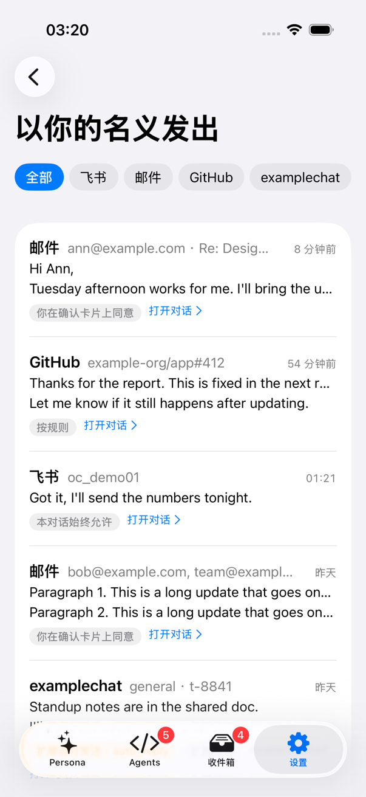
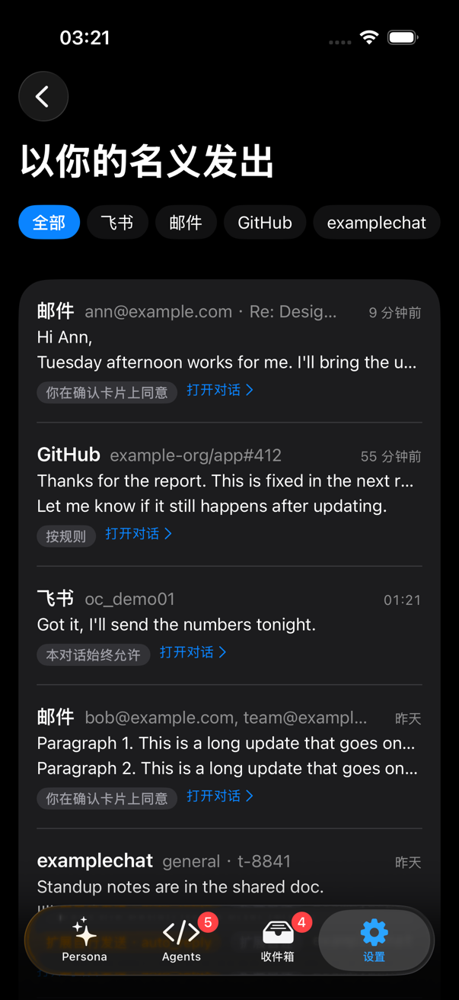
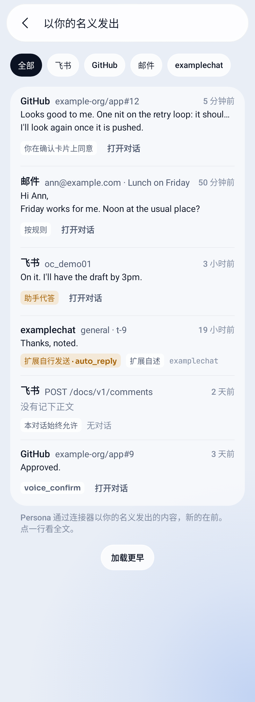
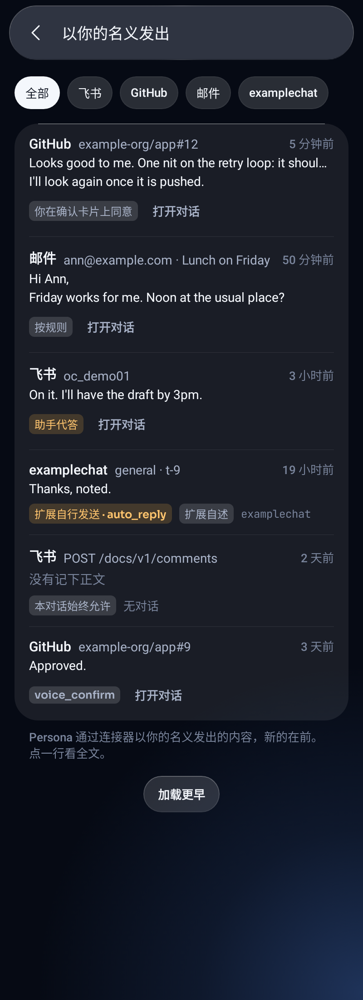

# Connectors

A connector is Persona's standard way to connect a data source: GitHub, Messages (iMessage), Telegram, Lark and mail each have one. The hub's pipelines
(assistant tools, write gates, Inbox, knowledge base, status in Settings › Connectors, live events) attach automatically according to what the connector provides; adding a source does not require changing those pipelines.

This document has three parts:

- **I. Current structure (v1)**: the actual structure after the Lark and mail migration (M0–M6) and the merged GitHub, Messages and Telegram work. Follow this to add a connector.
- **II. v2 design**: eight comments on v1, each with agreement / disagreement, how to change it, size of the change, affected connectors and old/new compatibility.
  **Decided 2026-11-03** (results in part IV; the text already reflects them); V1 and V3–V6 are complete, V2 and V7 were rejected, and v2 is closed out.
- **III. Migration order**, **IV. Decisions**.

The process and history (why it was split this way, acceptance for each step) are in `docs/plan-connectors.md`; Telegram is in `docs/archive/plan-telegram.md` (an extension since 2026-11-05, #1704; code in `nwverse/persona-extensions`, #2057).
Planned Discord support (the user's own bot, extension, #2828) is in `docs/plan-discord.md`.

## I. Current structure (v1)

### Available connectors

| id | Name | How it runs | Knowledge base | Inbox | Assistant tools | Writes | Login |
| --- | --- | --- | --- | --- | --- | --- | --- |
| `github` | GitHub | In the hub (`connector/github`) | `Archive` (`updated_at` cursor) | Yes, rule-based tiers + noise reduction (`rules.go`) | `github_search/read/diff/checks` | `github_comment`, `github_review` (gated) | Reads `gh` login from a computer (`credential.gh_token`) |
| `imessage` | Messages | Reads on the Mac's node, with an RPC-forwarding adapter in the hub (`connector/imessage`) | `Archive` (ROWID) | Yes | `imessage_chats/read/search` | None | None (grant personad Full Disk Access on the Mac) |
| `telegram` | Telegram | Extension `telegram` in the `nwverse/persona-extensions` marketplace (#1704, #2057, code outside this repo), called by the hub over the process extension protocol (`connector/proc`) | `Archive` | Yes | Read-only tools; reads through the `tg` CLI (`Unlisted`) | `telegram_send/forward/react/mark_read` (`tg` CLI, `Unlisted`, gated) | Stepwise `Login` (phone number, code, two-step verification password), session encrypted in `connector_secrets` |
| `wechat` | WeChat | Separate built-in extension program `personad-wechat` (`docs/wechat.md`): a bot in WeChat, not a data source but a channel (`docs/channels.md`); the connector handles only binding and status | None | None | None | None | QR `Login` (`kind: qr`), token encrypted in `connector_secrets` |
| `lark` | Lark | Registered by the Lark extension since #1571 (formerly the hub's lark_connector.go wrapping the original Lark gateway code) | `Chats` (one cursor per conversation) + `Items` (documents, meetings, events) | Inbox blocks from the extension (block types in `assistant/inbox_blocks.go`; formerly the hub's inbox_own.go) | `lark_chats/messages/search` | Through the Lark extension's skill + the node's Bash gate (rules below) | Log in through the Lark gateway on the hub machine |
| `mail` | Mail | In the hub (`extmgr/mail_connector.go`) | `Archive` (UID per account) | The hub's own Inbox blocks | `mail_accounts/search/read` | `mail_send` (gated) | Its own API: password / Gmail and Outlook OAuth (`/api/v1/mail/…`) |

### Interfaces: one manifest, dispatched by declaration

`server/internal/connector/connector.go`: `Connector` has `ID()`, `Name()`, `Manifest()`. The manifest (`manifest.go`, since v2 · V1) declares what it can do in one place:

| Manifest field | Meaning |
| --- | --- |
| `Capabilities` | Typed capabilities (`CapStatus`, `CapTools`, `CapActions`, `CapEvents`, `CapInbox`, `CapSettle`, `CapArchive`, `CapChats`, `CapItems`, `CapLogin`, `CapOptions`), each corresponding to an interface |
| `Hosts` | Link hostnames (for link recognition in the App) |
| `AgentTools` | Tools also given to Agents (not only the assistant), name globs (`mail_*` for mail) |
| `Unlisted` | Tools and writes excluded from the model's tool list, name globs: the connector's own frontend calls them by name (the Telegram extension's `tg` CLI and skill, `docs/connector-protocol.md` ("CLI")). Not a permission |
| `ConfirmAlways` | Writes that always require confirmation on the phone, name globs (optional): matching `allow` rules in `connector_gate` are clamped to `confirm`, while `deny` stays unchanged (see "Gate"). Written as `confirm_always` in extension manifests |
| `Poll` | How often to query `Archive` (0 is the hub default; mail is 6 minutes) |
| `Kinds` | Inbox item kinds; each needs a description in `prompts/inbox/kinds/<id>.md` (`connector.CheckKinds`, each connector's `TestKindsAreDescribed`); an undeclared kind received is logged |
| `Proxy` | Answers on behalf of another program (subprocess `proc.Conn`): implements every interface, but only declared ones are real |

The hub uses only `connector.As[interface](c)` to discover capabilities: it asserts the interface only when declared. `Registry.Add` checks the manifest with `connector.Check`: declared but unimplemented, implemented but undeclared (except `Proxy`),
unknown capabilities, or kinds without an Inbox capability all fail registration. Capability interfaces:

| Capability | Interface | What it does | Who has it |
| --- | --- | --- | --- |
| `status` | `Accounts` | `Status()`: state, accounts, a human-readable error sentence and `Guide` | All except Lark and mail (absence means `ok`; a `Proxy` is always asked for its own status) |
| `tools` / `actions` | `ReadTools` / `Actions` | Read-only tools; writes (`Describe` produces the card text and returns errors for bad parameters without showing a card; `Do` performs the write). A connector that knows the id of the message a write made also implements `RefActions` (`DoRef`: `Do`'s text and that id, for the sent-as-user ledger), and one that can take such a message back implements `Recaller` (`CanRecall`, `Recall`; "Sent as the user" below); both are found by type assertion, declare nothing and are optional | See above |
| `options` | `Options` | Connector-specific settings (JSON), edited in the App | GitHub |
| `events` | `Events` | Live events, `changed(Scope)`; `Scope` is a typed constant, validated when received from subprocesses | Each has its own |
| `archive`, `chats`, `items` | `Archive`, `Chats`, `Items` | Three shapes for knowledge-base ingestion | See above |
| `inbox`, `settle` | `Inbox`, `InboxSettler` | Inbox candidates and replies (`Reply` receives the full `InboxReply`: conversation, item, which step it answers, body); settle old items by rule | GitHub, Messages, Telegram; `settle` only GitHub |
| `login` | `Login` | Stepwise login | Telegram |
| `threads` | `Threads` | Opens an Inbox conversation as a chat page in the App: `Thread(thread, before, limit)` returns a page of messages (sender, avatar, media, references, cursor); `Media(ref)` supplies avatar/media bytes. Read-only; replies use the action named in `ThreadChat.Reply` (gated). The App selects a page by `ThreadChat.Kind`: bubbles for dm / group / channel, GitHub layout for pr / issue | Telegram (#1054), GitHub (#1055, `docs/plan-connectors.md` ("Conversation pages")) |

`Runner` (its own loop) and `Machines` (a computer connected) describe how it runs, not capabilities, and still use type assertions. Inbox tiers are `connector.Tier` (`TierAction`, `TierFYI`, `TierNoise`);
the hub drops unknown tiers and leaves classification to the model.

`Registry` (`registry.go`) owns all connectors: offers tools according to status (only `ok`), dispatches calls by prefix, enables/disables (`SetEnabled`), and starts `Run` / `Watch` (restarts with backoff after failure).

### Three execution models

- **In the hub**: Go code implements the interfaces directly.
- **Subprocess** (`connector/proc` ↔ `connector/serve`): first-party code whose dependencies are too large to compile into personad (Telegram's gotd; since #1704 Telegram is an extension using the process extension protocol). The hub starts the program; stdin / stdout carry the same
  JSON-lines RPC as hub↔node (`internal/rpc`), with methods corresponding to interfaces (`init`, `status`, `archive.changes`, `inbox.collect`, `tools.call`… in `serve.go`).
  The program calls the hub's `secrets.*` in the other direction. At registration the hub gives `proc.Conn` a static manifest (`proc.Config.Manifest`; extensions get it from their
  `persona-plugin.json`), so even connectors that have never started and are off by default can report capabilities and log in/out (#666). The program manifest returned by `init`
  (`serve.Manifest`, snake_case fields on the wire) is checked against it; mismatches are logged and the static one still wins. Built-in extension programs (the WeChat bot) must come from the same build as the hub (`version -v` matches exactly); the protocol is versioned (v2, `docs/connector-protocol.md`).
- **node relay**: data exists only on a Mac (`chat.db`). A `Reader` on the node reads local data; the hub reads through node RPC (`connector.list/chats/older/changes/search`,
  five methods hardcoded in `node/node.go`; new nodes also answer through `plugin.node.call {id: "imessage"}`, see `docs/extensions.md` ("Built-in node programs"));
  the hub-side `imessage.Remote` is the connector. Choose the Mac in the built-in extension "Messages (iMessage)" (#1830 step 6); without a selection, use `imessage.machine` in the manager's manager.json.

### Gate

- The gate handles only **AI-initiated** writes (assistant tools, `tg` CLI / skill, Agents, all through the node's `mcp.call`): `Registry.Call` →
  rules in `connector/gate.go` (`connector_gate` in the manager's manager.json, first match wins) →
  `allow` runs directly, `deny` refuses, `confirm` (default) shows a card on the phone (`hub.approve`, expires in 15 minutes). The card says what will happen, the full text, and who will see it.
  For writes matching the manifest's `ConfirmAlways`, even `allow` rules (including `*`) are clamped to `confirm` (`Decide`), while a `deny` that matches stays unchanged; the manifest registered by the hub wins, and a program's self-report cannot loosen it.
  A call whose arguments give a field more than once is refused before any rule is read (`repeatedField` in `connector/gate.go`, error kind `declined`): the very same name, or names that differ only in capitals by `encoding/json`'s case folding, among the top-level fields. The message names the field and tells the model to write each field once, spelled as the tool defines it. A connector that decodes its arguments into a struct reads such a call by rules the gate's map does not follow (it takes the last value in the plain case, but ignores a `null` and decodes an object or an array onto what the earlier one left), so a rule cannot tell which value the write would use, and an extension in another language may read the names some other way again; the gate does not guess, for any connector.
  A `deny` or `confirm` with a `match` reads field names without regard to capitals, the rule's own as well as the call's (`matchFieldsAny`), so a call that spells a field once in other capitals is refused or asked as if it were spelled right; this refuses or asks for more calls than before. An `allow` reads the exact names, so such a call does not hit it and goes on to the later rules, ending at the default `confirm`. Arguments that give each field once, spelled exactly, are decided as ever. Ignoring the case of a name is what the built-in connectors do, and extensions written in Go with `encoding/json`. The node's Feishu gate does none of this: it compares a request body by exact field names (`bodyMatches` in `node/larkgate.go`, also for the rules `connector.GateRules` gives it), and the service that gets the body is not one this repository decodes.
- **Manual actions by the user bypass the gate** (#1190, user: "Why do I need to approve a message I send myself? That's completely wrong"): replies from the conversation-page composer
  (`POST …/thread/reply`) sent by the user's own logged-in device (phone, Mac, web full device token) use `Registry.Run` directly, without a card;
  `deny` rules do not block them either. Identity comes from hub authentication (`byOwnDevice` in `extmgr/helpers.go`), not client-reported fields; hub.json pairing tokens, pairing codes,
  machine / linked-hub credentials are not devices and still go through the gate. Lark sends and Inbox "Send" already bypassed it.
- Lark writes are not tools: the assistant uses commands / lark-cli in the Lark extension's skill; the node's Bash hook (`node/larkgate.go`) reads the command to distinguish reads and writes. Its rules are
  `connector:"lark"` in `connector_gate` (`action` is "method path"), plus the old `lark_gate` and built-in rules (M5).
- Tapping "Send" in the Inbox is itself confirmation, so `Reply` shows no extra card; the conversation-page composer works the same way (above).

### Sent as the user

Every write that went out through the gate is kept in the ledger `sent_as_user` (migration `manager/0420`, #5278), so the user can see what Persona wrote in their name, where, and why it was allowed. The ledger is on the manager's side: the gate runs there, and so do the approval card and the conversation that asked.

- **What is a row**: a gated call (`Registry.Call`) whose action (`Do`) returned without an error; `Registry.SetSent` tells the manager (`recordSent` in `extmgr/sent_ledger.go`). Not a row: a write the gate denied, one the user declined on the phone, one whose `Do` failed (a program's `Do` that timed out may have happened anyway; nothing is kept for it), and everything the user sent by their own hand (`Registry.Run`: the conversation-page composer, Inbox "Send", Lark sends). Taking a row's message back is described below (**Recall**). An extension's connector that sends in the user's name by itself, outside the gate, and says so in its manifest (`contributes.connectors[].sends_as_user`), can put such a send in the ledger with `sent.record` (below). The assistant's Lark writes through the node's gate proxy come in with `lark.sent` (below).
- **Columns**: `id`, `at`, `connector`, `action`, `target` (where it went), `text` (what it said, at most 4000 characters), `summary` (one line), `origin`, `let_through`, `message_ref`, `recalled_at`.
  - `target` is read from the arguments: GitHub comments and reviews `{ref: "owner/name#12"}` (a review also `event`); mail `{to, cc?, bcc?, subject, account_id?}`; any other connector (an extension's too) the fields they usually name a destination by (`chat`, `thread`, `channel`, `conversation`, `recipient`, `to`, `reply_to`, `subject`, `repo`, `number`), and when none is there `{arg_keys: [...]}`, the names of the arguments it was given.
  - `summary` is the first line of the card's words when the user was asked, else the action and its target; for an extension's own record the line it gave, else `<connector>: <target fields>`.
  - `origin` is the conversation that asked, `{machine_id, session_id}`; `{}` when the request named none (a pairing token's reply in a connector's thread). For a send an extension recorded it is `{extension: <id>}`, with `machine_id` and `session_id` beside it when the extension named them. For a Lark write through the node's gate it is `{machine_id}` (the computer the write ran on) with `session_id` when the node knew the conversation.
  - `let_through` says how the gate let it through: `{kind: "rule", rule: {connector, action, match?, decision}}` for the `connector_gate` rule that allowed it, or `{kind: "card", interaction_id, answered_by?}` for the phone card (`answered_by` is `assistant` when the assistant answered it for the user, absent when the user did). A rule's `allow` that `confirm_always` or a health conversation clamped to a card is a card. A call refused for giving a field more than once writes nothing and has no row. An extension's own record is `{kind: "auto", setting?}`: no rule and no card, `setting` being the extension setting that let it send without asking. The node's Lark gate adds `{kind: "conversation_always"}`: the user had chosen "Always allow in this session" for that route, so no card was shown.
  - `message_ref` (the sent message's id on the other side, kept as the service wrote it, only trimmed and with no NUL; one longer than 200 characters is not cut, because a cut id points at nothing or at another message, but left empty, the same for all three sources of a row: `proto.CleanMessageRef`) is what the write said it made, empty when it did not say. `recalled_at` is written by a recall (below). Per source: a connector with `RefActions` says it through `DoRef` (`Registry.call` asks it instead of `Do`); GitHub's comment is the new comment's `id` (`github_comment`) and its review the review's `id` (`github_review`), in decimal (an id that is not a positive whole number leaves it empty and never fails the post: it is read after the post went out): they are different resources with numberings of their own, so the id alone does not say which and the row's `action` and `target.ref` (`owner/name#12`) are what a recall goes by; mail is the Message-ID written into the header of the message that went out, without the angle brackets (the form of `message_id` in the mail API's message lists; whether a provider keeps it as written has not been checked); an extension's connector answers it in `actions.do`'s `message_ref` (`docs/connector-protocol.md`), an older one answers none and the row is written all the same; the node's Lark gate reads it from the API's answer (below). A connector that does not say leaves it empty, and so does a recorded send (`sent.record`) that gave none.
- **Sends an extension made itself** (`sent.record`, #5278 step 2): a gate sees only the writes that pass it, and an extension's connector can also send from inside a tool that reads. Such a connector declares `sends_as_user: true` in its manifest (shown at install as "Send messages as you", and asked again when an upgrade adds it), and its program calls `sent.record` after each send (`docs/extensions.md` "Sent as the user: `sent.record`"). The hub (`extensionSentRecord` in `extmgr/sent_ledger.go`) accepts it only from a connector of the caller's own that declares the field (else `permission_denied`; the user switching that connector off afterwards does not matter, the send happened), forces `origin` to the extension (its `machine_id` and `session_id` are the extension's own word) and `let_through` to `auto`, cuts the text to 4000 characters like a gated write's, keeps the target's short values and limits each extension to 60 calls at once and then one a second. The ledger is then as complete as the extension is honest: the hub does not see the sends it is not told of, and the install line says so.
- **The assistant's Lark writes** (`lark.sent`, #5278 step 3): the node's Lark gate (`node/larkgate.go`) decides before the command runs and cannot see whether it sent. A gated command whose gate has `auth` goes through the node's gate proxy (`node/gateproxy.go`), which sees the status the API answered with. For every write it forwarded (any method but GET and HEAD) that came back 2xx (201 and 204 as much as 200), the proxy tells the manager with a `lark.sent` request once the answer has gone to the command, also when it could not finish passing on the answer's body (the API had taken the write by its 2xx). The report does not wait for the manager: it runs in the background, at most 32 at a time (one over waits up to a second for a place, then is logged and not told), and one that fails is only logged on the node. Reads, requests the proxy refused, redirects, 304 and failures are not told, and neither is a command that went away before the API answered (whether the API ran it is not known). The manager (`RecordNodeSent` in `extmgr/sent_ledger.go`) takes it only from a computer it knows, and the row's `origin.machine_id` is the connection's, whatever the request says. The row is `connector: "lark"`, `action: "<METHOD> <path>"` (the way `connector_gate` writes a Lark rule), `target: {command, method, path}` (`command` is the gated command, the gate's own name) plus `conversation` and `message` when the path names them REST-style (`/conversations/<id>/…`, `/messages/<id>/…`; a path that names a collection twice or has no id after it gives none), `text` the body's `body`, `text`, `message`, `content` or `comment` field (the first with words, a JSON body only) cut to 4000 characters, and `let_through` as above. The conversation comes from the card or the process: the session `larkCheck` decided for when the write was confirmed or covered by "Always allow", else the one the assistant's process was started for (a write a rule allows). A grant a confirmed write is let through by belongs to the conversation it was confirmed for: another conversation's identical call does not use it up. When the manager answers the node's card from an "Always allow" it kept (after the node restarted, or because a card answered meanwhile covers it) it says so (`remembered: true` on the resolution), and the row is `conversation_always`, not a card that was never shown (an older manager does not say so and the row is a `card`). What the ledger does not have: writes through lark-cli (it carries its own credentials and does not pass the proxy), gates without `auth` (their credentials are in the command's environment, so the node never sees the answer), a write the node could not tell the manager of (the manager was not reachable, or the node had no hub connection), and a write the API answered 2xx but whose body says it failed (the proxy reads the status, and the id described next, only).
  - *The message id* (`message_ref`): the proxy keeps a copy of the first 256 KiB of a 2xx JSON answer to a write while it passes the answer on (the command gets the bytes, headers and status as the API sent them, flushed as they come: the copy is made after each write, it is not a buffer in front of it), and the report reads the id from the copy once the answer has gone: the first non-empty string among `data.message_id`, `data.messageId`, `message_id` and `messageId` (a gateway's receipt names it one way, the Open Platform's answer another), as the API wrote it (one longer than 200 characters is none, not cut). gzip answers are read, whether the command asked for gzip (the answer passes compressed and the copy is unpacked) or not (the proxy's transport unpacks it first). No id, not JSON by its Content-Type, cut off, longer than the copy (256 KiB, also once unpacked), compressed some other way: the write is reported all the same, with no id. Only the id leaves the node; the answer is never logged. The manager keeps it only for a route that creates one message in a conversation the path names: `POST /conversations/<id>/messages` and the attachments' routes (`/conversations/<id>/images`, `/files`, `/attachments`, `docs/lark-attachments.md`, `docs/extension-messaging.md` "6"). **Known limit**: a reply (`POST /messages/<id>/replies`) and a forward are not known to answer with the new message's id, and a reaction or a read position answers with the id of a message that is someone else's, so their rows leave `message_ref` empty for now: a wrong ref (the one a recall would act on) is worse than none. A route is added when its answer is known to name the message it made. An older node does not send the field and an older manager ignores it.
- **Recall** (#5278, the core only: no route, no button and no card yet): a connector that can take back a message one of its writes made also implements `connector.Recaller`, next to `RefActions` (found with `connector.RecallerOf`, not a capability: nothing is declared and `Check` does not look for it). `CanRecall(action, age)` answers from memory whether the message that action made, `age` ago, can still be taken back (the limit a service sets on how late is the connector's own); `Recall(ctx, SentMessage{Action, Ref, Target})` does it, with the row's action, `message_ref` and `target`. It returns nil only when the other side confirms the message is gone (one that was already gone included, and a repeat after success succeeds too), an error wrapping `ErrRecallUnknown` when the request may have taken effect (a timeout, a lost connection), one wrapping `ErrCannotRecall` or `ErrRecallUnavailable` when nothing was sent (the row names nothing the connector could have written, or it is a kind it cannot recall; no token, offline, the token refused), and any other error when nothing changed (the other side refused, or whether the message is gone could not be checked).
  - **GitHub**: `github_comment` is taken back by deleting the comment (`DELETE /repos/{owner}/{repo}/issues/comments/{id}`, the id being the row's `message_ref` and the repository the one in `target.ref`; the same write permission as posting it). Only a 204 is a success: a repository that moved answers 301 and the client sends the request on as a GET, which answers 200 and deletes nothing, so a repository renamed or transferred since the write cannot be recalled (the outcome is unknown; a 307 or 308 would keep the DELETE, but GitHub documents 301). A 404 is looked into, because GitHub answers it for a comment that is not there, for one the token can read but may not delete (a public repository) and for a repository the token cannot see: the connector reads the comment itself. It can be read: it is still there and the delete was refused (`recall_refused`). It cannot be read (404) and the issue it was on can (or was deleted, a 410, which takes its comments): the comment is gone, which is what was asked for, and a repeat after a lost answer succeeds too. Anything else (a lookup that fails, an issue that cannot be read) leaves nothing known and is a refusal, not an unknown outcome, as the 404 deleted nothing. `github_review` cannot be taken back: GitHub deletes only a review that was never submitted ("Submitted reviews cannot be deleted"), and dismissing one leaves it on the page. **Mail** cannot be taken back, and neither can the sends an extension recorded: a program's connector (`connector/proc`) is not a `Recaller` (see below).
  - **`RecallSent`** (`extmgr/sent_recall.go`) is what a route will call with a row id and `confirm`, how the caller made sure the user agrees: it runs after the checks and before the connector, and an error from it stops the recall, so a card or the user's own device can be passed without changing the core (a `nil` confirm refuses to run). Nothing in it says who may ask: the caller applies the ledger's read rule (below) and refuses what an extension or a conversation started. Two recalls of one row at once each call `confirm` (and the connector), so a caller that asks the user should dedupe them. The checks (`recallCheck`, which a page of the ledger can use to say which rows offer a recall): not taken back already, the connector is registered, is a `Recaller` and `CanRecall`s the action, the row has a `message_ref`, the message is not older than `sent_recall_hours` (manager.json: 24 hours when omitted or 0, no limit below 0) nor than the connector allows (the stricter of the two, judged when the request comes), and the connector is available (switched on, signed in). Only when `Recall` says the message is gone is `recalled_at` set, once (`UPDATE … WHERE recalled_at IS NULL`), also when the request went away meanwhile; a refusal and an outcome nobody can tell leave the row as it was and can be asked again. Two recalls at once both reach the connector (which allows repeats), but only the first marks the row; the other gets `already_recalled`. The connector has `sentRecallTimeout` (30 seconds) for its recall, and what it says decides the code: an error wrapping `connector.ErrRecallUnknown`, or one that came when the time ran out or the request went away, is `recall_unknown`; `ErrCannotRecall` (it found it could not, before it sent anything) is `not_recallable`; `ErrRecallUnavailable` (no token, offline, the token refused) is `connector_unavailable`; any other error (the other side refused, or whether the message is gone could not be checked) is `recall_refused`.
  - **Failures** are a `*RecallError{Code, Err}`; the route (not written yet) will answer by code, with these statuses: `not_found` (no such row, 404), `not_recallable` (no `Recaller`, no ref, not that kind of message, or the connector found it could not before it sent anything, 409), `too_old` (409), `already_recalled` (409, with the row), `connector_unavailable` (switched off, not signed in, offline, its token refused, 503), `recall_refused` (the recall did not happen: the other side refused, or whether the message is gone could not be checked; nothing was changed, 502), `recall_unknown` (it may or may not be gone, nothing recorded, safe to ask again, 504) and `no_database` (503). A database that fails, or a mark that fails after the message was taken back (asking again finds it gone and marks it), is a plain error for a 500.
  - **Not yet**: the route and who may call it (it must keep the ledger's rule: the user's own full devices and the owner, never an extension's token); the clients' button; whether a recall started on the user's own device asks a card first (the caller's `confirm`); the extension protocol: a method and a declared capability for a program's connector, with what its install preview says (it is a write like `sends_as_user`) and what the program is given, to be designed with an extension that has something to take back, so no program's connector is offered a recall until then; Lark messages (the node's gate proxy has the ids, no connector has `Recall`).
- **Retention**: rows older than `sent_ledger_days` (the manager's manager.json, 90 when omitted or 0, below 0 keeps them for good) are deleted when the manager starts and every six hours.
- **Reading**: `GET /api/v1/connectors/sent` (`docs/protocol.md` "Connector API"), for the user's own full devices and the owner on the hub machine only (not answer-only devices, pairing tokens or extensions' tokens). Only the default manager's ledger is read; a second manager keeps its own. The web app shows it in **Settings › Sent as you** (`docs/web.md` "Settings", #5278): newest first with the connector filter, how each send was let through and the chat that asked, a row opening its full text. iOS, the Mac and Android show the same page (below).
- **On iOS and the Mac** (#5278 step 5): **Settings › Sent as You**, one code path for both (`SettingsPage.sent`, `Persona/Views/Settings/SentView.swift`; the logic and words are in `SentModel.swift`, kept like the web's `lib/sent.ts`; tests `SentModelTests` and `SentAsYouTests`). A single-row section after Connectors, not in Demo Mode. It reads the page like the web does (`APIClient.sent(before:limit:connector:)`): a row has the connector, where it went, how long ago, the first two lines of the text (the one-line summary when there is none) and a badge for how the gate let it through (**By a rule**, **Always allowed in this chat**, **Confirmed by you on a card**; in orange **Answered by the assistant**, **Answered by <name>** and **Sent by the extension itself**; a kind it does not know as it is) with **Open Chat** (`openLinked`, so the assistant's chats open in Persona and an agent's in Agents; VoiceOver reads it as "Open Chat: <connector> <target>"), **Extension-reported** for a row an extension recorded, or **No Chat**. A row opens a sheet with the time, the action, every field of the target, how it was let through (the rule, the card's id), the chat, the message id and the whole text, which can be copied (the button itself says Copied for a moment, as the app's toast can sit under a sheet on the Mac), with a note when it is exactly 4000 characters. **Load Earlier** asks with `before=next`; the first page is read again when the page opens, on pull to refresh and with ⌘R on the Mac, and it keeps older pages it connects to. A read that comes back late is dropped: one for another connector chip, one older than a read of the first page already taken, and an older page read for a cursor the list has moved on from; a read SwiftUI cancelled says nothing and does not strand an older one that is good. The chips are Lark, the connectors the loaded rows show and the chosen one; choosing it again is **All**. States: nothing recorded yet, nothing under a chip (**Show All**), 503 `no_database`, 403 and a 404 with no code (an older hub: update it), each said before the usual "Can't reach the hub" with **Retry**. Unlike the web, which keeps the hub's key order, the sheet lists a target's fields in a fixed order (where it went first: the hub's destination fields, then `ref`, `cc`, `bcc`, `event`, `method`, `path`, `command`, `account_id`; then the rest by name) and a rule's matched fields by name, because decoded JSON objects have none. DEBUG launch argument for screenshots: `-tab settings -openSentAsYou YES`; the fake hub is `MOCK_SENT=1` (`scripts/mock/sent_ledger_mock.py`, `docs/testing.md`).
  
  
- **On Android** (#5278 step 7): **Settings › Sent as you**, a single-row section after Connectors, not in demo mode (`SettingsPage.Sent`, `feature/settings/SentScreen.kt`; the logic and words are in `SentState.kt`, kept like the web's `lib/sent.ts` and iOS's `SentModel.swift`; `HubSent` / `HttpHubSent` read the route; tests `HttpHubSentTest`, `SentStateTest`, `SentShotsTest`). The same rows, badges, details sheet, **Load earlier**, connector chips, late-answer rules and states as iOS (`docs/android.md` "Settings › Sent as you"), with the sentence-case words Android uses; **Open chat** is the app's `ChatRoute`, and the rows' machine ids are put in the selected hub group's form so a chat opens in a group of hubs too. The sheet lists a target's fields in the same fixed order as iOS.
  
  

### Inbox ingestion

The connector provides `InboxThing` (one thing: `Thread` is its key, `Kind` its own kind, `Tier` / `Why` the tier chosen by its rules, and `Done` means it observed completion);
each round, the hub hands candidates to the manager (`inbox.collected` on the bus, `docs/inbox.md` ("Who owns what")). The manager (`applyConnector` in `assistant/inbox_connectors.go`)
merges subsequent activity for the same `Thread` into an open item. Classification, AI twin, completion and retention then belong to the manager and are the same for every source; replies, `Settle` and tools derived from events
are still dispatched to connectors by the hub (the manager asks through `app.call inbox.*`). Items use a generic block (`InboxConnector`), so the App can render them without knowing the source.

### Knowledge-base ingestion

- `Archive`: one cursor per account; `Changes(cursor)` returns changed conversations. The hub stores the cursor in `cursors/<id>.json`; conversation ids are `<connector id>-<conversation id>`.
- `Chats`: for sources like Lark with per-conversation cursors, backfill (`kb.Backfiller`) and attachments, provide `kb.Source` directly; archiving, backfill, compression and tagging stay unchanged.
- `Items`: Lark documents, meetings and calendar events.

### Settings › Connectors

`GET /api/v1/connectors?all=1` (without `all`, omits Lark and mail for pre-M6 Apps); each entry is `{id, name, status, account, via, error, guide, capabilities, hosts, enabled, options, archive, inbox}`.
`archive` / `inbox` are the "Add to knowledge base" / "Add to Inbox" toggles (`Registry.SetFeed`, on by default, stored in hub settings): disabling knowledge-base ingestion stops hub calls to `Archive`; "Delete stored knowledge-base content" (`DELETE …/{id}/archive`) deletes only its conversations and people in the knowledge base. Disabling Inbox ingestion stops `Collect` without changing existing items. The connector keeps running and tools remain available.
The App draws the whole section from this list: Lark and mail retain their original rows (status still comes from their own APIs), Messages has its own page, and others use the generic connector page. API details in `docs/protocol.md` ("Connector API").

Audit: signing in or out, the switch, the two feeds, the connector's own settings, deleting its data or knowledge base content and GitHub's token source are recorded in `plugin_audit`
with who did it (#5281); never a credential or a typed value. The actions and their details are listed in `docs/extensions.md` (after the install / upgrade steps).

### Adding a connector (v1 approach)

1. Create a `connector/<id>` package implementing `Connector` (including `Manifest()`) and its declared capabilities; tool descriptions go in `prompts/mcp/<id>/`, Inbox kind descriptions in
   `prompts/inbox/kinds/<id>.md`; declare kinds in the manifest and add `TestKindsAreDescribed`.
2. Add a config section to the manager's manager.json (`docs/config.md` ("manager.json")) and register it in `registerConnectors` in `extmgr/connectors.go`.
3. Writes must be `Actions`; the `Describe` card must say who will see the result.
4. `Status` answers only from memory (queried on every tool listing); errors get a one-sentence `Error`, and self-service fixes get a `Guide`.
5. No body text, phone numbers or tokens in logs/errors.
6. For external services, embed `connector.Egress` (`connector/egress.go`) in config to get a `proxy` key (`http://[username:password@]host:port`, empty means direct).
   Build every HTTP client with `Egress.HTTPClient`: use the proxy when configured, direct otherwise; invalid config errors rather than silently connecting directly. This is how `github.proxy` works (#1106);
   proxy-address parsing lives in `netproxy`, also used by `google.proxy`. Not yet wired: Telegram (MTProto, not HTTP), subprocess / third-party connectors (proxy must be passed to the program), see #1106.

> **Process-extension connectors live outside the hub**: for example, a personal WeChat connector is a client for an external API service, delivered as an extension package (`.tar.gz` plus sha256) and installed from the extension marketplace.
> It speaks extension protocol 1 and connector protocol v2 to the hub and declares `fallback` (each Inbox item carries a fallback tier). Its code is outside this repo; the extension and its integration guide are published from its own repository.
> This repo retains only the wire fixtures and manifest for the neutral `examplechat` ("Example chat") connector (`schema/extension/examples/Manifest.examplechat.json`).
> Conformance testing for such external programs: use `conformance.Program` for extension-side start/stop and handshake ([extensions.md](extensions.md) ("Conformance tests")),
> and `CheckProgram` with synthetic wire fixtures for connector-side capability checks ([connector-protocol.md](connector-protocol.md) ("Conformance tests")).

## II. v2 design

The assessment of v1 was "usable, well documented, but not elegant enough". Below are judgments on eight points after reading the code. Change sizes are estimated as "small: one or two PRs, hundreds of lines, no App changes",
"medium: three to five PRs, possibly App changes", "large: crosses hub / node / programs / App, needs several steps".

### 1. Capability declarations: one explicit manifest

**Agreed.**

Current state: 19 optional capability interfaces (`Accounts`, `ReadTools`, `Actions`, `Options`, `AgentTools`, `Validator`, `Events`, `Runner`, `Machines`, `Hosts`,
`Poller`, `Chats`, `Items`, `Archive`, `Inbox`, `InboxReplier`, `InboxSettler`, `Login`, `Capabler`). The problem is not just their number:

- Two declaration systems. In-hub connectors use "which interface is implemented", subprocesses self-report through `Capabler`; to represent any program, `proc.Conn` implements every method it can forward over RPC,
  so the hub's assertions always succeed, and correctness depends on the program "returning empty if unsupported". `Capabilities()` (then in `connector/registry.go`, now `Capabilities` in `connector/manifest.go`) reports only 11,
  leaving `AgentTools`, `Validator`, `Poller`, `InboxReplier`, `InboxSettler` invisible in `GET /api/v1/connectors`.
- Some entries are data, not behavior: `Hosts`, `AgentTools`, `Poller` each returns an unchanging value (constant or config).

Proposal:

```go
type Connector interface {
    Manifest() Manifest // Read once at startup; subprocess reports the same structure in its handshake
}

type Manifest struct {
    ID, Name     string
    Protocol     int          // Connector protocol version (point 4)
    Capabilities []Capability // Typed constants: CapStatus, CapTools, CapInbox, CapChanges, CapLogin, CapOptions…
    Hosts        []string
    Tools        []ToolSpec   // Each tool: name, read/write, exposed to Agents (replaces AgentTools, per-tool granularity)
    Inbox        *InboxSpec   // Kinds (name, label, default tier), reply support, whether it settles old items itself
    Changes      *ChangesSpec // Poll interval (replaces Poller), backfill support, attachments
    Login        *LoginSpec   // Login methods (point 7)
}
```

- Type assertions are only for **dispatch**: the hub asserts `Inbox` only if the manifest declares `CapInbox`; declared but unimplemented, or implemented but undeclared, fails in `Registry.Add` (caught at startup rather than returning empty at runtime).
- Merge interfaces into seven groups: `Status` (required, with an embeddable `connector.Base` defaulting to `ok`), `Run` (merges `Runner` + `Events` + `Machines`: `Run(ctx, Host)`,
  where `Host` provides `Changed(scope)` and `MachineOnline` subscription), `Tools` (`ReadTools` + `Actions`, `Describe` can return errors, replacing `Validator`), `Inbox`, `Changes` (point 2), `Login`, `Options`.
- `capabilities` in `GET /api/v1/connectors` comes from the manifest; existing names remain unchanged, so no App changes.

Size: **small to medium**. Mechanical changes to five connectors and hub dispatch; MCP / Inbox / knowledge-base goldens must remain byte-for-byte identical.

### 2. Knowledge-base ingestion: unify as "cursor-based changes"

**Not doing this (decided 2026-11-03, V7).** Conclusions after reading the code:

- GitHub, mail, Messages and Telegram's four `Archive` implementations already use the same cursor-based changes pattern; unifying them would only rename things.
- Lark's `Items` (documents, meetings, events) returns full snapshots, not increments; forcing it into a cursor interface would still require another endpoint for document-title lookup by link.
- Lark's `Chats` (per-conversation cursors, backfill, attachment downloads) is the knowledge-base archive engine itself. An adapter would merely move code,
  with no external change, yet create the highest-risk step on the largest source.

So the three shapes stay: `Archive`, `Chats`, `Items` ("I · Knowledge-base ingestion"). The original proposal follows for the record.

The judgment then: **mostly agreed; backfill and attachments stay separate.**

Three current shapes plus scheduling: `Archive` (GitHub, mail, Messages, Telegram, already cursor-based changes), `Chats` (Lark and Moments, per-conversation cursors,
with the knowledge-base engine selecting conversations, backfilling and downloading attachments), `Items` (Lark documents, meetings, events, a full snapshot each time), `Poller` (only scheduling).

Proposal:

```go
type Changes interface {
    // The connector owns the cursor (one number, one per account, or one per conversation); the hub stores and returns it verbatim.
    Changes(ctx context.Context, cursor string, limit int) (Batch, error)
}
type Batch struct {
    Chats    []ChatBatch // New conversation messages (as today)
    Items    []kb.Item   // Documents, meetings, events (replaces Items)
    Next     string
    More     bool
    NextPoll time.Duration // Replaces Poller; 0 uses the manifest value
}
```

- The four existing `Archive` connectors: only rename and change the return structure.
- `Items`: merge into `Batch.Items`; `DocTitle` (document-title lookup by link) is not a "change", so remains an optional query (later merged into "Links" in the v1 plan).
- Lark conversations: an adapter `connector.PerChat(kb.Source)` wraps per-conversation cursors into a composite cursor, moving the engine's conversation-selection logic into the adapter.
  **Lark is the largest source and this is the highest-risk step, so do it last**, with the M0 comparison baseline (then the hub's connector_baseline_test.go, removed with the hub's Lark source in #1571) and real-data comparison required.
- **Kept separate**: backfill (reading older history, the opposite direction from "since last time") remains optional `Backfill`; attachments (`Download`) remain optional `Media`.
  Forcing them into `Changes` makes one cursor represent two directions and harder to understand.

Size: **medium** (almost mechanical for four connectors) **to large** (Lark). Moments moves with Lark.

### 3. Patchwork interfaces and ad hoc strings

**Agreed, except for `Kind`.**

- `InboxReplier`: merge into `Inbox.Reply(ctx, InboxReply)`, one signature. Change all five connectors; subprocess `inbox.reply` only gains a few fields, so remains compatible.
- `AgentTools`: becomes per-tool `ForAgents` in the manifest (point 1). Currently an entire connector is exposed at once, too coarse.
- `Validator`: merge into errors returned by `Describe`.
- `scope`: constants already exist, but subprocesses and nodes send strings. Make it a typed `Scope`, validate at boundaries, log and drop unknown values.
- Inbox tiers (`"action"`, `"fyi"`, `"noise"`): the connector package has no constants, so Telegram, Messages and GitHub each write their own strings. Add constants such as `TierAction`.
- **Do not make `Kind` a global enum**: these should be the connector's own terms (`review_requested`, `dm`, `ci_failed`), understood by the model through `prompts/inbox/kinds/<id>.md`.
  Declare them in the manifest instead (name, human-readable label, default tier); the hub errors on undeclared kinds, and a test checks that every declared kind is described in the prompt file.

Size: **small**.

### 4. One versioned protocol, with in-process code as an adapter

**Agreed on versioning, unification and a written spec; disagreed on making built-in connectors pass through JSON in production.**

Current state: three execution models, three conventions.

- Subprocess: no version, relies on "same build". Most fields lack JSON tags, so wire keys are Go field names (`Cursor`, `Batches`), hard for third parties to reproduce.
- node relay: five iMessage-specific methods, then hardcoded in `node/node.go` (now `serveLocalConnector` in `node/connectors.go`).
- Third party: HTTP + MCP was designed in `plan-connectors.md` ("External processes") but not implemented.

Proposal:

- **Protocol v2**: JSON-RPC-style one-message-per-line (reuse `internal/rpc`, already used hub↔node and hub↔subprocess), all fields snake_case, methods mapping one-to-one to the interfaces in points 1–3:
  `initialize` (both sides report `protocol` versions; the hub supports current and previous) → program returns manifest → `status`, `changes`, `inbox.collect`, `inbox.reply`, `tools.call`, `action.describe`, `action.do`, `login.step`…;
  program calls hub: `secrets.*`, `changed`. Fixed error codes (`not_signed_in`, `rate_limited`, `unknown_method`…).
- **The same protocol on three transports** (decided: third parties use it too, not the original HTTP + MCP plan): stdin / stdout (first-party subprocesses, third-party local programs); node relay (hub sends `connector.call {id, method, params}`, node forwards verbatim to its connector,
  with iMessage's `Reader` becoming a protocol-v2 connector on the node instead of five hardcoded methods); WebSocket for resident services (third-party service runs itself and the hub connects, like `docs/daemons.md`).
- **In-process** (decided): production still calls Go interfaces directly (type checking, no copies of large message batches). Tests get a JSON round-trip adapter: the same **conformance tests**
  (`connector/conformance`) run twice for each built-in connector (direct / encode then decode), so "in-process is an implementation of the protocol" is enforced by tests, not merely written in a doc.
- **Tool descriptions**: third-party tool descriptions do not live in this repo's `prompts/`, an explicit exception to "all prompts live in prompts/" (already stated in `plan-connectors.md`).
  Can a third party attach an existing MCP server as a connector with only read tools? It can be an optional protocol capability (`tools` over MCP), not the main protocol,
  because MCP has no cursors, Inbox or login.
- **Third-party spec**: write `docs/connector-protocol.md` separately: handshake, manifest, every method's parameters/results, error codes, version rules, hard safety requirements (writes only as declared actions,
  invoked by the hub after gating; secrets only in the hub-provided `secrets`; no body text or numbers in logs; no networking in `status`), and how to run conformance tests on your program. The draft's essentials are above.

Size: **large**. Telegram (subprocess, released with personad, upgraded together, simplest) → Messages (node implementation changes, old nodes keep the five methods) → third-party spec and conformance tests.
Lark, mail and GitHub stay in the hub and only run conformance tests.

### 5. Structured Inbox attributes; hub-managed merging, muting and automatic closure

**Agreed on hub-managed merge keys, sender kinds, tags and supersession; disagreed on declarative conditions for "automatically resolved".**

Current state: all noise reduction lives in the GitHub connector (`connector/github/rules.go`): CI merges by "repository + branch" (`Thread` itself becomes `ci:<repo>@<branch>`),
bot recognition (`isBot`), muted repositories and ignored branches (GitHub's own `Options`), and closure after a successful run / branch deletion / PR merge (`followUpCI` + `Settle`).
Telegram and Messages each repeat "groups are FYI" and "bots stay out of the Inbox". Every new source repeats this, and only GitHub can be muted in the App.

Proposal: add these fields to `InboxThing`:

| Field | Meaning | What the hub handles centrally |
| --- | --- | --- |
| `Group` | Merge key (defaults to `Thread`) | Merge open items with the same `Group`; `Thread` only decides "where the reply goes" |
| `From {Name, Kind, Handles}` | Who performed the latest step; `Kind` is `person` / `bot` / `self` / `system`; `Handles` in point 6 | Rule: bots default to FYI; your own actions are not new messages |
| `Tags map[string]string` | Attributes for filtering and muting (`repo`, `branch`, `branch_role`, `chat`, `sender`) | Tag-matching mute rules (with globs), stored on the hub; the App's item menu "mute this repository / conversation / sender" works the same for every source (decided; screenshot the new UI first) |
| `Supersedes []string` | Which `Group`s this item replaces (a later successful CI run supersedes the failed group) | Close superseded open items with a stated reason |

"What counts as automatically resolved" remains observed and reported by the connector: the hub cannot know that a branch was deleted, a later run succeeded or a PR merged without calling GitHub; declarative conditions would still require the connector to check.
Unify only the reporting into two paths: push (`InboxThing.Done` + `Why`, report when observed) and pull (rename `InboxSettler.Settle` to `Check(openGroups)`,
with the hub periodically asking whether open groups are finished). Cleanup after mute/rule changes belongs to the hub and no longer needs the connector's `Settle`.

**GitHub is the first adopter**: `muted_repos` → mute rules on `repo`; `ignore_branches` → glob mute rules on `branch`; `isBot` → `From.Kind`;
CI's "repository + branch" → `Group`; later success → `Supersedes`; CI mode (off / default branch / include my PRs / all) is evaluated in the hub through `branch_role` (`default` / `mine` / `other`).
The App's GitHub settings page stays unchanged (storage moves from GitHub options to hub mute rules; old `github.inbox` config migrates on first startup).
Acceptance: read-only replay of the real data used for #584 still gives 13 Needs you items, identical before and after.

Then Telegram and Messages adopt `From.Kind` and `Tags` (delete their separate bot / group checks); Lark and mail still use the hub's own Inbox blocks,
and will attach when they adopt `InboxThing` (not done in v1; a separate task).

Size: **medium**. Hub Inbox, GitHub, Telegram, Messages; the App's mute menu is new UI, a separate PR with screenshots shown to you.

### 6. Sender identity hints

**Agreed; v2 records but does not merge. Hints store only HMAC hashes, are hidden from models, and are used only to recognize people (decided).**

Current state: knowledge-base people (`Person` in `kb/store.go`) have only one `Source` + `SourceID`; the same person has separate entries in Lark, mail, Messages and Telegram.
To keep numbers off disk, Messages already uses a phone/email hash as the person id (`PersonKey` in `connector/imessage/persona.go`).

Proposal:

- `Handle{Kind, Hash}`: `Kind` is `email` / `phone` / `github` / `telegram` / `lark`; `Hash` is an HMAC with the hub's own key after normalization (lowercase email, E.164 phone).
  The same email in mail and Messages gets the same hash, identifying the same person without writing the number to the knowledge base.
- Put it in `InboxThing.From.Handles` and `kb.SourceMessage.SenderHandles`; add `Handles []string` to `Person` (append only).
- **Hidden from models**: no hints in MCP results, Inbox classification prompts or knowledge-base compression prompts (hashes mean nothing to the model and waste context), enforced by goldens;
  raw values (phone, email) still stay off disk.
- What each source can supply: mail (address), Messages (phone / email, already its id), GitHub (login; omit email when unavailable), Telegram (user id; phone only for contacts),
  Lark (user id; email with permission).
- **Identity merging (combining entries into one person) is outside v2**: design separately once hints exist, including how to undo a bad merge and who confirms it.

Size: **small** (connector fields) **to medium** (knowledge-base writes). Small changes to all five connectors.

### 7. Login supports "open a web page to authorize"

**Agreed. Mail needs multi-account support first, so comes later.**

Current state: only Telegram uses `Login` (stepwise field entry). Gmail and Outlook use mail-specific `/api/v1/mail/oauth/{google,microsoft}/start|finish`;
GitHub reads `gh` login from a computer. The App has no generic connector login page yet (Telegram's App side is in progress).

Proposal: add two step types to `Prompt` beyond field entry:

- `open_url`: `{url, callback_scheme}`. The App opens it through system web authentication (`ASWebAuthenticationSession`), then returns the callback URL as this step's value (`callback_url`). OAuth uses this.
- `device_code`: `{url, user_code, interval}`. The App shows the code, opens the URL, then polls the same step every `interval` seconds until `done`. GitHub device-code login uses this.
- `qr` (#1351): `{url, interval}`, where `url` is content for another App to scan (WeChat QR authorization). The hub adds the QR matrix `qr: {size, rows}` to its App response (`rows` is one string of `0` / `1` per row,
  without surrounding whitespace, generated like the admin pairing QR). The App draws it (black modules on white in both dark and light, with a quiet zone), polling the same step every `interval` seconds until `done`;
  a phone cannot scan its own screen, so a "Save QR code" action appears below (share / save to Photos, then recognize it from the album in the other App). iOS / Mac, web (Settings › Connectors, #1693) and Android all have connector login pages.
- Steps the client cannot draw (unknown `kind`, `qr` without a matrix, a form with no fields) must not become an empty form with a permanently disabled "Next" (#1693): explain that the step cannot be displayed and what to do next (update and restart; for a channel, also bind in Settings › Channels), and offer "Start over".
  Web falls back to a link (copyable, still polled) when a `qr` step lacks only the matrix and `url` is http(s). iOS / Mac likewise explain that this App version cannot display the step and to update then "Start over"; QR steps also suggest scanning through web Settings › Connectors (`ConnectorPrompt.cannotDraw`).
  Android (Settings › Connectors, Settings › Channels, extension login, #4488) follows the web fallback: when a `qr` step lacks only its matrix and `url` is http(s), show a link (copy button or long-press selection) and keep polling. For other unsupported steps, explain the reason, offer "Start over" and "Cancel", and do not poll (`StepView` in `SignInSteps.kt`).

The App then has **one** generic login page (field entry, web authorization, code display), used by Telegram, Gmail, Outlook and GitHub.

- **Mail**: one connector has several accounts, while today's `Login` holds one session per connector. Add an "account" layer (`login.step` carries `account`, empty to add an account; `logout` names the account).
  Keep old `/api/v1/mail/oauth/*` for old Apps.
- **GitHub**: device-code login uses the built-in GitHub CLI Client ID; users need not register an OAuth App (decided #1089, replacing user-entered IDs).
  This is `oauthClientID` in `internal/authflow/flow.go` of `cli/cli` (`178c6fc778ccc68e1d6a`, whose source comment explicitly permits committing it),
  hardcoded as `ghCLIClientID` in `server/internal/connector/github/login.go`; device-code login needs no client secret. The first step gets the code directly, and the App shows it and automatically waits for authorization.
  Older hubs stored a user-entered client ID: stop reading it and discard it on the next save; tokens obtained with it remain valid. If GitHub refuses to issue a code, report the error directly, not another ID form.
  Keep "read gh login from a computer" as an alternative.

  What the user sees:

  1. Settings › Connectors › GitHub › Login source › Device-code login › Log in; the App shows a code.
  2. Enter it at github.com/login/device. **The authorization page says "GitHub CLI"** (its OAuth App is being reused), not Persona; this is expected.
  3. GitHub lists the requested permission: only `repo` (read/write repositories, including private-repository PRs, issues, comments, reviews, CI and logs, and notifications); confirm it.
     To revoke later, find "GitHub CLI" in Settings › Applications › Authorized OAuth Apps (revoking also invalidates the same grant obtained by gh device-code login on your computers; run `gh auth login` again when needed).

Size: **medium**. Hub login API, generic App login page (new UI, screenshots shown to you), multi-account mail, GitHub device codes.

### 8. Writes are tools and must be gated; no extra gate for skills

**Connector writes still go through `connector_gate` as tools; skills get no extra gate and rely on Claude Code's own permission checks (decided 2026-11-03; V2 rejected).**

Current state (unchanged):

- Connector writes are `Actions`, gated for every AI call (`github_comment`, `github_review`, `mail_send`); manual sends in the App bypass the gate (#1190, see "Gate").
- Lark writes are the exception: commands and lark-cli in the Lark extension's skill are classified by the node's Bash hook (rules also in `connector_gate` after M5), requiring confirmation regardless of permission mode.
- User skills in `~/.persona/skills` are linked into the assistant directory; their scripts follow Claude Code's permission flow.

The former proposal generalized `larkgate.go` command classification to every skill (declare write scripts in `persona.json`, confirm on the phone at execution, #654 / #657).
The user's decision: Claude Code already authorizes skill writes; Claude judges for itself and asks when a user decision is needed. "Do not over-engineer this." So it was not implemented or merged.

The rule to make writes connector actions remains: Telegram send, reply, forward, reaction and mark-read became actions such as `telegram_send` (#988),
called through the `tg` CLI, gated with a card naming the recipient and full text; the subprocess protocol gained `actions.*` for this (`docs/connector-protocol.md`).

## III. Migration order

Each step gets one issue and one PR. Steps preserving external behavior must pass existing goldens (MCP tools, Inbox, knowledge-base M0 baseline); UI changes get screenshots shown to you.

| Step | Contents | Points | Size | Affected | Compatibility |
| --- | --- | --- | --- | --- | --- |
| V1 ✓ | Manifest (`Manifest`) + manifest-based dispatch (`As`, `Check`); tier/scope constants; remove `Capabler`, `Hosts`, `Poller`, `AgentTools`, `Validator`, `InboxReplier`; declare kinds and check their prompts. Optional interfaces shrink from 19 to 11 capability interfaces plus `Runner`, `Machines`. **Not done**: merging `Runner` + `Events` + `Machines` into `Run(ctx, Host)` (would move hub `Watch` backoff/restart into connectors, changing behavior; do with V5's protocol); retain separate `ReadTools` + `Actions` (the manifest distinguishes reads/writes, merging has no benefit); `Settle` changes in V3, the three knowledge-base shapes merge in V7 | 1, 3 | Small to medium | All five (mechanical) | No external change: `GET /api/v1/connectors` capabilities and MCP goldens match; compare real hub lists before/after |
| ~~V2~~ | ~~Skill command gate~~: **rejected** (user decision 2026-11-03: rely on Claude Code's permission checks, point 8; #654 closed) | 8 | — | — | — |
| V3 ✓ | Hub-managed Inbox muting (#670): `InboxThing.Tags` (`repo`, `chat`, `sender`, `branch`); all sources (Lark, mail, GitHub, Messages, Telegram) mute by "source + tag + value", settling covered items during collection; each App row's long-press menu offers "mute this repository / conversation / sender", plus "More › Muted"; GitHub `muted_repos` migrates to mutes at startup, settings page unchanged. **Not done**: `Group`, `From`, `Supersedes`—the hub already merges by `Thread`, and GitHub already reports `Done` after CI success, branch deletion or PR merge. Add only when a connector actually needs them; no over-engineering | 5 | Medium | GitHub, Telegram, Messages, hub Inbox, App | New fields/APIs; old Apps omit menus, GitHub settings unchanged; items gain `mutes`, connector blocks gain `tags` (wire samples updated) |
| V4 ✓ | Identity hints (record only, #687): connectors include raw sender hints in messages (memory only); the knowledge base HMACs them with the manager's key (`handles.key`, the built-in manager's in `~/.persona/managers/assistant/`) and stores them in the person's `handles.json`, not `meta.json`, invisible to models; all five supply hints (mail addresses, Messages emails / numbers, GitHub logins, Telegram users, Lark user ids). **Not done**: `From.Handles` on Inbox items (no consumer yet), Lark emails (extra permission needed) | 6 | Small | Small changes to all five, knowledge base | New file, old data untouched; `meta.json` and goldens unchanged |
| V5 ✓ | Protocol v2 (#699): all wire fields snake_case, `init` and manifest carry `protocol` (currently 2; mismatch stops it), fixed error codes (`not_initialized`, `no_capability`, `unknown_method`, `wrong_protocol`); spec in `docs/connector-protocol.md`; `connector/conformance` puts GitHub, Messages and Telegram on the program side, comparing direct and protocol results for each capability; `TestWireTypesAreTagged` checks every wire field has a name. **Not done**: converting Messages' node side to protocol v2 (the five hardcoded methods work; change when touching node), resident-service WebSocket transport (wait for the first external connector) | 4 | Medium | Telegram, hub subprocess integration, tests | Subprocess and hub upgraded from the same build; node unchanged |
| V6 ✓ | Choose GitHub login in the App (#704): **Login source** lists computers and their gh logins (account, scopes), letting the user select one; or **Device-code login** (no computer needed, built-in GitHub CLI Client ID, App shows the code and waits automatically; before #1089 users entered their OAuth App Client ID). Selection stored in hub settings (`github_auth`); manager.json's `github.auth.from_machine` is only the default. Switching logs out the previous source (selecting a computer forgets the device-code token), so GitHub has no separate logout. **Scopes**: only `repo` (private-repository PRs / issues / comments / CI and logs, search, comments, reviews, notifications; no orgs or teams, so no `read:org`); device-code login requests only `repo`. If the token lacks scopes (GitHub `X-OAuth-Scopes`), the page states what is missing, how to add it (`gh auth refresh -s repo` or device-code login), and affected features. New `device_code` login step. **Not done**: `open_url` (no current user; mail OAuth unchanged), multi-account mail | 7 | Medium | GitHub, hub, App | the file's `github.auth` still works before a selection; old Apps omit the selector |
| ~~V7~~ | ~~Unify knowledge-base ingestion as `Changes`~~: **rejected** (user decision 2026-11-03, reasons in point 2: four `Archive`s already match, `Items` is a full snapshot, Lark conversations are the knowledge-base engine itself); #731 | 2 | — | — | — |
| — | Third-party spec `docs/connector-protocol.md`; implement WebSocket transport with the first external connector | 4 | — | — | — |

Why this order: V1 is cheap and needed by everything after it; V3 is the most visible to users (mute and reduce noise for every source);
V5–V7 are larger with mostly internal benefits, so come later, Lark conversations last.

**Closeout (2026-11-03)**: V1, V3, V4, V5, V6 complete; the user rejected V2 (skill gate) and V7 (unified knowledge-base ingestion). Connector v2 ends here.

## IV. Decisions (2026-11-03)

1. **Overall direction and V1–V7 order**: agreed. V1 and V7 preserve external behavior, enforced by goldens and real-data comparison. V7 was later rejected (see point 2).
2. **Point 4**: built-in connectors keep direct Go calls in production; JSON round-trips happen only in tests, enforced by conformance tests.
3. **Point 4**: third-party connectors use "one JSON message per line over RPC, on stdin / stdout or WebSocket", the same protocol as subprocesses and nodes; not the original HTTP + MCP plan.
4. **Point 5**: add "mute this repository / conversation / sender" to every Inbox row's menu, for all sources. This is new UI; show screenshots first when implementing it.
5. **Point 6**: identity hints store only HMAC hashes, hidden from models, used only to recognize people.
6. **Point 7**: GitHub device-code login uses the built-in GitHub CLI Client ID, so users need not register an OAuth App; the authorization page says "GitHub CLI" (user revised the decision 2026-11-04, #1089; the original user-entered client ID decision is void), see point 7.
7. **Point 8**: initially decided "skill gate allows by default, blocks only declared write commands, applies only to the assistant"; then changed to **no skill gate**: Claude Code's own permissions govern skill writes; Claude judges and asks when needed, without over-engineering. Connector writes remain tools gated through `connector_gate`.
