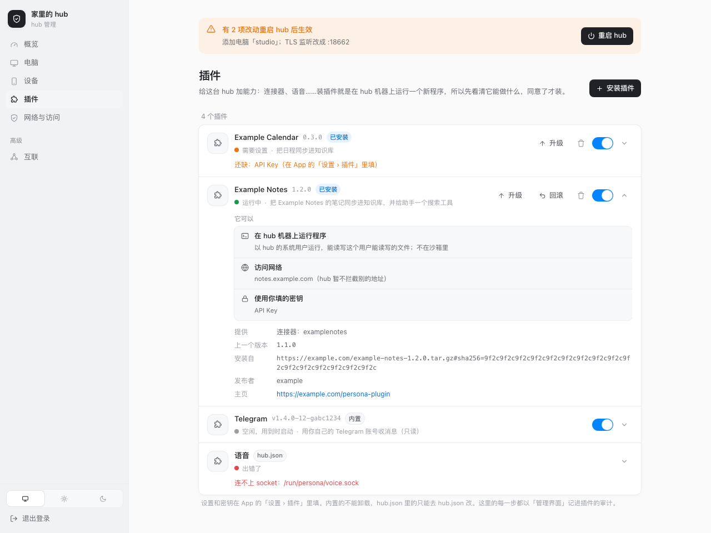
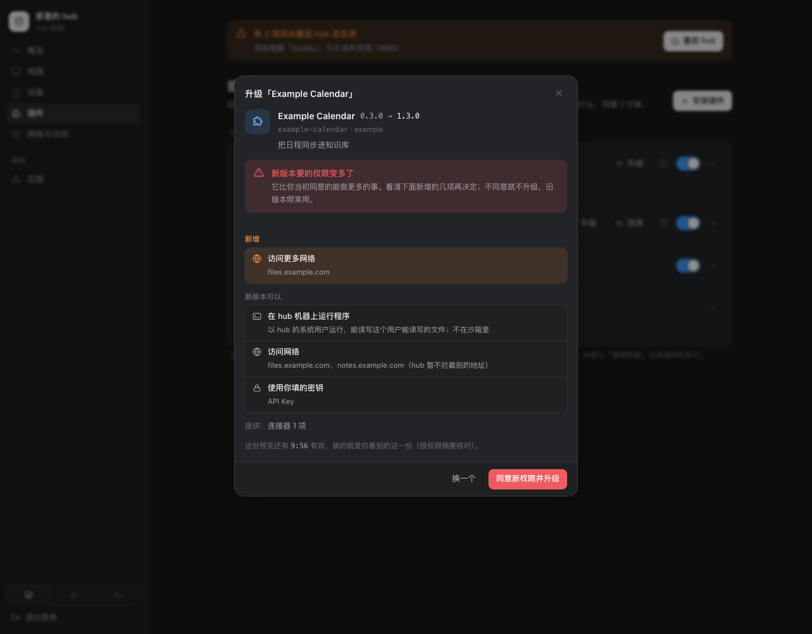

# 扩展

Persona 的扩展底座（#1101）：开源仓库只放通用能力和**扩展点**，只对某个公司、某个服务有意义的东西做成扩展，装上就有，不装也能跑。
骨架学 VS Code（清单 + `contributes` + 按需激活 + 独立进程），权限学 Chrome（显式声明、安装时展示），WordPress 只借事件通知、不借 filter。
设计取舍、分步和还没做的在 `docs/plan-extensions.md`。代码：清单、schema 子集、权限、注册表 `server/internal/extension`，进程宿主 `extension/host`，
程序一侧是官方 SDK `sdk/go/ext`（hub 内置的程序经 `extension/serve` 用它），一致性测试 `extension/conformance`；hub 里的接线 `server/internal/hub/extensions.go`、`extension_routes.go`、`extension_cli.go`，管理界面的接口 `admin_extensions.go`。

扩展从三个地方来，App 和接口里是同一个列表：

| 来源 | 是什么 | 能做什么 |
| --- | --- | --- |
| `builtin` | personad 自带，清单编在二进制里（Telegram 连接器，微信机器人，操控电脑 `cua`，浏览器 `ego`） | 开关、配置、密钥；不能卸载 |
| `hub.json` | hub.json 的 `extensions[]`，主人手写（现在的语音扩展），见下面「hub.json 里的扩展」 | 只读：去 hub.json 或管理界面改 |
| `installed` | 用 `personad extension install` 装在 hub 机器上的包，或跑在别处、经 socket 接入的扩展 | 全部：开关、配置、密钥、升级、回滚、卸载 |

三种形态：**纯声明**（只有清单，不跑代码）、**进程扩展**（hub 起子进程，stdin / stdout 上说进程扩展协议，可以同时在 unix socket 上起 HTTP）、
**远端**（跑在别处，hub 经 unix socket 接入）。

## 术语

和 VS Code 对齐的三层（#1843）：

| 术语 | 意思 | VS Code 里 |
| --- | --- | --- |
| 扩展（extension） | 安装、升级、授权、信任的单位：一个包，一份清单 `persona-extension.json` | extension |
| 扩展点（extension point） | hub 留的插槽：`connectors`、`channel`、`ui`、`quota`、`providers`、`api`、`assistant`、`agent_sources`、`events`、`voice`、`computer`、`browser`（下一节） | contribution point |
| 贡献（contribution） | 扩展挂到某个扩展点上的一项：清单 `contributes.<扩展点>[]` 里的一个 `{id, …}` | contribution |

连接器、渠道、页面、额度……都是「某个扩展点上的贡献」：一个扩展可以同时贡献好几个扩展点（lark-connector 扩展贡献 `api`、`connectors`、`assistant`）。
界面文案一律叫「扩展」（「设置 › 扩展」「扩展市场」），和 VS Code 中文版一样。

## 命名和兼容

这套东西原来叫「插件（plugin）」，#1844 改名。已经发出去的 App（iOS / Mac / 安卓 / 网页）、已经装好的扩展、写好的扩展包和市场还在用老名字，
所以老名字**全部照旧能用**；新写的代码、清单、文档用新名字。

| 旧 | 新 | 兼容 |
| --- | --- | --- |
| 清单 `persona-plugin.json` | `persona-extension.json` | 包里只有老名字时读老的；两个都有以新的为准 |
| `engines.plugin_protocol` | `engines.extension_protocol` | 都认（两个都写时必须一样）。hub 存下、发给 App 的清单仍写 `plugin_protocol`：回滚到老 hub 时它还读得懂 |
| 接口 `/api/v1/plugins/…` | `/api/v1/extensions/…` | 老路径在 hub 里改写成新路径处理，回答用老字段名（`plugins`、`plugin`、`plugin_name`，市场的个数 `plugins`）；新路径用 `extensions`、`extension`、`extension_name` |
| `/api/v1/admin/plugins…`（含上传 `…/upload`） | `/api/v1/admin/extensions…` | 同上 |
| 请求体 `{market, plugin}`（从市场预览） | `{market, extension}` | 都收 |
| 命令 `personad plugin …` | `personad extension …`，短名 `personad ext …` | `plugin` 照旧能用；命令行先调新路径，hub 还是老版本（没重启）时退回老路径 |
| 市场索引 `persona-plugins.json`，列表键 `plugins` | `persona-extensions.json`，列表键 `extensions` | GitHub 和 git 市场先找新文件、没有再读老的；https 写目录的（`https://…/dir/`）先读 `dir/persona-extensions.json`，404 时读 `dir/persona-plugins.json`；早先登记、存成完整地址的照旧读那个文件。两个列表键都认 |
| 环境变量 `PERSONA_PLUGIN_*`、`JARVIS_PLUGIN_*` | `PERSONA_EXTENSION_*` | 每个变量四种写法都给（`PERSONA_` / `JARVIS_` × `EXTENSION_` / `PLUGIN_`） |
| hub.json `plugins` | `extensions` | 都读；同一个 id 两边都有时用 `extensions` 里的 |
| 目录 `~/.persona/plugins/` | `~/.persona/extensions/` | hub 启动时把老目录整个挪过去，原地留一个链接 `plugins → extensions`（手工 `ssh -R` 到 `~/.persona/plugins/<id>.sock` 的、回滚到老 hub 的都照旧找得到）；挪不动或两个都在时继续用老目录并记日志，不挡启动 |
| features `plugins` / `plugin_manager` / `plugin_ui_slots` / `plugin_auto_upgrade` | `extensions` / `extension_manager` / `extension_ui_slots` / `extension_auto_upgrade`，加 `extension_market_spec` | 老的照报。新客户端看到 `extensions` 就走新路径，否则（老 hub）走老路径 |
| WebSocket 事件 `plugin_ui {plugin, …}`、`plugin_upgrade {plugin, …}` | `extension_ui {extension, …}`、`extension_upgrade {extension, …}` | 兼容期两份都发（先发老的）；推送载荷里 `plugin_upgrade` 和 `extension_upgrade` 两个键都带 |
| 协议 `initialize` 的 `plugin` | `extension` | hub 两个键都给；SDK 两个都认 |
| Go 包 `internal/plugin`、`plugin/host`、`plugin/serve`、`plugin/conformance` | `internal/extension/…` | — |
| 数据库表 `plugins`、`plugin_secrets`、`plugin_audit`、`plugin_markets`，设置键 `plugin_upgrades`，模型用途 `plugin.<id>`，hub↔node 的 `plugin_skills`、`~/.persona/plugin-skills/`，插槽名 `plugin_page`、图标名 `plugin`，错误码 `plugin_failed` / `invalid_plugin` / `no_plugins` | **不改** | 持久化和内部协议的身份（同 Jarvis → Persona 的做法，`docs/rename.md`）；改了要迁数据、node 和 hub 也不同步 |

**市场搬家**：仓库改名（`nwverse/removed` → `nwverse/persona-removed`）后，从它装的扩展来源是 `market:<市场 id>/<扩展 id>`，市场 id 不能变：
用 `personad extension market set-spec <市场 id> <新地址>`（接口 `PUT /api/v1/extensions/-/markets/{id}` `{spec}`）原地改地址，先用市场原来的 token 读一次新地址，读不到什么都不改。

**保留多久**：兼容层至少留到 **2027-05-05**（半年，覆盖已发布 TestFlight 构建的 90 天有效期和安卓的老版本），并且 hub 日志里老接口**连续 30 天没有调用**。
hub 给老路径的每次调用按路由计数（`extension_compat.go` 的 `legacyCalls`；每天第一次调用时把前一天的计数记一行日志 `extensions: old plugin API calls since …`，阶段 7 接到管理界面），
据此判断能不能删；删的时候另开 issue，按上表逐项去掉，并把存下的清单改写成 `extension_protocol`。

## 扩展点

扩展往哪些地方贡献什么，写在清单的 `contributes` 里：键是扩展点，值是贡献的列表，每项有一个 `id`（在这个扩展点里全局唯一，和别的扩展或 hub 自己的冲突就装不上）。

| 扩展点 | 命名空间（方法前缀） | 每项的字段 | 要求 | 接到哪 |
| --- | --- | --- | --- | --- |
| `connectors`（版本 2） | `connector.` | 连接器协议的清单字段：`id`（`^[a-z][a-z0-9]*$`）、`name`、`capabilities`、`hosts`、`agent_tools`、`unlisted`、`confirm_always?`（写操作名的通配，`connector_gate` 的 `allow` 也永远钳成手机上确认，`deny` 不变）、`poll_seconds`、`kinds`，以及 `kind_descriptions?`（种类 → 给模型看的一句「类型：…」，收件箱分拣、起草、AI 分身都用它）、`archive_sources?`（归档还能放在哪些名字下）、`cli?`（助手 PATH 上的命令行，见 `docs/connector-protocol.md`「命令行」） | 进程说协议 | 连接器注册表（设置 › 连接器、收件箱、知识库、助手的工具），方法见 `docs/connector-protocol.md` |
| `voice`（版本 1） | — | `id`、`name?` | `runtime.http` | App 的语音对话，契约见下面「语音」 |
| `computer`（版本 1） | — | `id`、`name?` | — | 助手操控电脑的工具和机器页的开关（只有内置的 `cua`），见 [computer-use.md](computer-use.md) |
| `browser`（版本 1） | — | `id`、`name?` | — | 助手用浏览器的工具（`browser_run` / `browser_look`）和机器页的「浏览器」（只有内置的 `ego`），见 [plan-ego-browser.md](plan-ego-browser.md) |
| `quota`（版本 1） | `quota.` | `id`、`name`、`hosts?`（网关主机名，可 `*.` 开头） | 进程说协议，权限 `launcher_keys` | 启动器页的「额度」，见下面「额度」 |
| `providers`（版本 1） | `provider.` | `id`、`name`、`description?`、`kind?`（`launcher` / `api`）、`api?`（`messages` / `responses`）、`base_url`、`model?`、`small_model?`、`models?: [{id, name?}]`、`dynamic_models?`、`key_hint?` | 纯声明即可；`dynamic_models` 要进程说协议 | 设置 › 模型供应商的「从扩展添加」，见下面「模型供应商」 |
| `api`（版本 1） | `api.` | `id`、`prefix`（一段路径）、`features?`、`events?`、`receipts?`（`[{method, path, kind}]`：要发送回执的写） | `runtime.http`，`on_startup`；有 `events` 要进程说协议 | App 用的一段接口 `/api/v1/<prefix>/…`，见下面「App 接口」 |
| `assistant`（版本 1） | `assistant.` | `id`、`skills?`（包里的目录，各有 `SKILL.md`）、`instructions?`（包里的 `.md`）、`gate?`（包里的 `.json`：技能里一个命令的闸门） | 包里有这些文件；`gate` 要有 `skills`，要凭据时进程说协议 | 助手的技能、说明和命令闸门，见下面「助手」 |
| `ui`（版本 2） | `ui.` | `id`、`title`、`placement`（插槽，见「UI 插槽」：`extension_page`（老名字 `plugin_page`） / `launcher_section` / `nav_page` / `overview_card` / `capsule_card` / `machine_section` / `inbox_item` / `widget`）、`hosts?`（只有 `launcher_section` 能写：网关主机名，可 `*.` 开头；不写就是任何启动器，扩展自己判断）、`icon?`（只有 `nav_page`）、`opens?`（只有 `overview_card`、`capsule_card` 和 `widget`）、`connector?`（只有 `inbox_item`，而且必须写：扩展自己贡献的一个连接器的 id）、`families` / `refresh_minutes?`（只有 `widget`，`families` 必须写，见「系统级位置」） | 进程说协议；`launcher_section` 要权限 `launcher_keys` | 扩展详情里的页面、启动器页上的一节、主导航、总览、机器详情、收件箱条目的详情、App 外的小组件和表盘，见下面「声明式 UI」「UI 插槽」「系统级位置」 |
| `agent_sources`（版本 1） | `agentsrc.` | `id`（`a-z0-9_-`，也是会话 id 的来源段 `<id>:<sessionKey>`）、`name`、`providers?`（`a-z0-9_`，如 `grok_bot`） | 进程说协议，`on_startup` | Agents 页的个人 Agent，和 hub 自己的 lark-connector 来源并列，见下面「个人 Agent 来源」 |
| `channel`（版本 1） | `channel.` | `id`（`^[a-z][a-z0-9_]{0,31}$`，不能是 8 位十六进制）、`name`、`kind`（`im`）、`connector?`（绑定和状态来自同一个扩展的这个连接器）、`bind?`（`qr` / `code` / `fields`）、`description?`、`capabilities`（收图片 / 文件 / 语音、`format`、`max_text`、`asks`、`push`、`typing`、`progress`、`threads`） | 进程说协议；没有 `connector` 时 `on_startup` | 和 Persona 对话的渠道：hub 跑统一管线（进对话、跟踪这一轮、答案发回、提问），扩展只管和 IM 说话，见 [channels.md](channels.md) |
| `events`（版本 1） | `event.` | `id`、`subscribe`（事件名的列表，见「事件」） | 进程说协议，`on_startup` | 只是告诉扩展 hub 上发生了什么，见下面「事件」 |
| `shortcuts`（版本 1） | `shortcut.` | `id`、`title`（1–40 字）、`description?`（≤ 200 字）、`params?`（≤ 8 个 `{name, title, kind: text / number / toggle / choice, choices?, required?}`）、`ui?`（同一个扩展的整页） | 进程说协议 | 快捷指令和 Siri 里的动作（iPhone、Mac、Apple Watch），见下面「系统级位置」 |
| `skills`（版本 1） | — | `id`、`dir`（包里有 `SKILL.md` 的目录） | 纯声明即可 | 助手的技能，和 `assistant.skills` 一样下发，见下面「纯声明贡献」 |
| `prompts`（版本 1） | — | `id`、`kind`：`instructions`（`file`：包里的 `.md`）/ `quick`（`title`、`text`） | 纯声明即可 | 接在助手 CLAUDE.md 后的说明；App 输入框的快捷提示，见「纯声明贡献」 |
| `themes`（版本 1） | — | `id`、`name`、`light` / `dark`：角色色 `accent`（必填）、`positive`、`caution`、`danger`、`ai` 的 `#RRGGBB` | 纯声明即可 | 设置 › 外观 › 主题色里多一种，见「纯声明贡献」 |
| `triage_templates`（版本 1） | — | `id`、`title`（≤ 40 字）、`text`（≤ 4000 字） | 纯声明即可 | 填收件箱分拣规则（`triage_rules`）时能选的模板，见「纯声明贡献」 |

hub 不认识的扩展点：扩展照样能装（可能是给新版 hub 写的），这一项不生效，预览和列表里有一条警告。以后加扩展点（知识库来源、链接识别……），在这张表里加一行。

## 清单 `persona-extension.json`

放在扩展包的根目录。例子（一个虚构的笔记服务的连接器）：

```json
{
  "manifest_version": 1,
  "id": "example-notes",
  "name": "Example Notes",
  "version": "1.2.0",
  "description": "把 Example Notes 的笔记同步进知识库，并给助手一个搜索工具。",
  "publisher": "example",
  "homepage": "https://example.com/persona-extension",
  "engines": {"persona": ">=202611050000", "extension_protocol": 1},
  "runtime": {
    "command": {"linux-amd64": "bin/example-notes-linux-amd64", "darwin-arm64": "bin/example-notes-darwin-arm64"},
    "args": ["serve"]
  },
  "contributes": {
    "connectors": [
      {"id": "examplenotes", "name": "Example Notes", "capabilities": ["status", "tools", "archive", "login"],
       "hosts": ["notes.example.com"], "poll_seconds": 600}
    ]
  },
  "configuration": {
    "type": "object",
    "properties": {
      "base_url": {"type": "string", "title": "服务地址", "format": "uri", "default": "https://notes.example.com"},
      "folders": {"type": "array", "title": "同步哪些文件夹", "items": {"type": "string"}},
      "include_shared": {"type": "boolean", "title": "包括别人共享给我的", "default": false}
    },
    "required": ["base_url"]
  },
  "secrets": [
    {"name": "api_key", "title": "API Key", "description": "在 Example Notes 的设置 › 开发者里生成", "required": true}
  ],
  "permissions": {"network": ["notes.example.com"]}
}
```

| 字段 | 必填 | 规则 |
| --- | --- | --- |
| `manifest_version` | 是 | `1` |
| `id` | 是 | `^[a-z0-9][a-z0-9_-]{0,31}$`；也是 `/api/v1/extensions/<id>/…` 的路径 |
| `name` | 是 | 1–40 个字符 |
| `version` | 是 | `MAJOR.MINOR.PATCH`（可带 `-pre`，不能带 `+build`）；升级只能往上 |
| `description`、`publisher`、`homepage` | 否 | `homepage` 只能是 https |
| `engines.persona` | 否 | hub 构建号的范围，只有 `>=N`、`<N` 及其组合；不满足装不上，已装的标成 `incompatible`。开发构建（构建号 0）不检查，给一条警告 |
| `engines.extension_protocol` | 有 `runtime` 或 `node` 时是 | `1` |
| `runtime` | 否 | 没有就是纯声明扩展。`command`：包里的相对路径，或 `{"<GOOS>-<GOARCH>": 路径}`，没有这台 hub 的平台就装不上；不能是绝对路径、不能跳出包（`..`、指向包外的链接都查），必须可执行；`personad` 只有内置扩展能用。`args`；`env`（不能是 `PERSONA_` / `JARVIS_` 开头，密钥不放这里）；`rpc`：`stdio`（默认）/ `none`；`http`：在 `PERSONA_EXTENSION_SOCKET` 上起 HTTP。`rpc: none` 又没有 `http` 装不上 |
| `node` | 否 | 在你选的电脑上运行的程序（#1830，`docs/plan-extensions.md`「七」）。`command`：只能按平台写 `{"darwin-<arch>" \| "linux-<arch>": 路径}`，路径规则同 `runtime`，不能是 `personad`；有哪些平台就是能在哪些电脑上跑，包里每个平台的程序都要在、要可执行（hub 不检查自己的平台）。`machines`：选电脑的配置字段名，这个字段必须是 `format: machine` 的数组，`items` 的 `x-os` 要写、且只能是 `command` 有程序的系统（要限定只能一台就写 `maxItems`）。`args`、`env`、`rpc`、`http` 同 `runtime`；`keep_running`：`lease`（默认，hub 半小时没续就停）/ `always`；`secrets`：发给电脑的密钥名（必须是 `secrets` 里的），其余只留在 hub；`permissions`：`network`（主机名）、`files`、`macos_privacy`，见「权限」。可以只有 `node` 没有 `runtime`（贡献的扩展点要不需要 hub 上的程序）。怎么跑见「在电脑上运行的程序」 |
| `activation_events` | 否 | `on_startup` / `on_call` / `on_http`，见「什么时候跑」；有 `runtime` 时默认 `on_call`；`rpc: none` 的只能 `on_startup` |
| `contributes` | 是（合集除外） | 见「扩展点」，至少一项；往别的扩展导出的扩展点贡献写 `"<扩展 id>.<扩展点 id>"`，见「依赖、导出和合集」 |
| `depends`、`exports`、`extension_pack` | 否 | 依赖的扩展、开给别的扩展的扩展点、合集的成员，见「依赖、导出和合集」 |
| `configuration` | 否 | 配置的 JSON Schema，只能用下面的子集 |
| `secrets` | 否 | `[{name, title, description?, required?}]`，`name` 是 `^[a-z][a-z0-9_]{0,31}$`，最多 32 个 |
| `permissions` | 否 | 见「权限」 |

清单最大 256 KB，按严格模式读：任何一层有不认识的字段都装不上（拼错的 `permission` 不会被悄悄忽略）。

### 配置：表单的子集

根是 `{"type": "object", "properties": {…}, "required": [...]}`。每个客户端都能把它画成表单，表单按属性在文件里的顺序排（hub 解析时保留顺序，
接口给的是排好的 `form.fields`）。子集以外的写法装不上，保证每个扩展的配置在 App 里都改得了。

| 类型 | 能用的关键字 | 表单 |
| --- | --- | --- |
| `string` | `title`、`description`、`default`、`enum`（带标签用 `oneOf: [{"const", "title"}]`）、`format`（`uri` / `email` / `hostname` / `machine`）、`x-os`（只配 `machine`：`darwin` / `linux` / `windows` 的列表）、`pattern`、`minLength`、`maxLength` | 输入框；有 `enum` 是选择器 |
| `integer`、`number` | 说明类、`enum`、`minimum`、`maximum` | 数字输入 |
| `boolean` | 说明类 | 开关 |
| `array` | `items` 只能是 `string`（可带 `enum`），`minItems`、`maxItems`、`uniqueItems` | 可增删的列表；`items` 有 `enum` 是多选；`items` 是 `format: machine` 时每台机器一个开关（下面） |
| `object` | 只在第一层，里面只能是上面的标量和数组；可以有自己的 `required` | 一个分组 |

**机器（`format: machine`）**：值是这台 hub 上某台机器的 id。
- 一列这种值（`{"type": "array", "items": {"type": "string", "format": "machine", "x-os": ["darwin"]}}`）在 App 和网页的设置页画成**每台机器一个开关**：机器名、在线与否，操控电脑一类的扩展（贡献 `computer`）再加 Cua 的状态。`x-os` 只列这些系统的机器。
- 开关**即时生效**，只改这一项，不等「保存」，表单里别的草稿留着。对不上任何机器的值照样列出来，可以关掉。
- 这一列带 `x-confirm`（一句话）时，打开某台的开关前先问这句话，确认了才存；关掉不问。App 和网页都是一个弹窗：标题「打开「<机器名>」？」，正文是这句话，按钮「取消」「打开」（App 用 `alert`，网页用 `Dialog`，#1830）。
- 表单里只有这种开关时，表单下面不再写「…即时生效，不用保存」（字段自己的说明里有，没有要保存的）；还有别的项时照旧说哪些即时生效、其余点「保存」。扩展 `cua` 的「扩展开着时不自动锁屏」用它（#1507）。
- hub 加载扩展时，把这类值里写成机器名、主机名的（大小写、空格、`-`、`_` 不计，只对上一台时）换成那台的 id，存回去（`extension_machines.go`）。

**约定的设置项**：hub 认得的名字，扩展声明了就有额外的用处。
- `triage_rules`（第一层的 `string`，建议 `maxLength` 不超过 4000：hub 只用前 4000 字）：这个来源的收件箱分拣规则，用户的原话。扩展交条目时把它带在 `rules` 上（`docs/connector-protocol.md`），
  hub 分拣这个来源的条目时用它代替全局的 `inbox.rules`（`docs/inbox.md`「AI 分拣」）。声明了它的扩展在助手的 `jarvis_settings` 里有一项
  `inbox.rules.<扩展 id>`：读随便读，改的时候手机上弹确认（改前 → 改后），批准了才经同一条改配置的路（按 schema 校验、只改这一项、扩展重启）写进去；
  hub.json 来的扩展只能读。

用收件箱的扩展**必须**有 `triage_rules`，见下面「收件箱的通用规则」。

### 收件箱的通用规则（#1730）

用收件箱（连接器声明了 `inbox`）的扩展都要守这三条；不用收件箱的扩展不受影响。各扩展自己怎么做（哪些类型及时交、多久一轮，比如飞书扩展的
`immediate_kinds`、`period_minutes`）是扩展自己的设置，不进协议。

1. **唤醒**（原来就有）：连接器有变化就发 `connector.changed {scope: "inbox"}`，hub 另外按 `poll_seconds` 定期拉（`docs/connector-protocol.md`）。
2. **自己的分拣规则**：设置里必须有第一层的 `triage_rules`（`string`，上面「约定的设置项」），交条目时带在 `rules` 上。
   **装、升级时查**（预览这一步：命令行、App、管理界面、浏览器上传、市场，连同市场扩展的自动升级）：没有就装不上（「设置里却没有 triage_rules……装不上」）。
   已经装好的不重新查，照常运行；回滚回到装过的版本也不查。内置扩展（微信机器人这些）不受这条管。
3. **自己的兜底（可选）**：连接器的 `capabilities` 加 `fallback`，承诺每个收件箱条目都带兜底分级 `extra.rule_tier`（`action` / `fyi` / `noise`）：
   模型分不了时按它进收件箱（`docs/inbox.md`「AI 分拣」），模型照样先分。**没声明 `fallback` 的，必须有能用的分拣模型**（设置 › 模型 的「信息筛选」，`inbox.triage`）：
   - **启用**：打开开关（`PUT /api/v1/extensions/{id}/-/enabled`，管理界面同理、渠道页的开关也是），以及装好（装上就是开着的）、开着时升级（含自动升级）时，
     如果「信息筛选」调不了（解析出来没有地址、模型或密钥：没在这里配、hub.json 的 `ai` / `inbox.triage_ai` 也没有、也没有能自动选的带 Key 的接入），
     返回 **409 `needs_triage_model`**：「先在 设置 › 模型 里配好『信息筛选』，再启用这个扩展」。被拒的安装、升级不用掉预览，配好模型用同一个预览再来一次就行。
     自动升级被拒时扩展上记一条「升级失败」，原因就是这句话。
   - **改模型**：有这样的扩展开着时，把「信息筛选」改成调不了的（`PATCH /api/v1/model-config/purposes/inbox.triage`）返回 **422 `triage_model_in_use`**（不用 409：App 把模型设置的 409 当成「别处改过了」，会把原因藏起来），
     `extensions` 列出是哪几个扩展、`error` 让先停用它们。去掉自己的选择、退回到仍然调得了的 hub.json 配置或自动选择，不算清掉，照常保存。
   - **hub.json 里的扩展**没有开关，hub 拦不住：照常启动，但调不了模型时**不收它的收件箱条目**，设置 › 扩展 里状态是 `needs_setup`、
     `needs_setup` 写「需要先配分拣模型」，模型能用了就恢复。（现在 hub.json 只能配 HTTP 扩展，还配不出连接器；这一条先按规则做好。）
   - 运行时照 #1644：模型分不了、条目又没有兜底，就不进收件箱，`GET /api/v1/inbox` 的 `triage` 里说有几件在等。

**老 hub**：#1680 之前的 hub 不认识 `fallback`，声明了它的连接器整个注册不上；#1680 的 hub 去掉它、记一行日志，当成没有兜底（于是要模型）。
声明 `fallback` 的扩展版本在 `engines.persona` 里写上带 #1730 的 hub 构建号（`">=YYYYMMDDHHMM"`，构建号是构建时的 UTC 时间）。

不支持 `$ref`、`allOf` / `anyOf`、`if` / `then`、对象数组、更深的嵌套、`additionalProperties`（额外的键一律不收）。值最大 64 KB。
`default`、`enum` 的值也按类型查。属性名像 `password` / `token` / `secret` / `api_key` 的给一条警告：配置明文存、明文显示，该放 `secrets`。

### 权限

学 Chrome：显式声明，装的时候整份给人看，升级要了更多就要重新同意。词表是封闭的，不认识的权限装不上。

| 权限 | 写法 | 意思 | hub 怎么守 |
| --- | --- | --- | --- |
| 运行程序（有 `runtime` 就有） | — | 在 hub 机器上以 hub 的系统用户运行 | 装在 hub 上的扩展默认在**沙箱**里跑（只能读写自己的包和数据目录，内存 / CPU 有上限），受信任市场来的默认不开，见下面「沙箱」 |
| `network` | 主机名列表，可以 `*.` 开头（只配下面的子域名，不配它自己），小写，不带协议、端口、路径；IP 地址只能原样列出 | 会访问哪些地方 | 在沙箱里的扩展只能经 hub 的出网代理出去，代理只放这些主机，见下面「出网」；不在沙箱里的照旧只展示和记录 |
| `hub` | 范围的列表，见下面「hub 的接口：范围」 | 用 hub 的哪几部分接口（读知识库、驱动 Agent……） | 扩展拿到的 token 只开这些范围的路由，别的回 403 `permission_denied` |
| `hub_api`（旧写法） | `true` | 拿到 hub 的地址和完整 token（`PERSONA_HUB_URL`、`PERSONA_HUB_TOKEN`），能做 hub 主人能做的一切 | 没接受就不给这两个变量；安装页写成「完整权限（旧写法）」并给警告。同时写了 `hub` 的以 `hub` 为准 |
| `launcher_keys` | `true` | 用启动器的 Key 访问它的网关（贡献 `quota`、`launcher_section` 的 `ui` 必须有） | 扩展看不到 Key：hub 或那台电脑替它发请求，只发到启动器自己的网关；没接受就不问它 |
| 显示在 App 里（有 `nav_page` / `overview_card` / `machine_section` / `inbox_item` 的 `ui` 就有） | — | 在主导航、总览、机器详情页、收件箱条目的详情里显示自己的界面（列出每处的标题） | 和事件一样不用写在 `permissions` 里，按贡献算进安装前给人看的「它可以」和权限摘要；升级时多了一处要重新同意，见「UI 插槽」「权限」 |
| 密钥（有 `secrets` 就有） | — | 用你填的密钥 | 每个扩展只拿到自己的 |
| 在你选的电脑上运行程序（有 `node` 就有） | — | 在列出的系统（Mac、Linux 电脑）上以 node 的系统用户运行；每台打开时再问一次 | 只展示：**没有沙箱** |
| `node.permissions.network` | 主机名列表，同 `network` | 在那些电脑上会访问哪些地方 | 只展示和记录 |
| `node.permissions.files` | `true` | 读写那些电脑上自己数据目录以外的文件 | 只展示和记录 |
| `node.permissions.macos_privacy` | `true` | 会请求 Mac 的完全磁盘访问、辅助功能这类系统权限 | 只展示；系统权限要用户在那台 Mac 上同意 |
| 发给电脑的密钥（`node.secrets`） | — | 这几个密钥会发到选中的电脑上 | 只在内存里交给程序，不落那台电脑的盘 |

#### hub 的接口：范围（#1855）

扩展要调 hub 的 HTTP 接口，就在 `permissions.hub` 里列出用到的范围，不再要完整 token：

```json
"permissions": {"hub": ["kb.read", "agents.read"]}
```

| 范围 | 安装页的说法 | 开哪些路由 |
| --- | --- | --- |
| `kb.read` | 读知识库 | `GET /api/v1/kb/…`、`GET /api/v1/kb-search` |
| `kb.write` | 改知识库里的条目 | `PUT /api/v1/kb/{kind}/{id}` |
| `inbox.read` | 读收件箱 | `GET /api/v1/inbox`、`/inbox/{id}`、`/inbox/mutes` |
| `inbox.write` | 处理收件箱 | 标为已处理、起草、回复（只能是文字：带 `changes` 或 `/agent` 的回复照旧只认完整权限）、文档状态、静音、刷新 |
| `agents.read` | 看各台电脑上的 Agent 和对话 | `GET /api/v1/sessions…`（列表、信息、条目、图片、屏幕）、`/interactions`、`/agents…`（个人 Agent）、`/workspaces`、`/workspace-board` |
| `agents.control` | 驱动 Agent | `POST /api/v1/sessions`（新建）、对话的 `messages` / `interrupt` / `queue` / `seen`、`POST /api/v1/interactions/{id}/resolve`、个人 Agent 的发消息和已读 |
| `machines.read` | 看你的各台电脑 | `GET /api/v1/machines`、`/machines/{id}/metrics`、`/machines/{mid}/stat` |
| `notify` | 给你的设备发通知 | `POST /api/v1/notify`（见「发通知」） |
| `assistant.ask` | 给 Persona 开对话、读对话动态 | `GET /api/v1/assistant`、`POST /api/v1/assistant/conversations`、`GET …/conversations/{id}/feed` |
| `extensions.call:<扩展 id>` | 调用扩展「…」的接口 | 那个扩展自己的 HTTP：`/api/v1/extensions/<id>/…`（不含 hub 的 `/-/` 接口） |

- **哪条路由属于哪个范围**登记在 `server/internal/hub/extension_scopes.go` 的 `routeScopes`（按路由注册时的 pattern）；**没登记的路由只认完整的凭据**，扩展的 token 一律 403。
  hub 的全部路由和各自的决定列在 `server/internal/hub/testdata/route_scopes.txt`（`-` 是只认完整凭据），`TestRouteScopes` 守着它：加了路由测试就失败，
  要先决定扩展能不能调（要的话加进 `routeScopes`），再 `PERSONA_UPDATE_ROUTE_SCOPES=1 go test ./internal/hub -run TestRouteScopes`，在 diff 里看清楚。
- **token**：`pext_` 开头。hub 每次启动扩展的程序时签一个新的（旧的同时作废），经环境变量 `PERSONA_HUB_URL` / `PERSONA_HUB_TOKEN`（旧名 `JARVIS_*` 一起给）
  和 `initialize` 的 `hub.url` / `hub.token` / `hub.scopes` 给它（跑在别处的扩展只有 `initialize` 这一条）。扩展停用、升级、改配置、卸载时作废，下次启动再签。
  token 只在 hub 的内存里：扩展的进程是 hub 的子进程，随 hub 一起重启（`docs/hub-restart.md`），新 hub 会再签新的；以后把扩展挪出 hub 的 cgroup 时再落库。
- 只认本机：扩展的 token 从公网来的请求回 403 `extension_token_local_only`。没有范围的路由回 403 `{"code": "permission_denied"}`，缺范围的再带 `scope`（缺的那个）。
- 扩展用 token 调这些路由时和完整权限的设备一样（不受手表那种只读设备的限制：回答卡片、发消息照常），收件箱带 `changes` / `/agent` 的回复除外。
- **兼容**：`hub_api: true` 的老扩展照旧拿 hub 的完整 token（只在环境变量里），装、升级时多一条警告「hub_api 是旧写法」；hub.json 里的扩展照旧拿完整 token。
  完整 token 涵盖所有范围：从 `hub_api` 升级到只要几个范围的新版本不用重新同意；反过来要。
- 权限摘要算上范围（规范化：排序、去重）；没有 `hub` 的扩展摘要和以前一样。升级时多了范围要重新同意，`added_permissions` 里是「使用 hub 的更多功能」。

### 知识库 RPC（#1908）

扩展的程序可直接调用下面六个方法，不需要经 HTTP 传 token。权限仍只声明在 `permissions.hub`，hub 按已获准的权限检查，
不是按清单中申请的权限放行；`kb.write` 不隐含 `kb.read`。旧 `hub_api` 完整权限兼容。所有调用都由 hub 转给管理者的知识库，
不要求扩展能读 hub 或管理者的数据目录。

| 方法 | 参数 | 返回 | 范围 |
| --- | --- | --- | --- |
| `kb.list` | `{kind,tag?,limit?,offset?}` | `{items,tags,total,next_offset?}` | `kb.read` |
| `kb.get` | `{kind,id,recent_chars?}` | `{detail}` | `kb.read` |
| `kb.day` | `{id,day}`，day 为 `YYYY-MM-DD` | `{day,messages,prev,next}`；`messages[].n` 是源文件中从 1 开始的行号 | `kb.read` |
| `kb.search` | `{query,messages?,limit?}` | `{hits}` | `kb.read` |
| `kb.update` | `{kind,id,...更新字段}` | `{id}` | `kb.write` |
| `kb.owner` | `{}` | `{name,aliases,handles:[{kind,value}]}` | `kb.read` |

kind 是 `projects`、`chats`、`people`、`docs`、`meetings`、`events`。list 默认 30 条、最多 200 条，offset 从 0 开始；
未读完时按 next_offset 继续。跨请求发生变化时分页不构成快照，扩展应去重并在需要时重读。search 默认搜消息，默认 40 条、最多 200 条；
get 默认带最近 12000 字符的消息，recent_chars 可为 0、最多 20000。空列表返回 `[]`。
`kb.get` 不附带实时 Agents，读取 Agent 状态仍须相应权限。缺少范围回 `permission_denied`，错误 data 带 `scope`；
未知字段、必填或格式错误回 `invalid_params`，缺实体回 `not_found`，管理者不在线回 `assistant_offline`，知识库未准备好回 `kb_unavailable`。
内部 `kb.forget`、`kb.context`、`kb.posts_*` 等不在此白名单内，完整权限的扩展也不能借此调用。

更新字段继承原有知识库更新接口，另加 `pinned`、`lock` 和 `remove_people/remove_chats/remove_aliases/remove_projects`。
保护规则、适用实体、本人身份的加密和历史限制见 [知识库](knowledge.md#扩展整理知识库1908)。本人别名由用户编辑 assistant 设置，
不另开扩展写本人身份的 RPC。

订阅例子：

```json
{"permissions":{"hub":["kb.read","kb.write"]},"activation_events":["on_startup"],
 "contributes":{"events":[{"id":"knowledge","subscribe":["kb.changed","kb.forgotten"]}]}}
```

hub 推送 `event.kb.changed {kind,id,what}` 和 `event.kb.forgotten {source}`。只有仍启用、对应贡献开启、程序运行中，且实际获准
`kb.read`（或旧完整权限）的订阅者收到；只写权限不够。通知只带上述标识字段，不附加正文、本人 handles 或绝对路径，也不持久补发，扩展启动/重连后先读全量状态。

### 出网（#1856）

hub 里有一个**出网代理**（`server/internal/extension/egress`），第一次有扩展要用时起，只听本机：

- **谁经过它**：在沙箱里的扩展（下面「沙箱」）只有它一条路出网；沙箱开着、但这台机器上没有沙箱的，环境变量也指向它（守规矩的程序会经过它，不守的拦不住，状态里写明）。
  沙箱关着的扩展、内置的、hub.json 里的照旧，不经过它。
- **放谁**：只放这个扩展 `permissions.network` 里的主机（`*.example.com` 是它下面的子域名；IP 地址只有原样列出的才放），别的回 403「`<主机>` is not in this extension's
  permissions.network」并记一行日志、按扩展计数（放行 / 拒绝的次数、最后一次拒绝的主机，在扩展详情的 `sandbox.egress` 里；也记进「运行情况」的计数 `egress.allowed` / `egress.denied`）。
  名字解析到本机回环、链路本地地址（云上的元数据服务）的不放，除非原样列的就是那个 IP。端口不限。
- **hub 自己的接口**：拿到 hub token 的扩展（`hub` 范围或旧的 `hub_api`）在沙箱里用 `http://hub.persona.internal` 访问 hub（`PERSONA_HUB_URL` 和 `initialize` 的 `hub.url` 就是它），
  代理把它接到 hub 本机的端口；沙箱里的回环不是 hub 的回环。
- **认谁**：本机的 TCP 端口按代理凭据认扩展（`HTTP(S)_PROXY=http://ext:<凭据>@127.0.0.1:<端口>`，每次启动换新，停用、卸载即失效）；Linux 沙箱另有每个扩展一个 unix socket
  （`~/.persona/extensions/run/<id>/proxy.sock`），socket 就说明了是谁。
- **hub 自己的上游代理**：hub 环境里有 `HTTPS_PROXY` / `HTTP_PROXY`（`NO_PROXY` 照算）时，代理经它出网（CONNECT），扩展不用知道。
- 环境变量：`HTTP_PROXY`、`HTTPS_PROXY`、`http_proxy`、`https_proxy`、`ALL_PROXY`、`all_proxy` 指向代理，`NO_PROXY` 为空。Go、Node（要自己用代理的库）、Python、curl 都认；
  只认 `HTTPS_PROXY` 的老客户端在沙箱里照样出不去，这是要的效果。

### 沙箱（#1856）

**谁在沙箱里**：只管 hub 从包里运行的**已安装**扩展（不管内置的、hub.json 里的、跑在别处的 `remote:`）。

| | 默认 |
| --- | --- |
| 从**受信任的市场**装的：市场记下的签名公钥（「签名」）是官方两个市场的（`persona-extensions`、`persona-removed`），或在 hub.json 的 `trusted_extension_markets` 里（key id，或 `market.pub` 那一行 `ed25519:…`） | 不开 |
| 别的：其他市场（没签名的也算）、`dir:`、`file:`、`https://…`、上传 | 开 |
| **#1856 部署前已经装好的**（hub 第一次带着沙箱起来时） | 记成「不开」，照原样跑；要开用下面的命令 |

主人可以改每一个（`personad extension sandbox <id> on|off|default`，或管理界面 `PUT /api/v1/admin/extensions/{id}/sandbox`，或 hub 机器上主 token 经回环的
`PUT /api/v1/extensions/{id}/-/sandbox` `{"enabled": true|false|null}`，`null` 回到默认）。手机改不了（关沙箱等于放大信任，和装扩展一样只在 hub 机器和管理界面做）。
改了就重启这个扩展，审计里记 `sandbox`。选择存在 hub 的设置 `extension_sandbox`；卸载时删掉，重新装从默认开始。

**Linux**：`bwrap`（bubblewrap）+ `systemd-run --user --scope`（`server/internal/extension/sandbox`）：

- 新的用户、PID、网络、IPC、UTS 命名空间；系统目录（`/usr`、`/bin`、`/lib*`、`/etc`、`/opt`）只读，沙箱自己的根也只读，`/tmp` 是私有的空目录，**家目录看不到**（连同它的路径也写不进去）；
  包目录只读，自己的数据目录（`PERSONA_EXTENSION_DATA`，也是 `HOME`）和运行目录（`~/.persona/extensions/run/<id>/`：它的 HTTP socket、代理的 socket）可写。
- 网络命名空间里只有回环：沙箱的第一个进程是 `personad __sandbox-run`（personad 只读挂在 `/run/persona/personad`），把沙箱自己回环上的 `127.0.0.1:3128` 转到代理的
  unix socket，再运行扩展的程序（stdin / stdout / stderr 原样、信号转交、退出码照传）。所以任何语言的 HTTP 客户端只要认 `HTTP(S)_PROXY` 就能用，SDK 不用改。
- `systemd-run --user --scope` 给它上限：`MemoryMax`（默认 1024 MB）、`MemorySwapMax=0`、`CPUQuota`（默认 100%，即一个核）。清单可以申请别的：
  `runtime.resources: {"memory_mb": 64–8192, "cpu_percent": 10–800}`（老 hub 严格读清单，用它的扩展在 `engines.persona` 里写上带 #1856 的构建号）。
  用不了 `systemd-run --user` 时（没有用户的 systemd）只有 bwrap，没有上限。
- hub 起来后第一次用时探一次：`bwrap` 在不在、能不能建网络命名空间，`systemd-run --user --scope` 能不能用。

**macOS**：`sandbox-exec`，profile 是：默认放行，再拒绝所有出站网络（只放 hub 代理的本机端口和自己运行目录里的 unix socket）、拒绝所有写（只放数据目录、运行目录、`/dev`）、
拒绝读家目录（只放包、数据、运行目录）。没有网络命名空间，所以代理用本机 TCP 端口加凭据；没有资源上限。2026-11-05 在 macOS 27.2 上实测：写数据可以、写 / 读家目录不行、
只连得上代理的端口、直连外网不行，包放在家目录下照样能读自己的包。

**这台机器没有沙箱**（没装 bwrap、内核不让建用户命名空间、别的系统）：沙箱开着的扩展照样跑，只是指向出网代理；扩展的 `sandbox.active` 是 `false`、`sandbox.why`
和列表的 `warnings` 写「没有沙箱：机器上没有 bwrap（bubblewrap）」。装 bwrap：Debian / Ubuntu `apt install bubblewrap`，没有 root 时可以把静态编译的 bwrap 放进 hub 的 `PATH`。

**接口**：已安装扩展的 `ExtensionView`（列表和详情）多一个 `sandbox`：`{enabled, default, chosen, active, why?, trusted?, egress: {allowed, denied, last_denied?, denied_at?}}`。

**权限摘要**：`permissions`（规范化后）加上「运行不运行程序」的 sha256；有 `node` 的再加上它的系统、node 侧权限和发给电脑的密钥名（没有 `node` 的扩展摘要和以前一样，已装的不用重新同意）。安装要回传预览给的摘要；升级时权限变多了也要（没变多不用重新同意，但仍要明确执行升级）。
接受的那一份存在 `plugins.granted`。

## 安装、升级、回滚、卸载

装扩展就是在 hub 机器上跑一个新程序，所以任意来源的包只有 hub 的主人能装，两条路：

- **hub 机器上的命令行**：`personad extension …` 读 hub.json 里的主 token，经回环调下面的接口。
- **管理界面**（`/admin` 的「扩展」页，[admin.md](admin.md)「扩展」）：管理员密码登录的会话，过访问范围、CSRF 和预览限流，接口在 `/api/v1/admin/extensions…`。
  管理界面本来就能加电脑、发凭据，和装扩展一样要紧，所以同一把密码；审计里记成 `admin UI`。

手机（设备凭据）能看列表、开关、改配置、填密钥；装、升级、回滚、卸载只能针对**已登记的扩展市场里的扩展**（见「扩展市场」），
任意来源（目录、文件、网址、上传、跑在别处）仍只走上面两条路。

扩展包：一个目录，或一个 `.tar.gz` / `.tgz` / `.zip`（根目录或唯一的顶层目录里有清单）。最大 200 MB、2 万个文件；解包时拒绝绝对路径、`..`、指向包外的链接、
设备文件，zip 里不能有链接；文件权限只留「可执行或不可执行」。在 Mac 上打的包常带 macOS 的元数据（tar 没设 `COPYFILE_DISABLE=1` 时的 `._*` AppleDouble 文件、
Finder 压缩的 `__MACOSX/`、`.DS_Store`），解包时一律跳过，不算顶层目录（#1590：一个扩展的包顶层多了个 `._<扩展 id>`，装不上）。

| 来源 | 写法 |
| --- | --- |
| hub 机器上的目录 | `dir:/path/to/extension`（或直接写一个存在的目录）：**拷一份**进来，原目录以后改了不影响已装的；`.git` 不拷 |
| hub 机器上的包 | `file:/path/to/extension.tar.gz`（或直接写路径） |
| 网址 | `https://…/extension.tar.gz#sha256=<64 位 hex>`：必须带 sha256，下载后校验；不收 http |
| 跑在别处 | `remote:rpc=<socket>,http=<socket>`（至少一个）：不拷文件；清单问扩展要（说协议的回 `manifest`，只有 HTTP 的回 `GET /manifest`） |
| 浏览器上传（只有管理界面） | `.tar.gz` / `.tgz` / `.zip` 文件本身：最大 200 MB，直接写进这次预览的暂存目录再解包，来源记成 `upload:<文件名>`，其余和 hub 机器上的包一样 |

私有扩展：在 hub 机器上 clone 私有仓库再 `dir:` 装，或者私有仓库的 CI 出一个带 sha256 的包。

1. **预览**：包放进 `~/.persona/extensions/staging/<预览 id>/`，解析和校验清单、查程序在不在包里、查 `engines`、查贡献的 id 有没有被占，
   回 `{preview_id, manifest, permissions（给人看的几行）, permissions_digest, warnings, expires_at, upgrade?, from?, more_permissions?, added_permissions?}`。10 分钟后清掉。
   `added_permissions` 只在升级时有：新版本比已装的多出来的那几项（多运行程序、多的主机、多的密钥、要 hub 的 token、要用启动器的 Key），升级页用它说清「变多了什么」。
2. **安装**：带 `preview_id` 和 `permissions_digest`；包挪到 `~/.persona/extensions/installed/<id>/<version>/`，写数据库。必填的密钥没填、配置不合 schema 时状态是 `needs_setup`，不启动。
3. **升级**：同样先预览，版本必须更高。旧进程停，新版本起；新版本 30 秒内起不来（握手失败、退出）就自动回滚到旧版本。只留当前和上一个版本的目录。配置、密钥留着。
4. **回滚**：回到上一个版本（只能回一步）。
5. **开关**：停用的不跑进程，贡献全部不生效（连接器从注册表里拿掉），配置和密钥留着。
6. **卸载**：停进程，删数据库里的行和密钥、包目录、数据目录（`--keep-data` 留数据目录），它贡献的连接器在 `connector_secrets` 和连接器设置里的那几行也删。
   内置的和 hub.json 来的不能卸载。

每一步都记进 `plugin_audit`（谁、什么时候、从哪个版本到哪个），不记配置的值和密钥。谁：`personad extension`（命令行）、`admin UI`（管理界面）、
`hub token` / `device:<id>`（App 的开关、配置、密钥）。

### 贡献的开关（#1854）

除了整个扩展的开关，**每个贡献**（`<扩展点>/<id>`）都能单独关：比如只要一个扩展的连接器、不要它在主导航上的入口，或者一个供应商扩展只留其中几家。

- 关掉的贡献不生效，扩展的其余部分照常：hub 按「去掉关掉的贡献」后的清单注册（`Extension.Manifest`；完整的清单是 `Extension.Full`），
  UI 插槽、供应商预设、助手的技能和说明、事件订阅、App 接口、额度、个人 Agent 来源都看不到它；程序在 `initialize` 的 `active` 里只拿到开着的那些
  （每个扩展点一项：`{"ui": ["usage"], "providers": ["fast"], …}`），扩展不用为关掉的贡献做任何事。改了开关扩展会重启（和改配置一样）。
- 关掉的 id 仍然算这个扩展的：别的扩展不能拿它装进来；权限、权限摘要、升级时比较的都是完整的清单，关掉贡献不会让扩展「少要权限」。
- **连接器**的开关就是连接器自己的开关（设置 › 连接器、收件箱和知识库原来就用它），这里只是同一个开关的另一个入口；绑在连接器上的**渠道**跟着那个连接器。
  它们在列表里是 `via: "connector"`、`can_disable: false`，改的时候走连接器的开关（连接器还没起来时回 409 `not_running`）。
- hub.json 来的扩展不能单独关（去 hub.json 改）。
- 存在 `plugins.disabled_contributions`（迁移 `0363`，`["ui/usage", …]`）；升级、回滚后留着（新版本没有这一项了就不起作用）。

接口（完整权限的设备）：

| 接口 | 做什么 |
| --- | --- |
| `GET /api/v1/extensions/{id}/-/` | 详情多一个 `contributions: [{point, id, title?, enabled, can_disable, via?}]`（按扩展点、再按清单里的顺序）；老的 `contributes`（扩展点 → id）照旧是全部 |
| `PUT /api/v1/extensions/{id}/-/contributions/{point}/{cid}` `{enabled}` | 开关一项，回详情；没有这一项 404，hub.json 的 409 `read_only`。老路径 `/api/v1/plugins/…` 同样能用 |

命令行：`personad extension contributions <id>`（列出）、`personad extension contribution <id> <point>/<cid> on|off`。

### 依赖、导出和合集（#1854）

**依赖** `depends: [{id, version?}]`：这个扩展要别的扩展装着、开着（`version` 是版本范围：`>=1.2.0`、`<2.0.0` 或两个都写，空格隔开；不写是任何版本）。

- **装、升级时**：预览的 `depends` 列出每一项在这台 hub 上的样子（`state`：`ok` / `missing` 没装 / `disabled` 停用着 / `old` 版本不够，`installed` 是装着的版本）。
  没装的、版本不够的，hub 去登记的市场里找（先找它自己来自的市场，再按 id 找别的），找到的作为**一起装**的预览放进 `bundle`（依赖的依赖也跟着，最多 4 层），找不到的写进 `unresolved`。
  安装 / 升级请求要带上 `bundle: [{preview_id, permissions_digest}]`，**每一个**都要和预览里的一致（用户在同一屏上看过它们各自能做什么），hub 先按顺序装它们、再装这一个；
  有 `unresolved`、或者还有没装又不在 `bundle` 里的依赖，就什么都不装（400）。不是从市场来的扩展（目录、文件、上传）同样会去市场找依赖。
- **运行时**：依赖没装、停用、版本不够时，这个扩展是 `needs_setup`，「还缺」写「先装扩展「X」」「先启用扩展「X」」「扩展「X」要 >=2.0.0（现在是 1.0.0）」，不启动；满足了自己起来（hub 在被依赖的扩展变了以后重新看一遍依赖它的）。
- **停用、卸载被依赖的**：还有开着的扩展依赖它时，`PUT …/-/enabled {enabled: false}` 和 `DELETE …/-/` 回 409 `{code: "has_dependents", dependents: [{id, name}], error}`；
  带上 `cascade`（`{"enabled": false, "cascade": true}`、`?cascade=1`）就先把它们停用（只停用，不连带卸载）。管理界面的接口同样（`cascade` 在请求体里）。不支持循环依赖（装不上第二个）。

**导出扩展点** `exports: {extension_points: [{id, version, description?, schema?}]}`：扩展开自己的扩展点，别的扩展往上贡献。

- 贡献方写 `contributes["<导出方 id>.<扩展点 id>"]: [{id, …}]`，并且必须在 `depends` 里写导出方；每一项是带 `id`（`a-z0-9_-`，最长 64）的对象，同一个扩展点里 id 全局唯一（和 hub 自己的扩展点一样）。
- `schema` 是每一项的 JSON Schema（配置的那个子集，必须声明字符串的 `id`）：不合的、导出方没有这个扩展点的，贡献方 `needs_setup` 并写明原因。
- 导出方在 `initialize` 的 `contributions_to_me` 里拿到开着的扩展给它的全部贡献（`{<扩展点 id>: [{extension, item}]}`），之后变了（装、升级、开关、单独关掉一项、卸载）hub 发事件
  `extension.contributions_changed {contributions_to_me}`。hub 不替它们转发调用：要调用对方用各自的 HTTP，或 hub 的接口（范围 `extensions.call:<id>`，见「权限」）。
- 往别的扩展的扩展点贡献，安装前的「它可以」里多一行「给别的扩展提供内容」。这些贡献和别的贡献一样能单独关（`<导出方>.<扩展点>/<id>`）。
- schema 生成的类型（`sdk/go/wire` 等）里的 `Contributes` 只有 hub 自己的扩展点，往别的扩展的扩展点贡献的那几项在生成的类型里读不到（清单照样合 schema）。

**扩展合集** `extension_pack: [{id, market?, version?}]`：只有成员、没有 `runtime` / `contributes` / 设置 / 密钥 / 权限 / 依赖 / 导出的扩展。

- 装它 = 一次装好一组：预览的 `bundle` 是没装的（或版本不够的）成员和它们的依赖，各自的权限都列出来，一次确认（同上，带 `bundle`）。`market` 写市场的地址（`github:owner/repo`），
  不写就是合集自己的市场、再按 id 找别的。合集本身作为一个已安装的扩展列出（`kind` 是 `extension_pack`，状态「启动」）。
- 卸载：`DELETE …/-/?members=1`（管理界面 `{"members": true}`）连同装着的成员一起卸，回 `removed_members`；不带就只卸合集，成员留着。
- 命令行：`personad extension install …` 打印要用的依赖、一起装的和找不到的，确认后一起装；`disable <id> --cascade`、`uninstall <id> [--cascade] [--members]`。

**兼容**：这三个字段是新的，老 hub（#1854 之前）严格读清单，有它们的扩展装不上、市场里的条目被丢掉并给一条警告；用它们的扩展在 `engines.persona` 写上带 #1854 的 hub 构建号。

### 命令行

```text
personad extension list
personad extension show <id>
personad extension install <source> [--yes]          先打印它能做什么，确认后才装
personad extension upgrade <id> <source> [--yes]
personad extension rollback <id>
personad extension enable <id> | disable <id> [--cascade]   --cascade：依赖它的扩展一起停用
personad extension sandbox <id> on|off|default  在沙箱里跑不跑（default：受信任市场的不开，别的开），见「沙箱」
personad extension contributions <id>                 每个贡献和它的开关
personad extension contribution <id> <point>/<cid> on|off   单独开关一个贡献（连接器的就是连接器的开关）
personad extension config <id> key=value …           值能解析成 JSON 就按 JSON，否则当文字；key= 删掉这一项
personad extension secret <id> <name> [--delete]     值从标准输入读（终端里不回显），不进命令行参数
personad extension uninstall <id> [--keep-data] [--cascade] [--members]   --members：合集的成员一起卸
personad extension market list | add <spec> [--token] | remove <id> | refresh <id>
personad extension market trust <id>                  市场换了签名的 key（或不再签名）：和发布方确认过再接受，见「扩展市场」「签名」
personad extension search [关键词]
personad extension install market:<市场 id>/<扩展 id>  从市场装；已装的就是升级
personad extension auto-upgrade on|off [<id>]        市场扩展自动升级的总开关，带 id 是这一个扩展的开关
personad extension upgrades                          有新版本的市场扩展：可升级 / 等你确认 / 已跳过

# 写扩展（见「写扩展：SDK、模板和命令行」）
personad extension new <id> [--template go|ts] [--name <名字>] [--dir <目录>]
personad extension dev [<目录>]                      挂到这台 hub 上试，改了自动重建、重启
personad extension test [<目录>]                     构建后用 hub 的检查跑一遍
personad extension pack [<目录>] [--platforms …] [--out dist] [--split]
```

## 扩展市场

一个仓库或网站发布一份**索引** `persona-extensions.json`，声明它提供的所有扩展；hub 登记这个市场以后，App、网页、管理界面和命令行都能浏览、搜索、
安装、升级、卸载里面的扩展。开源仓库不带任何市场，也不预置。代码在 `server/internal/extension/market.go`（索引、下载、校验）和 `server/internal/hub/extension_market.go`（登记、目录、接口）。

**市场的地址**：

| 写法 | 读哪里 |
| --- | --- |
| `https://example.com/extensions/`（不以 `.json` 结尾） | `https://example.com/extensions/persona-extensions.json` |
| `https://example.com/v100/market.json` | 就是这个文件 |
| `github:owner/repo`、`github:owner/repo@分支`（也认 `https://github.com/owner/repo`、`…/tree/<分支>`） | 仓库根目录的 `persona-extensions.json`，经 GitHub API 读，私有仓库也行 |
| `git:<地址>`、`git:<地址>#分支`（地址是 `git@host:path.git`、`ssh://…` 或 `https://…`；`git@host:path.git` 也可以不写 `git:`） | hub 把仓库浅克隆到 `~/.persona/extensions/markets/<市场 id>/`，读根目录的 `persona-extensions.json`；刷新时 fetch。用 **hub 机器自己的凭据**（SSH key），不收 token；只走 ssh / https，不弹提示，3 分钟超时。没有「拿 token 读单个文件」接口的私有 git 托管用这种 |

https 和 GitHub 市场只收 https。私有的 https / GitHub 市场填一个 **token**（GitHub 用只读的 fine-grained token：这个仓库的 Contents 读权限）：用 hub 的 `secret.key` 加密存，
只以 `Authorization: Bearer` 发给市场自己的源（GitHub 市场是 API 的源），重定向到别的主机（Release 附件跳到的存储）不带；不回显。

**索引**：

```json
{"market_version": 1,
 "name": "Example extensions",
 "description": "示例市场",
 "homepage": "https://example.com/",
 "extensions": [
   {"manifest": {"manifest_version": 1, "id": "example-notes", "name": "Example Notes", "version": "1.2.0", "…": "…"},
    "tags": ["笔记"],
    "packages": [
      {"platforms": ["linux-amd64", "linux-arm64"], "url": "dist/example-notes-1.2.0-linux.tar.gz", "sha256": "<64 位 hex>", "size": 123456},
      {"url": "release:v1.2.0/example-notes-1.2.0.tar.gz", "sha256": "<64 位 hex>"}]}]}
```

- `manifest` 是扩展的整份 `persona-extension.json`：没下载就能看它的权限、贡献。下载的包里的清单必须和它一致（id、版本、权限摘要），否则不装。
- `packages` 按顺序找第一个 `platforms` 含这台 hub（`GOOS-GOARCH`）的，没写 `platforms` 的算哪都能用。`url` 是相对索引的路径（GitHub、git 市场是仓库里的路径，git 市场不能经链接跳出仓库）、
  https 地址，或 GitHub 市场的 `release:<tag>/<附件名>`（经 API 下载 Release 附件，私有仓库也行）。`sha256` 必填，下载后校验，不对就不装。
- 坏掉的条目（清单不合法、没有包、地址不是 https、同一个 id 两次）丢掉并给一条警告，其余照常；`market_version` 不是 1、没有 `name` 的整份不认。
  上限：索引 4 MB、500 个扩展、一台 hub 32 个市场。

**接口**（完整权限的设备；管理界面在 `/api/v1/admin/extensions/-/…` 有同样的一套，过它的会话）：

| 接口 | 做什么 |
| --- | --- |
| `GET /api/v1/extensions/-/markets` | `{markets: [{id, spec, name, description, homepage, has_token, extensions（个数）, warnings, error, fetched_at, added_at, signature: {state, key_id?}}]}`（`signature` 见下面「签名」，老路径也带） |
| `POST /api/v1/extensions/-/markets` `{spec, token?, token_from?}` | 先读一次索引，读不到不登记（400，`error` 说原因：地址不对、私有要 token、token 不对）；回市场。`token_from` 是另一个已登记市场的 id：用它的 token（同一个账号的 token 读几个私有仓库），调用方看不到 token，和 `token` 只能给一个；命令行 `market add <spec> --token-from=<市场 id>` |
| `DELETE /api/v1/extensions/-/markets/{id}` | 不再读这个市场；从它装的扩展留着 |
| `POST /api/v1/extensions/-/markets/{id}/refresh` | 现在重读索引；签名不对时回 400 `market_signature`（上一份好的索引留着） |
| `POST /api/v1/extensions/-/markets/{id}/trust` | 重读一次，接受市场的新 key（`key_changed`，新 key 要是索引里 `signing_key` 写的那把、并且验得过）或接受它不再签名；验不过的签名永远不接受（400 `market_signature`）；回市场 |
| `PUT /api/v1/extensions/-/markets/{id}/token` `{token}` | 换 token（空串去掉）并重读 |
| `GET /api/v1/extensions/-/catalog?q=&market=&refresh=1` | `{markets, extensions: [CatalogItem], platform}`。`q` 在 id、名字、说明、发布者、标签里找（不分大小写）；索引超过 6 小时的在后台重读，`refresh=1` 等全部重读完 |
| `POST /api/v1/extensions/-/catalog/preview` `{market, extension}`（老字段名 `plugin` 也收） | 下载、校验，回预览（同「安装」的预览，多一个 `market`）；已装的就是升级的预览 |

`CatalogItem`：`market`、`market_name`、`id`、`name`、`version`、`description`、`publisher`、`homepage`、`tags`、`contributes`（扩展点 → id）、
`permissions`（给人看的几行，和安装前一样）、`problem`（装不了的原因：没有这台 hub 平台的包、要更新的 hub、市场的签名不对）、`installed`（已装的版本）、
`installed_source`、`from_this_market`、`upgradable`。

**谁能做**：完整权限的设备能登记 / 删除市场；预览来自市场时能拿它安装、升级（`POST /api/v1/extensions/-/install`、`…/{id}/-/upgrade`，同样带权限摘要），
来源记成 `market:<市场 id>/<扩展 id>` 的扩展能回滚、卸载。理由：完整权限的设备本来就能经 Agent 在各台电脑上跑任意命令，开放市场不扩大信任边界；
包由市场索引的 sha256 钉死，装之前同样列出权限。只能读和回答的设备都不行。

**发布一个市场**：仓库根目录放 `persona-extensions.json`，包放进 Release 附件（或仓库里、网站上），`sha256sum` 写进索引。扩展仓库的打包脚本顺手生成索引。

### 签名

（#1848）包由索引里的 sha256 钉死，索引本身由市场的 ed25519 私钥签名：仓库被人改了、换了，hub 不会照着新索引装东西。

| 文件 | 内容 |
| --- | --- |
| `<索引>.sig`（和索引同目录：`persona-extensions.json.sig`，老名字的索引是 `persona-plugins.json.sig`） | `{"alg": "ed25519", "key_id": "<32 字节公钥的 sha256 的前 16 位 hex>", "sig": "<对索引文件原始字节的签名，base64>"}` |
| 索引顶层 `signing_key` | `ed25519:<32 字节公钥的 base64>`：市场说自己用哪把 key，**只是提示**，hub 不凭它信任（老 hub 忽略这个字段） |
| 仓库根 `market.pub` | 同一行公钥，给人看、给 CI 验 |

签的是索引文件的原始字节（不做 JSON 规范化）。hub 读索引时一起读签名：GitHub 市场经 API 读同目录的 `.sig`（两次读之间有新推送、对不上时整对再读一次），
git 市场读克隆里的，https 市场读索引地址加 `.sig`。签名文件 404 算没有签名；读不到（网络、权限）算这次没读成，不当成没有签名。还没记过 key 时，`.sig` 不是签名文件（对任何路径都回同一页的网站）也算没有签名；记过 key 的市场不行。

**信任**：第一次读到签名就记下公钥（TOFU：登记市场时，或一直没签名的市场第一次签名时；只记验得过、并且就是索引 `signing_key` 写的那把），
存在 `plugin_markets.signing_key`。以后：

| `signature.state` | 什么时候 | hub 怎么做 |
| --- | --- | --- |
| `signed` | 用记下的 key 验得过 | 照常 |
| `unsigned` | 没有签名，也从没记过 key（老市场、没签名的市场） | 照常，标成「未签名」 |
| `invalid` | 记过 key，签名验不过（索引被改过）或签名没了 | **不更新目录**（上一份好的留着）、`error` 说原因；从这个市场**不能装、不能升级**（连上一份好的索引里的也不行，`catalog` 的 `problem` 写明），自动升级也停 |
| `key_changed` | 签名用的是另一把 key（`key_id` 是新 key 的） | 同 `invalid`，等主人确认 |

主人和发布方确认过（换 key 是发布方的事，hub 不能替人判断）后：`personad extension market trust <id>`，或管理界面 / 完整权限的设备 `POST …/markets/{id}/trust`。
它接受两种情况：新 key（要是索引 `signing_key` 写的那把、并且验得过）；市场不再签名（忘掉记下的 key，回到 `unsigned`，下次签名时重新 TOFU）。
签名验不过的索引永远不能 trust。改地址（`set-spec`）也按记下的 key 验，换地址不能顺便换 key。

**私钥**（扩展仓库的发布方）：每个市场仓库一把，只放仓库的 GitHub Actions secret `EXTENSION_MARKET_SIGNING_KEY`，只交给 CI 里签名那一步
（不交给跑扩展代码和测试的步骤）；另有一份离线备份由仓库的主人保存（密码管理器），不进仓库、不打日志。两个扩展仓库的 scripts 目录里有签名脚本 `sign-index.py`（只要 openssl；`sign-index.py verify` 验证），
README 写了只用 openssl 验证的步骤。
**轮换**（泄漏或丢了）：生成新 key（`openssl genpkey -algorithm ed25519`），换 Actions secret 和 `market.pub`，重新签索引并提交；
登记了这个市场的 hub 变成 `key_changed`，各自的主人确认后 `market trust`。

## 自动升级

从扩展市场装的扩展（来源 `market:<市场 id>/<扩展 id>`），市场里出了新版本时 hub 自己升级（#1699）。内置的、hub.json 里的、从别处装的
（`dir:`、`file:`、`https://…`、`remote:`）一律不参与。代码在 `server/internal/hub/extension_autoupgrade.go`。

- **读市场**：hub 每分钟看一次哪些市场该读了：上次读过 6 小时（每个市场再加一个 0–30 分钟的随机量，错开）；读失败的按 15 分钟、30 分钟……翻倍退避，最多 6 小时。
  日志只在一个市场读不到时记一行、恢复时记一行，不每次都记。App 打开目录（`catalog`）时照旧会在后台重读超过 6 小时的。
- **什么时候升级**：新版本比已装的高、这台 hub 能用（有它平台的包、`engines` 满足）、总开关和这个扩展自己的开关都开着（默认都开）、
  **要的不比用户批准过的多**（`MorePermissions` 为假，权限摘要和 `granted_digest` 一样），并且扩展空闲：没有在途的调用、没有开着的 HTTP 请求或 WebSocket
  （连接器一直持有扩展，不算在用），助手也没在工作（它下一步可能调这个扩展的工具）。忙的下一分钟再看。
- **怎么升级**：和手动升级同一条路：按市场索引下载、校验 sha256、预览，再升级（审计里谁是 `自动升级`）；停旧起新，新版本 30 秒内起不来就回滚到旧版本（`watchUpgrade`，审计里谁是 `hub`）。
  **回滚过的版本记为跳过**，以后不再自动装（不管当初是谁升级的）；市场出了更高的版本再说。装失败（下载、校验不过）的这个版本等市场下次读到新索引再试。
- **权限变多**：不升级，只告诉用户一次（「Example UI 1.2.0 要多一项权限：访问更多网络（api.example.com），去确认」），用户在 App 里确认
  （走市场的预览和升级，带权限摘要）后才升级。
- **告诉用户**：升级成功、回滚、等确认、装失败都记在扩展上（`ExtensionView.upgrade_note`），在线的 App 收到 `{"type": "extension_upgrade", "extension", "note"}`；
  前三种另发一条安静的推送（`thread-id` `extension_upgrade`、`interruption-level` `passive`，带 `extension_upgrade: {extension, kind, version}`）。
- **存在哪**：hub 的设置 `plugin_upgrades`（总开关、关掉的扩展、跳过的版本、告诉过的版本、每个扩展最后一次的结果），不加表。

`ExtensionView` 对市场扩展多三个字段：`auto_upgrade`（这个扩展的开关）、`upgrade`（有新版本时：`{id, name, market, from, to, state, added_permissions?, detail?}`，
`state` 是 `available` 下次检查时装 / `waiting_idle` 等空闲 / `needs_permission` 等你确认 / `off` 开关关着 / `skipped` 回滚过 / `failed` 没装上 / `incompatible` 装不了）、
`upgrade_note`（`{kind: upgraded | rolled_back | needs_permission | failed, from, to, detail?, at}`）。

**接口**（完整权限的设备；`features` 里有 `extension_auto_upgrade` 时才有）：

| 接口 | 做什么 |
| --- | --- |
| `GET /api/v1/extensions/-/upgrades` | `{auto（总开关）, upgrades: [上面的 upgrade], off（单独关掉的扩展）, last（扩展 → upgrade_note）}` |
| `PUT /api/v1/extensions/-/upgrades` `{auto}` | 总开关；回上面那份 |
| `PUT /api/v1/extensions/{id}/-/auto-upgrade` `{auto}` | 这个扩展的开关；不是从市场装的回 400 `not_from_market`；回详情 |

## 什么时候跑；崩溃和超时

进程只在「有东西需要它」时跑：

| | 什么时候起 | 什么时候停 |
| --- | --- | --- |
| `on_startup` | hub 起来、扩展启用就起 | 不停 |
| `on_call` | hub 第一次调它（调用进行中算需要它） | 10 分钟没有调用 |
| `on_http` | 第一个转发给它的请求到达（等它 `/health` 通，最多 30 秒） | 10 分钟没有请求、也没有开着的连接（WebSocket 算） |
| 贡献了连接器 | 连接器开着就起（连接器持有它） | 连接器在设置里关掉、又没有别的需要它；这种扩展的 `on_call` 不算数 |

- 退出就退避重启：2 秒起翻倍，最长 5 分钟；连续跑满 1 分钟算恢复。
- 状态：`stopped`（没在跑，没东西需要它，不是错）、`starting`、`running`、`error`（附原因）、`disabled`、`needs_setup`、`incompatible`。
  客户端（App、网页、管理界面）把 `running` 和 `stopped` 都显示成「启动」：对用户来说扩展只有启动和停用两种，空着的扩展用到时自己起来，
  不用区分；是否在跑只在详情里用小字写（「正在运行」/「暂未运行，用到时自动启动」）。按需启动和空闲回收照旧（省资源和电量，#1670）。
- 调用默认 30 秒超时（连接器 2 分钟），超时回 `timeout`；连续 3 次超时就重启它。说协议的扩展每 30 秒 `ping` 一次，连续 3 次没回就重启。
- 停进程：先关 stdin，5 秒后对进程组 SIGTERM，再 5 秒 SIGKILL（不说协议的直接 SIGTERM）。子进程跟着一起结束。
- 一个扩展出事只影响它自己的贡献；hub 启动从不等扩展。stderr（不说协议的连 stdout）逐行进 hub 的日志，前缀 `plugin <id>:`，单行截到 4 KB；
  同时进这个扩展自己的日志（下面「运行情况」），管理界面里按扩展看。
- 已安装的扩展默认在沙箱里跑，内存 / CPU 有上限（Linux），见「权限」下的「沙箱」「出网」。

## 运行情况（#1857）

hub 按扩展记它跑得怎么样，管理界面的扩展页看（[admin.md](admin.md)「扩展」）。代码在 `server/internal/hub/extension_metrics.go`，
宿主一侧（每次调用、每次运行、每行日志）是 `extension/host` 的 `Observer`。

- **调用**：按方法（`connector.status`、`ui.render`……）记次数、错误数（按错误码）、延迟的直方图（1 ms 到 60 s 的 15 个桶，再慢的一个桶；p50 / p95 / p99 在桶里线性插值）。
  hub 转发给扩展的 HTTP 也算，按路由记：扩展自己路径下是 `HTTP /<第一段>`，`api` 贡献的那段接口是 `HTTP /api/v1/<prefix>`（更深的段多半是 id，不拆开）；
  5xx、连不上算错误（`http_5xx`），4xx 只记码（`http_4xx`）不算扩展的错，WebSocket 只算次数不算延迟。调用方自己放弃的（`canceled`）也不算错误。
  每个扩展最多分开记 64 个方法，再多的记在 `other`。
- **运行**：每次启动、因为没东西需要它而停、出错退出（退避后重启）各记一次，退出的原因按桶计数（每桶最多 16 种），最近 20 次退出带时间。
- **日志**：每个扩展留最近 2000 行（单行 4 KB），来源是 `program`（它的 stderr，不说协议的连 stdout）或 `hub`（hub 关于它的话：重启、超时、回滚，即 hub 日志里 `plugin <id>: …` 的那些）。
  进这里之前按规则抹掉像凭据的东西（`Authorization` / `Cookie` 头、`Bearer …`、`token=` / `secret=` / `password=` / `api_key=` 一类、网址里的 `?token=` / `key=`）和 hub 自己的 token，换成 `***`；
  抹不干净的扩展自己负责：日志里不写密钥、正文、号码（见「进程扩展协议」）。hub 的系统日志（journal）照旧是原样的那一份。
- **存多久**：5 分钟一桶，内存里留 24 小时；每小时把收口的桶写进数据库（`extension_metrics` 表，迁移 `0358`，hub 停的时候连当前的桶一起写），留 7 天；
  hub 重启后从数据库读回最近 24 小时。日志只在内存里，hub 重启就没了。
- **老接口的调用**（#1924）：`/api/v1/plugins…`、`/api/v1/admin/plugins…` 每次调用按路由记进一个叫 `-legacy` 的计数（同样落库），概览里列出来，用来判断兼容层能不能删。

**接口**（只有管理界面登录的会话；老路径 `/api/v1/admin/plugins/…` 一样能用）：

| 接口 | 回什么 |
| --- | --- |
| `GET /api/v1/admin/extensions/-/metrics?window=1h\|24h\|7d` | `{window, from, to, extensions: [{id, calls, errors, error_rate, p95_ms, starts, exits, last_exit?}], legacy_calls: [{route, calls（窗口内）, since_start（hub 这次启动以来）}]}`；`window` 不写是 `24h` |
| `GET /api/v1/admin/extensions/{id}/metrics?window=` | `{extension, window, from, to, step_seconds, total, methods: [{method, …}], series: [{at, calls, errors, p95_ms}], starts, stops, exits, exit_reasons, recent_exits: [{at, reason}], counters}`；`total` 和每个方法是 `{calls, errors, error_rate, p50_ms, p95_ms, p99_ms, codes}`（没有计时的调用时几个分位数是 `null`）。序列的步长：1h 是 5 分钟，24h 是 1 小时，7d 是 6 小时 |
| `GET /api/v1/admin/extensions/{id}/logs?since=<seq>&q=<文字>&limit=<行数>` | `{lines: [{seq, at, source, text}], next, kept}`：`since` 之后的行（不写是全部），`q` 不分大小写地筛，`limit`（默认 500）留最新的那些；`next` 是下一行的序号 |
| `GET /api/v1/admin/extensions/{id}/logs/stream?since=<seq>` | server-sent events：先发 `since`（或 `Last-Event-ID`）之后留着的行（都没有时最近 200 行），再实时发新的，每行一个事件（`id` 是序号，`data` 是那一行的 JSON），每 25 秒一行注释保活 |

## 配置和密钥怎么到扩展

- 配置存在数据库（`plugins.config`），改的时候按 schema 校验；给扩展的是补上了 `default` 的那一份。
- 密钥用 hub 的 `secret.key` 加密（和邮箱密码、启动器的 Key、连接器的密钥一样），一个一行（`plugin_secrets`），**只能写不能读**：接口只回「已设置 / 没设置」。
- 说协议的扩展在 `initialize` 里拿到 `config`、`secrets`；不说协议的经环境变量 `PERSONA_EXTENSION_CONFIG`、`PERSONA_EXTENSION_SECRETS`（都是 JSON）。
  每个扩展只拿到自己的。改了配置、密钥或开关，hub 重启这个扩展的进程（不做热更新）。
- 环境变量：`PERSONA_EXTENSION_ID`、`PERSONA_EXTENSION_DIR`（包目录）、`PERSONA_EXTENSION_DATA`（`~/.persona/extensions/data/<id>/`，扩展自己的缓存和数据，卸载时删）、
  `PERSONA_EXTENSION_SOCKET`（有 `http` 时）；要了 `hub` 范围的还有 `PERSONA_HUB_URL`、`PERSONA_HUB_TOKEN`（只开那些范围，每次启动换新，见「权限」「hub 的接口：范围」），接受了 `hub_api`（旧写法）的拿到的是完整 token。旧的 `JARVIS_*` 名字一起给。
- **安装的扩展拿不到 hub 自己的环境变量**：hub 的环境里可能有它自己的凭据（Docker 部署时的数据库连接串），所以安装的扩展只继承一份白名单
  （`PATH`、`HOME`、`USER`、`LANG`、`TZ`、`TMPDIR`、代理和证书的几个，`host.PassEnv`），再加上面这些。内置的和 hub.json 来的照旧继承 hub 的全部环境。
- 连接器运行中自己存的状态（Telegram 的会话）照旧走 `connector.secrets.*`，存 `connector_secrets`，按连接器 id 一份：那是程序自己写的，和用户填的密钥分开。

## hub 的接口

`/api/v1/extensions/<id>/…` 整个转发给扩展，所以 hub 自己的接口放在保留的 `-` 段下（扩展自己的 HTTP 路径不能以 `/-/` 开头，hub 不转发）。
`/health` 和 hello 的 `features` 里有 `extension_manager` 时才有下面带 `-` 的接口。

| 接口 | 谁能调 | 说明 |
| --- | --- | --- |
| `GET /api/v1/extensions` | 任何设备 | `{"extensions": [ExtensionView], "can_install"}`。`ExtensionView`：老的 `id`、`name`、`kind`（第一个扩展点；语音扩展仍是 `voice`，连接器是 `connectors`）、`status`、`error`，加上 `version`、`source`、`enabled`、`description`、`contributes`（扩展点 → id）、`needs_setup`（还缺什么，给人看的）、`warnings` |
| `GET /api/v1/extensions/{id}/-/` | 完整权限的设备 | 详情：`ExtensionView` 加 `publisher`、`homepage`、`origin`、`previous_version`、`read_only`、`form`（`{fields: [{name, type, title, description, default, required, enum: [{value, title}], format, pattern, min_length, max_length, minimum, maximum, items, min_items, max_items, unique_items, fields}]}`）、`config`、`secrets: [{name, title, description, required, set}]`、`permissions`（给人看的几行）。hub.json 来的不回 `config`、`secrets` |
| `PUT /api/v1/extensions/{id}/-/enabled` `{enabled}` | 完整权限的设备 | 回详情；用收件箱又没有兜底的扩展在「信息筛选」调不了时打开，回 409 `needs_triage_model`（上面「收件箱的通用规则」）；安装、升级同样 |
| `PUT /api/v1/extensions/{id}/-/config` `{config}` | 完整权限的设备 | 整份替换；不合 schema 回 400 `{code: "invalid_config", field, message}` |
| `PUT /api/v1/extensions/{id}/-/secrets/{name}` `{value}`、`DELETE …` | 完整权限的设备 | 最多 16 KB；值不回显、不进日志和审计 |
| `POST /api/v1/extensions/-/preview` `{source, upgrade?}` | 主 token 经回环 | 回预览；别处来的 403 `this_machine_only` |
| `POST /api/v1/extensions/-/dev` `{dir, config?, secrets?}`、`POST …/{id}/-/dev/restart`、`DELETE …/{id}/-/dev`、`GET …/{id}/-/dev/logs` | 同上 | 开发中的扩展（`personad extension dev`），见「写扩展」「dev」 |
| `POST /api/v1/extensions/-/install` `{preview_id, permissions_digest}` | 同上 | 回详情 |
| `POST /api/v1/extensions/{id}/-/upgrade` `{preview_id, permissions_digest?}` | 同上 | 权限变多时要摘要 |
| `POST /api/v1/extensions/{id}/-/rollback` | 同上 | |
| `DELETE /api/v1/extensions/{id}/-/` `?keep_data=1` | 同上 | |
| `/api/v1/admin/extensions…` | 管理界面的会话 | 同样的预览 / 安装 / 升级 / 回滚 / 卸载 / 开关，外加浏览器上传；见 [admin.md](admin.md)「接口」 |
| 任意 `/api/v1/extensions/{id}/{path…}` | 完整权限的设备 | 转发给扩展的 HTTP（WebSocket 也是），去掉 App 的 `Authorization` 和 `token`；按需起的扩展先起好 |

## App 接口

扩展贡献 `api`，在自己的 HTTP 一侧（`PERSONA_EXTENSION_SOCKET`）提供 App 用的一段接口 `/api/v1/<prefix>/…`：

- hub 先鉴权（和别的接口一样，只读设备照旧受限），再原样转给扩展：路径不变，去掉 `Authorization` 和 `token`，带上 `X-Persona-Device`（设备 id，主 token 为空）和
  `X-Persona-Role`；调用方自己带的 `X-Persona-*` 头一律丢掉。路径里调用方转义了的部分（`%2F`）原样到扩展，扩展读 `EscapedPath()`。
- 缓存头以扩展的为准：hub 给自己的接口设的 `Cache-Control: no-store` 转发前去掉，扩展的回答没写 `Cache-Control` 时才补 `no-store`
  （`ReverseProxy` 是追加响应头的，不去掉就成了 `no-store, private, max-age=3600`，App 什么都缓存不住；#1320）。
- hub 自己有的前缀（任何路由在 `/api/v1/<prefix>` 下）**整段都不给扩展**，只有正在迁出 hub 的前缀例外（`migratablePrefixes`，现在是 `lark`）：扩展提供的优先，
  迁完后 hub 的那份删掉。
- 连接器同理：正在迁出 hub 的连接器（`connector.MigratableConnectors`，现在是 `lark`）不预留，扩展贡献同一个 id 时，扩展启用期间 hub 自己的那个让出注册表、
  扩展停用或卸载后放回（`hub/connectors_migrate.go`）。id 不变，知识库的会话（`lark-<feed>`）、收件箱的来源和静音、连接器设置都接得上；
  3c（#1520）之后 hub 没有自己的那份了，迁出的 id 只是不预留。它的收件箱条目怎么保持原样见
  `docs/connector-protocol.md`「迁出 hub 的连接器」。
- `features` 加进 hello 和 `/health` 的 `features`：客户端照旧按 features 决定显示什么，扩展停用后就没有了。
- 扩展发事件 `api.broadcast {type, …}`：hub 原样推给在线的客户端（去掉 `contribution`），`type` 必须在 `events` 里，不然丢掉并记日志。
- 要实时推送的扩展要常驻：`api` 要求 `on_startup`。
- **发送回执**（#1503）：`receipts` 里的写（`method` 是 POST / PUT / PATCH / DELETE，`path` 是前缀下的路径、`*` 一段，`kind` 是回执的种类）由 hub 套上
  和自己的发送一样的回执（`withReplyReceipt`）：回执 id 由请求体的 `client_id` 和 `kind` 派生（或用调用方自带的 `X-Jarvis-Op-Id`），同一个 id 重试拿到第一次的回答、
  不再到扩展，正文不同回 409，`GET /api/v1/ops/{id}` 查得到。迁出 hub 的路由用 hub 原来的 `kind`，App 算出的回执 id 不变。

## 助手

扩展贡献 `assistant`：

- `skills`：包里的技能目录（各有 `SKILL.md`）。hub 在 `assistant.prepare` 里带给跑助手的那台电脑（同一个技能每台电脑只带一次文件，之后只带摘要；
  node 报「没有」的下次再带），node 放在 `~/.persona/plugin-skills/<名字>`，和内置技能一样拷进助手目录；用户自己的同名技能优先；扩展停用或卸载后从助手目录拿掉。
  技能列表里来源是 `plugin`。一个扩展的技能合计最多 8 MB。
- `instructions`：包里的一个 markdown 文件，接在助手的 CLAUDE.md 后面（`<!-- plugin <id> -->` 开头）。
- `gate`：包里的一个 JSON 文件，**命令闸门**（#1468）：扩展技能里一个以用户身份调 HTTP 接口的命令（`<命令> METHOD PATH [BODY] [curl 参数]`，命令自己带凭据）。
  助手每次 Bash 调它，node 读命令、逐个调用按规则放行 / 在手机上确认 / 拒绝（`node/larkgate.go`），和 lark-cli 同一个闸门：

  | 字段 | 意思 |
  | --- | --- |
  | `command`、`script` | 助手 PATH 上的命令名（小写，不能是 `lark-cli`）和它跑的脚本（技能目录下的相对路径，必须在这个贡献的某个技能里，如 `<技能>/scripts/x.sh`） |
  | `title` | 卡片上说「以你的身份在<title>上…」 |
  | `connector?` | 用户在 `connector_gate` 里给这个连接器写成「方法 路径」（或 `*`）的规则排在 `rules` 前面 |
  | `env?`、`base_env?` | 凭据的变量名（扩展的 `assistant.credentials` 只能填这些）；`base_env` 是接口地址那个，直接 curl / wget 它的主机一律拒绝 |
  | `secret?` | 助手的命令里一出现就拒绝的变量名（token） |
  | `allowed_env?`、`headers?`、`path_prefix?` | 命令前允许的 `VAR=x`；允许的 `-H` 头（小写）；从路径里去掉的前缀 |
  | `rules` | `[{method, path, body?, action}]`：`path` 里 `*` 一段、`**` 剩下的全部，`body` 比对顶层字段；第一条命中的算，`allow` / `confirm` / `deny`，都不命中就在手机上确认 |
  | `actions?` | `[{pattern, what}]`：卡片上「做什么」，`pattern` 是对「METHOD /path」的正则 |
  | `tool?` | `{name, description}`：给没有 Bash 的运行时的工具（参数 `{args: [命令后面的词]}`），同样过闸门 |

  - **凭据**：hub 只给跑助手的那台 node（`assistant.lark`，node 一分钟最多问一次），调扩展的 `assistant.credentials {contribution}` → `{env}`，只留 `env` 里声明的名字；
    node 把它们放进助手进程的环境，命令包装（`~/.persona/assistant-bin/<命令>`，跑技能目录里的脚本）从那里拿，不落盘、不进日志。扩展停用后命令和凭据都没了。
  - **卡片**：确认卡片的标题是 `title`；扩展可以回答 `assistant.summary {contribution, summary}` → `{summary}`，把卡片里的 id 换成名字（读不到就原样）。
  - 闸门文件按严格模式读，装的时候查（脚本要在技能里）；凭据不能是 `PERSONA_` / `JARVIS_` 开头或 `PATH`。

## 额度

额度扩展贡献 `quota`，回答启动器的额度（`docs/launchers.md`「额度」）。它**看不到启动器的 Key**：

1. hub 发 `quota.query {contribution, query_id, base_url, tz}`：`base_url` 是网关的根（去掉 `/v1`），`tz` 是用户的时区（可能为空）。
2. 扩展要读网关时调 hub 的 `quota.http {query_id, method, url, headers?, body?}`：`url` 是网关同源的绝对地址或以 `/` 开头的路径；
   `${launcher_key}` 出现在地址、请求头或请求体里，由手里有 Key 的那一方（hub，或有这个启动器的电脑）换成 Key。回 `{status, headers, body}`，
   回答里出现 Key 的地方换回 `${launcher_key}`。只在这次查询进行中、只对被问的那个扩展有效（别的 `query_id` 回 `permission_denied`），一次查询最多 16 个请求；
   方法只有 GET / POST / PUT / DELETE / HEAD，请求体最大 1 MB，回答最大 4 MB，重定向只跟到同一个源。
3. 扩展回 `{report}`（`server/internal/quota` 的 `Report`：`key_name`、`usage`、`budget`、`pools`、`note`…；`gateway` / `gateway_name` 不写时用贡献的 id / 名字；App 显示 `gateway_name`），
   不是它的网关就回错误码 `unsupported`，hub 去问下一个。

开源仓库不带任何具体网关的额度扩展。

## 声明式 UI

扩展**不在 App 里跑代码**：它回一份 View（几种固定的条目），iOS、Mac、Android、网页用各自的设计系统画出来（每种界面风格、深浅色都对），
按钮的动作回到扩展。View 和组件的定义是 `schema/extension/view.schema.json`（四端的类型从它生成，见 [schema/extension/README.md](../schema/extension/README.md)）；
hub 先按 schema 查（`wire.Validate`，`sdk/go/wire`），再查 schema 说不清的（一页的条目数、字段名不重复、图表各系列的标签一致），在 `server/internal/extension/ui.go`。

**放在哪**（贡献 `ui` 的 `placement`）：见下一节「UI 插槽」的插槽表。最早的两个：

| placement | 出现在 | 额外 |
| --- | --- | --- |
| `plugin_page` | 设置 › 扩展 › 这个扩展，一行进入一页 | — |
| `launcher_section` | 启动器的详情页：网关主机名在 `hosts` 里的启动器；不写 `hosts` 就是每个启动器（自部署、主机不固定的网关），扩展画的时候认出不是自己的网关就回错误码 `unsupported`，hub 回 404 `unsupported`，App 不显示这一节（不算出错） | 像额度一样能用这个启动器的 Key 访问网关（扩展看不到 Key），要权限 `launcher_keys` |

**hub 的接口**（完整权限的设备）：

- `GET /api/v1/extensions/-/ui?placement=<p>[&launcher=<名字>&machine=<机器>]` → `{ui: [{extension, extension_name, id, title, placement, size, icon?, opens?, badge?}]}`：启用、在跑的扩展在这里画什么；
  `launcher_section` 要带 `launcher`，只列网关对得上的；不带 `placement` 是除了 `launcher_section` 以外的全部插槽（一次拿齐主导航、总览、机器详情）。
  扩展详情里也有 `ui`（它的 `plugin_page` 和 `nav_page`，都是能从设置里点进去的整页）。
- `POST /api/v1/extensions/{id}/-/ui/{ui}` `{context?: {launcher, machine, item, tz, locale, platform, size, ui_version}, state?, action?, values?}`（`context` 的各项见「UI 插槽」「上下文」）：不带 `action` 是画（回 `{view}`），
  带 `action` 是点了按钮（回 `{view?, toast?, open_url?}`；什么都没有就重新画一次）。扩展不在、没启用回 404；不写 `hosts` 的一节扩展说不是它的网关回 404 `unsupported`；
  `machine_section` 没带 `machine` 或没有这台机器回 404 `not_found`；`inbox_item` 没带 `item` 或收件箱里没有这一条回 404 `not_found`，这一条不是它的连接器收进来的回 403 `forbidden`，
  它的连接器现在不归这个扩展（没注册上）回 404 `unsupported`；扩展出错、View 画不了回 502 `plugin_failed`。

**hub 调扩展**：`ui.render {contribution, state, placement, size, ui_version, tz?, locale?, platform?, machine?, launcher?, item?}` → View；
`ui.action {…同上, action, values}` → `{view?, toast?, open_url?}`（参数是 `extension.UIParams`，各项见「UI 插槽」「上下文」）。
`launcher` 是 `{name, base_url, query_id}`：`launcher_section` 才有，扩展拿 `query_id` 调 hub 的 `gateway.http`（和「额度」的 `quota.http` 一样：
`${launcher_key}` 由手里有 Key 的一方换上，只发到这个网关，一次最多 16 个请求），画完就失效。

**View**：`{title?, sections: [{title?, footer?, items: [条目], more?}], state?, refresh_after?, search?, filter?}`。`state` 是扩展自己的（第几页、哪个标签），App 下次画、点按钮时原样带回，最多 16 KB。
`refresh_after` 见「UI 插槽」「刷新」；`search`、`filter`、`more` 见下面「UI 版本 3」。

| 条目 `type` | 字段 | 画成 |
| --- | --- | --- |
| `text` | `text`、`style?`（`body` / `secondary` / `caption` / `code`） | 一段字 |
| `metric` | `label`、`value`、`detail?`、`tone?` | 一个数，带说明 |
| `progress` | `label`、`ratio`（0…1）、`detail?`、`tone?` | 进度条 |
| `row` | `title`、`subtitle?`、`value?`、`badge?: {text, tone?}`、`action?` | 列表的一行；有 `action` 可点 |
| `button` | `title`、`action`、`role?`（`normal` / `destructive`） | 按钮（文字不换行） |
| `link` | `title`、`url`（只能 https） | 在 App 里打开的链接 |
| `field` | `name`、`label`、`kind`（`text` / `secret` / `number` / `toggle` / `choice`）、`value?`、`choices?: [{value, title?}]`、`placeholder?` | 输入；`secret` 不回显、扩展也不能预填 |
| `divider` | — | 分隔线 |
| `chart`（UI 版本 2） | `kind`（`bar` / `line`）、`series`、`title?`、`unit?`、`stacked?`、`detail?` | 柱状图 / 折线图，见「UI 插槽」「新条目」 |
| `stat_grid`（UI 版本 2） | `stats: [{label, value, detail?, tone?}]`（1–6 个） | 并排的几个数，见「UI 插槽」「新条目」 |
| `segmented`（UI 版本 2） | `name`、`choices: [{value, title?}]`（2–5 个）、`value`、`action` | 分段选择（时间范围这类），选了马上走 `action`，见「UI 插槽」「新条目」 |
| `markdown`（UI 版本 3） | `text`（最多 2 万字） | 安全子集的 Markdown，见下面「UI 版本 3」 |
| `table`（UI 版本 3） | `columns: [{title, align?}]`（1–8 列）、`rows: [[文字]]`（最多 100 行）、`caption?` | 表格 |
| `empty`（UI 版本 3） | `title`、`detail?`、`icon?`、`button?: {title, action}` | 空状态 |
| `loading`（UI 版本 3） | `title?` | 加载中 |

每个条目都可以带 `key`（UI 版本 3，同一页里不重复）：重画时各端用它保持滚动位置、展开状态和动画。`row` 在 UI 版本 3 还可以带 `icon` / `avatar: {url?, text?}` / `thumbnail: {url, aspect?}` 之一。

`tone` 只有 `neutral` / `positive` / `caution` / `danger`，App 换成自己的角色色；扩展不能给颜色、字号，图标只能从固定的图标集里挑。`action` 是 `{id, confirm?, submit?, push?}`：
`confirm` 有字就先让用户确认，`submit` 时把这一页所有 `field` 的值作为 `values`（名字 → 字符串，开关是 `"true"` / `"false"`）带上。
限制：一页最多 300 个条目，每个字符串最多 2000 个字符；`tone` 不在上面四个里、不是 https 的链接、认识的条目缺字段，整页拒绝（不画一半）。
hub 不认识的 `type`（给更新的 hub 写的扩展）从 View 里拿掉、照常画其余的；App 画不了的（老 App）换成它画得了的或拿掉，见「UI 插槽」「兼容」和「UI 版本 3」「兼容」。
`open_url` 也只能是 https；唯一的例外是 `inbox_item` 打开这一条自己的来源页（`persona://inbox/<条目 id>/source`，见「UI 插槽」「收件箱条目」）。

## UI 插槽

扩展能画东西的地方叫**插槽**：hub 有一张允许的插槽表（`extension.UISlots`，`server/internal/extension/ui.go`），扩展在清单 `contributes.ui[].placement` 里说插在哪；
表里没有的位置装不上。扩展仍然不在 App 里跑代码：每个插槽画的都是上面的声明式 View，各端用自己的设计系统画；扩展改变的只是这些位置的
**入口**（导航上多一项）、**角标**、**卡片**和按钮的**动作**，不能改 App 自己的页面和行为。（#1451）

### 插槽表

| placement | 出现在 | 尺寸 | 上下文 | 角标 | 安装时展示 | UI 版本 |
| --- | --- | --- | --- | --- | --- | --- |
| `extension_page`（老名字 `plugin_page`） | 设置 › 扩展 › 这个扩展，一行进入一页 | full | — | — | — | 1 |
| `launcher_section` | 启动器详情页的一节（见上面「声明式 UI」） | full | `launcher` | — | 已由 `launcher_keys` 展示 | 1 |
| `nav_page` | **主导航上的一个入口**，点进去是一整页 | full | — | 有 | 主导航上的入口 | 2 |
| `overview_card` | **「总览」上的一张卡片**，点卡片打开 `opens` 指的页 | compact | — | — | 总览上的卡片 | 2 |
| `capsule_card` | **Android 跨 App 悬浮胶囊展开后的卡片**，可用 `opens` 打开完整页面 | compact | — | — | Android 跨 App 悬浮胶囊里的卡片（在 App 外显示） | 3 |
| `machine_section` | **机器详情页里的一节**，在机器自己的各节后面 | full | `machine` | — | 机器详情页里的一节（会知道是哪台机器） | 2 |
| `inbox_item` | **收件箱里一件事的详情正文**：`connector` 收进来的条目，App 自己的头部下面（见下面「收件箱条目」） | full | `item` | — | 收件箱里它的连接器的条目详情（会读到那一条的标题、总结和分级） | 2 |
| `widget` | **App 外**：主屏幕小组件、锁屏和表盘的复杂功能（见下面「系统级位置」）；不在 `GET …/-/ui` 里，单独列 | `families` 里的一个 | — | — | 主屏幕小组件和表盘（在 App 外显示） | 3 |

各端放在哪：

| placement | 网页 | Mac | iOS | Android |
| --- | --- | --- | --- | --- |
| `nav_page` | 侧栏「总览 / 机器 / 设置」那一组里，设置前面，一页一行（图标、标题、角标） | 左边的分区列，和网页同一组、同样的位置 | 设置首页最上面的「扩展」一节，一页一行（图标、标题、角标）；设置 tab 的角标加上这些角标（数字相加，只有文字角标时是一个点） | 同 iOS：设置首页最上面的「扩展」一节 |
| `overview_card` | 总览页（`/overview`）上，Agent 概况下面一排卡片 | 没有总览页：放在设置 › 扩展的列表上面 | 没有总览页：放在设置首页「扩展」一节的入口上面 | 同 iOS |
| `machine_section` | 机器详情页 | 机器详情页 | 机器详情页 | 机器详情页 |
| `inbox_item` | 收件箱的详情栏：头部（标题、来源、已处理、✦ 摘要、AI 草拟回复 / 交给 AI）照旧，下面原来的会话 / 正文换成扩展画的 | 收件箱里打开这个连接器来源的条目时，右边一栏（✦ 摘要和按钮、已处理）照旧，左边原来的会话 / 正文换成扩展画的 View | 收件箱里打开这个连接器来源的条目时，导航栏下的操作条（✦ 摘要、AI 草拟回复 / 交给 AI）和已处理照旧，下面原来的会话 / 正文换成扩展画的 View | 同网页（Android 自己的 PR） |

清单里的写法：

```json
"contributes": {"ui": [
  {"id": "usage", "title": "用量", "placement": "nav_page", "icon": "chart"},
  {"id": "today", "title": "今天的用量", "placement": "overview_card", "opens": "usage"},
  {"id": "gpu", "title": "显卡", "placement": "machine_section"}
]}
```

- `icon` 只有 `nav_page` 能写，从固定的几个里挑：`plugin`（默认）、`chart`、`gauge`、`list`、`bell`、`doc`、`calendar`、`money`；各端换成自己设计系统里同一个意思的图标，
  不认识的画成 `plugin`。扩展不能给图片、SF Symbol 名字或颜色。
- `opens` 只有 `overview_card` 能写：同一个扩展的一个 `nav_page` 或 `plugin_page` 的 id，不写就是卡片不能点（卡片里的按钮、行照样能点）。
- 标题 1–40 个字；导航里放不下时各端截断（单行），不换行。
- `connector` 只有 `inbox_item` 能写，而且必须写，见下面「收件箱条目」。

**没做的位置**（评估过，先不开；名字留着）：

- 对话页工具栏的动作（`session_action`）：对话页是最常用、最在乎打开速度的页，每打开一个对话都要列一遍扩展的动作；手机上的工具栏已经放满，按钮又不能换行，
  只能收进菜单，价值不大；动作作用在某个 Agent 的会话上，扩展要读会话、驱动 Agent 才有用，而这类权限（读会话、`agents.control`）还没有。
  要对 Agent 的事做反应，先用「事件」（`agent.finished`、`agent.needs_you`）加自己的 `nav_page`。
- Agent 详情的一节（`agent_section`）：各端没有统一的「Agent 详情」（iOS 是对话页的信息面板，网页是右侧面板），而且同样要把会话交给扩展，等有了读会话的权限再开。

### 上下文

App 画一个插槽时在 `context` 里说清楚是给谁画、画在哪，hub 核对后交给扩展（`ui.render` / `ui.action` 的参数 `extension.UIParams`）：

| 字段 | App 发 | 扩展收到 |
| --- | --- | --- |
| `placement` | — | 这个贡献的插槽 |
| `size` | 可选：`compact` / `full` | 不发就是插槽表里的尺寸；`compact` 是卡片，要紧凑（见「新条目」下面的限制） |
| `ui_version` | App 画得了的 UI 版本：现在是 `2`；**老 App 不发，算 1** | `min(App 的, hub 的)`；扩展可以给老 App 画一个它画得了的版本（比如用 `progress` 代替 `chart`） |
| `tz` | 用户的时区（IANA 名字，`Asia/Shanghai`） | 能加载的才转；没发或不对时是 hub 知道的用户时区（App 上报的、助手设置里的），都没有就空。「今天」按它算 |
| `locale` | App 的语言（`zh-Hans-CN`） | 像个语言标签的才转，不然空 |
| `platform` | `ios` / `mac` / `android` / `web` | 别的值丢掉 |
| `machine` | `machine_section`：机器 id（机器名也认） | `{id, name, os, online}`；`machine_section` 没有它回 404 |
| `launcher` | `launcher_section`：启动器名（`machine` 是它所在的电脑） | `{name, base_url, query_id}`，见上面「声明式 UI」 |
| `item` | `inbox_item`：收件箱条目的 id | `{id, title, summary?, tier?, reason?, done, meta, extra?}`，见下面「收件箱条目」；`inbox_item` 没有它回 404 |

### Android 悬浮胶囊（#2124）

`capsule_card` 是 Android 原生悬浮模块开放的声明式内容与动作插槽，App 在“设置 › 悬浮胶囊”中开启并获系统悬浮授权后才能显示。
扩展清单新增这个位置会进入安装权限摘要和升级确认，明确说明内容会在 App 外显示；开关、窗口、拖动、键盘和系统权限始终归客户端。
其他客户端忽略不支持的插槽。扩展不能通过此插槽执行手机代码、取得截屏或麦克风权限。

```json
"contributes": {"ui": [
  {"id": "home", "title": "任务详情", "placement": "extension_page"},
  {"id": "task", "title": "任务状态", "placement": "capsule_card", "opens": "home"}
]}
```

胶囊展开时查询 `GET /api/v1/extensions/-/ui?placement=capsule_card`，按卡片请求 `ui.render`，扩展收到
`placement: "capsule_card"`、`size: "compact"`、`platform: "android"`。沿用卡片上限（最多 2 节、12 项，不带 field / search / filter / more），
按钮、行和分段选择走原来的 `ui.action`。需要确认的按钮在胶囊内部先显示确认行，确认后才发动作，错误和回执也留在卡片内。
`opens`、动作的 `push` 打开 App 内完整扩展页，链接只允许 https。`refresh_after` 和 `ui.invalidate` 只在卡片展开、窗口可见时刷新；
收起、关闭、退出配对或切换身份时移除组合并取消请求，不增加另一条 WebSocket。

写清单时把 `engines.persona` 设为首个支持此插槽的 hub 构建号；老 hub 会明确拒绝未知位置。完整清单示例见
`schema/extension/examples/Manifest.capsule-card.json`。客户端接入入口是 `ExtensionCapsuleCards(api, onOpen)`。

### 收件箱条目（`inbox_item`，#1681）

扩展的连接器收进收件箱的事，详情页的正文可以由扩展按这一条的数据画（比如收件箱按事件合成之后（#1680），飞书扩展按条目的 meta 画出一件事的消息链）。没有这个插槽的来源照旧走现在的详情。

```json
"contributes": {
  "connectors": [{"id": "lark", "name": "飞书", "capabilities": ["status", "inbox"]}],
  "ui": [{"id": "event", "title": "事件", "placement": "inbox_item", "connector": "lark"}]
}
```

- **只画自己连接器的条目**：`connector` 必须是同一个扩展 `contributes.connectors` 里的一个（和 `channel.connector` 一样），一个连接器最多一个 `inbox_item`。
  别的来源（邮件、GitHub……）的条目不是它的，不能读也不能画。清单检查时就拒绝；连接器 id 现在有没有注册上（比如 hub 自己的飞书还没让出来）到运行时才查：
  没注册上、或注册的不是这个扩展的，列表里不出现，画的时候回 404 `unsupported`。
- **列出**：`GET /api/v1/extensions/-/ui?placement=inbox_item` → `{ui: [{extension, extension_name, id, title, placement: "inbox_item", size: "full", connector}]}`；
  不带 `placement` 的列表里也有（不认识 `inbox_item` 的老 App 按规矩忽略）。App 缓存这个列表（和别的插槽一起拿，见「兼容」），打开一件事时按条目的 `source` 找 `connector` 对得上的那一项，不用每次问 hub。
- **画**：`POST /api/v1/extensions/{id}/-/ui/{ui}` `{context: {item: "<条目 id>", …}}`。hub 向收件箱（管理者的，总线上的 `inbox.item`，`docs/inbox.md`「谁管什么」）要这一条，核对它的来源（`source`）就是这个界面的 `connector`
  （管理者没连着时要不到，回 404 `not_found`，App 照旧画原来的正文），
  然后在 `ui.render` / `ui.action` 里带上 `item`：

  | 字段 | 说明 |
  | --- | --- |
  | `id`、`title`、`summary?`、`tier?`、`reason?` | 这一行：标题、AI 的总结、分级（`action` / `fyi` / `noise`，没分拣时没有）、理由 |
  | `done` | 是否已处理 |
  | `meta` | 连接器自己记的这件事的数据（收件箱事件合成，#1680），**原样**交给扩展，hub 不解析；没有时是 `null` |
  | `extra?` | 这一条的来源块（`lark` / `doc` / `moment` / `connector` 等，和 App 拿到的一样），原样；给还没有 meta 的条目（老条目、没有关联的来源）用 |

  hub 读的是条目的 JSON（不是固定的字段），条目上有了 `meta` 就原样带上，`meta` 由哪个 PR 加进条目都一样。条目的会话原文（`context`）不交给扩展。
  App 每次画、每个动作都带 `item`，hub 每次重新读这一条（扩展按钮做完事后重画，看到的是最新的）。
- **画在哪**：App 自己的头部（标题、来源、已处理、✦ 摘要、AI 草拟回复 / 交给 AI）不变，扩展画的是下面的正文，代替原来的会话页 / 正文
  （插槽不能改 App 自己的页面和行为，见上面）。所以扩展不重复画标题、分级、总结和已处理，画 meta 里才有的：涉及的人、时间跨度、「接着《…》」、消息链。
  按钮走 `ui.action`：回复是输入框加提交，扩展用 `inbox.write` 范围（老扩展是 `hub_api`）调现有的 `POST /api/v1/inbox/{id}/reply`（App 收到 `inbox` 推送照常刷新）；已处理在 App 的头部里，扩展不画。
- **在会话里看**（通用，不认飞书）：`ui.action` 回 `open_url: "persona://inbox/<条目 id>/source"`（id 按一段路径转义，`extension.InboxSourceURL`；`lark:F1:1051` 这样的原样）。
  `open_url` 本来只收 https，hub 只为 `inbox_item`、只为这次画的那一条（`context.item`）放行这一个 app 内链接，别的 `persona:` 链接、别的条目的、其他插槽的都回 502 `plugin_failed`。
  App 收到就打开这件事来源的原生页面，也就是没有插槽时点开这件事进的那一页：飞书是会话页，按条目的 `lark.start_position` 停在这件事的第一条（扩展写 `extra` 时就填事件的第一条）。
  扩展不拼飞书专用的链接。网页在正文的位置换成原来的会话页，上面一行「回到<页面标题>」，扩展的页还留着、回去时原样。
- **不画某一条**：扩展不想画的条目（比如飞书的云文档、公司圈条目，没有 meta）在 `ui.render` 里回错误码 `unsupported`，hub 回 404 `unsupported`，App 画原来的正文。hub 不解析 meta，所以总是问扩展。
- **画不出来时**：hub 回 403 / 404（只读设备、条目没了、连接器不归它、扩展说 `unsupported`）App 直接画原来的正文；扩展出错（502）也画原来的正文，上面一行说扩展的详情没画出来、可以重试。

### 新条目（UI 版本 2）

**`chart`**：真正的图，不再用一排进度条凑。

```json
{"type": "chart", "kind": "bar", "title": "近 7 天", "unit": "tokens", "stacked": true,
 "series": [
   {"name": "输入", "points": [{"label": "11-01", "value": 1200000, "display": "1.2M"}, {"label": "11-02", "value": 800000}]},
   {"name": "输出", "tone": "positive", "points": [{"label": "11-01", "value": 300000}, {"label": "11-02", "value": 250000}]}
 ],
 "detail": "按北京时间分天"}
```

- `kind`：`bar`（柱状）/ `line`（折线）。`series` 1–4 个，每个 1–120 个点；**每个系列的 `label` 一样、顺序一样**（横轴就是第一个系列的标签）；多于一个系列时每个都要有 `name`（各端画图例）。
- `value` 是数（可以是负数、小数）；`display` 是这个值怎么写（「¥1.20」「1.2M」），不给时 App 按 `unit` 写成紧凑的数（`1.2M tokens`）。纵轴刻度 App 自己算、自己写成紧凑的数。
- `tone`：不写是 App 自己的数据色（按系列顺序取，第一个是主色）；写了用角色色（`positive` / `caution` / `danger` / `neutral`）。扩展不能给颜色。
- `stacked`：多个系列的柱子叠起来（默认并排）；折线图忽略。
- 各端：点或悬停一个点显示 `label`、各系列的 `display`（或数）；compact 里不画坐标轴文字、只留柱子 / 线和首尾标签。标签多时 App 隔几个写一个，不能挤成重叠。

**`stat_grid`**：并排的几个数，卡片里放得下今天 / 7 天 / 费用这类摘要。

```json
{"type": "stat_grid", "stats": [
  {"label": "今天", "value": "1.2M", "detail": "+12% 比昨天", "tone": "caution"},
  {"label": "近 7 天", "value": "8.4M"},
  {"label": "费用", "value": "¥36.20"}
]}
```

1–6 个；各端按宽度一行放 2–3 个（网页、Mac 宽时一行放全），`tone` 给 `detail` 上色（和 `metric` 一样）。

**`segmented`**：几个里选一个、选了马上生效（时间范围、视角），代替一排按钮。

```json
{"type": "segmented", "name": "range", "value": "7d", "action": {"id": "range"},
 "choices": [{"value": "1d", "title": "今天"}, {"value": "7d", "title": "7 天"}, {"value": "30d", "title": "30 天"}]}
```

2–5 个选项，每个最多 12 个字，`value` 是其中一个；`name` 和 `field` 的名字不能重复。用户选了别的，App 马上调 `ui.action`，`action` 是它的 `id`，
`values` 里 `{name: 选的值}`（有 `submit` 时连同这一页的 `field` 一起）；扩展回新的 View（一般把选中的值放进 `state`）。

**卡片（`size: compact`，`overview_card`）的限制**：最多 2 节、12 个条目，不能有 `field`（要填东西就 `opens` 到一整页）。超出 hub 回 502 `plugin_failed`。
建议一张卡片是一个 `stat_grid` 加一个小 `chart`。

### 刷新

View 带 `refresh_after`（秒）：这个 View 在屏幕上时，App 过这么久重新画一次（`ui.render`，带上 `state`）。最少 30 秒（更小的 hub 改成 30），最多一天，不写或 0 不自动刷新。
不在屏幕上（切到别的页、App 在后台）不刷新，回到前台、重新出现时如果已经过了就马上画一次。手动下拉刷新照旧。

### 角标

`nav_page` 的入口可以带角标（数字或短字，最多 8 个字，`tone` 同上）。扩展给 hub 发事件：

```json
{"event": "ui.badge", "params": {"contribution": "usage", "text": "3", "tone": "danger"}}
```

`text` 为空是清掉。hub 记在内存里，`GET /api/v1/extensions/-/ui` 的那一项带上 `badge`，并推 WebSocket 事件 `extension_ui {extension, id, badge}` 给在线的 App（App 收到改角标，不用重拉列表）。
扩展重启后 hub 清掉它的角标：扩展在 `initialize` 之后自己再发一次（要角标及时的扩展用 `on_startup`）。不是 `nav_page` 的、太长的、`tone` 不对的角标丢掉并记日志。

### 权限

往主导航、总览、机器详情页放东西不单列一个 `permissions` 里的权限（它们不多拿任何数据），但**要让人知道**：和「事件」一样按贡献自动算——

- 安装前的「它可以」里多一行「在 App 里显示自己的界面」，列出每处和标题（「主导航上的入口：用量；总览上的卡片：今天的用量」）；
- 这几个插槽算进权限摘要：升级时多了一处（比如新加一个 `nav_page`）要重新同意（预览的 `more_permissions`，`added_permissions` 里是「在 App 的更多位置显示自己的界面」），同一处多一页不用；
- `machine_section` 会让扩展知道是哪台机器（id、名字、系统、在不在线），所以这一行写明了；`inbox_item` 会让扩展读到自己连接器那几条的标题、总结和分级（AI 的分拣结果），也写明了；
  `launcher_section` 已经要 `launcher_keys`；`plugin_page` 只在扩展自己的设置里，不展示。

不想看到某个扩展的入口和卡片：停用这个扩展。

### 兼容

**UI 版本**：1 是最早的八种条目、两个插槽；2 加了三个插槽、`chart` / `stat_grid` / `segmented`、`refresh_after`、上下文；3 见上面「UI 版本 3」。扩展点 `ui` 的版本跟着变（`initialize` 的 `hub.extension_points.ui`，现在是 3）。

- **老 App 遇到新插槽**：它只按 `placement` 问自己认识的插槽，看不到新插槽，不出错。`nav_page` 同时出现在扩展详情的 `ui` 里，老 App（网页）在设置 › 扩展 › 这个扩展 里照样能点进去；
  所以重要的内容放 `nav_page` 就行，`plugin_page` 可以不要。
- **老 App 遇到新条目**：老 App 不发 `ui_version`，hub 当它是 1，从 View 里拿掉 `chart`、`stat_grid`、`segmented`（一节只剩它们时整节拿掉，有 `footer` 的留着），老 App 不会白屏；
  扩展也看得到 `ui_version: 1`，可以给它画一个替代（`progress`、`metric`、一排 `row` 代替 `segmented`）。`refresh_after` 是多出来的字段，老 App 忽略。
- **新 App 的规矩**（以后再加条目、插槽都靠这条，不用再改 hub）：不认识的条目 `type` 跳过、照常画其余的；不认识的 `tone` 当 `neutral`；不认识的 `icon` 画成 `plugin`；
  列表里不认识的 `placement` 忽略；角标、`refresh_after` 不认识就不管。只有整个 View 读不出来时才显示出错。
- **扩展比 hub 新**：hub 不认识的条目 `type` 不再整页拒绝，拿掉并在 hub 日志里记一行，其余照常画。清单是严格读的：老 hub 不认识的 `placement`、`icon`、`opens` 让扩展装不上，
  用新插槽的扩展在 `engines.persona` 里写上带 UI 插槽的 hub 构建号，或在 `initialize` 里看 `hub.extension_points.ui >= 2`。
- **新 App 连老 hub**：hello / `/health` 的 `features` 没有 `extension_ui_slots` 时不问新插槽、不画导航入口和卡片（老 hub 对不认识的 `placement` 只会回空列表，也不出错）。
- **`inbox_item`（#1681）**：没有新的 feature，也不升 UI 版本（画的还是版本 2 的条目）。没有这个插槽的 hub 不会在列表里给出 `inbox_item`（不带 `placement` 的列表没有，
  `?placement=inbox_item` 是空列表），App 就照旧画原来的详情。带 `inbox_item` 或 `connector` 的扩展装到老 hub 上会被严格的清单检查拒绝（上一条），
  这是预期的：要用它的扩展在 `engines.persona` 里写上带这个插槽的 hub 构建号，或者把它放进单独的版本。

**一致性测试**：`conformance.Check` 对清单里的每个 `ui` 贡献按它的插槽调一次 `ui.render`（带上一份示例上下文；`inbox_item` 是它连接器的一条示例条目，`meta` 为 `null`）：回了 View 就必须是 App 在那个插槽画得了的
（`extension.Fit` 通过、没有不认识的条目、键是 snake_case）；回错误也行（测试里连不上扩展自己的服务），但不能是 `unknown_method` / `no_contribution`。

## UI 版本 3（#1850）

UI 版本 3 加了几种组件、列表的搜索 / 筛选 / 加载更多、页面跳转和 `ui.invalidate`，并让助手的卡片用同一套组件。App 在 `context.ui_version` 里发 `3`，
hub 的 `features` 有 `extension_ui_v3`；`initialize` 的 `hub.extension_points.ui` 是 `3`。字段的定义以 `schema/extension/view.schema.json` 为准。

### 新组件

- **`markdown`**：安全子集：1–3 级标题、段落、有序 / 无序列表、粗体、斜体、行内代码、代码块、引用、链接。链接只认 https（App 内打开）；**不支持** HTML（当成文字）、
  图片、表格（表格用 `table`）。hub 拒绝写了图片或非 https 链接的（代码里的不算）。最多 2 万字。
- **`table`**：`columns` 1–8 列（`align` 是 `start` / `end`，数字列用 `end`），`rows` 最多 100 行、每行的格数和列数一样，`caption` 写在表下。窄屏横向滚动，格子里不换行挤压。
- **`empty`**：空状态：一句 `title`、一句 `detail`、一个图标、最多一个按钮（`button: {title, action}`）。各端用自己的空状态组件画。
- **`loading`**：加载中。扩展数据还没到时先回它（比如 `{"sections":[{"items":[{"type":"loading"}]}]}`），数据到了发 `ui.invalidate` 让 App 重画。
- **行的图标 / 头像 / 缩略图**：`row` 可以带其中一个：`icon`（固定图标集：`extension`（默认，老名字 `plugin`）、`chart`、`gauge`、`list`、`bell`、`doc`、`calendar`、
  `money`、`person`、`chat`、`mail`、`link`、`folder`、`star`、`check`、`warning`、`clock`、`tag`、`search`、`settings`，各端换成自己设计系统里同一个意思的图标，不认识的画默认）、
  `avatar: {url?, text?}`（https 的图；没图时 1–2 个字画成首字母头像）、`thumbnail: {url, aspect?: square | wide}`。图片只认 https，App 直接加载、不带任何凭据，加载失败画占位。
  `nav_page` 的 `icon` 和 `empty` 的 `icon` 也用这张图标集。
- **`key`**：任何组件都能带，同一页里不重复。

### 搜索、筛选、加载更多

- View 的 `search: {placeholder?, value?, action}`：页面顶上一个搜索框。用户停 0.3 秒后 App 调 `ui.action`，`action` 是它的 `id`，`values: {"q": 文字}`；扩展回新的 View（把 `q` 放进 `state`）。
- View 的 `filter: {name, title?, choices: [{value, title?}]（2–20 个）, value, action}`：搜索框旁的下拉筛选。选了马上调 `ui.action`，`values: {name: 值}`（有搜索框时带上现在的 `q`）。
  `name` 不能和页面里的字段同名，也不能是 `q`。
- 节的 `more: {title?, action}`：节尾一行（默认「加载更多」）。滚到底自动触发一次（等回答，不重复触发），也能点。扩展回**完整的**新 View（`state` 里记游标），App 按 `key` 保持滚动位置。
- 卡片（`compact`）不能有这三样（hub 回 502）：要搜索就 `opens` 一整页。

### 页面跳转（push / pop）

- `action.push: {ui?, state?, title?}`：点了**不调 `ui.action`**，直接在当前导航栈上推一页：App 调 `ui.render`（同一个扩展的 `ui` 贡献，不写就是现在这个），带这个 `state`；
  `title` 是新页在 View 回来之前的标题。目标必须是一整页（`extension_page` / `nav_page`）：卡片、机器页的一节要跳就写明 `ui`。hub 查每个 View 的 push 目标，不合规整页拒绝（502）。
- `ui.action` 的回答可以带 `push`（同上，比如保存后去详情）和 `pop: true`（返回上一页，下面那页重新画一次）：「列表 → 详情 → 编辑 → 保存 → 返回」。
- 栈最多 8 层（App 不再往上推）。`push` 带的 `state` 和 View 的一样最多 16 KB。

### `ui.invalidate`

扩展的数据变了，主动让 App 重画，不只靠 `refresh_after` 轮询：

```json
{"event": "ui.invalidate", "params": {"contribution": "notes"}}
```

不写 `contribution` 是这个扩展的全部界面。hub 把一个扩展 1 秒内的 `ui.invalidate` 合成一次，推 WebSocket `{"type": "extension_ui", "extension", "id"?, "invalidate": true}`
（`id` 是哪个界面，没有就是全部；**不发**老的 `plugin_ui`：老 App 会把它当成角标更新）。App 只重画正在显示的那些页（带当前的 `state`、搜索、筛选，正在填的字段留着）；
不在屏幕上的记下来，出现时再画。

### 助手的卡片：`persona-view` 和 `persona-card`

助手回答里的卡片和扩展的 View 是同一套组件、同一个渲染器（只是不能点：助手的卡片里 `action`、`push`、`field`、`search`、`filter`、`more` 不生效，链接照常）。

- **```` ```persona-view ````**：代码块里一个 View（`{"sections": […]}`），或直接一个组件（`{"type": "metric", …}`）。hub.json 的 `assistant.persona_view: true` 时助手的提示词教它写这种
  （`prompts/assistant/claude_md.md`）；默认关，等各端都画得了 UI 版本 3 再开。
- **```` ```persona-card ````**（#886，老写法）照样能画：各端把它**转成组件**再画，规则见 `sdk/go/wire/personacard.go`（Go 的参考实现）的说明，四端一致；
  `schema/extension/examples/persona-card/` 是用例（卡片 → 应该得到的 View，`null` 是画不了、照旧显示成代码块），各端的测试拿它对照：
  - 画不了的：`stat` 没有 `value`；`stacked_bar` 没有部分、有负数或加起来是 0；`line` 少于两个点；`bar` 没有点。
  - 一节；卡片的 `title` 是节标题（`stat` 的 `title` 是它的 `metric` 的 `label`）；`subtitle` 是最前面的一段次要文字。数写成千分位、最多一位小数（`2,250`、`7.5`），后面空一格接单位。
  - `stat` → `metric {label: title 或「数值」, value, detail: note}`。
  - `stacked_bar` → `metric {label: 合计, value: total（没有就是各部分之和）, detail: note}`；一个叠起来的柱状图，每部分一个系列（超过 4 部分时前三个加「其他」，`rest` 和「其他」是 `neutral`），
    每个系列一个点、标签是 `title` 或「合计」；再每部分一行 `row {title: label, subtitle: note, value}`。单位用 `total` 的，没有就用卡片的。
  - `line` / `bar` → 有 `value` 时先一个 `metric {label: 当前, value}`；一个这种图，一个系列（最后 120 个点），`detail` 是 `note`。

### 兼容

- **老 App（`ui_version` 1 或 2）**：hub 把新的东西换成它画得了的（`extension.Fit`）：`markdown` → `text`（截到 2000 字）；`table` → 每行一个 `row`（第一格是标题、其余用「 · 」连起来）加
  `caption` 的小字；`empty` → 一段次要文字加按钮；`loading` → 一段「加载中…」；节的 `more` → 节尾一个「加载更多」按钮（老 App 点了调 `ui.action`，扩展回更长的 View）；
  `filter` → 一个 `segmented`（版本 2、不超过 5 个选项、每个不超过 12 个字时；否则拿掉）；`search`、`key`、行的 `icon` / `avatar` / `thumbnail`、动作的 `push`、回答的 `push` / `pop` 拿掉。
  动作的 `id` 留着：老 App 点一个 push 的行会调 `ui.action`，扩展要自己处理（回目标页的 View；官方 SDK 在 `ui_version < 3` 时替它做）。
- **新 App 连老 hub**：`features` 没有 `extension_ui_v3` 时照样发 `ui_version: 3`，老 hub 按自己的版本截到 2，扩展看到的是 2。
- **插槽名**：`plugin_page` 改叫 `extension_page`，hub 两个都认（`?placement=` 写哪个都一样），新接口回 `extension_page`、老接口（`/api/v1/plugins/…`）回 `plugin_page`；
  扩展在 `ui.render` 的 `placement` 里收到的是它清单里写的那个。清单写 `extension_page` 的扩展装不到老 hub 上（清单严格读），要在 `engines.persona` 里写上带 UI 版本 3 的 hub 构建号。
- **扩展比 hub 新**：照旧（不认识的组件拿掉、记一行日志）。

## 系统级位置（#1858）

扩展的东西放到 **App 外**：主屏幕小组件、锁屏和 Apple Watch 表盘上的复杂功能（`ui` 的插槽 `widget`），快捷指令和 Siri 里的动作（扩展点 `shortcuts`），
以及扩展发的通知上的按钮。扩展仍然不在 App 里跑代码：小组件画的是声明式 View 的一个子集，按钮和快捷指令的动作回到扩展。
服务端的实现在 `server/internal/hub/extension_system.go`（小组件、快捷指令、设备的小组件）和 `server/internal/extension/ui.go` 的 `FitWidget`；
schema 在 `schema/extension/`（`WidgetFamily`、`WidgetPlace`、`WidgetAnswer`、`DeviceWidget`、`ShortcutItem`、`ShortcutResult`、`NotifyAction`、`ExtensionNotification`），
四端的类型由它生成。**Apple 端怎么做见 #1862**；安卓的主屏幕小组件（Glance）以后可以照同一套接口做，这次不做。

`features` 里有 `extension_widgets` / `extension_shortcuts` / `extension_notify_actions` 时才有对应的能力（见下面「通知按钮」）。

### 小组件和表盘（`widget`）

清单：

```json
"contributes": {"ui": [
  {"id": "usage", "title": "用量", "placement": "nav_page", "icon": "chart"},
  {"id": "today", "title": "今天的用量", "placement": "widget",
   "families": ["small", "medium", "accessory_rectangular", "accessory_inline"], "refresh_minutes": 30, "opens": "usage"}
]}
```

- `families`（必须写，至少一个，不重复）：`small` / `medium` / `large`（主屏幕、Mac 的桌面和通知中心），`accessory_circular` / `accessory_rectangular` / `accessory_inline`（锁屏和表盘）。
- `refresh_minutes`：15–1440，不写是 30。小组件按它的时间线自己刷新；扩展发 `ui.invalidate` 时提前刷新（下面「刷新」）。
- `opens`：点小组件打开的整页（同一个扩展的 `nav_page` / `extension_page`），不写就是打开 App。小组件里没有能点的东西。
- 安装前的「它可以」里是「主屏幕小组件和表盘（在 App 外显示）：今天的用量」，算进权限摘要：升级时新加一个小组件要重新同意（和 `nav_page` 一样）。

**画什么**：hub 调扩展的 `ui.render`，`placement` 是 `widget`、`size` 是这次的 family（`small`……），其余上下文同页面（`tz`、`locale`、`platform`、`ui_version`）。
扩展回的 View 先照常检查（`Fit`），再由 `FitWidget` 裁成这个尺寸画得了的（**裁掉，不拒绝**，裁掉了什么记一行日志）：

| family | 能有什么 |
| --- | --- |
| `small` / `medium` / `large` | `metric`、`stat_grid`（`small` 最多 2 个数，其余最多 4 个）、`progress`、`chart`、`text`（最多 3 行、200 字）、`row`（最多 4 行，不能点）；最多 2 节，`small` 4 个、`medium` 6 个、`large` 12 个条目。`markdown` 当文字、`empty` / `loading` 当一行次要文字；`button`、`link`、`field`、`segmented`、`table`、`divider`、`search`、`filter`、`more`、动作、头像、缩略图都拿掉，`refresh_after` 不用 |
| `accessory_circular` / `accessory_rectangular` | 第一个 `metric`、`progress` 或 `text`（`rectangular` 的文字最多 3 行，`circular` 1 行） |
| `accessory_inline` | 第一个 `metric` 或一行 `text`（不画进度） |

一个能画的都没有时回 502。建议直接按 `size` 画：小的一个 `metric` 加一个 `stat_grid`，中的再加一个 compact 的 `chart`，表盘一个 `progress` 或一句话。

**接口**（完整权限的设备和手表的只读回答设备都能调；扩展的 token 不能）：

| 接口 | 做什么 |
| --- | --- |
| `GET /api/v1/extensions/-/widgets` | `{widgets: [{extension, extension_name, id, title, families, refresh_minutes, opens?}]}`：启用、在跑的扩展的全部小组件。**不在** `GET …/-/ui` 里（老 App 不会看到） |
| `POST /api/v1/extensions/{id}/-/widget/{ui}` `{context: {size: <family>, tz, locale, platform, ui_version}}` | `{view, expires_at}`：`expires_at` 是现在加 `refresh_minutes`，App 拿它做时间线的下一项。hub 按（扩展、小组件、family、时区、语言、平台、UI 版本）缓存到 `expires_at`，后台刷新、几台设备一起要时不重复问扩展。`size` 不在 `families` 里回 400；不是 `widget` 的贡献回 400；用 `…/-/ui/{ui}` 画小组件也回 400 |
| `PUT /api/v1/devices/{id}/widgets` `{widgets: [{extension, id, family}]}` | 这台设备（`id` 是 App 自己的设备 id，同 `…/prefs`）屏幕上有哪些小组件，**整份替换**（空列表就是都没了），最多 64 个；回存下的那份。App 在小组件增减时报（iOS：`WidgetCenter.getCurrentConfigurations`，App 进前台时对一遍）；存在 hub 的设置 `extension_widgets` 里，hub 重启照旧 |

**刷新**：

- 平时：App 按 `expires_at` 排时间线，系统到点让小组件扩展来要新的（hub 有缓存时直接给）。
- 扩展说变了：扩展发 `ui.invalidate {contribution: <小组件的 id>}`（不写 `contribution` 是它的全部）。hub 丢掉这个小组件的缓存；在线的 App 照常收到 `extension_ui {invalidate}`（在前台的 App 自己 `reloadTimelines`）；
  另外给**报过有这个小组件**的设备发一条后台推送：`{"aps": {"content-available": 1}, "extension_widget": {"extension", "id"}}`（`apns-push-type: background`、优先级 5），
  **同一台设备、同一个小组件 15 分钟最多一条**（iOS 给后台推送和小组件刷新都有预算）。App 收到后 `WidgetCenter.shared.reloadTimelines(ofKind:)`。
- 小组件扩展、表盘扩展读不了钥匙串（真机上；模拟器上却可以，见 CLAUDE.md「最常踩的坑」）：hub 地址和设备凭据按 App Group 的现有做法给它们。

### 快捷指令（扩展点 `shortcuts`）

清单：

```json
"contributes": {"shortcuts": [
  {"id": "usage_today", "title": "今天用了多少", "description": "说出今天的用量", "ui": "usage"},
  {"id": "set_budget", "title": "设预算", "params": [
    {"name": "amount", "title": "金额", "kind": "number", "required": true},
    {"name": "period", "title": "周期", "kind": "choice", "choices": [{"value": "day", "title": "每天"}, {"value": "month", "title": "每月"}]}]}
]}
```

- `params` 最多 8 个，`name` 是 `^[a-z][a-z0-9_]{0,31}$`、不重复；`kind` 是 `text` / `number` / `toggle` / `choice`，只有 `choice` 有 `choices`（1–50 个）。
- `ui`：同一个扩展的整页（`nav_page` / `extension_page`），App 在结果卡片上给一个「打开」。
- 安装前的「它可以」里是「快捷指令和 Siri 里的动作：今天用了多少、设预算」，算进权限摘要。

**接口**（完整权限的设备和手表；扩展的 token 不能）：

| 接口 | 做什么 |
| --- | --- |
| `GET /api/v1/extensions/-/shortcuts` | `{shortcuts: [{extension, extension_name, id, title, description?, params?, ui?}]}`：启用、在跑的扩展的全部快捷指令 |
| `POST /api/v1/extensions/{id}/-/shortcut/{sid}` `{values: {名字: 字符串}, context: {tz, locale, platform, ui_version}}` | hub 先查值：只能是声明过的参数，`required` 的要有，数要能解析，开关是 `"true"` / `"false"`，选择是它的一个值，不对回 400 `bad_request`；然后调扩展的 `shortcut.run {contribution, values, ui_version, tz?, locale?, platform?}`（20 秒超时），回 `{text?, view?}`：`text` 是 Siri 说出来 / 显示的一句话（最多 2000 字），`view` 按 `large` 小组件的子集裁（Siri 的结果卡片）。没有这个扩展 / 快捷指令回 404，扩展出错回 502 `plugin_failed` |

**App 侧**（#1862）：一个通用的 App Intent「运行扩展动作」，参数是「动作」（动态选项：`GET …/-/shortcuts` 列出的，按扩展分组）和按 `params` 生成的参数（文字形式），
运行就是上面的 `POST`，`text` 作为 Intent 的结果对话，`view` 用 App 的小组件画法画成结果卡片（`ShowsSnippetView`，注意 `#if compiler(>=6.4)`），有 `ui` 时给一个打开 App 那一页的按钮。手表上同样能跑。

### 通知按钮

扩展发通知（hub 的 `POST /api/v1/notify`，范围 `notify`；接口本身在 #1576，合并后这里接上）时可以带：

```json
{"title": "Example 网关面板", "body": "今天的预算用了 90%", "level": "active",
 "ui": "usage", "state": "range=1d",
 "actions": [{"id": "raise", "title": "预算加 ¥10"},
             {"id": "note", "title": "回复", "input": {"placeholder": "说点什么"}},
             {"id": "stop", "title": "停用这个 Key", "role": "destructive", "foreground": true}]}
```

- `actions` 最多 3 个：`id`（1–128）、`title`（1–40 字，按钮文字不换行）、`role?`（`normal` / `destructive`）、`foreground?`（点了打开 App 再做；不写是在后台做）、`input?: {placeholder?}`（先让用户输入一行字）。
  `ui` 是点通知本身打开的页（同一个扩展的 `ui` 贡献，带 `state`），也是按钮的动作送去的地方。
- 推送里：`aps.category` 是 `ext.<扩展 id>.<按钮 id 的 hash>`（同一组按钮同一个 category），`extension_notification: {extension, ui?, state?, actions?}`（schema `ExtensionNotification`）。
  App 第一次见到一个 category 时按 `actions` 注册（`UNNotificationCategory`；`input` 是 `UNTextInputNotificationAction`）。
- **点了按钮**：App 调 `POST /api/v1/extensions/{id}/-/ui/{ui}` `{action: <按钮 id>, state, values: {"text": <输入的字>}}`，和页面里点按钮完全一样走 `ui.action`；
  在后台做的，回答里的 `toast` 作为一条本地通知显示，`open_url` / `push` 忽略；`foreground` 的打开 App 到 `ui` 那一页再调，回答照页面的规矩处理。点通知本身打开 `ui` 那一页（带 `state`）。
- 服务端已在 `POST /api/v1/notify` 支持 `actions` / `ui` / `state`（范围 `notify`），`features` 报 `extension_notify_actions`；Apple 端在 #1862；样例见 `scripts/mock/apns/extension-notification.apns`。

### 假 hub

`MOCK_PLUGINS=1` 的假 hub 里 `example-gateway` 有一个小组件 `today`（五种尺寸，打开 `usage`）、两个快捷指令（`usage_today` 回一句话加一张卡片，`set_budget` 要金额），
`PUT /api/v1/devices/{id}/widgets` 记在内存里；带按钮的通知用上面的 `.apns` 样例。只在新路径 `/api/v1/extensions/…` 上。


## 个人 Agent 来源

`agent_sources` 的每一项是 Agents 页里的一个个人 Agent 来源，和 hub 自己的 `removedbridge`（lark-connector agent-bridge）并列；App 不用改：
接口还是 `/api/v1/agents*`（`docs/protocol.md`「个人 Agent」），会话 id 是 `<贡献 id>:<sessionKey>`，按 `provider` 分组和显示名字。
用于直接连一个个人 Agent 的服务（比如它有实时推送，就不用 lark-connector 那样每分钟轮询）。

- **id**：不能和别的扩展的重复。`removedbridge`（hub 自己的 lark-connector agent-bridge）是**可迁出**的（`agents.MigratableSources`，#1497）：
  扩展贡献同名来源时，扩展跑着期间 hub 自己的让出，停用、卸载后放回；会话 id 不变（`removedbridge:<sessionKey>`），App 里的会话、未读、缓存接得上。扩展启用、开始跑就进 Agents 页，停用、卸载、升级时先拿掉
  （App 收到 `{"type":"agents"}` 重新拉）。进程崩溃、超时、没起来时来源还在：它的 `status` 带错误，列全部会话、搜索时跳过它（别的来源照常），
  只问它的时候才回错误。
- **hub 调扩展**（`agentsrc.<方法>`，参数带 `contribution`；字段见 `server/internal/agents/wire.go`）：

| 方法 | 参数 | 回 |
| --- | --- | --- |
| `status` | — | `{enabled?, setup?, providers?, accounts?}`：`enabled` 不写算 `true`；`setup` 是 `no_accounts` 等（见 protocol.md）；`providers` 不写就用清单里的 |
| `sessions` | — | `{sessions: [{sessionKey, accountId?, provider, title, kind?, parentSessionKey?, canSend, unreadCount, rankTimeMs, avatarUrl?}]}` |
| `messages` | `session_key`、`cursor?`、`limit` | `{session?, messages: [{externalId, sessionKey, role, blocks, createTimeMs, position}], hasMore, nextCursor?}` |
| `send` | `session_key`、`client_id`（UUID）、`text` | 任意 JSON（原样给 App）；同一个 `client_id` 要去重：hub 对失败的会用同一个重试 |
| `delete_message` | `session_key`、`client_id` | `{}` |
| `mark_read` | `session_key` | `{}`；不支持回 `unsupported`，当成没有未读 |
| `search` | `q` | `{hits: [{sessionKey, externalId, text, role, createTimeMs, title, provider}]}`；不支持回 `unsupported`，当成没有结果 |

- **错误码**：没有这个会话回 `not_found`（App 看到 404），参数不对 `invalid`（400），现在发不了 `conflict`（409），不支持 `unsupported`（501）；
  其余错误只有 `message`，App 看到 502。
- **扩展发给 hub 的事件** `agentsrc.updated {contribution?, session_keys?}`：这些会话变了（新消息、未读、标题），没有 `session_keys` 就是列表变了。
  hub 清掉缓存、推 `{"type":"agents","session_ids":[…]}`，App 立刻重拉。只认这个扩展自己的来源。hub 自己的发送之后也会推，并在 4 / 15 / 45 秒再推一次；
  hub 每 60 秒还会兜底重新列一遍各来源。
- 实现：`server/internal/hub/extension_agents.go`；测试 `TestExtensionAgentSource`（`extension_agents_test.go`，假扩展经协议走一遍）、
  `agents.TestAddAndRemoveSources`、`TestExtensionTakesOverOLKBridge`（接管和放回）。

## 事件

扩展贡献 `events`，订阅 hub 上发生的事。只是**告诉**它（事件 `event.<名字>`，不等回答），它不能借此拦住或改动什么；要做事就用自己有的权限
（比如 `hub` 的范围）。订阅的事件和权限一样在安装前列出来，升级时多订了也要重新同意。扩展必须 `on_startup`（事件只发给在跑的扩展，不为一个事件拉起进程）。

| 事件 | 参数 |
| --- | --- |
| `inbox.changed` | `id`、`source`、`kind`、`title`：收件箱里新的或更新了的条目（一次存入超过 50 条只发前 50 条） |
| `agent.needs_you` | `machine_id`、`machine`、`session_id`、`interaction_id`、`kind`、`summary`：有 Agent 在等你回答或批准 |
| `agent.finished` | `machine_id`、`machine`、`session_id`、`title`：有 Agent 做完了 |

用 SDK 写的程序在 `Namespaces["event"]` 里收（方法名是事件名）。

## 发通知

扩展判断出「这件事该叫人了」，经 hub 给手机发提醒：`POST /api/v1/notify`（范围 `notify`，或完整权限；用 `PERSONA_HUB_URL` / `PERSONA_HUB_TOKEN`），参数见 `docs/protocol.md`。

- **级别由扩展定**：`active`（默认，普通通知）或 `time-sensitive`（突破专注模式，锁屏时转到手表震动，用户可在系统设置里关）。iOS 要 App 带 `com.apple.developer.usernotifications.time-sensitive` 这项 entitlement 才真按时间敏感显示，没带时系统当 `active` 处理（hub 自己的「需要你」推送同样受影响，见 #1572）。不提供 `critical`（要苹果单独批）和 `passive`。
- **分工**：什么时候发、同一会话多久发一次、怎么判断卡住，都是扩展的事；hub 只负责送达，并守住用户的设置：设备关了「需要你」（`input`）、会话被屏蔽、手机静音时都不发。hub 自己的推送（提问、授权、做完了）照旧，扩展不能拦，也不会被它重复发。
- **点开**：带 `machine_id` + `session_id` 的提醒按会话归组，点开进那个会话；不带的只是一条消息。按钮见「系统级位置」的「通知按钮」。
- 例子：扩展订 `agent.needs_you` / `agent.finished`，再轮询 `GET /api/v1/sessions`，发现一个会话停在等确认（读不了屏、hub 没建交互卡片的）或空转了 30 分钟，就发一条 `time-sensitive`，同一会话 30 分钟内只发一次。

## 模型供应商

扩展贡献 `providers`，声明模型供应商：地址、接入类型、模型。可以是纯声明的扩展（不跑程序）。`GET /api/v1/launchers/presets` 列出所有启用扩展的供应商
（`{presets: [{id: "<扩展>/<供应商>", plugin, name, description, kind, api, base_url, model, small_model, models, key_hint, models_error?}]}`）；
`dynamic_models` 的由 hub 调扩展的 `provider.models {contribution}` → `{models: [{id, name?}]}`，和声明的合在一起（读不到时声明的照旧，`models_error` 说原因）。
新增启动器 `POST /api/v1/launchers` 带 `preset` 时，没填的 Base URL、接入类型、API、模型、小模型从预设补上，用户只填名字和 Key；启动器记着它来自哪个预设。
App 里是「设置 › 模型供应商 › 新增」的「从扩展添加」（iOS 和网页；有预设时才出现），见 `docs/launchers.md`「从扩展添加」。
新建 Agent 的模型选择器也列预设的模型：从这个预设加的启动器、网关地址和预设一样的启动器（手动加的、~/.zshrc 的），在 `/model` 的几项后面补上预设的全部模型。

## 纯声明贡献（#1854）

只有清单和几个文件、不跑程序的扩展能做的事（模型供应商 `providers` 见上一节）。和别的贡献一样能单独开关（「贡献的开关」），扩展停用就都没了。

| 扩展点 | 写法 | 到哪 |
| --- | --- | --- |
| `skills` | `{"id": "weekly-review", "dir": "skills/weekly-review"}`：包里的目录，里面有 `SKILL.md` | 和 `assistant` 的 `skills` 同一条路：随 `assistant.prepare` 下发到跑助手的电脑，放进助手目录（见「助手」） |
| `prompts` | `{"id": "tone", "kind": "instructions", "file": "assistant/tone.md"}` | 接在助手的 CLAUDE.md 后面（同 `assistant.instructions`） |
| | `{"id": "today", "kind": "quick", "title": "今天做了什么", "text": "…"}` | App 输入框的快捷提示：`GET /api/v1/extensions/-/prompts` → `{prompts: [{extension, extension_name, id, title, text}]}` |
| `themes` | `{"id": "forest", "name": "森林", "light": {"accent": "#2E7D32", …}, "dark": {"accent": "#81C784"}}`：只能给设计系统的角色色（`accent` 必填，`positive`、`caution`、`danger`、`ai` 可选），不能给字号、图标、别的颜色 | `GET /api/v1/extensions/-/themes` → `{themes: [{extension, extension_name, id, name, light, dark, problems?}]}` |
| `triage_templates` | `{"id": "quiet-groups", "title": "大群只看提到我的", "text": "…"}` | 填一个来源的分拣规则（`triage_rules`）时能选：`GET /api/v1/extensions/-/triage-templates` → `{templates: [{extension, extension_name, id, title, text}]}` |

- 装的时候查包里有 `SKILL.md`、`.md` 文件（同 `assistant`）。三个 `GET` 任何设备都能读，只列开着的扩展里开着的贡献；扩展的 token 不能调（只认完整凭据）。
- **主题色的契约（给各端）**：hub 按 WCAG 算每个角色色在浅色（对白底）、深色（对黑底）下的对比度，低于 3 的写进 `problems`（「light.accent #FFF59D 对比度 1.2，低于 3」）。
  各端：有 `problems` 的不出现在 设置 › 外观 › 主题色 里；没有的作为一种新的主题色（`ThemeColor`）出现，名字是 `name`，只换给了的角色色、其余用默认主题色的，
  再按各端自己的 `StyleSpecTests` 一类的检查（真实背景、各界面风格）过一遍，不合格的同样不出现；扩展停用或关掉这一项后，选着它的退回默认主题色。
- **快捷提示**：各端在输入框的快捷提示 / 斜杠菜单里列出来（标题单行、截断），选了把 `text` 放进输入框（不直接发出去）。
- **分拣模板**：设置里编辑一个来源的「分拣规则」时，有模板就多一个「从模板填」，选了把 `text` 填进去（替换前确认）。

## App：设置 › 扩展

iOS（Mac 共用同一套页面）在 hub 带 `extension_manager` 时，设置首页连接器下面多一行「扩展」（个数，和几个要处理）。代码在
`apple/Persona/Views/Settings/ExtensionsModel.swift`（数据、接口、视图模型）和 `ExtensionsViews.swift`。

**新老 hub**（#1859）：hub 的 `features` 有 `extensions` 时，扩展的请求都发到 `/api/v1/extensions/…`（`APIClient.extensionsAPI`，`HubLink.api` 按 features 设上；
路径一律经 `APIClient.extensionPath`），否则（老 hub）发到 `/api/v1/plugins/…`。回答两套键都认：列表和目录 `extensions` / `plugins`，
UI 的位置 `extension` / `extension_name` 和 `plugin` / `plugin_name`，市场的个数 `extensions` / `plugins`；从市场预览的请求体在新 hub 写 `extension`、老 hub 写 `plugin`。
features 认新名字也认老的（`hasExtensionFeature("ui_slots")` 即 `extension_ui_slots` 或 `plugin_ui_slots`，`"manager"` 同理）；事件 `extension_ui` 和 `plugin_ui`
都收（新 hub 两份都发，角标是设置值，收两次没关系）；渠道的 `settings_url` 认 `settings/extensions/<id>` 和 `settings/plugins/<id>`。
画 View 的几个类型（`PluginUIPlace`、`PluginUIItem`、`PluginUIContext`、`PluginBadge`、`PluginChoice`）暂时还叫这个名字：
schema 生成的同名类型（`apple/Shared/Generated/ExtensionWire.swift`）在 #1860 替换它们。

- 列表：每个扩展的名字和状态（启动 / 正在启动 / 需要设置 / 停用 / 这台 hub 用不了 / 出错了；`running`、`stopped` 都是「启动」），点进详情；页脚写明在 hub 的管理界面（`/admin`）或 hub 机器上（`personad extension`）装。
- 详情：状态、版本、来源、描述、是否在跑的小字（「正在运行」/「暂未运行，用到时自动启动」）、「还缺：…」和错误；「启用」开关；「设置」是按 `form.fields` 画的表单（文字、数字、开关、选择、文字列表 / 多选，
  对象是单独一节），右上角「保存」整份提交，hub 拒绝的字段把原因显示在那一项下面、草稿留着；「密钥」每项只显示已设置 / 未设置，点开在单独的表单里输入（不回显），
  已设置的可以清除；「提供」「它可以」「关于」（版本、上一个版本、来源、安装自、发布者、主页、警告）。hub.json 来的只能看，不显示开关和表单。
- 页面（#1328，「声明式 UI」）：详情里扩展的每个 `plugin_page` 一行（「页面」一节），点进去是一页；启动器详情页在额度、可用性后面每个
  `launcher_section` 一节。`ExtensionViewRenderer`（`ExtensionViewRenderer.swift`）用设计系统画 8 种条目：分隔线把一节分成两组（标题跟第一组，页脚跟最后一组），
  `tone` 换成 `Theme.positive` / `caution` / `danger`（neutral：次要色，进度条用强调色），`field` 的 5 种 kind（`secret` 用 SecureField、
  永远不预填），按钮文字单行；`confirm` 先弹确认，`submit` 带上这一页全部字段；回 `view` 就换掉，`toast` 走 App 的提示，`open_url` 和 `link`
  在 App 内的链接卡片（Mac 是侧边面板）打开，只认 https；出错有空状态和重试。画启动器那一节时扩展回 404 `{"code":"unsupported"}`
  （没写 `hosts` 的会列在每个启动器上，#1339）就整节不画，也不算出错。逻辑在 `ExtensionUIModel.swift`（`ExtensionViewModel`、`ExtensionLauncherModel`）。
- UI 插槽（#1517，「UI 插槽」）：hub 的 `features` 有 `extension_ui_slots` 才问、才画。`ExtensionSlots`（`ExtensionSlots.swift`）不带 `placement` 一次拿到
  `nav_page` 和 `overview_card`，`extension_ui` 事件就地改角标。iPhone / iPad：设置首页头部下面先是卡片（紧凑，点卡片推 `opens` 指的页），
  再是「扩展」一节，每个 `nav_page` 一行（`icon` 换成 `Theme.Icon.plugin…`，不认识的是扩展图标；角标数字用 `CountBadge`、文字用 `Chip`），
  设置 tab 和新外壳抽屉里的设置按钮加上角标之和（只有文字时是一个点）。Mac：`nav_page` 在左边分区列的设置前面（`MacShellState.pluginPage`），
  卡片在设置 › 扩展列表上面。机器详情页在机器自己的各节后面每个 `machine_section` 一节（`ExtensionMachineModel`，按机器所在的 hub 组），
  hub 回 404 就整节不画。每次画、每个动作带 `context`（`PluginUIContext`：`tz`、`locale`、`platform`、`ui_version: 2`、`size`、`launcher` / `machine`）。
  新条目：`chart` 用 Swift Charts 画（`DataChart`：并排 / 叠起来的柱子、折线，系列没 `tone` 时取数据色，按住或悬停一列显示各系列的 `display`，
  紧凑时不写坐标轴、只留首尾标签，标签多时隔几个写一个），`stat_grid`（`ViewThatFits`：放得下一行放全，不然一行 3 个或 2 个），`segmented`
  （`SegmentedChoice`，选了马上发 `values: {name: 值}`）；不认识的条目跳过，不认识的 `tone` 当 `neutral`。`refresh_after` 只在页面在前台、
  App 在前台时计时（`.pluginRefresh`，最少 30 秒），回来时过了就马上画，自动重画时正在填的字段留着。卡片和机器上的一节不在列表里画链接面板：
  链接交给页面（Mac 的侧边面板会把整页包起来，放在一行里会把那一行压成只剩标题）。
- 收件箱条目的正文（#1682，`inbox_item`，见上面「收件箱条目」）：hub 有 `extension_ui_slots` 时（App 刚启动、hello 还没到时也问：启动就点开的一件不能因此定成原来的正文，
  不认识这个插槽的 hub 只回空列表），每台 hub 问一次 `GET /api/v1/extensions/-/ui?placement=inbox_item`（配对 / 换 hub、打开收件箱时再问），
  记下哪些连接器有扩展画（`InboxItemSlots`，`connector` 对条目的 `source`）。打开这些来源的条目时 `POST …/-/ui/{ui}`、`context.item` 是条目 id，
  拿到 View 就用 `ExtensionViewRenderer` 画在详情的头部下面，代替原来的会话 / 正文（和 `plugin_page` 一样，下拉刷新、`refresh_after`），条目变了（新消息、已处理 / 移回）再画一次。
  头部照旧：iPhone 导航栏下的操作条（✦ 摘要、AI 草拟回复 / 交给 AI）和右上角已处理，Mac 右边一栏。列表里没有它的来源不等，马上是原来的正文；还没问过时先转一下圈。
  403 / 404 / `unsupported` 安静地画原来的正文；扩展出错（502）、连不上 hub、没有 View 时也画原来的正文，上面一行「<扩展名>的详情没画出来：<原因>」和「重试」。
  按钮回 `open_url: persona://inbox/<这一条>/source`（在会话里看，`InboxSourceLink`；只认这次画的那一条）就换成原来的正文（飞书会话停在这件事的第一条），
  上面一行「回到<页面标题>」回到扩展的页（同一个 `ExtensionViewModel`，状态和填的字都在）；别的 `open_url`、链接照扩展页面的规矩，经页面的 `openURL` 打开
  （飞书文档进阅读器，Mac 在旁边的面板）。代码 `Persona/Views/Inbox/InboxItemSlot.swift`（`InboxItemSlots`、`InboxItemSlotModel`、`InboxExtensionItemPage`），
  单元测试 `InboxItemSlotTests`；截图：mock 加 `MOCK_INBOX_ITEM_UI=1`（扩展 `example-chat`），`-ui.oldLayout YES -tab mail -openInboxItem lark:f1:100`
  （`lark:f3:300` 是群聊、扩展出错的那一条）。
- 扩展市场（#1328，「扩展市场」）：`GET /api/v1/extensions` 回 `markets: true` 时列表最上面一行「扩展市场」。目录有搜索框（停 0.3 秒再问 hub）、
  按市场筛选的 chip（`FilterChip`，两个以上市场才有）、每个扩展的名字、版本、说明、标签和状态（可安装 / 可升级 / 已安装 / 装不了的原因），
  读不到的市场在上面写原因；详情列权限，「安装」「升级到 …」先 `catalog/preview`，弹出的确认页列出权限（升级时先单列「新版本多要的」），
  确认后带 `permissions_digest` 安装 / 升级；「卸载」只对 `from_this_market` 的开放（先确认）。右上角「市场」是市场管理：每个市场的地址、个数、
  读取时间、错误和警告，一行「刷新」「设 / 换 token」「删除」；「添加」填地址和可选 token（token 只写不回显），地址原样交给 hub、不在 App 里校验格式，
  hub 拒绝的原因留在表单里（#1373：https、`github:owner/repo`、`git:<地址>[#分支]` 三种写法，git 的用 hub 机器的 SSH 凭据、不用 token）。
  逻辑在 `ExtensionMarketModel.swift`（`ExtensionMarketModel`、`MarketExtensionModel`），页面 `ExtensionMarketViews.swift`。
- 自动升级（#1699，「自动升级」）：从市场装的扩展（`ExtensionView.auto_upgrade` 有值）的详情里，「启用」下面多一节「升级」，内容如下。
  - 「自动升级」开关（`PUT …/{id}/-/auto-upgrade`）。
  - 有新版本时一行「有新版本 1.1.0」，下面一行小字写它怎么样：空闲时自动升级 / 自动升级关着 / 要多一项权限：…（橙色）/ 上次起不来、不再自动升级（橙色）/ 没装上 / 装不了。
    要你做的，行尾写「去确认」或「去升级」，点了打开它在市场里的升级页，那里列权限、确认。
  - 没有新版本时写上次的结果：「已自动升级到 1.0.0（原来是 0.9.0）· 3 小时前」，或「1.1.0 起不来，已回到 1.0.0」。

  市场管理页最上面是全部扩展的「自动升级扩展」总开关（`GET/PUT /api/v1/extensions/-/upgrades`）：读不到这个接口的老 hub 不显示，没有市场时也不显示。
  列表里等确认的扩展，状态后面加「· 新版本待确认」。假 hub 的 `MOCK_PLUGIN_UPGRADE`（`needs_permission`（默认）/ `waiting_idle` / `skipped` / `upgraded`）
  决定 `example-gateway` 处在哪种情况；UI 测试 `ExtensionMarketTests.testAutoUpgrade`、`testAutoUpgradeForAll`，单元测试 `ExtensionUpgradeTests`。
- 截图：`MOCK_PLUGINS=1` 的假 hub（像新 hub：报 `extensions` 和 `extension_*`，`/api/v1/extensions/…` 回新键；加 `MOCK_PLUGINS_LEGACY=1` 是改名前的老 hub）有五个状态各不相同的示例扩展，另有 `example-gateway` 的页面、启动器上的一节（外加一个总回 unsupported 的）、
  两个市场和它们的目录；`-tab settings -openExtensions YES`（`-openExtension <id>` 直接进详情，再加 `-openExtensionPage <ui>` 进它的页面；老的 `-openPlugin…` 写法照旧能用）、
  `-openExtensionMarket YES`（目录）、`-openExtensionMarkets YES`（市场管理）、`-openMarketExtension <市场 id>/<扩展 id>`、`-openLauncherPage <启动器>`。
  UI 插槽：`-tab settings` 就是卡片和入口，`-openExtension example-gateway -openExtensionPage usage` 是用量页，`-openMachines YES -openMachineDetail macbook`
  看机器上的一节；Mac 用 `scripts/app/mac_shot.sh`（`DEMO=0` 加 `-pairURL`），`-openMacExtensionPage example-gateway/usage` 打开侧栏里的那一页。
  UI 测试 `ExtensionSettingsTests`、`ExtensionMarketTests`（从市场装、升级预览、市场管理、扩展页面里保存、启动器那一节；`TEST_RUNNER_JARVIS_PLUGINS_HUB`）、
  `ExtensionSlotsTests`（卡片、入口和角标、用量页的 segmented 和图、卡片点开、机器上的一节），
  单元测试 `ExtensionsModelTests`、`ExtensionMarketModelTests`、`ExtensionViewModelTests`、`ExtensionSlotsModelTests`。
- 网页（#1207）：设置 › 扩展，同样的列表和详情（`web/src/views/settings/Extensions.tsx`、`web/src/lib/extensions.ts`，`/settings?tab=extensions&extension=<id>`；老链接 `?tab=plugins&plugin=<id>` 照样打开），见 `docs/web.md`「设置」。
  #1330 加上声明式 UI（`settings/ExtensionView.tsx`、`lib/extension-ui.ts`：扩展详情的「页面」、启动器详情里的一节）和扩展市场（`settings/ExtensionMarket.tsx`、`lib/extension-market.ts`：目录、详情、管理市场）。
  #1699 加上自动升级（「自动升级」）：市场扩展的详情里一组「升级」（开关、新版本那一行和「去确认」、上次的结果，`UpgradeGroup`），管理市场最上面是全部扩展的总开关，和 App 同样的文字（`lib/extensions.ts` 的 `upgradeDetail` 等）。
  #1681 加上 `inbox_item`（`inbox/InboxExtensionBody.tsx`：收件箱详情的正文；列表来自 `lib/extension-slots.ts` 的缓存），见 `docs/web.md`「设置」的「UI 插槽」。
- Android（#1206）同样的功能，入口在设置首页的「扩展」一节，代码和截图方法见 [android.md](android.md)「扩展（设置 › 扩展）」；扩展画的界面（扩展页面、启动器页上的一节）和扩展市场（#1329）见同一节下的「扩展画的界面和扩展市场」。

## 管理界面：扩展

hub 管理界面（[admin.md](admin.md)）的「扩展」页（`web/src/admin/pages/Extensions.tsx`）管安装这一半，设置和密钥仍在 App 里填：

- 列表：名字、版本、来源（内置 / hub.json / 已安装）、状态（和 App 同一套说法）、描述、「还缺：…」和错误；展开看「现在」（是否在跑）、「它可以」、提供什么、上一个版本、安装自、发布者、主页、警告。
  已安装的有「升级」「回滚」（有上一个版本、不是远端时）「卸载」；除了 hub.json 来的都有开关。
- 安装：选来源（hub 机器上的路径、带 sha256 的 https 链接、上传文件、跑在别处的 socket），页面先查一遍写法，再「看看它能做什么」：
  拿到预览才显示名字、版本、发布者、描述、「它可以」逐项、提供什么、警告和预览剩几分钟，**点「同意并安装」才带着预览的 `permissions_digest` 安装**。
- 升级：同样先预览（版本 `旧 → 新`）；权限变多时顶部红色提示「新版本要的权限变多了」，单列「新增」几项，按钮变成红色的「同意新权限并升级」，不同意就不升；没变多是普通的「升级」。
- 回滚、卸载都要在对话框里确认；卸载可以勾「保留它的数据」（`~/.persona/extensions/data/<id>/`）。
- 运行情况（#1857，`web/src/admin/pages/ExtensionRunning.tsx`，见上面「运行情况」）：每行在按钮前两列「错误率」「p95」（近 24 小时；错误率 1% 起橙色、10% 起红色，调用不到 5 次不上色），
  展开后「运行情况」可选 1 小时 / 24 小时 / 7 天：调用、错误率、延迟 p95（附 p50 / p99）、启动 / 出错退出四个数，调用和出错（叠起来的柱子）、p95 延迟两张图，
  按方法的表（调用、错误率、p95、出错的码），出错退出的原因；「日志」能搜索（停 0.3 秒后问 hub）、实时跟随（server-sent events，读者停在底部时跟着滚）、拷贝。
  没有这些接口的老 hub（404）整块不显示。截图同上，`?dialog=details` 展开能回滚的那一行（mock 的数据在 `web/src/admin/mock-metrics.ts`）。
- 扩展市场（#1330）：列表下面登记市场（添加、删除、重新读取、换 token）和市场的目录（搜索、按市场筛选），从目录安装 / 升级先预览、同意后走上面的安装 / 升级，见 [admin.md](admin.md)「扩展」。
- 截图：`cd web && npx vite`，`/admin/extensions?mock=app&theme=dark`，`?dialog=install|upload|preview|upgrade|uninstall|details|market|market-add`（`web/src/admin/mock.ts`）。





## 进程扩展协议（extension protocol 1）

由连接器协议 v2 推广而来：同一个 `internal/rpc`，一行一条 JSON，请求 `{"id","method","params"}`、回应 `{"id","result"}` / `{"id","error":{"message","code"}}`、
事件 `{"event","params"}`。hub 起的扩展走 stdin / stdout，跑在别处的走 unix socket。stderr 是日志，**不写密钥、正文、号码**。字段一律 snake_case。

**握手**：hub 发 `initialize`：

```json
{"protocol": 1,
 "hub": {"build": 202611050000, "extension_points": {"computer": 1, "connectors": 2, "voice": 1}, "role": "center", "timezone": "Asia/Shanghai",
         "capabilities": ["inbox_group"]},
 "extension": {"id": "example-notes", "version": "1.2.0", "dir": "…", "data_dir": "…"},
 "config": {"base_url": "https://notes.example.com", "folders": ["work"], "include_shared": false},
 "secrets": {"api_key": "…"},
 "granted": {"network": ["notes.example.com"]},
 "active": {"connectors": ["examplenotes"]}}
```

`active` 是这次要用的贡献，每个扩展点一项（关着的连接器、单独关掉的贡献不在里面，见「贡献的开关」）；导出了扩展点的扩展另有 `contributions_to_me`（见「依赖、导出和合集」）。`hub.role`（#1503）是这台 hub 在互联组里的角色：`center`（独自一台，或组的中心：服务 App、驱动电脑）或
`member`（别的 hub 是中心：替组做的事，比如响应聊天服务的实时事件、跑 /agent、爬全量，交给中心那台）；角色变了，hub 重启贡献了 `connectors` 或 `api` 的扩展。
`hub.timezone` 是用户的时区（IANA 名字，和用户设备上报的一样），给扩展显示时间用（「今天」、一条消息的时间）；只知道 hub 自己的时钟时为空，每次启动时读。
`hub.capabilities`（#1680）是这台 hub 做得了、扩展可以据此换做法的事：`inbox_group`（把连接器交来的一批新消息关联到收件箱里的事件，`docs/inbox.md`「事件合成」）。
没有这个字段或里面没有某一项，就当这台 hub 不做。程序回 `{"protocol": 1, "id", "version", "contributes"?}`：`protocol` 不一致回错误 `wrong_protocol`
（或 hub 看到不对就停掉它）；`id`、`version` 必须和清单一致；`contributes` 是清单的子集，和清单不一致时 hub 记日志、以清单为准。

基础方法：`initialize`、`ping`（`initialize` 之后，回 `{}`）、`manifest`（`initialize` 之前也能调，回 `persona-extension.json`；跑在别处的扩展必须有，hub 从包里起的可以没有）。
`initialize` 之前调别的回 `not_initialized`。hub 关掉 stdin（或断开 socket）时程序退出。

**按扩展点分命名空间**：其余方法是 `<命名空间>.<方法>`，参数是对象，带 `contribution`（贡献的 id；只有一项时可以省）。
程序调 hub 的方法和发给 hub 的事件也一样（`connector.secrets.load`、事件 `connector.changed`）。

**错误码**：`not_initialized`、`unknown_method`、`wrong_protocol`、`no_capability`、`no_contribution`（没有这个贡献）、`permission_denied`、`timeout`（hub 本地生成）。
其余错误只有 `message`，是给人看的一句话，不带密钥和正文。改了字段的意思或删了字段就加协议版本；只加可选字段不加。

写扩展用官方 SDK（下面「写扩展：SDK、模板和命令行」）；hub 内置的连接器程序用 `connector/serve.MainWith`，它同时认两种开头。

## 在电脑上运行的程序（`node` 段，#1830）

hub 只存「应该是什么样」：扩展开着、设置齐了、`node.machines` 字段里选了这台、这台的系统有程序，就该在它上面跑（`hub/extension_nodes.go`），
node 照做（`node/plugins.go`）。什么时候对齐：这台电脑连上时、扩展装 / 开关 / 改配置 / 升级 / 卸载时，都是整份对账，不排队；离线的连上再对。

- **包**：hub 按这台电脑的平台做一份 tar.gz（`extension.NodePackage`：去掉别的平台的程序和 hub 上的程序，固定顺序、不带时间和属主，同一个包每次字节一样），
  sha256 当摘要；电脑上没有这一份（`plugin.node.have`）才分块发过去（`plugin.node.put.begin/chunk/commit`，1 MB 一块，node 校验 sha256 后解包，检查同安装）。
  放在那台电脑的 `~/.persona/node-plugins/<id>/<版本>/`，程序自己的数据在 `~/.persona/node-plugins/<id>/data/`，跨版本保留。
  **不用 `~/.persona/extensions/`**：hub 那台电脑上 node 和 hub 共用 `~/.persona`，`plugins/` 是 hub 装扩展的地方（`installed/`、`data/`、`staging/`……）。
  node 建的每个扩展目录里有一个标记 `.persona-node`，对账只删有这个标记的；#1921 的 node 放在 `plugins/` 下，对账时把 hub 的 `installed/` 当成不再安装的扩展删了（#1933）。
- **起**：`plugin.node.start`，hub 带上配置和 `node.secrets` 里的密钥（只在 `initialize` 里，不落那台电脑的盘），**不带 hub 的 token**（电脑上的程序没有 `hub_api`）。
  环境变量 `PERSONA_EXTENSION_ID`、`PERSONA_EXTENSION_DIR`、`PERSONA_EXTENSION_DATA`（有 `http` 时还有 `PERSONA_EXTENSION_SOCKET`），环境是干净的（同 hub 上装的扩展）。
  和正在跑的完全一样（版本、配置、密钥）就不动它；版本不同先停旧的；新版本 30 秒内没起来就停掉、把上一版再起起来，错误报给 hub。
- **对账**：`plugin.node.sync` 带上应该跑的全部 `{id, 版本, 摘要}` 和 hub 上装着的扩展 id：不该跑的停掉、删掉它的包；要跑的留当前版本和上一版（回退用）；
  hub 上已经卸载的连数据一起删，只是在这台关掉的留数据。
- **租约**：hub 每 10 分钟续一次（`plugin.node.renew`，30 分钟）；超过 30 分钟没续，node 停掉 `keep_running: "lease"` 的程序（状态 `lease_expired`），
  hub 回来再起；`always` 的不停。node 进程退出时程序都跟着退（`always` 也是，重启后等 hub 连上再起：密钥在 hub）。
- **HTTP**：`node.http` 的程序在 `PERSONA_EXTENSION_SOCKET` 上开 HTTP，App 经 hub 访问 `/api/v1/extensions/{id}/-/machines/{机器 id}/{path…}`（WebSocket 也行）：
  hub 每个请求开一条流（`plugin.node.dial`，同端口转发的 `internal/streams`）到那台电脑上程序的 socket，转发给程序的 `/{path…}`，去掉 `Authorization` 和 `token`；
  只给完整权限的设备，只到扩展开着的机器上；没这个扩展或这台没开 404，机器离线 409，程序没在跑 / 不应答 502。
- **调用和事件**：hub 上的程序调 `nodes.call {machine, method, params}`，转给那台电脑上程序的扩展协议方法（只能调开着的机器上的）；
  电脑上的程序发的事件，hub 以 `node.event {machine_id, event, params}` 转给 hub 上的程序。电脑上的程序调 hub 的方法一律 `unknown_method`。
- **App 里**：扩展详情带 `node_machines`（选电脑的字段名），这个字段的每一行在开着时写程序在那台的状态（「程序在运行 · 版本」「程序出错：原因」「离线：连上后会启动」「这台电脑上的 personad 太旧…」），
  程序出错时的原因里，Go 的 `exit status N` 写成「退出码 N」、`signal: X` 写成「被信号结束（X）」（App 和网页显示时换，旧 node 报上来的也一样）；
  关着的照旧只写在线 / 离线；打开一台之前先问（hub 给这个字段补上 `confirm`：「将在这台电脑上运行「…」的程序…」，清单自己写了就用清单的）。
  安装页的权限行按 key 配图标（`node_runs_code`、`node_network`、`node_files`、`node_macos_privacy`、`node_secrets`）。
- **状态**：扩展列表里每个有 `node` 段的扩展带 `nodes: [{machine_id, version, state, error?}]`，`state` 是 `running` / `starting` / `error` /
  `missing`（那台没有这个版本的包）/ `lease_expired` / `offline` / `outdated`（那台的 personad 太旧，不认 `plugin.node.*`）。
- **内置的 node 程序（cua、ego，#1830 第 5 步）**：操控电脑和浏览器的 node 侧代码就在 personad 里，不是包，不起子进程（`node/builtin.go`）。
  node 在 `node.info` 的 `builtin_programs` 里报 `["cua", "ego"]`；hub 看到了就经 `plugin.node.call {id, method, params}` 问它们（`status`、`call`、`install`、`grant`、`cancel`、
  `clipboard`、`cursor`、`nolock`、`lock`；ego 的 `status`、`install`、`open`、`cancel`、`call`、`cookies.list/import/clear`），没报的旧 node 照旧用 `computer.*`、`browser.*`
  （`hub/builtin_programs.go` 的 `callBuiltin`：按 node 自己说的选，不靠出错重试）。新 node 两种名字都答，走同一份代码，旧 hub 不受影响。
  内置程序不进对账：hub 不给它们发包、不 `plugin.node.start`（node 也拒绝），`node-plugins/` 里没有它们的目录；界面上还是机器页、设置页原来的 Cua / ego 状态，
  `node_machines`、打开前的确认、权限页的 node 那几行都不出现。
  **imessage**（第 6 步）也是内置的：方法名照旧是连接器协议的 `connector.list/chats/older/changes/search`，经 `plugin.node.call {id: "imessage", method: "connector.chats", …}`；
  旧 node 照旧直接调 `connector.*`。内置扩展「信息（iMessage）」的设置只有一个选 Mac 的字段 `machines`（`x-os: darwin`、`maxItems: 1`）：
  已经开着一台时再开另一台，hub 回 400 `invalid_config`，`field: machines`，「只能读一台 Mac，先关掉「<那台>」」。连接器 `imessage` 还是原来那个，
  只是读哪台改从这里取：扩展开着、选了一台就用它，否则 hub.json 的 `imessage.machine`，都没有就没有这个连接器（`hub/imessage_extension.go`）。
  hub.json 的值在 hub 启动时迁一次：名字换成机器 id、打开扩展，迁过记一个标记（`imessage.migrated_to_extension`），用户之后关掉或换一台不会被盖回；
  名字对不上任何机器、写不进去时只记一行日志，下次启动再试，这期间照旧读 hub.json。hub.json 的字段不改不删，保留一个版本。重连时的 `refreshComputer`、`refreshBrowser`、`tellNoLock` 先照旧，等两条路在真机上稳了再收进 `plugin.node.sync`。

## schema 和四端的类型

清单、进程协议、View 和组件的定义只有一份：`schema/extension/` 的 JSON Schema（#1849）。四端的类型从它生成，别手写：
Go `sdk/go/wire`（hub 直接用，`server/go.mod` 用 `replace` 指向 `../sdk/go`）、TypeScript `sdk/ts/src/wire.ts` 和网页的 `web/src/lib/extension-wire.ts`、
Swift `apple/Shared/Generated/ExtensionWire.swift`、Kotlin `android/core/contracts/.../generated/ExtensionWire.kt`。

- 改 schema 后 `python3 scripts/gen/extension_schema.py` 重新生成，`--check` 只比对（`scripts/test/test_extension_schema.py` 跑它，也查 `examples/` 下的例子和反例）。
- hub 查扩展画的 View、一致性测试查 `initialize` 的回答，都先按 schema 查（`wire.Validate`），再查 schema 说不清的（`extension.CheckView`）。
- 加组件、字段：先写进 schema、加例子、生成，再在各端的渲染器里画；生成器认的 schema 子集、各语言的样子、加一个组件的步骤见 [schema/extension/README.md](../schema/extension/README.md)。

## 一致性测试

`extension/conformance.Check(t, manifest, run, init)` 把一个扩展程序放在协议的另一头检查：`initialize` 前 `ping` 回 `not_initialized`、别的协议版本回
`wrong_protocol`、`initialize` 回的 id / 版本和清单一致、`contributes` 是清单的子集、回应的键都是 snake_case、不认识的方法回 `unknown_method`、
不认识的贡献回 `no_contribution`、每个 `ui` 贡献画出来的 View 在它的插槽画得了（见「UI 插槽」「兼容」）、关掉 stdin 后 5 秒内退出。任何语言写的程序用 `conformance.Program(t, path, args…)` 跑，Go 的用 `conformance.Serve`。
连接器的 `connector/conformance.Check` 对每个连接器两种开头各跑一遍（直接调 / 经协议，结果一字不差）。

外部程序的一个完整例子是微信（wechat-connector）：外部 API 服务 wechat-connector 的连接器扩展，不在本仓库，以扩展包（`.tar.gz` 加 sha256）交付，
用 `file:` 安装或在管理界面上传，用扩展协议 1 加连接器协议 v2 和 hub 说话。接入手册见 [wechat-connector.md](wechat-connector.md)；
连接器一侧逐个能力的检查（`CheckProgram`、合成的线上夹具）见 [connector-protocol.md](connector-protocol.md)「一致性测试」。

## 写扩展：SDK、模板和命令行

扩展包里只放各平台的可执行文件：hub 不内置 node、不依赖机器上的任何运行时（#1853）。官方 SDK 在主仓库的 `sdk/`，**零依赖、自成一体**，
扩展仓库按版本拷一份（主仓库是私有的，扩展仓库的 CI 不该为拉 SDK 去拿它的 token），生成的协议和 View 类型来自 `schema/extension/`。

### Go：`sdk/go`

module `github.com/nwverse/persona/sdk/go`，只依赖标准库。hub 自己也用它（`server/go.mod` 用 `replace` 指向同一份代码，Docker 构建把 `sdk/go/` 一起拷进去），
内置的程序经 `server/internal/extension/serve` 这一层薄的转发（换成 hub 自己的 `InitializeParams` 和 `rpc.Error`）。

| 包 | 内容 |
| --- | --- |
| `wire` | 生成的类型：清单、协议的帧和错误码、`initialize`、`UIParams`、View 和组件、`ActionResult`……（别手改） |
| `ext` | 运行时：`ext.Main(ext.Program{…})` 在 stdin / stdout 上说协议（`initialize`、`ping`、`manifest`、`not_initialized` / `wrong_protocol` / `unknown_method` / `no_contribution`），按命名空间把调用交给 `Namespaces`，`UI` 按贡献 id 路由 `ui.render` / `ui.action`（动作什么都不回就重画），`HTTP` 在 hub 给的 socket 上起 HTTP（`/health` 由 SDK 回）；`Hub.Call` / `Notify` / `Badge` / `Invalidate`；`Env()` 认三套环境变量名；`Init.Info()` 认 `extension` 和老的 `plugin`；错误用 `*ext.Error{Code, Message}`；系统级位置（「系统级位置」）：小组件就是 `placement: widget` 的 `Page`，`UIRequest.Widget()` / `Family()` 说画的是哪种，`Shortcuts` 按贡献 id 回 `shortcut.run`（`ShortcutRequest` 带 `Values`，回 `wire.ShortcutResult{Text, View}`） |
| `exttest` | 扩展自己的 `go test` 里跑的一致性检查：`exttest.Check(t, manifest, exttest.Serve(t, program))`（或 `exttest.Program(t, 路径)` 跑构建好的程序）：握手、错误码、snake_case、每个 `ui` 贡献按插槽画一次（小组件按它的每个 `families` 各画一次）并检查 View（按 `schema/extension` 校验，加上 https、条数和字数、卡片的限制），每个快捷指令跑一次 `shortcut.run`（空的 values，可以用文字拒绝，不能是 `unknown_method` / `no_contribution`）、关 stdin 后退出。`personad extension test` 用的是 hub 自己更严的那套（同安装、画的时候的检查） |

```go
func main() {
	ext.Main(ext.Program{ID: "example", Version: "1.0.0", Manifest: manifest,
		UI: map[string]ext.Page{"home": {Render: home, Action: act}}})
}
```

### TypeScript：`sdk/ts`

`@persona/extension`（不发 npm，扩展仓库拷一份），给 Bun 用：`main({id, version, manifest, init, namespaces, ui, fetch})` 和 Go 的 `ext.Main` 一一对应
（`connect(prog, write)` 是不带 stdin 的同一套，测试用）；`Hub` 的 `call` / `notify` / `badge` / `invalidate`，`env()`，`decodeState` / `encodeState`，`ExtError`；
`shortcuts`（`shortcut.run`）、`isWidget()`；`wire.ts` 是生成的类型。紧跟在 `initialize` 后面、没等它回答就发来的调用会等它做完。

**打包**：`bun build --compile --minify --target=bun-<linux|darwin>-<x64|arm64> src/main.ts --outfile bin/<id>-<平台>`，四个平台都能在一台 Linux 上交叉编译，
一个文件 60–80 MB（带着 Bun 自己）。包里只有这个可执行文件，hub 和电脑上都不需要 node / bun。

### 模板

`sdk/templates/go`、`sdk/templates/ts`：一个能直接跑的扩展，主导航上一页（搜索框、带图标的列表、点一行 push 出详情（`markdown`）、没结果时 `empty`）、
总览上一张卡片（`stat_grid`），贡献 id 是 `<id>` 和 `<id>-today`（贡献 id 在一个扩展点里对整台 hub 唯一，所以 `new` 的 id 最长 26）、一个设置项（问候语）、一个密钥（API Key，只显示设没设）、测试（Go：`exttest` 一致性检查 + 搜索和打开；TS：经协议走一遍）。
给 UI 版本 3 以前的 App 画的样子也在里面（搜索框换成输入框加按钮，详情页带「返回」），作为「画给老 App」的例子。

**push / pop 和老 App**：两个 SDK 都替扩展兼容 UI 版本 3 以前的 App（它们不认识 `push` / `pop`，点了会拿动作的 `id` 调 `ui.action`）：
View 发给老 App 时，带 `push` 的动作换成 SDK 自己的 id（`ext.push.<n>`，记在内存里最近 512 个），老 App 点了，SDK 直接画被 push 的那一页、替换当前页；
`ui.action` 回 `push` 就画那一页，回 `pop` 就画这一页最初的样子（`state` 为空）。扩展只写一遍 `push` / `pop`（`ext.Open` / `open()`）。

### 命令行

| 命令 | 做什么 |
| --- | --- |
| `new <id> [--template go\|ts] [--name <名字>] [--dir <目录>]` | 从模板写一个扩展（模板和 SDK 编在 personad 里：`sdk/go` 的 `sdk.Go`、`sdk.Bundle`），SDK 拷一份到 `<目录>/sdk/go` 或 `sdk/ts`，Go 的 `go.mod` 用 `replace` 指向它；目录里已经有东西就不写。不需要 hub |
| `test [<目录>]` | 给这台机器构建，按装的时候那样查清单和包（程序在不在、配置的 schema、收件箱的分拣规则），再起程序跑 hub 的一致性检查（`extension/conformance`，和 hub 收 View 时同一套）。不需要 hub |
| `pack [<目录>] [--platforms …] [--out dist] [--split]` | 清单里每个平台都构建（Go：`CGO_ENABLED=0 go build -buildvcs=false -trimpath`；TS：`bun build --compile`），打一个 `<id>-<版本>.tar.gz`（`--split` 每个平台一个），里面只有清单、各平台的程序、`skills/`、`assistant/`、`assets/`、README、LICENSE，没有源码和 SDK；打印 sha256 和可以贴进市场索引的 `packages` |
| `dev [<目录>]` | 构建后挂到这台机器的 hub 上（下面），每秒看一次文件，改了就重建、让 hub 重启它（清单变了就重新挂）；扩展的 stderr、hub 对它的每次调用（方法、耗时、错误）打到终端；Ctrl-C 拿掉 |

**dev**：只在 hub 机器上、主 token 经回环（和安装一样）。hub 把它当来源 `dev` 的扩展：直接从那个目录跑（不拷贝、不进数据库，hub 重启就没了），开着，
清单里声明的权限都给（主人自己机器上自己的代码），环境和安装的扩展一样干净，但不进沙箱（同官方市场的扩展，见「沙箱」）。设置和密钥从目录里的 `extension.dev.json`（`{"config": {…}, "secrets": {…}}`，别提交）来，
只放在 hub 的内存里；App 里看得到它（来源 `dev`），但开关、配置、密钥、卸载要改这个文件再 `dev`。id 不能和别的来源的扩展重复。
接口：`POST /api/v1/extensions/-/dev {dir（绝对路径）, config?, secrets?}` 挂上或换掉（回详情）、`POST /api/v1/extensions/{id}/-/dev/restart`、
`DELETE /api/v1/extensions/{id}/-/dev`、`GET /api/v1/extensions/{id}/-/dev/logs`（一行一条的文字流：它的日志，`→ <方法> <耗时>[：错误]`）。

### 给扩展仓库：`scripts/gen/sync-sdk.sh`

`scripts/gen/sync-sdk.sh <扩展仓库> [go|ts|all]` 把这个仓库的 SDK 拷到 `<扩展仓库>/sdk/go`、`sdk/ts`，在 `sdk/VERSION` 记下来源的 commit。
扩展仓库的 `go.mod`：`require github.com/nwverse/persona/sdk/go v0.0.0` + `replace github.com/nwverse/persona/sdk/go => ./sdk/go`。
SDK 的 TS 部分和模板变了要跑 `python3 scripts/gen/sdk_bundle.py`（`scripts/gen/extension_schema.py` 顺手跑；`scripts/test/test_sdk_bundle.py` 查它是不是最新的）。

### 语音扩展：从 `/usr/bin/node` 迁到打包

hub.json 里写 `"command": "/usr/bin/node"`、`"args": ["…/main.mjs"]` 的外部语音扩展依赖机器上的 node。迁成正常的已安装扩展：

1. `personad extension new voice-x --template ts`，把原来的 `main.mjs` 搬进 `src/`（Bun 能直接跑 Node 的 `http` / `ws` 写法；WebSocket 服务用 `Bun.serve` 的 `websocket` 更省事）。
2. 清单：去掉模板的 `ui`，写 `"contributes": {"voice": [{"id": "voice-x", "name": "…"}]}`，`"runtime": {"command": {…四个平台…}, "rpc": "none", "http": true}`，
   `"activation_events": ["on_startup"]`；要 hub 的 token 就加 `"permissions": {"hub_api": true}`（和 hub.json 里一样，安装时会列出来）。
   程序的 HTTP 交给 `main({…, fetch})`（`rpc: none` 时 SDK 不等 stdin，一直服务到 hub 停它），socket 是 `env().socket`。
3. 原来 hub.json `config` 里的东西：标量拆成清单 `configuration` 的字段，凭据放 `secrets`；超出表单子集的（上游的对象数组）放一个 `string` 字段写 JSON，程序自己解析。
   程序读 `env().config` / `env().secrets`（`rpc: none` 时 hub 经环境变量给）。
4. `personad extension pack` → `personad extension install file:dist/voice-x-<版本>.tar.gz`，在 App 里填设置和密钥，确认语音能用后删掉 hub.json 里那一项、重启 hub。
   App 按扩展的 `kind`（第一个扩展点 `voice`）和 `running` 找语音，id 变了模型配置的用途 `plugin.<id>` 也跟着变，要重新选一次模型。

内置的 `personad voice`（下面「内置语音扩展」）不受影响：它就是 personad 自己，不依赖 node。

## Telegram：从内置扩展到扩展（#1704）

Telegram 连接器原来是内置扩展 `telegram`（`jarvisd-telegram`，在 personad 旁边）。2026-11-05 起它是扩展 `telegram`，代码不在本仓库：0.1.2 之前在私有的 `nwverse/persona-removed`，0.1.3 起在 `nwverse/persona-extensions` 的 `extensions/telegram/`（#2057），从那个市场装和升级。它经 TCP 直连 Telegram 的数据中心，不能在沙箱里跑（官方市场装的默认不进沙箱，见「沙箱」）。
连接器 id 还是 `telegram`，所以 `connector_secrets` 里的登录、收件箱、知识库、连接器的开关和选项都按同一个 id 接着用，装上不用重新登录。
交接时注册表让内置的给同 id 的已装扩展让位（`Registry.Yields`）：先停掉内置的进程再起扩展的，同一个 Telegram 会话不会两边同时连。
内置的删掉以后，没装扩展的 hub 上就没有 Telegram 连接器（App 按 hub 列出的连接器显示，不出现）；那一行登录留在库里，装上扩展接着用。

## 内置扩展：微信（`wechat`）

`jarvisd-wechat` 在 personad 旁边时注册成内置扩展 `wechat`（#1352，`docs/wechat.md`）：贡献连接器 `wechat`（只有 `status` 和扫码的 `login`，
声明在 `wechat/spec`）和渠道 `wechat`（`channel` 扩展点，#1466，[channels.md](channels.md)），权限只有 `network: *.weixin.qq.com`。
要和 hub 同一次构建、跟着连接器的开关跑。第一版用 `hub_api` + `events` 拼（扩展自己轮询会话、跟踪这一轮），#1466 起这些都是 hub 的渠道管线，
扩展不再拿 hub 的 token、不订事件。连接器程序当渠道用：实现 `channel.Transport`（`Send`，可选 `Typing` / `Edit`），收到的消息交给 `serve.Init.Channel`（`Receive`），
`connector/serve` 把 `channel.*` 转给它、按 `ref` 只发一次。

## 内置扩展：操控电脑（`cua`）

纯声明扩展（不跑进程），贡献扩展点 `computer`（版本 1，`{id, name?}`）。**默认关**；配置是 `machines`（打开了的机器，机器页的开关写这里）和 `confirm`
（操作前在手机上确认）。打开后助手才有 `computer_state` / `computer_run`，机器页才有「操控电脑」。见 [computer-use.md](computer-use.md)。

## hub.json 里的扩展

`~/.persona/hub.json` 里手写的扩展（语音扩展就是这样配的），注册表替每一项合成一份清单：只说 HTTP、`on_startup`、接受了 `hub_api`、贡献它的 `kind`。行为和底座之前一样，
只是退避上限从 60 秒变成了 5 分钟。

```json
{
  "extensions": [
    {
      "id": "voice",
      "name": "语音",
      "kind": "voice",
      "command": "/usr/bin/node",
      "args": ["~/.persona/plugins/voice/src/main.mjs"],
      "dir": "~/.persona/plugins/voice",
      "env": {"SOME_SETTING": "…"}
    }
  ]
}
```

- `id`：`a-z0-9_-`，最长 32；也是 App 访问它的路径（`/api/v1/extensions/<id>/…`）。
- `kind`：App 据此决定显示什么。现在只认 `voice`（下面的语音契约）。
- `command` / `args` / `dir`：`~/` 是 hub 机器的家目录（`command` 和 `dir` 会展开，`args` 原样传，扩展自己展开）。
  personad 的 systemd unit 的 PATH 很短，`command` 写绝对路径。
- `disabled: true` 停用但保留配置。
- `config`：扩展自己的设置（任意 JSON），原样放进环境变量 `PERSONA_EXTENSION_CONFIG` 交给扩展。内置语音扩展的上游就写在这里；它不进注册表的配置和表单（对象数组超出了表单的子集），
  也不经接口返回（里面可能有凭据）。
- 内置扩展仍可用兼容配置值 `"command": "jarvisd"`（不带路径）指向 hub 自己这个二进制，换了安装位置、升级以后也不用改。`personad` 同样可以。
- 只写 `socket`、不写 `command`：扩展跑在别处，hub 只连这个 socket（健康检查、转发），不启动、不重启它。
  用于 hub 机器访问不到扩展依赖的服务时：扩展跑在能访问的机器上，用 `ssh -R <hub 上的 socket>:<本机 socket> <hub 机器>` 把 socket 转过来；
  这时扩展自己配 `JARVIS_HUB_URL`（hub 的 `public_url`）和 token。
- 给它的环境变量：`PERSONA_EXTENSION_SOCKET`（`~/.persona/extensions/<id>.sock`，启动前 hub 会删掉旧的，扩展在这上面起 HTTP 服务）、`PERSONA_EXTENSION_ID`、
  有 `config` 时 `PERSONA_EXTENSION_CONFIG`、`JARVIS_HUB_URL` 和 `JARVIS_HUB_TOKEN`（本机访问 hub API 的地址和 hub 的 token：扩展是 hub 的主人自己配的，
  和 node 一样算 hub 的一部分，可以用这些读知识库、Agents 等）；`PERSONA_*` 同名的一起给。
- 每秒（起来以后每 10 秒）请求一次扩展的 `GET /health`，200 就算 `running`。改了 `extensions` 要重启 hub。

## 语音（kind = voice）

全双工：手机一直送麦克风（包括静音），什么时候该说话由模型决定，App 不做 VAD、不做「按住说话」。

### `GET /models`

```json
{"models":[{"id":"…","name":"…"}],"default":"…"}
```

能选的模型（`name` 可省，没有就显示 id），`default` 是扩展自己配的那个。

### `GET /voices?model=<id>`

```json
{"voices":[{"id":"…","name":"温柔桃子","gender":"female","languages":["zh"]}],"default":"…"}
```

这个模型能用的音色（不同模型的音色集可能不一样，不带 `model` 是默认模型的）。App 里选中的模型和音色存在本机，开始对话时带上。

### `GET /ws`（WebSocket）

文本帧是 JSON，二进制帧是音频（PCM16 little-endian，单声道）。

App → 扩展：

| 帧 | 含义 |
| --- | --- |
| `{"type":"start","model":"<id>","voice":"<id>"}` | 第一帧；`model`、`voice` 都可省（用扩展的默认） |
| 二进制 | 麦克风，采样率是 `ready` 里的 `input_rate`；`ready` 之前别发 |
| `{"type":"interrupt"}` | 打断正在说的回答 |
| `{"type":"text","text":"…"}` | 打字说一句（和说话等价） |

扩展 → App：

| 帧 | 含义 |
| --- | --- |
| `{"type":"ready","input_rate":16000,"output_rate":24000,"model":"<id>","voice":"<id>"}` | 会话建好；采样率以这里为准，别写死 |
| 二进制 | 要播放的声音，采样率 `output_rate` |
| `{"type":"clear"}` | 丢掉还没播的声音（用户插话打断了，或者回答被取消） |
| `{"type":"transcript","id":"…","role":"user"\|"assistant","text":"…","final":false}` | 字幕：同一个 `id` 每次给**到目前为止的全文**，App 直接替换；`final` 后这条不再变 |
| `{"type":"tool","id":"…","label":"查知识库","done":false}` | 正在用工具（App 显示一行状态）；可以同时开着几个（比如交给主对话的事在后台跑），按 `id` 收，显示最新的那个 |
| `{"type":"error","message":"…","fatal":true}` | `fatal` 时扩展随后关闭连接 |

关闭 WebSocket 就结束这次对话。

### App

- Android：点「Persona」tab 的标题，菜单里的「语音对话」（只在有 `running` 的 voice 扩展时出现）进入语音页；页面右上角是「音色」
  （宿主接上模型配置页后是「模型配置 / 音色」菜单），模型读模型配置的用途 `plugin.<id>`，旧 hub 用扩展自己的默认模型。
  录音用 `VOICE_COMMUNICATION` 音源 + 系统回声消除（外放时模型不会听到自己），见 `docs/android.md`。

## 内置语音扩展（`personad voice`）

personad 自带一个 kind = `voice` 的扩展，语音来自说 **GPT-Live 协议**的实时服务（代码在 `server/internal/voice`，提示词在
`server/internal/prompts/voice/`、工具说明在 `prompts/mcp/voice/`）。不用另装 node 和 SDK；可选：hub.json 里没有这个条目就没有它。

```json
{
  "extensions": [
    {
      "id": "voice",
      "name": "语音",
      "kind": "voice",
      "command": "jarvisd",
      "args": ["voice"],
      "config": {
        "providers": [
          {"id": "codex", "name": "GPT-Live", "dialect": "codex", "url": "wss://<网关>/v1/live", "key_file": "~/.persona/voice-gateway.key"},
          {"id": "rt", "name": "实时服务", "url": "wss://<实时服务>/v1/live", "key_command": "<打印凭据的命令>", "ssh": "<能访问它的机器>"}
        ],
        "owner": "<怎么称呼你>"
      }
    }
  ]
}
```

一个扩展可以有几个上游（`providers`），App 里的模型列表是它们合在一起的（模型 id 是 `<provider>/<model>`，几个上游时名字后面带上游的名字），
选哪个模型就连哪个上游。`config.default` 指定默认模型（不写是第一个上游的默认）。

| 字段 | 说明 |
| --- | --- |
| `id`、`name` | `a-z0-9_-`；模型 id 的前缀和显示名 |
| `url` | 会话的 WebSocket：`wss://<host>/v1/live` |
| `dialect` | `live`（默认）：公开的 GPT-Live 协议；`codex`：Codex 跟 `gpt-live-1-codex` 说的那套（见下） |
| `key` / `key_file` / `key_command` | 凭据，作为 `Authorization: Bearer` 发出：直接写、文件第一行、命令（`sh -c`）打印的第一行。命令每次对话都跑一次，别处续期的凭据马上生效。凭据只放在 hub 机器上（hub.json 0600，或单独的文件） |
| `ssh` | hub 机器访问不到这个服务时，经那台机器连（`ssh -W host:port <机器>`，TLS 仍然是端到端的）；hub 机器要能免密 ssh 过去 |
| `models`、`default_model` | 列出来的模型；不写时 live 方言读服务的 `GET <url>/models`，codex 方言是 `gpt-live-1-codex` |
| `tools` | live 方言：在 `session.start` 里声明 Persona 的函数工具（查知识库、看 Agents、发给 Agent、交给主对话）。公开的 GPT-Live API 不收 `session.tools`，只有自己部署、支持它的服务才开 |
| `input_rate` | 麦克风采样率 16000 / 24000；默认 live 16000、codex 24000 |

### 两种方言

| | live（公开 GPT-Live） | codex（`gpt-live-1-codex`） |
| --- | --- | --- |
| 握手 | `Authorization: Bearer` | 加 `OpenAI-Alpha: quicksilver=v2`，模型在 URL 的 `?model=` |
| 第一帧 | `session.start{model, instructions, audio{format, output.voice}, delegation{type: client}, tools?}` | `session.update{instructions, audio.output.voice, delegation{type: client}}` |
| 麦克风 / 声音 | `session.input_audio.append` / `session.output_audio.delta{delta}` | `input_audio.append` / `output_audio.delta{audio}`（24 kHz） |
| 字幕 | `session.input_transcript.delta`、`session.output_transcript.delta`（只追加，没有「完」） | `input_transcript.added`、`output_transcript.added`，`turn.done` 给整句 |
| 交出去的事 | `session.delegation.created{target: client}`；有工具时 `response.event{function_call}` | `delegation.created{item{type: delegation, target: client, content}}` |
| 回答 | `session.thinking.append`（安静的进度）、`session.commentary.append{delegation_id}`（结果，模型会说出来），最多约 500 token | `delegation.context.append{channel: commentary / speakable}`，按 500 字节切 |
| 打字说一句 | `session.commentary.append{delegation_id: null}` | `session.context.append{channel: speakable}` |

模型把事交给客户端（delegation）时，扩展把它交给 **Persona 主对话**（没有主对话就新开一个并设为主对话），先回一句安静的「交代下去了」，
主对话做完把最后的回复作为这个 delegation 的结果交回去，模型再口头转述；delegation 已经不在了（重连过）就作为一句新的上下文说出来。
App 那边这期间显示「Persona 主对话处理中」。开了 `tools` 的上游，模型调函数工具时扩展直接执行（查知识库、看 Agents 走 hub 的 API），
`ask_jarvis` 也是交给主对话。

上游会话中途断了（服务重启、网络断）：App 的连接不断，显示「连接断了，重新连接中」，扩展新开一个会话，把最近 40 句写进提示词，
一次对话最多重连 3 次。App 发 `interrupt` 时扩展丢掉这次回答还没送出的声音（GPT-Live 没有打断的帧，模型自己听到插话会停）。

### 部署

`scripts/deploy.sh` 照常部署 personad 就带上了这个扩展；hub.json 里写上上面的条目，`systemctl --user restart jarvisd`（改了 `extensions` 要重启 hub）。
本地试：`PERSONA_EXTENSION_SOCKET=/tmp/v.sock PERSONA_EXTENSION_CONFIG='{"providers":[…]}' personad voice`，然后对着这个 socket 发 `GET /models`、开 `/ws`。

### 验证（2026-11-03）

- 公开 GPT-Live 协议的实时服务（公司内部署）：打字说一句、模型出声和字幕、交给主对话、函数工具、经 `ssh` 跳板连，都实测过。
- Codex 方言：照 Codex 的源码（`codex-rs` 的 realtime_websocket）实现，单元测试用假的上游；兼容 OpenAI 的网关的 `/v1/live` 要有能接语音的 Codex 账号，
  没有时握手回 `503 no eligible upstream account`（扩展把这句话原样显示在 App 里）。
