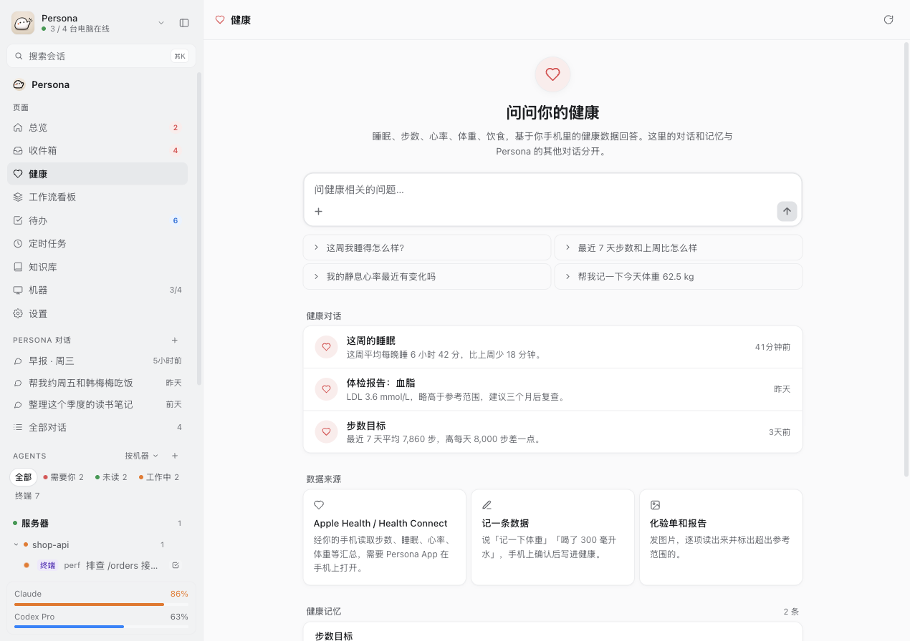
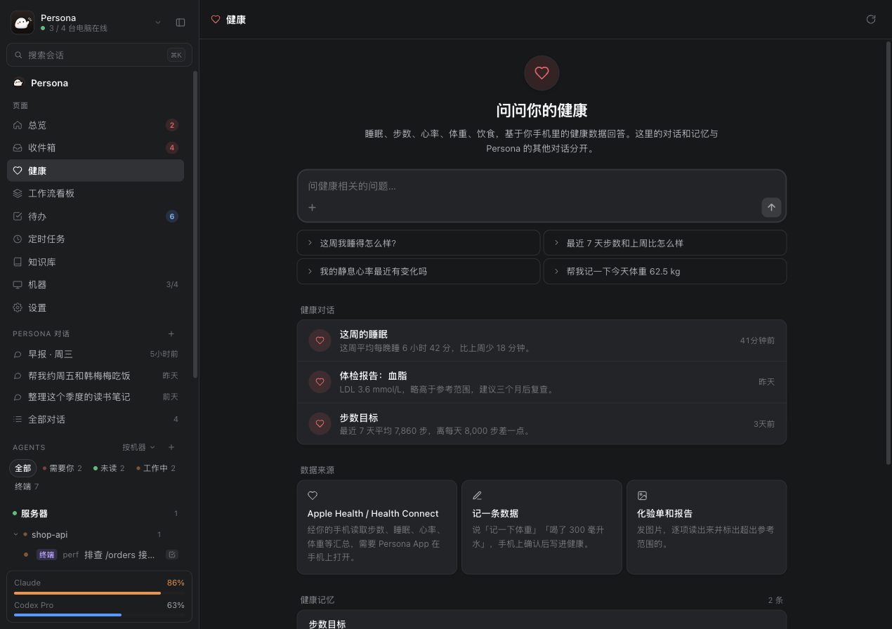
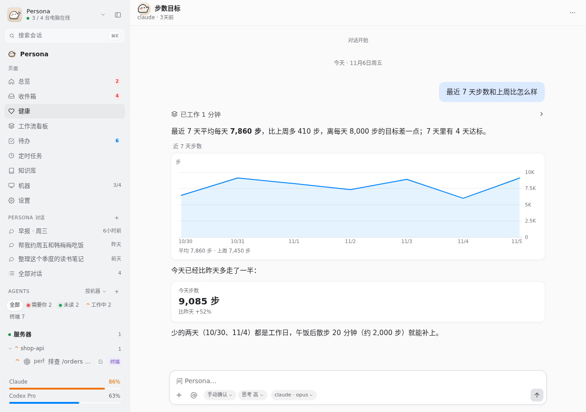
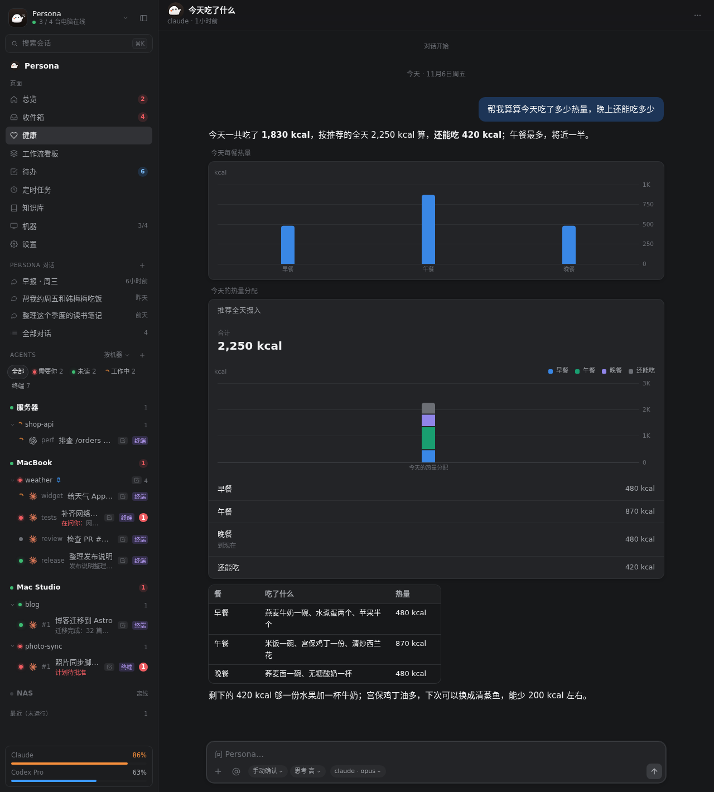

# 健康空间（#2691）

健康相关的对话从助手的主对话里分出来，放进一个单独的「健康」空间：单独的入口、单独的对话目录、单独的记忆。
第一版照着 ChatGPT Health 仿，先做 hub 和网页（#2789）；iOS 和 Mac 的入口随后复用同一套接口（#2901），Android 还没有。

## 为什么分出来

健康信息比工作信息更私密，也更长期：过敏、用药、体检结果这些记下来要一直有用，但不该出现在工作对话的上下文里，
也不该被主对话的工具读到、写进知识库。放在主对话里，记忆、工具和对话列表都是共用的，分不开。
单独一个目录以后，Claude Code 按目录区分的 auto memory、CLAUDE.md 和对话列表自然就分开了。

## 仿 ChatGPT Health 的哪些点

| ChatGPT Health 怎么做 | Persona 第一版怎么做 | 以后 |
| --- | --- | --- |
| 侧边栏（桌面）/ 菜单（手机）里单独的 Health 入口，进去是独立空间（[1]） | 网页侧边栏单独的「健康」入口，`/health`；iOS、Mac 助手侧边栏的「健康」 | Android 的健康入口 |
| Health 首页：最近的数据和趋势、同步的记录、推荐提问、以往的健康对话、已连接的账号（[2]） | `/health` 页：一句隐私说明、数据来源（Apple Health / Health Connect 经手机）、推荐提问、以往的健康对话、健康记忆 | 首页显示最近的趋势卡片（接 #886 的结构化卡片） |
| Health 的记忆单独存，不会流回普通对话；用户能查看、删除（[3]） | 健康空间有自己的目录，auto memory 只属于它；网页上能看、能删；主对话的工具看不到健康对话 | 健康空间只给健康相关的工具 |
| 在普通对话里聊健康，会建议挪到 Health（[4]） | 不做 | 主对话聊到健康时建议「去健康里继续」 |
| 连接的数据不用于训练，有额外的加密和隔离（[5]） | 数据都在你自己的 hub 和电脑上；健康对话调 `kb_update` 被拒绝（代码拦）；不发到别的对话靠对话工具只认同一空间；推送不带正文，交给 Agent、发邮件和飞书每次在手机上确认（「外发」） | 更多数据源：病历、体检报告上传、录音里的心率 / HRV（#1950） |
| 不替代医生的诊断和治疗 | CLAUDE.md 写明不诊断、不开药、不改处方，危险信号第一句就让用户就医 | |

来源：

1. https://www.foxnews.com/tech/chatgpt-health-promises-privacy-health-conversations
2. https://chat.openai.com/health
3. https://livemint.com/technology/tech-news/openai-launches-a-dedicated-experience-for-medical-questions-in-chatgpt-heres-how-it-works-11767866024939.html
4. https://www.thetechoutlook.com/new-release/software-apps/openai-introduces-a-dedicated-space-for-health-conversations-in-chatgpt-chatgpt-health/
5. https://openai.com/index/health-in-chatgpt/

## 目录和记忆怎么隔离

- **目录**：健康对话跑在助手那台机器上的 `<数据目录>/health`（默认 `~/.persona/health`），和助手自己的 `<数据目录>/assistant` 平级。
  hub 让 node 准备目录时（`assistant.prepare`）传的相对路径是 `.jarvis/health`。
  `identity.HealthDir`、`identity.SpaceHealth`、`identity.SpaceOf` 在 `server/internal/identity/paths.go`；`IsAssistantDir` 对健康目录也成立，
  所以健康对话和助手对话一样是「助手的对话」（`assistant: true`），用同一套工具、授权和提问。
- **CLAUDE.md**：健康空间有自己的一份 `server/internal/prompts/assistant/health_claude_md.md`（golden：`server/internal/assistant/testdata/prompts/health_claude_md.golden`）：
  只聊健康；用 `phone_health_summary` 读数据、`phone_health_write_sample` 记数据（手机上确认）；不写知识库、不把健康内容发到别的对话；用户要分享给别人（医生、教练、家人）就帮他发，发送在手机上确认；
  不诊断、不开药，危险信号先让用户就医；讲数字默认配图表卡片（下面「图表」）。连接器和插件的 skill 和助手目录一样装进去，但插件给助手的说明（`plugins.Instructions`）不拼进健康的 CLAUDE.md：那些说明是给主对话的工作场景写的，第一版有意不带。
- **记忆**：Claude Code 的 auto memory 按工作目录分（`~/.claude/projects/<编码后的目录>/memory/`），健康目录的记忆只有健康对话读写，主对话的上下文里没有它，反过来也一样。
- **文件**（#3282）：主对话的 Claude 能用 Read / Bash 读电脑上的文件，目录分开不等于读不到。所以主对话（不是健康空间的助手对话）启动时带上拒绝规则：
  Read、Edit 不许碰健康目录和它的 Claude 项目目录（记忆、对话记录），`server/internal/node/healthdeny.go`，CLI 经 `--disallowedTools`、Agent SDK 经 settings 的 `permissions.deny`。
  拒绝规则压过一切放行：点过「本会话总是允许」、切到 bypass 模式都读不到（实测 Claude Code 2.1.318）。
  主对话里文件类工具的「本会话总是允许」也只放行那个文件所在的目录（`hooks.go` `fileRuleScope`），不再放开整个工具。
  **没拦住的**：Bash 可以用任意写法拼出路径（`cd .. && cat he*`），按命令文本拦不全；要彻底拦住得用 Claude Code 的沙箱或系统层的隔离。主对话跑在 Codex 上时也还没有这条规则。
  记忆接口带 `?space=health` 读写的就是这一份。
- **node**：node 认得健康目录对应的 Claude 项目目录（`server/internal/node/sessions.go` 的 `isAssistantProject`），健康对话的 transcript 和助手的一样当作助手的对话。
- **哪个空间**：hub 发出的会话列表里，健康对话的每一项带 `space: "health"`（`proto.Session.Space`，`server/internal/hub/hub.go`、`server/internal/hub/assistant_link.go` 按 cwd 填）；
  助手自己的对话没有这个字段。助手判断一段对话属于哪个空间时先看 `space`，没有就看目录（`server/internal/assistant/health.go` 的 `spaceOf`）。

## 接口

协议的详细写法见 `docs/protocol.md`「助手」那张表。

| 接口 | 健康空间的用法 |
| --- | --- |
| `POST /api/v1/assistant/conversations` | 带 `"space":"health"` 在健康目录新开一段对话（先写好健康的 CLAUDE.md）。和 `"main":true` 一起带回 400（健康空间没有主对话）；不认识的 `space` 回 400 |
| `GET /api/v1/assistant?space=health` | 列健康空间的对话，`cwd` 是健康目录；不带 `space` 只列助手自己的对话，健康对话不再出现。`?archived=1` 一样能用；不认识的 `space` 回 400 |
| `GET /api/v1/assistant/memory?space=health` | 健康空间的记忆 `{"files":[…],"dir"}` |
| `PUT / DELETE /api/v1/assistant/memory/{name}?space=health` | 改、删健康空间的一条记忆 |
| `sessions` 推送、会话列表 | 健康对话带 `space: "health"` |

对话打开以后和别的助手对话一样：发消息、归档、改名、压缩都走原来的接口（`/api/v1/assistant/conversations/{id}/…`、`/api/v1/sessions/{mid}/{sid}/…`），不用带 `space`。

## 工具隔离

一段对话里的 `conversation*` 工具只看得到同一个空间的对话（`server/internal/assistant/conversations.go`：`spaceConversation`、`ownSpaceConversation`、`selfSpace`）：

- `conversations_list`：健康对话里只列健康对话，助手的对话里只列助手的对话。
- `conversation_read`、`conversation_rename`、`conversation_archive`、`conversation_send`：对方不在同一个空间时当作找不到。
- `conversation_new`：从健康对话里开的新对话还在健康空间。
- 不是从某段对话里调的（没有调用方的会话 id）按助手自己的空间算。

- 健康对话调 `kb_update` 直接报错：健康信息不进知识库（`assistant/tools.go` `runTool`）。知识库的读（`kb_search` 等）照常能用。
- 健康对话里建的定时跟进、定时任务（`schedule_followup`、`schedule_routine`）记下所在空间（`Task.space`），到点要新开对话时开在健康空间。
- 判断不出调用的对话在哪个空间时（助手的机器暂时列不出它），按主空间处理：只够得到主空间的对话，健康对话无论如何都列不出来、读不到。最坏的情况是一段健康对话暂时看到主空间的列表，不会反过来把健康内容露给别处。
- `list_followups` 只列本空间的定时任务；`schedule_routine` 带 id 改、`delete_routine` / `cancel_followup` 删别的空间的任务都当作找不到。
- 其余工具（手机工具、提醒、邮件、飞书、Agents……）两个空间都有：健康信息可以发给用户想发的人，规矩见下面「外发」。

## 外发（#3194）

边界不是「健康信息不能出去」，而是「不能在用户不知道的情况下出去」。用户把体检结果发邮件给医生、经飞书发给健身教练或家人都是正当的，照常能做；
判断一律看对话所在的空间（可信的会话目录），不用模型判断「这句话算不算健康」。

| 出口 | 健康对话里怎么样 | 代码 |
| --- | --- | --- |
| 推送：一轮结束、`notify_user`、等你开始的计划、定时任务失败 | 只说「健康空间有新消息」，不带正文，也不带对话标题、任务名 | `hub/machine.go` `doneAlert`、`assistant/tools.go`、`tasks.go`、`schedule.go` |
| 提问 / 授权卡的推送 | 锁屏上同样只说「健康」，卡片内容在 App 里看 | `hub/push.go` `interactionPayloadIn`（看 `ix.Cwd`） |
| 飞书机器人、插件渠道 | `notify_user` 的转发只说有新消息；定时任务那段对话的回答不镜像；「全部卡片」「全部提问」不包括健康对话的卡（渠道自己正驱动的那段对话照常） | `assistant/feishu_cards.go`、`channels_plugin.go` |
| `agent_send` / `agent_start` | 每次先在手机上确认，卡片写明交出去以后对方那边的记录不会随健康空间删除 | `assistant/health.go` `confirmOutbound` |
| `task_plan` | 不自动开始，一律等用户在计划卡上点开始 | `assistant/tasks.go` |
| `mail_send` 和连接器的写操作 | 每次在手机上确认，闸门的 allow 规则不放行（deny 仍拒绝） | `connector.ConfirmEach`，`extmgr/connectors.go` 的 `callConnector` |
| 飞书写操作（lark-cli、命令闸门） | 每次在手机上确认，allow 规则不放行，没有「本会话总是允许」；读照常 | `node/larkgate.go` `larkCheck` |

同一空间里的记忆、对话、提醒不加确认。

## 网页入口

- 侧边栏单独一项「健康」，打开 `/health`。
- 首页：一句隐私说明（对话和记忆只在健康空间里、数据在你自己的 hub 上、不替代医生）、数据来源（Apple Health / Health Connect，经手机的 `phone_health_summary` / `phone_health_write_sample`，要手机上的 Persona 开着并授权）、
  推荐提问（点一下就用它开一段健康对话）、以往的健康对话、健康记忆（查看、删除）。
- 点进一段对话打开 `/health/<id>`，和别的助手对话是同一个对话页。
- 主对话的历史列表里不再有健康对话。

## iOS 和 Mac 入口（#2901）

- 入口：助手侧边栏「知识库」下面一行「健康」（新外壳的抽屉在「知识库」和「机器」之间；Mac 的分栏列表在「定时任务」下面），推出健康页（`apple/Persona/Views/Assistant/HealthView.swift`，iOS 和 Mac 共用）。
- 健康页：一句说明、推荐提问（点一下就用它开一段健康对话）、健康对话（`GET /api/v1/assistant?space=health`，再叠上推送里带 `space: "health"` 的，左滑 / 右键归档）、
  健康记忆（推进记忆页 `AssistantMemoryView(space: "health")`，看、改、删都带 `?space=health`）、数据来源、隐私；底部是输入框，发出去 `POST /api/v1/assistant/conversations` 带 `"space":"health"`，从不设成主对话。
- 开出来、点进去的健康对话在 Persona 页的对话里打开，和别的助手对话是同一个对话页；回健康页从侧边栏的「健康」。
- 侧边栏「最近」「已归档」和搜索不列健康对话（`AssistantLists` 按 `Session.assistantSpace` 分开，健康的在 `AppModel.healthConversations`）。
- 截图参数：`-tab assistant -openAssistantPage health`（新外壳 `-openShellPage health`）。单测 `PersonaTests/HealthModelTests`。

## 图表（#3140）

健康的回答多半是一组数字，看图比读文字快。第二版让健康空间讲数字时**默认**带 `persona-card`（#886 的图表卡片，格式和画法在 `sdk/go/wire/personacard.go`），各端按自己的能力画：

| 内容 | 卡片 | 例子 |
| --- | --- | --- |
| 近 7 天（或更长）的步数、睡眠，体重、静息心率这类按天的趋势 | `line` | 近 7 天步数 |
| 每餐热量（几样东西比多少，每次运动消耗） | `bar` | 今天每餐热量 |
| 全天热量分配（一个总数里各部分各占多少） | `stacked_bar` | 今天的热量分配：早 / 午 / 晚 / 还能吃 |
| 单个关键指标 | `stat` | 今天步数 |
| 明细（每样食物、化验单逐项） | Markdown 表格 | |

- **说明**：写在健康空间的 CLAUDE.md（`server/internal/prompts/assistant/health_claude_md.md`「讲数字默认配图表」）：按上表选，结论和关键数字写在正文、卡片放后面，一次最多三张，没有数据的那天不补 0。
  `TestHealthClaudeMDTeachesCharts` 查四种卡片都有例子、每个例子都是各端画得出来的卡片。
- **网页**：健康对话就是助手的对话页（`ChatView`），代码块照旧经 `ui/AssistantCard.tsx` 画成图，没有另写一套；各端画成什么样由 `schema/extension/examples/persona-card/` 的用例管着（网页是 `lib/assistant-view.test.ts`）。
- **飞书**：卡片画不了图，代码块里的 JSON 也不是答案，机器人发出去前把每张 `persona-card` 写成一两行数字（`stat` 一行粗体数字，`line` / `bar` 一条 ▁▃█ 小图加逐个数字，`stacked_bar` 一张两列的小表），见 `docs/bots.md`「卡片」。

要看效果：默认的假 hub（`python3 scripts/mock/mock_hub.py`，数字是编的）里健康空间的「这周的睡眠」「步数目标」「今天吃了什么」三个对话都带图表。

## 体检报告（#4546）

体检报告多半是几十页的 PDF，读完只剩聊天记录就没法跨年对比，所以原件和逐项的记录都留在健康目录里。

- **上传**：网页健康页的输入框（首页和健康对话）附 PDF 或别的文件，发到助手所在的机器 `POST /api/v1/machines/{mid}/files?dest=health`
  （`proto.UploadDestHealth`），node 存进健康目录的 `reports/`（`原名-YYYYMMDD-HHMMSS.扩展名`，0700 / 0600，不过期），路径插进输入框随消息发出。
  图片照旧当图片发（Claude 直接看），不落盘。主对话读不到 `reports/`：它在 #3282 拒绝的健康目录里。
- **记录**：健康对话读原件，在旁边写一份同名的 `.md`：报告日期（报告上印的检查日期）、机构、类型，一张「项目 | 结果 | 单位 | 参考范围 | 异常」的表，
  数值照原文、看不清的写「看不清」，最后是医生的结论和建议；对话里直接发的照片也照这样记一份。做法写在健康 CLAUDE.md「数据」。
- **对比**：问到「这几年」「和去年比」时读 `reports/` 下所有记录，同一项（「甘油三酯」和「TG」）合在一起按日期对比，用 `line` 卡片画；有原件没记录的先补记录。
- **不用每次批准**：健康对话的 `--allowedTools` 带 `Edit(//<健康目录>/reports/**)`（`node/healthdeny.go` 的 `healthReportRules`），写记录不弹手机确认；
  健康目录别的地方照旧按对话的权限模式问。Claude Code 只按路径匹配 `Read` 和 `Edit` 规则，`Edit(path)` 管所有改文件的工具，`Write(path)` 从来匹配不上，
  所以手机上对 Write / MultiEdit / NotebookEdit 点「总是允许」记的也是 `Edit(<目录>/**)`。
- 实测（Claude Code 2.1.318，两份假报告）：两份记录逐项抄对，日期取的是报告上的检查日期，「TG」「LDL-C」和去年的「甘油三酯」「低密度脂蛋白」对上了，回答带三张 `line` 卡片。
- iOS / Mac（#4587）：健康页的输入框（两种界面风格）和健康对话里的输入框「文件」选的、Mac 上拖进来的文件都带 `dest=health`（`FileUploads.start(…, dest:)`），
  照片照旧当图片发；视频照旧进临时目录。hub / node 早于 #4546 的回 400 / 「unknown upload destination」，App 提示上传失败，更新 hub 后就好。
- **入口（#4656）**：只有输入框的 `+` 时看不出能传，所以健康页有一个明确的「上传体检报告」：网页在首页输入框下方，iOS / Mac 在「问问看」最前面。
  点了选 PDF 或图片（图片也当文件传，原件同样留在 `reports/`），全部传完后自动开一段健康对话（`views/health/reports.ts`、`FileUploads.startAll`），第一条消息带着路径；
  传的途中离开页面也照样开。测整条路：iOS 启动参数 `-showReportUpload <文件名>`（假 hub 上看 `POST …/files?dest=health` 和 `POST /api/v1/assistant/conversations`）。
- **查看和删除（#4998）**：健康页有「体检报告」，列出 `reports/` 里的报告（`server/internal/node/healthreports.go`）：原件和同名 `.md` 记录算一份，只有记录的（对话里发的照片）也算一份。
  能看整理记录、打开原件、删除。删除是永久的，原件和记录一起删；**对话和健康记忆里已经提到的内容不会一起删**，确认时写明。名字只能是 `reports/` 里的一个普通文件，软链、文件夹、`../` 都拒绝。
  网页在首页（`views/health/HealthReports.tsx`），iOS / Mac 是单独一页（`HealthReportsView.swift`）。node 太旧时回 409 `node_outdated`，页面显示这句话。接口在 `server/internal/devices/healthreports.go`，hub 转发（`devicewire.Routes`）。
  截图参数：`-openReportRecord YES`（直接打开第一份的记录）、`-showReportDelete YES`（直接弹删除确认），都从报告页开始算。
- 还没有：Android（还没有健康空间的入口）。

## 第一版不做的

- Android 的入口：复用上面这套接口。
- 饮食建议扩展的打包：另一个 Agent 在做。
- 主对话聊到健康时建议挪进健康空间。
- 把已有的、在主对话里聊过的健康内容迁过来：不迁，旧记忆留在助手目录。

## iOS 的健康趋势（#3272）

- `apple/Persona/Views/Health/HealthTrendsSection.swift`：「健康趋势」，近 7 天 / 30 天的步数（`bar`）、睡眠和体重（`line`，只有一天时是 `stat`），画成 `persona-card`，和健康回答里的卡片是同一个渲染（`AssistantViewCard`）。
- 数据在手机上直接读 Apple 健康（`HealthTool.daily`，和 `phone_health_summary` 同一套查询），不经 hub。没问过健康权限时给「允许读取」，读不到时说明去哪里打开。
- 只是一块组件，健康空间的入口和以往对话在 #2901，那边的健康首页直接放这一块。
- 截图：`-showHealthTrends sample`（模拟器没有健康数据，用示例数据）、`empty`、`ask`、`YES`（读本机）。

## 之后

- 手机上的健康 tab（#2901），首页放上面的「健康趋势」。
- 主对话聊到健康时建议「去健康里继续」。
- diet-advice 的推送进健康空间。
- 主对话经 Bash、经 Codex 读健康目录：用沙箱或系统层隔离彻底拦住（#3282 之后）。
- 更多数据源：病历、Android 上传体检报告（网页和 iOS 的见上面「体检报告」）、录音里的心率 / HRV（#1950）。

## 怎么验证

- 服务端（在 `server/` 里）：`go test ./internal/assistant -run Health`（`server/internal/assistant/health_test.go`：开健康对话、列表分开、`main` 和不认识的 `space` 被拒、工具不跨空间、外发、golden）、
  `go test ./internal/hub -run Health`（推送不带正文）、`go test ./internal/connector -run ConfirmEach`、`go test ./internal/node -run LarkGateHealth`、`go test ./internal/identity`（健康目录、`SpaceOf`、`IsAssistantDir`）。
  改了 `health_claude_md.md` 要更新 golden 并看 diff（`docs/prompts.md`）。图表：`go test ./internal/assistant -run HealthClaudeMDTeachesCharts`、`go test ./internal/feishubot -run PersonaCards`。
- 网页：`cd web && npm test && npm run build`。
- iOS / Mac：`PersonaTests/HealthModelTests`（列表和记忆带 `space`、推送叠加、侧边栏不列健康对话、新对话带 `space`），编 `Persona` 和 `PersonaMac`。
