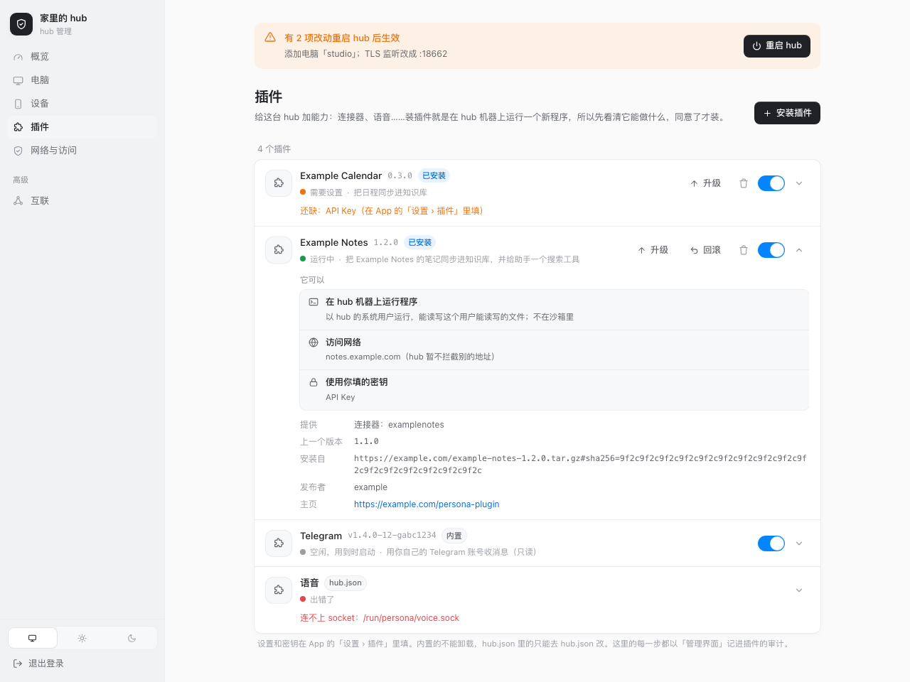
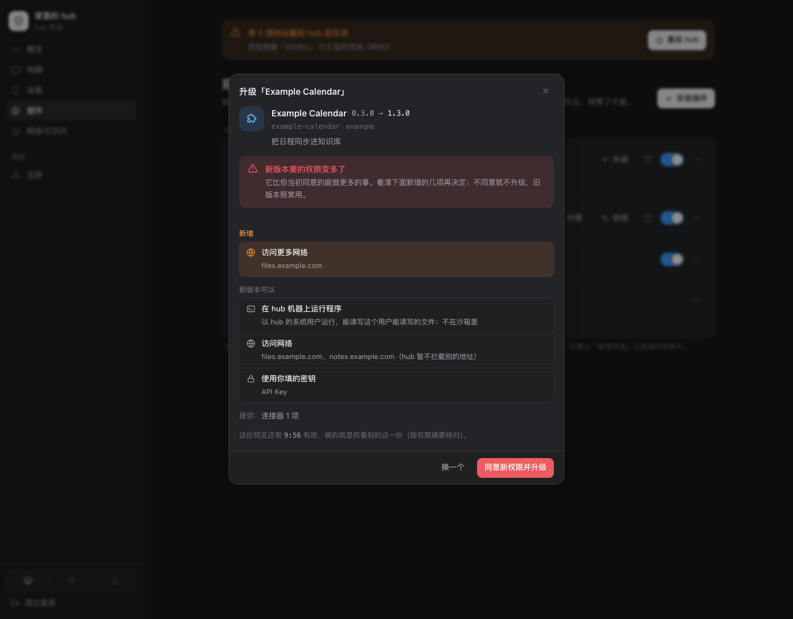

# 插件

Persona 的插件底座（#1101）：开源仓库只放通用能力和**扩展点**，只对某个公司、某个服务有意义的东西做成插件，装上就有，不装也能跑。
骨架学 VS Code（清单 + `contributes` + 按需激活 + 独立进程），权限学 Chrome（显式声明、安装时展示），WordPress 只借事件通知、不借 filter。
设计取舍、分步和还没做的在 `docs/plan-plugins.md`。代码：清单、schema 子集、权限、注册表 `server/internal/plugin`，进程宿主 `plugin/host`，
程序一侧 `plugin/serve`，一致性测试 `plugin/conformance`；hub 里的接线 `server/internal/hub/plugins.go`、`plugin_routes.go`、`plugin_cli.go`，管理界面的接口 `admin_plugins.go`。

插件从三个地方来，App 和接口里是同一个列表：

| 来源 | 是什么 | 能做什么 |
| --- | --- | --- |
| `builtin` | personad 自带，清单编在二进制里（Telegram 连接器，微信机器人，操控电脑 `cua`，浏览器 `ego`） | 开关、配置、密钥；不能卸载 |
| `hub.json` | hub.json 的 `plugins[]`，主人手写（现在的语音插件），见下面「hub.json 里的插件」 | 只读：去 hub.json 或管理界面改 |
| `installed` | 用 `personad plugin install` 装在 hub 机器上的包，或跑在别处、经 socket 接入的插件 | 全部：开关、配置、密钥、升级、回滚、卸载 |

三种形态：**纯声明**（只有清单，不跑代码）、**进程插件**（hub 起子进程，stdin / stdout 上说进程插件协议，可以同时在 unix socket 上起 HTTP）、
**远端**（跑在别处，hub 经 unix socket 接入）。

## 扩展点

插件往哪些地方贡献什么，写在清单的 `contributes` 里：键是扩展点，值是贡献的列表，每项有一个 `id`（在这个扩展点里全局唯一，和别的插件或 hub 自己的冲突就装不上）。

| 扩展点 | 命名空间（方法前缀） | 每项的字段 | 要求 | 接到哪 |
| --- | --- | --- | --- | --- |
| `connectors`（版本 2） | `connector.` | 连接器协议的清单字段：`id`（`^[a-z][a-z0-9]*$`）、`name`、`capabilities`、`hosts`、`agent_tools`、`unlisted`、`confirm_always?`（写操作名的通配，`connector_gate` 的 `allow` 也永远钳成手机上确认，`deny` 不变）、`poll_seconds`、`kinds`，以及 `kind_descriptions?`（种类 → 给模型看的一句「类型：…」，收件箱分拣、起草、AI 分身都用它）、`archive_sources?`（归档还能放在哪些名字下）、`cli?`（助手 PATH 上的命令行，见 `docs/connector-protocol.md`「命令行」） | 进程说协议 | 连接器注册表（设置 › 连接器、收件箱、知识库、助手的工具），方法见 `docs/connector-protocol.md` |
| `voice`（版本 1） | — | `id`、`name?` | `runtime.http` | App 的语音对话，契约见下面「语音」 |
| `computer`（版本 1） | — | `id`、`name?` | — | 助手操控电脑的工具和机器页的开关（只有内置的 `cua`），见 [computer-use.md](computer-use.md) |
| `browser`（版本 1） | — | `id`、`name?` | — | 助手用浏览器的工具（`browser_run` / `browser_look`）和机器页的「浏览器」（只有内置的 `ego`），见 [plan-ego-browser.md](plan-ego-browser.md) |
| `quota`（版本 1） | `quota.` | `id`、`name`、`hosts?`（网关主机名，可 `*.` 开头） | 进程说协议，权限 `launcher_keys` | 启动器页的「额度」，见下面「额度」 |
| `providers`（版本 1） | `provider.` | `id`、`name`、`description?`、`kind?`（`launcher` / `api`）、`api?`（`messages` / `responses`）、`base_url`、`model?`、`small_model?`、`models?: [{id, name?}]`、`dynamic_models?`、`key_hint?` | 纯声明即可；`dynamic_models` 要进程说协议 | 设置 › 模型供应商的「从插件添加」，见下面「模型供应商」 |
| `api`（版本 1） | `api.` | `id`、`prefix`（一段路径）、`features?`、`events?`、`receipts?`（`[{method, path, kind}]`：要发送回执的写） | `runtime.http`，`on_startup`；有 `events` 要进程说协议 | App 用的一段接口 `/api/v1/<prefix>/…`，见下面「App 接口」 |
| `assistant`（版本 1） | `assistant.` | `id`、`skills?`（包里的目录，各有 `SKILL.md`）、`instructions?`（包里的 `.md`）、`gate?`（包里的 `.json`：技能里一个命令的闸门） | 包里有这些文件；`gate` 要有 `skills`，要凭据时进程说协议 | 助手的技能、说明和命令闸门，见下面「助手」 |
| `ui`（版本 2） | `ui.` | `id`、`title`、`placement`（插槽，见「UI 插槽」：`plugin_page` / `launcher_section` / `nav_page` / `overview_card` / `machine_section` / `inbox_item`）、`hosts?`（只有 `launcher_section` 能写：网关主机名，可 `*.` 开头；不写就是任何启动器，插件自己判断）、`icon?`（只有 `nav_page`）、`opens?`（只有 `overview_card`）、`connector?`（只有 `inbox_item`，而且必须写：插件自己贡献的一个连接器的 id） | 进程说协议；`launcher_section` 要权限 `launcher_keys` | 插件详情里的页面、启动器页上的一节、主导航、总览、机器详情、收件箱条目的详情，见下面「声明式 UI」「UI 插槽」 |
| `agent_sources`（版本 1） | `agentsrc.` | `id`（`a-z0-9_-`，也是会话 id 的来源段 `<id>:<sessionKey>`）、`name`、`providers?`（`a-z0-9_`，如 `grok_bot`） | 进程说协议，`on_startup` | Agents 页的个人 Agent，和 hub 自己的 lark-connector 来源并列，见下面「个人 Agent 来源」 |
| `channel`（版本 1） | `channel.` | `id`（`^[a-z][a-z0-9_]{0,31}$`，不能是 8 位十六进制）、`name`、`kind`（`im`）、`connector?`（绑定和状态来自同一个插件的这个连接器）、`bind?`（`qr` / `code` / `fields`）、`description?`、`capabilities`（收图片 / 文件 / 语音、`format`、`max_text`、`asks`、`push`、`typing`、`progress`、`threads`） | 进程说协议；没有 `connector` 时 `on_startup` | 和 Persona 对话的渠道：hub 跑统一管线（进对话、跟踪这一轮、答案发回、提问），插件只管和 IM 说话，见 [channels.md](channels.md) |
| `events`（版本 1） | `event.` | `id`、`subscribe`（事件名的列表，见「事件」） | 进程说协议，`on_startup` | 只是告诉插件 hub 上发生了什么，见下面「事件」 |

hub 不认识的扩展点：插件照样能装（可能是给新版 hub 写的），这一项不生效，预览和列表里有一条警告。以后加扩展点（知识库来源、链接识别……），在这张表里加一行。

## 清单 `persona-plugin.json`

放在插件包的根目录。例子（一个虚构的笔记服务的连接器）：

```json
{
  "manifest_version": 1,
  "id": "example-notes",
  "name": "Example Notes",
  "version": "1.2.0",
  "description": "把 Example Notes 的笔记同步进知识库，并给助手一个搜索工具。",
  "publisher": "example",
  "homepage": "https://example.com/persona-plugin",
  "engines": {"persona": ">=202611050000", "plugin_protocol": 1},
  "runtime": {
    "command": {"linux-amd64": "bin/example-notes-linux-amd64", "darwin-arm64": "bin/example-notes-darwin-arm64"},
    "args": ["serve"]
  },
  "contributes": {
    "connectors": [
      {"id": "examplenotes", "name": "Example Notes", "capabilities": ["status", "tools", "archive", "login"],
       "hosts": ["notes.example.com"], "poll_seconds": 600}
    ]
  },
  "configuration": {
    "type": "object",
    "properties": {
      "base_url": {"type": "string", "title": "服务地址", "format": "uri", "default": "https://notes.example.com"},
      "folders": {"type": "array", "title": "同步哪些文件夹", "items": {"type": "string"}},
      "include_shared": {"type": "boolean", "title": "包括别人共享给我的", "default": false}
    },
    "required": ["base_url"]
  },
  "secrets": [
    {"name": "api_key", "title": "API Key", "description": "在 Example Notes 的设置 › 开发者里生成", "required": true}
  ],
  "permissions": {"network": ["notes.example.com"]}
}
```

| 字段 | 必填 | 规则 |
| --- | --- | --- |
| `manifest_version` | 是 | `1` |
| `id` | 是 | `^[a-z0-9][a-z0-9_-]{0,31}$`；也是 `/api/v1/plugins/<id>/…` 的路径 |
| `name` | 是 | 1–40 个字符 |
| `version` | 是 | `MAJOR.MINOR.PATCH`（可带 `-pre`，不能带 `+build`）；升级只能往上 |
| `description`、`publisher`、`homepage` | 否 | `homepage` 只能是 https |
| `engines.persona` | 否 | hub 构建号的范围，只有 `>=N`、`<N` 及其组合；不满足装不上，已装的标成 `incompatible`。开发构建（构建号 0）不检查，给一条警告 |
| `engines.plugin_protocol` | 有 `runtime` 时是 | `1` |
| `runtime` | 否 | 没有就是纯声明插件。`command`：包里的相对路径，或 `{"<GOOS>-<GOARCH>": 路径}`，没有这台 hub 的平台就装不上；不能是绝对路径、不能跳出包（`..`、指向包外的链接都查），必须可执行；`personad` 只有内置插件能用。`args`；`env`（不能是 `PERSONA_` / `JARVIS_` 开头，密钥不放这里）；`rpc`：`stdio`（默认）/ `none`；`http`：在 `PERSONA_PLUGIN_SOCKET` 上起 HTTP。`rpc: none` 又没有 `http` 装不上 |
| `activation_events` | 否 | `on_startup` / `on_call` / `on_http`，见「什么时候跑」；有 `runtime` 时默认 `on_call`；`rpc: none` 的只能 `on_startup` |
| `contributes` | 是 | 见「扩展点」，至少一项 |
| `configuration` | 否 | 配置的 JSON Schema，只能用下面的子集 |
| `secrets` | 否 | `[{name, title, description?, required?}]`，`name` 是 `^[a-z][a-z0-9_]{0,31}$`，最多 32 个 |
| `permissions` | 否 | 见「权限」 |

清单最大 256 KB，按严格模式读：任何一层有不认识的字段都装不上（拼错的 `permission` 不会被悄悄忽略）。

### 配置：表单的子集

根是 `{"type": "object", "properties": {…}, "required": [...]}`。每个客户端都能把它画成表单，表单按属性在文件里的顺序排（hub 解析时保留顺序，
接口给的是排好的 `form.fields`）。子集以外的写法装不上，保证每个插件的配置在 App 里都改得了。

| 类型 | 能用的关键字 | 表单 |
| --- | --- | --- |
| `string` | `title`、`description`、`default`、`enum`（带标签用 `oneOf: [{"const", "title"}]`）、`format`（`uri` / `email` / `hostname` / `machine`）、`x-os`（只配 `machine`：`darwin` / `linux` / `windows` 的列表）、`pattern`、`minLength`、`maxLength` | 输入框；有 `enum` 是选择器 |
| `integer`、`number` | 说明类、`enum`、`minimum`、`maximum` | 数字输入 |
| `boolean` | 说明类 | 开关 |
| `array` | `items` 只能是 `string`（可带 `enum`），`minItems`、`maxItems`、`uniqueItems` | 可增删的列表；`items` 有 `enum` 是多选；`items` 是 `format: machine` 时每台机器一个开关（下面） |
| `object` | 只在第一层，里面只能是上面的标量和数组；可以有自己的 `required` | 一个分组 |

**机器（`format: machine`）**：值是这台 hub 上某台机器的 id。
- 一列这种值（`{"type": "array", "items": {"type": "string", "format": "machine", "x-os": ["darwin"]}}`）在 App 和网页的设置页画成**每台机器一个开关**：机器名、在线与否，操控电脑一类的插件（贡献 `computer`）再加 Cua 的状态。`x-os` 只列这些系统的机器。
- 开关**即时生效**，只改这一项，不等「保存」，表单里别的草稿留着。对不上任何机器的值照样列出来，可以关掉。
- 这一列带 `x-confirm`（一句话）时，打开某台的开关前先问这句话，确认了才存；关掉不问（App 是确认框，网页是 `window.confirm`）。插件 `cua` 的「插件开着时不自动锁屏」用它（#1507）。
- hub 加载插件时，把这类值里写成机器名、主机名的（大小写、空格、`-`、`_` 不计，只对上一台时）换成那台的 id，存回去（`plugin_machines.go`）。

**约定的设置项**：hub 认得的名字，插件声明了就有额外的用处。
- `triage_rules`（第一层的 `string`，建议 `maxLength` 不超过 4000：hub 只用前 4000 字）：这个来源的收件箱分拣规则，用户的原话。插件交条目时把它带在 `rules` 上（`docs/connector-protocol.md`），
  hub 分拣这个来源的条目时用它代替全局的 `inbox.rules`（`docs/inbox.md`「AI 分拣」）。声明了它的插件在助手的 `jarvis_settings` 里有一项
  `inbox.rules.<插件 id>`：读随便读，改的时候手机上弹确认（改前 → 改后），批准了才经同一条改配置的路（按 schema 校验、只改这一项、插件重启）写进去；
  hub.json 来的插件只能读。

用收件箱的插件**必须**有 `triage_rules`，见下面「收件箱的通用规则」。

### 收件箱的通用规则（#1730）

用收件箱（连接器声明了 `inbox`）的插件都要守这三条；不用收件箱的插件不受影响。各插件自己怎么做（哪些类型及时交、多久一轮，比如飞书插件的
`immediate_kinds`、`period_minutes`）是插件自己的设置，不进协议。

1. **唤醒**（原来就有）：连接器有变化就发 `connector.changed {scope: "inbox"}`，hub 另外按 `poll_seconds` 定期拉（`docs/connector-protocol.md`）。
2. **自己的分拣规则**：设置里必须有第一层的 `triage_rules`（`string`，上面「约定的设置项」），交条目时带在 `rules` 上。
   **装、升级时查**（预览这一步：命令行、App、管理界面、浏览器上传、市场，连同市场插件的自动升级）：没有就装不上（「设置里却没有 triage_rules……装不上」）。
   已经装好的不重新查，照常运行；回滚回到装过的版本也不查。内置插件（Telegram 这些）不受这条管。
3. **自己的兜底（可选）**：连接器的 `capabilities` 加 `fallback`，承诺每个收件箱条目都带兜底分级 `extra.rule_tier`（`action` / `fyi` / `noise`）：
   模型分不了时按它进收件箱（`docs/inbox.md`「AI 分拣」），模型照样先分。**没声明 `fallback` 的，必须有能用的分拣模型**（设置 › 模型 的「信息筛选」，`inbox.triage`）：
   - **启用**：打开开关（`PUT /api/v1/plugins/{id}/-/enabled`，管理界面同理、渠道页的开关也是），以及装好（装上就是开着的）、开着时升级（含自动升级）时，
     如果「信息筛选」调不了（解析出来没有地址、模型或密钥：没在这里配、hub.json 的 `ai` / `inbox.triage_ai` 也没有、也没有能自动选的带 Key 的接入），
     返回 **409 `needs_triage_model`**：「先在 设置 › 模型 里配好『信息筛选』，再启用这个插件」。被拒的安装、升级不用掉预览，配好模型用同一个预览再来一次就行。
     自动升级被拒时插件上记一条「升级失败」，原因就是这句话。
   - **改模型**：有这样的插件开着时，把「信息筛选」改成调不了的（`PATCH /api/v1/model-config/purposes/inbox.triage`）返回 **422 `triage_model_in_use`**（不用 409：App 把模型设置的 409 当成「别处改过了」，会把原因藏起来），
     `plugins` 列出是哪几个插件、`error` 让先停用它们。去掉自己的选择、退回到仍然调得了的 hub.json 配置或自动选择，不算清掉，照常保存。
   - **hub.json 里的插件**没有开关，hub 拦不住：照常启动，但调不了模型时**不收它的收件箱条目**，设置 › 插件 里状态是 `needs_setup`、
     `needs_setup` 写「需要先配分拣模型」，模型能用了就恢复。（现在 hub.json 只能配 HTTP 插件，还配不出连接器；这一条先按规则做好。）
   - 运行时照 #1644：模型分不了、条目又没有兜底，就不进收件箱，`GET /api/v1/inbox` 的 `triage` 里说有几件在等。

**老 hub**：#1680 之前的 hub 不认识 `fallback`，声明了它的连接器整个注册不上；#1680 的 hub 去掉它、记一行日志，当成没有兜底（于是要模型）。
声明 `fallback` 的插件版本在 `engines.persona` 里写上带 #1730 的 hub 构建号（`">=YYYYMMDDHHMM"`，构建号是构建时的 UTC 时间）。

不支持 `$ref`、`allOf` / `anyOf`、`if` / `then`、对象数组、更深的嵌套、`additionalProperties`（额外的键一律不收）。值最大 64 KB。
`default`、`enum` 的值也按类型查。属性名像 `password` / `token` / `secret` / `api_key` 的给一条警告：配置明文存、明文显示，该放 `secrets`。

### 权限

学 Chrome：显式声明，装的时候整份给人看，升级要了更多就要重新同意。词表是封闭的，不认识的权限装不上。

| 权限 | 写法 | 意思 | hub 怎么守 |
| --- | --- | --- | --- |
| 运行程序（有 `runtime` 就有） | — | 在 hub 机器上以 hub 的系统用户运行，能读写这个用户能读写的文件 | 只展示：**没有沙箱** |
| `network` | 主机名列表，可以 `*.` 开头，小写，不带协议、端口、路径 | 会访问哪些地方 | 只展示和记录；hub 暂不拦截别的地址 |
| `hub_api` | `true` | 拿到 hub 的地址和完整 token（`PERSONA_HUB_URL`、`PERSONA_HUB_TOKEN`），能做 hub 主人能做的一切 | 没接受就不给这两个变量 |
| `launcher_keys` | `true` | 用启动器的 Key 访问它的网关（贡献 `quota`、`launcher_section` 的 `ui` 必须有） | 插件看不到 Key：hub 或那台电脑替它发请求，只发到启动器自己的网关；没接受就不问它 |
| 显示在 App 里（有 `nav_page` / `overview_card` / `machine_section` / `inbox_item` 的 `ui` 就有） | — | 在主导航、总览、机器详情页、收件箱条目的详情里显示自己的界面（列出每处的标题） | 和事件一样不用写在 `permissions` 里，按贡献算进安装前给人看的「它可以」和权限摘要；升级时多了一处要重新同意，见「UI 插槽」「权限」 |
| 密钥（有 `secrets` 就有） | — | 用你填的密钥 | 每个插件只拿到自己的 |

后面的扩展点会加细的权限（`kb.read`、`inbox.read`、`agents.control`……），按接受的权限放行 hub 提供给插件的方法，没接受回 `permission_denied`。
**权限摘要**：`permissions`（规范化后）加上「运行不运行程序」的 sha256。安装要回传预览给的摘要；升级时权限变多了也要（没变多不用重新同意，但仍要明确执行升级）。
接受的那一份存在 `plugins.granted`。

## 安装、升级、回滚、卸载

装插件就是在 hub 机器上跑一个新程序，所以任意来源的包只有 hub 的主人能装，两条路：

- **hub 机器上的命令行**：`personad plugin …` 读 hub.json 里的主 token，经回环调下面的接口。
- **管理界面**（`/admin` 的「插件」页，[admin.md](admin.md)「插件」）：管理员密码登录的会话，过访问范围、CSRF 和预览限流，接口在 `/api/v1/admin/plugins…`。
  管理界面本来就能加电脑、发凭据，和装插件一样要紧，所以同一把密码；审计里记成 `admin UI`。

手机（设备凭据）能看列表、开关、改配置、填密钥；装、升级、回滚、卸载只能针对**已登记的插件市场里的插件**（见「插件市场」），
任意来源（目录、文件、网址、上传、跑在别处）仍只走上面两条路。

插件包：一个目录，或一个 `.tar.gz` / `.tgz` / `.zip`（根目录或唯一的顶层目录里有清单）。最大 200 MB、2 万个文件；解包时拒绝绝对路径、`..`、指向包外的链接、
设备文件，zip 里不能有链接；文件权限只留「可执行或不可执行」。在 Mac 上打的包常带 macOS 的元数据（tar 没设 `COPYFILE_DISABLE=1` 时的 `._*` AppleDouble 文件、
Finder 压缩的 `__MACOSX/`、`.DS_Store`），解包时一律跳过，不算顶层目录（#1590：一个插件的包顶层多了个 `._<插件 id>`，装不上）。

| 来源 | 写法 |
| --- | --- |
| hub 机器上的目录 | `dir:/path/to/plugin`（或直接写一个存在的目录）：**拷一份**进来，原目录以后改了不影响已装的；`.git` 不拷 |
| hub 机器上的包 | `file:/path/to/plugin.tar.gz`（或直接写路径） |
| 网址 | `https://…/plugin.tar.gz#sha256=<64 位 hex>`：必须带 sha256，下载后校验；不收 http |
| 跑在别处 | `remote:rpc=<socket>,http=<socket>`（至少一个）：不拷文件；清单问插件要（说协议的回 `manifest`，只有 HTTP 的回 `GET /manifest`） |
| 浏览器上传（只有管理界面） | `.tar.gz` / `.tgz` / `.zip` 文件本身：最大 200 MB，直接写进这次预览的暂存目录再解包，来源记成 `upload:<文件名>`，其余和 hub 机器上的包一样 |

私有插件：在 hub 机器上 clone 私有仓库再 `dir:` 装，或者私有仓库的 CI 出一个带 sha256 的包。

1. **预览**：包放进 `~/.persona/plugins/staging/<预览 id>/`，解析和校验清单、查程序在不在包里、查 `engines`、查贡献的 id 有没有被占，
   回 `{preview_id, manifest, permissions（给人看的几行）, permissions_digest, warnings, expires_at, upgrade?, from?, more_permissions?, added_permissions?}`。10 分钟后清掉。
   `added_permissions` 只在升级时有：新版本比已装的多出来的那几项（多运行程序、多的主机、多的密钥、要 hub 的 token、要用启动器的 Key），升级页用它说清「变多了什么」。
2. **安装**：带 `preview_id` 和 `permissions_digest`；包挪到 `~/.persona/plugins/installed/<id>/<version>/`，写数据库。必填的密钥没填、配置不合 schema 时状态是 `needs_setup`，不启动。
3. **升级**：同样先预览，版本必须更高。旧进程停，新版本起；新版本 30 秒内起不来（握手失败、退出）就自动回滚到旧版本。只留当前和上一个版本的目录。配置、密钥留着。
4. **回滚**：回到上一个版本（只能回一步）。
5. **开关**：停用的不跑进程，贡献全部不生效（连接器从注册表里拿掉），配置和密钥留着。
6. **卸载**：停进程，删数据库里的行和密钥、包目录、数据目录（`--keep-data` 留数据目录），它贡献的连接器在 `connector_secrets` 和连接器设置里的那几行也删。
   内置的和 hub.json 来的不能卸载。

每一步都记进 `plugin_audit`（谁、什么时候、从哪个版本到哪个），不记配置的值和密钥。谁：`personad plugin`（命令行）、`admin UI`（管理界面）、
`hub token` / `device:<id>`（App 的开关、配置、密钥）。

### 命令行

```text
personad plugin list
personad plugin show <id>
personad plugin install <source> [--yes]          先打印它能做什么，确认后才装
personad plugin upgrade <id> <source> [--yes]
personad plugin rollback <id>
personad plugin enable <id> | disable <id>
personad plugin config <id> key=value …           值能解析成 JSON 就按 JSON，否则当文字；key= 删掉这一项
personad plugin secret <id> <name> [--delete]     值从标准输入读（终端里不回显），不进命令行参数
personad plugin uninstall <id> [--keep-data]
personad plugin market list | add <spec> [--token] | remove <id> | refresh <id>
personad plugin search [关键词]
personad plugin install market:<市场 id>/<插件 id>  从市场装；已装的就是升级
personad plugin auto-upgrade on|off [<id>]        市场插件自动升级的总开关，带 id 是这一个插件的开关
personad plugin upgrades                          有新版本的市场插件：可升级 / 等你确认 / 已跳过
```

## 插件市场

一个仓库或网站发布一份**索引** `persona-plugins.json`，声明它提供的所有插件；hub 登记这个市场以后，App、网页、管理界面和命令行都能浏览、搜索、
安装、升级、卸载里面的插件。开源仓库不带任何市场，也不预置。代码在 `server/internal/plugin/market.go`（索引、下载、校验）和 `server/internal/hub/plugin_market.go`（登记、目录、接口）。

**市场的地址**：

| 写法 | 读哪里 |
| --- | --- |
| `https://example.com/plugins/`（不以 `.json` 结尾） | `https://example.com/plugins/persona-plugins.json` |
| `https://example.com/v100/market.json` | 就是这个文件 |
| `github:owner/repo`、`github:owner/repo@分支`（也认 `https://github.com/owner/repo`、`…/tree/<分支>`） | 仓库根目录的 `persona-plugins.json`，经 GitHub API 读，私有仓库也行 |
| `git:<地址>`、`git:<地址>#分支`（地址是 `git@host:path.git`、`ssh://…` 或 `https://…`；`git@host:path.git` 也可以不写 `git:`） | hub 把仓库浅克隆到 `~/.persona/plugins/markets/<市场 id>/`，读根目录的 `persona-plugins.json`；刷新时 fetch。用 **hub 机器自己的凭据**（SSH key），不收 token；只走 ssh / https，不弹提示，3 分钟超时。没有「拿 token 读单个文件」接口的私有 git 托管用这种 |

https 和 GitHub 市场只收 https。私有的 https / GitHub 市场填一个 **token**（GitHub 用只读的 fine-grained token：这个仓库的 Contents 读权限）：用 hub 的 `secret.key` 加密存，
只以 `Authorization: Bearer` 发给市场自己的源（GitHub 市场是 API 的源），重定向到别的主机（Release 附件跳到的存储）不带；不回显。

**索引**：

```json
{"market_version": 1,
 "name": "Example plugins",
 "description": "示例市场",
 "homepage": "https://example.com/",
 "plugins": [
   {"manifest": {"manifest_version": 1, "id": "example-notes", "name": "Example Notes", "version": "1.2.0", "…": "…"},
    "tags": ["笔记"],
    "packages": [
      {"platforms": ["linux-amd64", "linux-arm64"], "url": "dist/example-notes-1.2.0-linux.tar.gz", "sha256": "<64 位 hex>", "size": 123456},
      {"url": "release:v1.2.0/example-notes-1.2.0.tar.gz", "sha256": "<64 位 hex>"}]}]}
```

- `manifest` 是插件的整份 `persona-plugin.json`：没下载就能看它的权限、贡献。下载的包里的清单必须和它一致（id、版本、权限摘要），否则不装。
- `packages` 按顺序找第一个 `platforms` 含这台 hub（`GOOS-GOARCH`）的，没写 `platforms` 的算哪都能用。`url` 是相对索引的路径（GitHub、git 市场是仓库里的路径，git 市场不能经链接跳出仓库）、
  https 地址，或 GitHub 市场的 `release:<tag>/<附件名>`（经 API 下载 Release 附件，私有仓库也行）。`sha256` 必填，下载后校验，不对就不装。
- 坏掉的条目（清单不合法、没有包、地址不是 https、同一个 id 两次）丢掉并给一条警告，其余照常；`market_version` 不是 1、没有 `name` 的整份不认。
  上限：索引 4 MB、500 个插件、一台 hub 32 个市场。

**接口**（完整权限的设备；管理界面在 `/api/v1/admin/plugins/-/…` 有同样的一套，过它的会话）：

| 接口 | 做什么 |
| --- | --- |
| `GET /api/v1/plugins/-/markets` | `{markets: [{id, spec, name, description, homepage, has_token, plugins（个数）, warnings, error, fetched_at, added_at}]}` |
| `POST /api/v1/plugins/-/markets` `{spec, token?}` | 先读一次索引，读不到不登记（400，`error` 说原因：地址不对、私有要 token、token 不对）；回市场 |
| `DELETE /api/v1/plugins/-/markets/{id}` | 不再读这个市场；从它装的插件留着 |
| `POST /api/v1/plugins/-/markets/{id}/refresh` | 现在重读索引 |
| `PUT /api/v1/plugins/-/markets/{id}/token` `{token}` | 换 token（空串去掉）并重读 |
| `GET /api/v1/plugins/-/catalog?q=&market=&refresh=1` | `{markets, plugins: [CatalogItem], platform}`。`q` 在 id、名字、说明、发布者、标签里找（不分大小写）；索引超过 6 小时的在后台重读，`refresh=1` 等全部重读完 |
| `POST /api/v1/plugins/-/catalog/preview` `{market, plugin}` | 下载、校验，回预览（同「安装」的预览，多一个 `market`）；已装的就是升级的预览 |

`CatalogItem`：`market`、`market_name`、`id`、`name`、`version`、`description`、`publisher`、`homepage`、`tags`、`contributes`（扩展点 → id）、
`permissions`（给人看的几行，和安装前一样）、`problem`（装不了的原因：没有这台 hub 平台的包、要更新的 hub）、`installed`（已装的版本）、
`installed_source`、`from_this_market`、`upgradable`。

**谁能做**：完整权限的设备能登记 / 删除市场；预览来自市场时能拿它安装、升级（`POST /api/v1/plugins/-/install`、`…/{id}/-/upgrade`，同样带权限摘要），
来源记成 `market:<市场 id>/<插件 id>` 的插件能回滚、卸载。理由：完整权限的设备本来就能经 Agent 在各台电脑上跑任意命令，开放市场不扩大信任边界；
包由市场索引的 sha256 钉死，装之前同样列出权限。只能读和回答的设备都不行。

**发布一个市场**：仓库根目录放 `persona-plugins.json`，包放进 Release 附件（或仓库里、网站上），`sha256sum` 写进索引。插件仓库的打包脚本顺手生成索引。

## 自动升级

从插件市场装的插件（来源 `market:<市场 id>/<插件 id>`），市场里出了新版本时 hub 自己升级（#1699）。内置的、hub.json 里的、从别处装的
（`dir:`、`file:`、`https://…`、`remote:`）一律不参与。代码在 `server/internal/hub/plugin_autoupgrade.go`。

- **读市场**：hub 每分钟看一次哪些市场该读了：上次读过 6 小时（每个市场再加一个 0–30 分钟的随机量，错开）；读失败的按 15 分钟、30 分钟……翻倍退避，最多 6 小时。
  日志只在一个市场读不到时记一行、恢复时记一行，不每次都记。App 打开目录（`catalog`）时照旧会在后台重读超过 6 小时的。
- **什么时候升级**：新版本比已装的高、这台 hub 能用（有它平台的包、`engines` 满足）、总开关和这个插件自己的开关都开着（默认都开）、
  **要的不比用户批准过的多**（`MorePermissions` 为假，权限摘要和 `granted_digest` 一样），并且插件空闲：没有在途的调用、没有开着的 HTTP 请求或 WebSocket
  （连接器一直持有插件，不算在用），助手也没在工作（它下一步可能调这个插件的工具）。忙的下一分钟再看。
- **怎么升级**：和手动升级同一条路：按市场索引下载、校验 sha256、预览，再升级（审计里谁是 `自动升级`）；停旧起新，新版本 30 秒内起不来就回滚到旧版本（`watchUpgrade`，审计里谁是 `hub`）。
  **回滚过的版本记为跳过**，以后不再自动装（不管当初是谁升级的）；市场出了更高的版本再说。装失败（下载、校验不过）的这个版本等市场下次读到新索引再试。
- **权限变多**：不升级，只告诉用户一次（「Example UI 1.2.0 要多一项权限：访问更多网络（api.example.com），去确认」），用户在 App 里确认
  （走市场的预览和升级，带权限摘要）后才升级。
- **告诉用户**：升级成功、回滚、等确认、装失败都记在插件上（`PluginView.upgrade_note`），在线的 App 收到 `{"type": "plugin_upgrade", "plugin", "note"}`；
  前三种另发一条安静的推送（`thread-id` `plugin_upgrade`、`interruption-level` `passive`，带 `plugin_upgrade: {plugin, kind, version}`）。
- **存在哪**：hub 的设置 `plugin_upgrades`（总开关、关掉的插件、跳过的版本、告诉过的版本、每个插件最后一次的结果），不加表。

`PluginView` 对市场插件多三个字段：`auto_upgrade`（这个插件的开关）、`upgrade`（有新版本时：`{id, name, market, from, to, state, added_permissions?, detail?}`，
`state` 是 `available` 下次检查时装 / `waiting_idle` 等空闲 / `needs_permission` 等你确认 / `off` 开关关着 / `skipped` 回滚过 / `failed` 没装上 / `incompatible` 装不了）、
`upgrade_note`（`{kind: upgraded | rolled_back | needs_permission | failed, from, to, detail?, at}`）。

**接口**（完整权限的设备；`features` 里有 `plugin_auto_upgrade` 时才有）：

| 接口 | 做什么 |
| --- | --- |
| `GET /api/v1/plugins/-/upgrades` | `{auto（总开关）, upgrades: [上面的 upgrade], off（单独关掉的插件）, last（插件 → upgrade_note）}` |
| `PUT /api/v1/plugins/-/upgrades` `{auto}` | 总开关；回上面那份 |
| `PUT /api/v1/plugins/{id}/-/auto-upgrade` `{auto}` | 这个插件的开关；不是从市场装的回 400 `not_from_market`；回详情 |

## 什么时候跑；崩溃和超时

进程只在「有东西需要它」时跑：

| | 什么时候起 | 什么时候停 |
| --- | --- | --- |
| `on_startup` | hub 起来、插件启用就起 | 不停 |
| `on_call` | hub 第一次调它（调用进行中算需要它） | 10 分钟没有调用 |
| `on_http` | 第一个转发给它的请求到达（等它 `/health` 通，最多 30 秒） | 10 分钟没有请求、也没有开着的连接（WebSocket 算） |
| 贡献了连接器 | 连接器开着就起（连接器持有它） | 连接器在设置里关掉、又没有别的需要它；这种插件的 `on_call` 不算数 |

- 退出就退避重启：2 秒起翻倍，最长 5 分钟；连续跑满 1 分钟算恢复。
- 状态：`stopped`（没在跑，没东西需要它，不是错）、`starting`、`running`、`error`（附原因）、`disabled`、`needs_setup`、`incompatible`。
  客户端（App、网页、管理界面）把 `running` 和 `stopped` 都显示成「启动」：对用户来说插件只有启动和停用两种，空着的插件用到时自己起来，
  不用区分；是否在跑只在详情里用小字写（「正在运行」/「暂未运行，用到时自动启动」）。按需启动和空闲回收照旧（省资源和电量，#1670）。
- 调用默认 30 秒超时（连接器 2 分钟），超时回 `timeout`；连续 3 次超时就重启它。说协议的插件每 30 秒 `ping` 一次，连续 3 次没回就重启。
- 停进程：先关 stdin，5 秒后对进程组 SIGTERM，再 5 秒 SIGKILL（不说协议的直接 SIGTERM）。子进程跟着一起结束。
- 一个插件出事只影响它自己的贡献；hub 启动从不等插件。stderr（不说协议的连 stdout）逐行进 hub 的日志，前缀 `plugin <id>:`，单行截到 4 KB。
- 不限 CPU / 内存，没有沙箱（见 `docs/plan-plugins.md`「十」）。

## 配置和密钥怎么到插件

- 配置存在数据库（`plugins.config`），改的时候按 schema 校验；给插件的是补上了 `default` 的那一份。
- 密钥用 hub 的 `secret.key` 加密（和邮箱密码、启动器的 Key、连接器的密钥一样），一个一行（`plugin_secrets`），**只能写不能读**：接口只回「已设置 / 没设置」。
- 说协议的插件在 `initialize` 里拿到 `config`、`secrets`；不说协议的经环境变量 `PERSONA_PLUGIN_CONFIG`、`PERSONA_PLUGIN_SECRETS`（都是 JSON）。
  每个插件只拿到自己的。改了配置、密钥或开关，hub 重启这个插件的进程（不做热更新）。
- 环境变量：`PERSONA_PLUGIN_ID`、`PERSONA_PLUGIN_DIR`（包目录）、`PERSONA_PLUGIN_DATA`（`~/.persona/plugins/data/<id>/`，插件自己的缓存和数据，卸载时删）、
  `PERSONA_PLUGIN_SOCKET`（有 `http` 时）；接受了 `hub_api` 的还有 `PERSONA_HUB_URL`、`PERSONA_HUB_TOKEN`。旧的 `JARVIS_*` 名字一起给。
- **安装的插件拿不到 hub 自己的环境变量**：hub 的环境里可能有它自己的凭据（Docker 部署时的数据库连接串），所以安装的插件只继承一份白名单
  （`PATH`、`HOME`、`USER`、`LANG`、`TZ`、`TMPDIR`、代理和证书的几个，`host.PassEnv`），再加上面这些。内置的和 hub.json 来的照旧继承 hub 的全部环境。
- 连接器运行中自己存的状态（Telegram 的会话）照旧走 `connector.secrets.*`，存 `connector_secrets`，按连接器 id 一份：那是程序自己写的，和用户填的密钥分开。

## hub 的接口

`/api/v1/plugins/<id>/…` 整个转发给插件，所以 hub 自己的接口放在保留的 `-` 段下（插件自己的 HTTP 路径不能以 `/-/` 开头，hub 不转发）。
`/health` 和 hello 的 `features` 里有 `plugin_manager` 时才有下面带 `-` 的接口。

| 接口 | 谁能调 | 说明 |
| --- | --- | --- |
| `GET /api/v1/plugins` | 任何设备 | `{"plugins": [PluginView], "can_install"}`。`PluginView`：老的 `id`、`name`、`kind`（第一个扩展点；语音插件仍是 `voice`，连接器是 `connectors`）、`status`、`error`，加上 `version`、`source`、`enabled`、`description`、`contributes`（扩展点 → id）、`needs_setup`（还缺什么，给人看的）、`warnings` |
| `GET /api/v1/plugins/{id}/-/` | 完整权限的设备 | 详情：`PluginView` 加 `publisher`、`homepage`、`origin`、`previous_version`、`read_only`、`form`（`{fields: [{name, type, title, description, default, required, enum: [{value, title}], format, pattern, min_length, max_length, minimum, maximum, items, min_items, max_items, unique_items, fields}]}`）、`config`、`secrets: [{name, title, description, required, set}]`、`permissions`（给人看的几行）。hub.json 来的不回 `config`、`secrets` |
| `PUT /api/v1/plugins/{id}/-/enabled` `{enabled}` | 完整权限的设备 | 回详情；用收件箱又没有兜底的插件在「信息筛选」调不了时打开，回 409 `needs_triage_model`（上面「收件箱的通用规则」）；安装、升级同样 |
| `PUT /api/v1/plugins/{id}/-/config` `{config}` | 完整权限的设备 | 整份替换；不合 schema 回 400 `{code: "invalid_config", field, message}` |
| `PUT /api/v1/plugins/{id}/-/secrets/{name}` `{value}`、`DELETE …` | 完整权限的设备 | 最多 16 KB；值不回显、不进日志和审计 |
| `POST /api/v1/plugins/-/preview` `{source, upgrade?}` | 主 token 经回环 | 回预览；别处来的 403 `this_machine_only` |
| `POST /api/v1/plugins/-/install` `{preview_id, permissions_digest}` | 同上 | 回详情 |
| `POST /api/v1/plugins/{id}/-/upgrade` `{preview_id, permissions_digest?}` | 同上 | 权限变多时要摘要 |
| `POST /api/v1/plugins/{id}/-/rollback` | 同上 | |
| `DELETE /api/v1/plugins/{id}/-/` `?keep_data=1` | 同上 | |
| `/api/v1/admin/plugins…` | 管理界面的会话 | 同样的预览 / 安装 / 升级 / 回滚 / 卸载 / 开关，外加浏览器上传；见 [admin.md](admin.md)「接口」 |
| 任意 `/api/v1/plugins/{id}/{path…}` | 完整权限的设备 | 转发给插件的 HTTP（WebSocket 也是），去掉 App 的 `Authorization` 和 `token`；按需起的插件先起好 |

## App 接口

插件贡献 `api`，在自己的 HTTP 一侧（`PERSONA_PLUGIN_SOCKET`）提供 App 用的一段接口 `/api/v1/<prefix>/…`：

- hub 先鉴权（和别的接口一样，只读设备照旧受限），再原样转给插件：路径不变，去掉 `Authorization` 和 `token`，带上 `X-Persona-Device`（设备 id，主 token 为空）和
  `X-Persona-Role`；调用方自己带的 `X-Persona-*` 头一律丢掉。路径里调用方转义了的部分（`%2F`）原样到插件，插件读 `EscapedPath()`。
- 缓存头以插件的为准：hub 给自己的接口设的 `Cache-Control: no-store` 转发前去掉，插件的回答没写 `Cache-Control` 时才补 `no-store`
  （`ReverseProxy` 是追加响应头的，不去掉就成了 `no-store, private, max-age=3600`，App 什么都缓存不住；#1320）。
- hub 自己有的前缀（任何路由在 `/api/v1/<prefix>` 下）**整段都不给插件**，只有正在迁出 hub 的前缀例外（`migratablePrefixes`，现在是 `lark`）：插件提供的优先，
  迁完后 hub 的那份删掉。
- 连接器同理：正在迁出 hub 的连接器（`connector.MigratableConnectors`，现在是 `lark`）不预留，插件贡献同一个 id 时，插件启用期间 hub 自己的那个让出注册表、
  插件停用或卸载后放回（`hub/connectors_migrate.go`）。id 不变，知识库的会话（`lark-<feed>`）、收件箱的来源和静音、连接器设置都接得上；
  3c（#1520）之后 hub 没有自己的那份了，迁出的 id 只是不预留。它的收件箱条目怎么保持原样见
  `docs/connector-protocol.md`「迁出 hub 的连接器」。
- `features` 加进 hello 和 `/health` 的 `features`：客户端照旧按 features 决定显示什么，插件停用后就没有了。
- 插件发事件 `api.broadcast {type, …}`：hub 原样推给在线的客户端（去掉 `contribution`），`type` 必须在 `events` 里，不然丢掉并记日志。
- 要实时推送的插件要常驻：`api` 要求 `on_startup`。
- **发送回执**（#1503）：`receipts` 里的写（`method` 是 POST / PUT / PATCH / DELETE，`path` 是前缀下的路径、`*` 一段，`kind` 是回执的种类）由 hub 套上
  和自己的发送一样的回执（`withReplyReceipt`）：回执 id 由请求体的 `client_id` 和 `kind` 派生（或用调用方自带的 `X-Jarvis-Op-Id`），同一个 id 重试拿到第一次的回答、
  不再到插件，正文不同回 409，`GET /api/v1/ops/{id}` 查得到。迁出 hub 的路由用 hub 原来的 `kind`，App 算出的回执 id 不变。

## 助手

插件贡献 `assistant`：

- `skills`：包里的技能目录（各有 `SKILL.md`）。hub 在 `assistant.prepare` 里带给跑助手的那台电脑（同一个技能每台电脑只带一次文件，之后只带摘要；
  node 报「没有」的下次再带），node 放在 `~/.persona/plugin-skills/<名字>`，和内置技能一样拷进助手目录；用户自己的同名技能优先；插件停用或卸载后从助手目录拿掉。
  技能列表里来源是 `plugin`。一个插件的技能合计最多 8 MB。
- `instructions`：包里的一个 markdown 文件，接在助手的 CLAUDE.md 后面（`<!-- plugin <id> -->` 开头）。
- `gate`：包里的一个 JSON 文件，**命令闸门**（#1468）：插件技能里一个以用户身份调 HTTP 接口的命令（`<命令> METHOD PATH [BODY] [curl 参数]`，命令自己带凭据）。
  助手每次 Bash 调它，node 读命令、逐个调用按规则放行 / 在手机上确认 / 拒绝（`node/larkgate.go`），和 lark-cli 同一个闸门：

  | 字段 | 意思 |
  | --- | --- |
  | `command`、`script` | 助手 PATH 上的命令名（小写，不能是 `lark-cli`）和它跑的脚本（技能目录下的相对路径，必须在这个贡献的某个技能里，如 `<技能>/scripts/x.sh`） |
  | `title` | 卡片上说「以你的身份在<title>上…」 |
  | `connector?` | 用户在 `connector_gate` 里给这个连接器写成「方法 路径」（或 `*`）的规则排在 `rules` 前面 |
  | `env?`、`base_env?` | 凭据的变量名（插件的 `assistant.credentials` 只能填这些）；`base_env` 是接口地址那个，直接 curl / wget 它的主机一律拒绝 |
  | `secret?` | 助手的命令里一出现就拒绝的变量名（token） |
  | `allowed_env?`、`headers?`、`path_prefix?` | 命令前允许的 `VAR=x`；允许的 `-H` 头（小写）；从路径里去掉的前缀 |
  | `rules` | `[{method, path, body?, action}]`：`path` 里 `*` 一段、`**` 剩下的全部，`body` 比对顶层字段；第一条命中的算，`allow` / `confirm` / `deny`，都不命中就在手机上确认 |
  | `actions?` | `[{pattern, what}]`：卡片上「做什么」，`pattern` 是对「METHOD /path」的正则 |
  | `tool?` | `{name, description}`：给没有 Bash 的运行时的工具（参数 `{args: [命令后面的词]}`），同样过闸门 |

  - **凭据**：hub 只给跑助手的那台 node（`assistant.lark`，node 一分钟最多问一次），调插件的 `assistant.credentials {contribution}` → `{env}`，只留 `env` 里声明的名字；
    node 把它们放进助手进程的环境，命令包装（`~/.persona/assistant-bin/<命令>`，跑技能目录里的脚本）从那里拿，不落盘、不进日志。插件停用后命令和凭据都没了。
  - **卡片**：确认卡片的标题是 `title`；插件可以回答 `assistant.summary {contribution, summary}` → `{summary}`，把卡片里的 id 换成名字（读不到就原样）。
  - 闸门文件按严格模式读，装的时候查（脚本要在技能里）；凭据不能是 `PERSONA_` / `JARVIS_` 开头或 `PATH`。

## 额度

额度插件贡献 `quota`，回答启动器的额度（`docs/launchers.md`「额度」）。它**看不到启动器的 Key**：

1. hub 发 `quota.query {contribution, query_id, base_url, tz}`：`base_url` 是网关的根（去掉 `/v1`），`tz` 是用户的时区（可能为空）。
2. 插件要读网关时调 hub 的 `quota.http {query_id, method, url, headers?, body?}`：`url` 是网关同源的绝对地址或以 `/` 开头的路径；
   `${launcher_key}` 出现在地址、请求头或请求体里，由手里有 Key 的那一方（hub，或有这个启动器的电脑）换成 Key。回 `{status, headers, body}`，
   回答里出现 Key 的地方换回 `${launcher_key}`。只在这次查询进行中、只对被问的那个插件有效（别的 `query_id` 回 `permission_denied`），一次查询最多 16 个请求；
   方法只有 GET / POST / PUT / DELETE / HEAD，请求体最大 1 MB，回答最大 4 MB，重定向只跟到同一个源。
3. 插件回 `{report}`（`server/internal/quota` 的 `Report`：`key_name`、`usage`、`budget`、`pools`、`note`…；`gateway` / `gateway_name` 不写时用贡献的 id / 名字；App 显示 `gateway_name`），
   不是它的网关就回错误码 `unsupported`，hub 去问下一个。

开源仓库不带任何具体网关的额度插件。

## 声明式 UI

插件**不在 App 里跑代码**：它回一份 View（几种固定的条目），iOS、Mac、Android、网页用各自的设计系统画出来（每种界面风格、深浅色都对），
按钮的动作回到插件。View 的定义和检查在 `server/internal/plugin/ui.go`。

**放在哪**（贡献 `ui` 的 `placement`）：见下一节「UI 插槽」的插槽表。最早的两个：

| placement | 出现在 | 额外 |
| --- | --- | --- |
| `plugin_page` | 设置 › 插件 › 这个插件，一行进入一页 | — |
| `launcher_section` | 启动器的详情页：网关主机名在 `hosts` 里的启动器；不写 `hosts` 就是每个启动器（自部署、主机不固定的网关），插件画的时候认出不是自己的网关就回错误码 `unsupported`，hub 回 404 `unsupported`，App 不显示这一节（不算出错） | 像额度一样能用这个启动器的 Key 访问网关（插件看不到 Key），要权限 `launcher_keys` |

**hub 的接口**（完整权限的设备）：

- `GET /api/v1/plugins/-/ui?placement=<p>[&launcher=<名字>&machine=<机器>]` → `{ui: [{plugin, plugin_name, id, title, placement, size, icon?, opens?, badge?}]}`：启用、在跑的插件在这里画什么；
  `launcher_section` 要带 `launcher`，只列网关对得上的；不带 `placement` 是除了 `launcher_section` 以外的全部插槽（一次拿齐主导航、总览、机器详情）。
  插件详情里也有 `ui`（它的 `plugin_page` 和 `nav_page`，都是能从设置里点进去的整页）。
- `POST /api/v1/plugins/{id}/-/ui/{ui}` `{context?: {launcher, machine, item, tz, locale, platform, size, ui_version}, state?, action?, values?}`（`context` 的各项见「UI 插槽」「上下文」）：不带 `action` 是画（回 `{view}`），
  带 `action` 是点了按钮（回 `{view?, toast?, open_url?}`；什么都没有就重新画一次）。插件不在、没启用回 404；不写 `hosts` 的一节插件说不是它的网关回 404 `unsupported`；
  `machine_section` 没带 `machine` 或没有这台机器回 404 `not_found`；`inbox_item` 没带 `item` 或收件箱里没有这一条回 404 `not_found`，这一条不是它的连接器收进来的回 403 `forbidden`，
  它的连接器现在不归这个插件（没注册上）回 404 `unsupported`；插件出错、View 画不了回 502 `plugin_failed`。

**hub 调插件**：`ui.render {contribution, state, placement, size, ui_version, tz?, locale?, platform?, machine?, launcher?, item?}` → View；
`ui.action {…同上, action, values}` → `{view?, toast?, open_url?}`（参数是 `plugin.UIParams`，各项见「UI 插槽」「上下文」）。
`launcher` 是 `{name, base_url, query_id}`：`launcher_section` 才有，插件拿 `query_id` 调 hub 的 `gateway.http`（和「额度」的 `quota.http` 一样：
`${launcher_key}` 由手里有 Key 的一方换上，只发到这个网关，一次最多 16 个请求），画完就失效。

**View**：`{title?, sections: [{title?, footer?, items: [条目]}], state?, refresh_after?}`。`state` 是插件自己的（第几页、哪个标签），App 下次画、点按钮时原样带回，最多 16 KB。
`refresh_after` 见「UI 插槽」「刷新」。

| 条目 `type` | 字段 | 画成 |
| --- | --- | --- |
| `text` | `text`、`style?`（`body` / `secondary` / `caption` / `code`） | 一段字 |
| `metric` | `label`、`value`、`detail?`、`tone?` | 一个数，带说明 |
| `progress` | `label`、`ratio`（0…1）、`detail?`、`tone?` | 进度条 |
| `row` | `title`、`subtitle?`、`value?`、`badge?: {text, tone?}`、`action?` | 列表的一行；有 `action` 可点 |
| `button` | `title`、`action`、`role?`（`normal` / `destructive`） | 按钮（文字不换行） |
| `link` | `title`、`url`（只能 https） | 在 App 里打开的链接 |
| `field` | `name`、`label`、`kind`（`text` / `secret` / `number` / `toggle` / `choice`）、`value?`、`choices?: [{value, title?}]`、`placeholder?` | 输入；`secret` 不回显、插件也不能预填 |
| `divider` | — | 分隔线 |
| `chart`（UI 版本 2） | `kind`（`bar` / `line`）、`series`、`title?`、`unit?`、`stacked?`、`detail?` | 柱状图 / 折线图，见「UI 插槽」「新条目」 |
| `stat_grid`（UI 版本 2） | `stats: [{label, value, detail?, tone?}]`（1–6 个） | 并排的几个数，见「UI 插槽」「新条目」 |
| `segmented`（UI 版本 2） | `name`、`choices: [{value, title?}]`（2–5 个）、`value`、`action` | 分段选择（时间范围这类），选了马上走 `action`，见「UI 插槽」「新条目」 |

`tone` 只有 `neutral` / `positive` / `caution` / `danger`，App 换成自己的角色色；插件不能给颜色、字号、图标。`action` 是 `{id, confirm?, submit?}`：
`confirm` 有字就先让用户确认，`submit` 时把这一页所有 `field` 的值作为 `values`（名字 → 字符串，开关是 `"true"` / `"false"`）带上。
限制：一页最多 300 个条目，每个字符串最多 2000 个字符；`tone` 不在上面四个里、不是 https 的链接、认识的条目缺字段，整页拒绝（不画一半）。
hub 不认识的 `type`（给更新的 hub 写的插件）和 App 画不了的（老 App）从 View 里拿掉、照常画其余的，见「UI 插槽」「兼容」。
`open_url` 也只能是 https；唯一的例外是 `inbox_item` 打开这一条自己的来源页（`persona://inbox/<条目 id>/source`，见「UI 插槽」「收件箱条目」）。

## UI 插槽

插件能画东西的地方叫**插槽**：hub 有一张允许的插槽表（`plugin.UISlots`，`server/internal/plugin/ui.go`），插件在清单 `contributes.ui[].placement` 里说插在哪；
表里没有的位置装不上。插件仍然不在 App 里跑代码：每个插槽画的都是上面的声明式 View，各端用自己的设计系统画；插件改变的只是这些位置的
**入口**（导航上多一项）、**角标**、**卡片**和按钮的**动作**，不能改 App 自己的页面和行为。（#1451）

### 插槽表

| placement | 出现在 | 尺寸 | 上下文 | 角标 | 安装时展示 | UI 版本 |
| --- | --- | --- | --- | --- | --- | --- |
| `plugin_page` | 设置 › 插件 › 这个插件，一行进入一页 | full | — | — | — | 1 |
| `launcher_section` | 启动器详情页的一节（见上面「声明式 UI」） | full | `launcher` | — | 已由 `launcher_keys` 展示 | 1 |
| `nav_page` | **主导航上的一个入口**，点进去是一整页 | full | — | 有 | 主导航上的入口 | 2 |
| `overview_card` | **「总览」上的一张卡片**，点卡片打开 `opens` 指的页 | compact | — | — | 总览上的卡片 | 2 |
| `machine_section` | **机器详情页里的一节**，在机器自己的各节后面 | full | `machine` | — | 机器详情页里的一节（会知道是哪台机器） | 2 |
| `inbox_item` | **收件箱里一件事的详情正文**：`connector` 收进来的条目，App 自己的头部下面（见下面「收件箱条目」） | full | `item` | — | 收件箱里它的连接器的条目详情（会读到那一条的标题、总结和分级） | 2 |

各端放在哪：

| placement | 网页 | Mac | iOS | Android |
| --- | --- | --- | --- | --- |
| `nav_page` | 侧栏「总览 / 机器 / 设置」那一组里，设置前面，一页一行（图标、标题、角标） | 左边的分区列，和网页同一组、同样的位置 | 设置首页最上面的「插件」一节，一页一行（图标、标题、角标）；设置 tab 的角标加上这些角标（数字相加，只有文字角标时是一个点） | 同 iOS：设置首页最上面的「插件」一节 |
| `overview_card` | 总览页（`/overview`）上，Agent 概况下面一排卡片 | 没有总览页：放在设置 › 插件的列表上面 | 没有总览页：放在设置首页「插件」一节的入口上面 | 同 iOS |
| `machine_section` | 机器详情页 | 机器详情页 | 机器详情页 | 机器详情页 |
| `inbox_item` | 收件箱的详情栏：头部（标题、来源、已处理、✦ 摘要、AI 草拟回复 / 交给 AI）照旧，下面原来的会话 / 正文换成插件画的 | 收件箱里打开这个连接器来源的条目时，右边一栏（✦ 摘要和按钮、已处理）照旧，左边原来的会话 / 正文换成插件画的 View | 收件箱里打开这个连接器来源的条目时，导航栏下的操作条（✦ 摘要、AI 草拟回复 / 交给 AI）和已处理照旧，下面原来的会话 / 正文换成插件画的 View | 同网页（Android 自己的 PR） |

清单里的写法：

```json
"contributes": {"ui": [
  {"id": "usage", "title": "用量", "placement": "nav_page", "icon": "chart"},
  {"id": "today", "title": "今天的用量", "placement": "overview_card", "opens": "usage"},
  {"id": "gpu", "title": "显卡", "placement": "machine_section"}
]}
```

- `icon` 只有 `nav_page` 能写，从固定的几个里挑：`plugin`（默认）、`chart`、`gauge`、`list`、`bell`、`doc`、`calendar`、`money`；各端换成自己设计系统里同一个意思的图标，
  不认识的画成 `plugin`。插件不能给图片、SF Symbol 名字或颜色。
- `opens` 只有 `overview_card` 能写：同一个插件的一个 `nav_page` 或 `plugin_page` 的 id，不写就是卡片不能点（卡片里的按钮、行照样能点）。
- 标题 1–40 个字；导航里放不下时各端截断（单行），不换行。
- `connector` 只有 `inbox_item` 能写，而且必须写，见下面「收件箱条目」。

**没做的位置**（评估过，先不开；名字留着）：

- 对话页工具栏的动作（`session_action`）：对话页是最常用、最在乎打开速度的页，每打开一个对话都要列一遍插件的动作；手机上的工具栏已经放满，按钮又不能换行，
  只能收进菜单，价值不大；动作作用在某个 Agent 的会话上，插件要读会话、驱动 Agent 才有用，而这类权限（读会话、`agents.control`）还没有。
  要对 Agent 的事做反应，先用「事件」（`agent.finished`、`agent.needs_you`）加自己的 `nav_page`。
- Agent 详情的一节（`agent_section`）：各端没有统一的「Agent 详情」（iOS 是对话页的信息面板，网页是右侧面板），而且同样要把会话交给插件，等有了读会话的权限再开。

### 上下文

App 画一个插槽时在 `context` 里说清楚是给谁画、画在哪，hub 核对后交给插件（`ui.render` / `ui.action` 的参数 `plugin.UIParams`）：

| 字段 | App 发 | 插件收到 |
| --- | --- | --- |
| `placement` | — | 这个贡献的插槽 |
| `size` | 可选：`compact` / `full` | 不发就是插槽表里的尺寸；`compact` 是卡片，要紧凑（见「新条目」下面的限制） |
| `ui_version` | App 画得了的 UI 版本：现在是 `2`；**老 App 不发，算 1** | `min(App 的, hub 的)`；插件可以给老 App 画一个它画得了的版本（比如用 `progress` 代替 `chart`） |
| `tz` | 用户的时区（IANA 名字，`Asia/Shanghai`） | 能加载的才转；没发或不对时是 hub 知道的用户时区（App 上报的、助手设置里的），都没有就空。「今天」按它算 |
| `locale` | App 的语言（`zh-Hans-CN`） | 像个语言标签的才转，不然空 |
| `platform` | `ios` / `mac` / `android` / `web` | 别的值丢掉 |
| `machine` | `machine_section`：机器 id（机器名也认） | `{id, name, os, online}`；`machine_section` 没有它回 404 |
| `launcher` | `launcher_section`：启动器名（`machine` 是它所在的电脑） | `{name, base_url, query_id}`，见上面「声明式 UI」 |
| `item` | `inbox_item`：收件箱条目的 id | `{id, title, summary?, tier?, reason?, done, meta, extra?}`，见下面「收件箱条目」；`inbox_item` 没有它回 404 |

### 收件箱条目（`inbox_item`，#1681）

插件的连接器收进收件箱的事，详情页的正文可以由插件按这一条的数据画（比如收件箱按事件合成之后（#1680），飞书插件按条目的 meta 画出一件事的消息链）。没有这个插槽的来源照旧走现在的详情。

```json
"contributes": {
  "connectors": [{"id": "lark", "name": "飞书", "capabilities": ["status", "inbox"]}],
  "ui": [{"id": "event", "title": "事件", "placement": "inbox_item", "connector": "lark"}]
}
```

- **只画自己连接器的条目**：`connector` 必须是同一个插件 `contributes.connectors` 里的一个（和 `channel.connector` 一样），一个连接器最多一个 `inbox_item`。
  别的来源（邮件、GitHub……）的条目不是它的，不能读也不能画。清单检查时就拒绝；连接器 id 现在有没有注册上（比如 hub 自己的飞书还没让出来）到运行时才查：
  没注册上、或注册的不是这个插件的，列表里不出现，画的时候回 404 `unsupported`。
- **列出**：`GET /api/v1/plugins/-/ui?placement=inbox_item` → `{ui: [{plugin, plugin_name, id, title, placement: "inbox_item", size: "full", connector}]}`；
  不带 `placement` 的列表里也有（不认识 `inbox_item` 的老 App 按规矩忽略）。App 缓存这个列表（和别的插槽一起拿，见「兼容」），打开一件事时按条目的 `source` 找 `connector` 对得上的那一项，不用每次问 hub。
- **画**：`POST /api/v1/plugins/{id}/-/ui/{ui}` `{context: {item: "<条目 id>", …}}`。hub 在收件箱里找到这一条，核对它的来源（`source`）就是这个界面的 `connector`，
  然后在 `ui.render` / `ui.action` 里带上 `item`：

  | 字段 | 说明 |
  | --- | --- |
  | `id`、`title`、`summary?`、`tier?`、`reason?` | 这一行：标题、AI 的总结、分级（`action` / `fyi` / `noise`，没分拣时没有）、理由 |
  | `done` | 是否已处理 |
  | `meta` | 连接器自己记的这件事的数据（收件箱事件合成，#1680），**原样**交给插件，hub 不解析；没有时是 `null` |
  | `extra?` | 这一条的来源块（`lark` / `doc` / `moment` / `connector` 等，和 App 拿到的一样），原样；给还没有 meta 的条目（老条目、没有关联的来源）用 |

  hub 读的是条目的 JSON（不是固定的字段），条目上有了 `meta` 就原样带上，`meta` 由哪个 PR 加进条目都一样。条目的会话原文（`context`）不交给插件。
  App 每次画、每个动作都带 `item`，hub 每次重新读这一条（插件按钮做完事后重画，看到的是最新的）。
- **画在哪**：App 自己的头部（标题、来源、已处理、✦ 摘要、AI 草拟回复 / 交给 AI）不变，插件画的是下面的正文，代替原来的会话页 / 正文
  （插槽不能改 App 自己的页面和行为，见上面）。所以插件不重复画标题、分级、总结和已处理，画 meta 里才有的：涉及的人、时间跨度、「接着《…》」、消息链。
  按钮走 `ui.action`：回复是输入框加提交，插件经 `hub_api` 调现有的 `POST /api/v1/inbox/{id}/reply`（App 收到 `inbox` 推送照常刷新）；已处理在 App 的头部里，插件不画。
- **在会话里看**（通用，不认飞书）：`ui.action` 回 `open_url: "persona://inbox/<条目 id>/source"`（id 按一段路径转义，`plugin.InboxSourceURL`；`lark:F1:1051` 这样的原样）。
  `open_url` 本来只收 https，hub 只为 `inbox_item`、只为这次画的那一条（`context.item`）放行这一个 app 内链接，别的 `persona:` 链接、别的条目的、其他插槽的都回 502 `plugin_failed`。
  App 收到就打开这件事来源的原生页面，也就是没有插槽时点开这件事进的那一页：飞书是会话页，按条目的 `lark.start_position` 停在这件事的第一条（插件写 `extra` 时就填事件的第一条）。
  插件不拼飞书专用的链接。网页在正文的位置换成原来的会话页，上面一行「回到<页面标题>」，插件的页还留着、回去时原样。
- **不画某一条**：插件不想画的条目（比如飞书的云文档、公司圈条目，没有 meta）在 `ui.render` 里回错误码 `unsupported`，hub 回 404 `unsupported`，App 画原来的正文。hub 不解析 meta，所以总是问插件。
- **画不出来时**：hub 回 403 / 404（只读设备、条目没了、连接器不归它、插件说 `unsupported`）App 直接画原来的正文；插件出错（502）也画原来的正文，上面一行说插件的详情没画出来、可以重试。

### 新条目（UI 版本 2）

**`chart`**：真正的图，不再用一排进度条凑。

```json
{"type": "chart", "kind": "bar", "title": "近 7 天", "unit": "tokens", "stacked": true,
 "series": [
   {"name": "输入", "points": [{"label": "11-01", "value": 1200000, "display": "1.2M"}, {"label": "11-02", "value": 800000}]},
   {"name": "输出", "tone": "positive", "points": [{"label": "11-01", "value": 300000}, {"label": "11-02", "value": 250000}]}
 ],
 "detail": "按北京时间分天"}
```

- `kind`：`bar`（柱状）/ `line`（折线）。`series` 1–4 个，每个 1–120 个点；**每个系列的 `label` 一样、顺序一样**（横轴就是第一个系列的标签）；多于一个系列时每个都要有 `name`（各端画图例）。
- `value` 是数（可以是负数、小数）；`display` 是这个值怎么写（「¥1.20」「1.2M」），不给时 App 按 `unit` 写成紧凑的数（`1.2M tokens`）。纵轴刻度 App 自己算、自己写成紧凑的数。
- `tone`：不写是 App 自己的数据色（按系列顺序取，第一个是主色）；写了用角色色（`positive` / `caution` / `danger` / `neutral`）。插件不能给颜色。
- `stacked`：多个系列的柱子叠起来（默认并排）；折线图忽略。
- 各端：点或悬停一个点显示 `label`、各系列的 `display`（或数）；compact 里不画坐标轴文字、只留柱子 / 线和首尾标签。标签多时 App 隔几个写一个，不能挤成重叠。

**`stat_grid`**：并排的几个数，卡片里放得下今天 / 7 天 / 费用这类摘要。

```json
{"type": "stat_grid", "stats": [
  {"label": "今天", "value": "1.2M", "detail": "+12% 比昨天", "tone": "caution"},
  {"label": "近 7 天", "value": "8.4M"},
  {"label": "费用", "value": "¥36.20"}
]}
```

1–6 个；各端按宽度一行放 2–3 个（网页、Mac 宽时一行放全），`tone` 给 `detail` 上色（和 `metric` 一样）。

**`segmented`**：几个里选一个、选了马上生效（时间范围、视角），代替一排按钮。

```json
{"type": "segmented", "name": "range", "value": "7d", "action": {"id": "range"},
 "choices": [{"value": "1d", "title": "今天"}, {"value": "7d", "title": "7 天"}, {"value": "30d", "title": "30 天"}]}
```

2–5 个选项，每个最多 12 个字，`value` 是其中一个；`name` 和 `field` 的名字不能重复。用户选了别的，App 马上调 `ui.action`，`action` 是它的 `id`，
`values` 里 `{name: 选的值}`（有 `submit` 时连同这一页的 `field` 一起）；插件回新的 View（一般把选中的值放进 `state`）。

**卡片（`size: compact`，`overview_card`）的限制**：最多 2 节、12 个条目，不能有 `field`（要填东西就 `opens` 到一整页）。超出 hub 回 502 `plugin_failed`。
建议一张卡片是一个 `stat_grid` 加一个小 `chart`。

### 刷新

View 带 `refresh_after`（秒）：这个 View 在屏幕上时，App 过这么久重新画一次（`ui.render`，带上 `state`）。最少 30 秒（更小的 hub 改成 30），最多一天，不写或 0 不自动刷新。
不在屏幕上（切到别的页、App 在后台）不刷新，回到前台、重新出现时如果已经过了就马上画一次。手动下拉刷新照旧。

### 角标

`nav_page` 的入口可以带角标（数字或短字，最多 8 个字，`tone` 同上）。插件给 hub 发事件：

```json
{"event": "ui.badge", "params": {"contribution": "usage", "text": "3", "tone": "danger"}}
```

`text` 为空是清掉。hub 记在内存里，`GET /api/v1/plugins/-/ui` 的那一项带上 `badge`，并推 WebSocket 事件 `plugin_ui {plugin, id, badge}` 给在线的 App（App 收到改角标，不用重拉列表）。
插件重启后 hub 清掉它的角标：插件在 `initialize` 之后自己再发一次（要角标及时的插件用 `on_startup`）。不是 `nav_page` 的、太长的、`tone` 不对的角标丢掉并记日志。

### 权限

往主导航、总览、机器详情页放东西不单列一个 `permissions` 里的权限（它们不多拿任何数据），但**要让人知道**：和「事件」一样按贡献自动算——

- 安装前的「它可以」里多一行「在 App 里显示自己的界面」，列出每处和标题（「主导航上的入口：用量；总览上的卡片：今天的用量」）；
- 这几个插槽算进权限摘要：升级时多了一处（比如新加一个 `nav_page`）要重新同意（预览的 `more_permissions`，`added_permissions` 里是「在 App 的更多位置显示自己的界面」），同一处多一页不用；
- `machine_section` 会让插件知道是哪台机器（id、名字、系统、在不在线），所以这一行写明了；`inbox_item` 会让插件读到自己连接器那几条的标题、总结和分级（AI 的分拣结果），也写明了；
  `launcher_section` 已经要 `launcher_keys`；`plugin_page` 只在插件自己的设置里，不展示。

不想看到某个插件的入口和卡片：停用这个插件。

### 兼容

**UI 版本**：1 是最早的八种条目、两个插槽；2 加了三个插槽、`chart` / `stat_grid` / `segmented`、`refresh_after`、上下文。扩展点 `ui` 的版本跟着变成 2（`initialize` 的 `hub.extension_points.ui`）。

- **老 App 遇到新插槽**：它只按 `placement` 问自己认识的插槽，看不到新插槽，不出错。`nav_page` 同时出现在插件详情的 `ui` 里，老 App（网页）在设置 › 插件 › 这个插件 里照样能点进去；
  所以重要的内容放 `nav_page` 就行，`plugin_page` 可以不要。
- **老 App 遇到新条目**：老 App 不发 `ui_version`，hub 当它是 1，从 View 里拿掉 `chart`、`stat_grid`、`segmented`（一节只剩它们时整节拿掉，有 `footer` 的留着），老 App 不会白屏；
  插件也看得到 `ui_version: 1`，可以给它画一个替代（`progress`、`metric`、一排 `row` 代替 `segmented`）。`refresh_after` 是多出来的字段，老 App 忽略。
- **新 App 的规矩**（以后再加条目、插槽都靠这条，不用再改 hub）：不认识的条目 `type` 跳过、照常画其余的；不认识的 `tone` 当 `neutral`；不认识的 `icon` 画成 `plugin`；
  列表里不认识的 `placement` 忽略；角标、`refresh_after` 不认识就不管。只有整个 View 读不出来时才显示出错。
- **插件比 hub 新**：hub 不认识的条目 `type` 不再整页拒绝，拿掉并在 hub 日志里记一行，其余照常画。清单是严格读的：老 hub 不认识的 `placement`、`icon`、`opens` 让插件装不上，
  用新插槽的插件在 `engines.persona` 里写上带 UI 插槽的 hub 构建号，或在 `initialize` 里看 `hub.extension_points.ui >= 2`。
- **新 App 连老 hub**：hello / `/health` 的 `features` 没有 `plugin_ui_slots` 时不问新插槽、不画导航入口和卡片（老 hub 对不认识的 `placement` 只会回空列表，也不出错）。
- **`inbox_item`（#1681）**：没有新的 feature，也不升 UI 版本（画的还是版本 2 的条目）。没有这个插槽的 hub 不会在列表里给出 `inbox_item`（不带 `placement` 的列表没有，
  `?placement=inbox_item` 是空列表），App 就照旧画原来的详情。带 `inbox_item` 或 `connector` 的插件装到老 hub 上会被严格的清单检查拒绝（上一条），
  这是预期的：要用它的插件在 `engines.persona` 里写上带这个插槽的 hub 构建号，或者把它放进单独的版本。

**一致性测试**：`conformance.Check` 对清单里的每个 `ui` 贡献按它的插槽调一次 `ui.render`（带上一份示例上下文；`inbox_item` 是它连接器的一条示例条目，`meta` 为 `null`）：回了 View 就必须是 App 在那个插槽画得了的
（`plugin.Fit` 通过、没有不认识的条目、键是 snake_case）；回错误也行（测试里连不上插件自己的服务），但不能是 `unknown_method` / `no_contribution`。

## 个人 Agent 来源

`agent_sources` 的每一项是 Agents 页里的一个个人 Agent 来源，和 hub 自己的 `removedbridge`（lark-connector agent-bridge）并列；App 不用改：
接口还是 `/api/v1/agents*`（`docs/protocol.md`「个人 Agent」），会话 id 是 `<贡献 id>:<sessionKey>`，按 `provider` 分组和显示名字。
用于直接连一个个人 Agent 的服务（比如它有实时推送，就不用 lark-connector 那样每分钟轮询）。

- **id**：不能和别的插件的重复。`removedbridge`（hub 自己的 lark-connector agent-bridge）是**可迁出**的（`agents.MigratableSources`，#1497）：
  插件贡献同名来源时，插件跑着期间 hub 自己的让出，停用、卸载后放回；会话 id 不变（`removedbridge:<sessionKey>`），App 里的会话、未读、缓存接得上。插件启用、开始跑就进 Agents 页，停用、卸载、升级时先拿掉
  （App 收到 `{"type":"agents"}` 重新拉）。进程崩溃、超时、没起来时来源还在：它的 `status` 带错误，列全部会话、搜索时跳过它（别的来源照常），
  只问它的时候才回错误。
- **hub 调插件**（`agentsrc.<方法>`，参数带 `contribution`；字段见 `server/internal/agents/wire.go`）：

| 方法 | 参数 | 回 |
| --- | --- | --- |
| `status` | — | `{enabled?, setup?, providers?, accounts?}`：`enabled` 不写算 `true`；`setup` 是 `no_accounts` 等（见 protocol.md）；`providers` 不写就用清单里的 |
| `sessions` | — | `{sessions: [{sessionKey, accountId?, provider, title, kind?, parentSessionKey?, canSend, unreadCount, rankTimeMs, avatarUrl?}]}` |
| `messages` | `session_key`、`cursor?`、`limit` | `{session?, messages: [{externalId, sessionKey, role, blocks, createTimeMs, position}], hasMore, nextCursor?}` |
| `send` | `session_key`、`client_id`（UUID）、`text` | 任意 JSON（原样给 App）；同一个 `client_id` 要去重：hub 对失败的会用同一个重试 |
| `delete_message` | `session_key`、`client_id` | `{}` |
| `mark_read` | `session_key` | `{}`；不支持回 `unsupported`，当成没有未读 |
| `search` | `q` | `{hits: [{sessionKey, externalId, text, role, createTimeMs, title, provider}]}`；不支持回 `unsupported`，当成没有结果 |

- **错误码**：没有这个会话回 `not_found`（App 看到 404），参数不对 `invalid`（400），现在发不了 `conflict`（409），不支持 `unsupported`（501）；
  其余错误只有 `message`，App 看到 502。
- **插件发给 hub 的事件** `agentsrc.updated {contribution?, session_keys?}`：这些会话变了（新消息、未读、标题），没有 `session_keys` 就是列表变了。
  hub 清掉缓存、推 `{"type":"agents","session_ids":[…]}`，App 立刻重拉。只认这个插件自己的来源。hub 自己的发送之后也会推，并在 4 / 15 / 45 秒再推一次；
  hub 每 60 秒还会兜底重新列一遍各来源。
- 实现：`server/internal/hub/plugin_agents.go`；测试 `TestPluginAgentSource`（`plugin_agents_test.go`，假插件经协议走一遍）、
  `agents.TestAddAndRemoveSources`、`TestPluginTakesOverOLKBridge`（接管和放回）。

## 事件

插件贡献 `events`，订阅 hub 上发生的事。只是**告诉**它（事件 `event.<名字>`，不等回答），它不能借此拦住或改动什么；要做事就用自己有的权限
（比如 `hub_api`）。订阅的事件和权限一样在安装前列出来，升级时多订了也要重新同意。插件必须 `on_startup`（事件只发给在跑的插件，不为一个事件拉起进程）。

| 事件 | 参数 |
| --- | --- |
| `inbox.changed` | `id`、`source`、`kind`、`title`：收件箱里新的或更新了的条目（一次存入超过 50 条只发前 50 条） |
| `agent.needs_you` | `machine_id`、`machine`、`session_id`、`interaction_id`、`kind`、`summary`：有 Agent 在等你回答或批准 |
| `agent.finished` | `machine_id`、`machine`、`session_id`、`title`：有 Agent 做完了 |

用 `plugin/serve` 写的程序在 `Namespaces["event"]` 里收（方法名是事件名）。

## 模型供应商

插件贡献 `providers`，声明模型供应商：地址、接入类型、模型。可以是纯声明的插件（不跑程序）。`GET /api/v1/launchers/presets` 列出所有启用插件的供应商
（`{presets: [{id: "<插件>/<供应商>", plugin, name, description, kind, api, base_url, model, small_model, models, key_hint, models_error?}]}`）；
`dynamic_models` 的由 hub 调插件的 `provider.models {contribution}` → `{models: [{id, name?}]}`，和声明的合在一起（读不到时声明的照旧，`models_error` 说原因）。
新增启动器 `POST /api/v1/launchers` 带 `preset` 时，没填的 Base URL、接入类型、API、模型、小模型从预设补上，用户只填名字和 Key；启动器记着它来自哪个预设。
App 里是「设置 › 模型供应商 › 新增」的「从插件添加」（iOS 和网页；有预设时才出现），见 `docs/launchers.md`「从插件添加」。
新建 Agent 的模型选择器也列预设的模型：从这个预设加的启动器、网关地址和预设一样的启动器（手动加的、~/.zshrc 的），在 `/model` 的几项后面补上预设的全部模型。

## App：设置 › 插件

iOS（Mac 共用同一套页面）在 hub 带 `plugin_manager` 时，设置首页连接器下面多一行「插件」（个数，和几个要处理）。代码在
`apple/Persona/Views/Settings/PluginsModel.swift`（数据、接口、视图模型）和 `PluginsViews.swift`。

- 列表：每个插件的名字和状态（启动 / 正在启动 / 需要设置 / 停用 / 这台 hub 用不了 / 出错了；`running`、`stopped` 都是「启动」），点进详情；页脚写明在 hub 的管理界面（`/admin`）或 hub 机器上（`personad plugin`）装。
- 详情：状态、版本、来源、描述、是否在跑的小字（「正在运行」/「暂未运行，用到时自动启动」）、「还缺：…」和错误；「启用」开关；「设置」是按 `form.fields` 画的表单（文字、数字、开关、选择、文字列表 / 多选，
  对象是单独一节），右上角「保存」整份提交，hub 拒绝的字段把原因显示在那一项下面、草稿留着；「密钥」每项只显示已设置 / 未设置，点开在单独的表单里输入（不回显），
  已设置的可以清除；「提供」「它可以」「关于」（版本、上一个版本、来源、安装自、发布者、主页、警告）。hub.json 来的只能看，不显示开关和表单。
- 页面（#1328，「声明式 UI」）：详情里插件的每个 `plugin_page` 一行（「页面」一节），点进去是一页；启动器详情页在额度、可用性后面每个
  `launcher_section` 一节。`PluginViewRenderer`（`PluginViewRenderer.swift`）用设计系统画 8 种条目：分隔线把一节分成两组（标题跟第一组，页脚跟最后一组），
  `tone` 换成 `Theme.positive` / `caution` / `danger`（neutral：次要色，进度条用强调色），`field` 的 5 种 kind（`secret` 用 SecureField、
  永远不预填），按钮文字单行；`confirm` 先弹确认，`submit` 带上这一页全部字段；回 `view` 就换掉，`toast` 走 App 的提示，`open_url` 和 `link`
  在 App 内的链接卡片（Mac 是侧边面板）打开，只认 https；出错有空状态和重试。画启动器那一节时插件回 404 `{"code":"unsupported"}`
  （没写 `hosts` 的会列在每个启动器上，#1339）就整节不画，也不算出错。逻辑在 `PluginUIModel.swift`（`PluginViewModel`、`PluginLauncherModel`）。
- UI 插槽（#1517，「UI 插槽」）：hub 的 `features` 有 `plugin_ui_slots` 才问、才画。`PluginSlots`（`PluginSlots.swift`）不带 `placement` 一次拿到
  `nav_page` 和 `overview_card`，`plugin_ui` 事件就地改角标。iPhone / iPad：设置首页头部下面先是卡片（紧凑，点卡片推 `opens` 指的页），
  再是「插件」一节，每个 `nav_page` 一行（`icon` 换成 `Theme.Icon.plugin…`，不认识的是插件图标；角标数字用 `CountBadge`、文字用 `Chip`），
  设置 tab 和新外壳抽屉里的设置按钮加上角标之和（只有文字时是一个点）。Mac：`nav_page` 在左边分区列的设置前面（`MacShellState.pluginPage`），
  卡片在设置 › 插件列表上面。机器详情页在机器自己的各节后面每个 `machine_section` 一节（`PluginMachineModel`，按机器所在的 hub 组），
  hub 回 404 就整节不画。每次画、每个动作带 `context`（`PluginUIContext`：`tz`、`locale`、`platform`、`ui_version: 2`、`size`、`launcher` / `machine`）。
  新条目：`chart` 用 Swift Charts 画（`DataChart`：并排 / 叠起来的柱子、折线，系列没 `tone` 时取数据色，按住或悬停一列显示各系列的 `display`，
  紧凑时不写坐标轴、只留首尾标签，标签多时隔几个写一个），`stat_grid`（`ViewThatFits`：放得下一行放全，不然一行 3 个或 2 个），`segmented`
  （`SegmentedChoice`，选了马上发 `values: {name: 值}`）；不认识的条目跳过，不认识的 `tone` 当 `neutral`。`refresh_after` 只在页面在前台、
  App 在前台时计时（`.pluginRefresh`，最少 30 秒），回来时过了就马上画，自动重画时正在填的字段留着。卡片和机器上的一节不在列表里画链接面板：
  链接交给页面（Mac 的侧边面板会把整页包起来，放在一行里会把那一行压成只剩标题）。
- 收件箱条目的正文（#1682，`inbox_item`，见上面「收件箱条目」）：hub 有 `plugin_ui_slots` 时（App 刚启动、hello 还没到时也问：启动就点开的一件不能因此定成原来的正文，
  不认识这个插槽的 hub 只回空列表），每台 hub 问一次 `GET /api/v1/plugins/-/ui?placement=inbox_item`（配对 / 换 hub、打开收件箱时再问），
  记下哪些连接器有插件画（`InboxItemSlots`，`connector` 对条目的 `source`）。打开这些来源的条目时 `POST …/-/ui/{ui}`、`context.item` 是条目 id，
  拿到 View 就用 `PluginViewRenderer` 画在详情的头部下面，代替原来的会话 / 正文（和 `plugin_page` 一样，下拉刷新、`refresh_after`），条目变了（新消息、已处理 / 移回）再画一次。
  头部照旧：iPhone 导航栏下的操作条（✦ 摘要、AI 草拟回复 / 交给 AI）和右上角已处理，Mac 右边一栏。列表里没有它的来源不等，马上是原来的正文；还没问过时先转一下圈。
  403 / 404 / `unsupported` 安静地画原来的正文；插件出错（502）、连不上 hub、没有 View 时也画原来的正文，上面一行「<插件名>的详情没画出来：<原因>」和「重试」。
  按钮回 `open_url: persona://inbox/<这一条>/source`（在会话里看，`InboxSourceLink`；只认这次画的那一条）就换成原来的正文（飞书会话停在这件事的第一条），
  上面一行「回到<页面标题>」回到插件的页（同一个 `PluginViewModel`，状态和填的字都在）；别的 `open_url`、链接照插件页面的规矩，经页面的 `openURL` 打开
  （飞书文档进阅读器，Mac 在旁边的面板）。代码 `Persona/Views/Inbox/InboxItemSlot.swift`（`InboxItemSlots`、`InboxItemSlotModel`、`InboxPluginItemPage`），
  单元测试 `InboxItemSlotTests`；截图：mock 加 `MOCK_INBOX_ITEM_UI=1`（插件 `example-chat`），`-ui.oldLayout YES -tab mail -openInboxItem lark:f1:100`
  （`lark:f3:300` 是群聊、插件出错的那一条）。
- 插件市场（#1328，「插件市场」）：`GET /api/v1/plugins` 回 `markets: true` 时列表最上面一行「插件市场」。目录有搜索框（停 0.3 秒再问 hub）、
  按市场筛选的 chip（`FilterChip`，两个以上市场才有）、每个插件的名字、版本、说明、标签和状态（可安装 / 可升级 / 已安装 / 装不了的原因），
  读不到的市场在上面写原因；详情列权限，「安装」「升级到 …」先 `catalog/preview`，弹出的确认页列出权限（升级时先单列「新版本多要的」），
  确认后带 `permissions_digest` 安装 / 升级；「卸载」只对 `from_this_market` 的开放（先确认）。右上角「市场」是市场管理：每个市场的地址、个数、
  读取时间、错误和警告，一行「刷新」「设 / 换 token」「删除」；「添加」填地址和可选 token（token 只写不回显），地址原样交给 hub、不在 App 里校验格式，
  hub 拒绝的原因留在表单里（#1373：https、`github:owner/repo`、`git:<地址>[#分支]` 三种写法，git 的用 hub 机器的 SSH 凭据、不用 token）。
  逻辑在 `PluginMarketModel.swift`（`PluginMarketModel`、`MarketPluginModel`），页面 `PluginMarketViews.swift`。
- 截图：`MOCK_PLUGINS=1` 的假 hub 有五个状态各不相同的示例插件，另有 `example-gateway` 的页面、启动器上的一节（外加一个总回 unsupported 的）、
  两个市场和它们的目录；`-tab settings -openPlugins YES`（`-openPlugin <id>` 直接进详情，再加 `-openPluginPage <ui>` 进它的页面）、
  `-openPluginMarket YES`（目录）、`-openPluginMarkets YES`（市场管理）、`-openMarketPlugin <市场 id>/<插件 id>`、`-openLauncherPage <启动器>`。
  UI 插槽：`-tab settings` 就是卡片和入口，`-openPlugin example-gateway -openPluginPage usage` 是用量页，`-openMachines YES -openMachineDetail macbook`
  看机器上的一节；Mac 用 `scripts/app/mac_shot.sh`（`DEMO=0` 加 `-pairURL`），`-openMacPluginPage example-gateway/usage` 打开侧栏里的那一页。
  UI 测试 `PluginSettingsTests`、`PluginMarketTests`（从市场装、升级预览、市场管理、插件页面里保存、启动器那一节；`TEST_RUNNER_JARVIS_PLUGINS_HUB`）、
  `PluginSlotsTests`（卡片、入口和角标、用量页的 segmented 和图、卡片点开、机器上的一节），
  单元测试 `PluginsModelTests`、`PluginMarketModelTests`、`PluginViewModelTests`、`PluginSlotsModelTests`。
- 网页（#1207）：设置 › 插件，同样的列表和详情（`web/src/views/settings/Plugins.tsx`、`web/src/lib/plugins.ts`，`/settings?tab=plugins&plugin=<id>`），见 `docs/web.md`「设置」。
  #1330 加上声明式 UI（`settings/PluginView.tsx`、`lib/plugin-ui.ts`：插件详情的「页面」、启动器详情里的一节）和插件市场（`settings/PluginMarket.tsx`、`lib/plugin-market.ts`：目录、详情、管理市场）。
  #1681 加上 `inbox_item`（`inbox/InboxPluginBody.tsx`：收件箱详情的正文；列表来自 `lib/plugin-slots.ts` 的缓存），见 `docs/web.md`「设置」的「UI 插槽」。
- Android（#1206）同样的功能，入口在设置首页的「扩展」一节，代码和截图方法见 [android.md](android.md)「插件（设置 › 插件）」；插件画的界面（插件页面、启动器页上的一节）和插件市场（#1329）见同一节下的「插件画的界面和插件市场」。

## 管理界面：插件

hub 管理界面（[admin.md](admin.md)）的「插件」页（`web/src/admin/pages/Plugins.tsx`）管安装这一半，设置和密钥仍在 App 里填：

- 列表：名字、版本、来源（内置 / hub.json / 已安装）、状态（和 App 同一套说法）、描述、「还缺：…」和错误；展开看「现在」（是否在跑）、「它可以」、提供什么、上一个版本、安装自、发布者、主页、警告。
  已安装的有「升级」「回滚」（有上一个版本、不是远端时）「卸载」；除了 hub.json 来的都有开关。
- 安装：选来源（hub 机器上的路径、带 sha256 的 https 链接、上传文件、跑在别处的 socket），页面先查一遍写法，再「看看它能做什么」：
  拿到预览才显示名字、版本、发布者、描述、「它可以」逐项、提供什么、警告和预览剩几分钟，**点「同意并安装」才带着预览的 `permissions_digest` 安装**。
- 升级：同样先预览（版本 `旧 → 新`）；权限变多时顶部红色提示「新版本要的权限变多了」，单列「新增」几项，按钮变成红色的「同意新权限并升级」，不同意就不升；没变多是普通的「升级」。
- 回滚、卸载都要在对话框里确认；卸载可以勾「保留它的数据」（`~/.persona/plugins/data/<id>/`）。
- 插件市场（#1330）：列表下面登记市场（添加、删除、重新读取、换 token）和市场的目录（搜索、按市场筛选），从目录安装 / 升级先预览、同意后走上面的安装 / 升级，见 [admin.md](admin.md)「插件」。
- 截图：`cd web && npx vite`，`/admin/plugins?mock=app&theme=dark`，`?dialog=install|upload|preview|upgrade|uninstall|details|market|market-add`（`web/src/admin/mock.ts`）。





## 进程插件协议（plugin protocol 1）

由连接器协议 v2 推广而来：同一个 `internal/rpc`，一行一条 JSON，请求 `{"id","method","params"}`、回应 `{"id","result"}` / `{"id","error":{"message","code"}}`、
事件 `{"event","params"}`。hub 起的插件走 stdin / stdout，跑在别处的走 unix socket。stderr 是日志，**不写密钥、正文、号码**。字段一律 snake_case。

**握手**：hub 发 `initialize`：

```json
{"protocol": 1,
 "hub": {"build": 202611050000, "extension_points": {"computer": 1, "connectors": 2, "voice": 1}, "role": "center", "timezone": "Asia/Shanghai",
         "capabilities": ["inbox_group"]},
 "plugin": {"id": "example-notes", "version": "1.2.0", "dir": "…", "data_dir": "…"},
 "config": {"base_url": "https://notes.example.com", "folders": ["work"], "include_shared": false},
 "secrets": {"api_key": "…"},
 "granted": {"network": ["notes.example.com"]},
 "active": {"connectors": ["examplenotes"]}}
```

`active` 是这次要用的贡献（关着的连接器不在里面）。`hub.role`（#1503）是这台 hub 在互联组里的角色：`center`（独自一台，或组的中心：服务 App、驱动电脑）或
`member`（别的 hub 是中心：替组做的事，比如响应聊天服务的实时事件、跑 /agent、爬全量，交给中心那台）；角色变了，hub 重启贡献了 `connectors` 或 `api` 的插件。
`hub.timezone` 是用户的时区（IANA 名字，和用户设备上报的一样），给插件显示时间用（「今天」、一条消息的时间）；只知道 hub 自己的时钟时为空，每次启动时读。
`hub.capabilities`（#1680）是这台 hub 做得了、插件可以据此换做法的事：`inbox_group`（把连接器交来的一批新消息关联到收件箱里的事件，`docs/inbox.md`「事件合成」）。
没有这个字段或里面没有某一项，就当这台 hub 不做。程序回 `{"protocol": 1, "id", "version", "contributes"?}`：`protocol` 不一致回错误 `wrong_protocol`
（或 hub 看到不对就停掉它）；`id`、`version` 必须和清单一致；`contributes` 是清单的子集，和清单不一致时 hub 记日志、以清单为准。

基础方法：`initialize`、`ping`（`initialize` 之后，回 `{}`）、`manifest`（`initialize` 之前也能调，回 `persona-plugin.json`；跑在别处的插件必须有，hub 从包里起的可以没有）。
`initialize` 之前调别的回 `not_initialized`。hub 关掉 stdin（或断开 socket）时程序退出。

**按扩展点分命名空间**：其余方法是 `<命名空间>.<方法>`，参数是对象，带 `contribution`（贡献的 id；只有一项时可以省）。
程序调 hub 的方法和发给 hub 的事件也一样（`connector.secrets.load`、事件 `connector.changed`）。

**错误码**：`not_initialized`、`unknown_method`、`wrong_protocol`、`no_capability`、`no_contribution`（没有这个贡献）、`permission_denied`、`timeout`（hub 本地生成）。
其余错误只有 `message`，是给人看的一句话，不带密钥和正文。改了字段的意思或删了字段就加协议版本；只加可选字段不加。

用 Go 写插件可以直接用 `plugin/serve`（`serve.Serve(ctx, os.Stdin, os.Stdout, serve.Program{…})`）；连接器程序用 `connector/serve.MainWith`，它同时认两种开头。

## 一致性测试

`plugin/conformance.Check(t, manifest, run, init)` 把一个插件程序放在协议的另一头检查：`initialize` 前 `ping` 回 `not_initialized`、别的协议版本回
`wrong_protocol`、`initialize` 回的 id / 版本和清单一致、`contributes` 是清单的子集、回应的键都是 snake_case、不认识的方法回 `unknown_method`、
不认识的贡献回 `no_contribution`、每个 `ui` 贡献画出来的 View 在它的插槽画得了（见「UI 插槽」「兼容」）、关掉 stdin 后 5 秒内退出。任何语言写的程序用 `conformance.Program(t, path, args…)` 跑，Go 的用 `conformance.Serve`。
连接器的 `connector/conformance.Check` 对每个连接器两种开头各跑一遍（直接调 / 经协议，结果一字不差）。

外部程序的一个完整例子是微信（wechat-connector）：外部 API 服务 wechat-connector 的连接器插件，不在本仓库，以插件包（`.tar.gz` 加 sha256）交付，
用 `file:` 安装或在管理界面上传，用插件协议 1 加连接器协议 v2 和 hub 说话。接入手册见 [wechat-connector.md](wechat-connector.md)；
连接器一侧逐个能力的检查（`CheckProgram`、合成的线上夹具）见 [connector-protocol.md](connector-protocol.md)「一致性测试」。

## 内置插件：Telegram

`jarvisd-telegram` 在 personad 旁边时注册成内置插件 `telegram`，贡献连接器 `telegram`（能力在 `connector/telegram/spec`，程序没跑过也报得出）。
程序必须和 hub 是同一次构建（`version -v` 一样），否则状态写明「不是同一个版本」、不启动。连接器 id、`connector_secrets` 里的会话、连接器的开关和选项都没变，
默认关着；用户平时只碰连接器的开关（插件默认启用，开着连接器才跑进程）。

## 内置插件：微信（`wechat`）

`jarvisd-wechat` 在 personad 旁边时注册成内置插件 `wechat`（#1352，`docs/wechat.md`）：贡献连接器 `wechat`（只有 `status` 和扫码的 `login`，
声明在 `wechat/spec`）和渠道 `wechat`（`channel` 扩展点，#1466，[channels.md](channels.md)），权限只有 `network: *.weixin.qq.com`。
和 Telegram 一样要和 hub 同一次构建、跟着连接器的开关跑。第一版用 `hub_api` + `events` 拼（插件自己轮询会话、跟踪这一轮），#1466 起这些都是 hub 的渠道管线，
插件不再拿 hub 的 token、不订事件。连接器程序当渠道用：实现 `channel.Transport`（`Send`，可选 `Typing` / `Edit`），收到的消息交给 `serve.Init.Channel`（`Receive`），
`connector/serve` 把 `channel.*` 转给它、按 `ref` 只发一次。

## 内置插件：操控电脑（`cua`）

纯声明插件（不跑进程），贡献扩展点 `computer`（版本 1，`{id, name?}`）。**默认关**；配置是 `machines`（打开了的机器，机器页的开关写这里）和 `confirm`
（操作前在手机上确认）。打开后助手才有 `computer_state` / `computer_run`，机器页才有「操控电脑」。见 [computer-use.md](computer-use.md)。

## hub.json 里的插件

`~/.persona/hub.json` 里手写的插件（语音插件就是这样配的），注册表替每一项合成一份清单：只说 HTTP、`on_startup`、接受了 `hub_api`、贡献它的 `kind`。行为和底座之前一样，
只是退避上限从 60 秒变成了 5 分钟。

```json
{
  "plugins": [
    {
      "id": "voice",
      "name": "语音",
      "kind": "voice",
      "command": "/usr/bin/node",
      "args": ["~/.persona/plugins/voice/src/main.mjs"],
      "dir": "~/.persona/plugins/voice",
      "env": {"SOME_SETTING": "…"}
    }
  ]
}
```

- `id`：`a-z0-9_-`，最长 32；也是 App 访问它的路径（`/api/v1/plugins/<id>/…`）。
- `kind`：App 据此决定显示什么。现在只认 `voice`（下面的语音契约）。
- `command` / `args` / `dir`：`~/` 是 hub 机器的家目录（`command` 和 `dir` 会展开，`args` 原样传，插件自己展开）。
  personad 的 systemd unit 的 PATH 很短，`command` 写绝对路径。
- `disabled: true` 停用但保留配置。
- `config`：插件自己的设置（任意 JSON），原样放进环境变量 `JARVIS_PLUGIN_CONFIG` 交给插件。内置语音插件的上游就写在这里；它不进注册表的配置和表单（对象数组超出了表单的子集），
  也不经接口返回（里面可能有凭据）。
- 内置插件仍可用兼容配置值 `"command": "jarvisd"`（不带路径）指向 hub 自己这个二进制，换了安装位置、升级以后也不用改。`personad` 同样可以。
- 只写 `socket`、不写 `command`：插件跑在别处，hub 只连这个 socket（健康检查、转发），不启动、不重启它。
  用于 hub 机器访问不到插件依赖的服务时：插件跑在能访问的机器上，用 `ssh -R <hub 上的 socket>:<本机 socket> <hub 机器>` 把 socket 转过来；
  这时插件自己配 `JARVIS_HUB_URL`（hub 的 `public_url`）和 token。
- 给它的环境变量：`JARVIS_PLUGIN_SOCKET`（`~/.persona/plugins/<id>.sock`，启动前 hub 会删掉旧的，插件在这上面起 HTTP 服务）、`JARVIS_PLUGIN_ID`、
  有 `config` 时 `JARVIS_PLUGIN_CONFIG`、`JARVIS_HUB_URL` 和 `JARVIS_HUB_TOKEN`（本机访问 hub API 的地址和 hub 的 token：插件是 hub 的主人自己配的，
  和 node 一样算 hub 的一部分，可以用这些读知识库、Agents 等）；`PERSONA_*` 同名的一起给。
- 每秒（起来以后每 10 秒）请求一次插件的 `GET /health`，200 就算 `running`。改了 `plugins` 要重启 hub。

## 语音（kind = voice）

全双工：手机一直送麦克风（包括静音），什么时候该说话由模型决定，App 不做 VAD、不做「按住说话」。

### `GET /models`

```json
{"models":[{"id":"…","name":"…"}],"default":"…"}
```

能选的模型（`name` 可省，没有就显示 id），`default` 是插件自己配的那个。

### `GET /voices?model=<id>`

```json
{"voices":[{"id":"…","name":"温柔桃子","gender":"female","languages":["zh"]}],"default":"…"}
```

这个模型能用的音色（不同模型的音色集可能不一样，不带 `model` 是默认模型的）。App 里选中的模型和音色存在本机，开始对话时带上。

### `GET /ws`（WebSocket）

文本帧是 JSON，二进制帧是音频（PCM16 little-endian，单声道）。

App → 插件：

| 帧 | 含义 |
| --- | --- |
| `{"type":"start","model":"<id>","voice":"<id>"}` | 第一帧；`model`、`voice` 都可省（用插件的默认） |
| 二进制 | 麦克风，采样率是 `ready` 里的 `input_rate`；`ready` 之前别发 |
| `{"type":"interrupt"}` | 打断正在说的回答 |
| `{"type":"text","text":"…"}` | 打字说一句（和说话等价） |

插件 → App：

| 帧 | 含义 |
| --- | --- |
| `{"type":"ready","input_rate":16000,"output_rate":24000,"model":"<id>","voice":"<id>"}` | 会话建好；采样率以这里为准，别写死 |
| 二进制 | 要播放的声音，采样率 `output_rate` |
| `{"type":"clear"}` | 丢掉还没播的声音（用户插话打断了，或者回答被取消） |
| `{"type":"transcript","id":"…","role":"user"\|"assistant","text":"…","final":false}` | 字幕：同一个 `id` 每次给**到目前为止的全文**，App 直接替换；`final` 后这条不再变 |
| `{"type":"tool","id":"…","label":"查知识库","done":false}` | 正在用工具（App 显示一行状态）；可以同时开着几个（比如交给主对话的事在后台跑），按 `id` 收，显示最新的那个 |
| `{"type":"error","message":"…","fatal":true}` | `fatal` 时插件随后关闭连接 |

关闭 WebSocket 就结束这次对话。

### App

- Android：点「Persona」tab 的标题，菜单里的「语音对话」（只在有 `running` 的 voice 插件时出现）进入语音页；页面右上角是「音色」
  （宿主接上模型配置页后是「模型配置 / 音色」菜单），模型读模型配置的用途 `plugin.<id>`，旧 hub 用插件自己的默认模型。
  录音用 `VOICE_COMMUNICATION` 音源 + 系统回声消除（外放时模型不会听到自己），见 `docs/android.md`。

## 内置语音插件（`personad voice`）

personad 自带一个 kind = `voice` 的插件，语音来自说 **GPT-Live 协议**的实时服务（代码在 `server/internal/voice`，提示词在
`server/internal/prompts/voice/`、工具说明在 `prompts/mcp/voice/`）。不用另装 node 和 SDK；可选：hub.json 里没有这个条目就没有它。

```json
{
  "plugins": [
    {
      "id": "voice",
      "name": "语音",
      "kind": "voice",
      "command": "jarvisd",
      "args": ["voice"],
      "config": {
        "providers": [
          {"id": "codex", "name": "GPT-Live", "dialect": "codex", "url": "wss://<网关>/v1/live", "key_file": "~/.persona/voice-gateway.key"},
          {"id": "rt", "name": "实时服务", "url": "wss://<实时服务>/v1/live", "key_command": "<打印凭据的命令>", "ssh": "<能访问它的机器>"}
        ],
        "owner": "<怎么称呼你>"
      }
    }
  ]
}
```

一个插件可以有几个上游（`providers`），App 里的模型列表是它们合在一起的（模型 id 是 `<provider>/<model>`，几个上游时名字后面带上游的名字），
选哪个模型就连哪个上游。`config.default` 指定默认模型（不写是第一个上游的默认）。

| 字段 | 说明 |
| --- | --- |
| `id`、`name` | `a-z0-9_-`；模型 id 的前缀和显示名 |
| `url` | 会话的 WebSocket：`wss://<host>/v1/live` |
| `dialect` | `live`（默认）：公开的 GPT-Live 协议；`codex`：Codex 跟 `gpt-live-1-codex` 说的那套（见下） |
| `key` / `key_file` / `key_command` | 凭据，作为 `Authorization: Bearer` 发出：直接写、文件第一行、命令（`sh -c`）打印的第一行。命令每次对话都跑一次，别处续期的凭据马上生效。凭据只放在 hub 机器上（hub.json 0600，或单独的文件） |
| `ssh` | hub 机器访问不到这个服务时，经那台机器连（`ssh -W host:port <机器>`，TLS 仍然是端到端的）；hub 机器要能免密 ssh 过去 |
| `models`、`default_model` | 列出来的模型；不写时 live 方言读服务的 `GET <url>/models`，codex 方言是 `gpt-live-1-codex` |
| `tools` | live 方言：在 `session.start` 里声明 Persona 的函数工具（查知识库、看 Agents、发给 Agent、交给主对话）。公开的 GPT-Live API 不收 `session.tools`，只有自己部署、支持它的服务才开 |
| `input_rate` | 麦克风采样率 16000 / 24000；默认 live 16000、codex 24000 |

### 两种方言

| | live（公开 GPT-Live） | codex（`gpt-live-1-codex`） |
| --- | --- | --- |
| 握手 | `Authorization: Bearer` | 加 `OpenAI-Alpha: quicksilver=v2`，模型在 URL 的 `?model=` |
| 第一帧 | `session.start{model, instructions, audio{format, output.voice}, delegation{type: client}, tools?}` | `session.update{instructions, audio.output.voice, delegation{type: client}}` |
| 麦克风 / 声音 | `session.input_audio.append` / `session.output_audio.delta{delta}` | `input_audio.append` / `output_audio.delta{audio}`（24 kHz） |
| 字幕 | `session.input_transcript.delta`、`session.output_transcript.delta`（只追加，没有「完」） | `input_transcript.added`、`output_transcript.added`，`turn.done` 给整句 |
| 交出去的事 | `session.delegation.created{target: client}`；有工具时 `response.event{function_call}` | `delegation.created{item{type: delegation, target: client, content}}` |
| 回答 | `session.thinking.append`（安静的进度）、`session.commentary.append{delegation_id}`（结果，模型会说出来），最多约 500 token | `delegation.context.append{channel: commentary / speakable}`，按 500 字节切 |
| 打字说一句 | `session.commentary.append{delegation_id: null}` | `session.context.append{channel: speakable}` |

模型把事交给客户端（delegation）时，插件把它交给 **Persona 主对话**（没有主对话就新开一个并设为主对话），先回一句安静的「交代下去了」，
主对话做完把最后的回复作为这个 delegation 的结果交回去，模型再口头转述；delegation 已经不在了（重连过）就作为一句新的上下文说出来。
App 那边这期间显示「Persona 主对话处理中」。开了 `tools` 的上游，模型调函数工具时插件直接执行（查知识库、看 Agents 走 hub 的 API），
`ask_jarvis` 也是交给主对话。

上游会话中途断了（服务重启、网络断）：App 的连接不断，显示「连接断了，重新连接中」，插件新开一个会话，把最近 40 句写进提示词，
一次对话最多重连 3 次。App 发 `interrupt` 时插件丢掉这次回答还没送出的声音（GPT-Live 没有打断的帧，模型自己听到插话会停）。

### 部署

`scripts/deploy.sh` 照常部署 personad 就带上了这个插件；hub.json 里写上上面的条目，`systemctl --user restart jarvisd`（改了 `plugins` 要重启 hub）。
本地试：`JARVIS_PLUGIN_SOCKET=/tmp/v.sock JARVIS_PLUGIN_CONFIG='{"providers":[…]}' personad voice`，然后对着这个 socket 发 `GET /models`、开 `/ws`。

### 验证（2026-11-03）

- 公开 GPT-Live 协议的实时服务（公司内部署）：打字说一句、模型出声和字幕、交给主对话、函数工具、经 `ssh` 跳板连，都实测过。
- Codex 方言：照 Codex 的源码（`codex-rs` 的 realtime_websocket）实现，单元测试用假的上游；兼容 OpenAI 的网关的 `/v1/live` 要有能接语音的 Codex 账号，
  没有时握手回 `503 no eligible upstream account`（插件把这句话原样显示在 App 里）。
