# 主要功能流程图

> **2026-10-31 起，本文讲 Android 外观、布局和交互的部分已被 [Android 界面风格与设计系统](../android-design.md) 取代**：用户要求视觉和交互整体重做，做成玻璃（默认）、晨报、看板三套界面风格。功能、数据、协议、门禁的规格仍以本文为准。

> 草案（2026-10-30），属于 [重设计方案](README.md)。这一轮只在 Android 和 hub 上落地，iOS 不改。
> 图用 Mermaid 写，GitHub 和多数 Markdown 预览能直接画出来；同一批图也放在界面预览里（[`prototypes/android/flows.html`](../../prototypes/android/flows.html)）。
> 每张图下面标了对应的规格章节；图和规格不一致时以规格为准，并回来改图。

| # | 流程 | 规格 |
| --- | --- | --- |
| 1 | [整体：谁连谁](#1-整体谁连谁) | README D8、D9 |
| 2 | [配对](#2-配对) | ux.md 3.7，hub-changes.md 1.3 |
| 3 | [配对失败怎么提示](#3-配对失败怎么提示) | ux.md 3.7，android.md 5.1 |
| 4 | [选路：多地址探测](#4-选路多地址探测) | android.md 5.1，hub-changes.md 1.2 |
| 5 | [连接状态](#5-连接状态) | ux.md 5.5 |
| 6 | [常驻连接和心跳](#6-常驻连接和心跳) | android.md 5.8、5.9，hub-changes.md 1.6、3.8 |
| 7 | [地址变了以后怎么找回](#7-地址变了以后怎么找回) | android.md 5.1，hub-changes.md 1.2、1.7 |
| 8 | [通知 → 审批 → Agent 继续](#8-通知--审批--agent-继续) | ux.md 3.4、9，android.md 5.8 |
| 9 | [「做完了」通知](#9-做完了通知) | hub-changes.md 3.9 |
| 10 | [发消息：outbox 和结果三态](#10-发消息outbox-和结果三态) | ux.md 5.2，README D3 |
| 11 | [打开对话：同步和连续性](#11-打开对话同步和连续性) | README D4，`docs/protocol.md`「items 的连续性」「折叠的工作」 |
| 12 | [收件箱和 AI 分身](#12-收件箱和-ai-分身) | ux.md 3.6，`docs/inbox.md` |
| 13 | [分享到 Persona](#13-分享到-persona) | android.md 6.3 |
| 14 | [首次准备清单（国产系统）](#14-首次准备清单国产系统) | ux.md 3.7，android.md 5.18 |
| 15 | [App 内更新](#15-app-内更新) | android.md 第 9 节 |

## 1. 整体：谁连谁

Android 只连 hub：在外面经公网（优先 IPv6）走 TLS 端口并钉公钥；在家里也可以走内网。现有 iOS 照旧走明文端口（内网或 VPN），推送走 APNs。

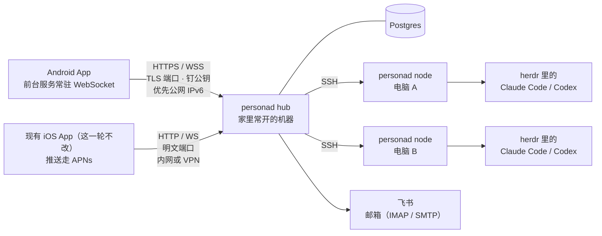

## 2. 配对

二维码格式不变（现有 iOS 照样能扫），token 换成 10 分钟内有效、只能用一次的临时 token；新参数给 Android 用。

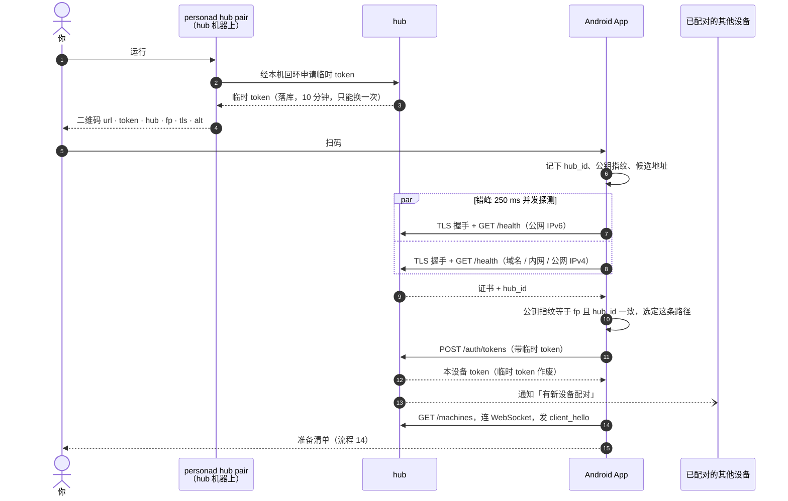

## 3. 配对失败怎么提示

不给假进度，失败按原因给能照做的提示。在家里 Wi-Fi 上超时，先排除本地网络权限（Android 17 起没授权时表现为超时）。

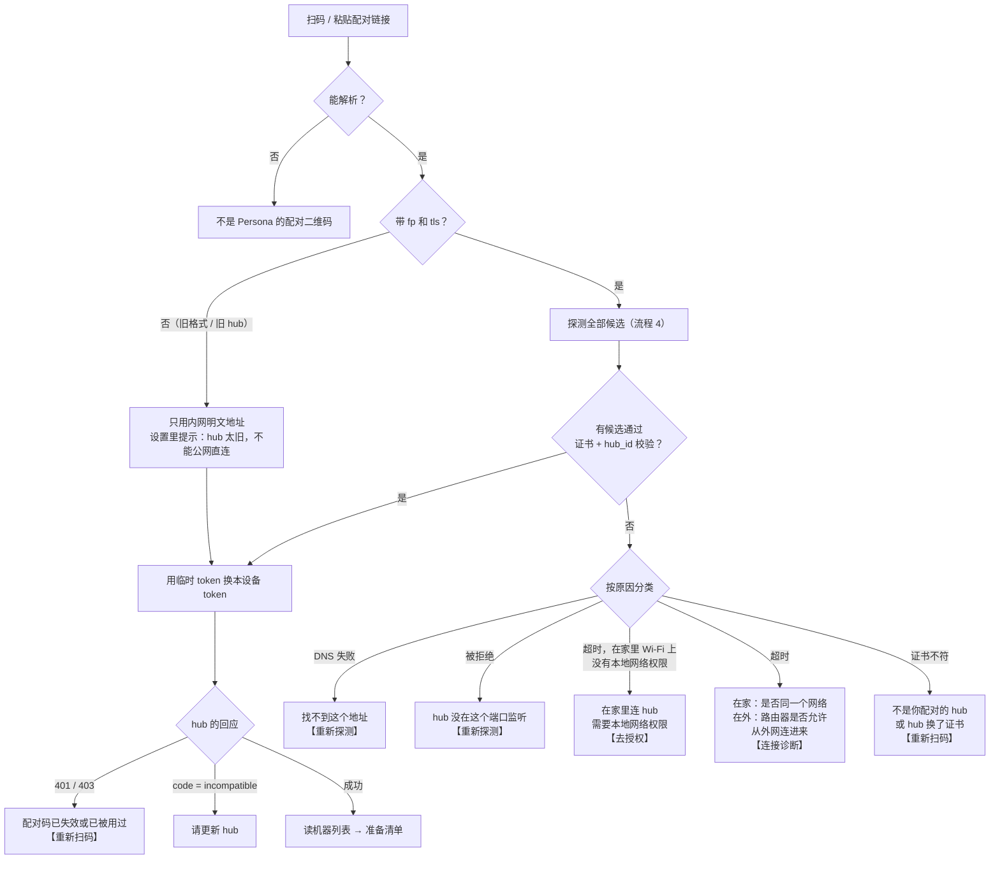

## 4. 选路：多地址探测

参考 Happy Eyeballs v2（RFC 8305）：错峰并发，先通过身份校验的赢。旧前缀可能已经分给了别人，所以「连得上」不够，证书和 `hub_id` 都要对上。

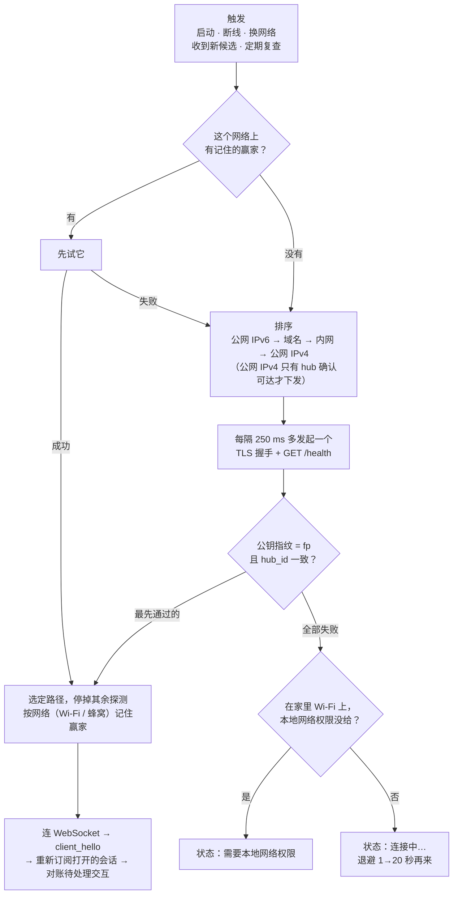

## 5. 连接状态

iOS 的四态照搬，Android 多三个要你处理的状态（橙色，不自动重试：授权后回到「连接中」，重新扫码后从头配对）。变坏要持续 1.5 秒才显示，恢复立刻显示。

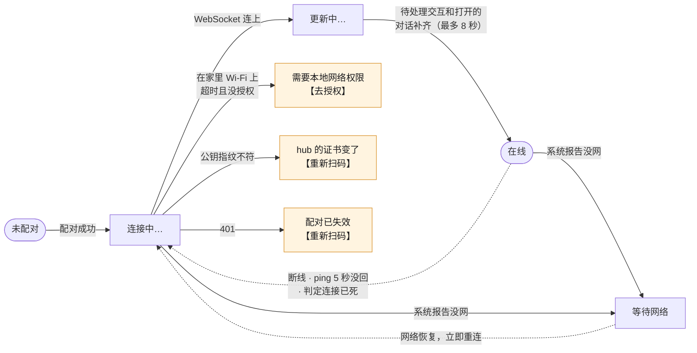

## 6. 常驻连接和心跳

Android 深睡时客户端的 ping 不触发（OkHttp 的计时用 `System.nanoTime`，深睡时停走），所以后台心跳由 hub 发，按连接协商间隔。旧连接（现有 iOS）不协商，保持 20 秒。

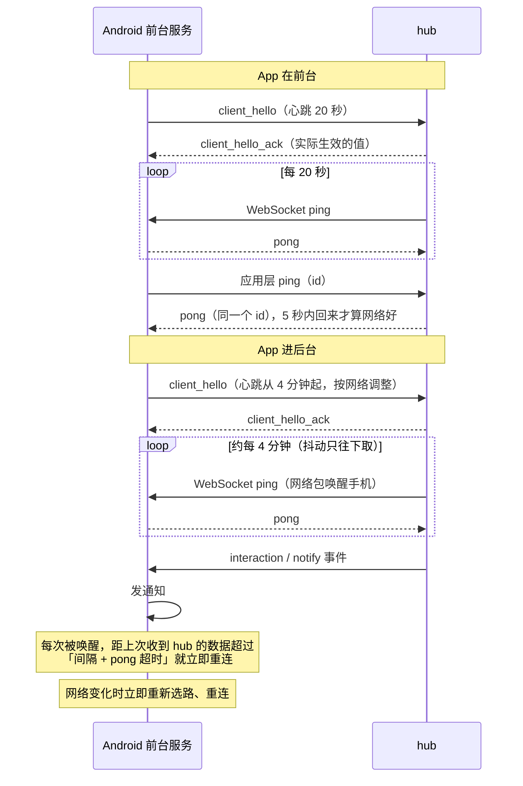

## 7. 地址变了以后怎么找回

家宽重新拨号时 IPv6 前缀会变，旧连接当场断开。Android 没有 FCM 这样的旁路，人在外面只能靠域名找回，所以推荐配 DDNS。

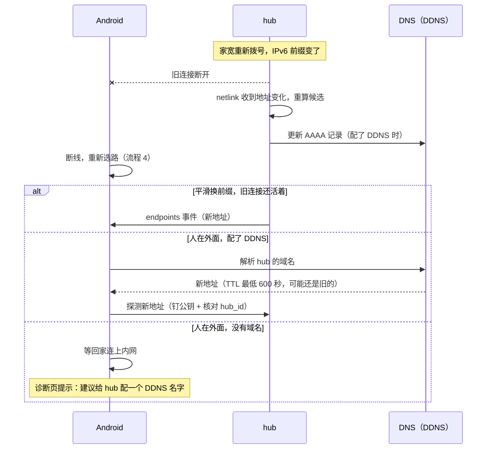

## 8. 通知 → 审批 → Agent 继续

「允许 / 批准」要先解锁；拒绝原因和计划意见可以直接在通知里输入。处理完（不管在哪处理的）撤回通知。

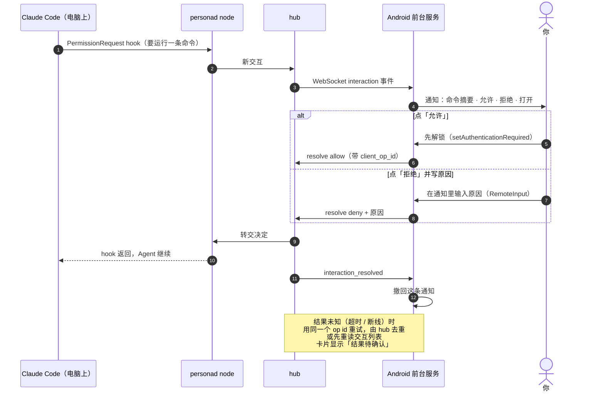

## 9. 「做完了」通知

由 hub 判断发不发，iPhone 和 Android 用同一套规则，只是送达的通道不同。手机只负责显示，不再自己算（PR #84 现在是手机自己算）。

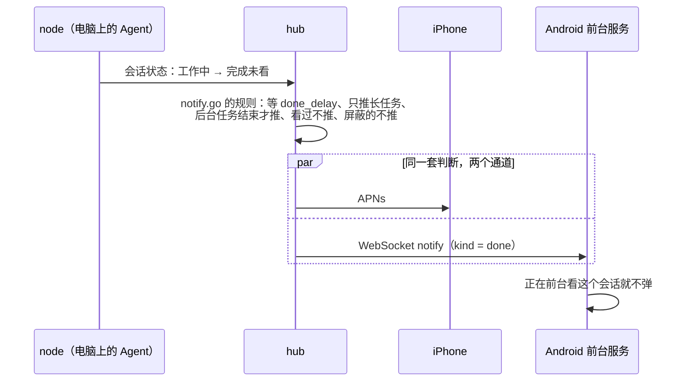

## 10. 发消息：outbox 和结果三态

先写进 outbox 再清空输入框，同一条消息始终用同一个 `client_msg_id`。「发出去没回音」不再当没网盲目重发。

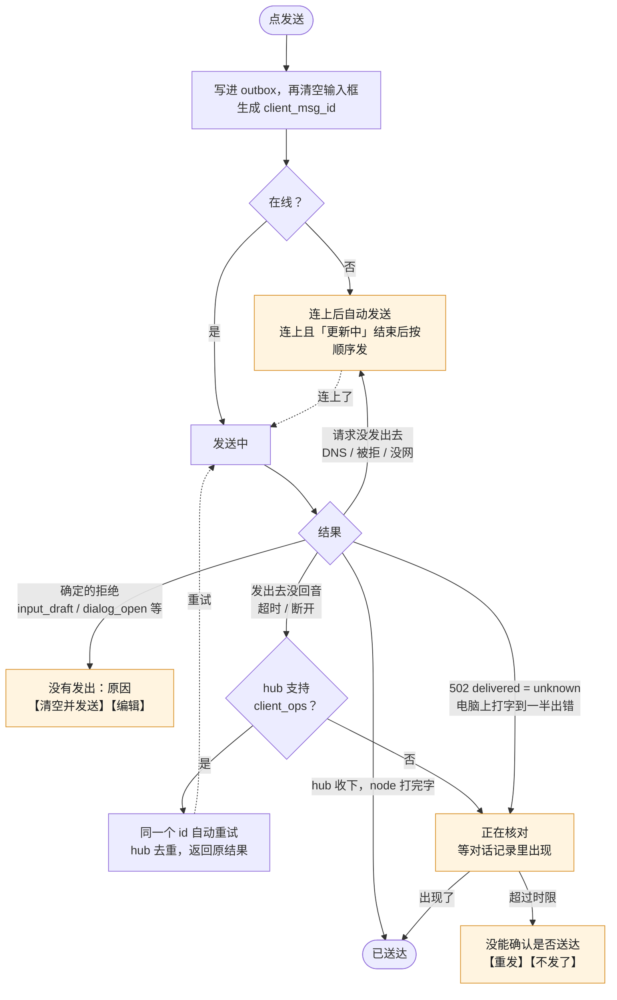

## 11. 打开对话：同步和连续性

规则沿用 `docs/protocol.md`「items 的连续性」和「折叠的工作」，写进 `spec/fixtures/continuity/`，Android 的 reducer 和 Go 的仿真共用。

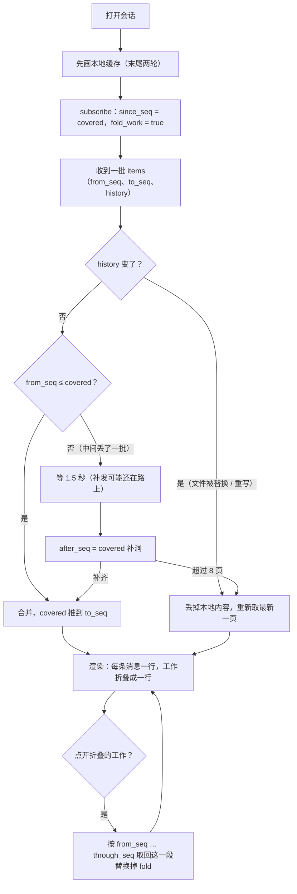

## 12. 收件箱和 AI 分身

飞书消息和邮件在一个列表里，一行一件事。AI 分身只起草、不发送，发送要你点一下；发送带 clientId，重试不会发两遍。

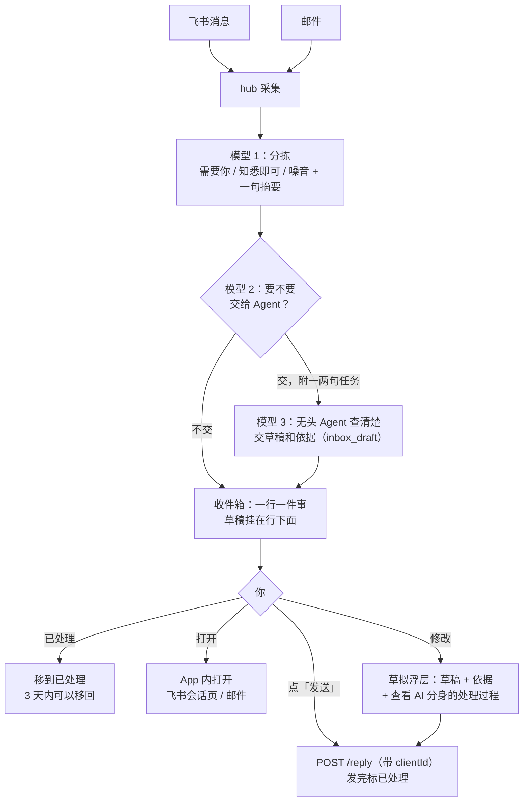

## 13. 分享到 Persona

Android 独有的入口：任何 App 的文字、链接、图片、文件发进 Persona，正合「把各处信息收到一起交给 AI」。

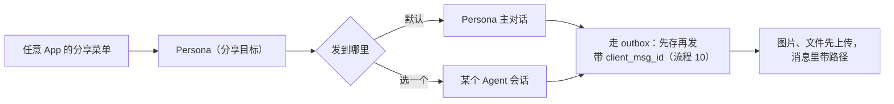

## 14. 首次准备清单（国产系统）

配对后逐项检查，每项都能跳过，并写明跳过会少什么。没有一家国产系统提供「查自启动、查后台白名单」的接口，所以能查的显示真实状态，查不了的按系统给步骤，再用锁屏测试通知兜底。各家的入口见 [android.md](android.md) 5.18。

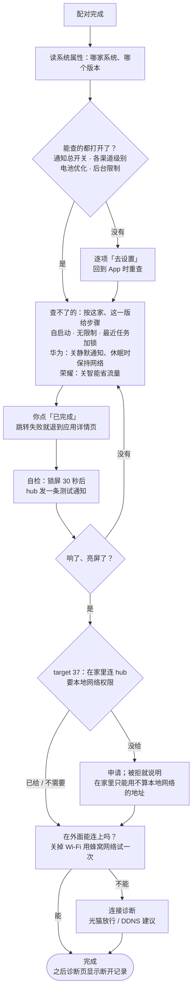

## 15. App 内更新

没有 Play 商店。APK 放在 hub 上，经 TLS 下载（钉同一个公钥），用系统安装器升级。澎湃 OS 上请求静默安装会直接失败（`INSTALL_FAILED_ABORTED`，不弹任何框），所以国产系统一律弹系统确认。第一次安装没有设备 token，用 `personad hub pair --android` 打印的内网下载链接，或 adb。

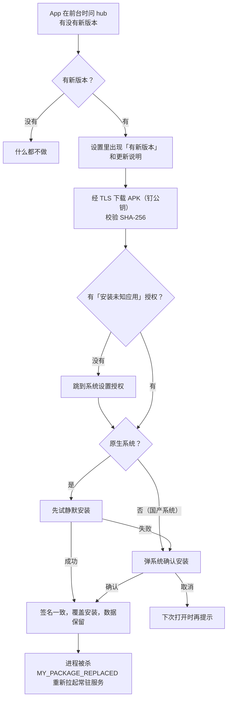
