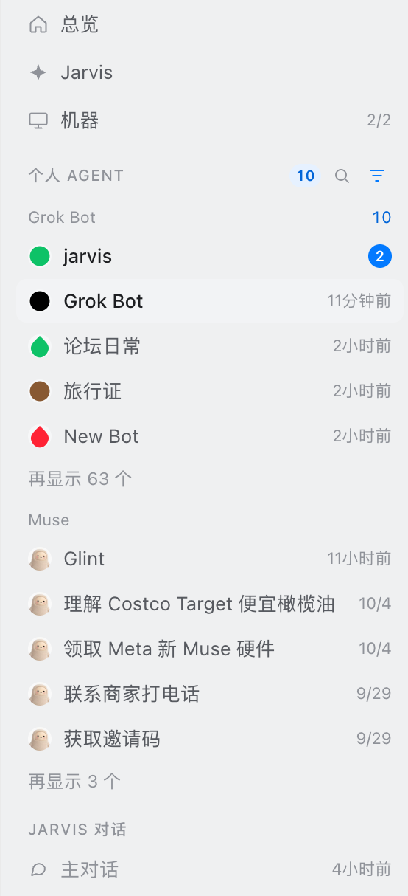
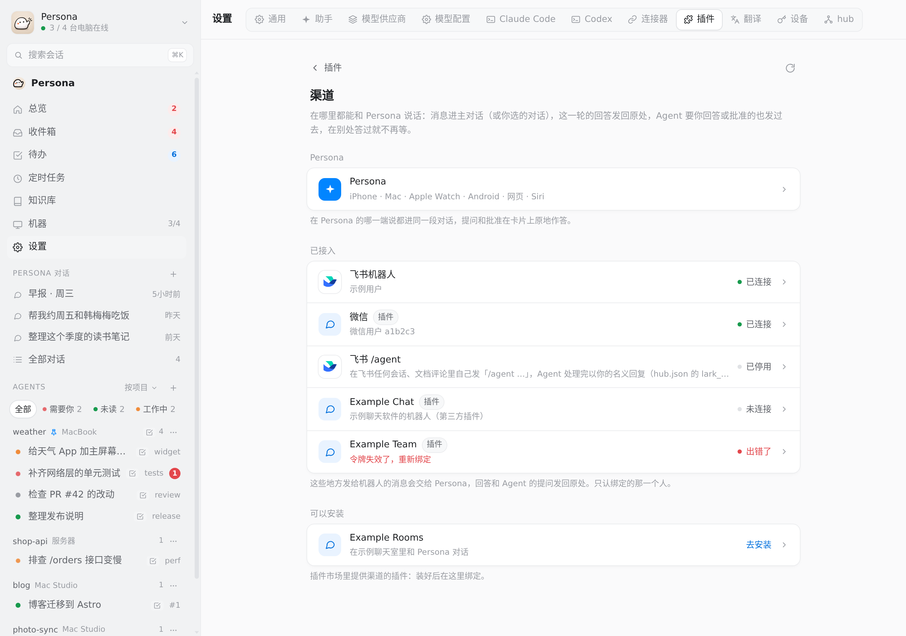
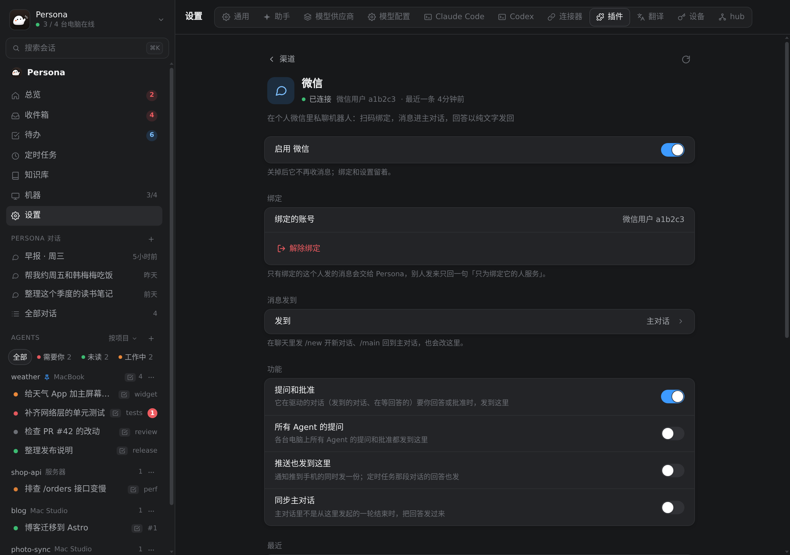
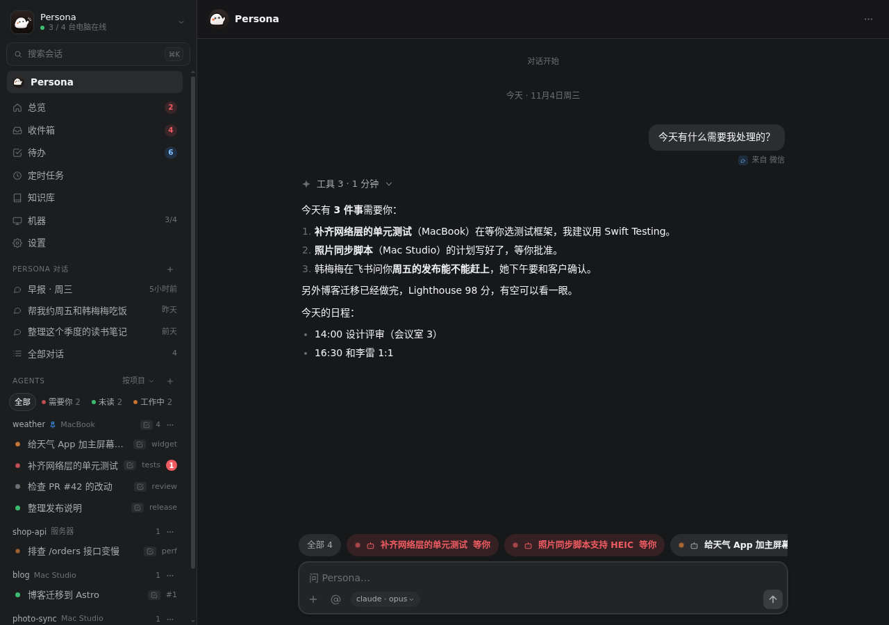

# Web app (`web/`)

Persona in the browser: Overview, Agents (Claude Code / Codex in herdr on each of your computers, plus terminal, files and Git), the Persona assistant (scheduled tasks, memory, knowledge base),
Inbox, machine monitoring and Settings. Features roughly match the phone app (gaps are listed in "Gaps versus the phone app" at the end; #297 and #433 were the two rounds that closed most of them). Visuals and interaction follow
[Beautiful UI](https://www.beautifului.dev/) (MIT, license in `THIRD_PARTY_NOTICES.md`): design tokens (`--ink` / `--surface` / `--line`…, light and dark sets),
keyframes and component grammar (Thinking's expandable trace, Tool Chips, Approval Card, Prompt Bar, Sidebar Nav's sliding highlight, Search, Task Rows, Insight Cards).
The components are rewritten from the site's React versions and wired to real data. They are not the site's demo components copied as is (those run their own demo animations and take no data).

## Running it

- **Hosted by the hub itself**: the hub serves `<hub data dir>/web` (default `~/.persona/web`) as a static site on the same port as the API (the hub's `listen`, default `:18660`, i.e. all interfaces).
  Same origin, so no CORS, and WebSocket and images use the same token. Without that directory, non-`/api/` paths still return 404.
  Paths that are not files all return `index.html` (front-end routes: `/` (Persona main chat), `/overview` (Overview), `/s/<machine>/<session>`, `/t/<machine>/<space>/<tab>[/<session>]` (one herdr tab, #1963), `/space/<machine>/<space name>` (space page, #2887), `/j`, `/j/<session>`, `/j/new`, `/history`, `/inbox`, `/inbox/<item>`, `/messages`, `/messages/<chat>`, `/routines`,
  `/kb`, `/kb/<type>/<entry>`, `/workspace-board` (workspace board), `/machines`, `/machines/<machine>`, `/terminal`, `/terminal/<machine>/<terminal id>`, `/assistant` (assistant profile page), `/settings`, `/extension/<extension>/<page>` (an extension's full page));
  files under `/assets/` carry a content hash and are cached forever; `index.html` is not cached (`server/internal/hub/web.go`).
- Deploy: `./scripts/deploy/deploy.sh web` (builds and uploads the web app only, no hub restart). Deploying the hub also deploys the web app: the web app and the Go binary are built first; if either fails to build, the build output is printed (including privacy-scan hits) and nothing is installed. The web app is uploaded after the hub restarts.
- Local development: `cd web && npm ci && npm run dev`. Vite proxies `/api` to `PERSONA_HUB_URL` (falling back to `JARVIS_HUB_URL`, then `http://127.0.0.1:18660`; `eval "$(python3 ../scripts/persona_config.py env)"` sets both).
  Tests: `npm test` (vitest, runs every `*.test.ts(x)` under `src/`); type check: `npm run typecheck`.
  End-to-end check of the sidebar entries (Persona opens the main chat, the two "+" buttons, old links, the narrow-screen drawer; Python Playwright driving the local Chrome): start the mock hub and `npx vite`, then run
  `python3 scripts/test/web_sidebar_e2e.py <web URL> [--shots <dir>]`; usage is at the top of the script. `--shots` also takes light / dark / narrow-screen screenshots.
  End-to-end check of the settings entries (#2196: channels before connectors, old extension links still work, channels and connectors link to each other, narrow screen goes back to Settings): start the mock hub with `MOCK_CHANNELS=1 MOCK_PLUGINS=1`,
  run `python3 scripts/test/web_settings_entries_e2e.py <web URL> [--shots <dir>]`; it checks wide / narrow × light / dark.
  The "herdr is not running" notice row in the Agents list (#1916): the mock hub's `GET /mock/herdr?stopped=&start=` picks which machine is stopped and how starting goes;
  run `python3 scripts/test/web_herdr_notice_e2e.py <web URL> --hub <mock hub URL> [--shots <dir>] [--channel msedge]` (wide / narrow × light / dark).
  End-to-end check of task **Retry** (#1396, #4145: the reason and **Retry** are said once, on the card; the failure receipt only points to the card; repeated clicks, failing again, offline; desktop / phone width × light / dark): start the mock hub with `MOCK_TASKS=1`,
  run `python3 scripts/test/web_task_retry_e2e.py <web URL> --hub <mock hub URL> [--shots <dir>]` (the mock hub's `GET /mock/retry?mode=|fail|offline` restores the failed task and picks the retry outcome).
  End-to-end check of injected messages (#2360: task notifications and scheduled tasks render as one line, the text meant for the model is not shown, tapping opens the task / request): start the mock hub with `MOCK_TASKS=1 MOCK_INJECTED=1`,
  run `python3 scripts/test/web_injected_e2e.py <web URL> [--shots <dir>]` (desktop / phone width × light / dark).
  End-to-end check of quotes (#2427: the quote bar, the input stays empty, × cancels, it is still sent as a `> ` block, quote cards in bubbles and history expand): start the mock hub with `MOCK_QUOTE=1`,
  run `python3 scripts/test/web_quote_e2e.py <web URL> [--shots <dir>]` (desktop / phone width × light / dark; `--before` takes only the same shots before the change; for quotes on task cards add `--tasks` and start the mock hub with `MOCK_TASKS=1`).
  End-to-end check of comments (#2437: selecting text shows **Comment**, the C key, writing a comment in the card, highlights and numbers follow scrolling, Esc cancels, the sent block and the comment card in the bubble; the line-number gutter + / drag-select in files and Git diffs, writing a comment, the card jumps back to the spot, the sent message carries the location and code; desktop / phone width × light / dark): start the mock hub with `MOCK_FILES=1` (for the terminal view also add `MOCK_TERMINAL_STREAM=1 MOCK_TERMINAL_CONTROL=1 MOCK_TERMINAL_PANES=1`),
  run `python3 scripts/test/web_comments_e2e.py <web URL> [--only transcript|code|diff] [--shots <dir>]` (the browser is the installed Chrome, or the one `PERSONA_E2E_CHROMIUM` points to).
  End-to-end check of scheduled-task "push when done" (#2570: the two options on the edit page when the hub has `task_push`; choosing **Only when it alerts** hides **Continue the original chat** and saves `push`; the marker in the list; switching back to **Every run**; desktop / phone width × light / dark): start the mock hub and `npx vite`, then run
  `python3 scripts/test/web_task_push_e2e.py <web URL> --hub <mock hub URL> [--shots <dir>]`; usage is at the top of the script.
  End-to-end check of status marks / fold counts / segmented slider (#3559: each status's shape and glow, the spinning arc, counts on folded machine rows, session header / terminal tree / command palette, the slider halfway through its move, reduced motion; light / dark × wide / 390; Python Playwright): start the mock hub with `MOCK_AGENT_MARKS=1 MOCK_TERMINAL_STREAM=1 MOCK_TERMINAL_CONTROL=1 MOCK_TERMINAL_PANES=1`, serve the web app with `npx vite`, then run
  `python3 scripts/test/web_status_visuals_e2e.py <web URL> --hub <mock hub URL> [--shots <dir>]`.
  End-to-end check of visual polish (#3475: with reduced motion the spinner and the working dot still spin / breathe at 2.4 s while other animations are suppressed; counts on sidebar machine rows and workspace rows align on the right edge, ⋯ sits over the count and appears only on hover / keyboard focus, always on touch screens; the context bar turns red at ≥ 90%; the toast's error icon and close button; light / dark × wide / 390 drawer × reduced motion on / off, plus one touch screen): start the mock hub with `MOCK_SPLIT_TABS=1 MOCK_SOURCES=1 MOCK_CONTEXT_DANGER=1`, serve the web app with `npx vite` (the toast check imports the app's own modules from it),
  run `python3 scripts/test/web_visual_polish_e2e.py <web URL> [--shots <dir>]`.
  End-to-end check of folding sidebar groups (**Other agents** folds / unfolds / stays after reload, every group can fold under all five grouping modes, the arrow is always shown on touch screens, #1417): start the mock hub with `MOCK_SOURCES=1`, then run
  `python3 scripts/test/web_sidebar_fold_e2e.py <web URL> [--shots <dir>]`.
  End-to-end check of collapsing the sidebar to an icon rail (#2524: the button and Ctrl+Alt+B, persists after reload, page / Agents / status groups fold and persist, narrow screens still use the drawer): start the mock hub with `MOCK_SOURCES=1`,
  serve the web app with `npx vite preview` (the dev server occasionally breaks module loading on reload), run `python3 scripts/test/web_sidebar_collapse_e2e.py <web URL> [--shots <dir>]`.
  End-to-end check that the chat stays at the latest message (first open, reload, switching in the sidebar, content arriving in chunks, the input growing taller, not pulled back after scrolling up, paging on a slow network; main chat and Agent chats, wide and narrow; #1340):
  start the mock hub with `MOCK_TASKS=1 MOCK_LONG_ASSISTANT=1 MOCK_LONG_HISTORY=1`, then run `python3 scripts/test/web_chat_scroll_e2e.py <web URL> [--hub <mock hub URL>] [--shots <dir>]`.
  End-to-end check that new content shows up in a chat without reloading (#3036: new replies appear in the chat view, after switching terminal ⇄ chat several times, when pushed while on the terminal page, and after the page refetches because the `history` token changed): start the mock hub with `MOCK_TERMINAL_STREAM=1 MOCK_TERMINAL_CONTROL=1 MOCK_TERMINAL_PANES=1` (`GET /mock/say?user=…&text=…[&history=<token>]` adds a reply to every chat a page is subscribed to and can also change `history`), run `python3 scripts/test/web_chat_live_e2e.py <web URL> --hub <mock hub URL> [--shots <dir>]`.
  End-to-end check of the main chat's task dock ("All N" is the same height as the pills with top and bottom edges aligned; the pill row has no scrollbar but still scrolls sideways; Chrome runs with always-visible scrollbars, WebKit optional): start the mock hub with
  `MOCK_TASKS=1 MOCK_TASKS_DOCK=pair|many`, then run `python3 scripts/test/web_task_dock_e2e.py <web URL> [--browser chromium|webkit|all] [--shots <dir>]`.
  End-to-end check that opening a task with a pending question in the side panel does not push the whole page up (#1282: cards in the panel fold like on a narrow screen, the bottom area has a max height, focusing the input does not scroll ancestors): start the mock hub with
  `MOCK_TASKS=1 MOCK_TASKS_DOCK=many`, then run `python3 scripts/test/web_panel_focus_e2e.py <web URL> [--size 1280x800] [--shots <dir>]`.
  End-to-end check of installing as an app (Chrome considers it installable, the service worker takes over, the cache holds only the shell and assets, it opens offline, the install row in Settings, theme-color follows light / dark):
  the service worker only runs in a build, so first `npm run build`, serve it with `npx vite preview` (not `vite`) against the mock hub, then run `python3 scripts/test/web_pwa_e2e.py <web URL> [--shots <dir>]`.
  End-to-end check of terminal mouse input (#2441: click / drag / middle and right button / ctrl and alt modifiers reach the hub as `terminal_input.mouse`, Shift selects text and Shift+right-click opens the menu, **Select locally**, nothing is sent in view-only mode, the scroll wheel is unchanged):
  start the mock hub with `MOCK_TERMINAL_STREAM=1 MOCK_TERMINAL_CONTROL=1 MOCK_TERMINAL_PANES=1`, then run `python3 scripts/test/web_terminal_mouse_e2e.py <web URL> --hub <mock hub URL> [--shots <dir>]`.

## Subpaths (#2563)

The hub often does not get its own port but sits under a subpath of an existing site: a reverse proxy strips the prefix from `https://<domain>/<prefix>/` and forwards to the hub's plaintext port,
and `hub.json`'s `public_url` is set to `https://<domain>/<prefix>` (the app and `node --dial` both append `/api/v1/…` to it, and pairing links use it too). The web app works this way as well:

- **The proxy sends `X-Forwarded-Prefix: /<prefix>`**. When the hub returns `index.html`, it rewrites `<base href="/" />` to `<base href="/<prefix>/" />`
  (`forwardedPrefix` / `withBase` in `server/internal/hub/web.go`). Only prefixes that start with `/`, have only letters, digits and `-._~` in each segment, contain no `.` / `..` segment, and are at most 256 bytes are accepted;
  anything else (quotes, angle brackets, spaces, control characters, percent escapes…) is ignored and treated as the root path. Without the header, behavior is exactly as before.
  The same `index.html` returns different content depending on this header, so it carries `Vary: X-Forwarded-Prefix` (it was already `no-cache`; `Last-Modified` and 304 work as before). Only `index.html` is changed; other files are served as is.
- **The web app reads the prefix from `<base>`** (`BASE` in `src/lib/base.ts`, an empty string at the root path): the API (`lib/api.ts`), WebSocket (`lib/store.ts`),
  images / file downloads / thumbnails / avatars / avatar packs / Lark document media (`imageURL`, `fileDownloadURL`, `fileThumbURL`, `agentAvatarURL`, `personaFileURL`, the Inbox's `withToken`, `feishu-doc`'s `mediaURL`),
  the live screen page and its WebSocket (`/screen/<machine>`), and front-end routes all add it. Routing: `href()` produces prefixed URLs, `parse()` reads the path with the prefix removed (`useRoute` calls `stripBase` first),
  and string arguments like `navigate("/settings?…")` are in-app paths without the prefix. Links to the hub's own pages (`/s/…`, `/todos?id=…`) open inside the app only if they are within the prefix.
  When writing new code: build `/api/…` URLs only through the functions above (or prepend `BASE`), use `href(route)` for in-site links, and never hard-code `"/xxx"`.
- **The bundle uses relative paths** (`base: "./"` in `vite.config.ts`): `index.html` references `./assets/…`, and icons and the manifest use relative URLs too, all relative to `<base>`;
  reloading a deep path (`/<prefix>/s/<machine>/<session>`) works. `manifest.webmanifest`'s `start_url` / `scope` / icons / shortcuts are all relative (`id` stays `/`, so existing installs are unchanged).
- **No service worker under a subpath** (`lib/pwa.ts`): its rules and cache are written for the root path. The PWA can still be added to the home screen, just without the offline shell.
- **The admin UI (`/admin`) is root-only**: it does not read the prefix and cannot be opened through a subpath. The admin UI restricts access by source address ([admin.md](admin.md)) and should not be exposed through a public proxy anyway;
  access the hub's port directly on the hub machine or the LAN.
- **One hub per origin**: login (`localStorage`) is stored per origin, so two hubs under two prefixes on the same domain log each other out. The **Switch** hub list can remember prefixed URLs.

nginx example (replace `hub.example.com`, `/persona/` and the port with your own; `map` goes in the `http` block, `location` in the 443 `server` block):

```nginx
map $http_upgrade $connection_upgrade { default upgrade; '' close; }

location = /persona { return 301 /persona/; }
location /persona/ {
    proxy_pass http://127.0.0.1:18660/;          # the trailing / strips the prefix
    proxy_set_header X-Forwarded-Prefix /persona;
    proxy_set_header Host $host;
    proxy_set_header X-Forwarded-For $proxy_add_x_forwarded_for;
    proxy_set_header X-Forwarded-Proto $scheme;
    proxy_http_version 1.1;
    proxy_set_header Upgrade $http_upgrade;      # WebSocket
    proxy_set_header Connection $connection_upgrade;
    proxy_buffering off;
    proxy_read_timeout 1h;
}
```

In `hub.json`: `"public_url": "https://hub.example.com/persona"`. To verify: open `https://hub.example.com/persona/` in the browser; in the developer tools every request (including `/api/v1/ws`) should be under `/persona/`.

## Sign-in

The sign-in page does not teach the command line (#3356, `docs/onboarding.md` 4.2). The first choice is **Sign in with your signed-in phone**: it tells you to open **Settings › Devices › Connect a new device › Browser** on a device that is already signed in;
phones / tablets scan the code with the camera and sign in directly, and on a computer you click **Copy sign-in link** and open it or paste it here. The second choice is the **Paste a sign-in or pairing link** box.
The box for pasting the hub's master token, and the `personad hub pair --legacy` / `jq` recipes, are tucked into **Advanced: sign in with the hub's master key**, collapsed by default, which says plainly "this is the hub's master key".
**Don't have a hub yet?** expands into an in-page explanation (what a hub is, what to do if you install it yourself, who to ask if someone else installed it). It does not link to GitHub docs: the web app cannot read the site URL from the build config (`publish.site_url`).

A pairing token the web app receives is first exchanged for its own device token (`POST /api/v1/auth/tokens`, `kind: web`, role full; older hubs store it as `other`). From then on only its own token is used,
and the pairing token is not kept in the browser; **Settings › Devices** can revoke it on its own. You can also paste a `jd_` device token directly.
**One browser, one device**: the device name carries the sign-in date ("Web (Chrome · Mac · Nov 6)"). The id of this browser's previous device is kept in `localStorage` under
`jarvis.tokenId` (it is not cleared when the hub returns 401 and the token is cleared). When exchanging a token it is sent as `replaces`, and the hub revokes that device (only `kind: web` ones), so the device list no longer piles up devices with the same name;
**Disconnect this browser** already revokes and clears it. A browser whose site data was cleared cannot be recognized and gets a new device as before, told apart by date.
For browsers signed in before the upgrade, the hub stored `other` (the same kind as the Mac desktop app's credential, so they cannot be told apart), and the first sign-in again does not replace it; older same-named devices have to be revoked by hand in **Settings › Devices**.
Step one of the sign-in page sends the user to **Settings › Devices › Connect a new device › Browser** on a signed-in device: the web app and iOS have this entry; Android gets it from the onboarding PR for connecting new devices on Android (`docs/onboarding.md` section 7, step 16). Until then, only Android users have to go through **Advanced**.
**Sign in by link** (2026-10-31): opening `<hub address>/?token=<hub token>` (any page path works; `#token=` is also accepted, and is not sent to the server) signs you in directly, no pasting.
On page load the token is first wiped from the address bar (`history.replaceState`, before React renders), so it is not in history, bookmarks or copied links; then it is exchanged for this browser's own
device token as usual. If this browser is already signed in (the link is opened again), the existing token is reused and no extra device token is created. If the token is wrong, the page stays on sign-in with a message.
The hub's access log records only the path, not the query string. Note that the link itself carries full access: don't post it in group chats or store it where others can see it; if it leaks, rotate the token on the hub machine.
A signed-in browser can generate such a sign-in link for another device in **Settings › Devices › Connect a new device** (a one-time temporary code, 10 minutes); see "Settings" below.
The token is stored in `localStorage`. `` cannot send request headers, so images use `?token=` (the hub already accepts it, and the log does not record query strings).
**Disconnect this browser** in the top-left menu revokes this token.

**Security**: the page itself needs no auth (it is just static files); all data sits behind `/api/` and needs the token. The hub speaks plain HTTP by default, so the token is visible on the network:
use it only on the intranet / VPN, and put an HTTPS reverse proxy in front before exposing it to the internet.

## Pages

- **Workflow board** (`/workspace-board`, #1646): off by default, turned on in Settings › General › Agent (the switch is stored on the hub, the same for every browser, #2475). When off, the sidebar has no entry; opening the URL directly shows **Workflow board is off** with a button to Settings, and it neither reads the board nor polls the discovery API. When on, enter from the sidebar, bind an existing workspace or a real directory on an online machine, and manage columns, card order, pinning and archiving by hand; the detail view links Agents in the same directory and opens files, Git, or explicitly creates a new Agent. Cards and column state are stored in Postgres; Agent state does not move cards between columns, and cards stay when offline. Operations, permissions, upgrades and sources: see [Workspace board](workspace-board.md).

- **Terminal** (`/terminal`, `/terminal/<machine>/<terminal id>`, `src/views/terminal/TerminalPage.tsx`, `src/lib/terminals.ts`, `docs/terminal.md` section 19): open a terminal without starting an Agent.
  Machine → herdr space → tab → pane. Agents have a status dot, plain shells a terminal icon. Clicking a plain shell pane opens it as a terminal on the right (full page on narrow screens); it is the same `TerminalPanel` as **Side panel › Terminal**, with the same take-over / view-only / key bar / history. Clicking an **Agent's pane** (or Enter in Jump To) goes to its session page with the terminal view in the middle (**Terminal ⇄ chat**, #2419); old `/terminal/<machine>/<Agent session id>` links still open.
  The terminal has two UIs, switched by "Single pane / Full UI" in its header (default full UI; see **Side panel › Terminal** below).
  The "+" next to a space creates a new shell tab (`POST /machines/{mid}/panes`, without stealing focus on the computer). The input above the list is Jump To (title / directory / branch / machine, ↑ ↓ Enter). The 2 most recently opened terminals on each machine stay attached, so switching shows content immediately.
  Machines / workspaces / tabs all fold, and every node has a context menu ("Node menu"). When the browser tab goes to the background, only the terminal being viewed is kept; leaving the page releases all of them. A pane terminal is that computer's shell, so only full devices can open it (watch tokens and extension tokens cannot). For screenshots use the mock hub with `MOCK_TERMINAL_STREAM=1 MOCK_TERMINAL_CONTROL=1 MOCK_TERMINAL_PANES=1`.
  Why the route is a full page and not a side panel: a side panel sits next to a chat, and without a chat there is nothing to sit next to; a full page has a URL, so it can be bookmarked and navigated back and forward.

- **Sidebar** (always visible on wide screens, a drawer on narrow screens; both are the same component): connection status and online-computer count, ⌘K search (sessions, terminal panes, Inbox and pages; `>` runs commands, see "Shortcuts and command palette"). The main chat is the top row of the left column, **Persona** (the app logo `AppMark`, bold; opens the main chat, shows a status dot or count while working / needing you, with a chat menu on ⋯ / right-click). A divider separates it from the pages below. It stays visible when Pages or Persona chats is collapsed, appears from first load and only once, consistent across clients with iOS #2004, #5109; previously it was the first Persona chats row, #2824),
  followed by Overview / Inbox (the **Needs you** count) / Todos / Scheduled / Knowledge base / Machines / Terminal (only when the hub has `terminal_panes`) / (extension pages, see "UI slots" under "Settings") / Settings. Below that is **Persona chats** (pinned chats first, not counting toward the limit, then the 5 most recent chats other than the main chat, ending with **All chats**;
  the "+" right of the title opens a one-off new chat `/j/new`; each row's ⋯ / right-click offers Pin / Unpin, **Rename…**, Archive and Copy session ID, plus **End…** while the chat is running (click again in the menu to confirm, `POST /sessions/{mid}/{sid}/close`),
  matching the long-press menu in the iOS sidebar (#2988, `views/ConversationMenu.tsx`). Pins are stored in this browser (`localStorage` `assistant.pinned`, per device like iOS, `lib/conversation-pins.ts`). Pinned chats have a **Pin** subheading whose ⋯ / right-click is **Unpin all**, and pinned rows show a pin instead of the chat icon. The Persona row's ⋯ / right-click is the main chat's menu, with only Copy session ID and **End…**), then **Personal agents** and Agents (the "+" right of the title creates a new Agent; it is also in the ⌘K palette).
  **Why Persona is the default landing page** (#1239): it matches iOS (the app opens on the assistant, Agents is the second tab), and the main chat has its own task dock and **Needs you** (#930),
  so things to handle are visible and can be delegated right there; Overview is more of an Agents dashboard and moved to `/overview`. The main chat has a single entry: `/`, the old `/j`, `/persona` and `/j/<main chat id>` all select the Persona row.
  **Recent** under **Persona chats** lists only chats the user opened. Chats the hub opened itself (Inbox AI twin, scheduled tasks, Lark /agent, chat spin-offs, extensions; the session's `origin`, #3264) go into one row below, "Automatic N", folded by default (`localStorage` `fold:auto-chats`).
  When folded it shows a red count for those waiting on you and a status dot for running ones. Expanded, there is one row per origin; clicking opens `/history/<origin>`: **All chats** filtered by origin, switchable with "All · Mine · Inbox · …" at the top (`lib/conversation-origins.ts`).
  Pinned ones still show under pins; when an open automatic chat has no row of its own, its origin's row is highlighted. For screenshots use the mock hub with `MOCK_ORIGINS=1`. The rules are in `docs/protocol.md` ("Origin of assistant chats").
  The **Persona chats** list and the new-chat page's top bar no longer list **Main chat** again. The main chat's top-bar title is always "Persona" (avatar on the left), with no subtitle line (like the iOS Persona top bar), and its menu has no **Rename…** (#1313);
  side chats still show the chat title + "launcher · how long ago". When there is no main chat yet, `/` is the new-chat page, and the first message carries `main: true` to start the main chat.
  The main chat's ⋯ menu also has **Compact context** and **New main chat…** (only when the hub's `features` include `assistant_compact` / `assistant_main_new`, #1727, `lib/compaction.ts`):
  while compacting, a **Compacting context…** line shows above the input; when done, **Context compacted** shows briefly; on failure the reason is shown and can be dismissed (it only reports changes seen on this page or just finished, not old ones every time you open it).
  Creating a new one asks for confirmation (**Bring a summary of the old chat** is on by default); on success it returns to the new-chat page at `/`, and the old one appears under **All chats › Archived** as "Old main chat · until <month day>".
  In every chat, a compaction is drawn as a divider "Content above compacted · manual · N×10k tokens before compaction", and `/compact`'s **Compact context** and "Continued from compacted context" fold into that line (hover to see the original text).
  **The currently open row** (#2283): always has the `--hover-2` background (one step darker than the hover `--hover`, visible in both light and dark) and `aria-current="page"`; the sliding hover highlight only follows the mouse and no longer takes the current row's background with it.
  Besides being measured when the sidebar re-renders, the sliding highlight's position is re-measured when the list layout changes (#2476, `useGlide`): a `ResizeObserver` watches the list, its sections and every row, plus the end of fold animations and scrolling in the list, measuring at most once per frame;
  the highlight covers only the visible part of the row (`lib/glide.ts` intersects the row with every enclosing `overflow: hidden` box). When the row goes into a folded group, has zero height or disappears, it fades out, and when it reappears it slides over from where it was.
  When the current session is not among the 5 most recent in **Persona chats** (an older one opened from **All chats**, ⌘K, the Inbox or a link), it is appended after those 5; the same applies when **Recent (not running)** has more than 8 entries or there are more than 5 personal Agents.
  Its group (including ones folded by default) expands once when it opens; after that it can still be folded by hand, and the saved fold state does not change. The list scrolls it to the middle, and until the user scrolls, clicks or presses a key, it scrolls back if content loading above pushes it out of view.
  The current row's ⋯ (Agents) and pin button (personal Agents) are always shown, without hovering; the row end reserves room for them, so hints and badges no longer move aside.
  **The whole sidebar collapses into an icon rail** (#2524, wide screens only): the button right of the account row at the top, or ⌘⌥B / Ctrl+Alt+B, collapses it into a 56px column of icons (expand button, search, Persona, each page, new Agent, connection status at the bottom).
  The current page has a background, and page counts become small dots on the icon corners (the count is in the accessibility label and tooltip). An icon rail rather than hiding it entirely: pages are still one click away and the expand button is always on screen, so the collapsed state can safely be remembered;
  once collapsed, sessions and the Agents list are found with ⌘K. ⌘B is already the right panel and ⌘⇧B is the browser's bookmarks bar, so it uses Moshi's ⌘⌥B (changeable in Settings). Narrow screens still use the full drawer and ignore this state.
  **Every sidebar group can fold** (#1417): **Pages** (Overview…Settings; the heading was added in #2524) and the whole Agents block (the grouping control and "+" stay on the title row) can fold too.
  These two do not follow "Fold / unfold all groups", so their headings stay visible when everything is folded. Persona chats, personal Agents, pinned, starting, every group under every grouping mode, idle spaces, **Other agents** and **Recent (not running)** all use the same
  `Section` (`folded` / `onToggle` are required): clicking the heading folds / unfolds, the fold state is stored in this browser (`localStorage` `fold:<key>`) and survives reload; on touch screens without hover the fold arrow is always shown.
  Right of the heading is the count; when folded it is replaced by status dots for the "needs you / done, not seen / working" items inside, so folding never hides what needs attention.
  The list menu on the Agents title row (the grouping one) also has **Collapse all** and **Expand all** (#3027, matching the app's list settings): they only touch groups in the Agents block (`useFolded` subscribes per block via `FoldScope`),
  and **Expand all** also switches saved manual folds of spaces and tab groups not currently drawn (`fold:space:*`, `fold:tree:*`) to expanded, so they stay open after changing the grouping or expanding an outer level.
  **Other agents** (Agents not in any space, such as Codex or DSH sessions) follow the space rule for their default: folded when there are more than 3 and none needs attention (seen, waiting), otherwise expanded.
  They are not always folded like **Idle Spaces**, because for people who do not use herdr every Agent is in this group, and always folding it would hide the working ones too. iOS has no such group; Agents outside spaces are grouped into one space per computer, which can also be folded.
  The right side of the Agents title switches between "By machine / By repo / By project / By status / By to-do"; browsers that never picked one default to by machine (#1963). Once picked (including by to-do, #1836) it is remembered for next time; if by to-do is picked but the hub does not support todos, it shows by machine for now. The choice and each group's fold state are saved in the current browser.
  Below the divider in the same menu is sorting (matching iOS / Mac `AgentSort`, `src/lib/agent-sort.ts`, stored in `jarvis.agentSort`): **State first** (default) keeps each group's own order; with **Recently updated**, Agents within each group are sorted by time only (working ones by `state_since`), and machines, spaces, tabs and repos are ordered by their newest Agent too (by repo, machines keep their original order, like iOS, so a whole section does not jump when another computer updates). By project, **Other agents** is sorted by time only; pinned spaces stay first and a repo's main worktree stays first; by to-do, only the Agents under each to-do are sorted by time. A clock icon is added in front of the grouping button. By status hides sorting (the sections are the states).
  - **By machine** (following herdr's layout, `src/lib/herdr-tree.ts`): machine → Workspace (herdr's order, `space_index`) → Tab (`slot_index`). A session is an Agent pane; several Agent panes in the same tab are switched with tabs at the top of the session page (`views/chat/PaneTabs.tsx`); plain shell panes are not listed.
    Machine rows have an online dot and the needs-you count, and offline machines fold by default. Workspace rows have a status dot and an Agent count (counting Agents like the machine row and quick filters; hover shows how many tabs), and ⋯ reuses the space menu. Tab rows show `#N` or the name, the title of the most urgent pane, and "N agents". Each level's status dot is the most urgent below it (needs you > working > done, not seen > seen).
    When a tab has several Agents (#2320, `docs/agent-states.md` "Several panes in one tab"), "N agents ›" at the row end expands into one row per Agent (with a status dot, Agent name and its own ⋯),
    ordered by pane position (`pane_index`; when missing, by the order herdr opened the panes, since pane ids are base-36 counters): the lead is on top, marked **Lead**, and panes it split off are indented beneath it on a thin line;
    when the top-left is a shell, the Agents are peers and unmarked. Expanded by default (so you can see at a glance which Agents belong together); clicking "N agents" folds it into one row. The fold state is kept in this browser keyed by `machine/space name/tab number` (no tab name: two tabs with the same name are tracked separately, a renamed tab (the hub renames `#2` to the task title) is still recognized, and numbers survive a herdr restart; hosts without numbers use the tab's id). Long tab names are truncated (to at most half the width) and never overlap "N agents".
    When folded, what is open is one of the Agents inside, and the tab row is highlighted (the sliding highlight and "scroll to the open row" land on it); only when expanded is it that Agent's own row: folded child rows are still in the fold container but do not register a position. The tabs at the top of the session page are also ordered by position, and the lead carries **Starter** (when three tabs crowd one row on a phone, only this mark is kept and the Agent name is dropped).
    Clicking a Tab goes to `/t/<machine>/<space>/<tab>`, selecting the most urgent pane by default; if the id changed after a herdr restart and it cannot open, it falls back to the session in the link; old `/s/` links open as usual. Hosts without a tab level (Paseo, botmux, runtime) list sessions directly under the space, and those not in a space go to **Other** under the machine.
    Folding and pinning are keyed by `machine/space name` (workspace ids change after a herdr restart).
    Spaces with `parent_space_id` (Orca child workspaces, #2073) hang under the parent space like in Orca's sidebar: after the parent's tabs there is an extra "N children" row, folded by default (`<machine/space name>/children`), with status dots for children needing attention when folded;
    the parent space's row sums the children's states (counts of needs you / working / done), and its own status dot and folded status dots include the children. When the parent has no running Agent (not in the list) or parent and child form a cycle, child spaces stay at the top level. Only **By machine** folds this way.
  - **By repo** (following Orca's "Projects" sidebar): grouped by repo within each machine; under a repo are its worktrees, and Agents are under worktrees. Repos and worktrees (`src/lib/agent-repos.ts`): when the session carries `repo_root` (the host knows which repo it belongs to, #2840; Paseo worktrees live in Paseo's own directory and cannot be recognized from the path), it is grouped by that: a cwd inside it is the main worktree, otherwise one of its worktrees. Without it, the repo is inferred from cwd: the part before `.worktrees/`, `.claude/worktrees/` or `.herdr/worktrees/` is the repo; for the centralized `~/.worktrees/<repo>/<worktree>` layout the first segment after the marker is the repo; any other path is itself the repo. The main worktree has a home icon and comes first; worktrees with no running Agent are labeled **Idle** and folded by default; a repo with only a main worktree skips the worktree level and lists Agents directly under the repo.
  - **By project** keeps the original herdr order (machine → workspace → tab); quiet spaces go into **Idle Spaces**. Spaces with a loop, background work or running subagents are never folded away.
  - **By status** matches iOS `AgentListOrder`: needs you → done, not seen → working → waiting to wake → muted → seen; only non-empty groups are shown, and seen is folded by default.
    Mutes come from the hub's `/mutes`; needs-you items are not demoted by muting, and ordinary seen items still go under seen. Agents with notifications turned on individually inside a project do not count as muted.
    Within a group, items are sorted by time descending, ties by session ID; working ones by `state_since` (falling back to `updated_at`), so they do not move with every line of output.
    Rows in status groups add project context, and the machine name when there are several machines.
  - **By to-do**: one section per unfinished to-do with Agents attached; the section header is the to-do title and status, and clicking it opens the to-do. Agents without a to-do go in a last section **Not on a to-do** (formerly **Unassigned**), folded by default when there are to-dos above (unless it contains needs-you items). It and **Opened in the terminal** (formerly **Started Manually**) each have a line of gray text under the header explaining what these Agents are and that right-clicking a row (or clicking ⋯) › Link to to-do… moves them over; it shows even when folded (#3057; iOS / Mac still use the old names). When the list has two or more kinds of host (herdr, botmux, Orca…), rows not in herdr carry a small host tag (`botmux`, inferred from the `pane_id` prefix); with only one kind it is hidden. Rules for pinning, muting and **Recent (not running)** match **By status**. Under other groupings, rows attached to a to-do show a to-do icon tag.
  - **Recent (not running)** is kept under all three groupings: offline sessions, or sessions whose machine is offline / no longer in the machine list, go only here and are not repeated in the live groups; the assistant is not mixed into Agents.
    Expanding shows 8 at first and can go up to the 40 most recent. Folded content leaves keyboard focus and the accessibility tree.
  - **Quick filters** (#433, iOS `QuickFilterBar`, `src/lib/agent-filter.ts`): pills "All / Needs you / Unread / Working" with counts under the Agents title, showing only states that have Agents; they combine with all three groupings and are saved in the current browser. At the end of the filter row is a "botmux" toggle (#2786, shown when there are botmux sessions, and kept while hidden so it can be restored): one click hides / shows botmux sessions in the list (strikethrough means hidden); it combines with any filter and grouping and is saved in the current browser. **Lark group** contains only botmux sessions, so hiding them under **Lark group** returns to **All**, and picking **Lark group** while hidden shows them again. It only affects this list; **Also show botmux sessions** under machine details › Engine still decides whether that computer's botmux sessions are listed.
    Counts match iOS (muted unread / working items do not count, muted needs-you items do). Matches are recorded when a filter is selected, so opening an unread item and turning it seen does not make it jump out of the filter; clicking the pill again recomputes. With a filter on, **Recent** is hidden and idle spaces do not fold.
  - **Mark all as read** (iOS `AppModel.markSeen`): the top row of the list when filtering **Unread**, the space heading's menu, and the right of Overview's **Done, not seen yet** all confirm first; it marks them seen locally right away (WS `seen`, `POST …/seen` when disconnected).
  - **Pin** (`GET / PUT /pins`, keys as on iOS: `machine/space name`, `machine/session id`): a **Pin** section at the very top; pinned spaces come first in by-project grouping and never fold even when idle; local state changes first and is restored on failure.
  - **Row menu / space menu** (iOS `AgentRowMenu` / `SpaceMenuItems`, `src/views/AgentMenus.tsx`): the ⋯ shown when hovering an Agent row, or right-click (opens at the mouse position): live attach, pin, rename, mute notifications, **Hand back to Persona**, copy directory / resume command, close Agent… (the same confirmation dialog `CloseAgentDialog` as the chat's ⋯, #3405),
    followed by the group every node has (copy session id / herdr id, new pane, Git, close pane; see "Node menu" below);
    a space heading's ⋯: **Open space page**, **Mark all as read**, rename space, pin space, mute this space, followed by fold, new Agent, Git, copy path. On hover, hints and badges at the row end move aside so ⋯ does not cover half of them.
    **Hand back to Persona** (iOS `AgentHandoff`) sends this Agent's situation into the main chat as a context card, through the cross-page pending message (see "Persona" below); you jump there and see the bubble.
- **Todos** (`/todos`, `src/views/Todos.tsx`): list on the left, details on the right. The list is sorted by unfinished state (waiting for you > to review > in progress > to follow up > not started) and creation time, with completed ones at the bottom; each row shows the state, number of linked Agents, the last line of the most urgent Agent and the last update time (`updated_at`, as on iOS / Android, #2975). Until the first load finishes it shows loading; with no todos it shows an icon + **No to-dos** + an explanation + **New to-do**, and a different text when a search finds nothing. On narrow screens (< 768px) the list and details take turns: clicking a row goes to details (URL gets `?id=`), and **Todos** at the top left goes back to the list. Details let you edit the title and description in place, list currently linked Agents (click to open the chat; each row's × unlinks it, and for ones that failed to start it is **Remove**) and past participants; you can **Hand to agent** (open a new one or hand to an existing one, with a to-do context card and `todo_id`), complete / reopen, or delete. The chat page's ⋯ menu and session info show "To-do: X"; when the hub does not support the todo API (404), the entries are hidden.
- **New Agent**: Claude Code launchers have **Permission mode** (follow launcher / ask manually / auto-edit files / plan only / auto / allow everything; picking allow everything shows a red risk warning below), sent as `permission_mode` at launch and remembered per computer (`new.mode.<machine>`, as on iOS); not shown for Codex. The first message supports picking, pasting or dropping images or files; attachments are previewed locally first and can be removed. Images are sent with the message; other files are uploaded to the chosen computer in the background and their paths are put into the message.
  Clicking **On** closes the dialog and opens a local session right away, with the first text and attachments visible immediately; the real session is created with `async:true` and then `/messages` is sent, without waiting for the remote launch to finish before navigating.
  **Starting** in the sidebar keeps the background task; it continues when you switch to other pages, and does not force-navigate you when done. On failure the content is kept and can be retried; once a real session exists, only the upload or send is retried, with the same message ID.
  When the outcome of creation or delivery is uncertain, it first suggests checking the list / session, and does not automatically create or send again. The first message can still be empty; Codex text launch is kept for compatibility, but its creation protocol does not support first-message attachments, which the UI states explicitly.
  Text drafts are saved in localStorage; attachments and background tasks live only in the current page's memory, so reloading the page does not restore unfinished tasks.
- **Overview**: interactions that need you, **Stuck, take a look** (Agents that need you but have no card for you to handle; formerly "Stopped on the computer"), working ones (with timers), and done-but-not-seen ones (**Mark all as read** on the right), one row each (Task Rows), with the computers below. The sentence at the top counts Agents ("5 agents need you"), while **Needs you** counts cards: when one Agent has several cards there is an extra gray line under the heading explaining it; **Stuck, take a look** also has an explanatory line (#2956).
  After the initial load, if there are no computers and no Agents or interactions needing attention, the summary asks you to connect a computer first. The **All set** card becomes **No computers yet**, explains that a computer must connect to the hub before you can create an Agent, and offers **Open machines** (#3729). The overview header also hides **New agent** when there are no computers. While loading, the connection message remains; with any existing computer, including an offline one, the usual overview and actions remain.
  Several Agents in the same herdr tab collapse into one row (#2320, `homeTaskGroups` in `lib/herdr-tree.ts`): placed under the most urgent state among them, titled with the lead's title (or the first pane's when there is no lead),
  with the latest line of the representative Agent below it (prefixed with the Agent name if it is not the lead). The row end has a status dot per Agent and "N agents" (only dots on narrow screens); clicking opens that tab on the representative pane.
  The representative is the one ranked first, by this group's ordering, among the Agents in that state: for working, the longest-running (timer and sorting follow it); for needs you / done not seen, the newest (time, preview and sorting follow it); ties go to the earlier pane.
  An Agent that already has an interaction card is counted in the cards above and no longer decides which group its tab goes into; when only cards are left, it does not say there is nothing that needs you.
  **Needs you** rows can answer simple things in place (#4090, the same scope as the quick buttons on iOS "Needs you" cards, `lib/quick-answers.ts`): permissions (that need no input) get Allow / Deny; single questions with one choice and at most 4 options, and terminal dialogs the hub read, get option buttons, and the row shows the tool and command. Plans, multi-question, multi-select, typed answers and MCP forms still open the chat. Answers go through the same `resolve` as chat cards; the button spins while sending; once answered the row says "Answered: …" in place for about 1.6 seconds before collapsing (so the next row does not slide up and get clicked by mistake); on failure the row and buttons stay and a toast gives the reason.
  **Mark all as read** still marks every done-but-not-seen Agent (the confirmation shows the actual count), including those collapsed into the **Stuck, take a look** and working rows: when there is a **Done, not seen yet** group it sits right of that heading; when there is no such group but there are done-not-seen Agents, it sits right of the summary sentence at the top. Search (⌘K), todos, and groupings other than by machine in the sidebar / Agents page (by repo / project / status / to-do) still show one Agent per row.
- **Chat page** (#1963 aligned with cindy's rendering; code in `src/lib/turns.ts`, `src/lib/work-groups.ts`, `views/chat/`): one section per message from you. Tools, thinking and in-between text in a section are grouped by cindy's rules:
  in progress it is **Working…** + a timer, showing the latest 5 items (with 5 or fewer, the heading is not clickable); when a turn finishes, the last reply stays outside and the process before it folds into "Worked Xs" (folded by default; when it is all reads and searches, "· read N files · searched N times" is appended).
  Deliverable body text (600+ characters, or with headings, tables, lists of 3+ items, images) and running subagent cards are not folded in. Requests carry `fold_work`; expanding fetches the folded part by `from_seq` / `through_seq`.
  - **Tool rows** (`ActionRow`): `[status][verb][argument][+N −N][›]`; verbs are Edit / Create / Run / Read / Search / Visit / Call. Persona's own MCP tools (`mcp__jarvis__*`, #2896, the same table as iOS `PersonaToolNames`, `personaToolVerb` in `lib/turns.ts`) use their own verbs (read Agent chat, search knowledge base, remind, control computer…; `phone_*` / `mail_*` are "iPhone" / "Mail" + what was done); unmapped ones still read "Call Persona · <tool name>". Bash uses its description as the whole line when it has one; file arguments are small chips with just the file name. Command-type rows expand in place (input, divider, output, untruncated); Edit / Write / MultiEdit open a diff overlay.
  - **Thinking** (`ThinkingCard`): "Thought Ns", expandable only when there is body text (Claude Code's thinking mostly has none); while thinking, a temporary last line shows "Thinking" + bouncing dots + timer (from live status).
  - **Plan** (`PlanCard`, TodoWrite): expanded by default, header "done/total · current step"; when the card scrolls out of view, "Step N / M" appears above the input.
  - **Subagents** (`SubagentCard`): Task / Agent calls are drawn as cards right in the message flow (type, duration, status), no longer as tags under the title at the same level as the main Agent. Expand to see the prompt, result, last few steps and the subagents it started; **View full run** opens `<parent>@<child>` read-only in the side panel, leaving the main chat alone.
  - **User bubbles** are right-aligned, at most 488 wide, and anything over 14 lines collapses to 10. Your own messages (input, dictation, quick commands) use the light blue of the iOS Agents page (`--user-bubble`: light `#DCEAFF`, dark `#1D3557`, body-color text, #2643); messages forwarded from another Persona chat via conversation_send stay neutral gray (`--neutral-bubble`, `isOwnMessage` in `lib/turns.ts`). Replies have no bubble; body text is 15 / 1.6, code blocks are highlighted with highlight.js (loaded on demand) and wrap. The chat column is 880 wide.
  - **Live status and streaming**: while Claude works, the run status bar above the input shows the verb, timer and ↓ tokens that node reads from the status line (`live` pushes, `docs/protocol.md` "Live status"; without them it falls back to "Running" + a local timer), and fades out 1 second after a turn ends. While a **Working…** line is timing in the chat, the run bar no longer shows a timer; the duration appears only on the **Working…** line (as on iOS, #3534).
    New replies fade in word by word (not when opening history, paging, or expanding fetched content). Deltas of the assistant's main chat are throttled (100–400 ms) and split into chunks at blank lines, recomputing only the last chunk (`ui/stream/chunks.ts`: no split inside code blocks or `$$` / `\[` formulas, nor when the next line is indented, a quote or a list item, including list items with no text yet like `2.` / `-`; a last line `2` that might become a list item is not split yet; tests compare chunked and whole-block HTML character by character, #1966), and unclosed Markdown is completed. **Settings › Appearance › Reply animation** and the system's reduced motion setting turn off the fade-in. When a reply moves within the chat and is remounted (the streaming-end item replaces it, the next reply joins the same section), it continues on its original fade timeline and already shown words do not fade again (`shownBefore` in `wordFade.ts`, #4107); code highlighting and formulas load when the page is idle, showing monospace plain text until then, without changing size when they arrive.
  - **Scrolling**: at the bottom it follows new content; scrolling the wheel up, pulling down with a finger, scroll keys or dragging the scrollbar stops following at once; scrolling down to within 100 px of the bottom or hitting the bottom resumes it; sending yourself returns to the bottom; expanding a card pauses for 300 ms and keeps the clicked row in place.
    When not at the bottom, **Jump to bottom** appears (**New messages** when there is new content). Opening, reloading and switching from the sidebar all land on the latest message (#1340); scrolling to the top auto-loads the two earlier turns without the position jumping.
  - **Several Agent panes in the same tab**: a row of tabs below the top bar (`PaneTabs`) with status dots and Agent type; clicking switches chats; hidden when there is only one.
  - **Line-based rendering** (#433, `chatLines()` / `buildBlocks()` following iOS `ChatLines` and `ChatBlock.build`, `views/chat/Lines.tsx`): messages inserted while working join the current turn; a finished turn with several messages is also drawn message by message as back-and-forth (#2512); **Interrupted** is its own centered line; messages from other sessions are "From X" cards, and `/loop` wake-ups are a small strip.
    Task notifications, scheduled tasks and wake-ups the hub sends to the model (`docs/protocol.md` "Messages Persona injects", `lib/injected.ts`) are not user bubbles: a centered line "Task "x" finished" that opens the task; the scheduled-task line opens the task's request; they are not matched against pending messages.
  - **Background task wake-ups**: work done after a wake-up stays in its original turn; the longest stretch of text is taken as the answer, with a small strip "N background tasks done ›" below. Clicking opens a dialog: one group per wake-up (notification + answer), newest on top, intermediate steps folded at the end.
    Task notifications (iOS `TaskNoteRow`, `lib/tasks.ts`) show category, description and a result pill, and can expand to show the command; **View output** opens in the side panel. The tool row of the step that started a background task carries a mark such as "Background · done".
  - **While you were away recaps**: several recaps fold into one line; click to read in full (newest on top). When the newest one is the last item in the chat, it expands at the end of the chat into a full card (`OpenRecapLine`, `openRecap`) on the same plane as the Agent's replies: scrolling up carries it away with the text, at the bottom it shows in full along with the recap, and expanding / collapsing grows or shrinks it in the flow (#1360: placed above the input it covered the last part of the reply). Clicking × or starting to type closes it, and closed ones are remembered in the browser (Agent chats only, as on iOS); older recaps folded in the same line stay as a small strip above the card, and after closing the whole line goes back to a strip (#870). End-to-end check: on the mock hub with `MOCK_RECAP_LONG=1`, run `scripts/test/web_recap_e2e.py <web URL> [--shots <dir>]` (desktop / phone width × light / dark; usage at the top of the script).
  - **API error cards** (`lib/api-errors.ts` following `APIErrorInfo`): reason, status code, whether it is a transient failure or needs you, how many times in a row; expand to see the request ID and raw text. When it can be retried, is the last line and the Agent is not working, there is **Retry** (sends "continue").
  - **Loop / background tags**: right of the top-bar title, "⟳ next time" and "⚙ background N"; clicking opens a dialog: the loop (frequency, next wake-up, what it will do; **Stop loop** confirms first, then sends the same sentence as iOS) and the background task list (command, how long it has run, view output).
  - **Background workflows** (#2935, `lib/workflows.ts`, `views/chat/WorkflowCard.tsx`): when the main turn is paused waiting for a Claude Code workflow, the second line of that sidebar row is "done/started · name · phase" (hover for the full text),
    the to-do card gets an extra line under its progress: "Background workflow "name" · phase i/n · done/started · elapsed", and the top bar's background tag includes running workflows (a run is not double-counted with background tasks);
    in the dialog each run has a card: status, elapsed time, phase bar, agents done and running, errors for failures / stops; "Expand N agents" lists each agent (running ones first) with its last line, and clicking one shows its chat read-only in the side panel.
    Old hubs have no `workflows` field: the row and to-do card just say **Running in the background**, and runs are listed as ordinary background tasks. Screenshots and checks: the mock hub with `MOCK_WORKFLOWS=1|legacy MOCK_TASKS=1` + `scripts/test/web_workflows_e2e.py`.
  - **Subagent** cards: see "Chat page" above (since #1963 there is no subagent tag strip under the top bar and no **All Subagents** dialog). For screenshots use the mock hub with `MOCK_SUBAGENT_CARDS=1 MOCK_WORK_GROUPS=1` (`scripts/test/web_chat_trace_e2e.py`).
  - **Message menu** (#433, iOS `MessageMenu`, `views/chat/MessageActions.tsx`): hovering shows "Copy / Quote" and the time below replies, and "Copy / Quote / Edit" left of your own bubbles; right-click shows the same menu
    (with text selected, or when right-clicking a link / image / code block, it is still the browser's menu); long-press on touch screens shows the menu with an extra **Select text**. Quoting does not write `> …` into the input: a quote bar appears above the input (left rule, light background, "Quoting <assistant name / Agent / me> · time" and a two-line summary with Markdown stripped; × cancels, quoting another replaces it), and the input stays as is and gets focus; for inputs that are not open, the quote is stored in `quote:<draft key>`. On send, the quote is still joined as a `> ` block before the body (`withQuoteBlock` in `lib/drafts.ts`), so the assistant and Agents on computers receive the same as before and the protocol is unchanged. A leading `> ` block in user bubbles (including history and merged bubbles) is drawn as a quote card at the top of the bubble (`views/chat/Quote.tsx`), at most three lines, with long ones expandable; editing a message with a quote puts the quote back in the quote bar and the body back in the input. Task finished / failed-to-start cards (`OutcomeReceipt` in `views/assistant/Tasks.tsx`, #2462) can also be copied and quoted: hovering shows "Copy / Quote" at the card's top right (not taking space below the card), and right-click / long-press show the same menu; the quote bar reads "Quoting task "title" · time" with the first two lines of what the Agent last said, and the first line of the sent `> ` block is `任务「标题」（todo id: …）` (literal text the code emits and parses: "Task "title" (todo id: …)"), which the bubble draws as the task title without showing the todo id. Editing puts that message back in the input (confirming first if the input has text). Share cards are not supported.
  - **Comments** (#2437, Moshi's "Comment", `lib/comments.ts`, `views/chat/CommentCard.tsx`, `CommentMarks.tsx`, `views/session/files/LineComment.tsx`): comments are not a second quoting system but another kind of entry in the quote bar's list (above), with the same `lib/drafts.ts` storage (`quote:<draft key>`, one per input, surviving reload; single objects saved by older versions are still read) and the same send path. There is still at most one quote (quoting again replaces it), but there can be many comments, numbered in the order added.
    - **Selecting text in the chat**: select text in the chat (within one message, across paragraphs is fine) and a small "Comment  C" strip appears below the selection. Click it, or press C (when focus is not in the input), to add a comment card above the input: number, the two selected lines, and a comment box (Enter saves, Shift+Enter adds a line, Esc cancels; Esc on a new card removes it, on an existing card restores the old text; limit 4000 characters, with a counter shown past 3200). While the card exists, those words in the chat are marked with a light blue background and a numbered dot at the end (clicking the dot returns to that card's comment box). The position is recorded as "message id + text offset + the preceding 16 characters" (`lib/comment-marks.ts`), re-measured after the chat re-renders, streams or expands / folds, and follows the content when scrolling (marks are drawn inside the scroll area's own content); if the text changes it searches nearby by the preceding text, and if not found it is not marked. Marks disappear when the card is removed or sent. Clicking the card header returns to those words (scrolls there and flashes).
    - **Lines in files and Git diffs**: in the line-number gutter of the file viewer (code, source mode) and Git diffs (unstaged / staged / a file in a commit), the number turns into + when the pointer is on a line; click to select one line, hold and drag on line numbers or Shift-click to select several (tap to select one line on touch screens). A comment box appears below the code (titled `path:line · diff name`; Ctrl/⌘+Enter or **Add** puts it above the input, Esc cancels). Lines that already have comments show the card's number instead of the line number. Diff line numbers are the new file's; if only deleted lines are selected they are the old file's and `Side: old` is written. Which input the comment goes to: session panels (files, Git) go to that session's input; a file panel opened from a path in the chat has no session and goes to the most recently used input; read-only sources have no input, so the gutter shows no +. When adding a comment in the **Terminal** view, the hint strip includes **Show chat**.
    - **Sending**: code sent with a message is at most 60 lines (the rest is counted in `Truncated`); the format is in `docs/protocol.md` ("Quote and comment blocks at the start of a message"). In the user bubble, each comment is a card (number, location or original text, the first three lines of code, the comment); file / diff cards can be clicked to go back to the file or diff. Clicking a card goes back to the spot: files open at those lines (highlighted), diffs open at that line (the hint **That change is no longer in the diff** means the file is no longer among the changes).
  - **Rewind to here** (#2436, Moshi's Rewind to here; `lib/rewind.ts`, `rewindActions` in `MessageActions.tsx`): your message's ⋯ and context menu have "Rewind to here ▸ Rewind chat only / Rewind code and chat";
    the second is red and needs a second click on **Confirm code rewind**. While node runs Claude's `/rewind` in the terminal (up to about a minute) the row spins, and failure reasons are shown in the menu. On success **Conversation rewound** pops up,
    and that message goes back into the input (confirming first if the input has other text). The rewound turns are removed by node when reading the transcript (`docs/protocol.md` "Rewind to a message"); `history` changes, and every web page with this session open refetches, rather than hiding them in the web app alone.
    For non-Claude sessions (Codex…), or when the session is working / waiting for an answer / not running, the item is grayed out with the reason on the right (Claude only / working / awaiting answer / not running); assistant chats and subagents do not have it.
    What must match is "the Nth identical message counting from the end" and "how many messages follow"; if they do not match, node changes nothing. Mock hub: `MOCK_REWIND=1` (four messages, two of them "continue"). iOS / Mac have it too (#2915, **Rewind** in the action bar, `docs/ios.md`).
  - **Image viewer** (`ImageViewer.tsx`): page left and right through all loaded images in the chat (←/→, arrows on both sides, swipe), n / m at the top, fitted to the screen (small images are enlarged too). Zoom (#1753, `lib/image-zoom.ts`, 1–6× like Android): mouse wheel, trackpad pinch and two-finger touch zoom around the pointer; when zoomed, drag to pan without leaving the edges; double-click / double-tap zooms in at that point (2.5×, up to the original size when the original is larger, at most 6×) or resets; `+` / `-` / `0` also work. While zoomed, swiping pans and clicking outside does not close (double-click resets); paging resets the zoom.
    **Edit** (`ImageEditor.tsx`, canvas): box select, pen, 6 colors, undo, clear; exports at the original resolution and adds it to the input. Image attachments in the input can also be annotated with one click. **Copy** appears only on HTTPS / localhost (plain HTTP cannot write images to the clipboard).
  - **Why it is waiting, open in Lark** (#1752, iOS `AttentionNote`, `sessionPreview` / `externalLink` in `lib/format.ts`): when a session needs you and the hub includes `attention_reason` (the reason botmux raised its hand, `docs/engines.md` "botmux"),
    list rows (Overview, Machines page, the line under an Agent row's title in the sidebar, #3195) show the reason instead of the last line, and a hint above the input states the reason. With `external_url` (https only), the hint strip, the chat's ⋯ and **Session info** have **Open in Lark** (via `openLink`, new tab). List rows also include sessions in knowledge-base details. Without these two fields the UI is unchanged. For screenshots use the mock hub with `MOCK_BOTMUX=1`.
- **What the session is waiting for** (#1837, [agent-work.md](agent-work.md)): for stopped sessions the hub has triaged, the list row's line becomes the work state: "✓ conclusion" when done, "waiting for what (wakes in N minutes)" when waiting;
  ones the hub will wait for on its behalf (auto-retry, scheduled wake-up) go under **Waiting**; when background tasks are still running the hub counts it as working (#2228). The switch is in **Settings › General › Session triage** (all off by default). For screenshots use the mock hub with `MOCK_WORK=1`.
  - **Queued messages** (`QueueStrip.tsx`, `POST …/queue {keep}`, which the hub forwards to node's `session.queue.edit`): "N queued" above the input, each with **Pull back to edit** (takes it back to the end of the input), copy, delete;
    messages already in the queue are no longer also shown as "sending" bubbles.
  - **"@"** (`MentionMenu.tsx`, `lib/mentions.ts`): type `@` in the input or click @ in the toolbar: files this chat's tools have used, the first level of the session directory (type `/` to go down level by level, `/machines/{mid}/fs`), other sessions;
    picking a file inserts `@path`; picking a session inserts no text but adds a context pill (sent with the message as `<jarvis-context>`). An @ inside an email address does not pop it up. When tool steps are folded (`fold_work`), files in unexpanded steps are not in the list.
  - Interaction cards (questions / plans / permissions / terminal dialogs / MCP forms and links) sit above the input, styled as an Approval Card; × is **Handed back to the computer** (`dismiss`).
    MCP forms and links (`ElicitationCard`, validation in `lib/elicitation.ts`): submit / decline / cancel are `action: accept / decline / cancel`;
    forms are drawn from a schema subset (text, number, yes / no, single / multi-select enums, email, date, password; required / optional, default values, clear this field);
    anything outside the subset (`pattern`, objects, unknown formats…) can only be declined / cancelled or handed back to the computer. URL mode shows the MCP server and target host, and **Continue** is available only after opening that link from the card.
    Details shared with Android: MCP server names go through `mcpServerLabel` (Persona's own shows as Persona, `plugin_` is stripped); links are `<a target="_blank" rel="noopener noreferrer">`,
    so the other page cannot reach this page and does not receive the hub's address (Referer); empty required fields are marked **Fill this in** from the start; password fields note that they are not saved;
    number fields request a numeric keypad only when the value cannot be negative (phone numeric keypads have no minus sign); while a card is unanswered, entered values (except passwords) and opened links are kept in memory by id,
    so on narrow screens, when the previous card is answered and this one is redrawn in a new position, they are still there; they are dropped when the card ends.
    The hub pushes these cards only when the WebSocket's `client_hello.features` includes `elicitation`, and REST `/interactions` is matched to that connection by the same `X-Jarvis-Client` ([protocol.md](protocol.md) "MCP elicitation").
  - Input (Prompt Bar): Enter sends, Shift+Enter adds a line, Enter does not send during IME composition; `/` commands (the app's quick messages; `/clear` confirms first; since #2978 filtered by session capabilities, as on iOS: `/model` only for Claude in herdr panes that can switch models, `/clear` only for Claude in a pane that is not working and does not need you; none for Codex / TRAEX / read-only sources, `lib/composer-commands.ts`);
    `/loop` (#1586, `lib/loop-command.ts`, not in the app yet): picking it fills in `/loop `; when the draft is `/loop …`, a line below the input says what it will do ("Repeat every 10 minutes: …", "Repeat at a pace Claude decides: …") or what is still missing,
    and it is sent to Claude Code as is; only Claude Agents have it, not Codex / TRAEX sessions;
    paste / drop / pick images as attachments (up to 4 at a time, as on iOS / Android; ones still being read count too, so pasting twice in a row cannot exceed it; extras get **Up to 4 at a time**); other files are uploaded to the session's computer and the path is inserted at the cursor (`docs/protocol.md` "Sending files");
    Claude's reply suggestions (#2978, like iOS SuggestionPill): when the input is empty, has no attachments / quotes, and the Agent is neither working nor needing you (not waiting on a question / plan / approval card), a suggestion strip appears above the input; click to fill it in (cursor at the end), and the arrow on the right is **Send now**. On desktop the placeholder also shows the suggestion and Tab fills it in.
    While the Agent is working or needs you, the placeholder is **Add more (queued until it finishes)** (like iOS `status.isActive`).
    When the host reports "stopped on error" (`failure_reason`, an error botmux will not continue from on its own) and the session is not working and does not need you, a red hint appears above the input: the reason (with the leading ⚠️ removed), **Retry** (sends only "continue", leaves the input text alone, and collapses immediately; the dismissal is remembered on the chat page and does not pop up again after a detour through "needs you" until a new reason appears), and **Open in Lark** when there is a Lark thread; list previews show this reason too (like iOS FailureNote / listPreview).
    While the Agent is working and you are not typing, the send button becomes a red interrupt, and Esc interrupts too; Persona chats (including the main chat) behave the same (#1467: assistant chats used to have no interrupt, although the hub and node supported it: claude -p ends the process and the next message continues from the transcript). Drafts are stored per session in localStorage.
  - **Send history and Ctrl+R search** (#2434, `lib/send-history.ts`, `views/chat/useSendHistory.ts`, `HistorySearch.tsx`, modeled on Moshi; only on devices with a precise pointer, not touch screens): each session remembers the last 100 sent messages in this browser (`persona.sent.<session>`, recorded only on successful send, duplicates moved to the end; not uploaded).
    When the input is empty or showing a history entry, ↑ gets older ones and ↓ newer ones (going past the newest returns to an empty box; multi-line entries only page when the cursor is on the first / last line, otherwise arrow keys belong to the input). Ctrl+R in the input (also ⌃ on Mac; ⌘R is still reload) opens a `^R` search panel above the input:
    words are split on spaces and each must appear (case-insensitive), newest first, at most 100 results, with candidates from the history of **all sessions**; ↑↓ / Ctrl+R / Ctrl+P move up, Ctrl+S / Ctrl+N move down, Enter or Tab put the selection in the input (without sending), Esc or Ctrl+G cancel; with no matches it shows **No matching messages**. No key counts during IME composition. The input's tooltip mentions these two keys.
  - **Search in chat** (#2977, matching Android's `ChatSearchScreen`, parity N26; `lib/chat-search.ts`, `views/chat/ChatSearch.tsx`, `search-reveal.ts`): **Search in chat** in the chat's ⋯
    searches this session's **loaded** records: body text, thinking, tool names, tool input (strings in arguments) and output, system events (notifications, background tasks, recaps); literal, case-insensitive matching, newest first, grouped by category, with hits highlighted,
    at most 100 results (beyond that it says "Showing only the first 100 hits"); it searches 200 ms after you stop typing. The top reads "N hits, M turns loaded"; with no input / no hits it shows an empty state with a description of the searchable scope.
    **Load earlier and keep searching** at the bottom pages back through the chat's own pagination (at most 20 pages at a time, with **Stop**; failures, no progress, or records being updated all give a reason; at the start it says **This is the start of the chat**), and the chat stays in place while paging.
    Clicking a hit closes the panel, expands the work row, tool row (input and output) or thinking that contains it, scrolls there and shows a blue frame for 3 seconds; **Back to where you were** floats at the top and returns to the position when search was opened, folding back the rows expanded for it (if you were at the bottom, back to the bottom).
    Unexpanded work records (not yet fetched by `fold_work`) and truncated full text are out of scope, as noted at the bottom of the panel; a hit inside a background-task wake-up drawer jumps to the drawer's strip.
  - Sends carry `client_msg_id`; when rejected (`input_draft`), a dialog shows the text in the computer's input box, and where it can be cleared offers **Clear and send** (resent with the same id, with `clear_draft`).
  - Other Agents in the same space are in the "Same space N" menu at the top right; each row shows a status dot and text label (needs you / working / done, not seen / seen), in fixed tab order; states update with pushes and do not rely on color alone. At phone width (< 640px) the top bar omits this button so the title gets priority: the same menu opens from the first row "Same space N" of ⋯, and ⋯ has a red dot when something needs you (#3576).
    The current Agent keeps a check mark; long titles are truncated to one line, hover shows the full title and state, and the menu on narrow screens never exceeds the viewport. The button has a red dot when others need you.
  - Right side of the top bar: files (open in the right panel, see "Side panel" below), the **Terminal | Chat** switch (see "Terminal ⇄ chat" below) and ⋯: terminal (switches to the terminal view; click again for chat) / files / Git, **Session info** (`/info`: run, usage, location; copy ID and resume command),
    rename (the herdr tab name and Claude's session name in two fields, sending only what changed, as on iOS), rename space (`/machines/{mid}/spaces/{wid}/rename`),
    mute / unmute notifications (`PUT /mutes`; the Agent's own switch layers on the space mute: when the space is muted, turning it on individually goes into `allowed`, `src/lib/session-actions.ts`),
    copy session ID / directory / resume command, close Agent (confirms first); sessions that are not running can delete the chat (confirms first, only removes it from the list, `docs/protocol.md` DELETE `/sessions/{mid}/{sid}`).
  - Claude Code sessions have two pills below the input: permission mode and thinking effort (`POST …/modes`, local state changes first and is restored on failure; allow everything can only be chosen when starting a new one and is not in the list).
    For Claude Code terminal sessions, the thinking-effort pill (unchanged in look) opens a **model and thinking-effort popover** (#2434, `ModelEffortPopover.tsx`, `lib/model-switch.ts`, modeled on Moshi's model pill): effort levels on top (levels the model does not support are grayed out), the model list below
    (`GET /machines/{mid}/launchers/{name}/models`, the same list used to pick a model for a new Agent, fetched by the session's launcher; the current model is marked **Current**). ↑↓ picks a model, ←→ picks a level, Enter applies, Esc cancels, clicking outside closes; applying sends `POST …/modes {"model"}` and then `{"effort"}`, each changing local state first and restoring on failure.
    Typing just `/model` in the input and pressing Enter does not send but opens this popover (Agents without model switching send as usual). On receiving `model`, node types `/model <id>` into Claude Code's input along the same safe path as sending messages: it reads the screen first and refuses, typing nothing, if a dialog is open (`dialog_open`) or the input has a draft (`input_draft`);
    it also refuses while the Agent is working. After typing it reads the screen again to confirm `Set model to` appeared, and reports an error otherwise rather than treating it as success. The model id accepts a single word (letters, digits and `._:/@[]-`), never a command or arguments. Note: newer Claude Code's `/model <id>` also saves the chosen model as the default for new sessions (the output in the local transcript is "Set model to `…` and saved as your default for new sessions"); there is no way to change only this session, and the popover says so. Codex threads keep only thinking effort; Persona chats switch models in their own pill; other Agents have no such entry.
    Codex, TRAEX, runtime sessions and the assistant do not have it. In the older iOS / Mac layout, the thinking-effort tag menu can also pick a model, through the same `modes {"model"}` (#3119).
  - Sending bubbles show `<jarvis-context>` as a quote card, the same as in the record (it used to expose the raw tag).
  - `seen` is sent when the page opens and when it returns to the foreground.
- **Persona**: `/` (and the old `/j`) is the main chat, `/j/new` is a new chat (suggestions + Prompt Bar, `POST /api/v1/assistant/conversations`; the input can send files to the assistant's computer and @ other sessions as context, #2978, like iOS StarterComposer), and `/j/<id>` is one chat; the headless assistant's `delta` streams in character by character.
  - **Avatar** (#433, `lib/persona.ts`, `views/assistant/Persona.tsx`, `docs/persona.md`): the hub's `/personas` avatar packs; which one is chosen is stored in the current browser. It is used for the large icon on the new-chat page, the state-dependent dot left of the chat top-bar title
    (states as in iOS `personaState`; the browser plays the APNG itself, and with reduced motion the first frame is drawn on a canvas), the header of Settings › Assistant, and the "Ask xxx…" placeholder. With the default avatar (or an old hub, or no pack), everything looks as before;
    the avatar's colors do not change the web app's tokens. It is chosen in Settings › General › Avatar and on the profile page.
  - **Profile page** (`/assistant`, `views/assistant/Profile.tsx`, following `AssistantProfileView`): avatar, name, where it runs, online / next item, up next (scheduled tasks), avatar, proactive work / knowing you / runs on, access.
    Entries: **Data** at the top right of the new-chat page, and **Details** in the chat's ⋯ menu (the ⋯ menu also has knowledge base, back to main chat, copy info).
  - **Switching launchers in a chat** (`lib/assistant-chat.ts`, `AssistantChat.tsx`): a launcher pill below the input; its menu **Used from the next message** lists launchers on the assistant's computer that can run the assistant (like iOS `runsAssistant`),
    and every later message in this chat carries `launcher`; the choice lives only on this page (iOS also keeps it only in memory). On the new-chat page, the pill picks the launcher for the new chat.
  - **Cross-page pending messages** (`lib/outbox.ts`, the store's `outbox`, following iOS's outbox): **Ask Persona** in the knowledge base, **Hand to AI** in the Inbox, **Hand back to Persona** in Agents, and the first message on the new-chat page jump there first and show the bubble right away;
    it disappears once the same message appears in the record (delivered ones wait at most 60 seconds). Failed ones stay with the reason and offer **Retry** (same `client_msg_id`) / **Delete**, and **Clear and send** when the computer's input has text that can be cleared.
- **All chats** (`/history`, `src/views/assistant/History.tsx`): all of the assistant's chats, main chat pinned on top, the rest grouped into today / yesterday / last 7 days / earlier; search titles and last lines;
  row menu: rename, copy ID, archive / unarchive (the main chat cannot be archived); the **Archived** section is folded by default (`GET /assistant?archived=1`).
- **Scheduled tasks** (`/routines`, `src/views/assistant/Routines.tsx`, `docs/assistant.md` "Scheduled tasks"): two sections, scheduled tasks and one-off follow-ups, with a toggle at the row end to enable / disable directly. Under each row are up to three chat entries (the task's own chat first, then ones from run records, excluding the chat the task came from), labeled with the time of the most recent run into it ("Chat n" when the run records lack it); clicking opens that chat. The main chat and chats the user opened do not count (even if the task ran into them before) (in the sidebar they are under **Automatic**, #2824);
  the edit popover changes repeat, prompt and run mode (allow everything confirms first), with save / delete / run now (jumps to that chat) / new chat next time. Right-clicking a row (or the menu key) gives "Run now / Edit / Delete", like the Mac context menu; on the web, delete needs a second click in the menu to confirm (Mac deletes directly), and the note under one-off follow-ups mentions right-click only when there is a mouse (hover) (#2975); **New** can start from a template, and the popover only has "Cancel / Add";
  the right column has **Up next** and run records grouped by day. The real hub's `PUT /assistant/tasks/{id}` replaces fields wholesale, so even the toggle sends the full task;
  launcher and thinking effort are sent only if changed this time (so values stored by unified model config are not overwritten, `docs/model-config.md`), and when the hub has unified model config there is a link to it.
- **Inbox** (`/inbox`, `/inbox/<item>`, `src/views/inbox/`, `src/lib/inbox.ts`, `docs/inbox.md`): Lark, mail, cloud docs, Moments and connectors (GitHub, Telegram, Messages, extensions) in one list,
  in four sections: needs you / FYI (mark all seen) / folded (clear all) / done (collapsed, can be moved back); filters: all / Lark / each mail account / each connector with items | @me / DMs / groups / mail / Agent; search titles, senders, content and summaries.
  - **Waiting-for-triage banner** (#1773, `views/inbox/TriageBanner.tsx`, text from `triageBanner` in `lib/inbox.ts`, rules in `docs/inbox.md` "Waiting-for-triage banner"): the list response's `triage` is stored in the Inbox store,
    and a `bg-orange-tint` banner (`role="status"`, clock icon) sits below the filters and above the first section; **Set up** opens `/settings?tab=model-config&purpose=inbox.triage` (the web app is always a full-access device, so the button is always there).
    For screenshots use the mock hub with `MOCK_INBOX_TRIAGE=unconfigured`, `behind:8:飞书` or `error:7:飞书,邮件,GitHub` (mock values; 飞书 = Lark, 邮件 = mail).
  - **Connector items** (#1324, the list is fetched with `?sources=all` and drawn from each item's `connector` block, without knowing the specific source): the tag is `connector.label`, the second line "example-org/example-repo#12 · who: content", and the avatar corner has the connector's own logo (GitHub, Telegram) or a gray generic mark.
    Details (`ConnectorThread.tsx`) first read `/connectors/<id>/thread`: GitHub PRs / issues are drawn as a GitHub timeline (state, branches, labels, description, comments, reviews, inline code comments with diffs, CI results and failure logs);
    chat-type ones (Telegram) are drawn as bubbles (images, stickers and video covers via `/connectors/<id>/media`; voice and files are only described), with older messages loadable; when the thread page has a reply action (`chat.reply`), there is an input at the bottom using `thread/reply` (chats can quote a message).
    When the thread page cannot be read (things like CI failures that are not threads, rate limits, connectors without threads), it shows the content the hub collected (`context` from `GET /inbox/<item>`) and "Open in X"; on rate limit / unavailability a sentence above gives the reason.
    Only `can_reply` items have **AI draft reply** (replies go through `/inbox/<item>/reply`, and the dialog states where the reply goes and who can see it); items that cannot be replied to but have `open_url` get **Reply in Telegram** / **Reply in Messages** instead (`sms:` carries the AI twin's draft); with neither, there is only **Hand to AI**. The handed-to-AI title is "connector name · title", and the body includes its link.
  **Mute** (#2968, `docs/inbox.md` "Mute"): right-clicking a row gives "Done / Move back" plus what this item can mute (the item's `mutes`: mute this repo / chat / sender, with the name on the right),
  and the item page has a mute button next to the title (the same set). Clicking moves this item and the open items it covers in the same source to done first, `POST /inbox/mutes`, restored on failure. **Muted** in the list's ⋯ opens a dialog,
  newest first, each row with **Unmute** (`DELETE /inbox/mutes/<id>`); when empty it explains how to mute. For screenshots use the mock hub with `MOCK_MUTES=1 MOCK_GITHUB_INBOX=1`.
  - **Events, handling chain, suggestions** (Inbox evolution phase 1, `lib/inbox-events.ts`, `views/inbox/InboxEvent.tsx`, rules in `docs/inbox.md`): when the hub adds `status`, `urgent`, `recap`, `handling`, `suggestion`, `chain` and `related` to items:
    the list gets an extra **Active** section (between needs you and FYI, sectioned by `status`, falling back to `tier` as before; this section cannot collapse; the sidebar badge counts only needs-you items, meaning `status: action`, including urgent items but not active ones); a marker line under the row: active items say "AI is looking / Agent is working / waiting for their reply",
    urgent items (`urgent`, still being looked at, no suggestion yet) say **AI is preparing a suggestion**, failed handling says **AI didn't finish**, and items with a suggestion say "Suggested reply / Suggested Agent / Conclusion" plus the suggestion's first line.
    Details default to the event view: ✦ summary, recap (`recap`), the active state (**Conversation** opens that manager chat) or the failure reason, then the suggestion card with buttons right below it: reply "Reject · Edit · Send", Agent "Reject · Edit · Start",
    conclusion "Reject · Got it", and items that need your judgment (`handback`) "Reject · Edit · Confirm". **Edit** expands text editing and **Say something** in the card: after editing, confirm runs the edited version; filling in **Say something** hands it back to the handling chat for a new suggestion (`instruct`).
    All go through `POST /inbox/<item>/suggestion {version, action, text?, client_id}`, and the returned item replaces the local one; `409 suggestion_stale` shows **Suggestion updated** and redraws from the item in the response (an old suggestion is never sent).
    Below that is the handling chain: only the latest entry by default, with "Expand all (N)" for all of them (oldest on top). Each row is "time · type icon · text": `source` opens the original (Lark chats jump to `position`, mail opens the message `uid`, `url` opens in the app),
    `session` opens that chat, `item` opens that item; rows without a link expand in place to show the basis / original words / the messages received (rows with both a link and content expand with the small arrow on the right). Further down is **Related** (`related`, opens that item) and leads.
    Rows and details of items archived by a manager after reading (`done_by: "manager"`) say **Handled by manager**; **Done** chain entries (`done`: you marked it done / the manager read it, no action needed) use a check mark and have no link. FYI conclusions stay in FYI until **Got it** archives them.
    The original body (Lark chat, mail, cloud doc…) is not lost: **Original** at the top switches to it and **Handling** switches back. When there is a suggestion, the AI twin's draft (the copy the hub mirrors for old apps) is no longer drawn as a separate draft card, and the button is just **AI draft reply**.
    Old hubs lack these fields: the list, rows and details are exactly as before. For screenshots use the mock hub with `MOCK_INBOX_EVENTS=1` (`scripts/mock/inbox_events.json`, one item per state; `GET /mock/inbox_events/bump?id=<item>` swaps in a new suggestion version to see **Suggestion updated**; `MOCK_INBOX_EVENTS=legacy` is the same items without the new fields).
  Agents waiting on you (pending interactions, except muted ones) come first under needs you, and clicking opens that chat. Hovering a row shows "Done / Move back" (the web has no swipe-left); local state changes first and is restored on failure.
  Rows the AI twin has drafted get a draft card below (send / edit); while handling it says "AI twin is handling: …". Wide layouts show list on the left and details on the right; narrow ones cover the list with details. The switch is based on the page's own width (container queries), so an open side panel does not squeeze it.
  Details: for items brought in by an extension's connector, the extension draws the body when it has `inbox_item` (see "UI slots" under "Settings" below); everything else is as before.
  Lark chats (stop at the first new message with a **New messages** divider, can load older / newer, refresh when a `lark` push matches; no group settings, since we are not building a second Lark);
  - **Lark chat parity with iOS** (#2974, `lib/lark-chat.ts`, `inbox/LarkExtras.tsx`): images open in the web image viewer (`chat/ImageViewer.tsx`: switch between loaded images in the same chat, zoom, download);
    files are cards (type, name, size) that download under the original name; voice plays in the page (play / pause, duration); video plays in place from the cover (browser's built-in controls), with a hint to watch it in Lark when it cannot play.
    Card buttons are drawn below the card (including overflow menu options), as on the phone: icon-only buttons are drawn as is (the accessible name comes from the hint text, or **Card button** without one), and buttons that do nothing are drawn disabled. Link buttons open a new tab; callback buttons are pressed as yourself (`POST /lark/messages/{id}/card-actions/{action}`); success shows "Submitted "…"", and after 1.2 seconds the page around that message's position is re-read (`around=<position>`) and merged into the current window, with the spinner running until the re-read is done; failures explain why; switching chats cancels the re-read.
    In group chats (except topic groups), typing @ in the input pops up members (`GET …/members?q=`, reusing `ui/LarkPeoplePicker.tsx`, with **Everyone** first); sends and quoted replies carry `mentions` (only those whose `@name` is still in the text), and retries after failure carry the same set.
    Your own messages show read receipts next to the time (`POST …/read-states`): "Read / Unread" in DMs; in groups a ring filled by the read ratio, a check mark when everyone has read. It only asks about your own messages visible on screen (tracked as they enter and leave the viewport, like the phone's onAppear / onDisappear), asks again when messages are added or removed or a push hits this chat (reaction and send-state changes do not count), at most 100 messages per request and once per 3 seconds; fully read messages are not asked again, and after an old hub returns 404 it stops asking for this session.
    Reactions are shown below messages (yours highlighted, hover shows who reacted); one click adds / removes, shown immediately and rolled back on failure. **Sticker** in the hover bar opens the reaction picker (quick reactions + all emoji, `/lark/reactions/quick`, `/lark/emojis`).
    Clicking someone else's avatar shows a profile card (`GET /lark/users/{id}?feed_id=`: name, group nickname / English name, status, signature, department and other fields); **Message** opens a DM (`POST /lark/users/{id}/chat`), which opens in a dialog (read state is not reported inside the dialog).
    The input saves drafts per chat and Lark account (text, quote, @ list, in `localStorage` `persona.lark-draft.<account>:<chat>`); they survive switching away and back, and are cleared once sent. For screenshots use the mock hub with `MOCK_LARK=1`.
  - **Auto-loading older messages when scrolling up, and back to latest** (#2893, `lib/lark-history.ts`, following iOS `LarkHistoryPaging` #1033 and back-to-latest #1034): in ordinary group chats / DMs, scrolling within half a screen of the top automatically requests the previous page (one page at a time; short pages that do not fill a screen keep requesting),
    and on prepend `scrollTop` is corrected by the content height difference so the message being read does not move. It stops on failure, empty / duplicate pages or cursor loops, with a clickable blue line at the top to retry (account switch and sign-out each have their own wording); late responses after switching chat / window are not merged. Topic groups still use the **Earlier messages** button.
    When more than a screen away from the latest, or when the window is not at the latest (after jumping via Pin), **Back to latest** floats at the bottom: if the window is at the latest it scrolls to the bottom; otherwise it first switches back to the latest 80 messages this page remembered and then quietly re-reads the latest page (merged if it connects; if there is a gap, replaced only if still at the bottom); only when nothing was remembered does it wait for the hub (the button spins).
    When sitting at the latest message, new messages follow to the bottom. End-to-end check: on the mock hub with `MOCK_LARK_HISTORY=1`, run `scripts/test/web_lark_history_e2e.py <web URL> --hub <mock hub URL> [--shots <dir>]`.
  Mail HTML goes in a sandboxed iframe that disallows scripts (`allow-same-origin` is only for measuring height and intercepting links); cloud docs list the lines that mention me with a status menu (`/doc/status`); Moments shows posts and comments.
  Action bar: ✦ summary, **AI draft reply** (draft, **Ask AI to revise** rewrites, send goes through `/reply`), **Hand to AI** (a new Persona chat or one of the 8 most recent running Agents; marks it done at the same time by default).
  Sidebar badge = the number of unhandled needs-you items (including ones not yet triaged); re-fetched on `inbox` pushes and reconnects.
  - **Lark read when visible** (#433, `lib/lark-read.ts`, following iOS `LarkPager.readReport`): a message counts as seen only when at least half of it is in the list, the page is in the foreground, the first screen has been positioned, and no dialog covers it; 450 ms after the last one is seen, reports are merged and sent
    (`POST /lark/conversations/{id}/read`: position + `badge_count` + ids of others' unread messages); going to the background / leaving reports immediately. Reports only move forward; failures are retried next time; topic groups do not report.
    When opened from the Inbox, what is seen on the first screen is also reported (from this item's first new message), per the 2026-10-31 decision in `docs/inbox.md` (the iOS code still has the old behavior of not reporting the first screen).
  - **Compose / reply** (`ComposeDialog.tsx`, `lib/mail.ts`, `POST /mail/send`): **New email** in the top bar, **Reply** in mail details (Re: subject, In-Reply-To / References, quoting the first 40 lines); plain text, no attachments (as on iOS);
    cancel discards the draft, while Esc / clicking outside closes it and keeps it (in page memory only). `references` is sent as the hub's string.
  - **Opening mail marks it read**: unhandled, unread mail sends `POST /mail/messages/{aid}/{uid}/flags {seen:true}` on open; failures are ignored (as on iOS).
  - **Translation** (`lib/translate.ts`): with translation on, opening mail that is not in the target language sends `POST /translate/mail`, the body is replaced by the translation, with "Translated to… · Show original" above it; translations the hub prepared in advance (`translations[target]`) are used directly in list rows and titles.
    In Lark chats chosen in Settings, foreign-language messages from others get a translation line below (`POST /translate`, batched). Language detection uses the writing system + common words (the browser has no equivalent of iOS NaturalLanguage), so Latin-script languages may be confused with each other.
  - **Lark topic groups** (#2903, `inbox/LarkTopicCard.tsx`, `lib/lark-topic-replies.ts`, following iOS `LarkTopicCard` and `LarkTopicReplies`): one card per topic (avatar, name, time, body),
    without merging consecutive posts by the same person as chats do; anything taller than 320 px is folded (fade + "Expand / Collapse"). The latest two replies show below the card ("name: one-line summary"), with "View N earlier replies" above when there are more;
    a card is read only 200 ms after entering the viewport (`GET /lark/messages/{topic}/thread?limit=3`), at most 3 topics at a time, remembered by reply count at read time and re-read when the count changes; failed reads offer **Retry**. Until read, two lines of space are reserved so the card does not grow when replies arrive.
    Clicking a reply preview shows all replies in the **Thread** dialog (older ones loadable); reactions are not supported. For screenshots use the mock hub with `MOCK_LARK_TOPIC=1` (the Inbox item "版本发布", mock data, "Release").
  - **Lark summary cards** (#3032, `inbox/LarkSummaryCard.tsx`, `lib/lark-summary.ts`, following iOS `LarkSummaryCards.swift`): cards the Lark gateway summarizes itself (the card part's `metadata.variant`) are drawn by type; those without `variant` are drawn as generic cards as before.
    Merged forwards (`merge-forward`) show a title, the first four previews ("name: content"; recalled / encrypted ones get a single phrase) and "Chat history · N messages"; clicking opens a dialog with all forwarded messages (avatar, name, time, content, drawn the same way as in chats);
    group / personal cards (`share-group` / `share-user`) show avatar, name and fields, with the card kind at the bottom and disbanded groups marked; meetings, calendar events, polls, tasks, red packets and so on show a left color bar, icon or image, eyebrow, title, status, description, poll options, field table and footer; ISO times in fields are shown in local time, and meeting numbers can be copied.
    For screenshots use the mock hub with `MOCK_LARK=1` (the chat history and video meeting in the Inbox item "设计评审", mock data, "Design review").
  - **Sending images and files in Lark chats** (#2902, `lib/lark-attachments.ts`, `inbox/LarkComposer.tsx`, `inbox/LarkOutbox.ts`, following iOS `LarkAttachment`, `docs/lark-attachments.md`): the paperclip left of the input appears only when the hub's Lark extension declares `lark_attachments`;
    pick, paste or drop into the chat; previews show above the input and can be removed, at most 4 at a time. Files are 1 byte to 100 MiB; static images are converted to JPEG in the browser (longest edge 2560, metadata stripped), while animated images, vector images and ones the browser cannot draw (HEIC in most browsers) are sent as files.
    Text is sent first, then each attachment in turn (`POST …/images` is JSON + base64, `POST …/files` is raw bytes), each with its own `client_id`; the local copy is drawn right away and replaced when the hub's message with the same `client_id` comes back.
    When quoting a message, attachments carry `reply_to`; expanded topics have a reply box underneath (text goes through `replies` with `thread: true`, attachments carry `reply_to` + `thread` / `thread_root`). Both require the extension to declare `lark_attachment_reply`: without it, sending attachments with a quote shows "Update the Lark extension on the hub…", sends nothing and keeps the content in the input, and the topic reply box offers no attachments.
    Failed ones can be clicked to resend with the same `client_id`; if a file upload breaks halfway (timeout, disconnect, 5xx, unreadable receipt), it says **Send result unknown** and only offers **Check result** (re-reads the latest page and looks for the `client_id`) and **Remove local copy**, never re-uploading automatically. The outbox lives only in this page's memory and is not restored on reload.
  - **Pins in Lark chats** (#1327, `lib/lark-pins.ts`, `inbox/LarkPins.tsx`, following iOS `LarkChatPins`, `docs/lark-migration.md` "Pinned messages in chats"): the pin button in the Lark details header opens the pin list (a dialog),
    `GET /lark/conversations/{id}/pins` paged by cursor, auto-loading near the bottom. The Lark gateway marks pins as read when the list is read, so it is read only when opening the list, after changing a pin, or on a `lark` push for this chat while the list is open; no prefetch, page memory only.
    Clicking an entry first calls `GET …/pin-messages/{message}` to confirm it can be located, then closes the list: ordinary messages switch the chat to the page around it, scroll to it and flash; replies in a topic open in the **Thread** dialog (topic head + replies, that one highlighted); if it cannot be found, the list stays open and the chat position does not change.
    "Pin" in the message hover bar (from the hub's `can_pin`; not offered for recalled / deleted / sending messages) confirms first, then `POST …/pins` with the current Lark account; entries with `can_unpin` can be removed from the list (inline confirmation).
    Unknown write results (timeout, `lark_pin_result_unknown`) are not retried; the list is re-read first. Switching account / signing out clears and stops it. Old hubs (404 / 405 without this route) prompt to upgrade the hub, an old Lark gateway's 426 prompts to upgrade the Lark gateway, and a missing original message is not misreported.
  - **Anti-recall, edit history** (#2900, `lib/lark-display.ts`, `inbox/LarkEditHistory.tsx`, `settings/LarkDisplaySettings.tsx`, following iOS #933, `docs/lark-migration.md` "Message Tweaks message display"):
    `GET /lark/message-display` is read when a chat opens, when the page returns to the foreground, and on `lark` pushes carrying `settings_changed` (one per Lark account, page memory only); if not read, read failed or there is no account, both switches are treated as off.
    With anti-recall on and the original retained by the Lark gateway (`retained`), recalled messages, quotes and pin summaries show the original marked **Withdrawn**; system messages and ones not retained still just say recalled. The hover bar still offers no reply / pin (the recalled mark still governs write actions).
    With edit history on and `edit_history` present, **Edited** is clickable and a dialog lists old versions; encrypted old versions show only `olk.publicParts` (the web app does not decrypt). Topic cards in topic groups also show retained originals under anti-recall, but **Edited** on cards cannot open the history yet. Both switches are in **Settings › Connectors › Lark › Message Tweaks**; writes carry the account and old value, and conflicts / unknown results are not retried: the settings are cleared until the user clicks **Reload**.
  - **Brave Climb encoded text** (#3102, `lib/lark-brave-climb.ts`, `inbox/LarkBraveClimb.tsx`, following iOS #2109, `docs/lark-migration.md` ("Brave Climb")): encoding and decoding use BigInt and match the Lark gateway's web client byte for byte (unit tests use iOS's known vectors); the old four-character encoding can be read too.
    When `message-display`'s `brave_climb_codec` is true, encoded text in chats, topic cards and edit history is shown decoded, marked **Brave Climb · Decoded** below; rich text split into several segments is joined before decoding, and when embedded mid-sentence only those segments are replaced. Quotes, pin summaries and chat summaries on the **Messages** page are decoded too.
    When off, bubbles keep the original, and in one-line summaries a fully encoded message reads **Brave Climb encoded message**. The **Brave Climb** switch left of the input only appears when the setting is on and the chat is not a topic group, and sends the encoded text; beyond the Lark gateway's 10000-character limit it shows a hint and keeps the text in the input;
    if the setting was turned off elsewhere before sending, it prompts to turn it on in Settings and does not send. Settings › Connectors › Lark › Message Tweaks gets an extra **Brave Climb Encoding** row, which does not appear when the extension lacks the field (before 0.10.0). The web input has no draft, and the chosen mode is not saved.
- **Messages** (`/messages`, `/messages/<chat>`, `src/views/messages/`, `src/lib/lark-chats.ts`, `docs/lark-migration.md` ("Entry points")): the narrow exception from #392.
  The sidebar shows **Messages** only when this browser has turned on **Settings › Connectors › Lark › Show Messages on Home** (off by default, stored in `localStorage` `lark.homeMessages`, local like on iOS, not synced to the hub); the hub's features must also include `lark` (#1530).
  Browse all DMs and group chats: `GET /lark/conversations?scope=chats&account_bound=1` (60 per page, more loaded when scrolling to the bottom) and `GET /lark/pinned?account_bound=1` (a row of pinned avatars, with order and unread counts from the server);
  opening one reuses the Inbox's Lark chat page (`LarkThread`: message flow, replies, read when visible, pins). Search only covers loaded chats. After a `lark` push, the loaded page window is re-read and replaced only if the whole batch succeeds (chats you left disappear at this point); on failure the old list stays;
  when the hub says the account changed, the old account's rows are dropped immediately and late responses are not merged. The list lives only in this tab's memory and is not persisted. Wide / narrow layout as in the Inbox; the top right goes to Lark settings. When off, opening this URL only suggests turning it on in Settings.
  No contacts, workplace or similar pages (we are not building a second Lark).
  Multiple Lark accounts (#1321, `lib/lark-accounts.ts`, `docs/feishu.md` "Multiple accounts"): a row of account buttons below the search box (with unread counts), one list per account, the choice remembered in this browser
  (`localStorage` `lark.account`); all requests for another account's chats and Inbox items carry `ol_account`, and the chat header reads "Group chat · <name>".
- **Knowledge base** (`/kb`, `/kb/<type>`, `/kb/<type>/<entry>`, `src/views/knowledge/`, `src/lib/kb.ts`, `docs/knowledge.md`): type pills, tag filters, projects split into key / other active / completed / not a project;
  full-text search merged per entry (up to two hits, in bold). Entry page: Agents working on it, timeline, profile, links, code directories, the last 7 days of messages (view a single day in a dialog), directory path;
  **Tag** changes importance / relevance / tags / project type and status, and **Ask Persona** sends it into the main chat (opening a new one if there is none). Wide / narrow layout as in the Inbox; when the entry page covers the list, the list is not unmounted, so scrolling and search are kept.
  When there is no cached list for the selected type and tag, show **Loading** below the search box until the list arrives, then display the type pills, selected type's count, tag filters and content together. This prevents the arriving count from wrapping the pills and shifting content down on mobile (#4047).
  Cached lists, including empty ones, appear immediately and refresh in the background. If the initial request fails, keep the type links and retry action available; search remains usable while the list loads. The loaded layout stays unchanged.
  `<jarvis-context>` attributes are written in the order `kind`, `title`, `url`: iOS parsing requires this order, otherwise the card does not show on the phone.
- **Personal agents** (`/a`, `/a/<entire id encoded>`, `src/lib/agents.ts`, `src/views/agents/`): personal Agents paired through the Lark gateway (`/api/v1/agents/*`,
  `docs/protocol.md`). **Personal agents** in the sidebar are grouped by provider, sorted by recency within groups, with unread counts, and filterable when there are more than 6 sessions; `/a` is the full list with search.
  Session page: opening sends `POST …/read`; **Loading earlier messages** uses `nextCursor`, deduplicated by `externalId` and sorted by `position`; tool calls are folded, unknown blocks are shown as raw JSON.
  Sends carry a new UUID `clientId` and can be retried on failure (same `clientId`, the hub is idempotent); persisted messages have no `clientId`, so local bubbles converge by text + time; with `canSend=false` the input is disabled.
  On WS `{"type":"agents","session_ids":[...]}` the list refreshes, and an open session re-fetches its latest page when its id matches (or the list is empty).

  

- **Settings** (`/settings`, opened from the sidebar or top-left menu, `src/views/Settings.tsx`): categories are shown according to the hub's capabilities, using the same endpoints as the App's settings. Channels is its own category immediately before Connectors (#2196); Settings has no "Meet Persona" entry, and the profile page is still opened from the chat menu.
  General contains appearance (Match system / Light / Dark, theme color, text size; see "Theme color and text size" below), avatar, where the Persona assistant runs (models are on the Model configuration tab, #1291), and this browser (hub address, hub name, linked hubs, disconnect).
  Assistant (`settings/AssistantSettings.tsx`): On its own (opens scheduled tasks), About me (`PUT /assistant {notes}`, saved on Save or leaving),
  Memory (`/assistant/memory`: titles first use the Chinese titles from the MEMORY.md index; view / edit the whole file / delete, with a read-only index), Skills (`GET /skills`, skills on the computer running the assistant, read-only, `settings/Skills.tsx`), and Runs on (read-only; no model entry, models are under Model configuration › Main chat).
  Claude Code and Codex (`settings/AgentSettings.tsx`): pick an online computer; allowlisted settings (toggle / dropdown / text) are immediately `PUT` when changed. "Apply to all online machines" is on by default.
  Each row's ⋯ restores the default (clearing a text field is also null) or pushes to all online machines; failures roll back.
  Connectors (`settings/Connectors.tsx`): mail (list, add IMAP / Lark mail, delete; Gmail can only be added on the phone, because its Google authorization client is an iOS client and the callback is a custom scheme only the App can receive;
  Outlook sign-in is also on the phone (Microsoft callback `jarvis-mail-oauth://outlook`); the web Outlook entry says so and lets you enter this hub's client ID first (`GET` / `PUT /mail/oauth/microsoft/config`, steps and callback address match iOS, #2968).
  Account rows label Gmail / Outlook / Lark by `provider`; the second line for oauth2 distinguishes "Gmail · Sign in with Google" from "Outlook · Sign in with Microsoft"),
  Lark (`/lark/status`, read-only), Lark bot (`settings/FeishuBot.tsx`, logic in `lib/feishu-bot.ts`, `docs/bots.md`; one status row opens a dialog (`?tab=connectors&connector=feishu-bot` opens it directly): toggle, app credentials with "Verify and save",
  pairing code and countdown (refresh every 3 seconds while waiting for pairing), test message, confirmation before unpairing, six "What it can do" toggles, Agents chatted with in Lark, and how to create a bot; matches iOS `FeishuBotView`).
  When the hub has `connectors`, More connectors appears below (`settings/HubConnector.tsx`, logic in `lib/connectors.ts`, `&connector=<id>` goes straight to details, #1324):
  GitHub, Telegram, Messages, and extension-provided connectors, one row each (mark, name, status dot, account). Details match iOS `HubConnectorView`: status, sign-in source, last sync, error (gray for rate limiting), and steps for fixing it.
  Those that support sign-in here (`login`) have a "Sync X" toggle, step-by-step sign-in (fill in the fields supplied by the hub, with password inputs for `secret`; GitHub device codes are displayed large and can be copied, with automatic polling at `interval`; WeChat and other `kind: qr` steps draw the hub's QR code, offer Save QR code, and poll at `interval`. The QR code is shared with the Channels page via `settings/LoginSteps.tsx`; when only the matrix is missing, show a copyable link. Steps that cannot be rendered (unknown `kind`, neither matrix nor link, no fields) explain why and what to do next, and offer Start over rather than leaving a disabled Next button, #1693), inclusion in Knowledge / Inbox,
  delete stored knowledge content, sign out, and delete stored data (all require confirmation). On first open, if the process has not reported capabilities yet, poll every second for at most 15 seconds. GitHub also has a sign-in source (gh on your computers or device code, `/connectors/github/auth`),
  missing scopes and their consequences when permissions are insufficient, and Inbox options (CI failure tier, muted repositories, `PUT …/github/settings {options}`). Messages (iMessage) matches iOS `MessagesConnectorView`: beyond status, there is a Hand to Persona toggle (`ai` from `GET /imessage`, immediately `PUT /imessage/settings {ai}` on change, with explanatory text that follows the toggle), and Delete messages stored on the hub (only enabled when the toggle is off, confirmation first, `DELETE /imessage/data`, reports how many chats, people, and Inbox items were deleted; this group is hidden on old hubs without `ai`, #2898). Chat browsing is phone-only; This iPhone only exists on the phone.
  hub (`settings/HubSettings.tsx`, logic in `lib/hub-update.ts`, `docs/hub-update.md` ("In the App")): version, channel, last checked, check for updates, new version and release notes, notices for a rollback / a version auto-update will not install,
  Update hub; while waiting for idle it lists busy Agents and offers Update now… (confirmation first). Docker deployments show the image and commands to change (copyable). Auto-update toggle, initial confirmation that it is on, personad versions on your computers, update history.
  It refreshes on `hub_update` pushes; old hubs without this endpoint show only an explanatory line.
  Managers (`settings/ManagersSettings.tsx`, logic in `lib/managers.ts`, `?tab=managers`, [managers.md](managers.md)): one row per manager with its name, a Default badge, a status dot with online / offline · last synced … / installing · code expires in n minutes, and where it runs (host · OS · the hub's own / service / container / standalone).
  Its details show status, where it runs, version, and connected since / last synced, with Rename, Make default, Install elsewhere (warns that the old install stops; for a pending install it is New install code) and Delete (confirmed in place; greyed out with the reason for the hub's own and the default manager; Cancel install while installing).
  New manager asks for a name, then shows the install code with an m:ss countdown (New install code once it expires); when the hub answers with `commands`, two copyable commands, Install as a service and Use Docker, else the code and a short note.
  The page's `client_hello` asks for `managers`, and the list reloads on `{"type":"managers"}`. An old hub (`/api/v1/managers` 404) only shows that the hub needs an upgrade. Screenshots use the mock hub with `MOCK_MANAGER_COMMANDS=1`.
  Extensions (`settings/Extensions.tsx`, logic in `lib/extensions.ts`, `?tab=extensions`, `&extension=<id>` opens details directly; shown only when hub features contain `extension_manager` (`plugin_manager` on old hubs), #1207; old links `?tab=plugins&plugin=<id>` still work):
  matches iOS (`docs/extensions.md` ("App: Settings › Extensions")). The list has name, status dot and text, missing requirements / error, with counts beside the heading for total extensions and those needing attention. Details show status · version · source, description, missing requirements, errors,
  an Enabled toggle (immediate `PUT …/-/enabled`), and a form drawn from `form.fields` (text, number, toggle, choice, text list / multiselect, objects in their own group). Editing brings up Revert / Save at the bottom and saves the whole form with `PUT …/-/config`.
  If the hub returns `invalid_config`, the reason appears under that field and the draft stays; a nonnumeric number field blocks saving. Back with unsaved changes prompts first. Each secret only shows Set / Not set and opens a dialog for entering a value (`type=password`, never echoed).
  A set secret can be cleared (click again to confirm). Extensions contributing `channel` have a row under the header: "Set up X in Settings › Channels" (reuses `ChannelLink`, only when the hub has Channels and this channel).
  After Provides comes Isolation (only if the hub supplies `sandbox`, matching Android: sandbox active / requested but inactive / off, reason, counts allowed and denied by the egress proxy, last denied; read-only, #2968), It can, and About (version, previous version, source, installed from, publisher, https homepage, warnings). Extensions from hub.json are read-only: no toggle, form, or secrets.
  Install, upgrade, and remove in the hub's admin UI (`/admin`) or on the hub machine (`personad extension`); if the hub has extension markets (list returns `markets: true`), installation from a market is also available (below). Screenshots use the mock hub with `MOCK_PLUGINS=1`.
  **Sign-in and command-line tools** (#4508, `settings/ExtensionAuth.tsx`, logic in `lib/extension-auth.ts`, protocol in #4507): when an extension has `auth`, a Sign-in section appears below its status (Not signed in / Waiting for confirmation / Signed in: account / Expired / Error: reason; `unknown` says the extension is not running).
  A Sign in button (Sign in again if signed in before), and Sign out when signed in. Sign-in goes step by step in a dialog via `POST …/-/auth/step`: fields, `device_code` (only https links open in a new tab, copyable code, link QR code), `qr` (QR code with Save QR code).
  Those last two poll every `interval` seconds with the same `step` and no values until a different step or `done` comes back. `extension_auth` updates the details and list in place (unsigned-in entries append "· Not signed in" to their status). `auth.page` (the sign-in page for old clients) is not listed under Pages.
  About lists the command-line tools and versions used by this release (reused tools marked as already on the machine). Install progress adds an Install command-line tools step, with one row per program (reused ones say they use the copy on this machine); the current download has a progress bar, and `tools_failed` says "Command-line tools couldn't be installed: …".
  Once installed, `next: "auth"` opens the extension details and immediately opens sign-in.
  **New and old APIs** (#1845, `lib/extension-api.ts`, [extensions.md](extensions.md) ("Naming and compatibility")): when hello features contain `extensions`, request `/api/v1/extensions/…` (fields `extensions` / `extension` / `extension_name`);
  otherwise (old hub, or before hello) request `/api/v1/plugins/…` (`plugins` / `plugin` / `plugin_name`). Read both field sets; market previews send both keys in `{market, extension, plugin}`.
  Listen for `extension_ui`; a hub with the new API also sends the old `plugin_ui` for old Apps, and the web only reads `plugin_ui` on old hubs. Market signature status (#1848's `signature`) appears in the market row ("Signature verified", "Unsigned", and so on).
  **Channels** (#1466, #2196, `settings/Channels.tsx`, logic in `lib/channels.ts`, [channels.md](channels.md); shown only when hub features contain `channels`): its own category in Settings, before Connectors, no longer nested in the extension list.
  Open `?tab=channels`: three groups, Persona (clients), Connected, and Available to install (from markets, opens the market's details). Each row has the channel's mark (Lark uses its own, others an icon by kind), name, account or description, status dot and text.
  A single channel `?tab=channels&channel=<id>` (old links `?tab=extensions&extension=-channels[/<id>]`, `?tab=plugins&plugin=-channels[/<id>]` still open the corresponding channel): status, account, last message; Enabled; when unbound, Binding follows `bind` steps (fields, QR code drawn from the hub with Save QR code, or a large pairing code with polling); when bound, account and Unbind (confirmation first).
  Send messages to (Main chat / New chat / choose an assistant chat), toggles drawn from `features`, counts of answers and questions waiting, recently used chats, What it can do, Send test message (only to yourself), and an extra More settings row when `settings_url` exists (Lark bot opens its original dialog).
  Read-only channels (Persona, Lark /agent, voice) only show information. WeChat and Lark bot on the Connectors page have a row at the top linking here. Messages coming from channels in chats (`client_msg_id` is `<channel>-…`) show "From WeChat" under the bubble;
  the chat list draws a small mark for the most recent channel (the session's `channels`) beside the title. Screenshots use the mock hub with `MOCK_CHANNELS=1`.

  

  

  

  
  **Declarative UI** (#1330, `settings/ExtensionView.tsx`, logic in `lib/extension-ui.ts`, `docs/extensions.md` ("Declarative UI")): extension details add a Pages group (its `ui`); opening one goes to `&extension=<id>/ui/<page>`.
  One component renders all eight item types: text (four styles), metric (consecutive items side by side), progress, row (badge, clickable), button (consecutive buttons in one row, destructive in red text, submit as the primary button), link (https only, opened with `openLink`), field (text, secret without echoing, number, toggle, choice), divider.
  Tones map to role colors (neutral → accent / body color, positive → green, caution → orange, danger → red). Buttons with `confirm` first open a confirmation dialog; `submit` sends every field value on the page (toggles as `"true"` / `"false"`; no request if a number is not numeric).
  A new view in the response replaces the old one, `toast` shows a toast, and `open_url` uses the web's link-opening behavior; with none of these, redraw. A rendering failure shows an empty state with Retry.
  In launcher details under Model providers, when the hub has the extension foundation, `GET /extensions/-/ui?placement=launcher_section&launcher=<name>[&machine=<first online computer>]` adds one section per extension (titled with the name supplied by the extension).
  If the extension returns 404 `{"code": "unsupported"}` while rendering (a section without `hosts` is listed on every launcher, and the extension says this is not its gateway, #1339), hide the whole section; it is not an error and shows no error message.
  **UI slots** (#1451, `docs/extensions.md` ("UI slots"); list and badges in `lib/extension-slots.ts`, rendering for the three placements in `views/extensions/ExtensionSlots.tsx`, charts in `views/extensions/ExtensionChart.tsx`, logic in `lib/extension-ui.ts`):
  Only queried when hub features contain `extension_ui_slots` (`plugin_ui_slots` on old hubs). `GET /extensions/-/ui` (without placement) fetches all slots at once; fetch again on reconnect (hello), after enabling / disabling / changing settings / installing / upgrading / removing an extension here, and when the tab returns to the foreground after more than a minute.
  `nav_page` adds one sidebar row per page between Machines and Settings (the eight fixed icons are mapped to web icons; unknown ones use the extension icon. Badge color follows tone; `extension_ui` events (`plugin_ui` on old hubs) update it in place without refetching), opening `/extension/<extension>/<page>`.
  `overview_card` is a row of cards below the Overview greeting (one fills the width, multiple cards use two columns), rendered compactly (`context.size: compact`); clicking the blank area or title opens `opens`, while buttons, rows, and charts within the card remain clickable.
  `machine_section` adds one section per extension at the end of the machine page (after launchers), with `context.machine`. Every render and action carries `context: {tz, locale, platform: "web", ui_version: 4, …}`.
  Unknown items are skipped; a section emptied by skipping is removed (kept if it has a footer). Only failure to read the whole View shows an error. `chart` renders SVG bar charts (grouped / stacked, bars at most 24px wide, rounding on the free end, 2px gaps between stacked segments) and line charts.
  Hover or arrow keys show each series' value under that label; x-axis labels appear at intervals without overlapping, with only the first and last labels in compact mode. Series without a tone use `--series-1…4` (the first is the primary color, avoiding the green / orange / red role colors, with light and dark sets).
  `stat_grid` uses 2 items per row when narrow, 3 when wider, and all items in one row when very wide; selecting a `segmented` item immediately sends `ui.action` (`values: {name: selected value}`). `refresh_after` redraws on schedule only while the page is visible and the component is present; if overdue on return to the foreground, redraw immediately.
  Screenshots use the `MOCK_PLUGINS=1` mock hub (`example-gateway`'s usage page, today's usage card, and Gateway calls on the machine page).
  **UI version 4: code hosting** (#2951, `docs/extensions.md` ("UI version 4: code hosting"); rendering in `views/extensions/CodeViews.tsx`, logic in `lib/code-view.ts`): `diff` supports unified / side-by-side (side-by-side only at ≥1024px,
  preference stored in this browser), inline comment threads, clicking a line number to open a comment editor, and Expand between hunks. `code` and `diff` are highlighted with lowlight (highlight.js's common languages, loaded on the first code render), using the page's color tokens.
  `layout: split` uses a left column on wide screens (kept in view) and an expandable "Files · N" bar at the top on narrow screens; `tabs` is a row of tabs below the title. When the View contains `split`, `code`, or `diff`, extension pages opened from the sidebar use full page width (`max-w-[1680px]`; others remain 880).
  Long files and diffs off-screen use `content-visibility: auto` and do not incur layout work.
  **UI version 5: code review** (#3136, `docs/extensions.md` ("UI version 5: code review"); diffs rendered in `views/extensions/DiffReview.tsx`, logic in `lib/code-review.ts`, page state in `views/extensions/review-context.ts`):
  word-level highlighting, fetching lines via `context` to expand between hunks (cached per file, without redrawing the page), viewed state (`mark_viewed`, or stored as `path@revision` in this browser), generated / large / viewed files initially collapsed, drag-selecting line numbers to comment, drafts and a bottom review bar, suggestions,
  ignore whitespace (stored in this browser), "Viewed x / y" and "N unresolved" at the top, and shortcuts (`?` to see all). `context`, `mark_viewed`, and automatic `load` when scrolled nearby use `ExtensionView`'s quiet requests (do not take busy); response `items` replace components in place.
  **UI version 3** (#1850, `docs/extensions.md` ("Declarative UI"); rendering in `views/extensions/ViewBody.tsx`, loading and navigation in `settings/ExtensionView.tsx`, parsing in `lib/extension-ui.ts`):
  `markdown` renders only a safe subset (headings, paragraphs, lists, emphasis, code, quotes, https links; no HTML or images, links open inside the web app). `table` scrolls horizontally when narrow and cells do not wrap; `empty` is an empty state with a button; `loading` is a one-line spinner.
  Rows can carry a fixed icon (`icon`, mapped to a web icon), avatar (https image, falls back to initials on load failure), or thumbnail (https, no credentials). Component `key` becomes the React key, keeping the list in place on redraw.
  A View's `search` is the search box at the top (sends `values: {q}` after a 0.3-second pause); `filter` is the adjacent dropdown (sends immediately on selection, together with `q`). A section's `more` is a final Load more row, automatically queried once when scrolled into view (once per new View), and also clickable.
  An action's `push` does not ask the extension; it directly pushes a page on this view's own page stack (renders that `ui` with `state`); `push` / `pop` in responses work the same way. The stack is at most 8 levels; on full pages, browser Back returns to the previous page, with "‹ Previous page title" at the top.
  Cards and sections embedded in other pages (Overview, machine page, launcher page) have no stack: push opens the extension's full page `/extension/<extension>/<page>?state=…`. `extension_ui {invalidate}` redraws the currently visible page (at most once per second); off-screen pages wait until visible again.
  Assistant replies' ```` ```persona-view ```` and ```` ```persona-card ```` use the same components (`ui/AssistantCard.tsx`, `lib/assistant-view.ts`): the former is a View or component, and the latter is converted to a View according to `sdk/go/wire/personacard.go`.
  Every case in `schema/extension/examples/persona-card/` is compared individually in unit tests. Interactive controls such as buttons and fields are not rendered; unreadable content (unfinished or malformed) remains a code block. Screenshots: the Notes (components v3) page of `example-gateway` with `MOCK_PLUGINS=1`, main chat with `MOCK_CARDS=1`, and the default mock hub's health chat (`docs/health.md` ("Charts")).
  `inbox_item` (#1681, `docs/extensions.md` ("Inbox items")): among entries with `connector` in the same cached list, opening an item looks up its `source` (`useInboxItemPlace`), without another hub query.
  When found, `views/inbox/InboxExtensionBody.tsx` renders the extension's View below the details header (`context.item` is the item id). A change in the item's `version` (a new message) triggers redraw, preserving fields being edited.
  If the hub returns 403 / 404 (read-only device, item gone, connector not owned by this extension), render the original body directly. Extension errors also fall back to the original body, with a line above saying the details could not be rendered and a Retry button.
  When the extension renders, the header has no Pin (Pin acts on the original chat page). If a button returns `open_url: persona://inbox/<this item>/source` (View in chat), the body switches to the original chat page
  (Lark positioned at this item's first message), with a "Back to <page title>" row above. The extension page is hidden, not unmounted, and returns unchanged; links to other items or other `persona:` links do not open (`outcome` / `inboxSourceItem` in `lib/extension-ui.ts`).
  Screenshots use `MOCK_PLUGINS=1 MOCK_INBOX_ITEM_UI=1`: `example-chat` renders a Lark item (reply, View in chat), while the group-chat item's extension fails (tests fallback).
  **Extension market** (`settings/ExtensionMarket.tsx`, logic in `lib/extension-market.ts`, `docs/extensions.md` ("Extension market")): a two-row Extension market group above the extension list (#5017); the official market is labeled **Official extensions** (`officialMarketName`).
  Browse extension market (`&extension=-market`): search (queries the hub after a 250 ms pause), market filter chips, reload all, with unavailable markets' reasons at the top. Each row has name, version, description, market, tags, and status (Not installed / Upgrade to x / Installed x / Built into hub / Cannot install and why).
  Opening a row shows details (`&extension=-market/<market>/<extension>`): description, tags, It can, Provides, About. Install / Upgrade to x first calls `POST …/catalog/preview`, then opens a preview (permissions, upgrade `old → new`, a red warning and New for extra permissions, minutes remaining; disabled once expired).
  Agree and install / Upgrade / Agree to new permissions and upgrade calls `/extensions/-/install` / `/extensions/<id>/-/upgrade` with the preview id and digest. Once installed, it opens the extension details. Extensions installed from this market offer Remove (can keep data), also in extension details (`origin` is `market:`).
  When the hub has `extension_operations` (#3277, `settings/ExtensionOperation.tsx`, logic in `lib/extension-operations.ts`), installation becomes step-based: Install sends an asynchronous preview, and steps appear below the card (downloads with byte count and progress bar, cached downloads labeled Use local cache, sync to computers showing the count). At Waiting for your approval, the original permission confirmation opens automatically; agreeing continues the same operation. Failure stops at that step with a reason and Retry. Closing and reopening (or reconnecting) still shows the ongoing operation. WebSocket `client_hello.features` declares `extension_operations`. Removal still calls synchronously (still asks about dependent extensions), and shows steps while in progress.
  Manage markets (`&extension=-markets`): each market's name, token, address, number of extensions · time since last read, description, unreadable reason, and warnings; reload, set / replace / remove token (write-only; no button for `git:` markets), delete (inline confirmation). Add market takes an address and optional token; placeholder and help text describe three formats (https, `github:owner/repo`, `git:…`, #1373).
  The page does not validate the address format; it passes it unchanged to the hub, and a read failure appears in the dialog. `git:` markets use the hub machine's own SSH credentials and cannot take a token. The web and admin UI share the logic and text (`MARKET_SPEC_HINT`).
  Model providers lists all integrations (search; Managed by Persona / From ~/.zshrc / Hidden). Opening one shows a dialog: real parameters grouped by computer (`docs/launchers.md`),
  "Usage · <gateway name>" (for non-direct API integrations, #1326, `settings/LauncherQuota.tsx`, logic in `lib/quota.ts`, matching iOS `LauncherQuotaSection`: budget, each account / provider's windows and progress bars (orange at ≥ 70%, red at ≥ 90% or exhausted), collapsed by model, this Key's usage, top-right refresh with `refresh=1`, `docs/launchers.md` ("Usage")),
  availability test, function source (collapsed), edit, delete / hide. Adding first lists the hub's provider presets (built-in and extension-provided; select, paste only a Key, test automatically, `assign` on save); Custom compatible gateway comes last (launcher or direct API, Messages / Responses). Import from ~/.zshrc is under Advanced below the list, disabled when there is no computer (`docs/launchers.md` ("Adding from an extension")).
  Model configuration groups / searches the hub's real purpose catalog, edits provider, specific model, and supported thinking effort, and shows inheritance and currently effective values. Save failures preserve the draft; revision conflicts require reload (`docs/model-config.md`).
  Translation (`settings/TranslationSettings.tsx`, `?tab=translate`): auto-translate, translation model (opens the `translate` purpose in Model configuration), target language, translation scope (mail, selected Lark chats),
  stored in this browser (same key names as iOS AppStorage). Not synced to the hub: hub translation preferences are tied to the phone's push device id (`/devices/{id}/prefs`, sent by iOS and Android; the hub pre-translates incoming messages accordingly), which the web does not have.
  The web translates on demand when opened, and directly uses any hub-pretranslated content.
  Devices lists each device's token (this browser first), with inline confirmation for revoking. The hub also returns revoked devices (with `revoked_at`); these are not counted in "Devices N",
  and appear below in Revoked, gray with the revocation time and no second revoke action, matching iOS (#1764). The category is stored in `?tab=`; old `?tab=models` still opens providers, while the new category is `?tab=model-config`.
  Active and revoked devices use icons for their kind: a phone outline for phones, a watch face with straps for watches, and the existing globe for web and all other kinds (#3596). The glyphs come from `ui/icons.tsx`; the device type label still appears below the name.
  Regression check: with a mock hub and Vite running, run `python3 scripts/test/web_device_icons_e2e.py <web address> --shots <screenshot directory>` to cover light and dark themes, wide and narrow screens, active and revoked devices, and the fallback for unknown kinds.
  Connect new device at the right end of the Devices heading (#2731, `views/settings/ConnectDevice.tsx`): asks the hub for a one-time temporary pairing code (`POST /api/v1/auth/pair-codes`, with `{"web": this page's address}`,
  [protocol.md](protocol.md) ("Temporary pairing")), without needing to log into the hub machine to run `personad hub pair`. The dialog has Persona App (pairing QR code + copy pairing link, pasted for Mac / Android pairing) and
  Browser (QR code of the sign-in link `<page address>#token=jp_…`, opened directly by scanning with a phone camera + copy sign-in link), remembering the last choice. At countdown 0, show Expired and Generate again.
  The device list is queried every 3 seconds; credentials created after the code was generated identify the device that used it, showing "Connected: name" and refreshing the list. If the page is on `127.0.0.1` / `localhost`, the Browser tab warns that only this computer can open that address.
  The code expires after 10 minutes and can only be redeemed once. Closing the dialog does not invalidate it (the hub has no endpoint to invalidate temporary codes); it expires naturally.
- **Machines**: a card per computer, with current CPU / memory / disk values and CPU chart for the last hour (`/api/v1/metrics`, refresh every 10 seconds; gaps mean disconnections). Offline machines can reconnect; clicking the name or Details › opens the machine page.
  - **Add computer** (#3883, [onboarding.md](onboarding.md) 4.2, item 11 in 7.2; `src/views/machines/AddComputer.tsx`, `src/lib/add-computer.ts`): when the hub has `machines_add`, the page header and empty state ("No computers yet. Add one so Persona can work on it for you") have Add computer; old hubs hide it.
    Choose OS (Mac / Linux / Windows), enter a name (Chinese allowed) → `POST /api/v1/auth/pair-codes` with `add` → OS-specific instructions: Linux gets one copyable command (install + pair if the hub supplies `install.linux`, otherwise `jarvis-link pair`).
    Mac first installs Persona Link (honestly says it currently must be built from source, links to persona-link-install.md), then copies / shares the pairing link and pastes it into Pair…; Windows follows [windows.md](windows.md) with `jarvis-link.exe install --jarvisd .\personad.exe --pair …`.
    Countdown reuses `connect-device.ts` from Connect new device; read the machine list every 3 seconds (use WebSocket pushes if faster). Once connected, the same screen asks "A computer wants to join: <name>. Is it yours?"; It's my computer / No, remove it calls `…/confirm` / `…/reject`.
    After expiry, Generate again (`{"machine": id}`). `tls_required`, `mesh_member`, `too_many_pending`, and so on have Chinese messages by code; `too_many_pending` lists the pending computers blocking it, each with Remove (#4480).
  - **No computers, no sources** (#4485, #4480, [onboarding.md](onboarding.md) 4.5): pages requiring a computer use `src/views/machines/AddComputerEntry.tsx` (`useAddComputer` opens the same add flow, with an explanatory dialog for old hubs; `NoComputers` uses the machine page's empty state). The Agents page uses it full-page when there are no computers; New Agent's Computer field gives the reason and Add computer.
    With no connected Inbox sources (`src/lib/inbox-sources.ts`), say no message sources are connected yet and list mail, Lark, and connectors supporting sign-in here. Computers that have never connected (`neverConnected`) say Not connected yet rather than Offline.
  - Pending computers (`trust: pending`) have an orange notice on their card: online, "A computer wants to join…" + confirm / remove; never connected, "Waiting for this computer to connect with the pairing link" + Generate new link / Remove. Do not show Reconnect or the `error` the hub writes for old Apps.
    Machine `error_code` (`node_service_down` / `link_offline` / `never_connected` / `node_outdated`) uses its own Chinese text instead of the raw message (raw text in a hover tooltip); without `error_code`, classify by raw text as before.
  - Screenshots: mock hub with `MOCK_ADD_COMPUTER=1` (add `MOCK_MACHINES_KEEP=none` for empty state) or `MOCK_ADD_COMPUTER=seed` (pending and offline machines in the list); `MOCK_ADD_COMPUTER_JOIN=<seconds>` controls how soon a computer connects.
  With no machines, show No machines yet (when monitoring cannot be read, Machines unavailable). Refresh failure adds a red notice at the top; with existing data, say the previous data is shown and retry every 10 seconds rather than failing silently. Screenshots use mock `MOCK_METRICS_FAIL=after` (normal for the first 5 seconds, then fails) and `MOCK_MACHINES_KEEP=<nonexistent id>` (no machines).
- **Space page** (`/space/<machine>/<space name>`, `src/views/SpacePage.tsx`, iOS `SpaceView`, Android #89, #2887): a space on one machine, looked up by name (same as keys for pins, mutes, and to-dos; still opens if its id changes after a herdr restart;
  if renamed here or on another device, the page follows the new name). At the top: machine (click back to its page), folder, Agent count and counts for Needs you / Working / Unread. Below: running Agents (most urgent first, click to open chat),
  New agent (prefilled machine and space folder), Mark all as read when there are unread completions. To-dos lists both the space's own linked to-dos and those linked to its Agents (opens the to-do); Link to to-do / Relink matches the space menu.
  Nonrunning Agents are under Recent (not running). The top-right ⋯ is the sidebar space heading menu (without Open space page). Entry points: space names on the machine page, and space heading ⋯ › Open space page in the Agents list (sidebar and mobile Agents page).
  When the space has no Agents left (closed, or renamed so it cannot be found), show Space not found with Back to machine.
- **Machine page** (`/machines/<machine>`, `src/views/machines/`): online state, OS, hub and route (with multiple hubs); offline error and Reconnect (then polls at most 10 more times waiting for it to come online),
  Redeploy for mismatched versions. Agents on this machine grouped by space (space names open the space page). CPU, memory, and network charts for 1 / 6 / 24 hours (`/machines/{id}/metrics?range=`, three synchronized hover readouts, also movable with left / right keys;
  if the whole range has no data, show one card with View last 24 hours). Refresh only while visible (every 10 seconds for 1 hour, every minute for the other two, matching iOS); system info and launchers.
  #433 adds a Load (1 minute) chart (four charts in a 2×2 grid, dashed line for core count, color token `--chart-load` from iOS `MetricColor.load`) and a Per core bar chart (when `latest.cores` has more than two cores and the machine is online, i.e. a Linux node,
  top-right "Busiest X%", hover for each core's value).
  What this computer can do (#2429, `machines/NodeHealth.tsx`, logic in `lib/node-health.ts`, [machines.md](machines.md) ("Self-check")): after Engine, reads the node self-check by feature (phone approval cards / status and notifications / terminal and engine / MCP tools / skills / runtime integration: Ready, Partly available, Problems, Off).
  View all checks (N) expands individual checks; Check again; Fix for outdated or missing generated files (one confirmation, `POST …/doctor/fix`). The user's own synchronous PermissionRequest hook is one explanatory line. Old nodes say node is too old with a deploy button.
  Offline machine cards and pages use error text to show Authentication failed / Cannot connect / Timed out / Version mismatch and one next-step sentence. Screenshots use the `MOCK_DOCTOR=…` mock hub.
  Engine (#2071, `machines/EngineSection.tsx`, logic in `lib/engines.ts`, matching iOS `EngineSelectionModel` / `EngineSelectionView`, [engines.md](engines.md)): below Agents, choose which engine provides this computer's sessions.
  List node-reported `engines` (name, Available · version / Not detected, `note` in orange explaining why unavailable; list new engines even if the web does not recognize them). Offline or when an old hub reports none, list the five known choices (herdr, Herdr App, herdr + Herdr App, Orca, Paseo).
  Known engines can be selected anytime (even offline, applied on reconnection); unknown engines only when the node reports them available. Mark the current choice Current. Revert / Save only appears after choosing another engine; save uses `PUT /machines/{id}/engine`.
  The returned machine is immediately written into the list (the later `machines` push has the same value). Failure keeps the selection, shows a red "Couldn't save: …", and allows retrying Save. Before editing, updates follow pushes. Screenshots use the default mock hub (`MOCK_ENGINE_ERROR=1` makes saving fail).
  Computer use (#1326, `machines/ComputerSection.tsx`, logic in `lib/computer.ts`, matching iOS `ComputerSection`, [computer-use.md](computer-use.md)): when the hub's cua extension is on and this machine is a Mac (machine has `computer`),
  add a section below Agents: Allow the assistant to control this computer (`PUT …/computer`, cannot change offline). Once on, show a status line and next step: if absent, Install Cua Driver (confirmation dialog first),
  installation steps and Cancel, Grant permissions when needed, Request again after the permission window opens, and the version when ready for control. If Screen Sharing is enabled on that Mac, show VNC (opens `/screen/<machine>` in a new tab);
  otherwise explain where to enable it. On page open, query `GET …/computer` once, and every 2 seconds during installation / authorization. The hub has no actions such as reboot (`…/computer/reboot` is 404), and neither does this section.
  Screenshots use the `MOCK_COMPUTER=permissions|missing|ready` mock hub.

### Unified main-chat entry (#930)

The same system as iOS ([unified-entry.md](unified-entry.md)): the hub's chat activity is inserted into assistant chats (`displayLines` in `lib/feed.ts`: each item goes at the end of the turn when it happened,
with a date above each day's first line. Results of `phone_reminders_create` / `phone_calendar_create_event` render as Reminder added / Added to calendar; the web has no undo and says On iPhone).
Cards are in `views/assistant/Tasks.tsx`: plan cards, task cards (not from today collapse to one line), answered questions, receipts, messages sent directly to tasks, the Today card (on the main chat's first open each day,
`POST …/today`; Prepare and Review say a sentence to Persona for you), and message cards (sent using Inbox replies). Above the input: the earliest question from a task's Agent ("N more"),
the task dock, and a routing label (Say something on a task card routes the next message directly to that Agent). Plan cards use Start / Edit / Don't start, like iOS: Edit opens a dialog to change each task's title, computer, folder, model, permissions, and first message; Start launches with those edits (`tasks` in `POST /task-plans/{id}/start`, `views/assistant/PlanEdit.tsx`). The task dock matches iOS (#1275): at the far left, text-only "All N" opens this chat's task board (Waiting for you / Awaiting review / Failed to start / Working / Done / Stopped / Completed, actions needed from you first; supervised tasks awaiting review (`supervision.state = pending_review`) that are neither running nor asking form their own group, not Stopped; `/todos` uses the same order, #4896; `lib/task-board.ts`; All on the Today card also opens it, #2975).
It stays fixed, while capsules scroll horizontally to its right. After tasks, the main chat's dock includes manually opened Agents that are working / waiting for you (`dockAgents` in `lib/todos.ts`; rules in
[unified-entry.md](unified-entry.md) ("Manual Agents in the main chat's task dock")); All N includes them. Task details open in a side panel (`kind: "task"`; `TaskPanel` contains that Agent's chat).
Manual Agent capsules open `kind: "agent"`, `AgentPanel`; changing pages does not close it. Screenshots use `MOCK_TASKS_DOCK=pair` (one task + one manual Agent) / `many` (nine). During development, `?task=<to-do id>` directly opens a task's panel; the `MOCK_TASKS=1` mock has the full fixture set.

### What the main chat still needs (#3847)

Follows the new-user onboarding plan sections 4.4, 4.5, 5.1, 5.2 ([onboarding.md](onboarding.md)). When the hub has `assistant_readiness`, the main chat's landing page and the main chat itself read `GET /api/v1/assistant/readiness` (`lib/readiness.ts`).
Refetch on page entry, machine online / offline / confirmed, and window return to foreground (deduplicated within 5 seconds). Refetch immediately after a rejected chat open or send, adding / confirming / removing a computer, or saving a provider (`readinessChanged`, no 5-second wait, and cannot be overwritten by an earlier in-flight request, #4037; other refetches share the in-flight request because each may run node self-checks for several seconds). Old hubs without this capability behave as before (no card, four hardcoded example questions, failures still shown as notifications).

- **Setup card** (`ReadinessCard` in `views/assistant/Readiness.tsx`): when `mode` is `setup`, a card above the input shows only the first `todo` or `problem` step among computer / Claude Code / model.
  The title and sentence come from the hub (`title` / `detail`), buttons from `action.id` (unknown ids are not rendered), and `alt_actions` become secondary buttons alongside. `rate_limited` is not blocking (and does not make the hub switch to `setup`).
  Try a message is never blocked. Unrecognized steps use `next` to show "One more step + title". `chat_only` (P1) shows a persistent notice and Add computer; sending works normally.
- **Send button**: when a step is missing, it becomes Add a computer first / Wake the computer first / Confirm the computer first / Connect a model first; clicking does the same as the card's primary button. Typing still works and the draft stays, but Return does not send and nothing is queued (`Composer`'s `blocked`). Sends outside the input, such as Today card actions and error-card Retry, are also blocked in the main chat and open that step instead.
  Only the main chat and landing page query readiness, not Agent sessions or side panels.
- **Button destinations**: `connect_model` → Settings › Model providers with the wizard open (`/settings?tab=models&add=1`); `edit_provider` → that provider's details (`&launcher=<name>`).
  `confirm_computer` → opens the pending computer's confirmation in place (the same dialog as the machine page's add flow, `AddComputer`'s `confirm`: online asks It's my computer / No, remove it; not yet connected gives an explanation with Remove and Generate new link (the new link invalidates the old pairing; only `never_connected` makes it the primary button). Prefer the readiness step's `machine`, otherwise the first online pending computer). If the hub lacks `machine_trust` or there are no pending computers, go to the machine page as before. `wake_computer`, `install_claude`, `login_claude` are explanatory dialogs within the page (install and sign-in each give one copyable command to run on that computer, plus Use an API Key instead).
  `add_computer` (on the setup card, Send button, failure card, Chat only notice, and What Persona can do) opens the machine page's add flow in place when the hub has `machines_add` (`views/machines/AddComputer.tsx`).
  Old hubs still get an explanatory dialog pointing to Computers › Add computer in the hub admin UI (`/admin/machines`, new tab).
  `enable_tls` / `open_admin` opens `/admin`; `test_assistant` runs `?probe=1` once, spins the button until the hub replies, and shows the result on the card (answer or reason).
  By default the admin UI only opens on the hub's network (`admin.access: lan`); the add-computer instructions say to switch to a computer on the same network if it cannot open.
- **The model-provider wizard reads readiness** (#4037, 4.3 B.3 / B.4): when computer, Claude Code, and model are all `ok` (the main chat can already answer), Use it for the main chat and new Agents is off by default on the preset screen; the explanation says the main chat already uses Claude Code on <computer>, so it is not changed by default.
  Before the first readiness response (node self-check can take more than ten seconds), the toggle is hidden and shows Checking whether the main chat works now…; Save also waits for the response before deciding whether to send `assign`, so it never replaces working Claude Code while readiness is unknown. A user's toggle choice takes precedence. After saving, if the Claude Code step is `claude_missing` (either before saving or in the post-save refetch), the completion page adds an orange notice: Key saved; Claude Code must still be installed on <computer> before the main chat can use it (if the Key was not assigned to the main chat: Key saved; install Claude Code on <computer> before using it), plus How to install (expands the same install instructions as the explanatory dialog, without Use an API Key instead).
  The pre-save result counts too: after switching the main chat to a Persona-managed provider, the hub no longer determines that claude is missing (the step becomes `unknown`), but the main chat still needs to launch claude on that computer. No notice if the post-save refetch returns `ok`.
- **Example questions**: use `suggestions` from readiness. `local: true` opens local help (What Persona can do, How to connect a model) without sending to the model; a question with `prompt` fills the input on click. If `needs` contains `phone_calendar`, show Uses your phone calendar on the right.
  In `setup`, the landing-page subtitle becomes One step away from getting started, no longer saying it can also work on your computers.
- **Failures are cards, not notifications** (`FailureCard`): a rejected main-chat open (landing page) or message send in a Persona chat shows a card above the input: the hub's `error` in the request language, buttons by `code` / `action`
  (`no_machine` defaults to Add computer, `node_unreachable` to How to wake it), with `detail` and request id folded into Details (copyable). The unsent message is already restored to the input, so there is no separate Retry on the card; on sending again, the card hides first and stays gone if sending succeeds.
  `assistant_offline` (assistant process restarting) silently retries a chat open every 2 seconds, at most 3 times, then shows the card. Agent session send failures are unchanged.
- **Turns with an unconfigured model**: Claude Code's own "Not logged in · …", "Invalid API key", "Failed to authenticate", "OAuth token has expired", "There's an issue with the selected model"
  render as error cards like "API Error:" (same set as the hub's `APIErrorMarkers`), no longer ordinary bubbles. The last turn uses the session's `turn_error_code`, with a title saying the model is not connected correctly: Claude Code is not signed in / Wrong Key / This model cannot be used.
  Fix sends sign-in or model problems to model setup and a wrong Key to provider editing; these cases do not offer Retry. Earlier turns recognize the same three kinds from the text. Fix only appears in Persona chats. The same Claude Code errors in Agent sessions keep the original error card (Retry where retryable), without pointing to Persona settings.
- **Empty states** (the web cases in 4.5): no computers on the machine page shows No computers yet + Add computer (same explanatory dialog as above). With no machine, Runs on in assistant settings says no computer has been chosen, rather than constructing the hub machine.
  Unconfigured `legacy.*` providers in Model configuration show Not set up, without exposing ids. An unreadable official extension market shows gray text saying the official extensions are temporarily unavailable, try again later (raw text in a hover tooltip). Without a token, do not offer Enter token here; only a subtle line below, Rate limited? Add a GitHub token in Manage markets, links to market management
  (tokens can still be entered there; when GitHub rate-limits the hub, it first reads from a fallback address, see extensions.md ("GitHub rate limiting")). Other GitHub markets that cannot be read and have no token directly offer an explanation and Enter token below the error.
  The avatar empty state follows #3871 (links to Settings › Extensions). The Overview no-computer case is handled by #3729.

Screenshots use an isolated test hub (real readiness for zero computers) plus Playwright API substitutes (offline, not signed in, wrong Key, everything ready, rejected chat open).

### Terminal ⇄ chat (#2419)

An Agent's session page (`/s/…`, `/t/…`) switches its center in place between **Chat** and its **Terminal**, following Moshi's session page (the user said switching between terminal and chat still felt odd and explicitly requested this layout;
previously the terminal was a side panel to the right of the chat, and ⌘J alternated between opening / closing that panel and the `/terminal` page). Logic is in `src/lib/session-view.ts`, layering in `views/session/ViewLayer.tsx`, and the switch in the top bar of `views/chat/ChatView.tsx`.

- **Switch**: Terminal | Chat at the right of the top bar (reuses the chat page's existing `Segmented`, single-line labels). At phone widths (< 640px), it becomes one icon button switching to the other view (terminal icon in chat, chat icon in terminal, with a red dot when an answer is needed), leaving room for the title (#3576, like the single switch button in the iOS top bar). Only shown when the Agent has an available terminal (`sessionCan(s, "terminal")` and not offline).
  If the chat has cards awaiting answers while the terminal view is active, Chat has a red dot. Terminal in the ⋯ menu does the same thing (checked = terminal view; click again to return to chat). ⌘J also switches (from the input or terminal; afterward the keyboard returns to the newly visible side, without opening the keyboard on touch screens).
- **URL**: `?view=term|chat` (`/t/…/<session>?view=term`), bookmarkable and shareable. Switching uses replace, so Back leaves this page instead of undoing switches one by one. A URL without `?view=` shows this Agent's **last displayed view** (one per Agent, in localStorage `persona.sessionView`, at most 300), or Chat if none is stored.
  Opening an Agent pane from the `/terminal` tree, Jump To, or sidebar terminal list goes to its session page + `?view=term`; ordinary shells have no chat and still use `/terminal/<machine>/pane:…`. ⌘J on an Agent terminal in `/terminal` returns to its chat.
- **Keep alive**: connect only on the first switch to terminal (no extra stream for people who never view it). Thereafter the terminal stays mounted beneath the chat at the same size, invisible and noninteractive (not `display:none`: xterm measures 100px in a hidden box and would shrink the pane, as on the `/terminal` page). The stream stays connected, so switching back immediately shows the screen without resubscribing.
  Leaving the session page (another Agent / page), or backgrounding the tab while Chat is active, releases the terminal and returns the pane to the computer. In Terminal, Esc belongs to the program running there, no longer Interrupt Agent.
- **Animation**: the two layers crossfade with a short horizontal slide (200 ms, same easing as panels); `prefers-reduced-motion` leaves only the fade (duration reduced to 1 ms by the global rule).
- **Files / Git panels** remain on the right and can sit beside Terminal (#2345's drag-files-into-terminal needs this); the Files button in the terminal header remains.
- **Terminal side panel removed**: `Panel` no longer contains `terminal` (no other entry needs it); ⌘B opens this chat's files when no panel is available to restore.
- **On-demand loading** (#2677): `TerminalPanel` and its stream / parsing code are not in the session page's main bundle; `ChatView` imports it with `React.lazy`. Pages supporting terminal switching (showing Terminal | Chat) prefetch this chunk in the background, avoiding a blank layer on first switch. While fetching, the terminal layer shows Loading; on failure (old chunk gone after hub redeploy), `PageBoundary` refreshes once or offers Retry. Pages without a terminal switch (such as the assistant page) do not fetch it. Even switchable pages fetch in the background after mounting rather than including it in the main bundle (about 102 kB less, about 30 kB gzip), making first-screen parsing faster.
- Terminal has two headers: the session page's header (title, status, switch) and `TerminalPanel`'s own header (Take over / View only, wrap, settings, reconnect). The latter is unchanged; its × returns to Chat.

### Side panels

Session files, Git, and links opened inside the page appear in a panel on the right (`src/views/SidePanel.tsx`, selection in `src/lib/panel.ts`): one at a time, a new panel replaces the old.
Wide screens (≥ 1024) use a column that pushes the page left; its left edge resizes by dragging (double-click resets, stored in localStorage). The edge is also reachable with Tab: ← / → widen / narrow it by 16px, Home / End go to the narrowest / widest, Enter resets (#5149). Narrow screens cover the whole page. With focus in the panel, Esc closes it (unless a field, menu or dialog in it handled the key first) and returns focus to the button that opened it, or to the chat input if that is gone. Session panels follow the session: changing to another page closes them; link panels remain until closed.
Two-column pages (Inbox, Knowledge) switch to one column according to their own width, and the session top bar also collapses according to its own width (#3670: below 800px hide the status capsule, model and context bar (680–800px keeps only "N%", #4443), and goal title; below 640px also reduce loop / background / same-space labels to icons), so an open panel does not crowd the page.

- **Terminal** (`session/TerminalPanel.tsx`, `session/terminal/`, `docs/terminal.md`; in the center of the session page, see Terminal ⇄ chat above, no longer a side panel): xterm.js (`@xterm/xterm`, loaded only on opening a terminal, separate chunk).
  - **Two interfaces** (#2357, `docs/terminal.md` section 24; only when the hub has `herdr_client`): Single pane / Full interface in the header's segmented control (icons only when narrow). **Full interface is the default** (requested 2026-11-05, like Moshi): the node runs herdr's own client in a PTY,
    and the browser's xterm shows its sidebar, tabs, and splits, with keys, mouse, resizing, and copying (OSC 52 → clipboard) all working. Single pane is the terminal described below. Switching slides one in with a fade and the other out with a fade (`--ease-out-strong`, 220 ms; instant with reduced motion).
    The latest choice is remembered; Settings › Terminal interface chooses the default (Full interface / Single pane / Remember last; choosing Full interface writes no key). Mod+Alt+F switches.
    **Cost**: Full interface shares the layout with herdr on the computer, and the most recently active side wins: while the browser is connected, programs on the computer lay out at the browser's size (notice on first connection).
    If unsupported by hub / node / herdr (old hub without switching; Windows; this computer does not use herdr), or if the client fails to start, fall back to Single pane with a reason. Full interface uses the same key bar, find bar, context menu, and saved commands as Single pane.
    **Linked focus** (#3021, `docs/terminal.md` section 28, like Moshi; only with hub `herdr_focus`): changing panes in herdr's own sidebar / tabs changes the page too (Agent pane → its session page's terminal view, ordinary shell → `pane:` URL on the terminal page; sidebar highlights by route and scrolls into view, `replace` avoids stacking history).
    Selecting another pane in Persona's sidebar / command palette / terminal-page tree moves herdr's focus there. **One client per computer**: changing between session and terminal pages keeps the same xterm and client (`full-registry.ts`), without closing or reopening. Focus changes from the computer's window or another browser do not pull the page along; the toolbar shows Focus elsewhere, and follows only on click.
  With hub `terminal_stream`, subscribe to the live stream: full frames clear and rewrite the screen, deltas continue by seq, and gaps or epoch changes resubscribe (ignoring frames still in flight from old streams). On `unsupported`, read the screen every second (`/screen?format=ansi`).
  By default, take over at the panel's columns × rows (`terminal_control`); after panel dragging or window resizing, debounce the new size request. If another program on the computer owns it, ask Take over / View only; if control is taken away, offer Take over.
  Only while in control are keyboard, wheel (`scroll`, with the mouse's cell), click (`click`), and paste (confirmation for multiple lines) sent. View only renders at the pane's own size and scrolls horizontally if too wide.
  On disconnect, error, or no first screen within 4 seconds of subscribing, show a status bar at the top (time since last update, reason, retry; backoff 1, 2, 4, 8 seconds, then every 15 seconds), and dim the old screen. A quiet pane is not stale. Colors use page tokens and follow light / dark.
  #433 adds (matching iOS `TerminalKeyBar` / `TerminalFeed` / `TerminalWrap`):
  - **Key bar** (`terminal/KeyBar.tsx`): Ctrl / Alt / ⇧ (tap for the next key, double-tap to lock, hold), Esc, Tab, ⌃C, ⚡ quick commands, paste, arrows, Return, with bytes matching iOS `TerminalKeyBytes`.
    Arrows change encoding when the program enables application cursor keys; modifiers also affect the next key typed in the terminal. Only usable while in control; visible by default on touch, otherwise enabled in the gear menu's Terminal settings.
  - **Quick commands** (`Shortcuts.tsx`): defaults match iOS, click to insert, ↵ to execute; add, reorder, delete, stored in this browser (iOS also stores locally).
  - **Scroll back through herdr history**: in View only, scroll upward past the top (or click Scroll up to load earlier output), `POST …/screen/before` (`anchor` = first 20 displayed lines, `loaded`, `lines: 200`, `format: ansi`).
    While reading history, the screen stays still and new frames accumulate; Back to latest applies them. At the beginning, show Start reached or herdr only keeps roughly the latest 1000 lines. No history loading while in control (wheel still goes to the program).
  - **Wrap toggle**: in View only the page draws the screen itself (`lib/terminal-cells.ts`, `DrawnRows.tsx`), wraps long lines at panel width, places continuation lines after indentation and list markers, and truncates width-filling horizontal rules at the edge. Off by default.
  - **Gaps between Chinese characters** (`terminal/cjk.ts`): xterm's DOM renderer gives wide characters two cells, but Chinese glyphs are only about 1em, so it adds trailing spacing. `FontFace` loads system Chinese fonts via `local()`, using `size-adjust` to fill exactly two cells.
    `unicode-range` includes only CJK, with no dependency added; if these fonts are absent, leave rendering unchanged.
  - **Font size**: 9–20 in the gear menu, without taking ⌘+ / ⌘− (browser zoom), stored in this browser.
  - **Paste / drop images and files, copy** (`lib/terminal-clipboard.ts`, `terminal/clipboard.ts`, `docs/terminal.md` section 18): while in control, screenshots pasted with ⌘V / Ctrl+V or files dropped into the panel are uploaded via `POST /machines/{mid}/files?dest=terminal`
    to the pane's computer (up to 50 MB), then the escaped path plus a space is typed into the pane (bracketed paste); Claude Code / Codex reads the image by path. A status bar appears at the top during upload. If the session has changed or control ended when upload completes, do not paste and explain why.
    With selected text, ⌃C / ⌘C copies (without a selection, still ^C); the key bar also has Copy. Non-HTTPS pages fall back to `execCommand` with an explanation. Load `@xterm/addon-clipboard` (program OSC 52 writes to clipboard, all read queries denied); herdr's stream currently does not carry program OSC 52.
    The page does not handle keys during IME composition, and waits for fonts before opening xterm.
  - **Conflicts in Full interface** (#2700, `docs/terminal.md` section 26, `lib/terminal-conflicts.ts`): herdr takes precedence. Right-click opens herdr's own menu (Persona's menu is Shift + right-click); Ctrl+B (herdr's prefix) is sent unchanged to herdr rather than Persona's Right panel; mouse goes to herdr first; links require ⌘ / Ctrl + click.
    Image / file paste and drop and Files-panel `@path` drops also work in Full interface (Windows / Linux Ctrl+V first checks for clipboard files, otherwise remains `^V`). The table is in `docs/terminal.md` section 26.
  #2331 adds (compared against Moshi's web details; logic in `lib/terminal-details.ts`, `lib/terminal-search.ts`, both unit-tested):
  - **Clickable URLs in output**: load `@xterm/addon-web-links`, click opens with `openLink` (same path as chat links), only http(s) accepted (`webLink`). Program OSC 8 links use the same filter.
    Clicking a link does not also send `terminal_click` to the program. Wrap mode draws the screen itself and has no links (including OSC 8).
  - **Context menu**: right-click inside the terminal replaces the browser menu with a small menu: Copy (only with selection), Paste (while in control), Select all, Search…, Clear selection. Uses `Menu` from `ui/atoms.tsx`, with `point` set to the mouse position (before #2329, a zero-size anchor was inserted).
    Shift + right-click still opens the browser's menu; touch long-press is not intercepted (needed for text selection).
  - **Mouse passed to the program** (#2441, `lib/terminal-mouse.ts`, `docs/terminal.md` section 25): while in control, press / drag / release (left, middle, right buttons, ctrl / alt modifiers) go to herdr via `terminal_input.mouse`.
    The program receives them if mouse mode is enabled, otherwise they are dropped (herdr does not tell us the program's mouse mode). Default is Pass to program: Shift-drag selects locally, Shift+right-click opens the menu above (then right-click is no longer the browser menu).
    Terminal settings › Mouse › Local selection restores the original drag-selection / context-menu behavior, with Shift passing to the program. ⌘ and touch remain local. No hover events sent. Feature `terminal_mouse`.
  - **Mac line-editing keys** (while in control, in xterm's custom key handler, `lineEdit`): ⌘⌫ → ^U, ⌘← → ^A, ⌘→ → ^E, alongside existing Shift+Enter (ESC CR); combinations with extra modifiers are unchanged.
  - **New terminal settings**: cursor style (Block / Bar / Underline), cursor blink, WebGL rendering (`@xterm/addon-webgl`, loaded on first enable; disabling or losing context disposes it and falls back to default rendering).
    Stored as `jarvis.terminal.cursorStyle` / `cursorBlink` / `webgl`; defaults (block, no blink, DOM rendering) write no keys and leave default appearance pixel-identical. Cursor style only affects xterm's cursor; the page-drawn cursor in Wrap mode is unchanged.
  - **Focus policy**: while in control, clicking anywhere in the panel or regaining window focus returns the keyboard to the terminal, unless text is selected, a dialog / menu / overlay is open, focus is in another input (including search), focus is on a control outside the panel, or this terminal is covered by another (`shouldRefocus` in `lib/terminal-details.ts`; page facts in `terminal/focus.ts`). View only never steals focus.
  - **Search** (`terminal/FindBar.tsx`, `@xterm/addon-search`): with terminal focus, ⌘F (Mac) / Ctrl+Shift+F (other OS; Ctrl+F also works when not in control, while ^F belongs to the program in control) opens a find bar at the top of the panel: search as you type, Enter next, Shift+Enter previous, Aa case-sensitive, Esc or × closes (Esc not sent to the program).
    A selected line becomes the initial query. The find bar only acts within the panel and registers no global shortcut. Search scope is in `docs/terminal.md` section 20.
  - **Back to latest while in control is not implemented**: see `docs/terminal.md` section 20; frames contain no scroll position for the program's view, so the page cannot know it.
  - **Drag Files-panel items into the terminal** (#2333, `lib/entry-drag.ts`, `docs/terminal.md` ("Drag Files-panel items into the terminal / input")): file / folder rows are draggable (appearance unchanged); dropping on a controlled terminal types `@path-relative-to-pane-folder ` (folders end with `/`, paths outside the folder are absolute, escaped like pasted files), without uploading. View only says Take over the terminal to paste files; files from another computer show a notice and are not typed. The same drag into chat input inserts `@path ` at the cursor. Pane headers on the standalone terminal page have a Files button opening that pane's folder beside the terminal.
  Not implemented: typing in View only (iOS can type via `/keys` while viewing only), terminal color / font selection, custom key-bar keys / auto-hide / input mode / completion, touch gestures (two-finger Agent switch, double-tap paste, pinch), OSC 8 links in Wrap mode.
- **Files and Git** (`session/FilesPanel.tsx`, `GitPanel.tsx`, `FileViewer.tsx`, `session/files/`, `src/lib/files.ts`): navigate down from the session folder, breadcrumbs, Git indicators, hidden-files toggle.
  **Tree view** (#2439, `session/files/FilesTree.tsx`, `lib/files-tree.ts`, following Moshi): wide screens (≥ 1024 px) default to an expandable tree, folders first, expand in place (nested indentation), Git-ignored rows dimmed (node `fs.list` adds `ignored` per item); drag / copy path / Git indicators unchanged.
  Narrow screens keep folder-by-folder navigation + breadcrumbs (same appearance); Tree view in the panel's ⋯ switches modes (stored in browser as `jarvis.files.view`), overriding width-based defaults when chosen. Expanded folders are stored per session (`jarvis.files.expanded.<machine>.<session>`), not carried to another session.
  Listed folders are cached by machine + session folder (12 most recently used folders, 8 MB total; evict least recently used when exceeded). Reopening shows content immediately and rereads in parallel.
  **Thumbnails** (#2907, like iOS #1370, `lib/file-thumbs.ts`): images, PDFs, videos, and Office / iWork docs in the tree (`thumbable`, same as iOS `FileThumbnails.extensions`; excludes empty files) use computer-generated thumbnails (`fileThumbURL`, 64px, with hub `file_thumb`) instead of icons, in a rounded frame slightly larger than the icon without shifting filenames. Request only when a row enters the panel's visible area (plus 200px above / below), at most 4 concurrently. Before loading and on failure (`no_thumbnail`, old node, missing file), keep the icon; failures are not retried in this page instance. URLs carry file size and modification time (`&v=`), requesting again only when changed; unchanged files use the browser cache (hub grants one day).
  **Live refresh** (`lib/fs-live.ts`, `lib/use-fs-live.ts`, `docs/protocol.md` ("Live file refresh")): while the panel is open, the page tells the hub which folders are open and whether Git is shown (`fs_watch`); the node polls those folders and `git status`, pushing `fs_changed` on change. After a 200 ms debounce, the page rereads only changed folders, Git status, and open diffs (in-place refresh, no loading animation). Stop watching while hidden and refresh once on return; also refresh on socket reconnect. Old nodes lacking `fs.watch` keep manual refresh.
  The Git panel subtitle and Files panel Git button show `↑N ↓N *` (commits ahead / behind upstream, uncommitted changes).
  Viewer: code with line numbers and lightweight coloring (comments / strings / numbers, only visible lines rendered, smooth even at 20,000 lines), Markdown (source toggle, README HTML converted to Markdown, relative images read from that machine),
  JSON (reindent only, no key reorder or loss of large-number precision), images (same `ImageViewer` as chats: zoom, pan, copy, download, filename at the top, downloads with original filename, #2982), PDF, sheets (below), paginated Load more, open at a line, copy path, download. Binary files use `file?stream=1` for metadata only;
  images / PDFs directly use `file/download?inline=1` (browser Range reads), downloads use attachments, no longer loading the whole base64 file into the page (`docs/protocol.md` ("File preview")); old hubs not recognizing `stream` still use base64. Git is read-only: branch and upstream, changes and diffs (staged / unstaged toggle), commit history and each commit's diff.
  Paths from Read / Edit / Write / MultiEdit / NotebookEdit in chats are clickable and open the viewer (Read with offset opens that line).
- **File paths in messages** (#1669, `lib/path-refs.ts`, `lib/path-presence.ts`, `ui/PathLinks.tsx`): paths in user messages and reply bodies become links **only after their existence on the Agent's computer is confirmed**. Clicking opens them in Files (Markdown rendering, code with line numbers and coloring), at the specified line if present; ⌘ / Ctrl-click opens the original file in a new browser tab.
  - **Recognized paths** (same as iOS `FilePaths`): `~/…`, absolute paths with at least two segments (`/tmp` alone does not count), relative paths with a folder and an extension starting with a letter (`src/a.ts`; not `deepseek/v4.1`), relative to the session cwd.
    Line suffixes: `:12`, `:12:5`, `:12-20` (start line used), `#L12`. Outside backticks, only ASCII is recognized; Chinese or full-width punctuation ends a path (`/tmp/a.md里`, where 里 means "in"); a sentence-ending period is excluded. Inside backticks, the whole span counts as one path (may contain Chinese and spaces).
    If the whole span does not exist, try paths within it (`` `/a.md 和 /b.md` ``, with 和 meaning "and"). URLs, version numbers, and `and/or` do not count. In replies, a backtick-wrapped path links the whole code span; code blocks, existing links, and formulas are untouched.
  - **Check before linking**: message candidates (at most 24) go to `path-presence`; candidates arriving within 60ms are combined by machine + cwd into one `GET /machines/{mid}/stat`. Link file / dir / denied (denied explains permissions on opening); cache presence for 30 minutes, absence for 2 minutes, unanswered requests for 1 minute before retrying.
    Before an answer, with old nodes lacking `stat`, or offline, paths remain plain text. Media / document cards below replies share this cache and do not repeat requests.
- **Sheets** (#1310, `session/files/SheetView.tsx`, `lib/sheets.ts`, `lib/sheets.worker.ts`; iOS / Mac #1294): CSV, TSV, xlsx / xlsm / xlsb / xls, ods, numbers open as spreadsheets.
  Column letters and row numbers stay fixed; first row frozen (can disable, stored in browser). Column width estimated from the first 300 rows (uses the file's width if wider), resize by dragging the header's right edge, double-click resets. Render only visible cells, smooth even with hundreds of thousands of rows.
  Merged cells, cell-specific number / date formats (SheetJS formatted text); click, drag, Shift-extend, select whole column / row by its letter / number, ⌘A; partial selection of a merged block expands to the whole block.
  ⌘C copies TSV (pasteable into spreadsheet software); selection shows count, sum and average when numeric values exist. Sheet tabs at the bottom. CSV / TSV can switch to Source file.
  - **No CSV type guessing**: own RFC 4180 parser (quotes, `""`, embedded newlines, CRLF, BOM), values shown unchanged, `001` never becomes `1`; delimiter by extension, otherwise the most common in the first lines (`,` `;` tab).
  - **Parsing in a Worker**: after reading large files (CSV at most 64 MB, workbooks at most 200 MB), pass to `sheets.worker.ts`; small CSV runs on the main thread. Keep at most 20 million cells per workbook and 500,000 rows per sheet; show a truncation notice beyond that.
  - **Official SheetJS package**: npm `xlsx` stopped at 0.18.5 (public prototype pollution and ReDoS vulnerabilities); new official releases are only tarballs from cdn.sheetjs.com (Apache-2.0).
    The privacy scanner accepts only the official npm registry or repository-relative paths, so it is stored at `web/vendor/xlsx-0.20.3.tgz`, with `file:vendor/…` in `package.json`. Docker copies `web/vendor/` before `npm ci`. Upgrade: download the new tarball, replace the old, `npm i ./vendor/<new file>`.
  - The Worker's SheetJS chunk is about 500 KB, loaded only when opening a spreadsheet.
- **Office** (#1345, `session/files/OfficeView.tsx`, `lib/pptx.ts`; iOS / Mac use QuickLook, #1293): docx / docm / dotx use docx-preview (Apache-2.0) for paginated layout (headers, footers, tables, images, footnotes).
  pptx / pptm / ppsx / potx use our `lib/pptx.ts`: slide size, theme colors (with luminance adjustments), placeholder positions and font sizes inherited from layouts and masters, master shapes, backgrounds, text (size, bold / italic, underline, color, alignment, bullets and levels),
  shapes (fill, outline, rectangle / rounded rectangle / ellipse / triangle / line), images, tables (merges, background), groups, hidden slides, notes.
  Charts read series from the chart part's cache and render column / bar (including stacked) / line / area / pie / doughnut as SVG (title, axes, legend, text scales with chart size). Unsupported scatter, radar, combo charts, and so on show a message in their box directing you to Convert to PDF at the top right; SmartArt does the same. Page count at the top, Convert to PDF always available.
  - **Font fallback**: named document fonts are often absent locally (Calibri, DengXian), causing the browser to use its default, with Chinese rendered in a heavy SimSun. Every `font-family` emitted by docx-preview gets fallback fonts (`lib/fonts.ts`): serif fallback only for named serif fonts (Times, SimSun, FangSong, KaiTi, and so on), otherwise system sans-serif (PingFang SC / Hiragino Sans GB / Noto Sans CJK / sans-serif). Unspecified document fonts use the same sans-serif set.
  - **iWork**: .pages / .key first show the preview saved by Apple's software inside the file (`QuickLook/Preview.pdf` has every page; newer formats only have the first page in `preview.jpg` / `QuickLook/Thumbnail.jpg`). HTTP Range reads only the ZIP tail (central directory) and that entry (`lib/zip-range.ts`; even a hundreds-of-MB Keynote fetches only hundreds of KB). Fall back to LibreOffice if unavailable.
    .numbers still opens as a spreadsheet with SheetJS first (more useful than an image), then tries the embedded preview if unreadable.
  doc / ppt / rtf / odt / odp, rendering failures, and files without embedded previews are converted to PDF by LibreOffice on that computer (`file/convert`, `docs/protocol.md` ("File preview")), then opened in the browser PDF viewer. If absent, explain what to install and offer Download.
  - **Isolation**: rendered output goes into a `srcdoc` iframe whose `sandbox` only allows popups (web links open in a new tab), not `allow-scripts` or `allow-same-origin`, plus CSP `default-src 'none'; img-src data:`. File content cannot execute scripts, access the web token, or connect to the network (external images and tracking pixels cannot load).
    Images use data URLs (docx-preview `useBase64URL`) because the iframe cannot read this page's blob URLs; remove non-http(s) links. Lay out at the document's own page width, then shrink the entire iframe to the panel width (never enlarge).
  - **Why not pptx-preview**: the npm package is ISC, but source is not public, its README adds source-use restrictions, and it writes `innerHTML` directly into the page, preventing review. Our renderer only emits escaped text, validated colors and numbers, and self-generated data URLs.
- **Mermaid** (#1376, `ui/Mermaid.tsx`, `lib/mermaid.ts`; iOS / Mac #1295): ```mermaid blocks in chat and file-viewer Markdown render as diagrams, supporting all Mermaid diagram types (flow, sequence, class, state, Gantt, pie, ER, mind map, and so on).
  Mermaid (MIT) loads on the first diagram (about 670 KB), with `securityLevel: "strict"` (built-in DOMPurify sanitization, no click callbacks, no HTML execution in labels). Render one at a time (global state during rendering); cache 60 per theme, no redraw on scrolling back.
  Follows light / dark (redraw on theme change); pie charts use App chart colors (Mermaid's dark pie is nearly black, light is pastel). At most 460px high, with Enlarge for full-screen viewing. During streaming, wait 350ms after code pauses before rendering, show source until ready; syntax errors show source and an error with line N, with Mermaid's English message in expandable details. Hover offers Source / Diagram, Enlarge, Copy.
- **Jupyter** (#1407, `session/files/NotebookView.tsx`, `lib/notebook.ts`; iOS / Mac #1296): .ipynb renders as a notebook (nbformat 4, compatible with v3 worksheets), with Notebook / Source file switch.
  Markdown cells use the same Markdown renderer (math, Mermaid); cell-attachment images are replaced after rendering (react-markdown rejects data: URLs, so initially write `#nb-attachment=` then replace). Code cells highlight by kernel language with `[n]:`.
  Show one format per output: image (PNG / JPEG / GIF / WebP / SVG) > HTML > Markdown > LaTeX (converted to `$$`) > JSON > plain text. Adjacent stdout / stderr with the same name merge, stderr has red background. Errors show the full traceback stripped of ANSI colors (horizontal scrolling, no wrap or truncation); other individual text outputs truncate after 2000 lines and say how many remain.
  HTML output (such as pandas tables) goes into a `sandbox=""` srcdoc iframe, CSP blocks networking, colors follow web light / dark, height estimated by line count and resizable by dragging. Read at most 64 MB for the whole file.
- **HTML preview** (#1413, `session/files/HtmlPreview.tsx`, `lib/html-preview.ts`; iOS / Mac #1297): .html / .htm / .xhtml default to Preview, with Source switch. Content goes into a srcdoc iframe, **never with `allow-same-origin`** (cannot access the page, storage, or token).
  Scripts off by default (no `allow-scripts` in sandbox), network off (CSP `default-src 'none'` inserted after the doctype, allowing only data: / blob: images and inline styles). Scripts and Network toolbar toggles enable each independently, only for this opening of this file; current state shown beside them. Reload opens it again.
  Inject `<base target="_blank">` so links open in new tabs. Same-folder resources referenced by the page (images, stylesheets including `@import` / `url()` fonts and images, scripts, icons) are read via the hub and embedded in the page (data: URLs, inline `<style>` / `<script>`, `lib/html-inline.ts`, DOMParser parsing without loading or executing anything); the isolated frame remains offline and cross-origin. At most 150 resources, 10 MB each, 40 MB total; toolbar counts loaded and unavailable resources. Local dev-server site previews are separate (port forwarding). Whole file at most 16 MB; larger files show source.
- **Media** (#1422, `ui/Media.tsx`, `chat/FileCards.tsx`): video and audio on file pages play directly from `file/download?inline=1`, with browser Range requests, allowing seeking before the download finishes. Unsupported codecs (HEVC in Chrome / Firefox, most MKV) get an explanation and Download.
  SVG displays as an image (scripts do not run in ``), with Source switch. HEIC / HEIF: Safari displays directly; after `` fails in other browsers, use a preview generated by that computer (`file/thumb`, longest side 1024), otherwise offer Download.
  Phone-sent `<jarvis-file kind="video" …/>` in chats (`docs/protocol.md` ("Sending video")) parses as a card: video / audio plays inline with filename, size, duration; other files open in Files. The tag itself is hidden, matching iOS; duration comes from reading the file (rounded down, like the player). Absolute paths (`/…`, `~/…`) in replies to videos, audio, images, or documents become the same cards below the reply after `stat` confirms the file on that computer (at most 8).
  Documents among them (Word / Excel / PowerPoint / Pages / Numbers / Keynote / RTF / PDF, `lib/documents.ts`) match iOS `DocumentCards` (#2982): a horizontally scrolling row of document cards (at most 6, fading edges when more exist).
  On the left is a first-page preview made by that computer (`file/thumb`: Quick Look on Mac; other computers only preview PDF and need pdftoppm), on the right filename and type (Word document, PDF document, and so on); click opens in Files.
  If unavailable (Office / iWork / RTF on other computers, old hub, load failure), use the file-type icon. Quick Look on a dark-mode Mac renders RTF and text documents on black.
  Like iOS, scale the first page to 8×8 over a white background and compute mean brightness; below 0.35, treat it as absent and show the icon.
  When Files replaces HEIC with a preview, the viewer downloads that PNG (`original-name.png`, `image/png`), while the header retains the original filename.
- **Compare** (#1437, `session/files/CompareView.tsx`, `lib/compare.ts`; iOS / Mac #1299): image, PDF, docx, pptx, xlsx changes in Git no longer just say Binary.
  Fetch both versions from `git/blob` (node caches that version, returns a path, then read with `file/download`): unstaged = index → working tree, staged = HEAD → index, file in a commit = `<commit>^` → commit; added / removed has only one side.
  Images side by side or overlaid with a draggable slider. Documents extract text (PDF with pdf.js, Apache-2.0, page by page; docx paragraphs and table rows (cells joined by ` | `, changed rows mark only changed cells as old→new), split at page breaks; pptx with `lib/pptx.ts` slide by slide, including tables, chart data, notes; sheets become tab-separated rows per worksheet).
  Myers line diff (same as git) shows additions and removals, labeling each change's page / slide / worksheet, with unchanged parts folded. Open old version / Open new version shows the originals in the file viewer. If text is unchanged, explain that formatting or images may have changed; more than 6000 changes shows only the two Open buttons.
- **Images viewed this turn** (#1540, `chat/TurnImages.tsx`, `lib/turn-images.ts`; App #1543, same design): between this turn's work row ("9 tools · 6 minutes") and reply body, list images returned by tools this turn: Read / Codex `view_image`, screenshots (Cua / computer), web screenshots (browser / playwright), MCP-returned images. User-sent images are in their bubbles and excluded.
  Two sources: image items with `tool_use_id` in expanded work, and `fold.images` in folded work (`docs/protocol.md` ("Folded work"): `item_id` uses items/{id}/image; without it, only `path`, use `file/thumb`). Deduplicate by path, or mime + size + dimensions if no path, ordered by first appearance.
  Thumbnails only, no heading or explanatory text: multiple images use a 60px-high horizontal strip with aspect-based widths (square to 16:9), fading edges on overflow; one gets a slightly larger thumbnail (88px high). Name (filename or Screenshot · machine) and dimensions only appear on hover and in the gallery. Clicking opens the gallery (shared chat `ImageViewer` since #2029): ← / → or swipe to switch, wheel / pinch / two-finger zoom, pan when enlarged, double-click zoom / reset, `+` / `-` / `0` (same as the viewer above, #1753), Esc or Back closes, Copy, Download, Copy path, Open in Files.
  Lazy-load thumbnails; strip height fixed, each image has its own key, new images append during work without shifting content above.
- **Browser** (`machines/BrowserSection.tsx`, `lib/browser.ts`, matching iOS `BrowserSection`): when the ego extension is on, Mac machine pages have Allow the assistant to use this computer's browser (`PUT …/browser`). Once enabled, show by state: absent → Install ego lite (reason on failure, then Reinstall); installing → spinner and Cancel; installed but not initially set up → four-step guide with Open ego lite, VNC (if Screen Sharing enabled), Check again. If not working, show the node's reason; ready shows initial setup, import, and usage statistics (Check again unless statistics are disabled). Poll every 2 seconds while tasks are running or ego lite is open for initial setup. Screenshots use `MOCK_BROWSER=missing|setup|ready`.
- **Browser sign-ins** (#1304, `machines/BrowserLogins.tsx`, `lib/cookies.ts`): when the ego extension is on and this Mac's ego lite has completed initial setup, the machine page lists signed-in websites in ego (count, latest expiry, no contents). Clear per website or all; import cookies.txt / JSON (parsed in the page, select websites, then forward via hub directly to that Mac without hub storage), see `docs/plan-ego-browser.md`.
- **Links**: see Links open inside the page below.

### Keyboard shortcuts and the command palette (#2330)

Key bindings follow Moshi's (`src/lib/shortcuts.ts` is the registry: id, Chinese name, default key, scope; in the App, `useShortcuts` (`src/lib/use-shortcuts.ts`) registers what each one does and attaches the single keydown listener).
**Every shortcut must include Mod** (⌘ on Mac, Ctrl on Windows / Linux; ⌃ on Mac does not count, it is left to the terminal), so a single key press is never stolen.

| Key (Mod = ⌘ / Ctrl) | What it does | Moshi equivalent |
| --- | --- | --- |
| Mod+K | Jump: search sessions, and also terminal panes, the Inbox and the pages ("Go to"); press again to close | Jump |
| Mod+Shift+P | Command palette (same as typing `>` first in the search box) | Command palette |
| Mod+/ | Shortcut help (the current keys; changed ones show the changed key) | — |
| Mod+, | Settings | Settings |
| Mod+1…9 | Switch to the Nth computer (machine detail page, in sidebar order) | Switch machine |
| Mod+J | Session page: switch the center between chat and terminal (remembers each Agent's last choice); terminal page: an Agent's pane goes back to its chat (a plain shell has no chat) | Terminal ⇄ chat |
| Mod+Alt+F | When the terminal panel is in front: single pane ⇄ full interface (only when the hub has `herdr_client`) | Terminal single pane ⇄ full interface |
| Mod+B | Collapse / restore the right panel (restores the last one closed; if none, opens this chat's files). In the terminal's full interface, Ctrl+B on Windows / Linux is herdr's prefix key and is passed to herdr as is (#2700) | Right panel |
| Mod+Alt+B | Wide screen: collapse the sidebar to an icon rail / expand it (remembered in this browser); narrow screen: drawer | Left sidebar |
| Mod+Shift+Enter | Wide screen: keep only the center (the sidebar and right panel are not drawn; a terminal in the panel stays mounted); press again to restore | Maximize center |
| Mod+I | Focus this page's input box (chat); if there is none, focus the terminal being viewed | Focus input |
| Mod+E | Cycle how the sidebar's Agents are grouped (by machine / repository / project / status / to-do); same setting as the grouping menu | Sidebar mode |
| Mod+Alt+↑ / ↓ | Previous / next sidebar row (opens it; collapsed rows are skipped, wraps around at the end) | Previous / next row |
| Mod+Alt+Shift+↑ / ↓ | Collapse / expand all sidebar groups | Collapse / expand tree |
| Mod+Alt+← / → | Previous / next tab on this computer (in sidebar order, wraps around at the end) | Previous / next tab on this machine |

Not carried over: Moshi's Mod+Alt+1–3 (choose Web / Files / Diff in the right panel). In Persona, Files and Git are separate panels, with no single tab strip; those three panels are still opened with the buttons in their header.
**The browser may grab a key first**: Chrome on Mac keeps ⌘⌥← / → for switching tabs, so the page never receives it; change the key in Settings if you need it. Other keys kept by the browser and the system are in the reserved table below.

- **Rebinding** (**Settings › Shortcuts**, `views/settings/ShortcutSettings.tsx`): click a row, press the new key combination, Esc cancels. It is stored in the current browser (`localStorage` key `persona.shortcuts`: `{overrides, disabled, off}`, only what differs from the defaults, keys written platform-independently as `Mod+Shift+P`; the first version stored only the overrides object itself, which is still read).
  The hub has no general per-user synced preferences (`/agents/prefs` only covers the Agents list, `/devices/{id}/prefs` is one device's push settings), so this does not sync across browsers; other tabs pick up changes through the `storage` event.
  Hints: "Include Ctrl / ⌘" (no Mod), "…: Used by the browser / for text editing / by the terminal / by the system. Pick another" (reserved table `RESERVED`: ⌘T / W / N / R / L, ⌘C / V / X / A / Z, Mod+Enter in dialogs, Ctrl+W / R / L / U / D / Z for the terminal on Windows / Linux…).
  A key already used by another item (#2586): the row says "X Already used by "Y"". **Replace** gives the key to this item and clears Y; **Cancel** leaves both alone. Disabled items count as using their key (so they don't collide when turned back on).
  - **Clear** (×): this item has no key (stored as `""`). Pressing the old key does nothing and does not fall back to the default; the command can still be clicked in the command palette.
  - **Disable** (the switch on each row): keeps the key but it has no effect. When **Enable shortcuts** (the master switch at the top of the page) is off, no shortcut works, and each item's own settings are kept. The dispatcher, terminal pass-through (`passesToApp`), help, command palette and sidebar hints read only the active keys (`getBindings` / `useBindings`, `""` for cleared and disabled ones); the settings page reads the configured keys (`getConfigured`).
  - **Reset**: per row (key back to default and re-enabled; if the default key is now used by another item, it asks to replace first, same as above) and **Reset all** at the top right (including the master switch; clears the stored value).
  While recording, global shortcuts are paused (`holdShortcuts`); Tab still moves focus. The computer 1–9 item only changes the modifier; the digits are fixed. The ⌘K hint on the sidebar search box is unchanged with the default key, shows the new key when rebound, and is hidden when there is no key. End to end: `scripts/test/web_shortcuts_e2e.py`.
- **Keys handled by components themselves** (`LOCAL_SHORTCUTS`): find in the terminal (⌘F on Mac; Ctrl+Shift+F on Windows / Linux, and Ctrl+F too when you are not driving the terminal, #2350) is decided by the terminal panel itself. It is not registered as a command and the dispatcher does not see it;
  it is only listed in help and in the settings section **In the terminal (fixed)**, and goes into the reserved table (Ctrl+Shift+F) so no other command can take it. The pass-through function `passesToApp` and the terminal's `lineEdit` (⌘⌫ / ⌘← / ⌘→) are separate things and do not interfere.
- **How keys are recognized**: letters by what is printed on the key (Dvorak / AZERTY follow the label); characters produced by ⌥ combinations on Mac (⌥B is ∫) by the physical key; digits and punctuation by the physical key. AltGr (Ctrl+Alt on Windows) does not count as Mod+Alt. Nothing fires during IME composition (`isComposing` / keyCode 229). A held key fires only once (except previous / next row).
- **Relation to input boxes and the terminal**: since every shortcut has Mod, they fire inside input boxes too (⌘K always has). For the terminal see `docs/terminal.md` ("Web"): xterm sends not a single byte for a registered key, so Ctrl+K opens the palette instead of sending `^K`; unregistered keys (Ctrl+C and so on) still go to the program.
  While a dialog (`Dialog`) or the palette is open, only jump / command palette / help still work; the rest are paused. When an item can't be used right now (for example Mod+J with no chat), it returns `false` and the key passes through unchanged.
- **Command palette** (`views/Palette.tsx`, `lib/palette.ts`): typing `>` first in the Mod+K search box (or Mod+Shift+P) enters command mode. It lists the commands that have a registered handler, grouped as "Global / Session page / Sidebar" with the current key on the right, plus "New agent" and "New chat"; filtering matches title / group / keywords. The computer 1–9 item expands into one entry per computer.
  Mod+K search also finds terminal panes (using the terminal page's data: `GET /machines/{mid}/panes` for each online computer + `buildTerminalTree`, read once when the palette opens; Agent panes that have a session are not listed twice). Opening one goes to `/terminal/<machine>/<id>`; with nothing typed, only the first 8 panes are listed, after the sessions.
  Following the Mac quick open (`MacQuickOpen`, #2988) there are two more groups: "Inbox" finds unhandled items by title / sender / preview / account (at most 5, opening one goes to `/inbox/<item>`), and "Go to" holds the sidebar's pages plus the main chat and all chats.
  It also accepts aliases (inbox / mail / 飞书, todo, kb, cpu / 内存 (memory)…; the English and Chinese aliases are written in `Palette.tsx` and are recognized whatever the UI language is, each language's own synonyms are in `palette.words_*`). Groups are ordered by the tier of their best entry (score / 20): typing "设置" (Settings) puts "Go to" ahead of sessions that merely mention it; within a tier the order is sessions, Inbox, Go to. When sessions are not the first group they get a "Sessions" subheading.
- **File search** (#2438, `views/palette/FilesSection.tsx`, `lib/file-find.ts`; Palette.tsx only gains a few lines that feed this section's rows into the list): Mod+K gets an extra "Files" section on a session page (by the session's `cwd`, for a session / tab pane) and on the `/terminal` page (by the open pane's `cwd`); other pages don't have it (the search box placeholder also mentions "files" only when the section exists).
  As soon as the palette opens it reads `GET /machines/{mid}/fs/find?cwd=` to build an index (one request returns the relative paths of the whole directory, 30-second timeout; the web app reuses it for the same directory within 20 seconds, the node within 10 seconds). If it hasn't come back by the first keystroke, it shows "Indexing files…". Old nodes (`unknown method`) or old hubs (404) fall back to walking `GET /machines/{mid}/fs` breadth-first, one level at a time (at most 300 folders and 20,000 files, skipping cache directories such as `.git` and `node_modules`).
  Matching is a pure function (`createFileSearch`): every word must match (space = AND), case-insensitive. Matches at word starts (after `/ . - _`), on camel-case capitals, consecutive matches and matches in the file name score higher; an identical file name or one that starts with the query scores more; shorter paths come first. At most 50 are listed, with matched characters in bold accent color. When the new query extends the previous one, it only searches the previous matches.
  Opening one (or Enter) previews it in the right panel (`openPanel({ kind: "file" })`, through `/file` like path links in a chat); Mod+Enter copies `@relative/path`.
- **Hook for other modules**: `registerContextCommands(provider)` (`lib/palette.ts`). The provider is called each time commands are listed, with `{ route, pane }` (the current page and the chat on the page), and returns `PaletteCommand[]` (`id`, `title`, `section`, `icon`, `chord`, `keywords`, `danger`, `run`). A provider that throws is skipped, duplicate ids keep the first, and the return value is an unregister function.
  These commands come first in command mode, grouped under their own `section` title. Usage: `useEffect(() => registerContextCommands((ctx) => ctx.pane ? nodeActions(ctx.pane) : []), [])`. Per-node actions (rename, copy path, pin, close…) come from the node menu work; once that is merged it plugs in here without changing the palette.
- **Small sidebar API** (`lib/sidebar-api.ts`; `Sidebar.tsx` only gains a few lines of subscriptions): `setAllFolded` (subscribed by `useFolded`, collapse / expand writes the same `fold:*` keys), `cycleGrouping` (writes the same `jarvis.agentGrouping`, subscribed by `AgentsBlock`), `stepSidebarRow` (finds the visible rows in the list marked `data-sidebar-rows` and clicks one).
  Layout state (`lib/layout.ts`): the sidebar collapsed to an icon rail is remembered in this browser (`localStorage` key `persona.sidebarCollapsed`, kept across reloads, other tabs follow);
  the icon rail always has an expand button, so you can't lose the sidebar by forgetting the key. Maximize applies only to the current page and is undone by a reload.
- Tests: `lib/shortcuts.test.ts` (parse / format / conflicts / reserved / event to key / dispatch / terminal pass-through), `lib/palette.test.ts`, `lib/shortcut-nav.test.ts`, `lib/sidebar-api.test.ts`, `views/Palette.test.tsx`, `lib/file-find.test.ts` (matching / narrowing / index cache / old-node walk), `views/palette/FilesSection.test.tsx`.
  To look at it in a browser, use the mock hub (`MOCK_FILES=1 MOCK_FILE_FIND=1` adds a few files for search ranking): `PORT=<port> MOCK_FILES=1 MOCK_FILE_FIND=1 python3 scripts/mock/mock_hub.py`.

### Node menu (#2329)

Every node in the sidebar's Agents tree and the `/terminal` page tree (machine, workspace / space, tab, pane / Agent row) has the same kind of context menu, following Moshi: right-click opens it at the pointer; the ⋯ at the end of the row, the Menu key and Shift+F10 open it next to the row
(on touch screens the entry point is still ⋯, not long press; the sidebar's machine headers only have right-click / Menu key, with no ⋯ added, so they look the same). The menu engine is `Menu` in `ui/atoms.tsx` (old usage unchanged); the pure logic is in `ui/menu-model.ts`:

- Keyboard: ↑ ↓ / Home End move, → opens a submenu, ← goes back up a level, Enter selects, Esc closes. The letter at the end of a row selects that row directly (either case; keys with Ctrl / ⌘ / Alt are left to the page, and typing in other input boxes on the page doesn't trigger it). ⌫ / Delete selects the "Close" row.
  Hovering a submenu row expands it after about 100 ms; the position flips to stay on screen (opens leftward near the right edge, upward near the bottom); on narrow screens it still isn't covered by the soft keyboard.
- Dangerous rows (`confirm`) need a second action: the first click / key press turns the row into a confirmation (for example "Close"), and only the second runs it. Moving to another row, or 4 seconds without input, reverts it.
- Rename (`rename`): once selected the row becomes an input box; Enter submits, Esc cancels back to the menu; unchanged or empty values are not submitted.
- Busy and errors (`inline`): a spinner at the end of the row; the failure reason is shown in the menu (the menu stays open); it closes only on success. A submenu can be a function (read only when opened, "Loading…").
- Read-only notes (`note`, #4054): a line of text (wraps; `hint` goes at the end of the row), skipped by keyboard and pointer. When the whole menu is `note` rows it is an explanation popover (`role="dialog"`), like the one opened from the context bar in the header.

Menu items are generated by `nodeActions(node, deps)` in `src/lib/node-actions.ts`, shared by all trees and also used by the command palette (see below):

| Node | Items |
| --- | --- |
| Machine | Collapse / Expand Z, Refresh R (terminal page), Copy machine ID I |
| Workspace | Collapse Z, New agent… N, New terminal T (terminal page), Rename… R (terminal page, inline), New worktree… W (when the host can open worktrees, #2431), Git ▸ G (Pull P / Push U / Fetch F / Copy branch name B), Copy path C, Copy herdr ID I |
| Tab | Rename… R (inline; tabs with an Agent use the existing rename endpoint), New pane ▸ N (Split right / Split down), Run agent here… ▸ A (a single plain shell pane), Git ▸ G, Copy path C, Copy session ID S, Copy herdr ID I, Close tab ⌫ |
| Pane | New pane N, Run agent here… A (plain shell), Git G, Copy path C, Copy session ID S, Copy herdr ID I, Close pane ⌫ |

Items that change the computer (close, split, rename tab, run Agent, Git) appear only with the herdr host and only while the machine is online. The read-only copy items are everywhere; values that don't exist (no branch, no session) are not shown.
An Agent row's menu keeps all of its existing items (Pin P, Rename R, Copy folder path C…), followed by this group. Rows that already have a rename dialog (Agent rows, sidebar spaces) do not get inline rename as well.

Endpoints (all `POST /api/v1/machines/{mid}/…`, **`full` devices only**; `answer` devices and extension tokens are rejected, listed as "credential only" in the route scopes): `panes/close {pane}`, `panes/split {pane, direction: right|down}`,
`panes/agent {pane, launcher}`, `panes/git {op: pull|push|fetch, pane | workspace_id+kind}`, `tabs/close {tab_id, kind?}`, `tabs/rename {tab_id, label, kind?}`; renaming a workspace uses the existing `spaces/{wid}/rename`.
Requests carry only these fields (anything else is dropped) and cannot specify a directory or a command; details in section 21 of `docs/terminal.md`.

- **New worktree…** (#2431, W): an item in the workspace menu and in the command palette. It opens a "Branch / Checkout path" dialog (`views/NewWorktree.tsx`, logic in `lib/worktree.ts`). Routes `worktree/prepare {workspace_id, kind?}` and `worktree/create {workspace_id, branch, path, kind?}`, likewise `full` devices only;
  it appears only when the host in `panes` carries `worktree: true` (old nodes don't, so the item is absent). The checkout path follows the branch name, stops following once edited by hand, and resumes when cleared; after a successful create it jumps to the new workspace's terminal. Details in section 23 of `docs/terminal.md`. For screenshots use the mock hub with `MOCK_TERMINAL_PANES=1` (in `worktree/create`, a branch or path containing `taken` is rejected, to see the error message).

- **`/terminal` page**: machines, workspaces and tabs can all be collapsed (click the header; a small arrow appears on the left, shown on hover and always shown once collapsed; key `fold:term:…`, keyed by machine / workspace name, so it survives herdr restarts that change ids). Search ignores collapsing.
  ⋯ appears at the end of the row on hover (always shown on touch screens).
- **Show terminals in sidebar** (**Settings › General › Appearance**, off by default, this browser only; `lib/sidebar-terminals.ts`): when Agents are grouped by machine, each computer gets an extra "Terminal" group below its Agents, listing the **plain shells** in its terminal (Agents are already listed above). Opening one goes to `/terminal/<machine>/<id>` (an Agent pane with a session goes to the terminal view of its session page); same menu.
- **Second line on Agent rows** (#3195, `rowLine` in `lib/row-line.ts`, `SessionRow` in `Sidebar.tsx`): under the title of a "Needs you" Agent in the sidebar, it says directly what it needs from you. With a card it is the card's kind plus its content ("Asking you: which test framework?", "Needs permission: swift test", "Plan to approve", prefix in red, worded the same as the Agent rows on the To-dos page); without a card it is the reason (`attention_reason` / the error / the triage result, same as `sessionPreview`). An "Unread" row says what it did (the triage's "✓ conclusion", or else its last sentence, with Markdown markup removed). Working, Seen and Not running rows and Persona chats stay one line; the hover tooltip is unchanged. You no longer have to hover or open it to know why it is red or green.
- **Show agent details / Show context as used** (#2430, **Settings › General › Appearance**, both off by default, this browser only; `lib/context-usage.ts`): with "Show agent details" on, each Agent row in the sidebar gets a line of small text under its title: "model · context · idle time · folder" (what doesn't fit is truncated from the end, without squeezing anything else). The end of the session header's title line **always** has the model name and a thin context bar (`views/chat/ContextMeter.tsx`, modeled on Moshi's session header, as the user asked). When the header itself is under 800px (phone, or with the side panel open, #3670) none of it is drawn, leaving room for the title, and ⋯ › Session info still has the context token count (#3532). With a content area of 680–800px (iPad landscape with the sidebar open, header about 740px, #4443) it shows only "N%", still changing color when nearly full, and clicking opens the same explanation popover, with no model name and no bar. When the header is ≥ 1000px wide the number reads "N% context left"; narrower, just "N%" (#3668). The hover text says "N% of the context left" and that it compacts automatically when full; when nearly full (from the warning color on) it says instead that you can send /compact or start a new Agent. One click (iPad and other touch screens have no hover) opens the same explanation plus the token count ("78K / 200K tokens", written like the compaction divider, #4054; `note` rows in `Menu`: read-only, skipped by keyboard and pointer, `role="dialog"` when all rows are notes); click again, click elsewhere or press Esc to close. "Show context as used" changes it to "N% context used" / "N% used", in both places at once. At ≥ 80% used it turns the warning color (`--orange`), at ≥ 90% (under 10% left) the danger color (`--red`, #3475; `contextTier`; the bar, the number and the percentage on sidebar rows change together). With both switches off the sidebar is pixel-identical to before. The numbers come from the session's `context_tokens` / `context_window` (the node reads them from the tail of the transcript, see `protocol.md`); without these fields (no reply yet, a model the node doesn't know, an old node) no context is drawn, leaving only the model and the other items. iOS / Mac draw the same remaining bar under "Usage" in Session info (#3289), not in the header.
  When off, this line is absent ("Needs you" and "Unread" rows have a separate line saying what it is asking / what it did; see "Second line on Agent rows" above, #3195).
- **Command palette**: `lib/node-palette.ts` registers with `registerContextCommands` and lists the current node's menu items first in `>` command mode (two sections, "Workspace · pane title" and "Workspace · workspace name");
  rename opens a small dialog asking for the name, dangerous items ask for confirmation once more, and failures show a toast. The current node comes from the session page's chat (`ctx.pane`) or the terminal page's pane (the terminal page hands it the tree it read).
- Tests: `ui/menu-model.test.ts` (keys, letters, confirm, rename, right-click position), `ui/atoms.test.tsx`, `ui/overlay.test.ts`, `lib/node-actions.test.ts`, `lib/node-palette.test.ts`. In a browser use the mock hub with
  `MOCK_TERMINAL_STREAM=1 MOCK_TERMINAL_CONTROL=1 MOCK_TERMINAL_PANES=1` (optionally `MOCK_SPLIT_TAB=1`, which adds a two-pane tab to the sidebar); actions are recorded at `/mock/node_actions`.

### Links open inside the page

CLAUDE.md requires links to open inside the App; on the web the browser itself is the "App", so it depends on the link:

- **Lark docs / wikis / sheets / mind notes / slides / files, Moments posts**: when the hub's features include `lark`, they open in the side panel with the native reader (the matching rules follow iOS's `FeishuLinks`; without `lark` they open in a new tab like any web page),
  via `GET /lark/raw/documents/read?format=markdown`; when the author has disabled export or the format isn't supported, it fetches the node tree instead (`format=json`). Hovering a link prefetches it, and the 12 most recent docs are cached in memory.
  Header: table of contents, comments (count of open ones), Add as context (whole doc), Open in new tab, Copy link, Reload. When a doc can't be read it says why (hub not connected to Lark, not signed in, no permission, doesn't exist). Bitable (Base) opens straight in a new tab (iOS also just shows a "not supported yet" page).
  The table of contents (#2974, same as iOS `FeishuDocReader`) is collected from the headings in the rendered body (the same for Markdown and the node tree), indented relative to the highest level; clicking an entry scrolls to that heading. With no headings there is no button.
  Under the title is the AI summary Lark has cached (`GET /lark/raw/documents/ai-summary`, shown only when `state` is `ready`). When it runs past a few lines it is folded; "Show all / hide" or clicking the summary expands it.
- **Lark doc comments** (#1290, same as the App's #1675, #1729; `src/views/link/DocComments.tsx`, `src/lib/doc-comments.ts`):
  - "Comments" in the header, or "N comments" at the end of the body, opens the comments view. It covers the doc; the doc's scroll position doesn't move.
  - Two tabs, "Open / Resolved"; each thread shows the quoted passage and every reply, with @-mentioned people highlighted.
  - Read-only: when the hub's Lark extension doesn't declare `lark_doc_comments`, comments can only be viewed; they are read from `/lark/raw/documents/comments`.
  - When the extension declares `lark_doc_comments`, you can also write:
    - each thread has "Reply" and "Resolve / Reopen";
    - the box at the bottom comments on the whole doc; after clicking reply, the box says "Reply to <name>";
    - after selecting body text, the small toolbar gains a "Comment" button that comments on that passage (with `quote`; paragraphs and headings from the node tree also carry `block_id`);
    - type @ and a name to find people (`src/ui/LarkPeoplePicker.tsx`, candidates from `/lark/documents/people`, written as a reusable component so Lark chats can use it directly when they need @).
  - Rules for writing: every write carries a `client_id`, so retrying the same text never posts twice; if it fails to send the text stays, with the hub's message verbatim.
  - Esc backs out one step at a time: first it closes the @ candidates, then goes from a reply / passage comment back to the whole-doc comment, and finally back to the doc. Pressing Esc never interrupts an Agent working in the chat.
  - Comments only; the body is never edited.
- **Other web pages**: new tab. Most sites forbid being embedded in an iframe with X-Frame-Options / CSP, and the page can't tell it was blocked, so embedding them in the panel would only show a blank screen.
- **This hub's Agent / task pages** (#2485): same-origin `/s/<machine>/<session>` and `/todos?id=<todo>` links (the kind the assistant writes when it says "who is handling it") open in the side panel,
  using the task dock's Agent / task panel, leaving the current chat alone; narrow screens have no right panel, so it navigates within the page. The panel has a single header, the Agent chat's own session header (#3333, matching iOS #3255): × on the right closes it; the top of ⋯ is "Open in new window" (tasks also have "Remove task…"); when a task has several Agents, the ⌄ next to the title switches between them. Other Agents in the same space are not shown. The same paths from other origins, and the hub's other pages, still open in a new tab.
  Assistant chats `/j/<chat id>` (#2680) navigate within the page (a route change, no full reload). Besides the current page's origin, "this hub" also covers the addresses the hub declares in `endpoints` in hello
  (`public_url` first, which is what the assistant uses when writing links): when the web app is opened via a LAN address, links the assistant wrote with the public address still open in the page (`lib/links.ts` `hubOrigins`).
  Same-origin only: when the address the assistant wrote and the address the browser opened the web app with differ (for example one is an intranet address and the other a public domain), the link is not intercepted.
- **`jarvis://session/…`**: navigates to that session within the page. ⌘ / Ctrl / middle-click on any link leaves it to the browser to open a new tab.
- **Selecting text**: after selecting in the reader, "Add as context" and "AI edit" float up. The first adds a context capsule above the active input box (sent as `<jarvis-context>` with the next message);
  the second sends immediately once you fill in the request (`<jarvis-context kind="edit">` + the request, body format same as iOS). The active input box is the one most recently mounted or focused that can send; when the page has none, it goes to the Persona main chat.
  Code is in `src/lib/links.ts`, `src/views/link/`, `src/views/chat/Composer.tsx` (capsule and assembly).

### Linked hubs (several hubs)

The web app is hosted by one hub and connects to that hub; once linked, it lists the computers of the other hubs in the group as its own (`docs/plan-hub-mesh.md` 2.6). The web app does not do multiple groups.
To move between hubs that are not linked, use "Switch hub" below.
When the machine list contains two or more `hub_id`s, the hub name is added to machine cards (hub capsule, hover to see the route), the machine page (hub and route), the computer and task rows in Overview, the sidebar's space / machine groups,
the chat page header, ⌘K search results, and the computer picker in New agent (`src/lib/mesh.ts`: `hubLabel`, `machineWithHub`, `routeText`). With only one `hub_id` (or an old hub without the field) nothing is added and the UI is unchanged.
**Settings › General › This browser** shows this hub's name (`hub_name` from hello) and the linked hubs (`mesh.hubs` from hello after authentication).

### Switch hub (#1014)

When one person uses several hubs that are not linked (their own, a family member's), the web app switches between them. Android pairs with several at once (`docs/android.md` ("Multiple hubs")); the web app does not:
connecting one page to several hubs at once needs CORS and cross-origin tokens, which conflicts with the same-origin design. So **switching means opening the web app hosted by that hub itself**:

- Each hub's sign-in is still stored in its own origin, and tokens never cross origins. The first time you open a hub you paste its token (or use a sign-in link); after that you go straight in.
- The list (`src/lib/hubs.ts`) holds only names and addresses (`scheme://host:port`, i.e. `location.origin`; behind a reverse proxy subpath it also carries the prefix, see "Subpath" above), stored in this origin's `localStorage` (`persona.hubs`), at most 20 hubs.
  Hubs you have opened are recorded automatically: the sign-in page records the address, and after sign-in the `hub_name` from hello is recorded. A name the user gave (`label`) takes precedence over the hub's own name.
- When switching, the list is put in the URL fragment (`<that hub>/#hubs=<JSON>`, never sent to the server). The other page reads it before React renders and merges it into its own list (entries it already has keep their order and names),
  then erases it from the address bar with `history.replaceState`, the same as the token in a sign-in link. Entries that can't be parsed, aren't http(s) addresses, or whose path isn't a clean prefix are dropped.
- Entry points: the top-left menu lists other hubs below Appearance (click one to switch); **Settings › General** has the hub management list ("Add hub": an address plus an optional name; with no scheme it assumes https; addresses with a username
  or query string are rejected; the only path accepted is a reverse proxy prefix (page paths like `/settings` or `/s/…` are rejected); while typing it previews the address that will open. Renaming only changes what this browser calls it; deleting only removes it from the list). The sign-in page lists "Other hubs", so you can get back even after landing on a hub you haven't signed in to.
- When the list has no other hubs, the menu and sign-in page are pixel-identical to before; the only addition is a "hub" section in Settings, which is where you add the second one.

## Connection

One WebSocket (`/api/v1/ws?token=`): after `hello` it refreshes everything over REST once (sessions, interactions, assistant, machines), then relies on pushes (`sessions` / `session` /
`interaction*` / `items` / `delta`). On disconnect it reconnects with exponential backoff (from 0.6 seconds, at most 15 seconds); if no message at all arrives for more than 70 seconds (the hub pings) it treats the connection as dead and reconnects,
and it also reconnects when the page returns to the foreground or the network comes back. After a disconnect (once the grace period passes without reconnecting) a capsule appears at the top, staged like iOS's `ConnectionTitle`: No network (`navigator.onLine`) / Hub is updating… (the hub sent `hub_restarting` or close 1001) / Connecting… / Can't reach the hub. Retrying…. Clicking it shows connection details (why, retry in how many seconds, how long since last connected, "Retry now"; `views/ConnectionPill.tsx`, `lib/connection.ts`, #2970); the status line and dot at the bottom of the sidebar use the same stages (`phaseTone`). Each attempt while reconnecting does not flip "can't reach" back to "connecting", so the capsule doesn't bounce with the backoff. "Hub is updating…" is shown for at most 5 minutes (like iOS's `hubRestartTimeout`), after which it counts as unreachable. Actions that fail during a disconnect because the hub can't be reached no longer pop a red toast each time: `toast()` goes through `lib/feedback.ts` and becomes a calm "Can't reach the hub / No network. That didn't go through", at most one every 4 seconds. Only errors from not reaching the hub count (`errorText`'s "can't reach the hub", a proxy's bare 502 / 503 / 504; `isOfflineError`); other errors such as form validation or a failed copy still show the original text in red. The same message within 4 seconds is merged (messages with a button are not), like iOS `AppModel.notDone` and Android `FeedbackGate`. After reconnecting, open chats resubscribe with `since_seq` (the last row received contiguously locally);
when `from_seq` doesn't connect, it fills the gap with `after_seq` after 1.5 seconds (`docs/protocol.md` ("Continuity of items")), and when `history` changes it refetches the whole page.
A page also doesn't get stuck when a push is lost (#3139, `lib/stale-page.ts`): when the session list's `updated_at` (for a subagent, its entry in the parent session's `subagents`) is newer than the latest item the page holds, and no items have arrived for 4 seconds, it quietly fetches once with `after_seq` (at most once every 10 seconds per session, only while the page is in the foreground; what it gets is merged without duplicates).
After 2 consecutive fetches that return items that should have come by push (or 2 consecutive failed fetches), the top of the chat shows "Not live · Reload", which disappears when pushes recover. Check: `scripts/test/web_chat_stale_e2e.py` (the mock hub's `/mock/say?drop=1` writes a reply and updates `updated_at` without pushing items).
Pushes the store doesn't keep itself (`inbox`, `lark`, `terminal`, `terminal_control`, `assistant_schedule`…) are subscribed by type by the pages that use them (`onHubEvent(type, fn)`, `src/lib/store.ts`);
hello's `features`, `hub_name` and `mesh` are kept in the store. Lark through the Lark gateway is provided by an extension (feature `lark`, Moments `lark_moments`): the places that depend on `/api/v1/lark/…` (the "Messages" page and its sidebar entry, **Settings › Connectors › Lark**, Lark chats in translation, the Lark doc / Moments post reader) are shown according to `store.larkOn()` / `useLarkOn()`; before the hub has reported features (before hello) they are shown as before. Inbox items with `lark` / `doc` / `moment` blocks are drawn as usual (they only exist when the extension is present). A knowledge base post archive with `feed` uses it as the post page title; without it the title is "Moments" (#1530).

**Request failures** (#3728): `errorText` in `lib/api.ts` explains common failures in the page's language. A 404, `not_found` or a bare `not found` says the item does not exist or this version does not support it yet, and suggests refreshing or checking whether the hub or the computer needs an update; 502 / 503 / 504 say the hub cannot answer right now, other 5xx that the service hit an error, both with retry and check-that-it-runs advice. The HTTP status and the hub's original text stay in brackets for diagnosis; the terminal list's error line stays on one line and shows the whole text on hover. Wrong credentials and other business errors show as before. Code that decides on compatibility or an error code reads the raw `ApiError`, never the explained text.

## Install as an App (PWA, #1772)

The web app can be installed on a phone's home screen / a computer's desktop and opens in its own window, with the same icon and name as the iOS App.

- **manifest** (`public/manifest.webmanifest`): `standalone`; `start_url` / `scope` are both `./` (relative to the manifest: `/` at the root path, `/<prefix>/` under a subpath); background and theme colors are the light `--page`.
  Shortcuts on long-pressing the icon: New chat, Inbox, Agents, Machines. The hub explicitly sets `application/manifest+json` for `.webmanifest` (Go's built-in table doesn't have it, and nosniff is on);
  it and `sw.js` are `no-cache` like `index.html` (`server/internal/hub/web.go`).
- **Icons** are all scaled down from `AppIcon.appiconset`, not redrawn: `app-icon-192/512.png` (`purpose: any`; desktop installs use `mac-512@2x.png`, the Mac icon with rounded corners and margins);
  `app-icon-maskable-192/512.png` (Android's mask: the full-bleed `icon.png` scaled to 84%, the surroundings filled by extending its own edges, so the waving line falls inside the central 80% safe circle);
  `apple-touch-icon.png` (180, full-bleed `icon.png`; iOS adds the rounded corners itself).
- **iOS**: `apple-mobile-web-app-capable`, status bar `default` (content starts below the status bar, so in neither light nor dark mode does white text sit on a light background); when running standalone, `#root` leaves room for the bottom safe area and the side safe areas in landscape (`display-mode: standalone` in `styles.css`).
  The home-screen App's storage is separate from Safari's, so the first launch needs signing in again (paste the token or use a `?token=` link).
- **theme-color**: two `<meta name="theme-color">` tags (the light / dark `--page`), following the system. When Settings picks light or dark, the first-frame script in `index.html` and `views/theme.ts` change the matching tag's `media` to `all`, so the address bar / title bar color follows the page.
- **service worker** (`src/sw.ts`, built separately by Vite into `sw.js` at the root; rules in `lib/sw-routes.ts`, with unit tests):
  - Opening the page: it first waits for the hub's `index.html` (3.5 seconds); if it arrives it is used and a copy is stored. If the hub is slow or unreachable it uses the stored copy, the page starts as usual and shows its own "Can't reach the hub". The shell is stored under the single key `/`, so `?token=` links never enter the cache.
  - Hashed files under `/assets/`: cache first, fetched if missing; the most recent 400 are kept (about three builds, so a version change never deletes ones in use). Whenever the shell updates, it also fetches the scripts and CSS its first screen needs, so it can open during the next outage too.
  - Icons and the manifest at the root: the hub's first, the stored copy if that fails.
  - `/api/` (data, WebSocket, images) and `/admin` never go through it, so data is always live.
  - It only registers in a secure context (https or localhost). Opened over plain http on the intranet it is an ordinary web page; iOS can still "Add to Home Screen", but without the offline shell. Chrome / Edge need https to install (public TLS: see `docs/network.md`).
    It doesn't register in development (`npm run dev`), nor under a reverse proxy subpath (see "Subpath" above).
- **Settings › General › This browser › Install as app** (`lib/pwa.ts`): when the browser offers an install prompt (Chrome, Edge) it is an "Install" button;
  on iPhone / iPad it points to "Add to Home Screen" in Safari's share menu, Safari on Mac to **File › Add to Dock**, other browsers on http explain that https is needed, and the rest point to the browser menu. Already in a standalone window, it shows "Installed".

## Subscription usage (bottom of the sidebar, #2432)

At the very bottom of the sidebar (below the Agents list): one thin bar for each of the two fullest subscription accounts, turning the warning color at ≥ 80%. Clicking opens a popover with one row per window per account (length, % used, bar, reset countdown, pace hint),
with the sample time to the right of the title. **With no data the whole block is not drawn.** Data comes from `GET /api/v1/usage/windows` (each computer's node reads local files, the manager merges the same account, the hub forwards),
refreshed once a minute, with no requests while the page is in the background. The pace and countdown algorithms, and how Claude's usage is hooked up, are in [usage-windows.md](usage-windows.md).
Accounts come from files read on the computers and from the account-pool gateways the hub queries (#2595): in the popover, the line under each account's title gives the plan and the source ("This computer · Relay"; with only one source it names that one).
Single-model windows put the model name next to the length (not used for sorting); when a gateway can't be read it says "these are its last numbers". The sidebar bar's tooltip also gives the source. Gateways are configured under "Usage sources" in the admin interface (`docs/admin.md`).
Code: `lib/usage-windows.ts` (pure functions, with unit tests), `views/UsageBars.tsx`; the mock hub has `MOCK_USAGE=none` to simulate no data and `MOCK_USAGE=gateways` to simulate a mix of computer and gateway accounts.

## Attention signals (tab title, icon badge, alert sound, system notifications, #2332, #2971)

When you aren't watching the web app, you still need to know an Agent is waiting for you. The logic is in `src/lib/attention.ts` (pure functions, with unit tests) and the page side effects in `src/lib/attention-signals.ts`; `App.tsx` only renders one `<AttentionSignals label={title} pane={pane} />` (a leaf component that draws nothing and calls `useAttentionSignals`; it took over the effect that used to set `document.title`). It reads every session push; being a leaf, a push re-renders only it, not the whole Shell (sidebar, command palette, current page).

- **The number**: exactly the red badge on the sidebar's "Overview" (`stateCounts().badge` in `lib/sessions.ts`, via `useCounts()`): Agents whose state is `needs_you`, excluding quiet tasks (#1731). It isn't counted separately, so the tab and the sidebar never disagree.
- **Tab title**: with N needing you it is prefixed with `(N) `, followed by the usual page name (`(2) Settings · Persona`, `(2) Persona`); with 0 it is exactly as before.
- **Icon badge**: it draws a red dot (`--status-needs`) on the original images of the two `<link rel="icon">` tags in `index.html` (one light, one dark, `media` by system), writing the digit for 1–9 and `9+` above that, and swaps each tag's `href` for the drawn data URL; at 0 it restores the original paths. Light and dark each use their own image; no new icon files.
  The icon files still go through the service worker's `static` rule (the hub's first, the stored copy if that fails), so it can draw offline too; the drawn data URLs don't hit the network or the cache, so `sw.ts` needs no change.
- **Alert sound** (**Settings › Notifications › Alert sound**, below "Show system notifications", off by default, stored in the current browser as `persona.attentionSound`; it used to be under **Settings › General › Appearance**, while the notifications page said "System notifications and alert sounds both follow these settings" and you couldn't find it there, so #4057 moved it): synthesized with WebAudio, no audio files. Needs you is two rising tones; finished is one low, soft tone.
  - Browsers won't play sound before the user's first click / key press: `armAudio()` creates and resumes the `AudioContext` on the first gesture; before that nothing plays and nothing is queued.
  - It stays silent for the session you're looking at (the current page is its chat) while the window is in front (visible and focused); with the window in the background or while looking at another session, it plays.
  - Rate limit: at most one sound per 3 seconds (blocked ones are neither queued nor deferred); within one batch, needs you takes priority over finished.
  - The state received on first load is only a baseline and makes no sound.
- **How "finished" is decided** (following the hub's finished push, `notifyFinished` and `settle` in `server/internal/assistant/fleet_push.go`, see `docs/agent-states.md`): a session goes from `working` to `unread` (Unread), notifications are not muted, and it isn't a quiet task.
  Going to `idle` (Seen, or triaged by the hub as "done") makes no sound, same as the hub, which doesn't push once it sees `seen`. The hub already counts a session with background commands / subagents still running as working (`backgroundState`), so it won't sound early either.
  Differences from the hub: ① the hub waits `done_delay` and rechecks; the web app checks after 1.5 seconds whether it is still stopped (no sound when the state flickers working → done → working); ② the hub drops "a turn woken by a background task report" (`WokeByTask`) and "the assistant just pushed"; the web app can't see these two and plays anyway;
  ③ the web app also honors each device's "finished" preference and turn length (see "Notification settings" below), but it tracks turns itself from state changes (`trackTurns`: counted from the hub's `state_since`; starting work again within 1.5 seconds counts as the same turn), not the hub's `turnTracker`; ④ deduplication of the same turn's reply (`stopDuplicate`) is in the hub; the web app relies only on the 1.5-second recheck and the rate limit.
- The needs-you sound ignores muting (consistent with filtering: needs you is always shown); sessions of quiet tasks make neither sound (and aren't counted in the sidebar).
- **Notification settings** (**Settings › Notifications**, #2971, `src/views/settings/NotificationSettings.tsx`, logic in `src/lib/notify.ts`, following iOS's `NotificationSettingsView`):
  two switches, "Show system notifications" and "Alert sound" (stored only in this browser; the alert sound can be toggled without waiting for the hub's preferences to load), a "When something needs you" switch and three options for "When an agent finishes" (Don't notify / Long tasks only / Every time), read and written through the hub's existing per-device preference endpoint `GET / PUT /api/v1/devices/{id}/prefs` (`NotifyPrefs` in `notify.go`).
  The device id is `web-<uuid>`, generated the first time this browser opens it (stored as `persona.notifyDevice`; if it can't be stored, the page uses an id of its own and neither reads nor writes the hub). The PUT carries only `input` and `done`; the hub decodes it on top of the device's existing preferences and leaves other fields alone. The long-task threshold is the `long_turn_seconds` the hub returns (default 60 seconds);
  with "Long tasks only", a turn of unknown length doesn't count as long (same as the Mac's `MacAttention`). Saving is optimistic: if the hub refuses, it reverts and says so. With two changes in a row only the last response counts (a late response or a failure from the earlier request never overrides the later one).
  If it can't load, it shows "Couldn't load notification settings" and "Retry". The alert sound and system notifications both follow these two settings; when another tab changes them, this page follows immediately via the `storage` event.
  The hub doesn't push to browsers, so this row in the hub's device table is only a set of preferences (no APNs token): the device credential that wrote it is recorded on the row (`Pusher.setPrefsBy`, only when the row had no credential yet), and it is deleted along with signing this browser out in **Settings › Devices**, same as a phone.
- **System notifications** ("Show system notifications" on the same page, off by default, stored as `persona.systemNotify`): turning it on calls `Notification.requestPermission()`. If the browser denies it the switch can't be turned on; the row is marked "Blocked" and explains how to change it in the site settings. Browsers without the Notification API say it isn't supported.
  It only notifies while the web app is open but no Persona tab is in front (tab not visible or window not focused), watching session state changes locally like the Mac's `MacAttention`: needs you is sent immediately, finished after the 1.5-second recheck. Title "<session name> finished", body the last sentence (collapsed to one line, at most 200 characters). Needs you is written from the session's earliest pending card (#4056): the title by kind, like phone pushes (asking you / needs your permission / plan waiting for your approval / waiting for you in the terminal / MCP request), the body is the question, the permission description or command, or the plan's first line; with no card it uses the reason the host gave, and only failing that the last sentence.
  An Agent with notifications muted gets no notification when it needs you (the alert sound still plays; like phone pushes and the Mac, muting is honored).
  When an Agent already needing you gets a new card (a question and then a permission request, etc., #4058), that also counts as needing you: the alert sound and system notification follow the switches, muting and rate limit just like the first card; the notification describes the new card and replaces this Agent's previous needs-you notification.
  "New card" is judged by the ids of pending cards in the store (`detectNewCards` in `attention.ts`): an id not seen last time, with the session needing you both before and after. When the session has just become needs-you, the state-change path sends it (describing the earliest card), so it doesn't sound twice. When needs-you arrives first and the card later (Codex permission via screen reading stops first and then shows the card), the card counts as the same wait: the notification is rewritten to that card, with no second sound. Cards present on first load are only a baseline. The same card refetched in a snapshot, or briefly gone and back (an id seen within 10 minutes), doesn't sound again. Several arriving at once sound once.
  When the card a notification describes is answered or withdrawn, the notification is withdrawn too, even if the session is still waiting on other cards (`answeredTags`, as in #3610); only the tab that sent the notification can withdraw it.
  With several tabs open: the tab in front records in `persona.frontTab` every 20 seconds that it is in front (also on gaining / losing focus and on visibility changes; entries not updated for over 60 seconds don't count), and the other tabs, seeing it, don't notify;
  for the same event (same `tag`), only the first tab to get there within 5 seconds notifies (`persona.notified`).
  The same Agent and the same kind of event use the same `tag`, so a later notification replaces the earlier one. Clicking a notification brings the window to the front and opens that session. When the page can't create a notification itself (Chrome on Android) it hands off to the service worker's `showNotification`;
  `notificationclick` (`src/lib/sw-click.ts`) only looks for windows controlled by this service worker (uncontrolled ones can't be navigated), preferring focused / visible ones, brings it to the front and navigates; with no window, or if it can't navigate, it opens a new window.
  - **Allow / Deny on permission notifications** (#4464, like iOS `NotificationActions`: only permission cards have buttons, no "Always allow"; questions, plans and terminal dialogs still open the chat): when the browser supports buttons (`Notification.maxActions` ≥ 2: Chrome, Edge and Firefox from 152; not Safari), a service worker controls the page, and a fine pointer is available (a computer; phone / tablet lock-screen buttons can be pressed without unlocking, while the app requires unlocking before approval, which the web cannot enforce, so mobile gets no buttons), the service worker shows the permission notification with two buttons and the card id; otherwise behavior is unchanged.
    The hub token never enters the service worker: a button press makes `sw.ts` send the action and card id to the open page through `postMessage` (with a `MessageChannel` port). The page (`src/lib/notification-answer.ts`) answers through the card's own `answerCard` (`src/lib/card-answer.ts`: the same endpoint, op-id deduplication and session-permission checks), without opening or navigating the page.
    If no page accepts within 0.8 seconds (no open page, card no longer present, not a permission card, already being answered, or a message arriving over 0.4 seconds late), the service worker opens the chat as before. A failed answer shows a toast if the page is in front, otherwise a "Couldn't allow / Couldn't deny" notification with the reason, opening the chat when clicked; already answered elsewhere (`already`) gets no extra notice (like iOS). Permission cards requiring fields (`fields`) have no buttons, matching hub pushes and overview quick answers. Clicking the notification itself still brings the window forward and opens the chat.
  The web app doesn't send `register_desktop`, so the phone's "mute phone" doesn't take effect while the web app is open; Persona main chat alerts aren't sent here either (`useAgentSessions` excludes assistant chats).

## On phones (#1996)

How narrow screens (below `lg`) and touch screens work; wide desktop screens stay as they were:

- **Shell**:
  - Drag right anywhere on the page to pull out the drawer, drag left to close it (`lib/drawer.ts`: only counts within 45° of horizontal; it opens or closes on a fast fling or after dragging past halfway; when the finger lands on something that scrolls horizontally, that scrolls first). Esc and the back button also close it. While closed the whole drawer is `inert`; when open, focus is trapped inside it.
  - In the narrow-screen drawer, the pages from Overview … Settings collapse into a two-row icon grid, so AGENTS and the machine tree are visible as soon as it opens.
    The grid uses localized short labels (`sidebar.nav_*_short`, #3579): Overview / Scheduled tasks / Knowledge / Machines become Home / Tasks / KB / Hosts in English, and 受信トレイ / ヘルスケア / 定期タスク become 受信 / 健康 / 定期 in Japanese. English Inbox / Health and all Chinese labels stay unchanged. Short labels appear only in the grid's single-line captions; tooltips, accessible names, the wide-screen sidebar, and the collapsed icon rail keep the full names.
  - The middle of the top bar is an "Assistant | Agents" switch (same as the new iOS shell; no bottom tab bar). The Agents page is `/agents`, and its content is the Agents block from the sidebar. The buttons on both sides of both pages use the same 80px slots (`views/chat/header.ts`), so their positions match to the pixel.
- **Back closes overlays first**: the drawer, full-screen side panels, the image viewer, and bottom sheets each push a same-URL history entry when opened (`lib/back-close.ts`). A reload keeps that entry but not the overlay, so before the app draws, `settleOverlayEntry` goes back off any entry still marked as an overlay's (or, if the page moved under it, just drops the marker); otherwise the first Back after a reload does nothing (#5134). Switching panes uses replace and adds no entry. An old `/s/` link is replaced with the matching `/t/` after opening. A session id in `/s/` can be just its first 8 or more characters (short ids from the assistant and notifications, #2464): it is resolved against that machine's session list. With exactly one match, the link is replaced in place with the full id; with several, they are listed for you to pick; with none, the node is asked as-is, and if that finds nothing it says the session can't be found (`lib/session-link.ts`). The node only accepts full ids.
- **Input area**:
  - The bar above the input box takes at most about 55% of the visible height and scrolls on its own. With several pending cards, only the first is expanded; the rest collapse into "N more ›". When you answer this Agent's last card here while other Agents still have cards waiting, an extra line appears under "Answered": "N more waiting for you · Next: <Agent> · <what it asks> ›" (#4091). The count comes from Overview's "Needs you" card list (minus this chat), the first item is taken in that order, and tapping it opens that chat with that card first. It never jumps automatically, and the line disappears when "Answered" does (in landscape or with the keyboard up, "Answered" is not shown, so neither is this line). It only appears on the Agent's own page; chats in side panels (Tasks, the Agent panel) and Persona's chats don't show it (task questions have their own bar). When the visible height is under 500px (landscape, keyboard up), cards collapse to one line, and plan step count, run status, and queue merge into one line too.
  - The input box is at most `min(240px, visible height × 35%)`.
  - Soft keyboard: `lib/viewport.ts` writes the visible viewport into `--kb-top` / `--kb-h`, and side panels, sheets, and menus position themselves by it.
  - On touch screens Return inserts a newline; with a precise pointer (say an iPad with a keyboard) Return sends.
- **Reading**:
  - Body text uses `--chat-body` / `--chat-secondary`: 15 / 14 on wide screens, 16 / 15 on narrow.
  - The copy-code and Mermaid tool buttons are always visible on touch screens.
  - Images use `ImageViewer`, with pinch, double tap, and swiping left / right.
  - Diffs are full-screen on narrow screens; wide tables scroll horizontally so columns don't squeeze down to one character per line.
  - KaTeX only loads when a reply contains math. Math (rehype-katex) and math inside Mermaid diagrams use the same KaTeX: `overrides` in `web/package.json` points both to the version pinned at the root, and when Mermaid is upgraded the root katex follows the version it needs. `npm ls katex` shows a single version and the build emits a single `katex-*.js` (#2652).
- **Controls**:
  - Tap targets on touch screens are at least 44×44 (the `touch-hit` utility class: an invisible square, so the control doesn't look bigger).
  - Input font size is at least 16px, otherwise iOS zooms the page on focus.
  - Dialogs are bottom sheets on narrow screens: the body scrolls, the bottom bar stays fixed, focus is trapped inside, and back closes it.
  - Menus detect outside taps on pointerdown, so releasing after a long press to open doesn't close them immediately.
  - Settings on narrow screens is a category list; tapping goes into a subpage, and back returns to the list.
- **First screen**: pages the first screen doesn't need are lazy-loaded per route, taking the main bundle from 1.68 MB to 0.90 MB (gzip from 516 KB to 296 KB). After sign-in, when the browser is idle (`requestIdleCallback`, waiting at most 5 seconds; Safari, which lacks it, waits 2 seconds), those pages' chunks are fetched in the background, so switching to them later draws directly without a loading state. With Data Saver on there is no prefetch; they load when opened. For pages that still have to wait, the loading state only fades in after 250 ms, so fast ones don't flash. Chunks that fail to fetch are not remembered; the next open or prefetch tries again (`lib/lazy-page.ts`, #1954). If it has never connected to the hub, it shows "Offline" and a retry instead of spinning forever.
- **Safe areas**: in the browser, the left and right safe areas are reserved too (landscape notch); the bottom is only reserved when installed as an App. The drawer reserves them as well.
- **Screenshots and end-to-end checks**: `scripts/test/web_mobile_{input,read,shell,pages}_e2e.py`, covering 390 / 360 / 844×390, dark and light. Touch uses real CDP events; the keyboard is simulated by shrinking the viewport height. Usage is at the top of each script. There is no real device, so iOS Safari's momentum scrolling, the system preview on long press, and the launch screen when installed as an App are not verified yet.

## Internationalization (#2452)

Conventions (languages, fallback, glossary) are in [i18n.md](i18n.md). How the web app does it:

- **Loading**: `main.tsx` / `admin/main.tsx` first `await initI18n()` to load the current language's strings, then dynamically import the remaining modules, so `t()` works even at module top level.
  In `main.tsx`, React, `react-dom/client`, and `lib/pwa` don't call `t()`, so they load in parallel with the strings; the App still runs only after the strings are ready.
  At build time, the `startup-preload` plugin in `vite.config.ts` adds an inline script to the `<head>` of the client's `index.html` (not `admin/index.html`).
  On open it immediately issues `modulepreload` (download only, no execution) for the current language's strings (same rules as `preferredLanguage`), React, and the App (`ScreenView` for the live view `/screen/<machine>`) plus their static dependencies,
  so a cold start doesn't wait for one import to download before starting the next (measured at 150 ms RTT, 1.6 Mbps, gzip: the sign-in page appears in about 3.6 s instead of about 4.0 s).
  The language does not change during the page's lifetime; changing it in Settings › General › Appearance › Language does `location.reload()` (the choice is stored in `localStorage` as `persona.language`; without it, the system language is used). Each language is its own chunk; the selected, English fallback, and source catalogs load before the app so missing keys can fall back synchronously.
  The shared `web/i18n-catalogs.ts` plugin generates client and admin modules from `_meta.json` and namespace JSON resources, without per-language TypeScript entry points. Client modules exclude `admin-*`; only `admin/main.tsx` layers those namespaces on via `admin/catalog.ts`
  (`initI18n(undefined, adminCatalog)`; the admin UI also uses `common.*` and the shared components' strings). At build time they go into `admin/assets/` with the admin code.
- **Adding a language**: add a resource directory and `_meta.json`; the picker, loaders, and preload script discover it automatically. See [i18n.md](i18n.md).
- **Strings**: `src/i18n/locales/<lang>/<namespace>.json`, flat `"name": "text"`, with keys written as `namespace.name`. **One namespace per page or feature block** (`settings-general`, `inbox`, `admin-devices`…),
  so several people editing at once don't collide on the same file. `common.json` only holds what's used everywhere (Cancel, Save, Loading); don't pile things into it.
- **Usage**: `t("inbox.empty")`, `t("inbox.count", { count })` (with `_one` / `_other`, chosen by `Intl.PluralRules`). Sentences with elements use `tRich("ns.key", { link: <a…/> })`:
  one string per whole sentence, never stitched from halves. Dates, numbers, and lists use `formatDate` / `formatNumber` / `formatRelative` / `formatList` from `src/i18n` (all `Intl`); never hand-assemble month / day words.
- **With the hub**: every request sends `Accept-Language` (`lib/api.ts`), and a WebSocket first sends `client_hello.locale` on connect (`lib/store.ts`); the hub uses it for the language of error messages, pushes, and the assistant's answers ([protocol.md](protocol.md)).
- **Checks** (`src/i18n/catalog.test.ts`): all discovered languages have valid metadata and matching namespaces, keys, and placeholders; every `_one` has an `_other`; "Persona" is not translated. Every key in `t("…")` in the code exists, and when the second argument is an object literal (or omitted) it must supply every placeholder that key's text uses (calls with spreads, computed property names, or a passed variable are skipped).
  The client strings contain no `admin-*`, the two together are exactly all strings, and `admin-*` keys are only used under `src/admin/`.
  Hardcoded Chinese (strings, JSX text; comments and tests don't count) can only decrease per file, with the baseline in `src/i18n/hardcoded-baseline.json`; after reducing it, rerecord with `UPDATE_I18N_BASELINE=1 npx vitest run src/i18n/catalog.test.ts`.
  Chinese that must stay (it has to match text someone else wrote, such as parsing hub / Lark output) gets an `i18n-ignore` comment on that line or the line above.
- **Tests**: vitest's `setupFiles` loads zh-Hans first (both client and admin strings), so existing tests keep asserting in Chinese.
- **Key pitfalls**: keys ending in `_zero` / `_one` / `_two` / `_few` / `_many` / `_other` are treated as plural forms (write `doc_cloud`, not `doc_other`).
  A module with a local variable named `t` must rename it so it doesn't shadow `t()`. Chinese that has to match text someone else wrote (notifications the hub writes into chats, markers inside `<jarvis-context>`, the first line of quotes) is not translated and is marked `i18n-ignore`.


## Detail conventions

- Colors only come from tokens (`:root` / `.dark` in `src/styles.css`); no hardcoded color values. Status colors: Needs you red, Working orange, Unread green, Seen gray.
- **Status marks** (#3559, after Moshi; `src/ui/StatusMark.tsx`): an Agent's status is drawn by the same `StatusMark` in sidebar rows, the session header, the /terminal tree, the command palette, PaneTabs, and sub-Agent cards. Each state has its own shape, not just its own color: Working is a spinning short arc (`stroke-dasharray` 28/72, one turn per 0.9 s, with `busy-motion`; slowed to 2.4 s with reduced motion), Needs you is a dot with a glow and a thin ring, Unread is a dot with a glow, Seen / Unknown is a plain dot, Not running is a hollow ring.
  Size (`--mark-dot` 7px, `--mark-spin` 9px, `sm` size 6 / 8px), glow (`--mark-glow`), and speed (`--mark-spin-dur`) are all tokens, in the block of `styles.css` marked #3559.
  Collapsed group / space / machine rows no longer get just a red badge: they get one small mark plus a tabular number for each of "Needs you → Working → Done" (`StateTally`, numbers from `lib/folded-counts.ts`); expanded rows stay as they were.
- **Segmented controls** (#3559): every segmented control (assistant / settings / files / admin pages / knowledge base / extension views / the terminal's Take over · View only) shares `SegmentedTrack` in `src/ui/Segmented.tsx`: a base of about 7% ink, one sliding thumb (`transform` over 200 ms with the design system's ease, `--seg-dur`); the selected item only changes its text. ARIA roles and keyboard behavior are unchanged. With reduced motion the thumb jumps into place without sliding.
- Theme: Match system / Light / Dark (top-left menu), decided in `index.html` before the first frame, so dark mode doesn't flash white.
- Brand mark: the top-left of the sidebar (32 px, radius 8) and the sign-in page (44 px, radius 12) use the original iOS App icon (`AppMark`, `public/app-icon.png` / `app-icon-dark.png`,
  scaled down from `icon.png` / `icon-dark.png` in `AppIcon.appiconset`, not redrawn), switching with the page's light / dark mode. The favicon is a 64 px version of the same image, switching with the system's light / dark mode (`<link media>`); the admin pages use it too.
  Icons for installing as an App are under "Install as an App" below. The optional "mark" in avatars (a white star on black) is a different thing and is untouched.
- Agent marks (#3391, telling at a glance which agent it is, like Moshi's web app; `src/ui/AgentMark.tsx`, `lib/agent-kind.ts`): Claude Code, Codex, opencode, pi, Gemini CLI, and Cursor each have their own mark.
  Others (TRAEX has no public mark, runtimes, other agents reported by herdr) get a square with the first character of the name. All have the same size and center (the `BrandMark` rule: a fixed box, filled at 0.88 to 1 of the box depending on shape).
  Monochrome marks are templates (CSS mask, `currentColor`) that follow the text color in light / dark and inside selected buttons; only Claude keeps its own coral. The mark sits next to the status dot and does not replace it:
  sidebar agent rows (dot › mark › source label › title, 14 px), the session page header (16 px), `/terminal` pane rows, session and pane results in ⌘K, and the launcher buttons of New agent (for agents started via a launcher).
  `role=img` + `aria-label` (strings `agent-mark.*`); agents without a mark use the runtime's own name (`agent_label`) or the name herdr reports.
  Sources and terms are in the file header comments and `THIRD_PARTY_NOTICES.md`; agents whose terms are unclear get the first character rather than a drawn mark. Check: `scripts/test/web_agent_marks_e2e.py` (mock hub with `MOCK_AGENT_MARKS=1`).
- Button text is always one line (`whitespace-nowrap`); when it doesn't fit, use an icon + `title`.
- Link rules are the same as in the App (`Links`): a bare link ends at whitespace or a non-ASCII character, and is written as `<url>` before going to Markdown (`linkify` in `src/ui/Markdown.tsx`), so a link inside Chinese text doesn't swallow the rest of the sentence.
- Respect `prefers-reduced-motion`: all animations shrink to 1ms. **Busy indicators are the exception** (#3475): spinners (`Spinner`), the breathing dots for Working / connecting, `Loading`'s pixel grid and shimmer, and skeleton pulses all carry the `busy-motion` class (`src/lib/busy-motion.ts`).
  With reduced motion they still spin, just slowed to 2.4 s per turn (Moshi's approach), and breathing keeps only opacity, no scaling; otherwise the "busy" signal would be lost. Any new looping busy animation gets this class; `busy-motion.test.ts` scans the source and fails if one is missing. Spinners always use `spinStyle(ms per turn)` (the `spin-long` keyframes run 100 turns per cycle, so 100× fewer loop events; see `docs/lessons/web.md` ("Infinite CSS animations are expensive even when idle")), never `spin … infinite`. Scrolling from script (`scrollTo` / `scrollIntoView`) is not covered by this CSS rule, so it always uses `scrollBehavior()` (`src/ui/stream/motion.ts`);
  with reduced motion it jumps straight to the position (back to bottom, the plan capsule, the file path bar, the scheduled task editor, quote jumps in external sessions, back to latest in Lark chats, #2664).
- Expand / collapse (#1124) always uses `Collapse`: CSS transitions the grid row between `0fr` / `1fr` with an opacity fade, and the arrow rotates via `transform`; no measuring heights in JS, no per-frame setState.
  Inside chats (work rows, tool steps, thinking, context, the latest-step preview) it uses `lazy`: on expand, content is first laid out at `0fr` and the transition starts on the next frame (the first layout of a long trace is heavy; mixed into the transition, it would jump most of the way open at once).
  On collapse, content stays until the transition ends before unmounting (it folds away with the height rather than vanishing), and becomes `inert` only after closing.
  The chat page pins the tapped row (`anchor` in `ChatView`, `lib/disclosure.ts`): on tap it records the row's on-screen position, and every time content changes size during the transition (ResizeObserver, after layout and before paint) it restores the scroll so the tapped row doesn't move.
  When collapsing from "Collapse N steps" at the bottom of a work row, it pins that row's bottom edge, so the group header lands where the button was. When at the latest position it keeps following the latest as before; it only stops following and pins the row instead when following would push the row off the top, or would move more than 64px in one frame (folded steps fetched all at once).
  Wheel, touch, and keys all release it. The scroll view itself still has `overflow-anchor: none` (an anchor the browser picks may sit below the expanded row and push the tapped row away instead).
- Results of `useStore(selector)` are reused by shallow comparison: a selector can return a new array, and if nothing changed there is no re-render (otherwise `useSyncExternalStore` loops forever).

## Theme color and text size

Settings › General › Appearance (#2980, matching iOS's Settings › Appearance › Theme color and Interface style › Text size; `src/ui/look.ts`, `src/views/settings/LookSettings.tsx`). Both are stored only in this browser.
The defaults add nothing to the page (no attribute, no stylesheet), so the default look is pixel-identical to before.

- **Theme color** (`persona.accent`): Default (the web app's own blue), Match avatar (only shown when the current avatar has `colors.accent`), and five fixed color schemes, with values taken from iOS's `ColorSpec`.
  Once chosen, it adds `data-accent` to `<html>` and inserts a `<style id="persona-accent">` that overrides only four tokens: `--accent`, `--accent-ink`, `--accent-tint`, and `--user-bubble`.
  The accent must be ≥ 3:1 against every page background and the text color ≥ 4.5:1; if not, it is pushed toward black (light) or white (dark) until it is, using the same function as extension themes (`meetContrast`). Coral orange in light mode ends up a touch darker because of this.
  System blue and Lark blue use iOS's light bubbles. The others are white text on colored bubbles on iOS, but the web bubbles have dark text, so they use a light tint derived from the accent instead.
  Match avatar: whenever `Persona.tsx` gets the avatar list or the avatar changes, it records the current avatar's main color in `persona.accent.persona`, and on page open the recorded value is used directly without waiting for the hub. An avatar with no colors is the same as Default.
  Extension theme tokens (`ExtensionThemePicker`, now labeled "Extension theme") are written as inline style on `<html>`, which has higher priority, so they still layer over the theme color. In that case the theme color no longer sets your own bubble (`--user-bubble`); the whole accent group belongs to the extension theme, just as an extension theme is its own theme color on iOS. When an extension theme is selected, a hint under the theme color says so.
- **Text size** (`persona.text-size`): Small / Standard / Large, with ratios from the Mac App's 12 / 13 / 14 pt (12/13, 1, 14/13). Web font sizes are px values in Tailwind classes (`text-[12.5px]`) spread across hundreds of files,
  so at build time a PostCSS plugin (`src/lib/text-scale.ts`, attached via `css.postcss` in `vite.config.ts`) rewrites every `font-size` (px, rem, token) and every fixed-length `line-height` (px, and the `calc(var(--spacing) * N)` that Tailwind's `leading-4` / `leading-5` compile to) into `calc(value * var(--text-scale, 1))`.
  `--text-scale` only has a value on `html[data-text-size]` (`styles.css`), which `index.html` sets before the first screen. em, %, and unitless line heights follow the parent element and are left alone.
  CSS `zoom` on the whole page is not used: under zoom, `getBoundingClientRect` and `left` / `top` are not in the same coordinate space, so every overlay positioned by element location would be off, and `100vh` would overflow the screen.
  Font sizes set in JS (inline `fontSize`, the terminal, Mermaid) don't change; icons and spacing don't either (iOS's `scaledFrame` does scale them).

## Gaps versus the phone apps (#297, #433, 2026-11-03)

Compared item by item with iOS as the reference and Android for comparison. #297 did the first round; #433 filled in what that round marked "won't do". "Web": Yes / Partial / No / Separate PR / N/A (phone-only, or meaningless in a browser); "Round" is which round did it.

### Agents and chats

| Phone feature | Web | Round | Notes |
| --- | --- | --- | --- |
| Agents list: grouped by project / status / machine, idle collapsed, recent not running | Yes | — | Sidebar |
| Agents sort: status first / recently updated | Yes | #2979 | Below the divider in the grouping menu; hidden when grouped by status (same as iOS) |
| Quick filters (All / Needs you / Unread / Working), mark all as read | Yes | #433 | Filters are under the sidebar's Agents heading; mark all as read is in the Unread filter, the space menu, and Overview |
| Pin Agents / spaces | Yes | #433 | A "Pinned" section at the top of the sidebar, hub `/pins` |
| Mute notifications (Agent / space) | Yes | #297, #433 | Agents in the chat ⋯ and the row menu; spaces in the ⋯ of the space heading |
| Needs-you alerts (tab title count, icon badge, optional sound, system notifications) | Yes | #2332, #2971, #4464 | See "Attention signals" above; system notifications are only sent while the web app is open and not in the foreground. There is no Web Push, so nothing arrives once the page is closed; permission notifications have **Allow / Deny** on computers (not Safari or phones) |
| Rename Agent (tab name, session name) / space | Yes | #297 | Chat ⋯, row menu, space menu |
| Close Agent | Yes | #3405 | Chat ⋯ and row menu (same confirmation); live attach is in both places too. Stopping a loop is only in the loop chip at the top of the chat page, not in the row menu (the iOS row menu has it) |
| Delete chat (remove from list) | Yes | #801 | Sessions not running: chat ⋯, row menu, right click (with confirmation); iOS / Mac / Android have it too (#1749) |
| Space page, machine page (MachineSpacesView) | Yes | #297, #2887 | The machine page lists that machine's Agents by space; a space name goes to `/space/<machine>/<space name>`; "Open space page" in the Agents list's space menu |
| Parent / child spaces (Orca child workspaces collapsed under the parent workspace) | Web first | #2073, #3075 | The web "By machine" grouping has it; iOS / Mac have it under "By repository" (#3075; other groupings such as by project are still flat); Android is still flat |
| Collapse all / Expand all | Yes | #3027 | In the list menu of the Agents heading row (two items under the grouping options), affecting only the Agents block; Expand all also opens manual collapses of spaces and tab groups not currently drawn |
| Card / compact list, filter by machine | No | — | The sidebar has only one density; to view by machine, use the "By machine" grouping |
| New Agent (machine, folder, launcher, first message and attachments) | Yes | — | With linked hubs, the hub name is shown next to the computer |
| New Agent permission mode (follow launcher, risk warning for allow all) | Yes | #2979 | Claude Code only; each computer remembers the last choice |
| "Hand to Persona" (Agents long-press menu) | Yes | #433 | Row menu; sent into the main chat via the cross-page pending message |
| Chat display (work rows, folding, traces, diffs, images, to-dos) | Yes | — | |
| Display logic matching `ChatLines`: merged exchanges, inserted while working, interrupted, from X, loop wake-ups | Yes | #433 | `chatLines()` / `buildBlocks()` |
| Codex file changes (Edit with unified diff): +N −N, tap to view the diff | Yes | #2990 | One block per hunk; new / deleted files without hunks count as entirely added / removed (`patchDiffs` in `lib/tool-detail.ts`) |
| Tool output truncated by the hub, "View full text" for long replies (`full_size`) | Yes | #2990 | `GET …/items/{id}/full` fetches the full text and replaces it in place (same as Android), with loading / retry on failure; the truncation note line is removed (`chat/FullText.tsx`) |
| Opening plan / question / assistant ask_user steps | Yes | #2990 | Plans render as Markdown, questions list their options, ask_user checks what was chosen (custom answers are listed too), unanswered shows "No answer" (`chat/StepDetail.tsx`) |
| Photos sent with messages (`<attached_images>` paths, sent from the phone, Codex local_image) | Yes | #2990 | Thumbnails above the bubble (file/thumb; the original image when no thumbnail can be drawn), tap to open the image viewer (`chat/AttachedPhotos.tsx`) |
| Interactive cards (question / plan / permission / terminal dialog, Codex) | Yes | — | |
| MCP elicitation (forms, link authorization) | Web first (Android has it too) | #2985 | Matches Android's `ElicitationFields` / `AnswerBuilder`: `client_hello` declares `elicitation`, and requests carry `X-Jarvis-Client: web/1`. Forms only accept the same schema subset; anything beyond it says to handle it in the terminal. A link must first be opened from the card (new tab) before "Opened, continue". iOS / Mac / watch don't have it yet; the hub only pushes it to connections that declared it |
| Input box (/ commands, attachments, suggestions, interrupt, drafts, clear and send when rejected) | Yes | — | |
| Input box details: stop with a hint and retry on error, / list filtered by session capability, clickable suggestion bar, "will queue" while working, at most 4 images at a time | Yes | #2978 | Same as iOS; video attachments are still phone-only (recordings no longer go through the input box but into the knowledge base, #3235) |
| "@" mentions of files and other sessions | Yes | #433 | When tool steps are folded (`fold_work`), files not expanded aren't candidates; no fuzzy search over the whole folder (iOS doesn't have it either) |
| Permission mode, thinking effort | Yes | #297 | Two capsules under the input box |
| Session info | Yes | #297 | |
| Queued messages: pull back into the input box, delete | Yes | #433 | Queue bar above the input box; no optimistic update, waits for the hub to push back the new queue (same as iOS) |
| Loop and background task labels, read-only view of sub-Agents | Yes | #433, #1963 | On the web a sub-Agent is a card in the message stream, and "View full process" reads in a side panel; iOS still uses a label bar |
| While-you-were-away recap, background task wake-up bar and drawer, API error cards | Yes | #433 | The drawer is a centered dialog (a bottom sheet on iOS); "Jump to the step that started it" in notification details is not done |
| Long-press a message (copy / select / quote / edit / share card) | Yes | #433 | Hover menu + right click, long press on touch; share card is not done (it's the phone's share sheet) |
| In-session search (body, thinking, tool names, tool input and output, system events; tapping a hit expands and scrolls to it, "Back to where you were") | Yes | #2977 | Opened from chat ⋯; a centered dialog on wide screens, a bottom sheet on narrow ones (a full-screen page on Android); see "In-session search" above |
| Full-screen image view / edit | Yes | #433, #1753 | Swipe left / right, box select / pen, wheel / pinch zoom and pan; the "Images viewed this turn" gallery (`TurnImages.tsx`) uses the same viewer and can zoom too (#2029) |
| Links open in the app | Yes | #297 | See "Links open inside the page" |
| Files (clickable paths, viewer, folder browsing) | Yes | #297, #1669 | Paths in message text are `/stat`ed first and then inlined as links, with line-number jumps (iOS shows file blocks below the message) |
| Document cards in answers (first-page thumbnail, name, type) | Yes | #2982 | Same as iOS `DocumentCards`; images in the Files panel now use the chat's `ImageViewer` too (zoom, copy, download) |
| Git (changes, diffs, commit history) | Yes | #297 | |
| Terminal: live stream, take over / view only, typing / wheel / click, retry on disconnect | Yes | #297 | |
| Terminal: key bar, quick commands, scrolling back through herdr history, wrap toggle, font size, CJK gaps | Yes | #433 | See "Side panels › Terminal" |
| Terminal ⇄ chat: switch in place in the middle of the session page (top bar "Terminal \| Chat", ⌘J, remembers each Agent's last view, `?view=`) | Yes | #2419 | After Moshi's session page; on iOS / Android the terminal is still a separate tab |
| Terminal: paste / drop images and files (uploaded to the computer, path typed into the pane) | Yes | — | iOS / Android have no entry point yet; the endpoint can be shared (`docs/terminal.md` section 18) |
| Terminal: clickable URLs in output, context menu, ⌘⌫/⌘←/⌘→, cursor style / blink / WebGL, focus policy, search (screen + loaded history) | Yes | #2331 | See "Side panels › Terminal"; "Back to latest" while taken over is missing, see `docs/terminal.md` section 20 |
| Terminal / input box: drag an item from the Files panel in to type `@path ` | Yes | #2333 | Mouse drag on the web; iOS / Android have no matching drag-and-drop entry |
| Terminal: standalone terminal without an Agent (machine → space → tab → pane, new shell, Jump To) | Yes | — | See "Pages › Terminal"; the phone apps don't have it yet |
| Terminal: typing in view-only, colors / fonts, custom key-bar keys / auto-hide / input box mode / completion, touch gestures | No | — | Computers have a physical keyboard; on phones use the App |
| Port forwarding (localhost links in answers) | No | — | The phone listens locally and forwards via the hub; a browser can't listen on ports, so the hub would need an HTTP reverse proxy and the security boundary redefined (`docs/ports.md`); to be evaluated separately |
| Dictation | N/A | — | Use the system input method / the browser's built-in dictation |

### Persona assistant

| Phone feature | Web | Round | Notes |
| --- | --- | --- | --- |
| New chat page (greeting, devices, suggestions), main chat, token-by-token streaming | Yes | — | The new chat input box can attach files and @ sessions (#2978) |
| Chat history: search, main chat pinned, rename, archive / unarchive | Yes | #297 | `/history` |
| Menu on sidebar chat rows (pin / unpin, rename, archive, copy session ID, end), pinning | Yes | #2988 | Pins are stored in the current browser (on the device on iOS); no swipe-left to archive (the web has no swipe gestures); row menus on the all-chats page have no pin or end |
| Switching launcher / model inside a chat | Yes | #433 | The launcher capsule under the input box; the choice does not survive a refresh (iOS also keeps it only in memory) |
| Scheduled tasks, one-off follow-ups, run history | Yes | #297 | `/routines` |
| Memory, About me | Yes | #297 | Settings › Assistant |
| Knowledge base (types, tags, search, entries, tagging, Ask Persona) | Yes | #297 | |
| "Start Agent" on knowledge base entries | Yes | #433 | Project entries; one step more than iOS: when the project has a code folder and that computer is online, the computer and folder are filled in too. The first message is the verbatim `<jarvis-context>` (same as iOS) |
| Avatar (name, picture, status animation), profile page | Yes | #433 | `/assistant`; the default avatar is the mochi drawn from the same icon coordinates as iOS (`MochiFace`), and the old star mark stays as an optional "Mark"; iOS's mask and convergence are not ported; the avatar's colors only reach the web's colors when the theme color is set to Match avatar (#2980); no profile card in the sidebar |
| Seeing the sending bubble in the chat after "Ask Persona" | Yes | #433 | Cross-page pending messages (store `outbox`); the same for Inbox "Hand to AI", Agents "Hand to Persona", and the new chat page |

### Inbox

| Phone feature | Web | Round | Notes |
| --- | --- | --- | --- |
| One list: Lark / mail / cloud docs / Moments, three AI triage tiers, done, filters, search | Yes | #297 | |
| Agents waiting on you merged into "Needs you" | Yes | #297 | |
| AI-drafted replies, hand to AI, AI twin draft cards | Yes | #297 | |
| Lark chat page: message stream and direct replies | Yes | #297, #950, #2974 | Type replies directly, quote a message, copy, have Persona summarize; optimistic display and retry; @ people in group chats, read receipts, emoji reactions, profile cards and starting a DM, per-chat drafts; group settings are not done (no second Lark) |
| Images, files, voice, video, and card buttons in Lark messages | Yes | #2974 | Images open in the viewer (paging only through loaded ones); files download and the browser handles them, no QuickLook; voice / video play in the browser, and when Safari can't play opus voice it suggests opening Lark |
| Auto-loading earlier messages when scrolling up in a Lark chat, back to latest | Yes | #2893 | Topic groups still use a button (same as iOS); the remembered latest message is only in page memory (iOS stores it in the local cache); the answering account is not checked against `account_id` (web requests carry `ol_account`) |
| Lark Messages page (show messages on the home screen, #392) | Yes | #1327 | The toggle is stored in the current browser; the list and pins are only in tab memory (iOS caches them locally per hub and device credentials); pins are a horizontally scrolling row, without iOS's pull-down expansion |
| Sending images / files in Lark chats (quotes, topic replies) | Yes | #2902 | See "Sending images and files in Lark chats" above; the outbox is only in page memory (iOS persists it and restores after restart) |
| Pins in Lark chats: list, jump to, add / remove, upgrade prompt | Yes | #1327 | Replies in topics open in a dialog; recalled pins show the retained original text according to the anti-recall setting (#2900); encrypted messages only show the public display the hub provides |
| First-load failure: a dedicated failure empty state and "Retry", no longer showing an error and "All done" at the same time | Yes | #2970 | After Android; when Agents are waiting on you the list isn't empty, and the reason stays in a line above the list |
| Lark topic groups: topic cards, latest reply preview, long topics folded | Yes | #2903 | Replies are read in a dialog; emoji replies and reactions on topic cards are not done |
| Lark summary cards: merged forwards (tap to see all), group / personal cards, meetings, events, polls, and so on | Yes | #3032 | Merged forwards are read in a dialog; polls only show options and can't be voted on; no purple color bar (polls use the accent) |
| Lark read-on-view reporting | Yes | #433 | Also reported for the first screen (per the decision in `docs/inbox.md`; iOS code still has the old behavior); not reported for topic groups (same as iOS) |
| Mail details, AI replies | Yes | #297 | |
| Composing new mail, manual replies, marking read on open | Yes | #433 | Plain text, no attachments, drafts only in page memory (same as iOS) |
| Mail translation, Lark message translation | Yes | #433 | Language detection is heuristic (browsers have no NaturalLanguage) |
| Cloud doc rows mentioning me, and changing their status | Yes | #297 | |
| Table of contents and AI summary in the Lark doc reader | Yes | #2974 | The table of contents is in a dialog; the summary only reads what Lark has cached and does not trigger generation |
| Lark doc comments: view, reply, resolve / reopen, comment on the whole doc or a selected passage, @ people | Yes | #1290 | Writing requires the extension to declare `lark_doc_comments`; comments only, the body is never edited; the App uses long press on a paragraph, the web uses text selection |
| Moments posts and comments | Yes | #297 | Read-only |
| Connector items (GitHub, Telegram, Messages, extensions): source filter, chat page, reply or "Open in X", hand to AI | Yes | #1324, #2990 | GitHub timelines and Telegram bubbles are read-only plus reply; images in chats open in the image viewer (#2990); reactions, forwarding, and downloading attachments are not done |
| Mute this repository / chat / sender, a "Muted" list and unmute | Yes | #2968 | The App uses long press on a row; the web uses right click on a row, or the mute button next to the item page title (for touch); "Muted" is in the list's ⋯ menu, as a dialog |

### Machines and settings

- **VNC** (`/screen/<machine id>`, #1184, [computer-use.md](computer-use.md) "Live view"): a separate page that skips sign-in and the sidebar; noVNC is loaded on demand only on this page. It connects to that Mac's Screen Sharing (5900) via the hub's port forwarding, view only by default; after "Take over", keyboard and mouse go to it. The App opens the same page in a WebView, with the token in the fragment and kept only in memory.

| Phone feature | Web | Round | Notes |
| --- | --- | --- | --- |
| Machine list (cards, charts, reconnect, redeploy) | Yes | — | Cards open the machine page |
| Machine details (Agents, 1 / 6 / 24 hour charts, system info, launchers) | Yes | #297 | |
| "Computer use" in machine details (toggle, install Cua Driver, permissions, Screen Sharing, VNC) | Yes | #1326 | "VNC" opens the web `/screen/<machine>` in a new tab (an in-App WebView on iOS) |
| "Browser (ego lite)" in machine details (toggle, install, first-time setup guide, readiness, browser sign-in) | Yes | #2979 | Same as above; "VNC" opens in a new tab |
| Empty state of the machine list, refresh failure notice | Yes | #2979 | Also shown when data already exists, saying it is showing the previous data |
| Load charts, per-core bar chart on Linux | Yes | #433 | |
| Subscription usage (Codex / Claude 5-hour and weekly windows, pace hints) | Yes | #2432 | Two thin bars at the bottom of the sidebar that open a popover; on the machines page on iOS, at the bottom of the section column on Mac (#2889); Android lists all accounts and windows at the top of the machine monitoring page (#3038) |
| "Engine" in machine details (engines the node detected, versions and descriptions, selectable even offline, retry on save failure) | Yes | #2071 | Chosen directly on the machine page, rather than on a separate page as on iOS |
| Orca launcher, creating an Agent in Orca | No | — | #254 (server side in #924 / #929) |
| Appearance: Match system / Light / Dark | Yes | — | |
| Theme color (Default, Match avatar, system blue / coral orange / lavender / teal / Lark blue), text size (Small / Standard / Large) | Yes | #2980 | Settings › General › Appearance; only changes the accent and your own bubble, and "Match interface style" is the same as "Default"; text size only scales text, not icons or spacing; on Mac, ⌘+ / ⌘- use the browser's own zoom |
| Interface style, layout | N/A | — | The web has only Beautiful UI; new styles become new options per CLAUDE.md |
| Avatar | Yes | #433 | Settings › General, profile page |
| Model providers, model configuration | Yes | — | |
| Model provider "Usage" | Yes | #1326 | In the provider dialog, above "Availability" |
| Assistant (proactive work, About me, memory, where it runs) | Yes | #297 | Changing the assistant's machine is not done (iOS can't change it either) |
| Claude Code settings, Codex settings | Yes | #297 | |
| Connectors: mail | Yes | #297, #2968 | Gmail and Outlook can only be added on the phone (the sign-in callback is a custom scheme only the App can receive); Outlook's client ID can be filled in on the web beforehand, and the account list marks Outlook |
| Connectors: Lark | Yes | #297 | Read-only status |
| Connectors: Lark › Show messages on home screen | Yes | #1327 | Only applies to the current browser |
| Lark anti-recall and edit history (Message display) | Yes | #2900 | The toggles are shared with the Lark gateway web page for the current account; encrypted old versions only show the public display (iOS can show the body after unlocking) |
| Lark [removed] ("Brave Climb") word-encoded text: read and send | Yes | #3102 | The input box has no draft and the mode isn't saved; topic groups can't send in this mode (same as iOS) |
| Connectors: Lark bot (status, credentials, pairing, what it can do) | Yes | #1325 | Settings › Connectors, opens as a dialog; copying the pairing code uses the clipboard (falls back to execCommand over http) |
| hub version and updates (check, update, update now, auto-update, history, Docker commands) | Yes | #1325, #2897 | Settings › hub; the hub notice row below the filter bar in the sidebar's Agents block (`views/agents/HubNoticeRow.tsx`, chosen by `hubNotice` in `lib/hub-update.ts`); the two App / hub version compatibility notices don't apply to the web (the hub hosts the web app itself) |
| Assistant Skills | Yes | #1325 | Settings › Assistant, read-only (same as iOS) |
| Connectors: GitHub (sign-in source, device code sign-in, permissions, Inbox options) | Yes | #1324 | |
| Connectors: Telegram, connectors provided by extensions (toggle, step-by-step sign-in, into knowledge base / into Inbox, sign out, delete) | Yes | #1324, #1425 | Brand, footer, and "Reply in X" are looked up by connector id in a table in `lib/connectors.ts`; extension connectors not in the table use a generic icon and generic copy (with their own name); WeChat's brand image is not decided yet, so it uses the generic icon for now |
| Connectors: Messages (iMessage) | Yes | #1324, #2898 | Status, the "Hand to Persona" toggle, deleting messages already stored on the hub; browsing that Mac's chats is phone-only |
| Extensions (list, toggles, schema-driven forms, write-only secrets) | Yes | #1207 | Install, upgrade, and uninstall happen on the hub machine (same as iOS) |
| "Run isolation" in extension details, entry from channel extensions to the Channels page | Yes | #2968 | After Android; iOS doesn't have it yet (#2919) |
| Keyboard shortcuts, command palette | Yes | #2330 | See "Shortcuts and command palette"; the phones have no physical keyboard |
| ⌘K searching the Inbox, "Go to" pages (Mac's Quick Open) | Yes | #2988 | No Mac "Actions" group: New agent / New chat are in the `>` command mode |
| Translation | Yes | #433 | Stored in the current browser and not synced to the hub: the hub's translation preferences hang off the phone's push device id, which the web doesn't have; the web translates on demand when opened |
| Devices (token list, revoke) | Yes | — | |
| Connection status: staged (no network / connecting / hub updating), connection details, retry now; failed actions while disconnected merged into one message | Yes | #2970 | See "Connection"; no SSH tunnel item (not applicable in a browser), no "N messages will send once connected" (web pending messages are retried manually after failing) |
| Scan to connect a new device | Yes | #2731 | Settings › Devices › Connect new device: App pairing QR code and web sign-in link / QR code, one-time temporary code |
| Notification preferences | Yes | #2971 | Settings › Notifications: the Needs you toggle and three levels for done, stored per device on the hub; no phone items such as Live Activities or Lock Screen. For system notifications see "Attention signals" |
| Storage | N/A | — | The browser manages its own cache |
| Linked hubs: machines and sessions labeled with their hub | Yes | #297 | See "Linked hubs (multiple hubs)"; the web does not do multiple groups |

### Phone-only (N/A)

Phone data tools (`phone_*`, the "This iPhone" connector), Live Activities / Dynamic Island, Apple Watch, push notifications and notification actions, phone / watch recording and transcription,
Siri / Shortcuts / Spotlight, taking photos, saving to Photos, iPad / iPhone Duo layouts, "Persona on Mac is signed in": these all depend on system capabilities or hardware with no browser equivalent.
Demo mode (viewable without a hub) is not done on the web: the hub hosts the web app, so if it opens, there is a hub.
